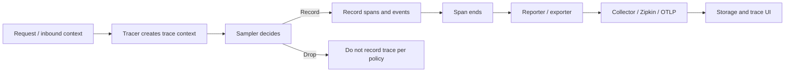
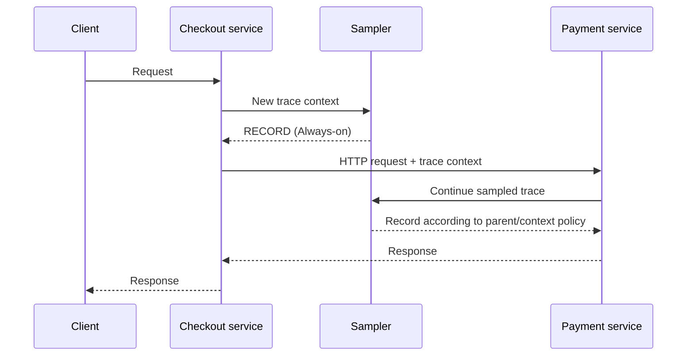
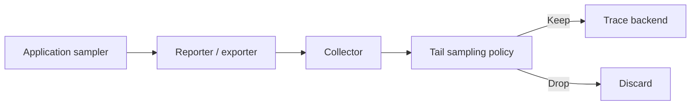

# Always-On Sampler in Distributed Tracing

A Spring Boot service is investigating a rare timeout error. The metrics dashboard shows a slight increase in the error rate, yet the operations team cannot find a trace for the failed requests. A quick way to rule out the possibility that sampling dropped the trace is to temporarily use an **Always-on sampler**: choosing to record every eligible trace from the start. In low-traffic test environments, this is also a simple way to verify instrumentation, context propagation, and exporters.

However, **an Always-on sampler does not guarantee that all telemetry is stored in the backend**. It only changes the sampling decision at the tracer layer; spans may still fail to finish properly, the reporter/exporter can fail, the collector can drop data, or the backend may fail to retain the trace. In production, selecting every trace can also substantially increase CPU, network, queue memory, and storage usage.

This lesson belongs to the **Sampling** chapter of the **SPRING_BOOT_OBSERVABILITY** module. The module teaches how to set up observability for Spring Boot using Micrometer Observation, metrics, logs, and distributed tracing; covering context propagation, tags/cardinality, exporters, sampling, and correlating signals to investigate errors, latency, and real application behavior. This lesson explains the meaning, configuration, limitations, and operation of the **Always-on sampler** in a tracing system.

## Learning Objectives

After this lesson, you will be able to:

1. Explain how the Always-on sampler selects traces and distinguish sampling from span recording, propagation, reporting, and storage.
2. Understand head-based sampling and the impact of a root-span sampling decision on downstream services.
3. Configure sampling probability via Spring Boot and recognize how to configure Brave or OpenTelemetry samplers directly.
4. Use Always-on in controlled tests/labs to verify a trace path.
5. Evaluate the cost of selecting every trace in high-traffic environments.
6. Distinguish "sampled" from "successfully exported" and "stored by the backend".
7. Combine traces with metrics, logs, cardinality, and privacy controls to investigate incidents.
8. Design an appropriate, bounded, and observable production sampling policy.

## 1. Where Does Sampling Fit in the Tracing Pipeline?

A single request can create many spans as it passes through a controller, service, HTTP client, database, and message broker. If every request generates and exports every span, the system can produce huge data volumes. **Sampling** is the mechanism for selecting a subset of traces to record/export according to a policy.



The Always-on sampler picks the **Record** branch for every eligible trace under the sampler policy at the decision point. It does not by itself guarantee that all subsequent steps succeed.

Five concepts need to be separated:

| Concept | Question | Example |
|---|---|---|
| **Sampling decision** | Is the trace selected to be recorded? | Always-on selects every trace |
| **Recording** | Are span attributes/events recorded during execution? | Tracer records the span lifecycle |
| **Propagation** | Is context passed across boundaries? | HTTP client injects traceparent/B3 |
| **Export/reporting** | Are finished spans sent out? | Zipkin reporter or OTLP exporter |
| **Ingestion/storage** | Does the backend receive, store, and make data queryable? | Collector and trace database |

A test can confirm the sampler selected a trace without proving the exporter sent it. An HTTP request carrying trace context also does not prove downstream recorded the same trace. These are independent layers.

## 2. What Is an Always-On Sampler?

An **Always-on sampler** is a sampling policy that always chooses to record traces rather than selecting only a small probability. Depending on the tracing implementation, the API name may be:

- Brave: **Sampler.ALWAYS_SAMPLE**.
- OpenTelemetry SDK: **Sampler.alwaysOn()**.
- Spring Boot/Micrometer Tracing: probability can be configured via **management.tracing.sampling.probability: 1.0** in versions supporting this property.

All of these examples express the same idea of "selecting all traces at the head-sampling point," but they are **not the same API** and should not be mixed in the same application without a clear tracer implementation design.

### 2.1. "Always-On" Refers to the Sampling Decision

When a new trace arrives and the sampler is asked for a decision, Always-on returns the record/sample choice. In a head-based sampling model, the decision typically occurs early when the trace is initialized or when inbound context is processed.

This means:

- Eligible new root traces will be selected for recording.
- The decision can be propagated to subsequent services via trace flags/B3 sampled flag.
- Instrumented spans in the trace have the opportunity to be recorded and exported.
- Uninstrumented code will still not automatically generate spans.
- The exporter/backend can still lose data after the sampler selects it.

**Always-on does not instrument unsupported libraries**, does not fix context propagation, and does not turn a metric into a trace.

### 2.2. Not Equivalent to "Always Having a Trace for Every Request"

A request may still lack a visible trace even when the sampler is configured to always select:

- The request does not pass through instrumentation that creates a span.
- Inbound context or the tracing handler is misconfigured.
- A span is never finished due to a lifecycle bug.
- The reporter/exporter encounters an error or its queue is full.
- The collector rejects the payload or loses connectivity.
- Backend retention expires, fails to store, or the query uses the wrong time range/service.
- A downstream service does not support the propagator or does not receive context.
- Another sampler at the collector/backend tier filters the data further.

Therefore, the accurate statement is that **the sampler at the configured layer selects every trace presented to it**, not that "the system guarantees storing every request."

## 3. Head-Based Sampling and the Always-On Decision

Head-based sampling decides early, usually before the full processing outcome is known. It has the advantage of cutting cost right at the start when a trace is not selected, but it lacks full information about final errors or latency.



In a parent-based model, child services typically respect the sampling decision already present on the parent. Exact behavior depends on the tracer, propagator, and configuration. If a gateway strips headers or downstream fails to extract properly, the trace can split or receive a different decision.

### 3.1. Comparing Always-On with 10% Probability

| Characteristic | Always-on | Probability 10% |
|---|---|---|
| Decision for eligible new traces | Record all | Select according to configured probability |
| Ease of testing instrumentation | High, no need to wait for random samples | May require multiple runs |
| Ability to keep rare traces | Better at this sampler layer | May drop rare traces |
| Input span volume | Can approach all instrumented traffic | Usually much lower |
| Reporter/backend cost | Highest of the two at equal traffic | Usually lower |
| Guarantees full backend storage? | No | No |
| Typical fit | Labs, tests, time-boxed debugging | Production when within budget |

Probability sampling does not necessarily produce exactly 10 traces in every small batch of 100 requests. It is an expected rate per the sampler mechanism and can vary over a short window due to randomness, parent-based decisions, filtering, and drops at other layers.

### 3.2. Sampling Does Not Alter Business Request Behavior

The sampler decides which tracing data is recorded. It should not change checkout processing results, HTTP responses, DB transactions, or retry logic. If enabling tracing alters business behavior, investigate side effects or instrumentation bugs; do not treat that as normal sampling semantics.

Independently instrumented metrics can continue measuring all requests even when the trace sampler selects only a subset. This is why stored trace counts must not be used as the sole denominator for service-wide SLIs.

## 4. Configuring Always-On via Spring Boot

In Spring Boot 3.x versions that support Micrometer Tracing sampling properties, the simplest configuration is usually setting probability to **1.0**:

```yaml
spring:
  application:
    name: checkout-service

management:
  tracing:
    sampling:
      probability: 1.0
```

**1.0** represents a 100% probability in the probabilistic sampling mechanism used by auto-configuration. Verify the running Spring Boot/Micrometer version and chosen tracer implementation. Do not apply this property blindly to every pipeline or custom sampler.

### 4.1. Configuring via a Lab Profile

You can create a dedicated profile configuration for labs:

```yaml
# application-tracing-lab.yml
management:
  tracing:
    sampling:
      probability: 1.0
```

Activate the profile via environment variables or Spring Boot launch arguments according to project conventions. This profile makes experimentation easy to observe, but guardrails are needed so it is not accidentally enabled in production.

Example:

```bash
java -jar app.jar --spring.profiles.active=tracing-lab
```

In CI integration tests, a dedicated test configuration can set 100% sampling when tests need to verify export. Do not share the lab profile across all environments.

### 4.2. When the Application Declares a Custom Sampler Bean

If the application supplies a sampler directly to the tracer or bridge, the custom bean may stop default auto-configuration from being the source of truth. In that case, changing **management.tracing.sampling.probability** alone may not produce the expected effect.

Verify:

1. Whether the actual tracer implementation is Brave or OpenTelemetry.
2. Whether a custom sampler bean/customizer is declared.
3. Which Spring Boot auto-configurations still apply.
4. Whether the sampler is injected into the tracer used on the request path.
5. Whether downstream inherits the sampling decision or has its own policy.

Do not create two competing samplers and do not assume properties override every custom implementation.

## 5. Configuring Directly by Tracer Implementation

The following examples show APIs at the implementation layer. Choose **one** matching the application's actual tracer.

### 5.1. Brave

Brave has an Always sample constant. Conceptual API example:

```java
import brave.sampler.Sampler;

Sampler sampler = Sampler.ALWAYS_SAMPLE;
```

In a Spring Boot application using the Micrometer Tracing Brave bridge, do not instantiate a standalone `Sampler` that is not wired into the auto-configured tracer. If direct configuration is truly required, use the extension point/bean supported by your Boot and bridge versions so the sampler is applied to the Brave tracing component actually used by requests.

**Do not configure both** Boot's probabilistic sampler and a custom Brave sampler without knowing which one is the final source of truth.

### 5.2. OpenTelemetry SDK

The OpenTelemetry SDK has an Always-on sampler:

```java
import io.opentelemetry.sdk.trace.samplers.Sampler;

Sampler sampler = Sampler.alwaysOn();
```

This is an OpenTelemetry SDK API. It is not configuration for the Brave bridge. If you use the Micrometer Tracing Brave bridge, the code above will not automatically change Brave's sampler.

### 5.3. Why Is It Necessary to Distinguish Them?

Micrometer Tracing provides a common abstraction so applications depend less on a specific implementation. However, the concrete sampler is part of the tracer SDK/implementation. Proper configuration must go through the right auto-configuration or extension point of the chosen implementation.

Before changing a sampler, inspect the dependency graph, bean wiring, and startup diagnostics of the exact application version. Do not mix Brave and OpenTelemetry classes in the same deployment example just because both have a `Sampler` API.

## 6. Impact of Always-On on Load and Cost

If an application handles 2,000 requests/second, each trace has an average of 8 spans, and all are sampled, the theoretical input volume is:

```text
2,000 traces/second × 8 spans/trace
= 16,000 spans/second
```

This is an illustrative calculation before accounting for extra messaging/DB spans or downstream sampling/drops. A trace can vary greatly in span count depending on instrumentation and fan-out.

Costs can appear in:

- **Application:** CPU for creating spans, serializing attributes/events, context bookkeeping.
- **Memory:** exporter queues/buffers, batch processors, and pending outbound data.
- **Network:** ingest requests/responses, retransmissions, TLS, and payload bandwidth.
- **Collector/reporter:** processing, batching, retries, queues, and backpressure.
- **Storage:** ingest rate, indexing, retention, and replication.
- **Query/UI:** indexing/searching across large data volumes.
- **Operations:** alerts, dashboards, and handling sensitive data.

### 6.1. Cost Does Not Scale Solely with Request Count

An endpoint calling 20 dependencies can produce far more spans than an endpoint running a single internal query. Large tracing attributes, stack/event payloads, exception details, and link counts also increase payload bytes.

Capacity forecasting should measure on real workloads:

1. Requests/second by endpoint group.
2. Average and p95 spans per trace.
3. Payload bytes/span and bytes/trace.
4. Success/error request rates and retry behavior.
5. Reporter/exporter queues, drops, and retries.
6. Backend ingest/storage/indexing throughput.
7. Retention and replication factor.

### 6.2. Rough Estimation Example

Suppose there are 500 requests/second, an average of 10 spans/trace, and an average of 1.2 KB/span:

```text
500 × 10 × 1.2 KB
= 6,000 KB/s
≈ 6 MB/s
≈ 518 GB/day (decimal, before compression/overhead)
```

This is only a rough calculation, not an accurate storage forecast. Compression, protocol overhead, indexing, replication, attribute sizes, retries, and retention alter actual figures considerably. Still, it shows Always-on can generate large volumes even when request rates look modest.

## 7. Always-On in Tests and CI

Always-on is very useful when you want to test tracing deterministically:

- No need to run tests repeatedly hoping a trace gets sampled.
- Easy to verify parent/child spans and propagation between two services.
- Can confirm the exporter/backend receives the test trace.
- Helps separate instrumentation bugs from random sampling drops.

A test strategy:

1. Create a test profile with sampling probability 1.0 or a test sampler that selects all.
2. Use an in-memory test trace exporter/reporter if you only need to verify the span tree.
3. Use an isolated backend/container in a small number of integration tests that must verify real ingestion.
4. Send a request across two services.
5. Assert the trace ID is preserved, span IDs are distinct, and parent relationships make sense.
6. Verify error paths and async boundaries.
7. Shut down/clean up backends and executors after tests.

### 7.1. Do Not Assert Every Production Request Has a Trace

Tests run in a test environment with a deterministic sampler, whereas production may use probabilistic sampling or another policy. Do not write business tests that depend on the Zipkin UI having a trace for every request. Instead, test context propagation and export in dedicated tests; business logic tests should be independent of sampling.

### 7.2. Test Propagation Independently of Export

A test can verify:

- Workers receive the current trace context accurately.
- Outbound HTTP carries `traceparent` or B3 headers.
- Downstream creates a server span in the same trace.

These three assertions verify context/propagation. If the backend is empty, inspect the exporter separately. Do not lump them together into a single "Always-on is broken" error.

## 8. Always-On Does Not Replace Tail Sampling

Always-on is usually a head-sampling decision at the start of the trace. It chooses to record every trace at that point, without knowing whether the request will become slow or fail at the end.

**Tail sampling** is a strategy that waits until more spans/data for the trace arrive before deciding which traces to keep, for example:

- Keep all traces containing an error.
- Keep traces whose duration exceeds a threshold.
- Keep a percentage of normal traces.
- Keep traces for a critical service/operation.

Tail sampling typically requires a collector capable of buffering spans by trace, sufficient memory, and timeout/decision-wait settings. Simply setting probability 1.0 in the application does not mean you have tail sampling.

### 8.1. Why Can't You Drop Early and Keep at the Tail?

If a head sampler refuses to record/export spans, the collector may never receive enough data to evaluate that trace. For tail sampling to make decisions across the full trace, the upstream pipeline must forward the necessary spans to the collector, or use an appropriate recording/transport mechanism. This can keep volume flowing to the collector high even if the final backend stores only a subset.

### 8.2. A Pipeline Can Have Multiple Sampling Layers



For example, the application always records while the collector only keeps error or slow traces. This policy can be useful, but load must be planned at steps B/C: **storing little in the backend does not mean the application and collector process little**.

## 9. Parent-Based Sampling and Propagation Flags

In distributed tracing, an upstream request can carry a sampling decision. A parent-based sampler typically inherits that decision so traces stay consistent across services.

With W3C Trace Context, `traceparent` carries trace flags. With B3, there are sampled/debug indicators. These values are propagation data, not credentials.

Scenarios to consider:

- The root service chooses Always-on; should downstream inherit it?
- Upstream is not sampled, yet does downstream have a mandatory policy to retain its own trace?
- Does the gateway rewrite or drop headers?
- Could an external request send a sampled flag itself to force the system into generating high trace volume?
- What trust boundaries and policies does the organization have for inbound sampling flags?

**Do not blindly trust sampling flags from the Internet.** Samplers may respect parent decisions depending on the implementation; if inputs are untrusted, design a trust policy or create a new root context at the appropriate boundary. Prevent arbitrary clients from forcing the application to record full trace payloads just by setting a header.

## 10. Privacy, Cardinality, and Data Protection

Always-on increases the number of recorded spans; consequently, any inappropriate information in attributes/events/baggage is likely to be collected more frequently.

Never put into spans:

- `Authorization` headers, cookies, API keys, access tokens.
- Payment card numbers, credentials, or secrets.
- Emails, phone numbers, addresses, or PII without proper basis and controls.
- Sensitive raw request/response bodies.
- Query strings containing tokens or user data.

Span names should be stable, such as **checkout.payment.authorize**, without embedding order IDs or user IDs in the name. Attributes should follow allowlists and semantic conventions; high-cardinality data must have a clear purpose, access control, and retention policy.

### 10.1. Trace ID Is Not a Metric Label

When Always-on creates many traces, trace ID remains a high-cardinality identifier. Do not add trace ID to metric tags to link metrics and traces. Use log correlation or exemplars when supported by the backend.

Metrics should measure all traffic appropriate for SLIs. If trace sampling drops to 10%, the trace count in the backend must not be used as the denominator for checkout error rates.

### 10.2. Access Control

Trace data can reveal routes, service names, dependencies, exceptions, and partial request metadata. Establish:

- Trace read permissions by operations team.
- TLS/authentication between applications, collectors, and backends.
- Redaction at instrumentation or collector layers.
- Retention aligned with investigation needs.
- Access auditing and data deletion policies.
- Limits on attribute count/size and payloads.

Always-on should only be enabled where data policies and budgets permit.

## 11. Metrics and Logs Remain Essential When Using Always-On

Even at 100% sampling, traces do not replace metrics/logs:

| Signal | Key question |
|---|---|
| Metrics | How many requests failed? How did p95/p99 change across all traffic? |
| Logs | Which error occurred, and what message/stack trace and business decision were recorded? |
| Traces | Which services and dependencies did a sampled/kept request traverse, and how long did each span take? |

If Always-on gives the trace backend enough data during a debugging window, use traces to locate slow dependencies or instrumentation gaps. Use metrics to quantify impact across all requests. Logs help inspect specific exceptions/retries, especially when traces are not ingested due to exporter failures.

A log with a trace ID does not guarantee the span was stored; conversely, the backend having a trace while log correlation is missing can also happen. All three pipelines must be operated and verified independently.

## 12. Diagnostics: Always-On Is Enabled Yet Traces Are Still Missing

| Symptom | Possible cause | How to check |
|---|---|---|
| No traces at all | Tracer/bridge not configured or no instrumentation | Check ObservationRegistry, tracing handler, dependencies, and startup config |
| Traces only in the first service | Downstream does not receive context or does not export | Check client injection, server extraction, propagator, and reporter |
| Trace exists but child spans are missing | Uninstrumented code, lost async context, or wrong span lifecycle | Inspect each boundary/thread and instrumentations |
| Trace ID in logs but backend is empty | Exporter/reporter/collector/storage failure | Check exporter logs/metrics, ingestion status, and retention |
| Traces appear delayed | Reporter/collector batching and async ingestion | Check queue/batch/flush behavior |
| Many traces but dashboard load spikes | Always-on volume exceeds capacity | Measure spans/trace, payload size, ingest rate, and storage |
| Downstream has a different trace ID | Header dropped or incompatible propagator | Verify B3/W3C headers and extraction on both ends |
| Traces still dropped despite app Always-on | Collector/backend has another sampling/drop policy | Check pipeline sampling and filters at each tier |
| A client forces sampled flag | Inbound context trusted across wrong boundary | Review trust policy for inbound trace headers |

### Ordered Troubleshooting Workflow

1. Confirm the sampler is actually applied to the running tracer and not overridden by a custom bean.
2. Generate a test request with known instrumentation.
3. Observe the current trace context and span lifecycle in the first service.
4. Inspect outbound trace headers and context in the next service.
5. Confirm spans end and the reporter executes a send.
6. Check responses from Zipkin/collector or OTLP exporter status.
7. Search for the trace by matching ID/service/time window.
8. Cross-check filter/tail sampling/retention policies in the backend.
9. Check metrics and logs to determine actual impact.

Do not set probability to 1.0 again if the sampler is already selecting everything. Find the exact stage where data is lost.

## 13. Real-World Scenario: Enabling Always-On to Investigate a Rare Timeout

A checkout service processes 700 requests/second. Payment timeout rate is about 0.05%, corresponding to a few errors per minute. At 5% sampling, the operations team occasionally lacks a trace for failed requests. They consider enabling Always-on.

### Assessment Before Enabling

**Step 1 — Quantify volume.** Estimate spans/trace, bytes/span, spans/second, and daily storage. 700 requests/second can generate several thousand spans/second if each request calls multiple dependencies.

**Step 2 — Check capacity.** Confirm reporter queues, collector throughput, backend ingest/indexing, and storage have headroom. Determine the retention window needed for the investigation.

**Step 3 — Privacy review.** Confirm attributes do not contain payment credentials or sensitive request bodies. Verify access control and retention.

**Step 4 — Limit scope and duration.** If possible, apply Always-on in staging, to a controlled service/route, or for an operationally approved debug window. Do not turn it on system-wide indefinitely just for a rare error.

### During Investigation

- Monitor reporter/collector queues, drops, errors, and latency.
- Compare displayed trace rate with request counts from metrics.
- Grab several timeout traces and inspect payment client/server child spans.
- Use logs with the same trace ID to examine retries, timeout policies, and provider responses.
- Identify root causes by comparing with successful traces and dependency metrics.

### After Investigation

1. Restore the production-appropriate sampling policy.
2. Verify the effective config across every instance/pod.
3. Confirm throughput/exporter/storage return to expected levels.
4. Review stored trace data against retention and privacy policies.
5. Turn findings into low-cardinality metrics/alerts, such as error rate and latency by dependency/route.
6. Keep only spans/attributes genuinely needed for future investigations.

**Scenario conclusion:** Always-on can help capture a rare trace during debugging, but sustainable operations rely on metrics for detection/quantification, intentional tracing policies for keeping the right data, and logs to explain events.

## 14. Anti-Patterns to Avoid

| Anti-pattern | Consequence | Recommended practice |
|---|---|---|
| Keeping Always-on permanently under high traffic without capacity planning | Overloads application, collector, and storage | Measure volume and choose a budgeted sampling policy |
| Assuming probability 1.0 guarantees full backend storage | Overlooks exporter/collector/backend drops | Monitor the entire pipeline |
| Setting property while another custom Sampler bean exists | Expected config does not affect the active tracer | Inspect actual beans and auto-configuration |
| Mixing Brave and OpenTelemetry Sampler APIs | Configures the wrong implementation | Pick one tracer implementation and configure its extension point |
| Using trace count to compute service error rate | Sampling bias and export drops skew the denominator | Use independently instrumented metrics |
| Trusting every inbound sampled flag | External clients can inflate trace volume | Design trust boundaries and sampler policies |
| Treating Always-on as tail sampling | Selects traces before knowing the final outcome | Use a collector tail policy if post-hoc decisions are needed |
| Attaching traceId to metric tags | Cardinality explosion | Use exemplars/log correlation |
| Putting tokens/PII in spans because "debugging needs everything" | Data leaks through the trace pipeline | Allowlists, redaction, access control |
| Only testing by checking if a trace shows up in UI | Unclear whether failure is in context, sampling, or backend | Test each layer independently |
| Using Always-on in every CI test | Unnecessary time/storage overhead | Test deterministic samplers and in-memory/test exporters |
| Only raising sampling when traces are missing | Problem may be propagation/export | Find the first point where data is lost |

## 15. Checklist for Safe Always-On Rollout

Before enabling the sampler in any environment:

1. **Purpose:** is this for testing, lab, incident debugging, or production policy?
2. **Implementation:** is the tracer using Brave or OpenTelemetry? Which sampler is actually injected?
3. **Auto-configuration:** is the Spring Boot property active or overridden by a custom Sampler bean?
4. **Head/parent semantics:** is the root trace decision properly inherited downstream?
5. **Propagation:** are B3/W3C headers injected/extracted across all required services?
6. **Instrumentation:** are expected spans actually created; are async lifecycles/contexts accurate?
7. **Exporter:** is the reporter/OTLP exporter working, and are queues/flushes/retries monitored?
8. **Backend:** is ingest/storage/query capacity sufficient for Always-on volume?
9. **Cardinality:** are span names and attributes stable, with no trace ID metric labels?
10. **Privacy:** are payloads, headers, baggage, exceptions, and PII allowlisted/redacted?
11. **Security:** are TLS/authentication, access control, retention, and auditing ready?
12. **Metrics:** do SLIs/error rates/latencies keep measuring full traffic independently of trace sampling?
13. **Operational guardrails:** are scope, duration, owner, and disable conditions defined?
14. **Verification:** are there cross-service test traces and separate tests for export/collector?
15. **Rollback:** is the original production sampling policy saved for immediate restoration after debugging?

## 16. Self-Assessment Questions

**Question 1.** What does the Always-on sampler do?

**Hint:** It selects all eligible traces for recording at the sampler layer where it is applied; it does not guarantee the exporter/backend stores every span.

**Question 2.** Does setting probability to 1.0 automatically create spans for every Java method?

**Hint:** No. Sampling only decides on traces/spans initialized by the tracer/instrumentation; uninstrumented methods do not automatically create spans.

**Question 3.** The app uses Always-on, yet Zipkin shows no traces. What should be checked?

**Hint:** Tracer/bridge, instrumentation, span completion, reporter, endpoint, network, collector, backend, retention, and query; do not check probability alone.

**Question 4.** Why use Always-on in labs while carefully evaluating it for production?

**Hint:** Labs have low load and benefit from easy-to-see traces; production has much higher volume, network/storage costs, privacy concerns, and capacity limits.

**Question 5.** Does 10% sampling mean exactly 10 out of every 100 requests will appear?

**Hint:** No. It is an expected rate per the sampler mechanism, not an exact guarantee per small window; it is also affected by parent decisions and pipeline drops.

**Question 6.** Does Always-on in the application equal tail sampling?

**Hint:** No. Always-on is typically a head decision; tail sampling decides after the collector receives enough trace data.

**Question 7.** Should span counts in the backend be used to calculate service-wide error rates?

**Hint:** No. Sampling/export/retention make the trace set non-representative. Use metrics with a clear request/transaction denominator.

**Question 8.** Should an inbound request sending `sampled=1` be trusted unconditionally?

**Hint:** No. Trace headers are untrusted data from external boundaries; appropriate policies are needed to avoid forced telemetry recording and cost spikes.

**Question 9.** Why shouldn't trace ID be a metric label when Always-on is enabled?

**Hint:** Each trace typically has a unique ID, causing time series counts to grow with traffic and yielding very high cardinality. Use correlation/exemplars.

**Question 10.** To use Always-on for testing an exporter, what assertions are needed beyond current trace context?

**Hint:** Verify the span ended, the reporter/exporter sent it, and the collector/backend received and made the test trace queryable by ID.

## Conclusion

**The Always-on sampler chooses to record every eligible trace at the configured sampling point**, making it very useful for labs, CI, and time-boxed investigations. In Spring Boot, you can configure probability `1.0` on supported versions, or use the Always-on API of your exact tracer implementation such as Brave or OpenTelemetry. This decision does not replace instrumentation, context propagation, span lifecycle, reporter/exporter, and backend storage; each layer must be verified independently. Before using it in production, estimate spans/second, payload sizes, collector/storage capacity, privacy, and retention, while keeping metrics and logs as independent signals to quantify service-wide impact.
