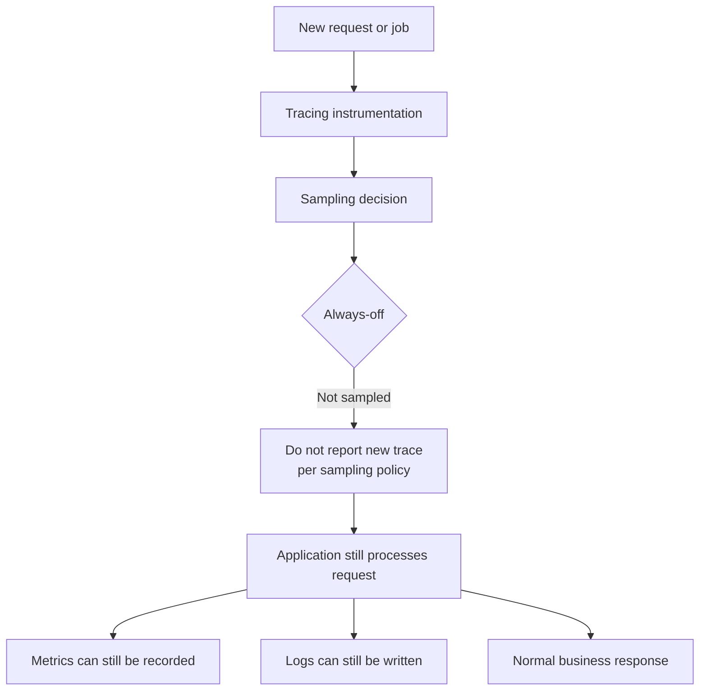
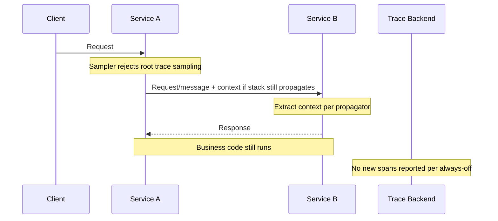
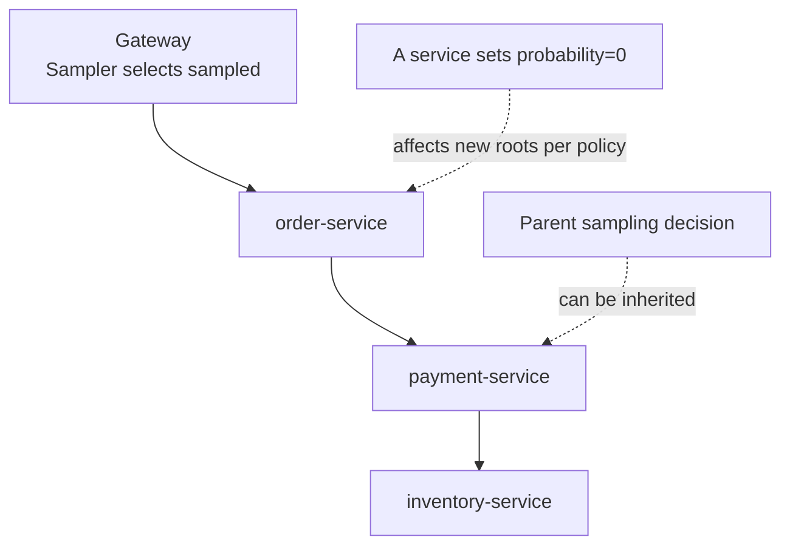

# Always-Off Sampler in Spring Boot

A Spring Boot application already has distributed tracing integrated, yet a test environment is not allowed to send spans to the backend, or a service needs to pause recording traces temporarily while metrics and logs still support operations. One way to express that sampling policy is an **always-off sampler**: every eligible new trace presented for a sampling decision is rejected.

In Micrometer Tracing, sampling decides which traces are recorded and reported according to the tracer's policy. **Always-off** is a policy that selects no new traces for storage/export. This does not mean the application stops producing metrics, stops writing logs, or automatically erases all trace context arriving from upstream.

The **Always-off sampler** lesson belongs to the **Sampling** chapter of the **SPRING_BOOT_OBSERVABILITY** module. The module focuses on setting up observability for Spring Boot using Micrometer Observation, metrics, logs, and distributed tracing; learning context propagation, tags/cardinality, exporters, sampling, and signal correlation to investigate errors, latency, and application behavior in production environments.

## 1. Learning Objectives

After this lesson, you will be able to:

- Explain the meaning of the always-off sampler and distinguish it from disabling all tracing instrumentation.
- Configure a sampling probability of 0 in Spring Boot when using compatible auto-configuration.
- Understand the sampler's role at the root trace decision point and the influence of a sampling decision inherited from a parent.
- Distinguish recording/exporting spans from propagating trace context.
- Identify separate impacts on metrics, logs/MDC, baggage, and distributed traces.
- Choose appropriate use cases and evaluate risks when disabling tracing in production.
- Verify the policy across logs, trace backends, headers, and metrics rather than relying on a single signal.
- Avoid configuring multiple samplers or building separate tracers that conflict with Spring Boot.

## 2. What Does Sampling Do?

Distributed tracing creates spans to describe the steps of a request or job. In high-request systems, recording and storing every trace can increase CPU, network, storage, indexing, and query costs. **Sampling** is the mechanism for selecting the set of traces to record/report under a policy.

| Policy | General meaning | Purpose |
| --- | --- | --- |
| Always-on | Select every new trace per policy | Small-environment debugging or full visibility under low load |
| Probability-based | Select by probability | Balance coverage and cost |
| Always-off | Select no new traces at the sampler's decision point | Pause trace recording/export per policy |
| Rate-limited | Cap the number of selected traces per interval | Control load under traffic |
| Custom/conditional | Select by attribute or rule | Prioritize certain routes, errors, or request groups |

Always-off is the highest-level rejection policy. It can fit local environments without a tracing backend, tests verifying the system still works without storing traces, or an approved temporary policy.

### A Sampler Is Not an Exporter

| Component | Question answered |
| --- | --- |
| Sampler | Which traces are selected for recording/reporting? |
| Tracing bridge | How is the Micrometer API wired to Brave or another implementation? |
| Reporter/exporter | By what mechanism are recorded spans sent out? |
| Backend | How are received traces stored and displayed? |
| Propagator | How is context injected/extracted over HTTP or message headers? |

If the exporter hits a network error, a trace may have been sampled yet never reach the backend. If the sampler is always-off, new traces will not be reported even when the exporter works fine. The two situations require different diagnostics.

## 3. What Does Always-Off Mean?

For a **new root trace** requiring a sampling decision, always-off returns a not-sampled decision. Depending on the active tracing stack, the corresponding spans are typically neither recorded nor reported to the tracing backend.



Always-off **is not an application circuit breaker**. It does not decide whether a request is allowed or rejected, does not stop controllers/services, does not disable business logic, and does not replace security policies.

### Not Sampled Does Not Mean Trace Context Vanishes

Trace context can carry a trace ID and sampling flags. When upstream has already sent context, a downstream service can extract that context to preserve trace relationships, even if the local policy does not select new traces.

Therefore, distinguish:

- **Not sampled:** the trace was not selected for recording/reporting by the sampling decision.
- **No context:** the request/message carried no valid trace context or context was not extracted.
- **Export failed:** spans were recorded, but the reporter/exporter/network/backend failed.

These states are not equivalent. A log may still contain a trace ID while the tracing backend stores no trace. Conversely, if context does not reach a service, logs may lack a trace ID even though the application has a tracing bridge.

## 4. Configuring Spring Boot with Probability Zero

With Spring Boot 3.x configured with Micrometer Tracing and compatible sampling auto-configuration, you can set the sampling probability to 0:

```yaml
spring:
  application:
    name: order-service

management:
  tracing:
    sampling:
      probability: 0.0
```

The value **0.0** is a zero probability of selecting new traces in the probabilistic sampler configured by Spring Boot. This is the common way to declare a default policy rejecting new root traces under the stack's probability-based mechanism.

### Configuring by Profile

Example turning off sampling locally:

```yaml
management:
  tracing:
    sampling:
      probability: 0.0
```

Another profile can set a probability aligned with observability goals, such as:

```yaml
management:
  tracing:
    sampling:
      probability: 0.1
```

Do not treat **0.1** as a universal production standard. The right rate depends on traffic, span size, retention, backend cost, investigation needs, and data policies. Manage properties per environment and verify the **final effective configuration** after profiles, environment variables, and deployment overrides are applied.

### What Is the Scope of Probability Zero?

This property controls the sampling probability Spring Boot configures for the corresponding tracing stack. It does not:

- Delete previously stored traces from the backend.
- Prevent every log record from containing a trace ID.
- Strip baggage or all propagation headers.
- Disable Micrometer metrics.
- Disable the Observation lifecycle.
- Guarantee that a downstream trace with a sampled parent is flipped to unsampled in every tracer/bridge.

Under policies with parent-based behavior, a sampling decision propagated from upstream may be inherited rather than recomputed as an independent root. Check the semantics of the running bridge and propagation configuration.

## 5. Always-Off in Brave

When using Micrometer Tracing with the Brave bridge, Brave provides a sampler to decide whether to sample a trace. The Brave API includes the **Sampler.NEVER_SAMPLE** constant for a policy that selects no new traces under that sampler.

Example using Brave directly in an application managing Tracing manually:

```java
import brave.Tracing;
import brave.sampler.Sampler;

public class StandaloneBraveConfiguration {
    public Tracing createTracing() {
        return Tracing.newBuilder()
            .localServiceName("order-service")
            .sampler(Sampler.NEVER_SAMPLE)
            .build();
    }
}
```

This is a **standalone Brave** example illustrating the sampler API. Do not instantiate a second `Tracing` instance alongside the tracer managed by Spring Boot/Micrometer auto-configuration. In Spring Boot, prefer Boot's sampling property or a bean override mechanism documented for your exact version.

### Be Careful with Already-Sampled Parents

In a distributed trace, child spans generally need to respect the sampling decision passed by upstream via context so a trace is not inconsistently split into sampled and unsampled fragments. A sampler deciding not to select **new root traces** does not automatically mean a downstream service may arbitrarily override the parent trace's sampling flag.

Example:

1. A request enters the gateway and is selected as sampled by the gateway's sampler.
2. The gateway injects trace context with a sampled decision into HTTP headers.
3. `order-service` extracts context and creates a child span.
4. How Brave/Micrometer handles parent context determines whether the child span inherits the parent sampling decision; do not infer it from a single probability property alone.

If the requirement is **never record any span from this service**, including spans belonging to an already-sampled parent trace, setting probability 0 alone may not suffice. Evaluate parent-context policy and the recording/exporter behavior of your running version. Do not modify propagation or strip headers arbitrarily, as that can break cross-service correlation.

### Do Not Run Two Bridges Simultaneously to Force Sampling

If the application uses Brave, use the Brave bridge. If it uses OpenTelemetry, use the OpenTelemetry bridge. Adding both and creating separate tracers, samplers, and exporters easily leads to duplicate beans, inconsistent context, and difficulty determining which policy is in effect.

## 6. Propagation Differs from Recording

This is an essential point when operating always-off. Trace context can still be passed across services without implying spans were recorded and exported.



### Four Separate Questions

| Question | Component to inspect |
| --- | --- |
| Is there inbound trace context? | HTTP/message headers, propagator, extraction |
| Which sampling decision applies? | Sampler and parent context |
| Is the span recorded? | Tracing implementation, recording lifecycle |
| Does the span reach the backend? | Reporter/exporter, network, auth, ingestion |

Do not use the answer to one question to answer all four. A missing trace in the backend could be due to sampling, exporter errors, or ingestion delay.

### Should Propagation Headers Be Stripped Under Always-Off?

Not automatically. Stripping headers can break downstream's ability to correlate with upstream, fragment traces, and reduce investigation effectiveness in other services that have their own sampling. If organizational policy forbids passing tracing metadata across a trust boundary, implement it intentionally as a gateway/egress policy after assessing its impact on overall tracing.

Always-off is a **sampling decision**, not a header filtering policy or comprehensive data protection control.

## 7. Do Metrics and Logs Still Work?

Trace sampling and metric recording are two separate pipelines. When the tracing sampler does not select a trace, meters managed by Micrometer can still record measurements.

| Signal | Typical impact of always-off | What to check |
| --- | --- | --- |
| Counter/Timer/Gauge | Still work if registry and metrics instrumentation are enabled | Actuator metrics, exporter, and backend |
| Observation lifecycle | Observations can still start/stop | Which handlers are registered? |
| Metrics from Observation | Meter handler can continue recording metrics | Does sampling policy apply only to the tracing handler? |
| Trace spans | New traces rejected from recording/reporting per policy | Parent-based behavior and bridge |
| Logs | Logger still works | MDC, logging level, and pipeline |
| Trace ID in logs | May still exist if context is propagated/integrated | Do not infer the trace was exported |
| Baggage | May continue per context and remote propagation config | Allowlist, privacy, and header propagation |

### One Observation Can Produce Multiple Signals

An Observation can be processed by multiple `ObservationHandler`s: the metrics handler and tracing handler have distinct responsibilities. An always-off tracing sampler does not disable the meter handler by default. Thus, Timers/Counters can keep incrementing while the tracing backend has no matching spans.

If you want to disable **all tracing instrumentation**, that is a different decision from merely rejecting sampling. Clarify the goal:

- Do not store new traces while keeping metrics/logging: choose a sampling policy.
- Do not create or register tracing instrumentation: configure tracing integration per your version, considering impacts on context/log correlation.
- Do not send tracing metadata outside a boundary: apply a dedicated propagation/egress policy.

Do not conflate all three goals into a single `probability: 0` property.

## 8. Always-Off Use Cases

| Use case | Why it can fit? | Risks to note |
| --- | --- | --- |
| Local environment without a trace backend | Avoid unnecessary/failed trace exports | Lose traces for debugging if needed |
| Independent metrics testing | Confirm metrics do not depend on trace sampling | Must test trace paths separately in another test |
| Environment temporarily restricted from storing traces | Reduce emitted trace data during an approved window | May lose incident evidence |
| Workload that does not need tracing per policy | Reduce overhead/reporting | Must prove metrics/logs suffice for operations |
| Fallback testing when telemetry backend is down | Confirm business paths do not depend on the trace backend | Do not confuse export failures with sampler behavior |

### Do Not Use Always-Off by Default Across All Production

If all traces are disabled, operations teams struggle to identify which dependency causes latency, which services a request traversed, and where exceptions originated. Metrics show rising error rates and logs show exceptions, but missing traces diminish the ability to reconstruct a request's path in a multi-service architecture.

If cost is the reason, consider probability-based, rate-limited, tail-based (if the collector/backend supports it), or policies retaining a subset of errors/high latency. Those mechanisms require explicit design and do not happen automatically just by using Micrometer Tracing.

## 9. Verifying Always-Off in Spring Boot

Verify from at least two angles: **whether spans are stored/exported** and **how other signals continue to work**.

### 9.1. Inspect the Effective Configuration

Check active profile and environment values:

```yaml
management:
  tracing:
    sampling:
      probability: 0.0
```

Check whether environment variables, command-line arguments, a config server, or profile overrides alter this property. If tracing is customized via a sampler bean, identify which bean auto-configuration actually uses.

Do not expose sensitive configuration endpoints or environment details publicly just to debug sampling.

### 9.2. Send a Test Request

Trigger an instrumented request, then check:

1. Whether the business response is returned per application logic.
2. Whether Counter/Timer metrics record measurements.
3. Whether logs are emitted; trace ID may or may not appear depending on propagation/context.
4. Whether the trace backend receives new spans after the normal reporter/ingestion interval.
5. Whether exporter/reporter logs report network/auth errors.

"No traces in the backend" is only consistent evidence for always-off once you have confirmed the endpoint/backend is healthy and no sampled parent context is influencing it.

### 9.3. Use Actuator Metrics to Verify the Independent Pipeline

If the endpoints are exposed:

```http
GET /actuator/metrics
GET /actuator/metrics/http.server.requests
GET /actuator/metrics/process.uptime
```

Meters can keep returning measurements even while tracing records no new traces. Meter names vary by version and instrumentation; these are common examples, not a guaranteed list for every application.

### 9.4. Verification Matrix

| Case | Sampling/config | Expected result |
| --- | --- | --- |
| A — New root | Probability 0.0, no parent | No new trace is selected for reporting |
| B — Metrics | Same request as A | Counter/Timer still increment if metrics handler/registry enabled |
| C — Logs | Same request as A | Logs still written per logging configuration |
| D — Inbound unsampled context | Receives unsampled context | Context may continue propagating per tracer |
| E — Inbound sampled parent | Receives sampled context | Child span depends on bridge's parent-based semantics; must verify |
| F — Exporter failure | Sampling allows trace but endpoint unreachable | No backend trace due to export failure, unlike always-off |
| G — Sampling re-enabled | Non-zero probability in test profile | New traces visible once config takes effect |

### Why Not Count Traces Using a Request Counter?

To compare request counts with stored trace counts, you need to know the sampling policy and reporter success rate. HTTP Timers/Counters count requests per metrics instrumentation; the trace backend only holds the subset sampled and successfully exported. A gap between the two numbers **does not by itself prove data loss**.

## 10. Parent-Based Behavior and Multiple Services

A request can start at a sampled gateway and pass through downstream services. If a downstream service configures always-off yet respects upstream sampling decisions passed via context, child trace behavior depends on the implementation/policy. Therefore, distinguish **turning off sampling for new roots in a service** from **recording zero spans in that service**.



This is a conceptual diagram, not a guarantee that every bridge/config uses the same parent-based algorithm. Check the tracing implementation, how the sampler is auto-configured, incoming sampling flags, custom samplers/handlers, and reporter filters.

If the requirement is "service X must never store traces under any circumstances," clarify that against trace continuity requirements of other services. You may need a collector/backend policy, accepting that traces will lack spans for that segment rather than stripping headers to hide the issue.

## 11. Security and Governance

Always-off can reduce newly exported trace data, but it is not a mechanism for erasing historical data or replacing data governance.

| Concern | What to do |
| --- | --- |
| Existing old traces | Use backend retention/deletion policies through approved workflows |
| Inbound baggage/headers | Still validate, allowlist, and limit size |
| Log correlation | Identify which logs still hold IDs/PII and their corresponding retention |
| Metrics labels | Continue managing cardinality; trace sampling does not make metric tags safer |
| Exporter credentials | Manage secrets and network security even while sampling is paused |
| Compliance policy | Define data that must never be collected; do not rely solely on the sampler |

If the reason for disabling tracing is sensitive data, audit metrics, logs, baggage, headers, and the trace backend too. A field omitted from a span can still leak into logs or metric tags if other instrumentation records it.

## 12. Common Configuration Mistakes

| Mistake | Symptom | How to fix |
| --- | --- | --- |
| Wrong property prefix | Sampling remains non-zero | Check exact `management.tracing.sampling.probability` and version |
| Another profile overrides probability | Local is 0 but deployment still samples | Inspect effective configuration of the process |
| Assuming probability 0 disables metrics | Actuator lacks expected data or misdiagnosis | Check metrics handler/registry separately |
| Assuming probability 0 strips trace context | Downstream loses or keeps correlation unexpectedly | Distinguish sampling from propagation |
| Parent sampled yet expecting child always off | Still seeing some downstream spans | Verify parent-based behavior |
| Broken reporter blamed on sampler | Export error logs despite non-zero probability | Check network/auth/endpoint |
| Creating a separate Brave Tracing instance in Spring Boot | Multiple tracers/samplers, bean conflicts, or split traces | Use the auto-configured Micrometer Tracer |
| Enabling both Brave and OTel bridges | Unpredictable context/export behavior | Choose one tracing implementation |
| Turning off sampler and wiping all log correlation | Loss of complementary investigation capability | Manage MDC independently per policy |
| Assuming always-off deletes old data | Backend still shows earlier traces | Use retention/deletion workflows |
| Turning on 100% sampling for testing and forgetting to revert | Production trace volume and costs surge | Manage profiles and deployment overrides |

## 13. Lab: Verifying the Always-Off Sampler

**Context:** a Spring Boot application has HTTP metrics, Micrometer Tracing with the Brave bridge, and a Zipkin reporter in a test environment. You need to verify that with sampling at 0, the business path and metrics still function, while determining whether trace context continues to propagate.

### Part A — Preparation

1. Choose a single tracing bridge and configure a valid test reporter/backend.
2. Enable Actuator metrics endpoints with appropriate protection.
3. Set `management.tracing.sampling.probability` to `0.0` in a test profile.
4. Create an HTTP endpoint with a meter/observation to test the business path.
5. Record the test timestamp and distinguish new data from old traces in the backend.

### Part B — Execution

| Case | Action | Question to verify |
| --- | --- | --- |
| A | Send a new root request | Is any new trace recorded/exported? |
| B | Read Actuator meter | Do HTTP Timer/Counter record measurements? |
| C | Read application logs | Are business logs emitted? |
| D | Send request with inbound unsampled context | Does downstream preserve context per policy? |
| E | Send request with sampled parent in test environment | What parent-based semantics govern child spans? |
| F | Pause Zipkin, enable sampling in test | Are reporter/export errors logged rather than sampler failures? |
| G | Restart backend | Does new data export once the reporter recovers? |

### Part C — Write Conclusions

Document the effective sampling config, implementation/bridge, results for each case, how context traveled over HTTP/messages, metrics/logs status, and evidence from the tracing backend. Clearly separate conclusions about sampling decisions, the exporter, and propagation.

### Self-Assessment Questions

1. What does the always-off sampler reject?
2. Why does probability 0 not mean all trace context is removed?
3. How do the responsibilities of sampler, propagator, and reporter differ?
4. If logs contain a trace ID yet Zipkin has no trace, what possibilities should be checked?
5. Why can metrics still be recorded when the tracing sampler does not select a trace?
6. When a parent is already sampled, why must a service with probability 0 still check parent-based behavior?
7. If the goal is to record zero spans from a service, why might changing sampling probability alone be insufficient?
8. Why does always-off not delete traces already stored in the backend?
9. When sampling is disabled for privacy, which other data pipelines still need evaluation?
10. Why shouldn't you create an extra Brave `Tracing` instance alongside Spring Boot auto-configuration?

## 14. Key Takeaways

**Always-off sampler** is a policy that declines to sample new traces at the sampling decision point. In Spring Boot using compatible Micrometer Tracing auto-configuration, **management.tracing.sampling.probability: 0.0** is the standard way to request no sampling of new root traces under the probabilistic sampler. With Brave, **Sampler.NEVER_SAMPLE** expresses the same idea in the Brave API when managing a tracer manually.

Always-off **does not mean** metrics, logs, baggage, or trace context automatically disappear. An already-sampled parent context can still affect child spans per tracer semantics; propagation, recording, reporting, and backend ingestion are distinct steps. Verify the bridge, effective configuration, parent decisions, and reporter before drawing conclusions. If you need to disable all tracing or block metadata from crossing a trust boundary, those are separate policies requiring explicit design. Keep controlling cardinality, privacy, logs, and baggage even while the sampler is off so Spring Boot observability remains safe and operationally valuable.
