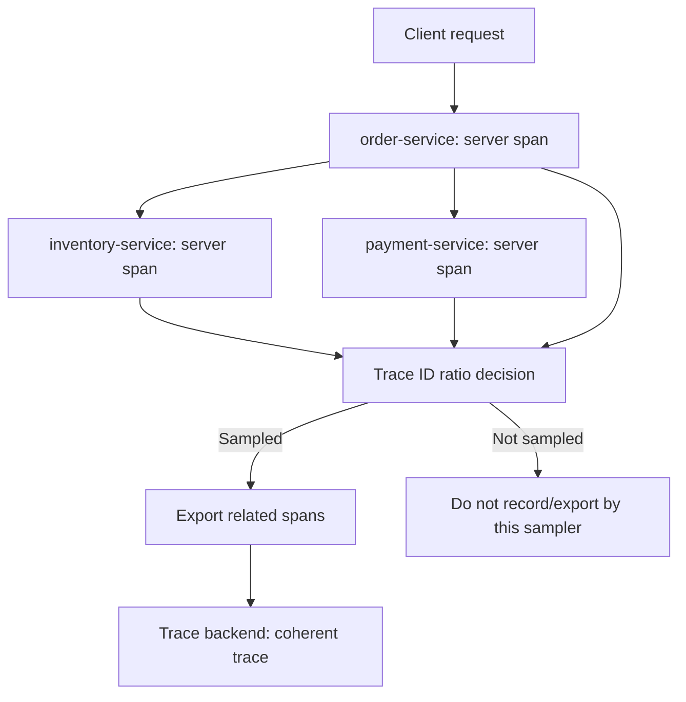
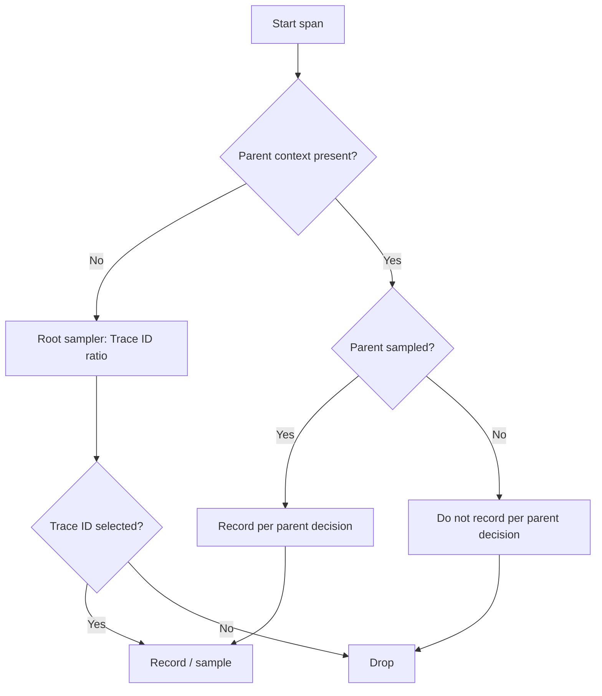
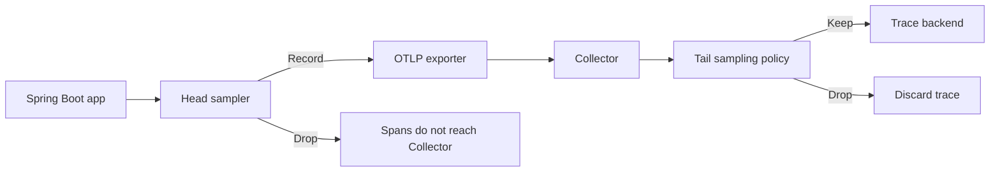

# Trace ID Ratio Sampler in Spring Boot Observability

**Trace ID ratio sampler** is a mechanism for sampling distributed traces based on the Trace ID and a configured ratio. Instead of selecting each span independently, the sampler makes a decision at the trace level so that spans belonging to the same trace receive a consistent sampling outcome within the scope of the applied sampler and parent context. This helps control the volume of recorded/exported telemetry, reduces storage costs, and keeps an investigable sample of traces.

In the **SPRING_BOOT_OBSERVABILITY** module, sampling is part of the tracing pipeline alongside Micrometer Observation, Micrometer Tracing, context propagation, exporters, and the trace backend. This lesson focuses on the Trace ID ratio sampler: the meaning of the ratio, how the decision ties to the Trace ID, the difference between head sampling and tail sampling, configuring probability in Spring Boot, and interpreting sampling results when cross-checking metrics, logs, and distributed traces.

## 1. What Problem Does Sampling Solve?

A Spring Boot application can create many spans per request. An HTTP request can create a server span plus spans for business steps, database calls, HTTP clients, and downstream calls. Under high load, total span volume grows rapidly.

Suppose a service receives 2,000 requests per second and each request creates an average of 7 spans:

\[
2\,000 \times 7 = 14\,000 \text{ spans/second}
\]

If all data is stored, the tracing system must ingest, process, index, and retain a massive volume of spans. Sampling selects a representative subset of traces to reduce data volume.

A **Trace ID ratio sampler** makes decisions according to a target ratio, such as 10% of traces. If a trace is selected, spans belonging to that trace can be recorded/exported per sampler policy and instrumentation. If not selected, the trace is typically not exported as a full trace to the backend.

Main goals:

- Reduce network traffic and ingestion into the trace backend.
- Control CPU, memory, indexing, and storage costs of the tracing system.
- Maintain a useful sample of traces to observe request paths.
- Apply a predictable ratio instead of storing all traces.
- Keep sampling decisions consistent across spans within the same trace when context is propagated properly.

Sampling does not replace metrics for measuring request rate/error rate across all traffic. Nor does it fix context propagation, generate spans for uninstrumented code, or recover traces dropped before reaching the Collector.

## 2. How Does a Trace ID Ratio Sampler Work?

A Trace ID ratio sampler uses the Trace ID as input to produce a deterministic decision. Conceptually, the sampler maps the Trace ID into a numeric domain and compares it against a threshold matching the desired ratio.

```text
Input: Trace ID
       |
       v
   Deterministic mapping
       |
       v
  Value in [0, 1)
       |
       +---- value < 0.10 ----> RECORD / SAMPLE
       |
       +---- value >= 0.10 ---> DROP
```

This is a conceptual model, not pseudocode for a specific algorithm. Details of how the Trace ID is extracted/mapped can vary by OpenTelemetry SDK version and sampler implementation. Applications should configure samplers through official APIs/frameworks rather than writing custom Trace ID hashes.

| Ratio | Expected meaning | Typical usage |
| ---: | --- | --- |
| 0.0 | Select no new traces under ratio sampler | Testing pipeline without recording new traces |
| 0.01 | Roughly 1% of traces | Very high traffic, tight tracing budget |
| 0.05 | Roughly 5% of traces | A small sample for trend observation |
| 0.10 | Roughly 10% of traces | Reference configuration for loaded environments |
| 0.50 | Roughly 50% of traces | Test environments or moderate traffic |
| 1.0 | Select all new traces under ratio sampler | Labs or controlled short-term debugging |

The ratio is a **statistical expectation over a sufficiently large set of traces**, not a guarantee that every one-second window has the exact percentage of traces. At low traffic, actual variance can be high.

## 3. Why Should Sampling Happen at the Trace Level?

A distributed trace can consist of many spans across multiple services. If each span were chosen independently, a trace could fragment: the first service has a span while the next service does not, or vice versa. Then the timeline becomes hard to read and parent-child relationships break down.

A Trace ID-based sampler produces consistent decisions by using the same Trace ID as input. When services propagate context properly, decisions at different trace entry points can converge on the same outcome.



This simplified diagram depicts the trace-level decision. In real deployments, each SDK can create spans at different moments; parent-based logic and the sampled flag in context affect subsequent decisions.

Having the same Trace ID is necessary, but not sufficient. A seamless trace also requires instrumentation, HTTP client/server context injection/extraction, compatible propagation formats, a sampler that respects parent context, an exporter, and a backend receiving the data. A Trace ID ratio sampler does not automatically join two independent traces or carry the Trace ID over HTTP.

## 4. Trace ID Ratio Sampling and Parent-Based Sampling

These two concepts are often used together but are not synonymous:

- **Trace ID ratio sampler** decides proportionally based on the Trace ID when it is the sampler applied to a new trace.
- **Parent-based sampler** decides based on the parent's sampled decision when a parent context exists, and delegates to the root sampler when no suitable parent is present.

A parent-based configuration wrapping a ratio sampler can be understood as follows:



This is the standard conceptual view of parent-based sampling. An SDK can configure separate branches for remote parent sampled, remote parent not sampled, local parent sampled, local parent not sampled, and root spans. Therefore, when exact control is needed, inspect the actual sampler constructed by the bridge/SDK.

Suppose the ingress/first service decides to sample a trace. As the request traverses other services, they should respect the received sampled context rather than re-rolling independently. That keeps related spans together in the same trace.

Conversely, if upstream decided not to sample, a downstream service usually should not unilaterally create a separate standalone trace without an explicit policy. If error or slow traces must be captured, consider tail sampling at the Collector tier, keeping in mind the tail sampler only sees spans sent to the Collector.

Remote parents and trust boundaries: a sampled flag arriving from outside is not authorization data. It affects tracing decisions per propagation policy, but must never be used to grant access or bypass security controls.

## 5. Configuring Sampling Probability in Spring Boot

With Spring Boot 3.x using Micrometer Tracing and a compatible tracing bridge, the typical configuration is:

```yaml
management:
  tracing:
    sampling:
      probability: 0.10
```

This value expresses the sampling probability for tracing managed by Spring Boot/Micrometer. In setups using the OpenTelemetry bridge, the implementation may use a ratio-based sampler combined with parent-based behavior depending on configuration/version.

**Do not infer from the property name that every version/bridge instantiates the exact same sampler class or algorithm details.** If SDK-level semantics must be guaranteed, verify the Spring Boot, Micrometer Tracing bridge, and OpenTelemetry SDK versions brought in by dependency management.

### 5.1. Lab Environment

```yaml
spring:
  application:
    name: order-service

management:
  tracing:
    sampling:
      probability: 1.0
  otlp:
    tracing:
      endpoint: http://localhost:4318/v1/traces
```

Sampling `1.0` makes the probabilistic sampler select all new traces under the ratio policy within configuration scope. The illustrative OTLP/HTTP endpoint assumes a Collector/backend is listening at that host/port.

When the app runs in a container separate from the Collector, `localhost` usually points to the application container itself. Use a reachable service DNS name, such as `http://otel-collector:4318/v1/traces`.

### 5.2. Production Environment

```yaml
management:
  tracing:
    sampling:
      probability: 0.05
```

Choosing 5% is only an example. An appropriate rate must be based on request volume, spans per request, span size, backend cost, error rarity, and investigation requirements. Do not shift sampling from 5% to 100% long-term just to resolve a short-term incident without assessing ingestion/storage capacity.

### 5.3. Environment-Based Configuration

```yaml
management:
  tracing:
    sampling:
      probability: ${TRACING_SAMPLING_PROBABILITY:0.10}
```

Environment variables allow setting the ratio per deployment environment. Validate that values stay within the framework's allowed range (typically `0.0` to `1.0`) and control changes to prevent misconfiguration from unintentionally turning tracing up or off.

## 6. Ratio Behavior: Consistent by Trace ID, Not Per-Span Sampling

A Trace ID-based sampler can yield consistent results when multiple places apply the same decision logic to the same Trace ID and policy. This is different from flipping a new coin on every span creation.

| Trace | Trace ID | 10% ratio sampler outcome |
| --- | --- | --- |
| A | `4bf92f3577b34da6a3ce929d0e0e4736` | Selected (hypothetical) |
| B | `8a12...` | Dropped (hypothetical) |
| C | `b1c4...` | Dropped (hypothetical) |
| D | `0f31...` | Selected (hypothetical) |

The outcomes in the table are illustrative only and must not be used as SDK test vectors.

If two services use incompatible sampler settings or fail to honor the parent decision, the same trace can be handled inconsistently. To avoid this, standardize propagation formats, use proper parent-based behavior, manage configuration centrally, and verify trace topology after SDK/bridge upgrades.

A 10% ratio typically applies to new traces per the sampler, which does not mean every service exports exactly 10% of its calls in a short window. Services have different traffic and fan-out; span counts can vary substantially.

## 7. Head Sampling vs. Tail Sampling

**A Trace ID ratio sampler is typically a head sampler choice** evaluated when the trace starts or the root span is created. The decision occurs early to save resources right at the application.

Head sampling:
- Decision is made early.
- Easy to distribute across applications and parent contexts.
- Reduces spans recorded/exported at the source.
- Does not know in advance whether the request will become slow or error at the end.
- If dropped at the head, the Collector cannot recover unsent spans.

For example, a request only times out after 5 seconds. If the head sampler drops the trace when the request begins, the system may lack a detailed timeline to inspect that timeout.

Tail sampling decides after the Collector has received spans for the trace over a waiting window. It can prioritize traces with an error status, exceeding a duration threshold, or belonging to critical operations. Tail sampling requires buffering data temporarily in memory/queues and routing spans sharing the same Trace ID to the same processor capable of making a unified decision. It cannot inspect spans already dropped by the application's head sampler.



If the head ratio is too low, the tail sampler has very few opportunities to keep error traces because most traces were already dropped at the source.

## 8. Sampling and W3C Trace Context Propagation

W3C `traceparent` carries Trace ID, Parent Span ID, and trace flags. Trace flags include the sampled bit in the W3C model. A service receiving a request can use the parent context to create a child span and make a consistent sampling decision.

```http
traceparent: 00-4bf92f3577b34da6a3ce929d0e0e4736-00f067aa0ba902b7-01
```

The trailing `01` in the example indicates the sampled flag is set. However, how this flag is interpreted in a specific environment must follow the tracing specification and SDK policy; it is neither an authorization command nor a guarantee that the backend stored the trace.

If a downstream service does not receive `traceparent`, it may start a new trace with a different Trace ID. The backend may display two separate traces instead of one cross-service trace. Sampling does not fix propagation; you must instrument HTTP clients/servers and ensure context headers are injected/extracted properly.

## 9. Impact on Metrics and Logs

**Trace sampling is not metrics sampling.** An application can record HTTP Timers and Counters for every request while exporting only a subset of traces.

| Signal | Role of sampling/collection | Consequence |
| --- | --- | --- |
| Metrics Counter/Timer | Usually recorded for every instrumented operation via a separate metrics pipeline | Used to measure request rate/error rate/latency across all traffic |
| Trace spans | Governed by head/tail sampling and exporter | Backend stores only retained spans |
| Logs | Governed by independent logging policy | Logs can exist even when a trace is dropped |
| Exemplars | Link selected measurements to a trace if supported | Does not guarantee every sample has a trace |

Suppose out of 1,000 requests there are 30 errors and a 10% sampler. You cannot conclude the backend will contain exactly 100 traces or exactly 3 error traces. Selected samples are statistical and do not necessarily represent rare errors accurately in short windows.

A log can record a Trace ID even when the trace was sampled out or failed to export, depending on logging/tracing implementation and when context was created. Finding a Trace ID in a log does not prove the trace was stored.

When investigating:
1. Use metrics to scope the error/latency impact.
2. Search logs using correlation fields.
3. Look up the trace by Trace ID if the trace was retained and ingested.
4. If no trace exists, check sampling, exporter, Collector, and retention.

## 10. Sampling and Baggage/Correlation

Baggage is metadata propagated alongside trace context, whereas sampling decides whether spans are recorded/exported. The two mechanisms are related but independent.

A request carries baggage `channel=mobile`. A service can extract baggage for logic/correlation even if the head sampling decision is drop, depending on propagation implementation. However, if the trace is not recorded/exported, baggage does not cause the backend to store a searchable trace.

Do not use baggage values to replace Trace ID or the sampled flag. Do not put Trace ID or request ID into metric labels to compensate for trace sampling, as that causes high cardinality.

An advanced sampling policy can inspect attributes at the Collector (tail sampling) after receiving spans, provided attributes have valid values and cannot be forged at trust boundaries. Baggage from external clients must not be implicitly trusted to grant privileges or priority trace retention.

## 11. Estimating Span Volume and Cost

An initial estimate helps pick a sampler ratio:

\[
S = R \times P \times N \times 86\,400
\]

Where `R` is request rate (requests/second), `P` is sampling ratio (0 to 1), `N` is average spans per request, and `S` is projected spans per day.

Example: 2,000 requests/second, ratio 0.05, and 8 spans/request:

\[
2\,000 \times 0.05 \times 8 \times 86\,400
= 69\,120\,000 \text{ spans/day}
\]

This is still a huge volume. A 5% ratio does not guarantee low cost when baseline traffic is very high.

If average serialized span size is 1.5 KB, illustrative raw data volume is:

\[
69\,120\,000 \times 1.5 \text{ KB}
\approx 103.7 \text{ GB/day}
\]

This is a simplified calculation, excluding compression, protocol overhead, batching, replication, indexing, metadata, retention, and actual storage costs. Span sizes vary substantially with attribute/event counts.

At the estimate level, raising the ratio from 5% to 10% can double selected traces if traffic and spans/request stay constant. However, backend cost does not always scale linearly due to index cardinality, fan-out, query workload, batching, retries, and storage layout.

Monitor:
- Spans received/accepted/dropped.
- Export failures and queue sizes.
- Collector memory/CPU.
- Backend ingestion and storage growth.
- Query latency and retention.
- Proportion of error/slow traces in the sample.

## 12. Choosing Sampler Ratio by Goal

| Environment/situation | Consideration |
| --- | --- |
| Local development | Can use 100% to inspect individual flows under low traffic |
| Integration tests | Use 100% or high rate for predictable assertions |
| Staging | Use a rate high enough to verify trace topology and exporters |
| Low-traffic production | Can keep a higher rate if capacity and privacy policies permit |
| High-traffic production | Choose rate based on span volume and backend budget |
| Short-term incident investigation | Increase ratio with a time limit, capacity monitoring, and operational approval |
| Need to keep error/slow traces | Consider tail sampling while ensuring traces reach the Collector |
| Batch/short-lived workloads | Check lifecycle/export flush; ratio does not solve a process exiting before export |

Do not mechanically apply the same ratio to every workload type. HTTP requests, message consumers, scheduled jobs, and batch operations can have very different span counts and diagnostic value. Check how the sampler applies to root spans, remote parents, and new traces.

## 13. Troubleshooting Trace ID Ratio Sampler

| Symptom | Possible cause | How to check |
| --- | --- | --- |
| Requests exist but no traces | Traces dropped by ratio sampler | Check sampling probability and send sufficient volume |
| Log has Trace ID but trace not found | Sampled-out, exporter failure, or wrong retention/query | Check sampled decision, exporter/Collector/backend |
| Downstream has new trace with different Trace ID | Lost `traceparent` or uninstrumented client/server | Inspect propagation headers at each hop |
| Root span exists but child spans missing | Inconsistent sampling/propagation, missing instrumentation | Check parent context and client instrumentation |
| 10% ratio but short window is not 10% | Small sample size and statistical variance | Compare over a large trace count and matching window |
| All traces exported | Probability 1.0, sampled parent, or another sampler | Check effective config and parent-based behavior |
| No traces exported | Probability 0.0, exporter/receiver error, or missing tracing bridge | Check sampler, exporter, and Collector in order |
| Backend ratio lower than configured | Export failures, tail sampling, downstream drops | Compare spans sampled, sent, received, stored |
| Backend ratio higher than expected | Multiple sources/services, parent-sampled decisions, or miscounted query | Distinguish root traces from spans and telemetry sources |
| Changing ratio produces no change | Parent decision dominates or config not reloaded | Verify runtime config, propagation, and rollout |
| Rare errors lack traces | Head sampling dropped request before outcome was known | Tail sampling with sufficient spans reaching Collector |
| Collector tail sampler misses error traces | Head drop at app, traces split across wrong Collectors, or policy mismatch | Check head ratio, trace routing, and tail policy |
| Metrics counts differ from trace counts | Two different pipelines and sampling rules | Use metrics for total traffic, traces for samples |
| Logs have baggage but trace is missing | Baggage/context still read, trace dropped or export failed | Check propagation and sampling separately |
| Collector load spikes unexpectedly | Ratio raised, spans/request grew, or retries | Watch ingest rate, payload, queues, and config |

Investigation workflow:
1. Verify the active tracing bridge and exporter.
2. Read the sampling probability after configuration is applied.
3. Send a large enough batch of requests to observe statistical ratio.
4. Check Trace ID and sampled flag across service boundaries in a lab.
5. Cross-check application, Collector, and backend using self-monitoring metrics.
6. Check whether tail sampling or processors drop spans after the head sampler.
7. Check time range, service name, tenant/project, and retention when querying the UI.
8. Do not change ratio, propagation, and exporter simultaneously before isolating the cause.

## 14. Lab Exercise: Verifying the Trace ID Ratio Sampler

The goal is to prove sampling applies per trace context, understand the discrepancy between metrics and traces, and calculate approximate cost.

### Preparation

- Spring Boot 3.x application with Actuator.
- Micrometer Tracing bridge, e.g., OpenTelemetry.
- OTLP traces exporter.
- OpenTelemetry Collector and trace backend/UI in a lab environment.
- An HTTP endpoint that creates at least one business Observation or HTTP client call.

### Step 1 — Establish a 100% Baseline

Configure sampling probability to `1.0` in the lab. Send several requests and confirm traces appear in the backend. Inspect the root span, service name, and child spans if instrumented.

### Step 2 — Change to 10%

Update configuration to `0.10` and restart/roll out the application as required by your environment. Send a sufficiently large batch of requests. Count traces stored in the backend and compare with requests sent.

Do not expect a short window to yield exactly 10%. Compare over a large enough sample and remember requests can lack traces due to exporter/Collector failures.

### Step 3 — Cross-Check Metrics

Check the HTTP request Timer/Counter in the metrics backend. The request count in metrics generally includes requests without stored traces. Explain why this is the expected result.

### Step 4 — Verify Parent-Based Propagation

Make a call from service A to B using an instrumented HTTP client. Confirm the child span in B keeps the same Trace ID when the trace is sampled. Try an uninstrumented client in the lab to see how context can be lost.

### Step 5 — Introduce Controlled Failures

Create a test endpoint that can return errors or wait slowly. With 10% head sampling, some failed requests may have no trace. Note this limitation and do not mistake it for an instrumentation bug.

### Step 6 — Try Tail Sampling If Collector Supports It

Configure a tail sampling policy in the lab to keep error traces among spans the Collector receives. Verify the Collector receives full spans of the trace and they are not dropped earlier by the head sampler.

### Step 7 — Estimate Cost

Record request rate, ratio, spans/request, and estimated payload size. Calculate spans/day and raw data volume. Compare against backend quota/retention.

### Step 8 — Check Log Correlation

Emit logs containing Trace ID/Span ID per logging integration. Verify logs are still written even when traces do not appear; use metrics to check total error counts.

### Step 9 — Test Configuration Changes

Test an environment variable controlling sampling probability. Confirm the rollout/config refresh actually applies the new value. Record the exact change timestamp so before/after data are not mixed in a single comparison.

### Acceptance Checklist

| Item to prove | Expected outcome |
| --- | --- |
| Ratio semantics | Correctly explain 0.0, 0.1, and 1.0 |
| Trace-level decision | Do not treat each span as an independent coin flip |
| Parent-based behavior | Child spans respect sampled parent per configuration |
| Spring Boot config | Know how to configure probability and verify version/bridge |
| Propagation | Trace ID connects across HTTP when instrumentation works |
| Head vs. tail | State limitations of early decisions and requirements of tail sampling |
| Metrics independence | Metrics cover broader traffic than retained traces |
| Cost estimate | Calculate approximate spans/day and data volume |
| Failure analysis | Distinguish sampled-out from exporter/backend failure |
| Security | Sampling is never used as an authorization policy |

## 15. Principles to Remember

1. **Trace ID ratio sampler samples proportionally based on Trace ID**, keeping decisions consistent at the trace level.
2. **Ratio is an expected proportion over a large set**, not a guarantee of exact counts in every short window.
3. **Parent-based behavior preserves the trace context's decision**, preventing downstream spans from splitting into separate traces.
4. **Spring Boot's probability property is a framework/bridge-level setting**; inspect the version and effective sampler when exact SDK semantics matter.
5. **Head sampling saves cost early but can miss errors/slow requests** because outcomes are unknown when requests begin.
6. **Tail sampling only processes spans that reach the Collector**; it cannot recover data dropped at the source.
7. **Metrics and logs have separate pipelines.** Metrics still count all traffic while traces sample only a subset.
8. **Context propagation is required for seamless cross-service traces.** A ratio sampler does not inject/extract `traceparent`.
9. **Calculate costs from request rate, spans/request, and sampling ratio**, then monitor ingestion, queues, storage, and retention.
10. **Never use the sampled flag or baggage for authorization.** Sampling is a telemetry policy, not a security policy.
11. **Combine metrics, logs, and traces**: metrics detect trends, traces show timelines of sampled requests, and logs verify event details.

The Trace ID ratio sampler is a foundational tool for controlling distributed trace volume in Spring Boot Observability. When configured with an appropriate ratio, honoring parent context, and paired with verified exporters/backends, engineering teams retain a useful trace sample at a predictable cost. Combined with full-traffic metrics and correlated logs, sampling enables focused latency and error investigations without equating "no trace" with "the request never happened."
