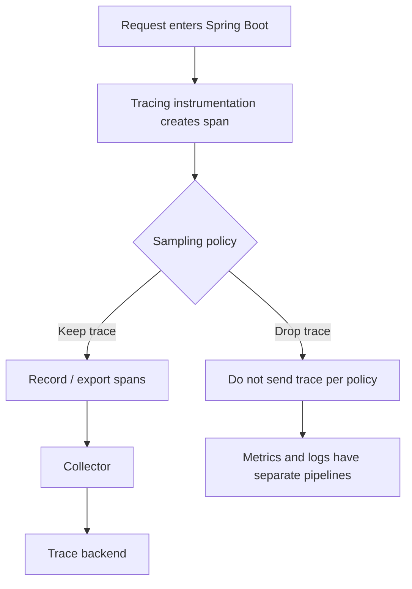
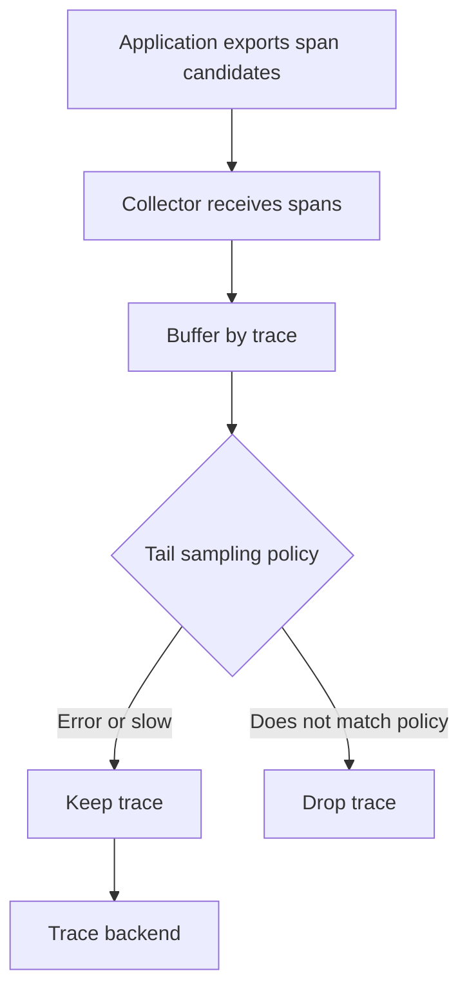
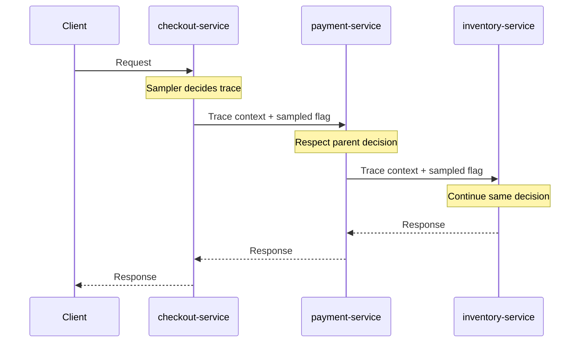
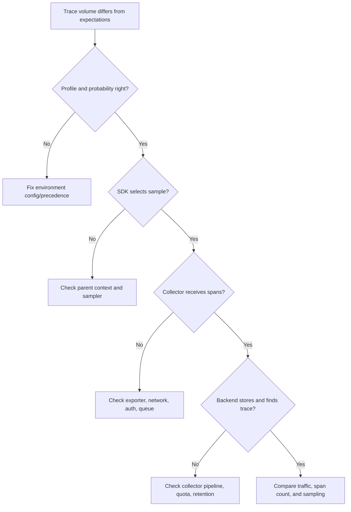

# Sampling by Environment in Spring Boot

A Spring Boot system can generate millions of spans every day. Storing every trace in every environment drives up transport, processing, storage, and query costs rapidly. Sampling too aggressively, on the other hand, can leave operations teams unable to find traces for rare errors. Therefore, **a sampling policy should match the environment and operational goal**: development needs easy debugging, staging needs test data, and production needs a balance between coverage and cost.

The **"Sampling by Environment"** lesson belongs to the **Sampling** chapter of the **SPRING_BOOT_OBSERVABILITY** module. The module teaches how to set up observability for Spring Boot with Micrometer Observation, metrics, logs, and distributed tracing. This lesson explains head sampling, tail sampling, Spring Boot configuration via profiles and environment variables, cross-service propagation, cost estimation, testing, and troubleshooting.

**Sampling primarily decides which traces/spans are recorded and exported in the tracing pipeline.** It does not automatically reduce HTTP metrics, replace log levels, or act as a data access control mechanism.

## 1. What Problem Does Sampling Solve?

A distributed trace can contain HTTP server/client spans, database spans, messaging spans, and business steps. Sampling selects a subset of traces to record/export per policy in order to retain enough investigative data, cap ingest/retention, and preserve analytical capability.



If a trace is selected, propagated and exported spans can show the journey across multiple services. If a trace is dropped early in the pipeline, the trace backend may lack investigative data even though the request still processed normally.

## 2. Distinguishing Head Sampling and Tail Sampling

### Head Sampling

A **head sampler** decides early, usually when the root span or initial trace is created. The decision can rely on probability, parent context, or attributes available at the start.

With a 10% probability, across a sufficiently large set of requests, roughly 10% of traces are selected per sampler behavior. The sampler does not yet know whether the request will become slow or raise an error later. The decision can be propagated down to services via the sampled flag in trace context.

Head sampling saves resources early, but can miss requests that turn anomalous late in processing.

### Tail Sampling

**Tail sampling** defers the decision until the collector has received the relevant spans and enough information to evaluate the trace, for example:

- Trace has an error status or exception.
- Total duration exceeds a threshold.
- HTTP status belongs to a monitored group.
- Trace belongs to a critical service or route per policy.



Tail sampling can retain error traces even when the error occurs at the end of a request. In return, the collector must receive and temporarily hold spans, assemble enough of the trace over a waiting window, and provide suitable buffers and policies. Configuring tail sampling cannot recover spans already dropped by an SDK head sampler before reaching the collector.

| Criterion | Head sampling | Tail sampling |
| --- | --- | --- |
| Decision timing | Early, when trace/span starts | After collector receives required information |
| Decision information | Context and attributes at the start | Can use final errors/duration |
| Bandwidth savings | Can drop early | Usually ships candidate spans to the collector |
| Retaining rare error traces | Not guaranteed if dropped early | Can prioritize if collector receives complete trace |
| Infrastructure | Sampler in SDK/bridge | Stateful collector, buffers, and tail-sampling processor |
| Main risk | Misses events occurring later | Memory overhead, missing spans when traces arrive late/under overload |

Do not call head sampling probability "tail sampling." The two mechanisms can be combined, but you must define clearly which layer drops traces and which layer is responsible for keeping critical traces.

## 3. Configuring Sampling in Spring Boot

Spring Boot provides a property to tune tracing sampling probability:

```yaml
management:
  tracing:
    sampling:
      probability: 0.1
```

The value typically expresses a probability from `0.0` to `1.0`:

| Value | Conceptual meaning |
| ---: | --- |
| 0.0 | Select no new traces under this probability |
| 0.01 | 1% probability |
| 0.05 | 5% probability |
| 0.1 | 10% probability |
| 0.5 | 50% probability |
| 1.0 | Select 100% of new traces under the probabilistic sampler |

This is the configured sampler's probability, not a guarantee that every 100 requests always yield exactly N traces. Outcomes depend on request count, sampler implementation, parent context, upstream sampling, and export failures.

Default values can differ by Spring Boot release, tracing bridge, and application configuration. Declare them explicitly per environment rather than relying on implicit defaults.

## 4. Using Spring Profiles to Set Sampling by Environment

Default configuration in `application.yml`:

```yaml
spring:
  application:
    name: checkout-service

management:
  tracing:
    sampling:
      probability: 0.1
```

Development:

```yaml
# application-dev.yml
management:
  tracing:
    sampling:
      probability: 1.0
```

Staging:

```yaml
# application-staging.yml
management:
  tracing:
    sampling:
      probability: 0.5
```

Production:

```yaml
# application-prod.yml
management:
  tracing:
    sampling:
      probability: 0.05
```

These ratios are only policy examples, not universal recommendations. Development may need 100% traces for debugging; production may pick 1%, 5%, or higher depending on traffic, budget, and SLOs.

Activate a profile via environment variable:

```bash
SPRING_PROFILES_ACTIVE=dev
```

Or when running the JAR:

```bash
java -jar app.jar --spring.profiles.active=staging
```

On Windows PowerShell:

```powershell
$env:SPRING_PROFILES_ACTIVE = "dev"
java -jar app.jar
```

Only activate the profile matching the deployment environment. Do not rely on manual configuration edits after packaging the image.

### Multiple YAML Documents in One File

You can use `spring.config.activate.on-profile` to manage multiple configurations in a single file:

```yaml
management:
  tracing:
    sampling:
      probability: 0.1
---
spring:
  config:
    activate:
      on-profile: dev
management:
  tracing:
    sampling:
      probability: 1.0
---
spring:
  config:
    activate:
      on-profile: staging
management:
  tracing:
    sampling:
      probability: 0.5
---
spring:
  config:
    activate:
      on-profile: prod
management:
  tracing:
    sampling:
      probability: 0.05
```

Ensure the file is parsed according to Spring Boot Config Data; verify the active profile and precedence. For large systems, separate profile files or external configuration are often easier to review.

## 5. Managing Sampling via Environment Variables

If the deployment platform manages the sampling rate, set an environment variable named `TRACING_SAMPLING_PROBABILITY` and bind the value via Spring Boot's configuration mechanism. Example runtime setup for development:

```bash
TRACING_SAMPLING_PROBABILITY=1.0
```

Illustrative production setup:

```bash
TRACING_SAMPLING_PROBABILITY=0.05
```

In `application.yml`, the property remains `management.tracing.sampling.probability`; the deployment must supply the variable per matching binding conventions or map it via external config. Verify the actual bound value inside the running process.

Centralized management lets one image run across multiple environments, lets policies be reviewed alongside release manifests, and avoids source code changes. The risk is that a bad value can spike exports or drop them near zero. Put validation, cost monitoring, and rollback in place.

External config, command-line arguments, profiles, and environment variables can override one another according to Spring Boot precedence. Do not read only the YAML file in the repository and assume the runtime value matches.

## 6. Choosing Rates by Environment

| Environment | Goal | Illustrative starting rate | Notes |
| --- | --- | ---: | --- |
| Local developer | Debug requests and inspect span trees | 1.0 | Can reduce during load tests |
| CI/test | Verify instrumentation | 1.0 for small tests | Avoid load tests generating excessive traces |
| Shared development | Observe integration | 0.5–1.0 | Simulated traffic can be large |
| Staging | Production-like verification | 0.25–0.5 | Balance coverage and load |
| Production | Incident response and trends | 0.01–0.1 | Base on traffic, cost, and SLOs |
| Production canary | Compare new version | Controlled higher rate | Limit duration and budget |

These numbers are illustrative. To pick a rate:

1. Estimate requests/second and average spans per trace.
2. Measure average serialized bytes per trace.
3. Calculate projected ingest across sampling levels.
4. Identify which incidents need investigation: rare errors, tail latency, dependency timeouts, or per-route errors.
5. Check storage, query latency, and retention.
6. Trial in staging/canary, watching collector queues and backend ingest.
7. Lock in the rate, effective duration, and accountable owner.

Low-traffic services may need a higher rate to collect enough traces; 10% on a massive service can still produce substantial span volume.

## 7. Consistent Sampling Across Service Boundaries

A trace may pass through `checkout-service`, `payment-service`, and `inventory-service`. If the first service decides not to sample yet downstream decides independently, the system can produce fragmented traces or keep only partial spans.

With **parent-based sampling**, downstream services typically respect the sampled decision carried in the parent's trace context. W3C Trace Context uses the `traceparent` header with trace flags, including the sampled flag. B3 also has its own mechanism for propagating sampling state.



If each service configures a different probability, verify whether the sampler has parent-based behavior and how sampled/unsampled remote parents are handled. Do not assume every bridge or custom sampler shares identical semantics.

Policies should be managed along the trace chain, not merely per repository. At trust boundaries, do not let untrusted clients force the system to retain 100% of traces by sending a sampled flag themselves; service edges need trust and policy controls.

## 8. How Does Sampling Affect Metrics and Logs?

Tracing sampling is not a master switch for observability.

| Signal | Effect of trace sampling | Separate control mechanism |
| --- | --- | --- |
| Distributed traces | Decides which traces/spans are recorded and exported | Head/tail sampling policy |
| Metrics | Does not automatically reduce Counters, Timers, Gauges | Instrumentation, MeterRegistry, filters, cardinality |
| Logs | Does not automatically reduce log events | Log levels, routing, filtering, retention |
| Audit records | Cannot be replaced by sampled traces | Dedicated audit/transaction system |
| Baggage | Does not directly decide which fields propagate | Allowlist, size limits, propagation policy |

An application may record HTTP request metrics for every request while exporting only 5% of traces. In that case, the metric error rate is the proper basis for evaluating HTTP 5xx across all traffic; backend trace counts do not represent all requests.

Logs can also be written for requests without stored traces. Log correlation may lack a useful trace ID or the trace backend may lack matching spans.

**Do not use the sampled trace ratio to infer the error rate of overall traffic**, especially when sampling prioritizes errors or uses tail sampling.

## 9. Probability Sampler vs. Tail Sampling in the Collector

Spring Boot configuration:

```yaml
management:
  tracing:
    sampling:
      probability: 0.05
```

typically describes the sampling probability in the application's tracing SDK/bridge. It does not configure tail sampling policies at the OpenTelemetry Collector.

If you want to retain traces with errors or high duration, the architecture can look like:

```text
Spring Boot tracing SDK
  -> export span candidates
  -> OpenTelemetry Collector
  -> tail_sampling processor
  -> traces backend
```

The Collector must receive candidate spans before making a decision. If the SDK already dropped a trace with a low head sampler and never exported spans, the collector cannot recover that trace from missing data.

Tail sampling requires verifying:

- The Collector receives spans from the participating services in the trace.
- Spans belonging to the same trace arrive at the same decision point or have an appropriate distribution/sync mechanism.
- Decision wait is long enough to receive required spans.
- Buffers/decision caches can hold the concurrent trace volume.
- Policies for error status, latency, service, and attributes are clear.
- Timeouts, late spans, and collector restarts have well-understood behavior.
- The pipeline has metrics tracking dropped spans, queues, and memory.

Tail sampling can require SDKs to send more spans, increasing network and collector load. Placing low head sampling in front of tail sampling drops traces early before tail policies ever see them. When combining tiers, clearly document candidate flow and each tier's policy.

## 10. Estimating Sampling Cost

Simple estimate of spans/day:

\[
\text{Spans/day} \approx R \times 86\,400 \times P \times S
\]

Where `R` is average requests/second, `P` is the sampled trace ratio from 0 to 1, and `S` is average spans per trace.

Hypothetical example:

- 200 requests/second.
- Sampling probability 0.05.
- 8 spans/trace.

\[
200 \times 86\,400 \times 0.05 \times 8
= 6\,912\,000 \text{ spans/day}
\]

This is a span load estimate, not byte size or monetary cost. Span size, attributes, events, retries, burst traffic, batching, compression, and retention all affect total cost.

| Sampling probability | Relative span volume |
| ---: | ---: |
| 1% | 1x |
| 5% | 5x |
| 10% | 10x |
| 25% | 25x |
| 50% | 50x |
| 100% | 100x |

This relationship assumes other factors remain constant. Parent decisions, tail sampling, and export failures can make actual numbers diverge.

Low sampling does not automatically reduce CPU spent instrumenting spans created before the decision, metrics cardinality, log volume, or baggage size. Monitor ingest bytes, dropped spans, exporter errors, and collector memory rather than looking only at the ratio.

## 11. Sampling That Prioritizes Errors and Latency

Probability sampling works well for baseline sampling, but does not guarantee retaining rare errors. To prioritize errors or latency, consider:

- Tail sampling at the Collector keeping traces with an error status.
- Tail sampling keeping traces exceeding a latency threshold.
- Rules prioritizing critical routes during testing windows.
- Temporarily higher sampling during canaries/incident response.
- Policies driven by validated and bounded metadata.

Be careful with rules keyed by tenant or user. If clients declare baggage themselves to gain priority sampling, they can inflate costs or manipulate telemetry. Only rely on attributes validated by trusted systems.

### Traces Dropped by the SDK Cannot Be Kept Later

1. SDK head sampling selects 5%.
2. A failed request falls in the dropped 95%.
3. The Collector receives no spans for that request.
4. The tail policy never sees the trace to keep it.

If the requirement is to retain every error, design an appropriate end-to-end sampling path from SDK to collector, rather than simply adding an error rule in the collector after the head sampler has already dropped most traces.

## 12. Managing Sampling Changes

Sampling probability is an operational parameter that can dramatically shift costs.

1. **Have an owner:** observability team or service owner responsible for the policy.
2. **Have an explicit default:** do not implicitly rely on framework defaults.
3. **Have per-environment overrides:** dev/staging/prod reviewed explicitly.
4. **Have guardrails:** validate values and alert on anomalous shifts.
5. **Have quotas:** cap ingest/backend and collector resources.
6. **Have rollback:** know how to revert to the previous policy.
7. **Have an expiration:** temporary sampling increases must have an end date.
8. **Have documentation:** dashboards/runbooks describing rates and how the sampler behaves.

When raising sampling during an incident, define the target service/route and start/stop times; estimate extra ingest; check collector queues, CPU, memory, and backend quotas; verify propagation; and restore the baseline rate once sufficient evidence is gathered. If tail sampling already retains errors, raising head sampling everywhere might be unnecessary, though you must verify the pipeline receives candidate spans.

## 13. Diagnosing Unexpected Trace Volumes

| Symptom | Possible cause | How to check |
| --- | --- | --- |
| Dev lacks enough traces | Profile inactive, probability overridden, or exporter failure | Check active profile, effective property, and exporter |
| Production volume spikes suddenly | High probability, traffic burst, more spans/trace | Check runtime config, RPS, and span counts |
| Trace shows spans from only one service | Inconsistent propagation or parent sampling | Check `traceparent`/B3 and instrumentation |
| Error traces are not retained | Head sampler dropped or tail policy didn't match | Check SDK sampler and Collector policy |
| Metrics show requests but traces are scarce | Normal sampling or tracing export failure | Check sampling, exporter errors, and collector |
| SDK samples yet backend lacks traces | Network, auth, queue, collector, or backend ingest failure | Inspect exporter/collector telemetry |
| Staging has unusually more traces than prod | Different profile/config, different traffic | Compare effective config and traffic |
| Raising probability does not raise volume | Unsampled parent, wrong profile, or pipeline drops | Check sampled flag and export pipeline |
| Collector memory grows under tail sampling | High buffer/decision wait/trace concurrency | Check processor config and resource limits |

Verification workflow:

1. Verify which profile is actually active on the pod/process.
2. Verify the bound value of `management.tracing.sampling.probability`.
3. Check which tracing bridge and sampler are built from configuration.
4. Send a test request and verify trace context/sample flags across services.
5. Verify span creation, export, and collector reception.
6. Check Collector processors/exporters and backend ingestion.
7. Cross-check trace volume against traffic, spans/trace, and sample rate.
8. Check metrics/logs independently to confirm requests still occurred when traces are absent.



Do not conclude instrumentation is broken simply because trace counts are low; sampling may be operating exactly per policy.

## 14. Lab Exercise: Configuring Sampling by Profile

Run in local/test.

1. Use `application-dev.yml` with probability `1.0`, `application-staging.yml` with `0.5`, and `application-prod.yml` with `0.05`. These numbers are for the lab exercise.
2. Run the application sequentially with the `dev`, `staging`, and `prod` profiles. Verify the active profile and effective configuration value; if using a config server/environment variables, verify precedence.
3. Send the same batch of test requests against each profile, large enough to observe trends. Do not compare a handful of requests and demand an exact ratio.
4. In the test backend, count stored traces and requests generated. Compute the observed ratio:

\[
\text{Observed sample ratio} =
\frac{\text{Stored traces}}{\text{Test requests}}
\]

This is an approximate measurement; account for exporter errors, filters, parent sampling, and cases where one request creates multiple root operations.
5. Have the request call a downstream service. Verify spans share the same trace ID when the trace is sampled; child services honor the sampled decision. Test both sampled and unsampled parents.
6. Compare HTTP metrics count/rate with sent requests. Metrics must not drop alongside tracing probability in typical setups.
7. If you have a Collector, test tail sampling in an isolated environment. Ensure the SDK does not drop traces early that the policy needs to inspect; measure memory, decision wait, and dropped spans.

## 15. Self-Check Questions

1. What problem does sampling in distributed tracing solve?
2. How does head sampling differ from tail sampling in timing and data used to decide?
3. Why can't tail sampling recover traces already dropped by an SDK head sampler before export?
4. What is `management.tracing.sampling.probability` used to configure?
5. Why should sampling probability be set explicitly per environment?
6. What are the benefits and risks of Spring Profiles and environment variables?
7. Why is parent-based sampling important when a trace crosses multiple services?
8. What role does the sampled flag in trace context play?
9. Does trace sampling automatically reduce HTTP Timers/Counters or log events?
10. Why shouldn't backend trace counts be used as the overall request error rate?
11. Roughly how many spans/day does a service at 200 RPS, 5% probability, and an average of 8 spans/trace generate?
12. Why can probability `1.0` in production incur high costs?
13. To keep rare error traces, what conditions are required in the SDK and Collector?
14. When the `prod` profile has the right probability yet trace volume is low, which layers should be checked?
15. When raising sampling during an incident, what guardrails and rollback plan are needed?

## References

- [Spring Boot Observability — Tracing](https://docs.spring.io/spring-boot/reference/actuator/tracing.html): configuring sampling probability and tracing in Spring Boot.
- [Micrometer Tracing Reference](https://docs.micrometer.io/tracing/reference/): tracing bridges, samplers, and context propagation.
- [OpenTelemetry — Sampling](https://opentelemetry.io/docs/concepts/sampling/): head sampling, parent-based sampling, and sampling decisions.
- [OpenTelemetry Collector — Tail Sampling Processor](https://github.com/open-telemetry/opentelemetry-collector-contrib/tree/main/processor/tailsamplingprocessor): tail-sampling processor, policies, decision wait, and operational limits.
- [W3C Trace Context](https://www.w3.org/TR/trace-context/): trace context and trace flags propagated across services.

## Conclusion

**Sampling by environment is an operational policy that must be configured, tested, and managed as part of the observability contract.** Spring Boot can set sampling probability via `management.tracing.sampling.probability`, combined with Spring Profiles or environment variables to match dev, staging, and production needs. Head sampling decides early and saves resources; tail sampling can select error/slow traces after the collector receives enough spans, at the cost of extra buffering and pipeline management.

When deploying, align parent-based behavior and sampled flags across service boundaries, monitor cost/volume, and maintain a rollback plan for sampling changes. Trace sampling does not automatically reduce metrics or logs; use metrics to measure total traffic, traces to investigate retained requests, and logs to add details in the right context.
