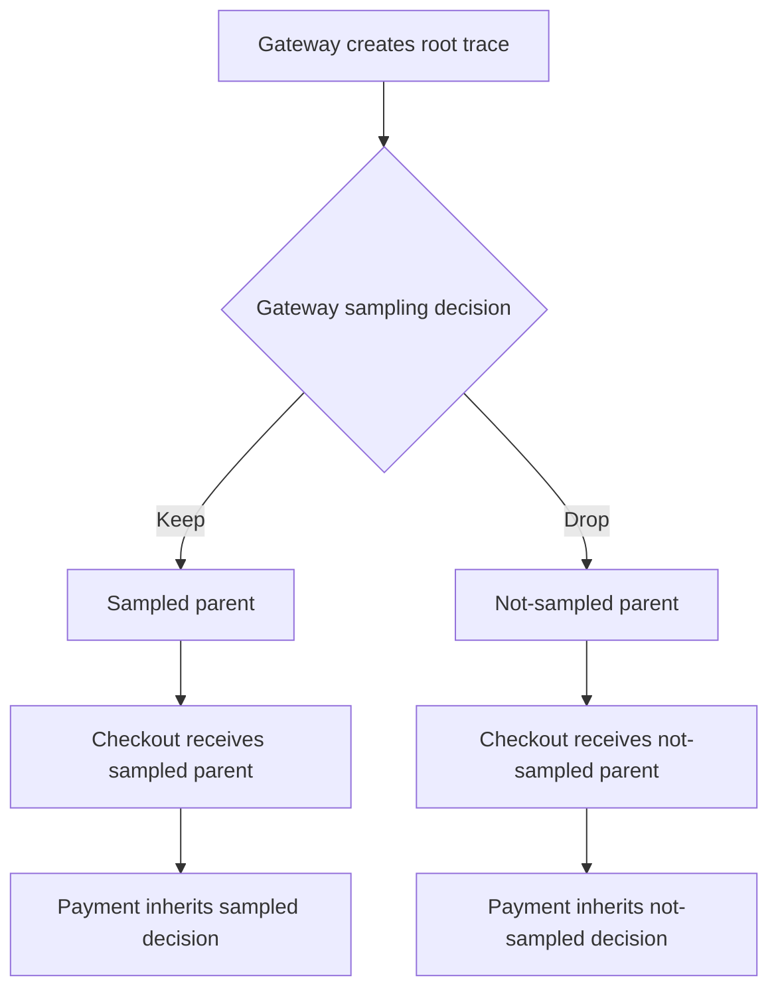
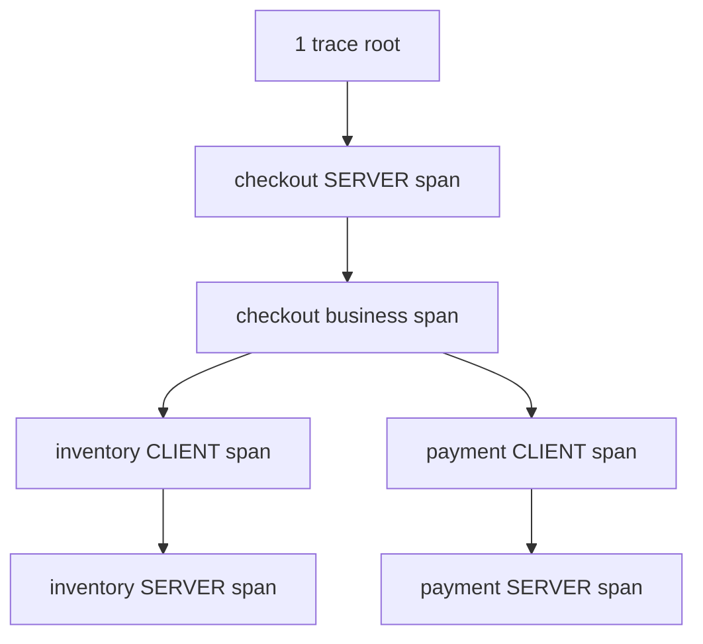
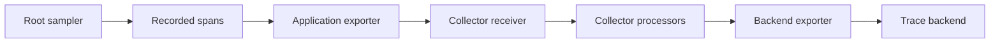

# Testing Sampling in Practice in Spring Boot

`management.tracing.sampling.probability: 0.1` is configured, yet the trace backend only displays a few requests. Is sampling working properly, or is the exporter losing data? Answering that requires inspecting the entire path from effective configuration, sampler decision at the trace root, propagation to child services, through to the exporter, collector, and backend.

The **Testing Sampling in Practice** lesson belongs to the **Sampling** chapter of the **SPRING_BOOT_OBSERVABILITY** module. The module teaches how to set up observability for Spring Boot using Micrometer Observation, metrics, logs, and distributed tracing; learning context propagation, tags/cardinality, exporters, sampling, and how to correlate signals to investigate errors, latency, and application behavior in production environments.

The goal of this lesson is to build a repeatable workflow for verifying sampling in a running application. We distinguish configured values from the active sampler, accurately count trace roots and spans, verify parent-based decisions, measure rates under controlled conditions, and locate the first point where data is dropped. A single number on a trace UI is not enough to conclude whether the sampler is right or wrong.

## 1. What Must Practical Sampling Verification Check?

Sampling is the decision to keep or drop traces/spans under a policy. In a distributed system, at least five separate questions must be distinguished:

| Question | Evidence to look for |
| --- | --- |
| Which sampler is the app actually running? | Effective configuration, tracer/SDK bean, and sampler implementation |
| How many trace roots are selected? | Eligible root operation counts and sampling decisions |
| Does downstream inherit the decision? | Trace context headers/flags and parent span relationships |
| Did spans leave the JVM? | Exporter success/failure, queues, and retry metrics/logs |
| Did traces reach the backend? | Collector received/dropped counters and backend ingestion/queries |

Do not lump these numbers together:

- **Request count:** number of HTTP/business requests per defined metric.
- **Trace root count:** number of traces starting at a specific boundary.
- **Sampled trace count:** number of root traces the sampler decided to keep.
- **Span count:** number of spans across recorded traces.
- **Exported span count:** number of spans successfully sent by the exporter or handed off to the pipeline.
- **Stored trace count:** number of traces actually stored and queryable in the backend.

These figures naturally differ. An HTTP server request may be a child span of a trace started at the gateway, one trace can hold many spans, and a sampled span can still fail to reach the backend if the exporter or collector fails.

## 2. First Step: Verify the Effective Configuration

With Spring Boot using Micrometer Tracing auto-configuration, probability configuration typically looks like:

```yaml
management:
  tracing:
    sampling:
      probability: 0.1
```

Putting a property in a file does not prove the runtime is using that value. Verify:

1. Which profile is actually active, e.g., `prod` or `staging`.
2. Whether environment variables, command-line arguments, and externalized configuration override the property.
3. Whether any custom tracer, SDK, or sampler bean replaces auto-configuration.
4. Whether the active bridge is OpenTelemetry or Brave, and which sampler implementation is in use.
5. Whether upstream services pass remote sampling decisions inside trace context.

With Actuator, you can use a secured config inspection endpoint to inspect the matching property if exposed and permitted. Never expose all of `/actuator/env` to the Internet just to check sampling. Alternatively, emit a controlled startup log for the effective sampling config or verify beans/runtime config in integration tests.

Profile example:

```yaml
# application-staging.yml
management:
  tracing:
    sampling:
      probability: 1.0
```

```yaml
# application-prod.yml
management:
  tracing:
    sampling:
      probability: 0.1
```

If the `staging` profile is inactive, staging values have no effect. If the SDK is built manually with its own sampler, Spring Boot's property may not control that SDK. Avoid configuring two sources and losing track of which one wins.

## 3. Create a Test with Clear Boundaries

To measure rates, first define the **sampling unit**. Usually we care about trace roots created at an ingress boundary, not counting every HTTP request across every service.

A controlled test should:

- Use a dedicated test route or defined workload, avoiding mixed health checks and management requests.
- Send fresh independent requests at ingress so each request has a chance to start a trace root.
- Avoid sending sample trace context from the client, unless intentionally testing remote-parent behavior.
- Record sent requests, created root spans, sampled decisions, and successfully exported spans.
- Use a defined time window and wait for exporter/collector flushes within controlled bounds.
- Run the same configuration and traffic pattern when comparing two runs.

Example test request with curl:

```bash
curl --fail-with-body \
  -H "X-Test-Run: sampling-check-01" \
  http://localhost:8080/test/trace
```

The `X-Test-Run` header is only test metadata in the example. It is not a sampling header and does not replace `traceparent`. The test route must exist in the application and must not expose sensitive diagnostic actions in production.

### Do Not Miscount Requests as Trace Roots

If the gateway starts the root trace and `checkout-service` receives a remote parent, the checkout span is a child rather than a root. If you send 1,000 requests through the gateway and count roots at checkout, you may see 0 new roots even while tracing works properly. Count at the exact boundary that originates traces.

## 4. Distinguishing Probability Sampling from Parent-Based Sampling

In many tracing SDKs, a sampler is composed of two decisions:

- If a span has a valid parent, a **parent-based policy** can inherit the parent's sampling decision.
- If a span is a root, the root sampler (e.g., probabilistic) decides according to the local policy.

Thus, `0.1` on checkout does not necessarily mean 10% of requests hitting checkout are independently selected. If the gateway already decided sampled or not-sampled, checkout may inherit that remote parent decision.



In a parent-based architecture, child services normally maintain the parent trace's decision consistently. If each service starts its own root due to missing propagation, backend trace counts can rise while spans split across multiple traces.

When testing local probability, generate requests without a remote parent at the boundary under test. When testing propagation, intentionally send a remote parent with sampled/not-sampled flags and verify child behavior per the configured sampler.

## 5. The Sampling Flag in Trace Context

With W3C Trace Context, the `traceparent` header carries version, trace ID, parent ID, and trace flags. The sampled bit is part of flags. Illustrative example:

```text
traceparent: 00-4bf92f3577b34da6a3ce929d0e0e4736-00f067aa0ba902b7-01
```

The example illustrates a header with the sampled flag enabled in W3C format. It is not an authentication token and does not indicate the exporter succeeded. The flag value can be altered at boundaries per authorized policy; never treat arbitrary client-supplied remote headers as trusted identity.

When verifying propagation:

1. Inspect outbound requests from the parent service via a test server or instrumentation test.
2. Confirm the trace ID is preserved along the same trace.
3. Confirm the parent span ID in the child service links to the matching client span.
4. Confirm the sampled flag is processed per parent-based policy.
5. Test one sampled request and one not-sampled request for comparison.

Never log full headers in production for debugging. Record only approved fields or use an isolated test receiver; never expose `Authorization`, `Cookie`, or tokens.

## 6. Test with a Deterministic Sampler First

When writing unit/integration tests, deterministic samplers are much easier to verify than probabilistic samplers. For instance, use a fixed always-sample or always-drop sampler in an SDK test fixture:

```java
// Pseudocode: exact API depends on tracing bridge/SDK.
Sampler sampler = alwaysOnSampler();

// Create tracer/test SDK with deterministic sampler.
// Invoke instrumented operation.
// Assert span is created and written to in-memory exporter.
```

Another test can use an always-drop sampler to prove:

- Traces are not recorded/exported via that tracing pipeline.
- Metrics Timers are still recorded if the metrics handler operates independently.
- Application logs follow their own logging configuration.

You do not need to send data to a production backend to prove sampler semantics. Use an in-memory exporter or test exporter suited to your implementation.

### Testing Property Binding in a Spring Context

An integration test can boot the application context under a test profile and verify the effective configuration/bean created. Exact class/property names must follow your Spring Boot and Micrometer versions. Do not merely assert that a YAML file contains the string `0.1`, because that does not verify runtime binding or custom sampler overrides.

## 7. Statistical Test for 10% Probability

With independent root traces, each selected with probability `p`, the number of selected traces can be modeled with a binomial distribution:

\[
X \sim \mathrm{Binomial}(n,p)
\]

Expectation and standard deviation:

\[
E[X] = np
\]

\[
\sigma = \sqrt{np(1-p)}
\]

Example with `n=10,000` eligible trace roots and `p=0.1`:

\[
E[X] = 1{,}000
\]

\[
\sigma = \sqrt{10{,}000 \times 0.1 \times 0.9} = 30
\]

Results like 970, 1,020, or 1,040 can all be reasonable depending on acceptance bounds and assumptions. Never require exactly 1,000. A statistical test should use tolerances based on standard deviation or a chosen confidence interval, avoiding sensitivity to a single run.

**Note on assumptions:** the binomial model only holds if root selections are independent at the given probability. Parent-based remote sampling, Trace-ID-deterministic custom samplers, rate limiting, heterogeneous traffic, or tests miscounting the root population can invalidate that model.

In production, use sufficiently long windows and many root traces; do not generate heavy synthetic load solely to hit statistical sample counts if doing so adds unnecessary load or cost.

## 8. Counting Trace Roots, Traces, and Spans Correctly

One trace typically contains many spans. A server request can generate a server span, a business observation, and multiple client spans. Thus, span count can be several times larger than trace count.



In this example, one trace has 6 spans. If the sampler retains 100 trace roots, the backend may see roughly 600 spans assuming complete instrumentation and no drops. Do not compare sampled spans directly with HTTP request counts as if they were the same unit.

Collect at least:

| Counter/measurement | Meaning |
| --- | --- |
| Ingress requests | Total requests entering the boundary |
| Trace roots started | Number of root spans created |
| Root sampling decisions: sampled | Number of roots retained |
| Spans ended | Number of completed spans |
| Exporter successes/failures | Number of spans/batches exported or failed |
| Collector received/dropped | Number of spans received or dropped by collector |
| Backend stored/searchable | Number of traces queryable after ingest |

Collect these figures via the corresponding instrumentation/test harness/SDK exporter metrics/collector telemetry. Not every Spring Boot app automatically exposes a built-in meter for every row in the table.

## 9. Checking the Exporter and Collector After Sampling

If the sampler selects a trace yet the backend does not show it, the data loss point may sit downstream of the sampler:



Inspect stage by stage:

1. **SDK/exporter:** does the exporter flush batches, handle timeouts, retry, and shut down properly?
2. **Network:** are DNS, routing, TLS, auth, protocol, and endpoint correct?
3. **Collector receiver:** does the collector receive spans and increment its received count?
4. **Processor:** do batching, memory limiter, tail sampler, or filters drop data?
5. **Backend exporter:** are there throttling, rejected payloads, auth errors, or exhausted retries?
6. **Query:** are you searching the right service name, tenant, environment, region, and time window?

A span recorded by the sampler in the SDK does not mean the collector received it. The exporter can fail, the collector queue can fill up, or a processor can drop it. Locate **the very first stage where counts drop unexpectedly**.

### Pipeline Observability Signals

Depending on the collector and exporter, pipeline telemetry can expose counters such as spans received, sent, refused, or dropped. Metric names vary by distribution/version; check the collector's actual metric names before writing alerts. Never hardcode names guessed from online examples.

## 10. Comparing Metrics and Logs in the Same Test

A practical sampling test should use independent signals to interpret results:

| Signal | Expectation when trace sampling drops | What to check |
| --- | --- | --- |
| HTTP server Timer | Usually still records requests if metrics instrumentation works | COUNT, route/status tags |
| Business Counter | Still increments if business logic calls increment | Defined once per logic step vs. multiple attempts |
| Application log | Still written per its own level/config | Log sampling/filters, MDC, and async propagation |
| Distributed trace | Not exported per dropped sampling decision | Sampler and downstream parent policy |
| Exporter/collector metrics | May not see spans dropped at head sampler | Compare matching counters at each stage |

Do not set `traceId` as a metric tag to cross-check individual requests. It is a high-cardinality field. Use a bounded test-run ID in test environments, trace search, or protected logs for correlation; never bring per-request IDs into metric labels.

## 11. Staging Sampling Verification Workflow

A staging runbook can follow these steps:

1. **Prepare:** pick an ingress service, identify the sampler/bridge, profile, exporter, and collector.
2. **Verify config:** check effective probability and ensure no custom SDK overrides it unexpectedly.
3. **Baseline:** send a small batch of requests with no remote trace parent; count root spans and sampled roots.
4. **Statistical run:** send a controlled batch of root requests, recording n, p, selected roots, and tolerance.
5. **Propagation run:** send sampled and not-sampled requests through the gateway and inspect client/server trace IDs, parent IDs, and flags.
6. **Export run:** compare recorded spans, exporter successes/failures, collector received/dropped, and backend stored counts.
7. **Signal cross-check:** confirm metrics/logs behave independently as expected.
8. **Cleanup:** stop test workloads, restore profile sampling config, delete synthetic data if policy requires, and record test results.

Do not run statistical tests on live production traffic and draw conclusions from a tiny batch. Use staging or a clearly scoped traffic cohort; if production verification is unavoidable, cap duration/volume and monitor cost.

## 12. Common Misinterpretations

| Wrong conclusion | Why it is wrong | Proper check |
| --- | --- | --- |
| Sending 10 requests must produce exactly 1 trace | Sampling is probabilistic, not even splitting | Use large samples or deterministic tests |
| Trace count equals HTTP request count | Requests can be children and one trace holds multiple requests/spans | Count trace roots at the exact boundary |
| Probability property is the running sampler | Profiles or custom SDKs can override it | Inspect effective config and runtime beans |
| Sampler selecting trace means backend stored it | Exporter/collector/backend can still drop | Compare stage by stage |
| Missing trace means request didn't run | Sampling may have dropped the trace | Check independent metrics/logs |
| Downstream must independently sample 10% | Parent-based policy may inherit upstream | Inspect remote parent/sampled flag |
| Trace with 10 spans means 10 requests were sampled | Traces and spans are different units | Count root traces and spans separately |
| Raising probability fixes propagation bugs | Sampling does not fix lost context/headers | Check inject/extract and parent IDs |
| No error traces means service has no errors | Head sampler can drop traces before errors happen | Use logs/metrics or tail-based sampling |
| 10% sampling protects sensitive data | Retained traces can still contain secrets | Sanitize data at source/pipeline |

## 13. Real-World Scenario: Staging Only Shows 4% of Traces

**Hypothetical context:** `checkout-service` is configured with probability `0.1`. Staging sends 5,000 requests, yet the trace backend only finds roughly 200 traces, or 4% of request count.

Do not immediately conclude the sampler only works at 4%. Investigate in order:

**Step 1 — Verify the denominator.** Were the 5,000 requests actually 5,000 new trace roots? Were there health checks, remote parents from the gateway, or multiple child requests? Counting all HTTP requests at checkout is the wrong denominator.

**Step 2 — Check config.** Ensure the `staging` profile is active and the runtime sampler actually uses probability `0.1`. Look for custom tracer/SDK beans and environment config.

**Step 3 — Check parent decisions.** If the gateway only forwards some traces or remote parents arrive with `sampled=false`, checkout can inherit that decision. Count local roots separately from remote-parent spans.

**Step 4 — Check the exporter.** Compare sampled roots/recorded spans in the app against export failures. If the SDK recorded more than the backend stored, data loss occurred after sampling.

**Step 5 — Check the collector.** Compare spans received, processor drops, tail-sampling policies, memory limiter, and backend exporter. A tail sampler may enforce its own policies that alter output relative to input.

**Step 6 — Check the query.** Verify service name, environment, tenant, and time range. The backend UI might have active filters or different retention.

**Step 7 — Run a controlled cohort.** Send a batch of independent root requests, verify the effective sampler, and use in-memory/collector telemetry to compare decisions and outputs. Only after ruling out remote parents, config overrides, and export drops should you treat the 4% ratio as anomalous.

## 14. Self-Check Exercises

**Exercise 1.** YAML sets probability `0.1`, yet runtime only selects 2%. What do you check first?

*Hint:* Active profile, externalized config, custom tracer/SDK sampler, and upstream parent decisions. A YAML file does not prove runtime sampler behavior.

**Exercise 2.** The gateway creates 1,000 root traces; checkout receives 1,000 requests but has zero root spans. Is tracing necessarily broken?

*Hint:* No. Checkout may be receiving remote parents and creating child spans; count roots at the gateway.

**Exercise 3.** The exporter logs 100 spans sent, yet the backend only finds 80 spans. Which layers should be checked?

*Hint:* Collector received/dropped, processors, backend exporter rejects/throttling, backend ingest, and query filters/time range.

**Exercise 4.** You want to prove dropping a trace in the sampler does not lose metrics. How should the test be designed?

*Hint:* Use a deterministic drop sampler, execute the instrumented operation, and assert no trace exports while Timers/Counters still record in the registry.

**Exercise 5.** Should you assert exactly 100 sampled traces in a single run of 1,000 roots with `p=0.1`?

*Hint:* No. Use binomial expectation/variance and statistical tolerance; or a deterministic sampler for unit tests.

**Exercise 6.** The backend displays 10,000 spans. Can you conclude 10,000 requests were sampled?

*Hint:* No. A single trace contains multiple spans, and spans can be client/server/internal. Count root traces separately.

**Exercise 7.** Why can't a tail sampler retain a trace that an application head sampler never exported?

*Hint:* The collector never receives data to decide upon. Tail sampling only applies to spans that actually reach the tail sampler component.

**Exercise 8.** The sampling rate is accurately 10%, yet only a fraction of traces appear in the backend. Which extra metrics should you inspect?

*Hint:* Export successes/failures, collector received/dropped, backend ingestion, tenant/service/time-range queries, and retention.

## 15. Key Takeaways

- **Testing sampling in practice means verifying the entire pipeline:** effective config → root decision → child propagation → exporter → collector → backend.
- Probability `0.1` is the sampler's probability under its applicable conditions, not a guarantee of 10% of every HTTP request at every service.
- **Count trace roots separately from spans and HTTP requests.** Downstream services normally receive parent traces rather than starting new roots.
- Inspect **parent-based decisions and the W3C sampled flag** when services show mismatched ratios or trace IDs.
- Use a **deterministic sampler** to test semantics; use statistical tests with sufficient samples and tolerance to test probability.
- Metrics and logs are independent pipelines; a sampler dropping a trace does not automatically stop Timers/Counters or application logs from recording.
- If the sampler selected a trace yet the backend lacks it, check the exporter, collector drops, backend ingestion, and queries before changing probability.
- Never use trace ID as a metric tag and never treat sampling as privacy protection; sensitive data must be stripped at the source or in a verified pipeline.
