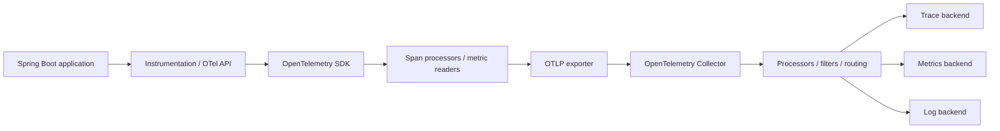

# OpenTelemetry in Spring Boot

A request enters a Spring Boot application, queries the database, calls the payment service, and publishes a message for background processing. When latency increases, the operations team needs to know where the request traveled, which step was slow, which service produced an error, and which logs belong to that trace. Metrics show overall trends; logs record events; distributed traces describe the journey of instrumented operations. To produce and exchange these signals under a common model, **OpenTelemetry (OTel)** provides APIs, SDKs, instrumentation, and the OTLP protocol.

OpenTelemetry is an open-source set of standards and tools for generating, processing, and exporting telemetry, including traces, metrics, and logs. In Spring Boot, OTel can integrate through the OpenTelemetry SDK/agent or work alongside Micrometer abstractions such as Observation and Micrometer Tracing. The right architecture depends on the Spring Boot version, dependencies, exporter, and backend pipeline.

This lesson belongs to the **OpenTelemetry** chapter of the **SPRING_BOOT_OBSERVABILITY** module. The module teaches how to set up observability for Spring Boot using Micrometer Observation, metrics, logs, and distributed tracing; covering context propagation, tags/cardinality, exporters, sampling, and signal correlation to investigate errors, latency, and application behavior in production environments. This lesson provides the foundation to understand OTel in Spring Boot and verify telemetry data from the application to the backend.

## Learning Objectives

After this lesson, you will be able to:

1. Explain what OpenTelemetry is and why telemetry standardization is needed.
2. Distinguish between the OTel API, SDK, instrumentation, OTLP exporter, Collector, and observability backend.
3. Describe the architecture for integrating OTel with Spring Boot and the role of Micrometer Observation/Tracing.
4. Choose an instrumentation model: Spring Boot Actuator/Micrometer, OTel Java Agent, or the OTel SDK directly.
5. Configure service/resource metadata, exporter endpoints, and context propagation.
6. Distinguish between trace/span, metric instrument, and log record; understand how signals are correlated.
7. Understand sampling, batching, retries, collector pipelines, and points where data can be dropped.
8. Control cardinality, privacy, secrets, and telemetry cost.
9. Diagnose issues from instrumentation through the OTLP Collector/backend.
10. Roll out OTel in phases, avoiding duplicate instrumentation or SDK/exporter conflicts.

## 1. What Problem Does OpenTelemetry Solve?

A distributed system may use multiple languages, frameworks, and observability backends. If each component defines its own trace IDs, metric names, log fields, propagation headers, and exporters, correlating data and switching backends becomes difficult.

OpenTelemetry provides shared components and conventions:

- **API:** the interface that libraries/applications use to create spans, metrics, and log telemetry.
- **SDK:** implements the API and manages providers, processors, readers, samplers, and exporters.
- **Instrumentation:** automatically or manually creates telemetry around HTTP, databases, messaging, frameworks, and business code.
- **Context propagation:** passes trace context across process, thread, and protocol boundaries.
- **OTLP:** the protocol for transmitting telemetry to a collector or supported backend.
- **Collector:** receives, processes, routes, and exports telemetry to one or more destinations.
- **Semantic conventions:** naming and attribute conventions so telemetry carries consistent meaning.

OpenTelemetry does not automatically explain every application behavior and does not guarantee that every request is collected. Applications still require properly configured instrumentation, propagation, sampling, and pipelines.

### 1.1. The Three Main Signals

| Signal | Content | Questions Typically Answered |
|---|---|---|
| **Traces** | A trace consists of related spans with timing, attributes, events, and status | Where did a request go? Which step was slow? |
| **Metrics** | Aggregated measurements such as counters, gauges, and histograms | How many requests? How do error rate and latency change? |
| **Logs** | Event records with timestamp, severity, body, and attributes | What happened? Were there any exceptions? |

The three signals complement each other. A sampled trace does not replace system-wide throughput; aggregated metrics do not contain every event of a request; logs do not inherently represent a distributed timeline.

### 1.2. General Telemetry Pipeline



This is a reference architecture. An application can export directly to a backend or use another Micrometer registry/exporter. A Collector is not mandatory in every small system, but it is useful for centrally managing pipelines, credentials, routing, and processing policies.

## 2. OpenTelemetry Components

### 2.1. OpenTelemetry API and SDK

The API allows code/instrumentation to obtain a tracer, meter, or logger and create telemetry. An application can depend on the API without knowing which backend stores the data.

The SDK implements the API and manages its components:

| Component | Responsibility |
|---|---|
| TracerProvider | Creates tracers and manages tracing configuration |
| SpanProcessor | Receives span start/end events and forwards spans to an exporter |
| Sampler | Decides whether a trace/span is recorded according to policy |
| MeterProvider | Manages meters, readers, views, and metric export |
| LoggerProvider | Manages log records when using the OTel Logs SDK |
| Resource | Describes the entity emitting telemetry: service, version, environment |
| Exporter | Sends telemetry via OTLP or another backend/format |

An application that includes the OTel API without an active SDK/exporter may not have the expected export pipeline. Therefore, you must verify the actual runtime provider and SDK.

### 2.2. Instrumentation

**Automatic instrumentation** uses an agent or framework integration to observe supported libraries with minimal source changes—for example, HTTP, JDBC, messaging, or runtime metrics.

**Manual instrumentation** is added by developers around business code that needs observation, such as authorizing payment, reserving inventory, or reconciling an order.

Automatic instrumentation reduces effort but does not fully understand domain semantics. Manual instrumentation adds business context, though clear boundaries are needed to avoid creating duplicate spans.

### 2.3. OTLP and Collector

**OTLP (OpenTelemetry Protocol)** is the protocol for transmitting telemetry over HTTP/protobuf or gRPC depending on the exporter, endpoint, and configuration. OTLP is not synonymous with the Zipkin API or Prometheus scraping.

The Collector can receive data through receivers, apply processors such as batch, memory limiter, transform/filter, or tail sampling when configured, and route it to exporters. Component availability depends on the Collector distribution and version.

## 3. OpenTelemetry and Micrometer in Spring Boot

Spring Boot has an observability system built on **Micrometer Observation**, **Micrometer Metrics**, and **Micrometer Tracing**. OpenTelemetry can connect to these abstractions, though the two API systems are not the same.

| Component | Role |
|---|---|
| Micrometer Observation | Models operations and observation lifecycles |
| Micrometer Metrics | API/registry for counters, timers, and gauges |
| Micrometer Tracing | Tracing abstraction for spans and context |
| OTel API/SDK | API/implementation for traces, metrics, and logs |
| Micrometer Tracing OTel bridge | Connects Micrometer Tracing to the OTel tracer |
| OTLP exporter | Exports OTel telemetry using OTLP |
| Collector/backend | Receives, processes, stores, and queries data |

An Observation can be watched by multiple `ObservationHandler` instances: a metrics handler creates meters, a tracing handler creates spans, and logging integration adds correlation. An Observation does not automatically turn into every signal; the handlers must be configured.

### 3.1. Avoiding Duplicate Instrumentation

If the OTel Java Agent creates HTTP server/client spans while Spring Boot/Micrometer instruments the same boundary, the trace may contain repeated spans.

Identify the instrumentation owner for each boundary: HTTP server, HTTP client, JDBC, messaging, and domain operations. Multiple tools can work together at different boundaries, but you must inspect the trace tree rather than enabling every integration by default.

## 4. Choosing an OTel Integration Model with Spring Boot

| Model | How It Works | When It Fits | Key Considerations |
|---|---|---|---|
| Spring Boot + Micrometer | Actuator, Observation, Metrics, Tracing, and bridge/export integration | Projects wanting to keep the Micrometer abstraction | Manage bridge, registry, exporter, and versions |
| OTel Java Agent | Agent injects instrumentation into the JVM | Need to instrument supported libraries quickly | Avoid overlapping with Spring/Micrometer instrumentation |
| Direct OTel SDK | App uses OTel API/SDK and instrumentation directly | Deep custom OTel requirements | Manage provider, exporter, resource, and context |

Before adding dependencies, find out whether the project already uses Micrometer, whether the current tracer is Brave or OTel, whether an agent is running, whether metrics are scraped or pushed, how logs are exported, and whether the backend receives OTLP directly or via a Collector.

If you already use Micrometer Observation and need an OTel backend, the appropriate bridge keeps your API consistent. If you use the OTel SDK or agent, plan the migration carefully to avoid two competing SDKs/providers.

## 5. Configuring Spring Boot with the OpenTelemetry Bridge

Illustrative Gradle setup for **Spring Boot 3.x using Micrometer Tracing with the OTel bridge**:

```groovy
dependencies {
    implementation 'org.springframework.boot:spring-boot-starter-actuator'
    implementation 'io.micrometer:micrometer-tracing-bridge-otel'
    runtimeOnly 'io.opentelemetry:opentelemetry-exporter-otlp'
}
```

Dependencies and versions should follow the Spring Boot/Micrometer BOM. Do not pin independent versions when the BOM manages them. Do not add the Brave bridge alongside the OTel bridge without a clear architectural reason.

### 5.1. Service Name and OTLP Endpoint

YAML example for some Spring Boot 3.x configurations:

```yaml
spring:
  application:
    name: checkout-service

management:
  tracing:
    sampling:
      probability: 0.10

  otlp:
    tracing:
      endpoint: http://otel-collector:4318/v1/traces
```

Property prefixes, default transports, and endpoint behavior depend on the Boot version. Consult the reference configuration and verify the actual endpoint used by the exporter.

- `spring.application.name` is one source of service name in many integrations.
- Sampling probability `0.10` illustrates head-based probability; metrics do not drop to measuring only 10% of requests because of this.
- Port `4318` is commonly used for OTLP/HTTP; path `/v1/traces` is the OTLP/HTTP traces path.
- `otel-collector` is an assumed hostname inside a container/cluster network.

If the application runs outside the Collector's network, hostname or `localhost` may not work. Use the real deployment endpoint along with the corresponding TLS/authentication and trust store.

### 5.2. Resource Attributes and Service Identity

A Resource describes **where telemetry is produced**, which differs from attributes on a span or metric point.

```text
service.name=checkout-service
service.version=1.42.0
deployment.environment.name=production
service.instance.id=checkout-pod-7f9c
```

Standard key names may vary across semantic convention versions. Keep resource metadata consistent across the application, agent, and collector. Do not use request ID, user ID, or trace ID as resource attributes because a resource applies broadly to the process/service.

## 6. OpenTelemetry Java Agent

The OpenTelemetry Java Agent provides automatic instrumentation for the JVM, typically attached at startup using the `-javaagent` flag.

Example:

```bash
java \
  -javaagent:/opt/otel/opentelemetry-javaagent.jar \
  -Dotel.service.name=checkout-service \
  -Dotel.exporter.otlp.endpoint=http://otel-collector:4317 \
  -Dotel.traces.sampler=parentbased_traceidratio \
  -Dotel.traces.sampler.arg=0.10 \
  -jar app.jar
```

This is Java Agent configuration, not Spring Boot `management.*` syntax. Port `4317` is commonly used for OTLP/gRPC; `4318` is commonly used for OTLP/HTTP. Match the receiver and agent versions; manage the agent JAR in your image/build and pin its version.

The advantage is instrumenting popular frameworks with minimal code changes. The limitations are that the agent does not understand full domain context, may produce spans duplicating Spring/Micrometer, and upgrading versions may alter span names/attributes. You should measure overhead and inspect the trace tree.

## 7. Manual Instrumentation with the OpenTelemetry API

Automatic instrumentation does not understand every business step. When you need to measure a custom operation, you can use the OTel API directly or Micrometer Observation.

```java
import io.opentelemetry.api.trace.Span;
import io.opentelemetry.api.trace.SpanKind;
import io.opentelemetry.api.trace.Tracer;
import io.opentelemetry.context.Scope;

class PaymentAuthorizationService {
    private final Tracer tracer;
    private final PaymentGateway gateway;

    PaymentAuthorizationService(Tracer tracer, PaymentGateway gateway) {
        this.tracer = tracer;
        this.gateway = gateway;
    }

    PaymentResult authorize(PaymentRequest request) {
        Span span = tracer.spanBuilder("payment.authorize")
                .setSpanKind(SpanKind.INTERNAL)
                .startSpan();

        try (Scope scope = span.makeCurrent()) {
            span.setAttribute("payment.operation", "authorize");
            span.setAttribute("payment.provider", "provider-a");
            return gateway.authorize(request);
        } catch (RuntimeException error) {
            span.recordException(error);
            span.setStatus(
                    io.opentelemetry.api.trace.StatusCode.ERROR);
            throw error;
        } finally {
            span.end();
        }
    }
}
```

The types `PaymentGateway`, `PaymentRequest`, and `PaymentResult` are business examples. The `Tracer` must be configured from the SDK/bridge. `makeCurrent` opens a scope so downstream instrumentation uses the active span; `close` restores the previous context; `span.end` completes the duration measurement.

### 7.1. Scope and Span Have Separate Lifecycles

A `Scope` manages the current context. Closing a scope restores the previous context; it does not mean the span has ended. Calling `span.end()` completes the timing measurement and allows processors/exporters to handle the span.

For async tasks, do not end the span immediately upon submitting a `Future`. The span lifecycle must wrap the execution callback, and context must be captured/restored at the proper boundaries.

### 7.2. Using Micrometer Observation When Appropriate

```java
Observation.createNotStarted(
        "payment.authorize", observationRegistry)
    .contextualName("authorize payment")
    .lowCardinalityKeyValue("payment.operation", "authorize")
    .lowCardinalityKeyValue("payment.provider", "provider-a")
    .observe(() -> gateway.authorize(request));
```

When metrics/tracing handlers are configured, `Observation` can produce both metrics and spans. Do not simultaneously create a manual OTel span wrapping the same callback without a clear reason.

Low-cardinality values like operation/provider have a bounded set of values. Order ID, email, trace ID, or raw URLs have high cardinality and may be sensitive. Follow allowlists, privacy policies, and backend indexing limits.

## 8. Context Propagation with OpenTelemetry

Distributed tracing needs to propagate `SpanContext` across HTTP headers, message headers, threads/executors, Reactor/async callbacks, and RPC boundaries.

W3C Trace Context is a widely used propagator:

```http
traceparent: 00-0af7651916cd43dd8448eb211c80319c-b7ad6b7169203331-01
```

Client instrumentation injects context; server instrumentation extracts it and creates a linked span if propagation is compatible. Proxies dropping headers or mismatched propagators can split traces.

OTel Java uses `Context` and the current scope; context does not automatically cross every executor or new thread. With Spring executors, Micrometer Context Propagation and `ContextPropagatingTaskDecorator` can help in supported versions. With the direct OTel SDK, use a compatible context wrapper. Do not pass an arbitrary `Scope` to another thread to close.

Baggage is contextual metadata that can propagate when configured. It does not automatically become a span attribute and can travel across network headers. Do not put tokens, authorization headers, PII, or sensitive payloads into baggage; enforce allowlists, size limits, and trust boundaries.

## 9. Sampling in OpenTelemetry

Sampling decides which traces are recorded/exported:

- **Head sampling:** decides early when the trace starts; saves load by dropping early, though it does not yet know whether the request will error or be slow at the end.
- **Tail sampling:** decides after the Collector receives more spans; requires buffering/capacity and is typically performed in the Collector/pipeline.

Example Java Agent using a parent-based trace ID ratio sampler:

```bash
-Dotel.traces.sampler=parentbased_traceidratio
-Dotel.traces.sampler.arg=0.10
```

Sampler names/properties depend on the Agent/SDK version. With Spring Boot Micrometer tracing, `management.tracing.sampling.probability` is how head probability is configured in supported versions.

Sampling traces should not reduce business metrics if metrics are instrumented independently. Do not use the count of stored spans in the backend as the denominator for total-traffic SLIs.

Parent-based sampling lets downstream services inherit the sampling decision. Inbound flags arrive from external boundaries; the system needs a trust policy and should not allow arbitrary clients to force the application to export every trace.

Tail sampling needs to hold spans by trace ID while waiting for a decision. If a head sampler already dropped spans at the application, the tail sampler cannot recover data that was never sent.

## 10. Metrics with OpenTelemetry and Micrometer

OpenTelemetry Metrics provides an instrument and export model. Micrometer Metrics has its own API and registry. Spring Boot commonly uses Micrometer and can export to backends via Prometheus, OTLP, or an appropriate registry.

Conceptual OTel counter example:

```java
LongCounter counter = meter
        .counterBuilder("checkout.orders.accepted")
        .setDescription("Accepted checkout orders")
        .setUnit("{order}")
        .build();

counter.add(1);
```

The API depends on the OTel version. If a project already uses Micrometer, consider registering meters via `MeterRegistry` or `Observation` rather than creating an independent OTel `MeterProvider` that makes managing two metrics systems harder.

Histograms record value distributions such as request duration. The backend calculates percentiles when supported by the exporter/backend. Check instruments, views, temporality, bucket boundaries, and output; do not assume p95 is always available.

Metric time series are identified by the metric name and combination of attributes/labels. Avoid user ID, order ID, or trace ID; use service, environment, route template, method, status group, and operation. OTel views can adjust aggregation/attributes; Micrometer uses `MeterFilter` and tag policies.

## 11. Logs and Correlation

The OTel Logs data model represents a log record with timestamp, severity, body, attributes, resource, and trace context when available. In Spring Boot, Logback can still generate logs; an integration/bridge forwards logs into the OTel pipeline.

Two distinct needs:

1. **Log correlation:** printing trace ID/span ID in structured logs or MDC to look up logs by trace.
2. **Log export:** shipping log records to a backend via an appender, agent, or collector.

A log having a trace ID does not prove the span was exported; conversely, a span may exist even when log correlation is not configured.

Trace ID and span ID have very high cardinality and should not be metric labels. Use log correlation, trace search, or exemplars if the backend supports them. Do not write access tokens, cookies, passwords, card numbers, sensitive request bodies, or unnecessary PII into logs or spans.

## 12. OpenTelemetry Collector: Receiver, Processor, Exporter

The Collector sits between applications and backends so the app does not need to know every destination. Illustrative pipeline example:

```yaml
receivers:
  otlp:
    protocols:
      grpc:
        endpoint: 0.0.0.0:4317
      http:
        endpoint: 0.0.0.0:4318

processors:
  memory_limiter:
    check_interval: 1s
    limit_mib: 512
  batch:
    timeout: 5s
    send_batch_size: 1024

exporters:
  debug:
    verbosity: basic

service:
  pipelines:
    traces:
      receivers: [otlp]
      processors: [memory_limiter, batch]
      exporters: [debug]
    metrics:
      receivers: [otlp]
      processors: [memory_limiter, batch]
      exporters: [debug]
    logs:
      receivers: [otlp]
      processors: [memory_limiter, batch]
      exporters: [debug]
```

Component availability and YAML schema depend on the Collector distribution/version. The `debug` exporter is for inspection, **not a production storage backend**.

The Collector typically processes and forwards telemetry; it is not a long-term trace database or metrics TSDB by itself. The receiving backend handles storage, querying, retention, alerting, and UI.

The batch processor groups telemetry to reduce network overhead. Queues/retries absorb brief disruptions, but they do not have infinite capacity; slow downstream backends can fill the queue and cause telemetry drops.

Monitor exporter failures/retries, queue size, enqueue failures, Collector memory/CPU, receiver accepted/refused counts, dropped records, and backend ingest latency. The observability pipeline needs observability too.

## 13. Security, Privacy, and Cost

**Network and identity:** use TLS/mTLS or supported authentication mechanisms; restrict receivers to trusted sources only. Do not expose OTLP ports publicly when unnecessary.

**Secrets:** do not hard-code tokens in application YAML or container images. Use a secret manager or secret mounts with rotation.

**Privacy:** do not put credentials, payment data, personal identifiers, or sensitive payloads into span events, baggage, log bodies, or metric attributes.

**Cardinality:** metric attributes require a low, stable set of values; span attributes are more flexible, but you must still consider index cost, search performance, and privacy.

**Retention:** traces can generate high volume; set retention based on investigation needs and data requirements.

**Sampling:** design policies around traffic, spans/trace, error/latency needs, and backend capacity. Always-on system-wide tracing can be prohibitively expensive.

**Collector boundary:** allow only approved processors/exporters; manage transforms/redaction and routing to prevent sending data outside policy.

## 14. Verifying OpenTelemetry in Spring Boot

Verify stage by stage along the pipeline:

1. **Startup:** confirm the tracer/SDK/bridge, exporter, and resource config are initialized.
2. **Instrumentation:** send test requests to HTTP endpoints and instrumented domain operations.
3. **Context:** check current trace/span, outbound headers, and downstream extraction.
4. **Sampling:** use deterministic samplers in tests to avoid randomly dropping traces.
5. **Export:** verify endpoint, protocol, TLS/authentication, and error logs.
6. **Collector:** confirm the receiver accepts telemetry, processors do not drop it unexpectedly, and exporters send it out.
7. **Backend:** search traces by ID, service name, and time; inspect metrics/logs if included in the pipeline.
8. **Correlation:** verify logs carry trace context and metrics do not have trace ID labels.
9. **Failure paths:** test exceptions, timeouts, async tasks, and Collector unavailability.
10. **Capacity/privacy:** check volume, queues/drops, resource attributes, and sensitive data.

### 14.1. Quick Diagnostic Table

| Symptom | Layer to Check |
|---|---|
| No spans created at all | API/SDK/agent, instrumentation, Observation handlers |
| Span exists in service A but trace splits at B | Propagator, HTTP/messaging headers, proxy, async context |
| Span is correct in memory but missing in backend | Sampler, processor, exporter, Collector, storage |
| Metrics appear but traces are missing | Metrics and traces have separate SDK/exporter/samplers |
| Trace exists but logs lack trace ID | MDC/log correlation and context scope |
| Trace exists with duplicate spans | Agent and Spring/Micrometer duplicate instrumentation |
| Collector queue grows and drops data | Downstream capacity, retry, memory limiter |
| Sudden spike in metric series | Attribute cardinality and tag policy |
| Service name split into separate groups | Inconsistent resource attributes |
| Incorrect trace duration on async tasks | Span lifecycle ending too early or missing context |

### 14.2. Testing a Trace Across Two Services

An integration test should boot two Spring Boot services and a test Collector or in-memory exporter; use deterministic sampling; send a request from service A to B; assert a shared trace ID, distinct span IDs, and semantically correct parent relationships; and verify the Collector receives spans and the test backend can query them when testing ingestion.

Not every unit test needs a Zipkin/Jaeger/Tempo UI. Most tests verify context and span lifecycle in memory; only a subset of E2E tests verify a real Collector/backend.

## 15. Phased Rollout Roadmap

**Phase 1 — Assess current state.** List Spring Boot/Micrometer versions, tracing bridge, Java Agent, registry, exporter, and backend. Identify who owns each instrumentation boundary.

**Phase 2 — Standardize service identity.** Align service name, version, environment, and resource attributes; avoid duplicates or per-request values.

**Phase 3 — Enable baseline telemetry.** Verify HTTP metrics, JVM metrics, server/client spans, and log correlation for one representative service.

**Phase 4 — Connect OTLP/Collector.** Set up networking, TLS/auth, receivers, processors, exporters, and monitoring for the Collector.

**Phase 5 — Instrument business logic.** Add Observation or OTel spans for reserving inventory, authorizing payment, and publishing events; avoid duplicate instrumentation.

**Phase 6 — Design sampling/retention.** Estimate spans/trace and storage volume; test head/tail sampling; keep metrics for full-traffic SLIs.

**Phase 7 — Test and canary rollout.** Compare duplicate spans, CPU/memory overhead, exporter drops, cardinality, and sensitive data.

**Phase 8 — Continuous operations.** Maintain dashboards for both applications and the Collector, alerts for telemetry loss, and investigation workflows correlating metrics, logs, and traces.

Starting with one representative service helps identify dependencies and configurations that need standardization before scaling across the whole system.

## 16. Anti-Patterns to Avoid

| Anti-pattern | Consequence | Recommended Approach |
|---|---|---|
| Treating OTel as a backend | Confuses SDK, Collector, and storage | Understand each layer of the pipeline |
| Adding only the API dependency | Missing SDK/provider/exporter | Verify the runtime provider |
| Running Agent and Spring instrumentation on the same boundary | Duplicate spans and overhead | Pick one owner per integration |
| Mixing Brave bridge and OTel bridge arbitrarily | Ambiguous tracer setup | Choose a primary implementation |
| Treating OTLP like Prometheus scraping | Wrong transport/endpoint | Use the matching exporter/receiver |
| Using `localhost` inside a container to call an external Collector | Wrong network namespace | Use real service DNS |
| 100% sampling indefinitely | Volume/storage exceeds capacity | Budgeted sampling policy |
| Using trace counts as the SLI denominator | Sampling/export bias | Use independent metrics |
| Adding `traceId`/`userId` to metric attributes | Cardinality and privacy risk | Keep metric dimensions stable |
| Logging entire payloads/request headers | Leaking credentials/PII | Use allowlists and redaction |
| Assuming the Collector stores telemetry long-term | Data loss without a backend | Connect a backend with retention |
| Monitoring only application health | Missed exporter drops | Observe the telemetry pipeline |
| Wrapping `Future` submission with a synchronous span | Duration does not measure the async task | Tie span lifecycle to the callback |
| Per-request resource attributes | Fragmented service identity | Keep resource metadata stable |

## 17. Pre-Production Checklist

1. **Architecture:** using Micrometer bridge, Java Agent, or direct OTel SDK? Is instrumentation ownership documented?
2. **Compatibility:** are Spring Boot, Micrometer, OTel SDK/Agent, and Collector versions compatible?
3. **Provider:** are tracer/meter/logger providers initialized from an authoritative source?
4. **Service resource:** are `service.name`/version/environment/instance id consistent and free of request data?
5. **Instrumentation:** are HTTP, database, messaging, and domain spans sufficient without duplication?
6. **Context:** do W3C/B3 propagators and thread/executor/Reactor/message contexts work properly?
7. **Sampling:** are head/tail, parent-based rules, and trust boundaries defined?
8. **Export:** are OTLP protocol, endpoint, TLS/auth, batching, retries, and queues verified?
9. **Collector:** are receiver/processor/exporter, memory limiter, health, and drop metrics monitored?
10. **Backend:** are ingest, query, indexing, retention, and access control properly configured?
11. **Metrics:** do histograms/cardinality/units/temporality match dashboards and SLIs?
12. **Logs:** are log bridge/correlation and privacy policies clear?
13. **Security:** are attributes, baggage, logs, and metric labels free of tokens/PII?
14. **Capacity:** have application overhead, spans/sec, payload size, queues, storage, and query costs been measured?
15. **Testing:** are there unit/integration/E2E tests for context, sampling, and export?
16. **Rollout:** are canary, rollback, ownership, and incident procedures for lost telemetry defined?

## 18. Self-Assessment Questions

**Question 1.** What are the main layers of OpenTelemetry?

**Hint:** API, SDK, instrumentation, context propagation, OTLP, Collector, and backend.

**Question 2.** You have the OTel API in dependencies, but no traces appear. What should you check?

**Hint:** SDK/provider, instrumentation, sampler, span lifecycle, exporter, endpoint, Collector, backend, and query.

**Question 3.** Is Micrometer Observation the same API as the OpenTelemetry API?

**Hint:** No. Observation is a Micrometer abstraction; a bridge/integration can connect it to an OTel tracer.

**Question 4.** Why shouldn't you enable both the Java Agent and Spring auto-instrumentation on the same boundary without checking?

**Hint:** It can duplicate spans, metadata, and overhead; you need to choose an instrumentation owner.

**Question 5.** What are OTLP ports 4317 and 4318 typically used for?

**Hint:** Many deployments use 4317 for OTLP/gRPC and 4318 for OTLP/HTTP. The receiver and protocol must match.

**Question 6.** Is the Collector a trace database?

**Hint:** Not by default. The Collector receives, processes, and exports; the storage backend handles persistence and querying.

**Question 7.** Does 10% trace sampling mean metrics only count 10% of requests?

**Hint:** No, if metrics are instrumented and exported independently.

**Question 8.** Why is a resource service name different from a span attribute like request ID?

**Hint:** A resource describes a stable telemetry-emitting entity; a request ID changes per operation.

**Question 9.** Trace context is valid, yet the backend has no trace. What should you inspect?

**Hint:** Span end, sampler, exporter, queue/batch, Collector receiver/processor/exporter, storage, and retention.

**Question 10.** Why shouldn't you add trace IDs to metric labels?

**Hint:** Cardinality explodes. Use log correlation or exemplars if the backend supports them.

## Conclusion

**OpenTelemetry provides a standard model to instrument, process, and export traces, metrics, and logs in distributed systems.** When integrating with Spring Boot, you need to understand the relationship between Micrometer Observation/Tracing, the OTel API/SDK, the Java Agent, the OTLP exporter, the Collector, and the backend. Choose a clear instrumentation architecture, propagate context properly across HTTP/thread/async boundaries, standardize resource metadata, size sampling to capacity, and protect telemetry as sensitive operational data. Finally, verify the pipeline from generated spans/metrics/logs to the Collector and backend, correlating all three signals during incident investigation instead of treating any isolated trace or dashboard as complete proof.
