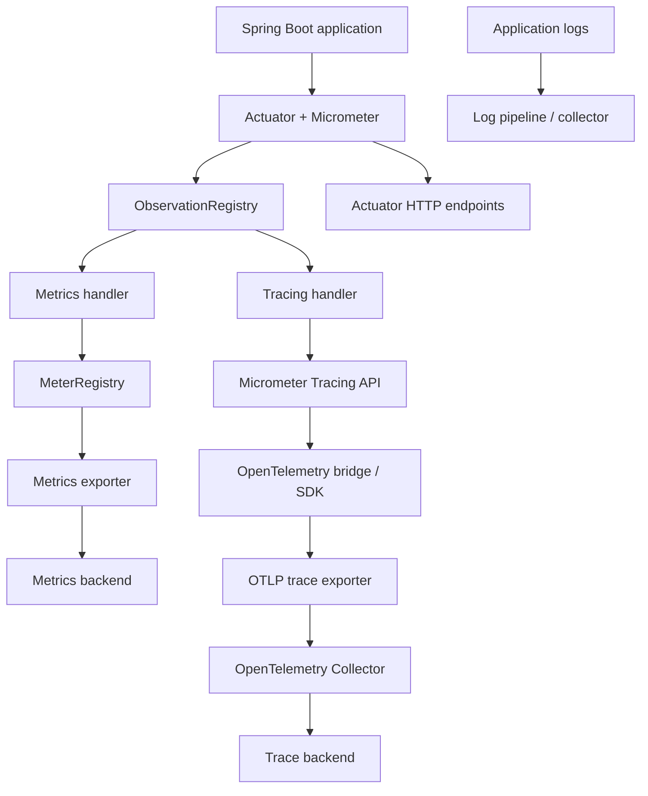
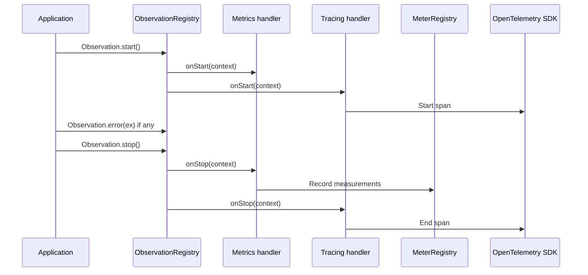
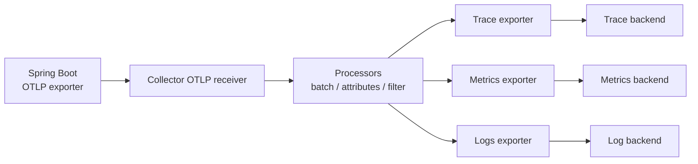

# Actuator Support for OpenTelemetry in Spring Boot

A Spring Boot application can expose `/actuator/health` for health checks, `/actuator/metrics` for reading measurements, and send distributed traces to an OpenTelemetry Collector. These capabilities are often deployed together, yet no single endpoint handles all of them. **Spring Boot Actuator** provides management and observation infrastructure; **Micrometer Observation/Tracing** produces application-level signals; and the **OpenTelemetry bridge, SDK, and exporter** bring traces (and, when configured separately, metrics) into the OpenTelemetry ecosystem.

This lesson **Actuator Support for OpenTelemetry** belongs to the **OpenTelemetry** chapter of the **SPRING_BOOT_OBSERVABILITY** module. The module focuses on setting up observability for Spring Boot using Micrometer Observation, metrics, logs, and distributed tracing; covering context propagation, tags/cardinality, exporters, sampling, and signal correlation to investigate errors, latency, and application behavior in production environments.

## 1. Learning Objectives

After this lesson, you will be able to:

- Explain the role Actuator plays when a Spring Boot application uses OpenTelemetry.
- Distinguish Actuator endpoints from the OTLP exporter endpoint and the Collector's OTLP receiver.
- Describe the relationship between Micrometer Observation, Micrometer Tracing, the OpenTelemetry bridge/SDK, and the backend.
- Configure baseline dependencies and management endpoints in Spring Boot.
- Understand the span export flow over OTLP and the difference between HTTP/protobuf and gRPC.
- Distinguish Micrometer metrics from OpenTelemetry traces; know when a separate registry/exporter is required.
- Design appropriate resource attributes, sampling, tags, and access controls.
- Diagnose cases where Actuator works yet the Collector receives no traces, or the backend has traces while metrics/logs are missing.

## 2. Which Parts Do Actuator and OpenTelemetry Solve?

**Spring Boot Actuator** is a suite of management and monitoring features for Spring Boot applications. It provides endpoints such as health, info, metrics, env, or prometheus depending on dependencies, exposure configuration, and security. Actuator lets you inspect health status and read selected runtime data.

**OpenTelemetry (OTel)** is an implementation-independent observability ecosystem comprising APIs, SDKs, semantic conventions, instrumentation, context propagation, and the OTLP protocol. OTel defines how to generate, process, and export telemetry such as traces, metrics, and logs.

**Micrometer** is the observability façade commonly integrated by Spring Boot. Micrometer Observation describes an operation; handlers can turn that operation into metrics and tracing spans. With the OpenTelemetry bridge, Micrometer Tracing uses OpenTelemetry underneath to manage spans/context, and the corresponding exporter sends spans to the Collector/backend.

| Component | Responsibility | Example |
| --- | --- | --- |
| Spring Boot Actuator | Application management/observation endpoints | `/actuator/health`, `/actuator/metrics` |
| Micrometer Observation | Observation lifecycle and handlers | `http.server.requests`, custom business observation |
| Micrometer Tracing API | Trace/span API used by applications or handlers | `Tracer`, `Span` |
| OpenTelemetry bridge/SDK | Creates span context, propagation, and OTel trace processing | `micrometer-tracing-bridge-otel`, OTel SDK |
| OTLP exporter | Sends telemetry to a receiver | OTLP trace exporter |
| OpenTelemetry Collector | Receives, processes, and forwards telemetry | OTLP receiver, processors, exporters |
| Observability backend | Stores, queries, and visualizes signals | Trace search, dashboards, alerts |

### Overall Diagram



**Actuator is not an OTLP Collector.** It does not automatically become a receiver at `/actuator/otlp` just because the application includes the OpenTelemetry bridge. The `/actuator/metrics` endpoint is an API for reading metrics inside the application; the OTLP exporter is a client sending telemetry out to a deployed receiver.

## 3. Common Actuator Endpoints

Which endpoints exist and are exposed depends on starters, registries, configuration, and security.

| Endpoint | Role | What Not to Infer |
| --- | --- | --- |
| `GET /actuator/health` | Application status and health contributors | Does not prove traces are exported |
| `GET /actuator/info` | Configured application info | Not a telemetry backend |
| `GET /actuator/metrics` | Lists Micrometer meter names | Not a historical time-series query |
| `GET /actuator/metrics/{name}` | Measurements and available tags of a meter | Does not replace PromQL or backend queries |
| `GET /actuator/prometheus` | Scrape metrics if a Prometheus registry is present and the endpoint is exposed | Not an OTLP endpoint |

### Exposing Required Endpoints

Example `application.yml`:

```yaml
management:
  endpoints:
    web:
      exposure:
        include: health,info,metrics
```

This configuration exposes three endpoints over the web when matching dependencies and the management web server are present. It does not enable a tracing exporter, create an OpenTelemetry Collector, or automatically expose a Prometheus scrape endpoint. If `/actuator/prometheus` is needed, the application must have a Prometheus registry and expose that endpoint.

**Exposed does not mean public.** An exposed endpoint can still be restricted by Spring Security, network policies, or a separate management port. Never expose all endpoints just for quick testing in production.

### Actuator Metrics Are In-Application Snapshots

Example:

```http
GET /actuator/metrics/http.server.requests
```

This endpoint returns measurements such as count/total time and available tags for a meter currently known to the registry. It is not where the OpenTelemetry backend stores traces. To view p95 latency over 30 minutes or look up a specific request's trace, query the corresponding metrics/tracing backend.

## 4. How Does Micrometer Observation Connect to OpenTelemetry?

Spring Boot uses Micrometer Observation to instrument operations. An Observation can have a name, low-cardinality key-values, high-cardinality values, an error, and a lifecycle. `ObservationRegistry` coordinates the installed handlers.

When the application has a metrics handler, an Observation can create a `Counter`/`Timer` or appropriate meter. When it has a tracing handler paired with the OpenTelemetry bridge, the same Observation can create a span. Both branches observe the same operation, yet each has **its own recording semantics and export pipeline**.



This diagram illustrates the case where both handlers are configured. It does not mean every Observation must produce both traces and metrics; that depends on actual instrumentation, filters, and handlers.

### Observation and the OTel API Are Not the Same API

| API/Layer | When to Use |
| --- | --- |
| `Observation` / `ObservationRegistry` | Instrumenting operations in the Spring/Micrometer model with multiple handlers |
| `io.micrometer.tracing.Tracer` | Performing tracing operations via the Micrometer API |
| `io.opentelemetry.api.trace.Tracer` | When the application intentionally uses the OTel API directly |
| OpenTelemetry SDK | Configuring providers, processors, exporters, and resources for OTel |
| Actuator | Inspecting application endpoints/runtime information |

In a Spring Boot application using Micrometer Observation, prefer `Observation` for custom operations needing both metrics and tracing. Only use the OTel API directly when there is a clear reason and you understand how it integrates with the lifecycle/SDK managed by Spring Boot; avoid creating a second standalone OTel SDK/provider outside auto-configuration.

## 5. Baseline Dependencies for Spring Boot with OpenTelemetry

Example for Spring Boot 3.x using Gradle Kotlin DSL and Spring Boot dependency management:

```kotlin
dependencies {
    implementation("org.springframework.boot:spring-boot-starter-actuator")
    implementation("io.micrometer:micrometer-tracing-bridge-otel")
    runtimeOnly("io.opentelemetry:opentelemetry-exporter-otlp")
}
```

Roles:

- `spring-boot-starter-actuator`: Spring Boot's management/observation endpoints and infrastructure.
- `micrometer-tracing-bridge-otel`: connects the Micrometer Tracing API to OpenTelemetry.
- `opentelemetry-exporter-otlp`: exporter supporting telemetry transmission over OTLP when configured and auto-configured for the right version.

The Spring Boot BOM should manage compatible versions of Spring Boot, Micrometer, and OpenTelemetry. Do not add arbitrary versions to individual dependencies or add the Brave bridge alongside the OTel bridge once OTel has been chosen.

### Actuator Does Not Require an OTLP Exporter to Read Metrics

If you only need `/actuator/metrics`, the in-application Micrometer registry may already be enough. If you want to export metrics to a backend via OTLP, you need a suitable metrics registry/exporter, such as the Micrometer OTLP registry for your version. The OTel trace bridge/exporter and the Micrometer metrics exporter are two configurations that can be independent.

### Not Every Library Is Automatically Instrumented

Actuator and the OTel bridge do not automatically create detailed spans for every third-party library. HTTP server, HTTP client, database, Kafka, RabbitMQ, or messaging instrumentation depends on the Spring version, client builders, instrumentation modules, and actual configuration. Prefer Spring-managed clients/templates and observe the end-to-end flow to verify.

## 6. Configuring Trace Export via OTLP

For traces to appear in the backend, the application needs an exporter and a receiver that actually receives the data. Typically, an OpenTelemetry Collector sits between the application and the backend.

Example OTLP/HTTP endpoint diagram:

```text
Application exporter
    |
    | OTLP/HTTP protobuf
    v
http://otel-collector:4318/v1/traces
    |
    v
OpenTelemetry Collector
    |
    v
Trace backend
```

Port `4318` is commonly used for OTLP/HTTP; `4317` is commonly used for OTLP/gRPC in standard deployments. The exact endpoint depends on the Collector's receiver, transport, and network.

### Properties by Spring Boot Version

Spring Boot release lines may change property groups and auto-configuration for OTLP tracing. In versions that support configuring OTLP tracing via management properties, the configuration may look like:

```yaml
management:
  tracing:
    sampling:
      probability: 0.1
  otlp:
    tracing:
      endpoint: http://otel-collector:4318/v1/traces
```

**Always check the property metadata for the exact Spring Boot version you are using.** Do not copy this property to an older Boot release or a stack with custom exporter configuration if the property is unsupported. If a version requires defining exporter/processor beans, use the auto-configuration or builders documented for that exact version; do not register multiple parallel exporters/providers.

### OTLP Endpoint vs. Actuator Endpoint

`/actuator/health` and `/actuator/metrics` are HTTP endpoints exposed by the application for operators. `/v1/traces` is an OTLP/HTTP path typically provided by the Collector's receiver. The application is the **client sending** traces to the Collector; it does not receive traces through an Actuator path.

### Configuring Sampling

`management.tracing.sampling.probability` adjusts the sampling policy configured by Spring Boot when the stack is compatible. For example, `0.1` corresponds to a roughly 10% probability policy for traces decided by that sampler; a small sample window may not equal exactly 10%. Production should choose a rate based on traffic, span volume, retention, and investigation requirements.

Do not use sampling rates as a data protection mechanism. Sensitive fields that must not be collected must be stripped or controlled at instrumentation, baggage, logs, and exporters.

## 7. Resource Attributes: Service Identity in OpenTelemetry

OTel resource attributes describe **the source emitting telemetry**, such as the service, environment, or deployment version. They differ from span attributes:

| Type | Example | Scope |
| --- | --- | --- |
| Resource attribute | `service.name=order-service` | Telemetry emitted from that resource/process |
| Resource attribute | `deployment.environment.name=production` | Deployment environment |
| Resource attribute | `service.version=2.4.1` | Application version |
| Span attribute | `http.route=/orders/{id}` | A single span/request |
| Span attribute | `payment.provider=partner-a` | A single operation |
| Metric attribute/tag | `outcome=error` | A meter/time-series dimension |

Semantic convention names and resource configuration properties depend on the OTel/Spring Boot version. Keep `service.name` stable, use standardized environment/version values, and inspect the exported resource at the Collector/backend.

Example declaring environment via deployment configuration:

```yaml
spring:
  application:
    name: order-service

management:
  tracing:
    sampling:
      probability: 0.1
```

The application name may be used as the service name by the built-in auto-configuration. Do not assume every stack automatically turns `spring.application.name` into all resource attributes; check the actual exported resource or configure it explicitly per your version's property/SDK support.

### Resource Is Not Baggage

`service.name` identifies the process/service producing telemetry. Baggage carries metadata along the trace context across services. Do not put `service.name` into baggage per request as a substitute for resource attributes.

## 8. Metrics, Traces, and Logs When OpenTelemetry Is Enabled

Actuator supports observing signals, yet each signal may travel down its own pipeline:

| Signal | Source in Spring Boot | Possible Export Destination | Related Actuator Aspect |
| --- | --- | --- | --- |
| Metrics | Micrometer meters/Observation | Prometheus, OTLP metrics registry, or other backend | `/actuator/metrics`, `/actuator/prometheus` |
| Traces | Micrometer Tracing/OTel bridge or OTel instrumentation | OTLP trace exporter | Tracing configuration; not an endpoint for reading historical traces |
| Logs | SLF4J/Logback or logging framework | Appropriate agent/collector/log exporter | Logging pattern/configuration, not the Actuator metrics endpoint |

### Metrics Are Not Automatically Sampled Alongside Traces

A request might not be sampled for a trace, yet `Timer`/`Counter` still record it. Therefore:

- Do not use the count of stored traces to compute total requests if sampling is below 100%.
- Do not put `traceId` or `spanId` into metric labels.
- Use low-cardinality tags such as route template, method, outcome, and service.
- Use a time-series backend to analyze rates, histograms, p95/p99, and history.

### Logs and Trace Correlation

When tracing integration places trace/span IDs into MDC, the logging pattern can print them:

```yaml
logging:
  pattern:
    correlation: "[%X{traceId:-},%X{spanId:-}] "
```

This is an example pattern for a compatible Spring Boot logging setup. It only affects log formatting; it does not export logs over OTLP and does not guarantee every background thread has MDC if context propagation is not configured.

If you need to export logs with OpenTelemetry, configure an appropriate log appender/agent/collector pipeline. Do not assume that enabling the OTel tracing bridge ships logs or metrics as well.

## 9. Custom Observation in the Application

Suppose you need to measure an inventory reservation operation and create a span when a tracing handler is present. You can use Micrometer Observation:

```java
import io.micrometer.observation.Observation;
import io.micrometer.observation.ObservationRegistry;
import org.springframework.stereotype.Service;

@Service
public class InventoryService {
    private final ObservationRegistry observationRegistry;
    private final InventoryClient client;

    public InventoryService(ObservationRegistry observationRegistry,
                            InventoryClient client) {
        this.observationRegistry = observationRegistry;
        this.client = client;
    }

    public Reservation reserve(ReserveCommand command) {
        Observation observation = Observation
            .createNotStarted("inventory.reserve", observationRegistry)
            .lowCardinalityKeyValue("operation", "reserve")
            .start();

        try (Observation.Scope scope = observation.openScope()) {
            try {
                Reservation result = client.reserve(command);
                observation.lowCardinalityKeyValue("outcome", "success");
                return result;
            } catch (RuntimeException ex) {
                observation.lowCardinalityKeyValue("outcome", "error");
                observation.error(ex);
                throw ex;
            }
        } finally {
            observation.stop();
        }
    }
}

interface InventoryClient {
    Reservation reserve(ReserveCommand command);
}

record ReserveCommand(String sku, int quantity) {}
record Reservation(String reservationId) {}
```

This example shows a custom observation at a business boundary. If meter and tracing handlers are configured, the same observation can generate both metrics and a span. Do not wrap an additional manual `Timer` and custom span around the same measurement if it will record duplicate latency/operations. Ensure `Observation.Scope` is closed and `observation.stop()` always executes, even when an exception occurs.

### Low-Cardinality and High-Cardinality

- Low-cardinality: `operation=reserve`, `outcome=success|error`, `region=ap-southeast-1`.
- High-cardinality: `orderId`, `userId`, `traceId`, URLs containing specific IDs.

Low-cardinality values can become metric tags. Span attributes can be more detailed, though they still need limits to protect storage/privacy. Do not use baggage or resource attributes as a workaround for cardinality limits.

## 10. Where Does the OpenTelemetry Collector Fit?

The Collector typically receives OTLP from applications, processes it through receivers/processors, and exports to one or more backends. It is a separate infrastructure component, not a bean or Actuator endpoint inside the application.



The Collector can aggregate multiple sources, batch data, add/remove attributes, sample in certain architectures, and route to backends. Each processor/exporter requires its own configuration. Applications should not send telemetry to untrusted endpoints or unauthenticated public endpoints.

### What the Application and Collector Must Agree On

1. Transport: OTLP/HTTP or OTLP/gRPC.
2. Endpoint/port/path and TLS.
3. Authentication headers or protection mechanisms.
4. Resource attributes and semantic conventions.
5. Sampling policies in the SDK and/or Collector, avoiding mismatched expectations between head and tail sampling.
6. Export timeouts, retries, batching, and resource limits.

The OTLP exporter can succeed in sending from the application while the Collector still drops data in a processor or fails in its backend exporter. When debugging, inspect both sides.

## 11. Securing Actuator and OTLP

Actuator web endpoints and OTLP export endpoints have different security boundaries:

| Component | Access Direction | What to Protect |
| --- | --- | --- |
| `/actuator/health` | Operators/monitors calling into the app | Only expose health details according to policy |
| `/actuator/metrics` | Operators calling into the app | May reveal meter names, tags, and metadata |
| `/actuator/env` | Authorized admins calling into the app | May expose sensitive configuration; do not expose broadly |
| OTLP exporter endpoint | App actively sending out to the Collector | TLS, auth, network egress, and trusted endpoints |
| Collector receiver | App/agent sending into the Collector | Authentication, network policies, and resource limits |

### Practical Principles

1. Expose only the Actuator endpoints you need; enforce security and network restrictions.
2. Do not make `/actuator/env` or `/actuator/configprops` public simply for debugging convenience.
3. Protect the OTLP receiver; do not treat ports 4317/4318 as safe by default on the internet.
4. Manage OTLP auth headers/secrets via a secret store, never hard-coded in source code.
5. Do not export tokens, cookies, passwords, request bodies, or PII in span attributes, baggage, or logs.
6. Standardize tags/resource attributes, and constrain cardinality and payload sizes.
7. Maintain retention, access control, and deletion policies in the backend.

Sampling does not replace privacy filtering. An unsampled span does not mean logs or metrics for the same request are free of sensitive data.

## 12. Troubleshooting: Actuator Works but OpenTelemetry Receives No Traces

| Symptom | Causes to Check | Verification Approach |
| --- | --- | --- |
| `/actuator/health` works but no traces appear | Actuator does not prove the tracing exporter works | Check bridge, SDK, exporter, and Collector |
| `/actuator/metrics` shows meters but metrics backend is empty | Metrics exporter/registry or scrape not configured | Check Micrometer registry, scrape target/OTLP metrics |
| App creates spans but Collector receives nothing | Endpoint, transport, DNS, firewall, TLS, or auth | Check exporter logs and Collector receiver |
| Collector receives spans but backend is empty | Processor/filter/backend exporter error | Check Collector logs/telemetry |
| Only root spans appear, downstream spans missing | HTTP/messaging client not instrumented or propagation mismatch | Check builders, headers, and context propagation |
| Trace split into multiple roots | W3C/B3 mismatch or stripped headers | Compare inject/extract on both ends |
| Fewer traces than requests | Low sampling rate or reporter/exporter drops | Check sampling and export stats |
| Logs have trace IDs but backend lacks traces | Trace unsampled or export failed | Distinguish propagation, recording, and export |
| Missing attributes/resources | Resource config or convention differs from expectations | Inspect telemetry at the Collector |
| Duplicate spans or durations | OTel instrumentation and custom Observation wrap the same operation | Remove duplicate instrumentation |
| Actuator metrics endpoint returns 404 | Not exposed, Actuator missing, or different base path/port | Check dependencies and exposure config |
| `/actuator/prometheus` returns 404 | Missing Prometheus registry or endpoint not exposed | Check registry and exposure |

### Investigation Order

1. Confirm dependencies: Actuator, the right tracing bridge, OTLP exporter, and library instrumentation.
2. Identify the active tracing implementation; avoid creating two concurrent SDKs/providers.
3. Review sampling probability/policy and test with a flow that has high enough sampling.
4. Check the OTLP endpoint, transport, port/path, DNS, TLS, and auth.
5. Inspect application logs/export metrics; distinguish unrecorded spans from failed exports.
6. Check Collector receiver, processors, exporters, and backend ingestion.
7. Check propagation across HTTP/message headers if traces break between services.
8. Check resource attributes, service name, and query time range in the backend.
9. Check metrics and logs separately; do not treat `/actuator/metrics` as a place to read traces.

## 13. Hands-on Lab: Actuator and OpenTelemetry Collector

**Context:** `order-service` uses Spring Boot Actuator, Micrometer Observation, and the OpenTelemetry bridge. The goal is to verify Actuator endpoints inside the application, send traces over OTLP to a Collector, and cross-check the three signals.

### Part A — Preparation

1. Add compatible Actuator, Micrometer OTel bridge, and OTLP exporter according to the Spring Boot BOM.
2. Configure `spring.application.name` and sampling probability for the test environment.
3. Expose `health`, `info`, and `metrics`; secure endpoints per policy.
4. Prepare a Collector with an OTLP receiver using the right transport/port and an exporter to a trace backend.
5. Verify the app can reach the Collector over network/TLS/auth.

### Part B — Generating Telemetry

1. Send an HTTP request to an instrumented controller.
2. Call `GET /actuator/health` and verify its status.
3. Call `GET /actuator/metrics` to list available meters.
4. Call `GET /actuator/metrics/http.server.requests` and read measurements/tags.
5. Trigger the custom Observation `inventory.reserve` from Section 9.
6. Search for the trace in the backend by service name and the test time window.
7. Confirm the Collector received OTLP data and the backend stored the spans.

### Part C — Verification Matrix

| Case | Condition | Expected Result |
| --- | --- | --- |
| A — Health | Actuator health is exposed | Health endpoint responds according to health contributors |
| B — Metrics | HTTP requests occur | Meter has measurements if instrumentation/registry work |
| C — Tracing | Sampling allows it | Trace is sent over OTLP and appears in the backend |
| D — Low sampling | Lower probability | Stored traces decrease; metrics do not necessarily decrease |
| E — Wrong Collector endpoint | Change port/path in test | Export fails, business requests still run as designed |
| F — Propagation | Order calls inventory | Spans link properly when client/server are instrumented |
| G — Security | Call management endpoint with unauthorized identity | Security policy denies access |
| H — Log correlation | Logging MDC is configured | Logs inside scope contain trace/span IDs when context exists |

### Part D — Reasoning Exercises

1. `/actuator/health` returns `UP` but the trace backend is empty. List the layers to inspect.
2. `/actuator/metrics` has `http.server.requests` yet the metrics backend has no data. Which component might be missing?
3. The Collector receives spans yet the trace backend has no traces. Identify which step remains in the pipeline.
4. Why does a probability of `0.1` not mean every 10 requests will produce exactly one trace?
5. Why can the same Observation produce both metrics and spans while trace sampling does not make the `Counter` disappear?
6. When a custom Observation overlaps boundaries with auto-instrumentation, how might duplication appear?
7. Why should `/actuator/env` not be exposed publicly even if the Collector receiver is already secured?

## 14. Key Takeaways

**Spring Boot Actuator supports OpenTelemetry by providing management infrastructure, health/metrics endpoints, and integration with Micrometer Observation/Tracing; Actuator itself is not an OpenTelemetry Collector or OTLP receiver.** Micrometer Observation describes operations, handlers produce corresponding metrics/tracing, the OpenTelemetry bridge/SDK manages trace context, and the OTLP exporter sends spans to the Collector/backend.

Distinguish `/actuator/metrics` from OTLP `/v1/traces`, the metrics registry from the tracing exporter, and the log pipeline from both. Configure dependencies, sampling, resource attributes, the OTLP endpoint, and security for your exact Spring Boot version. When investigating issues, verify each layer from instrumentation, recording, and export to the Collector and backend, then cross-reference metrics and logs using context correlation. Clear separation of these layers enables Spring Boot applications to correlate metrics, logs, and distributed tracing while keeping cardinality, privacy, reliability, and operational cost under control.
