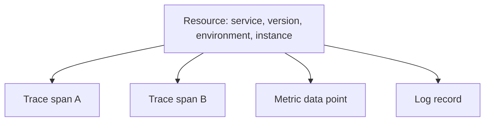
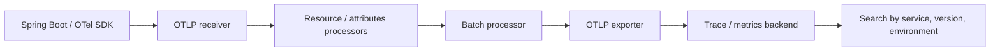

# `OTEL_RESOURCE_ATTRIBUTES` in OpenTelemetry and Spring Boot

**`OTEL_RESOURCE_ATTRIBUTES`** is the standard OpenTelemetry environment variable used to declare attributes of a **Resource**—the identity and context of the telemetry emitter. These attributes describe the service, application version, deployment environment, namespace, and instance. They help trace backends, metrics backends, and log systems group telemetry by its true source.

In the **SPRING_BOOT_OBSERVABILITY** module, Spring Boot combines Micrometer Observation, metrics, logs, and distributed tracing. Resource attributes help operators determine which service, release, and workload emitted telemetry, enabling before/after deployment comparisons and isolating failures. This lesson belongs to the **OpenTelemetry** chapter and focuses on environment variable syntax, differences between Resource, span attributes, and baggage, relationships with `service.name`/`OTEL_SERVICE_NAME`, Spring Boot configuration, and verifying Resource in the Collector/backend.

## 1. What Is a Resource?

In OpenTelemetry, a **Resource** describes the entity emitting telemetry. For a Spring Boot application, Resource typically represents the process or service instance.

| Attribute | Meaning | Example |
| --- | --- | --- |
| `service.name` | Logical name of the service | `order-service` |
| `service.version` | Application version | `2.4.1` |
| `service.namespace` | Logical service group | `commerce` |
| `deployment.environment.name` | Environment | `production` |
| `service.instance.id` | Instance identifier | `order-pod-a81f` |
| `host.name` | Host emitting telemetry if detected | `node-07` |
| `cloud.region` | Region if detected | `ap-southeast-1` |

These values are examples only. Actual Resource depends on the SDK, resource detectors, deployment, and application-supplied attributes.

### Resource Applies Across Signals



Multiple spans, metric points, or log records emitted by the same Resource share a common identity. Resource helps backends group data by service instance; it does not describe individual requests.

**`service.name`** should stay stable per logical service. Request ID, order ID, and Trace ID are not Resource identity.

## 2. What Is `OTEL_RESOURCE_ATTRIBUTES` Used For?

`OTEL_RESOURCE_ATTRIBUTES` is an OpenTelemetry environment variable used to pass a key-value list of Resource attributes to a compatible SDK/autoconfiguration.

Example:

```bash
OTEL_RESOURCE_ATTRIBUTES=service.namespace=commerce,service.version=2.4.1,deployment.environment.name=production
```

In a Kubernetes Deployment:

```yaml
env:
  - name: OTEL_RESOURCE_ATTRIBUTES
    value: "service.namespace=commerce,service.version=2.4.1,deployment.environment.name=production"
```

Pairs use `key=value` format separated by commas. Keys should follow semantic conventions; values should be short, stable, and free of secrets.

**Important:** an environment variable only takes effect if the running component actually reads it. Do not assume every Micrometer or Spring Boot component automatically processes all `OTEL_*` variables.

## 3. Syntax and Rules for Setting Attributes

General format:

```text
key1=value1,key2=value2,key3=value3
```

Example:

```bash
OTEL_RESOURCE_ATTRIBUTES=service.namespace=commerce,service.version=2.4.1,deployment.environment.name=staging
```

| Part | Guidance |
| --- | --- |
| Key | Valid attribute name, preferring semantic conventions |
| Value | Short, stable string without secrets |
| Separator | Comma between pairs |
| Assignment | Equals sign between key and value |
| Duplicate keys | Avoid duplicate declarations |
| Special characters | Follow OpenTelemetry specification syntax/encoding |
| Size | Keep the list small |

Do not write a naive parser splitting on commas if full encoding and specification rules are required. Let the SDK/autoconfiguration handle parsing. If you need custom Resource construction, use the official API or a supported integration.

Do not set `service.version` to a startup timestamp, `service.name` to a route, `service.instance.id` to a request ID, or `deployment.environment.name` to a client-supplied value.

## 4. `service.name` and `OTEL_SERVICE_NAME`

OpenTelemetry defines **`OTEL_SERVICE_NAME`** as the dedicated environment variable for **`service.name`**. When a compatible SDK/autoconfiguration reads both, `OTEL_SERVICE_NAME` takes higher precedence than a `service.name` declared in `OTEL_RESOURCE_ATTRIBUTES`.

Example:

```bash
OTEL_SERVICE_NAME=order-service
OTEL_RESOURCE_ATTRIBUTES=service.name=wrong-name,service.namespace=commerce,service.version=2.4.1
```

In an environment adhering to the OpenTelemetry SDK environment variable specification, `service.name` comes from `OTEL_SERVICE_NAME`; the remaining attributes are still read from `OTEL_RESOURCE_ATTRIBUTES`.

Kubernetes configuration example:

```yaml
env:
  - name: OTEL_SERVICE_NAME
    value: order-service
  - name: OTEL_RESOURCE_ATTRIBUTES
    value: "service.namespace=commerce,service.version=2.4.1,deployment.environment.name=production"
```

Do not declare conflicting service identities across application config, environment variables, Java agent, SDK Resource builder, and Collector transformations. Choose one authoritative source.

## 5. Resource Differs from Span Attributes

| Criterion | Resource attributes | Span attributes |
| --- | --- | --- |
| Scope | Telemetry-emitting source | A specific span |
| Lifecycle | Process/instance/resource | Operation |
| Examples | `service.name`, `service.version`, `host.name` | `http.route`, `http.request.method`, `db.system` |
| Purpose | Identify where telemetry came from | Describe the work performed |
| Varies per request | Usually no | Can vary |

Example:

```text
Resource:
  service.name = order-service
  service.version = 2.4.1
  deployment.environment.name = production

Span:
  name = POST /orders
  http.request.method = POST
  http.route = /orders
  http.response.status_code = 201
```

A service can emit millions of spans while sharing the same Resource identity. Do not put `http.route`, user ID, or Trace ID into Resource because those describe the request/operation.

## 6. Resource Differs from Baggage

**Baggage** is key-value metadata propagated along the trace context across service boundaries. **Resource** describes the telemetry emitter.

| Criterion | Resource | Baggage |
| --- | --- | --- |
| Purpose | Identify service/instance/environment | Propagate metadata along request/trace |
| Scope | Process or telemetry source | Current trace/context |
| Varies per request | Usually no | Can vary |
| Example | `service.name=order-service` | `channel=mobile` |
| HTTP transmission | Does not generate a baggage header itself | Can use the W3C baggage header |
| Risks | Cardinality and leaking deployment metadata | PII, untrusted input, header size |

The same service instance may handle request A with baggage `channel=web` and request B with baggage `channel=mobile`. Do not turn `channel` into Resource if it changes per request.

## 7. Resource and Micrometer Metrics in Spring Boot

Spring Boot typically uses Micrometer `MeterRegistry` to record metrics. A Prometheus registry serves Prometheus exposition; an OTLP registry exports OTLP metrics. Resource mapping depends on the registry/exporter.

Important distinctions:

- `OTEL_RESOURCE_ATTRIBUTES` belongs to OpenTelemetry SDK/autoconfiguration settings.
- `management.metrics.tags` configures Micrometer common tags.
- Resource attributes and Micrometer meter tags can be represented differently.
- Do not assume `OTEL_RESOURCE_ATTRIBUTES` automatically become Prometheus labels.
- Do not assume Micrometer common tags automatically become OTel Resource attributes for all signals.

Example of Micrometer common tags:

```yaml
management:
  metrics:
    tags:
      application: order-service
      environment: production
```

Inspection endpoint:

```bash
curl -s http://localhost:8080/actuator/prometheus
```

Illustrative output:

```text
http_server_requests_seconds_count{
  application="order-service",
  environment="production",
  method="GET",
  status="200"
} 42
```

The labels above illustrate Micrometer common tags. You cannot infer from this that the trace's OpenTelemetry Resource carries the exact same attributes. Prometheus scrape labels, Micrometer meter tags, and OTel Resource have separate mapping rules.

## 8. Configuration in Spring Boot: Identifying Which Component Creates the Resource

How you configure Resource depends on which component actually creates the OpenTelemetry Resource. Three main cases:

1. OpenTelemetry Java Agent.
2. OpenTelemetry SDK autoconfiguration.
3. Micrometer Tracing bridge and Spring Boot auto-configuration.

Do not lump all three cases into a single assumption.

### 8.1. OpenTelemetry Java Agent

The Java Agent includes mechanisms to read OpenTelemetry environment variables, including `OTEL_SERVICE_NAME` and `OTEL_RESOURCE_ATTRIBUTES`, depending on agent version and configuration.

```bash
export OTEL_SERVICE_NAME=order-service
export OTEL_RESOURCE_ATTRIBUTES=service.namespace=commerce,service.version=2.4.1,deployment.environment.name=production

java -javaagent:/opt/otel/opentelemetry-javaagent.jar -jar app.jar
```

The agent path is illustrative only. Ensure agent version compatibility and avoid duplicating instrumentation that is already configured manually.

### 8.2. SDK Autoconfiguration

If the application initializes the OpenTelemetry SDK via its autoconfiguration module, standard environment variables can be read by the SDK to construct Resource and other SDK components. Identify the right autoconfigure module and SDK lifecycle.

Do not create an extra standalone SDK if Spring Boot/Micrometer Tracing already manages the tracing infrastructure without checking for conflicts. Two SDKs/tracers can produce incompatible contexts or duplicate export pipelines.

### 8.3. Spring Boot Micrometer Tracing

In a Spring Boot application using the Micrometer Tracing bridge, Resource is constructed through framework/bridge/exporter integration. `OTEL_*` variables are not always read directly by Spring Boot properties the way the OpenTelemetry Java Agent reads them.

Therefore:
- Identify which tracing exporter is in use.
- Check whether the bridge uses the OpenTelemetry SDK and which resource config mechanism it supports.
- Check how Resource attributes are supplied to the exporter in your exact version.
- Do not attach the Java agent alongside an SDK exporter arbitrarily.
- Verify `service.name` and attributes in spans, OTLP payloads, and the Collector.

If no component reads `OTEL_RESOURCE_ATTRIBUTES`, merely declaring the environment variable will **not make metadata appear automatically**.

### 8.4. Configuring Resource Manually via the SDK API

For applications initializing the OpenTelemetry SDK directly, Resource can be built with the SDK API and attached to `TracerProvider`/`MeterProvider`/`LoggerProvider` depending on the signal.

```java
import io.opentelemetry.api.common.Attributes;
import io.opentelemetry.sdk.resources.Resource;

Resource resource = Resource.getDefault().merge(
    Resource.create(
        Attributes.builder()
            .put("service.name", "order-service")
            .put("service.version", "2.4.1")
            .build()
    )
);
```

This snippet illustrates creating/merging a Resource; it does not configure an exporter or Spring Boot itself. Use APIs compatible with your OpenTelemetry SDK/BOM version and attach the Resource to the corresponding provider.

## 9. Resource Detectors and Merging

In addition to explicitly declared attributes, the SDK/agent can gather information from resource detectors: process/runtime, host/OS, container, Kubernetes namespace/pod/container, or cloud metadata. Which detectors are active depends on SDK, agent version, and environment; do not assume every Kubernetes attribute appears automatically just because the app runs in Kubernetes.

Resource can be assembled from default SDK resources, environment variables, detectors, and application-supplied attributes. When the same key appears in multiple sources, the SDK/agent's merge/precedence rules determine the winning value.

For instance, avoid having three sources simultaneously setting `service.name` to `order-service`, `payment-service`, and `checkout-service` without defining an authoritative source. Inspect the resulting Resource rather than guessing from individual config files.

## 10. Kubernetes and Resource Identity

Example Resource for a Kubernetes workload:

```text
service.name = order-service
service.namespace = commerce
service.version = 2.4.1
deployment.environment.name = production
k8s.namespace.name = commerce-prod
k8s.deployment.name = order-service
k8s.pod.name = order-service-7d9c8b6f5d-a81f2
```

Kubernetes semantic convention names depend on the deployed convention/schema version; verify against the actual version.

Distinctions:
- `service.name` identifies the logical service, stable across replicas.
- `service.instance.id` identifies an instance.
- `k8s.pod.name` identifies the pod.
- `service.version` identifies the release version.

If you use pod name as `service.name`, dashboards can treat every pod as a distinct service, fragmenting statistics. Pod/instance identity is useful for replica-level investigation, though you should account for churn and Resource combination counts.

Never put request IDs, trace IDs, user IDs, or order IDs into Resource.

## 11. Cardinality and Metadata Cost

Resource attributes repeat across many spans, metric points, and log records from the same instance. Many Resource combinations can increase backend grouping overhead, indexing, and storage.

| Attribute | Characteristics | Assessment |
| --- | --- | --- |
| `service.name` | Few values, stable | Essential |
| `service.version` | Changes per release | Useful |
| `deployment.environment.name` | Bounded set | Useful |
| `k8s.namespace.name` | Bounded per cluster | Useful |
| `service.instance.id` | One value per instance | Monitor instance count |
| `host.name` | One value per host | Consider carefully |
| `request.id` | Nearly unique per request | Do not use |
| `trace.id` | Nearly unique per trace | Do not use |
| `user.id` | Many values, potentially sensitive | Do not use |

Resource cardinality is not strictly identical to metric time-series cardinality, yet it still impacts grouping, indexing, and backend costs. For metrics, each combination of metric name and attributes can produce a separate stream/series.

Other high-cardinality sources include span attributes, event attributes, raw URL IDs, baggage copied onto spans/logs, metric tags containing request/user/order IDs, and pod churn.

## 12. Security and Privacy

Do not place into Resource:
- API keys, passwords, access tokens, secrets.
- Database URLs containing credentials.
- Emails, phone numbers, addresses, or PII.
- Request/response bodies.
- Customer IDs or tenant IDs without an approved need.
- Internal host/network details if prohibited by policy.

Resource attributes are descriptive metadata only, not authorization proof. Backends must never grant permissions based on self-declared `service.namespace`, `deployment.environment.name`, or tenant attributes from a client/app. Authorization must rely on verified identity and policy.

TLS protects data in transit, yet it does not make sensitive fields safe to store in traces, metrics, or logs. Stripping unnecessary data at the source remains essential.

## 13. Resource Attributes in the Collector and Backend

The OpenTelemetry Collector can receive Resource alongside spans, metrics, and log records, and apply processors to add, modify, delete, or transform attributes. The backend uses Resource to group and display telemetry sources.



Example Resource processor:

```yaml
processors:
  resource/add_environment:
    attributes:
      - key: deployment.environment.name
        value: production
        action: upsert

service:
  pipelines:
    traces:
      receivers: [otlp]
      processors: [resource/add_environment, batch]
      exporters: [otlp/backend]
```

This snippet illustrates configuration for a Collector distribution supporting the `resource` processor; the pipeline also requires appropriately defined receivers and exporters. Do not hard-code `production` in a configuration shared across dev/staging/prod. Control processor ordering and override policies; never overwrite `service.name` arbitrarily.

After sending a lab trace, inspect `service.name`, `version`, `environment`, `namespace`, instance identity, duplicate keys, and sensitive data in span/resource details. What matters is the Resource after SDK/agent/Collector processing, not just container environment variables.

## 14. Troubleshooting `OTEL_RESOURCE_ATTRIBUTES`

| Symptom | Possible Cause | How to Check |
| --- | --- | --- |
| No Resource attributes in traces | No SDK/agent reads the env var | Verify tracing implementation/autoconfiguration |
| Wrong `service.name` | `OTEL_SERVICE_NAME`, Resource config, or agent override | Inspect config sources and precedence |
| Resource appears on traces but not Prometheus labels | Two separate metadata pipelines | Check Micrometer common tags and registry mapping |
| Only `unknown_service` appears | Service identity unconfigured or SDK ignores app name | Inspect final Resource |
| Attributes missing in Collector | Ignored by exporter/SDK or different Resource construction | Check OTLP payload / debug output |
| Pod name missing | Detector disabled or unmapped | Check agent/Collector detector and permissions |
| Duplicate Resource attribute keys | Declared in multiple sources | Pick one authoritative source |
| `service.name` varies across pods | Instance-specific value used as service name | Separate service identity from instance ID |
| Backend shows too many groups | Instance churn or dynamic attributes | Reduce dynamic attributes |
| Prometheus label cardinality grows | Micrometer tags contain dynamic IDs | Check common tags / `MeterFilter` |
| Env vars look right yet have no effect | Active component doesn't read OTel env vars | Identify agent/autoconfig/SDK/exporter |
| One signal has Resource, another lacks it | Traces/metrics/logs use different providers/exporters | Inspect each pipeline |
| Wrong environment in backend | Collector upsert/override or wrong deploy config | Inspect processors and effective Resource |

Debugging workflow:
1. Read environment variables from the exact lab container/process.
2. Identify whether the Java Agent, SDK autoconfiguration, or Micrometer Tracing bridge produces telemetry.
3. Verify whether that component supports `OTEL_SERVICE_NAME` and `OTEL_RESOURCE_ATTRIBUTES`.
4. Send a lab request and inspect Resource in Collector/debug output or the backend.
5. Compare Resources across traces, metrics, and logs separately.
6. Check whether Collector processors upsert, delete, or transform keys.
7. Verify service version/instance identity after a rollout.
8. Remove PII/secrets and check Resource cardinality.

## 15. Hands-on Lab: Standardizing Resource Identity for Spring Boot

The goal is to configure a service with consistent name, version, and environment on the trace backend while understanding the difference between OpenTelemetry Resource and Micrometer metric tags.

### Prerequisites

- A Spring Boot 3.x application.
- Actuator and Micrometer Observation.
- An active tracing path: Micrometer Tracing bridge/exporter or OpenTelemetry Java Agent/SDK.
- An OpenTelemetry Collector or backend accepting OTLP.
- A Prometheus registry if you want to cross-check metric labels.
- A lab environment, without real credentials or PII.

### Step 1 — Identify the Component Creating Resource

Explicitly document whether the application uses the Java Agent, SDK autoconfiguration, or Micrometer Tracing/Spring Boot bridge and exporter. Do not assume all three read the same configuration.

### Step 2 — Set Service Identity

In the lab, declare:

```bash
OTEL_SERVICE_NAME=order-service
OTEL_RESOURCE_ATTRIBUTES=service.namespace=commerce,service.version=2.4.1,deployment.environment.name=staging
```

Start the application using the exact component identified in Step 1.

### Step 3 — Generate a Trace

Send an instrumented HTTP request. Locate the trace in the backend or Collector debug output. Check `service.name`, `namespace`, `version`, and `environment`.

If environment variables are not read, re-identify the SDK/agent/autoconfiguration; do not manually patch span attributes to mask the problem.

### Step 4 — Verify Precedence

In the lab, set different `service.name` values in `OTEL_SERVICE_NAME` and `OTEL_RESOURCE_ATTRIBUTES`. Verify the resulting value per the OpenTelemetry SDK environment variable specification for the component reading them. Then remove the conflicting declaration and pick a single source of identity.

### Step 5 — Cross-Check Micrometer Common Tags

Configure:

```yaml
management:
  metrics:
    tags:
      application: order-service
      environment: staging
```

Call `/actuator/prometheus`, inspect labels, and compare them against trace Resource attributes. Record which fields belong to Micrometer tags and which belong to Resource.

### Step 6 — Change Version

Change `service.version` to `2.4.2` and roll out in the lab. Confirm new traces carry the new version and can be filtered to compare releases.

### Step 7 — Verify Instance Identity

Run two replicas with the same `service.name` but different instance IDs/pod names if supported by your environment. Confirm the backend groups them under the same service while still distinguishing individual instances.

### Step 8 — Test a Resource Processor

If using a Collector, upsert `environment` in the lab. Verify processor ordering and the outcome when the app already sends a different environment. Record the authoritative source.

### Step 9 — Audit Cardinality and Privacy

Search for attributes keyed by request/user/order ID. Remove unnecessary fields from Resource. Confirm no secrets/PII exist and Resource combination counts align with service instance counts.

### Acceptance Checklist

| Verification Item | Expected Outcome |
| --- | --- |
| Resource semantics | Distinguish Resource from span attributes and baggage |
| Environment variable | Understand `key=value,key=value` syntax |
| Service identity | `service.name` stable, with version/environment |
| Precedence | Know `OTEL_SERVICE_NAME`'s role when SDK supports it |
| Runtime integration | Identify whether agent/SDK/Micrometer bridge reads config |
| Micrometer metrics | Distinguish common tags from OTel Resource |
| Kubernetes | Separate service identity from pod/instance identity |
| Collector | Inspect Resource processors and merge/override behavior |
| Cardinality | No request ID/Trace ID/user ID in Resource |
| Security | No secrets/PII in metadata |
| Backend | Verify final Resource per pipeline |

## 16. Principles to Remember

1. **`OTEL_RESOURCE_ATTRIBUTES` declares Resource-level metadata**, describing the telemetry emitter such as service, version, environment, or instance.
2. **`OTEL_SERVICE_NAME` is the dedicated variable for `service.name`**; when standard SDK/autoconfiguration supports both, it takes higher precedence than `service.name` inside the Resource attributes environment variable.
3. **Resource differs from span attributes and baggage.** Resource describes the source, span attributes describe the operation, and baggage carries metadata along the trace context.
4. **Do not assume Spring Boot/Micrometer reads all `OTEL_*` variables.** Identify your agent, SDK autoconfiguration, bridge, and exporter before configuring.
5. **Micrometer common tags are not `OTEL_RESOURCE_ATTRIBUTES`.** Check actual mapping in each registry and signal.
6. **Keep `service.name` stable per logical service**, separate from instance/pod identity and service version.
7. **Control cardinality and privacy.** Avoid dynamic IDs, credentials, PII, and payloads in Resource.
8. **Resource detectors and Collector processors can enrich/override metadata.** Align on an authoritative source and inspect merge results.
9. **Verify final data in the Collector/backend.** Having an environment variable inside a container does not prove the SDK read it or the exporter sent it.
10. **Use Resource properly to correlate signals.** Emitter identity filters metrics/traces/logs; metrics reveal aggregate trends, traces show request paths, and logs capture discrete events.

`OTEL_RESOURCE_ATTRIBUTES` is an essential tool for standardizing telemetry source identity in OpenTelemetry. When `service.name`, version, environment, and instance are declared consistently, teams can search and compare telemetry across services and releases. Distinguishing Resource from span attributes, baggage, and Micrometer metric tags enables accurate Spring Boot configuration, keeps cardinality in check, and prevents unnecessary metadata from reaching the trace backend.
