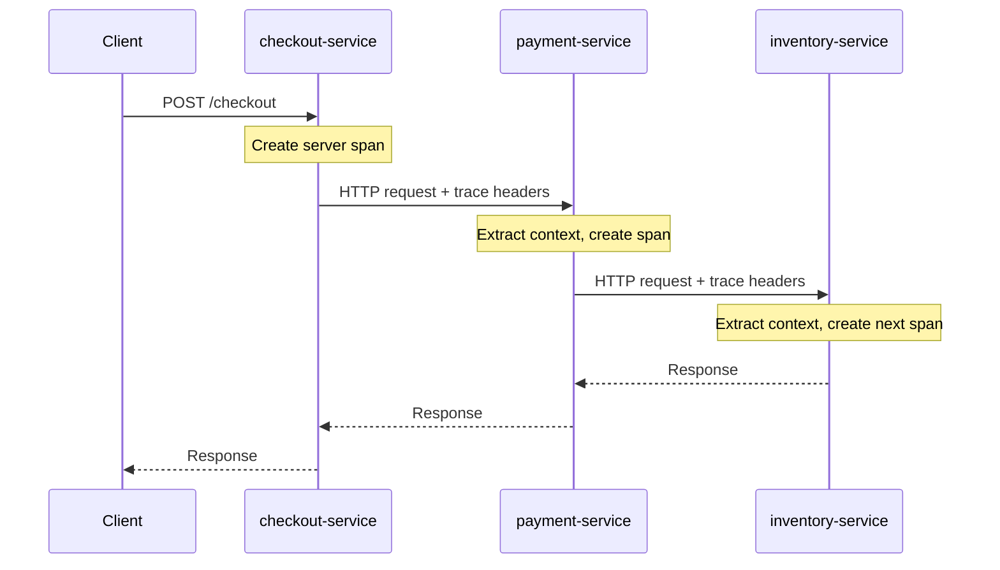
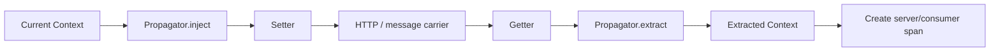
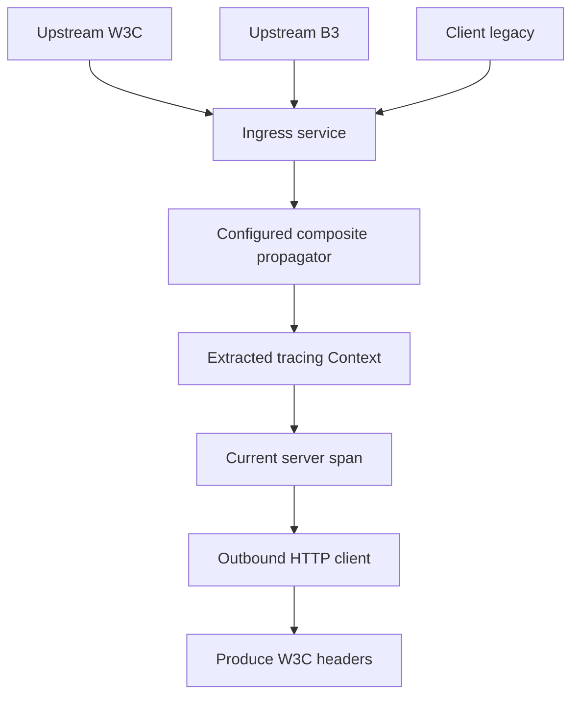
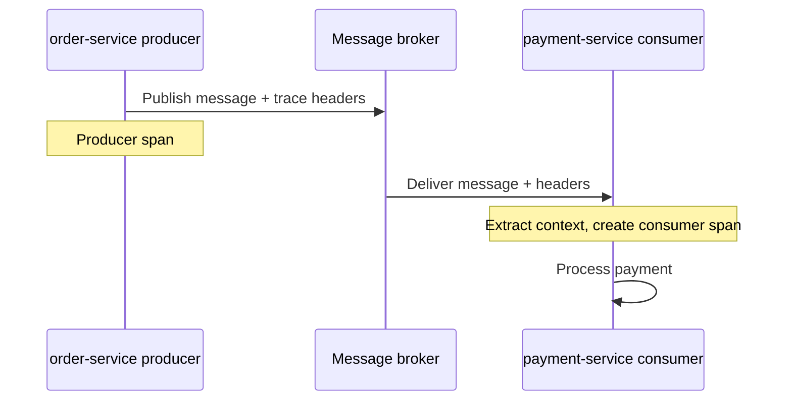
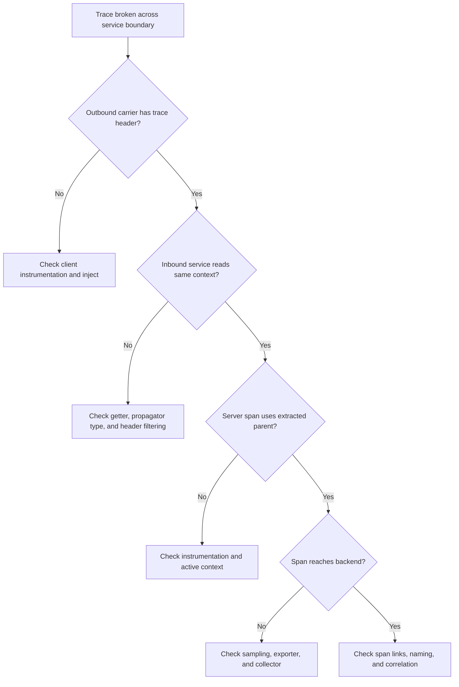

# Context Propagators in OpenTelemetry

Distributed tracing can construct a single trace across multiple services only when each component knows how to **read context from incoming requests** and **write context onto outgoing requests**. OpenTelemetry accomplishes this through **context propagation**. A *propagator* defines how to serialize and deserialize context over a carrier such as HTTP headers or message metadata. If service A creates a span without injecting context, service B may start a new trace; if service B fails to extract it properly, parent/child relationships break.

This lesson **"Context Propagators"** belongs to the **OpenTelemetry** chapter of the **SPRING_BOOT_OBSERVABILITY** module. The module teaches how to set up observability for Spring Boot using Micrometer Observation, metrics, logs, and distributed tracing—covering context propagation, tags/cardinality, exporters, sampling, and signal correlation to investigate errors, latency, and application behavior in production environments.

**Three layers must be distinguished:** Context stores execution-scoped values during processing; a propagator describes how to move part of that context across process boundaries; a carrier holds the serialized data, such as HTTP headers. A propagator is not an exporter, does not send spans to a backend, and does not replace HTTP client/server instrumentation.

## 1. Why Is Context Propagation Needed?

Suppose `checkout-service` receives a request, calls `payment-service`, and then calls `inventory-service`. Each process has its own runtime and memory. Trace context cannot cross the network automatically unless serialized into protocol metadata.



When propagation works properly, related spans share the same trace ID; the receiving span has the appropriate parent relationship; the trace backend can render the distributed trace; and logs can be correlated by trace ID/span ID when logging integration is configured. Sampling decisions can also travel with trace context so downstream services apply a compatible policy.

When propagation fails, each service may still record local metrics and logs, yet the trace fractures into separate pieces, making cross-service latency investigation much harder.

## 2. Context, Propagator, and Carrier

| Component | Role | Example |
| --- | --- | --- |
| **Context** | Stores values scoped to current execution | Active span, baggage |
| **Propagator** | Defines how to inject/extract context in a format | W3C Trace Context propagator |
| **Carrier** | Object carrying key/values across boundaries | HTTP headers, Kafka record headers |
| **Setter** | Writes key/value into a carrier | HTTP request header setter |
| **Getter** | Reads key/value from a carrier | HTTP server header getter |
| **Exporter/backend** | Exports and stores spans once ended | OTLP exporter, trace store |

A propagator **does not create spans by itself**. Instrumentation or tracing APIs create spans; the propagator only places the relevant context into a carrier or extracts context from a carrier. Not everything in Context gets serialized: a propagator handles only the fields defined by its format.

## 3. How Inject and Extract Work

- **Inject:** reads the current context and writes the required fields into an outbound carrier.
- **Extract:** reads fields from an inbound carrier and returns a new context containing the decoded data.



Example HTTP headers:

```http
traceparent: 00-4bf92f3577b34da6a3ce929d0e0e4736-00f067aa0ba902b7-01
tracestate: vendor=value
baggage: workflow=checkout,region=ap-southeast-1
```

This is illustrative data. `tracestate` is an optional field of W3C Trace Context; `baggage` belongs to W3C Baggage and is not part of `traceparent`.

HTTP server instrumentation reads headers through the configured propagator. After extraction, the server creates a span with the received context as parent or uses a link depending on processing semantics. Merely storing a raw header as a field inside a controller does not make the tracer understand parent/child relationships.

## 4. W3C Trace Context

**W3C Trace Context** is the standard format for propagating trace context between compatible components. Two common headers:

- `traceparent`: version, trace ID, parent ID, and trace flags.
- `tracestate`: vendor-specific tracing state if present.

Example:

```http
traceparent: 00-4bf92f3577b34da6a3ce929d0e0e4736-00f067aa0ba902b7-01
```

Structure of `traceparent` for version `00`:

| Part | Example | Meaning |
| --- | --- | --- |
| Version | `00` | Format version |
| Trace ID | `4bf92f3577b34da6a3ce929d0e0e4736` | 16-byte trace identifier, 32 hex chars |
| Parent ID | `00f067aa0ba902b7` | 8-byte parent span identifier, 16 hex chars |
| Trace flags | `01` | Bit flags; lowest bit is the sampled flag |

All-zero IDs are invalid. Parsers must validate syntax, version, and length per specification rather than merely checking whether the header exists.

### Sampled Flag Does Not Guarantee Backend Storage

The sampled flag indicates the sampling state propagated in context. It does not guarantee the span exporter succeeded, the collector received it, the backend stored it, or the dashboard grants access. Traces can still be lost at the exporter, collector, network, or backend. Conversely, independent metrics can still record requests whose traces were not stored.

### `tracestate` Is Not Baggage

`tracestate` is reserved for tracing vendor/system state under W3C Trace Context. `baggage` carries application metadata under W3C Baggage. They do not substitute for one another and require separate policies for size, privacy, and propagation.

## 5. W3C Baggage Propagator

W3C Baggage transmits additional key/value pairs via the `baggage` header:

```http
baggage: tenant.tier=premium,workflow=checkout
```

Baggage is useful when multiple services need lightweight metadata such as workflow or region. Never put tokens, emails, request bodies, sensitive customer data, or large payloads into baggage.

W3C Baggage requires platforms to propagate all list-members when baggage has at most 64 members and the baggage string is at most 8,192 bytes. If either threshold is exceeded, platforms are allowed to drop members until both limits are met. Real proxies/servers may enforce lower header limits.

Do not place baggage values into metric labels. If you want to copy fields into span attributes or MDC logs, enable the corresponding configuration explicitly and evaluate privacy, cardinality, and retention. Baggage does not appear automatically across all signals.

## 6. B3 and Other Propagation Formats

Some legacy systems or tracing platforms use B3. B3 can propagate context via a single `b3` header or multiple separate headers such as `X-B3-TraceId`, `X-B3-SpanId`, and `X-B3-Sampled`.

Example B3 multi-header:

```http
X-B3-TraceId: 4bf92f3577b34da6a3ce929d0e0e4736
X-B3-SpanId: 00f067aa0ba902b7
X-B3-Sampled: 1
```

| Format | Common Headers | When Appropriate |
| --- | --- | --- |
| W3C Trace Context | `traceparent`, `tracestate` | Interoperability across modern systems |
| W3C Baggage | `baggage` | Small permitted metadata |
| B3 single | `b3` | Compatibility with B3 single-header systems |
| B3 multi | `X-B3-*` | Compatibility with B3 multi-header systems |
| Jaeger/vendor | Implementation-specific headers | Only when required by existing systems |

Do not enable every format unconditionally. Multiple coexisting headers can create ambiguity if upstream sends mismatched contexts. Pick the trusted format at each boundary.

## 7. Composite Propagator

During migrations, a service may need to read multiple formats while emitting only one standard format. A composite propagator combines multiple propagators to perform inject/extract.

Common strategy:

- **Consume:** accept W3C and B3 from known upstreams.
- **Produce:** emit only W3C to newer downstreams.
- **Boundary:** validate or restrict trust of context received from external clients.



A composite propagator does not merge multiple trace IDs into one trace. When multiple formats arrive together, ordering and selection rules depend on the implementation; avoid sending conflicting contexts. Define a preferred format or normalize at the gateway.

Nor does a composite propagator automatically translate baggage schemas or vendor state with business semantics. A field absent in the source format cannot be invented in the target format.

## 8. OpenTelemetry API: `TextMapPropagator`

OpenTelemetry defines `TextMapPropagator` for text key/value carriers. The API has two operations:

- `inject(Context, carrier, setter)`: writes context into a carrier.
- `extract(Context, carrier, getter)`: reads a carrier and returns the enriched context.

Setter and Getter decouple propagation logic from the carrier type. HTTP frameworks have their own header APIs; message brokers have their own record header APIs. The propagator does not need to know how a framework stores data, only that setter/getter honor the carrier's contract.

Conceptual example with a map:

```java
TextMapPropagator propagator = ...;
Context outgoing = Context.current();
Map<String, String> headers = new HashMap<>();

propagator.inject(outgoing, headers, MapSetter.INSTANCE);
```

`MapSetter` here is an application-defined implementation, not a built-in singleton across every SDK:

```java
import io.opentelemetry.context.propagation.TextMapSetter;
import java.util.Map;

public enum MapSetter implements TextMapSetter<Map<String, String>> {
    INSTANCE;

    @Override
    public void set(Map<String, String> carrier, String key, String value) {
        if (carrier != null) {
            carrier.put(key, value);
        }
    }
}
```

Reading a carrier with a Getter:

```java
import io.opentelemetry.context.propagation.TextMapGetter;
import java.util.Collections;
import java.util.Map;

public enum MapGetter implements TextMapGetter<Map<String, String>> {
    INSTANCE;

    @Override
    public Iterable<String> keys(Map<String, String> carrier) {
        return carrier == null ? Collections.emptyList() : carrier.keySet();
    }

    @Override
    public String get(Map<String, String> carrier, String key) {
        return carrier == null ? null : carrier.get(key);
    }
}
```

Then extract:

```java
Context extracted = propagator.extract(
        Context.root(),
        headers,
        MapGetter.INSTANCE
);
```

This is a carrier API example. In real applications, prefer auto-configured instrumentation and propagators instead of manually calling inject/extract inside every controller.

HTTP headers have case-insensitive semantics and can have multiple values. Message brokers have size limits, byte/string types, and distinct semantics. Getter/Setter must respect the carrier's contract rather than assuming every carrier is a `Map<String,String>`.

## 9. Configuring Propagators in Plain OpenTelemetry SDK

If an application initializes the OpenTelemetry SDK directly, `ContextPropagators` can be configured with W3C Trace Context:

```java
import io.opentelemetry.api.OpenTelemetry;
import io.opentelemetry.api.trace.propagation.W3CTraceContextPropagator;
import io.opentelemetry.context.propagation.ContextPropagators;
import io.opentelemetry.sdk.OpenTelemetrySdk;

OpenTelemetry openTelemetry =
        OpenTelemetrySdk.builder()
                .setPropagators(
                        ContextPropagators.create(
                                W3CTraceContextPropagator.getInstance()))
                .build();
```

If W3C Baggage is also needed, combine both propagators:

```java
import io.opentelemetry.api.baggage.propagation.W3CBaggagePropagator;
import io.opentelemetry.api.trace.propagation.W3CTraceContextPropagator;
import io.opentelemetry.context.propagation.ContextPropagators;
import io.opentelemetry.context.propagation.TextMapPropagator;

TextMapPropagator propagator =
        TextMapPropagator.composite(
                W3CTraceContextPropagator.getInstance(),
                W3CBaggagePropagator.getInstance());

OpenTelemetry openTelemetry =
        OpenTelemetrySdk.builder()
                .setPropagators(ContextPropagators.create(propagator))
                .build();
```

This is a plain OpenTelemetry SDK example. You do not need to instantiate a separate SDK like this if Spring Boot already manages tracing through the Micrometer Tracing bridge. Mixing a manually initialized global OpenTelemetry SDK with a Boot-managed tracer can create two independent context pipelines.

OpenTelemetry API/SDK dependencies and versions must be compatible, usually managed by a BOM. Adding only SDK dependencies does not automatically instrument Spring MVC/WebFlux or HTTP clients.

## 10. Spring Boot: Letting the Framework Manage Propagation

In a Spring Boot application using Micrometer Tracing, the tracing bridge and instrumentation typically manage inject/extract for HTTP servers/clients when using auto-configured builders.

Example dependencies for the OpenTelemetry bridge and OTLP exporter using Spring Boot dependency management:

```groovy
dependencies {
    implementation 'org.springframework.boot:spring-boot-starter-actuator'
    implementation 'io.micrometer:micrometer-tracing-bridge-otel'
    runtimeOnly 'io.opentelemetry:opentelemetry-exporter-otlp'
}
```

Example configuration:

```yaml
spring:
  application:
    name: checkout-service

management:
  tracing:
    sampling:
      probability: 0.1
    propagation:
      type: w3c
  otlp:
    tracing:
      endpoint: http://otel-collector:4318/v1/traces
```

Supported properties and valid values may differ across Spring Boot release lines; check the documentation for your exact version, especially for `management.tracing.propagation.type`. W3C is generally appropriate for new interoperability when downstream systems support it.

### Using Instrumented HTTP Clients

Example `WebClient` using a Boot-managed builder:

```java
import org.springframework.stereotype.Component;
import org.springframework.web.reactive.function.client.WebClient;

@Component
public class PaymentClient {
    private final WebClient webClient;

    public PaymentClient(WebClient.Builder builder) {
        this.webClient = builder
                .baseUrl("http://payment-service")
                .build();
    }
}
```

Do not construct a client outside the builder/observation instrumentation mechanism and assume trace headers will always be injected. With `RestClient`, use the matching auto-configured builder. With Apache HttpClient, OkHttp, gRPC, or other message clients, compatible instrumentation is required.

**Exporter and propagator are two separate things:** the OTLP exporter sends finished spans to the Collector; the propagator injects/extracts context across requests. Having an OTLP endpoint does not mean HTTP headers are automatically propagated.

## 11. Propagation Across Messaging and Async

With message brokers, trace context is typically injected into record headers or message properties when the producer sends, and extracted by the consumer during processing.



The span model depends on messaging semantics. A consumer span may be a child or a link to the producer context, especially with batches or multiple messages. Do not apply a simple parent/child model blindly to every messaging pattern.

At async boundaries within the same JVM, Reactor Context, Micrometer Context Propagation, or an executor decorator preserves context across threads. Across process boundaries, a propagator over the protocol's carrier is required. These are related problems, not substitutes for one another.

If a task sits in a queue for hours before executing, the original trace may already have passed retention. Consider span links, small correlation metadata, and tracing policies tailored for background processing.

## 12. Security and Trust Boundaries

Trace context and baggage often arrive from headers supplied by clients or upstream services. Never assume these values are authenticated data.

- Never use trace ID, baggage, or `tracestate` to determine user identity or tenant permissions.
- Never put tokens, session secrets, emails, or sensitive payloads into baggage.
- Enforce baggage member count and byte size limits per W3C and infrastructure constraints.
- Validate headers at boundaries according to security policy.
- At public ingress, consider starting a fresh root trace or restricting remote parents per trust policy.
- Never log full headers if they contain credentials.
- Prevent arbitrary clients from controlling the sampled flag to force the backend to store all traces.
- Use TLS and authentication on the export path to the Collector/backend.

Syntactically valid trace context does not mean the upstream is trustworthy. Trace context enables correlation, not proof of identity.

## 13. Common Propagation Issues

| Symptom | Possible Cause | How to Check |
| --- | --- | --- |
| Each service gets a different trace ID | Missing inject/extract or format mismatch | Inspect outgoing/incoming headers |
| `traceparent` exists yet spans do not link | Server/client span not created from extracted context | Inspect tracing instrumentation |
| W3C service fails to read B3 | Configured to consume W3C only | Configure appropriate migration/composite setup |
| Same trace ID yet missing parent relationship | Extracted at wrong time or root span created manually | Check tracer API and parent scope |
| Baggage lost while trace still links | Baggage not configured/permitted | Check baggage propagator and allowlist |
| HTTP 400/431 | Request headers too large or proxy policy | Check total header bytes and gateway |
| Backend shows no trace despite valid headers | Sampler/exporter/collector/backend failure | Inspect the tracing pipeline |
| Multiple formats cause inconsistent traces | Upstream sends conflicting contexts | Define priority format at ingress |
| HTTP client lacks child span | Client uninstrumented or custom builder | Use auto-configured builder/instrumentation |
| Async task loses context | ThreadLocal/Reactor context not propagated | Check executor/context propagation |



## 14. End-to-End Propagator Testing

A proper test must verify both inject and extract, rather than only asserting a class was instantiated.

1. **Choose format:** use W3C Trace Context as the standard format. If migrating from B3, explicitly document accepted consume formats and the produced format.
2. **Create outbound request:** create an active span in service A and call an instrumented HTTP client targeting service B. Verify the outgoing request carries a valid `traceparent`.
3. **Verify extraction:** in service B, verify the server span shares the same trace ID and expected parent relationship. Do not compare raw headers alone; verify the actual span context.
4. **Add baggage:** add a short, non-sensitive mock field. Confirm inject/extract when baggage propagation is configured.
5. **Test sampled/unsampled:** verify downstream honors the parent policy; distinguish holding context from exporting spans.
6. **Malformed headers:** test missing headers, invalid version/IDs, duplicate headers, unsupported formats, and oversized values.
7. **Backend:** verify finished spans are exported and queryable. Successful propagation does not guarantee successful exporter ingestion.

## 15. Hands-on Lab: Standardizing on W3C Across a System with B3

Suppose the existing system has an older gateway emitting B3 and newer services using W3C:

1. Map ingress/egress boundaries and list currently used formats.
2. Designate the gateway as the point consuming B3 and producing W3C if its instrumentation supports it.
3. Configure newer services to prefer W3C; keep B3 consumption only at boundaries needing migration.
4. Send a request from a legacy client through the gateway to two newer services.
5. Verify trace ID, parent relationships, and sampled decisions across each service.
6. Test the case where an upstream sends both B3 and W3C with mismatched contexts.
7. Monitor fragmented traces and requests affected by header filtering.
8. Remove B3 consumption once legacy upstreams have upgraded and the compatibility window ends.

Do not splice B3 and W3C headers manually via string copying. Use protocol-aware propagators with clear precedence rules.

## 16. Self-Check Questions

1. How do context, propagator, and carrier differ?
2. Where do inject and extract occur during an HTTP call?
3. How does `traceparent` differ from `tracestate` and `baggage`?
4. Does the sampled flag guarantee a trace is stored in the backend?
5. How does B3 single differ from B3 multi-header?
6. Why might a service need to consume B3 while producing W3C?
7. What cases can a composite propagator not solve?
8. Why does `TextMapPropagator` use a Setter and Getter?
9. Why shouldn't you manually inject/extract in every controller?
10. How does a plain OpenTelemetry SDK differ from Spring Boot Micrometer Tracing integration?
11. Why doesn't an OTLP exporter replace HTTP context propagation?
12. Does a message consumer always create a direct child span of the producer?
13. Can trace context be used to authenticate a tenant or user?
14. When trace IDs match yet parent relationships are wrong, what should you inspect?
15. Beyond header presence, which layers must end-to-end testing verify?

## References

- [OpenTelemetry — Context Propagation](https://opentelemetry.io/docs/concepts/context-propagation/): inject/extract and cross-process propagation.
- [OpenTelemetry Java API — Context Propagation](https://opentelemetry.io/docs/languages/java/api/#context-propagation): Context Propagators and Java API.
- [W3C Trace Context](https://www.w3.org/TR/trace-context/): `traceparent` and `tracestate` specification.
- [W3C Baggage](https://www.w3.org/TR/baggage/): baggage specification and limits.
- [Spring Boot — Tracing](https://docs.spring.io/spring-boot/reference/actuator/tracing.html): Micrometer Tracing, propagation, and baggage.
- [Micrometer Tracing Reference](https://docs.micrometer.io/tracing/reference/): bridges, propagators, and tracing API.

## Conclusion

**Context propagators are the bridge carrying trace context across process boundaries.** OpenTelemetry uses the inject/extract model over carriers; W3C Trace Context is the standard interoperability format, W3C Baggage carries supplemental metadata, and B3 may be required in legacy environments. Composite propagators assist migrations when intentionally configured with clear consume/produce rules and trust boundaries.

In Spring Boot, prefer auto-configured tracing instrumentation and HTTP/message clients for consistent inject/extract. Keep propagation distinct from exporters, sampling, and log correlation; verify headers at every hop, span parent relationships, and final data in the backend. Doing so enables metrics, traces, and logs to correlate reliably when investigating errors and latency in production.
