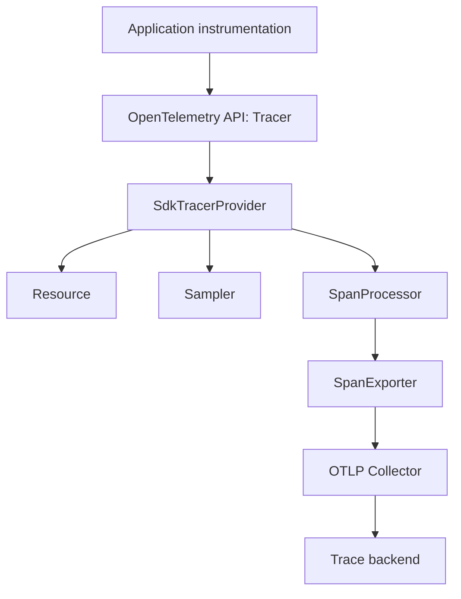
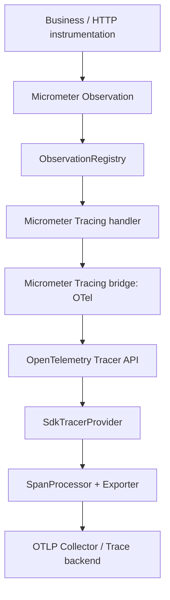
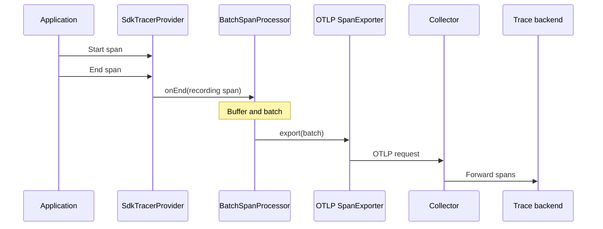

# `SdkTracerProvider` in the OpenTelemetry Java SDK

In a Spring Boot application, Micrometer Observation records operations, Micrometer Tracing can create spans, and OpenTelemetry delivers trace data to a collector/backend. The central component at the OpenTelemetry Java SDK layer is **`SdkTracerProvider`**: it supplies tracers and coordinates resources, samplers, span processors, exporters, and span lifecycles.

This lesson **`SdkTracerProvider`** belongs to the **OpenTelemetry** chapter of the **SPRING_BOOT_OBSERVABILITY** module. The module teaches how to set up observability for Spring Boot using Micrometer Observation, metrics, logs, and distributed tracing; covering context propagation, tags/cardinality, exporters, sampling, and signal correlation to investigate errors, latency, and application behavior in production environments.

After this lesson, you will be able to distinguish `SdkTracerProvider` from the `Tracer` API and OpenTelemetry API, configure resources/samplers/processors/exporters, understand batch export and shutdown, and decide when Spring Boot should manage the SDK versus when an application needs custom configuration.

## 1. What Is `SdkTracerProvider`?

OpenTelemetry separates the API from the SDK implementation:

| Component | Role |
| --- | --- |
| `Tracer` API | API called by instrumentation to create spans |
| OpenTelemetry API | Entry point providing tracers, propagators, and telemetry APIs |
| `SdkTracerProvider` | SDK implementation supplying tracers, creating and managing trace lifecycles |
| `SpanProcessor` | Receives callbacks on span start/end and processes finished spans |
| `SpanExporter` | Sends processed spans to a collector/backend |
| `Sampler` | Decides whether a span/trace is recorded |
| `Resource` | Describes the telemetry source, e.g., service name/version/environment |
| `ContextPropagators` | Injects/extracts context across HTTP, messaging, and process boundaries |

`SdkTracerProvider` is the SDK-level factory/manager for `Tracer`s. It is not a trace backend, does not open a server to receive spans, and does not send everything out by itself. It coordinates the registered samplers, processors, and exporters.



When code creates a span via a tracer supplied by the provider, the SDK uses this configuration to build the span context and process the span. If the sampler decides not to record, the span can be non-recording; not every span start results in exported data.

## 2. Distinguishing `Tracer`, `TracerProvider`, and `SdkTracerProvider`

- **`Tracer`**: the object instrumentation calls to create spans and manage span scopes.
- **`TracerProvider`**: the abstraction providing `Tracer` instances; instrumented code normally only needs the API provider.
- **`SdkTracerProvider`**: the concrete OpenTelemetry SDK implementation managing sampling, processors, resources, and lifecycle.

API usage example:

```java
Tracer tracer = openTelemetry.getTracer("com.example.checkout");

Span span = tracer.spanBuilder("checkout.submit").startSpan();
try (Scope scope = span.makeCurrent()) {
    checkout();
} catch (RuntimeException ex) {
    span.recordException(ex);
    span.setStatus(StatusCode.ERROR);
    throw ex;
} finally {
    span.end();
}
```

This example assumes an `OpenTelemetry` instance is already configured and `checkout()` is an illustrative business method. Business code normally does not need to know about the concrete `SdkTracerProvider` object; it only needs an injected tracer/API. This decouples instrumentation from how the SDK is configured.

## 3. Role in Spring Boot Observability

Spring Boot can connect Micrometer Observation/Tracing to OpenTelemetry via a bridge:



Observation is the abstraction applications can use to instrument operations; the bridge turns the tracing signal into spans via the OpenTelemetry SDK. The provider is used by the bridge/SDK integration; business services should generally not create providers again themselves.

### There Must Be One Clear Tracing Ownership

If Spring Boot already auto-configures an OpenTelemetry SDK/provider, creating another `SdkTracerProvider` manually can produce two pipelines:

- Some spans flow through the Micrometer Tracing bridge, while others go through the custom SDK.
- Resources, samplers, propagators, and exporters diverge.
- Trace IDs/log correlation become difficult to link; spans may not reach the expected backend.

Decide who owns the SDK lifecycle: Spring Boot, self-managed OpenTelemetry configuration, or an external agent. Avoid mixing multiple owners without a clear architecture.

## 4. Dependencies for the OpenTelemetry SDK

With Spring Boot using the Micrometer Tracing OTel bridge, Gradle typically looks like:

```groovy
dependencies {
    implementation 'org.springframework.boot:spring-boot-starter-actuator'
    implementation 'io.micrometer:micrometer-tracing-bridge-otel'
    runtimeOnly 'io.opentelemetry:opentelemetry-exporter-otlp'
}
```

Spring Boot's dependency management controls compatible versions. Do not mix mismatched versions of `opentelemetry-api`, SDK, exporter, and bridge manually.

When configuring the SDK directly, add the appropriate SDK and exporter modules:

```groovy
dependencies {
    implementation 'io.opentelemetry:opentelemetry-api'
    implementation 'io.opentelemetry:opentelemetry-sdk'
    runtimeOnly 'io.opentelemetry:opentelemetry-exporter-otlp'
}
```

This is a dependency sketch; use a BOM/platform compatible with your application's Spring Boot and Micrometer Tracing versions. In a Boot app that already uses the OTel bridge, do not add a standalone SDK unless you intentionally decide to move ownership to custom configuration.

## 5. Configuring `SdkTracerProvider`

The following example demonstrates constructing a standalone SDK provider using the OpenTelemetry Java SDK:

```java
import io.opentelemetry.api.common.AttributeKey;
import io.opentelemetry.api.common.Attributes;
import io.opentelemetry.sdk.resources.Resource;
import io.opentelemetry.sdk.OpenTelemetrySdk;
import io.opentelemetry.sdk.trace.SdkTracerProvider;
import io.opentelemetry.sdk.trace.export.BatchSpanProcessor;
import io.opentelemetry.exporter.otlp.trace.OtlpGrpcSpanExporter;

Resource serviceResource = Resource.getDefault().merge(
    Resource.create(Attributes.of(
        AttributeKey.stringKey("service.name"), "checkout-service",
        AttributeKey.stringKey("service.version"), "1.4.0"
    ))
);

OtlpGrpcSpanExporter exporter = OtlpGrpcSpanExporter.builder()
    .setEndpoint("http://localhost:4317")
    .build();

SdkTracerProvider tracerProvider = SdkTracerProvider.builder()
    .setResource(serviceResource)
    .addSpanProcessor(BatchSpanProcessor.builder(exporter).build())
    .build();

OpenTelemetrySdk openTelemetry = OpenTelemetrySdk.builder()
    .setTracerProvider(tracerProvider)
    .build();
```

This example shows the primary building blocks:

1. `Resource` attaches service metadata to spans.
2. The OTLP gRPC exporter sends spans to a collector, e.g., on port 4317.
3. `BatchSpanProcessor` batches spans before exporting.
4. `SdkTracerProvider` manages sampling and span processing.
5. `OpenTelemetrySdk` provides the API entry point for instrumentation.

This is a standalone SDK example, not a complete production Spring Boot configuration. Exporter packages/imports must match your managed OTel SDK version. Never instantiate a new provider/exporter per request; they are application-scoped resources.

## 6. Propagators and W3C Trace Context

The provider creates spans, while propagation requires `ContextPropagators` and instrumentation inject/extract. With a self-managed SDK, you can configure W3C Trace Context:

```java
import io.opentelemetry.context.propagation.ContextPropagators;
import io.opentelemetry.api.trace.propagation.W3CTraceContextPropagator;
import io.opentelemetry.sdk.OpenTelemetrySdk;

OpenTelemetrySdk openTelemetry = OpenTelemetrySdk.builder()
    .setTracerProvider(tracerProvider)
    .setPropagators(ContextPropagators.create(
        W3CTraceContextPropagator.getInstance()
    ))
    .build();
```

This configures a single SDK instance. If W3C Baggage is needed, configure a baggage propagator or appropriate composite propagator; the W3C trace context propagator does not automatically propagate baggage fields.

In Spring Boot using the Micrometer Tracing bridge, prefer framework-managed propagators and HTTP instrumentation. Do not create a second `OpenTelemetrySdk` if the bridge already uses an existing instance.

## 7. Resource: Identifying Which Service Created a Span

Resource is metadata attached to telemetry produced by a process/service:

| Attribute | Example | Meaning |
| --- | --- | --- |
| `service.name` | `checkout-service` | Logical name of the service |
| `service.version` | `1.4.0` | Application version |
| `deployment.environment.name` | `production` | Deployment environment |
| `service.instance.id` | Controlled instance ID | Distinguishes instances when needed |
| `host.name` | Permitted hostname | Infrastructure detail |

Do not put pod UID, request ID, or user ID into `service.name`. The service name should remain stable across replicas so the backend groups spans from the same application accurately.

Resource can be built from default resource detectors and merged with application-supplied metadata. Merge order decides which attribute wins on key conflicts; check `Resource.merge` semantics for your exact version. Never register a different Resource per request.

Resource differs from span attributes: Resource describes the process/service; span attributes describe an operation; baggage carries context across processes; metric dimensions group measurements and require low cardinality.

## 8. Sampler: Deciding Whether a Span Is Recorded

The sampler is attached to the provider when building the SDK:

```java
import io.opentelemetry.sdk.trace.samplers.Sampler;

SdkTracerProvider tracerProvider = SdkTracerProvider.builder()
    .setResource(serviceResource)
    .setSampler(
        Sampler.parentBased(
            Sampler.traceIdRatioBased(0.10)
        )
    )
    .addSpanProcessor(
        BatchSpanProcessor.builder(exporter).build()
    )
    .build();
```

This snippet illustrates a probabilistic sampler for root traces at 10% and parent-based decisions for spans with a parent. With Spring Boot auto-configuration, the property may be `management.tracing.sampling.probability`; when building `SdkTracerProvider` directly, the sampler is configured on the SDK. Do not configure both places without knowing which sampler actually executes.

The sampler decides whether a span is recorded; if non-recording, standard `SpanProcessor`s do not export it. However, the sampler does not guarantee the exporter successfully delivers recorded spans. Measure sampling decisions and export outcomes separately.

## 9. `SpanProcessor`: Processing Span Lifecycles

`SpanProcessor` receives lifecycle callbacks from the SDK:

| Processor | Behavior | When Appropriate |
| --- | --- | --- |
| `SimpleSpanProcessor` | Exports spans immediately when each span ends | Local debugging/testing or very low traffic |
| `BatchSpanProcessor` | Collects spans and exports in batches / on flush conditions | Normal applications, reduces exporter calls |

In production, `BatchSpanProcessor` is normally preferred to avoid one network call per span. It has a buffer, batch size, schedule delay, and export timeout; exact values depend on version/configuration. If the buffer fills up or the exporter slows down, spans can be dropped. Monitor SDK/exporter diagnostics and size queues to traffic.

Do not write a custom processor just to log all span data; doing so can leak PII, duplicate data, and raise costs.

**`SpanProcessor` is not a sampler:** the sampler decides early; the processor handles recorded spans; the exporter sends data out. Adding a processor cannot recover spans already dropped by the sampler.

## 10. `SpanExporter` and OTLP

`SpanExporter` forwards finished spans to a destination. With OTLP, the exporter sends data to a compatible collector or backend.

```text
OTLP/gRPC: http://otel-collector:4317
OTLP/HTTP: http://otel-collector:4318/v1/traces
```

These are common illustrative endpoints. gRPC and HTTP are two different protocols; the exporter, receiver, port, and URL path must match. Inside Docker/Kubernetes, the hostname must resolve from the application container/pod; `localhost` only points to the same network namespace.



A successful export at the SDK only means the exporter received a protocol-level success response; immediate backend queries may still not show the trace due to collector batching, ingestion, indexing, or retention.

## 11. Shutdown and Flush: Avoiding Loss of the Final Batch

`BatchSpanProcessor` may still hold pending data when the application shuts down. The provider must be shut down so the processor flushes per SDK mechanics and releases exporter resources.

In a standalone application:

```java
try {
    // Application work creating spans
} finally {
    tracerProvider.close();
}
```

With Spring, an application-owned custom bean can declare its lifecycle:

```java
@Bean(destroyMethod = "close")
SdkTracerProvider tracerProvider() {
    return buildTracerProvider();
}
```

This is a lifecycle pattern only. If Spring Boot already creates and manages the provider, do not declare a competing provider or manually close framework-owned beans. Clearly define which bean owns the exporter and processor to prevent closing twice or never closing at all.

Flush/shutdown has a timeout and cannot guarantee delivery if the process is terminated with `kill -9`, the container exceeds its termination grace period, or the network is unavailable. Configure a sufficient grace period and monitor drops/errors.

## 12. Integrating with Micrometer Tracing in Spring Boot

Two approaches must be distinguished:

| Approach | Who Owns the Provider? | When to Use |
| --- | --- | --- |
| Spring Boot + Micrometer OTel bridge | Spring Boot auto-configuration/SDK integration per version | Apps wanting instrumentation via Observation/Micrometer Tracing |
| Custom OpenTelemetry SDK | App creates/manages `SdkTracerProvider`, exporter, propagators | Specific SDK requirements or self-managed platform |

With the first approach, dependencies and properties may be enough for Spring Boot to configure the tracing pipeline per version. Do not instantiate a custom `SdkTracerProvider` just to name spans; use the `Observation`/`Tracer` abstraction.

With the second approach, officially integrate your custom `OpenTelemetry` instance with the bridge and verify Micrometer's `Tracer` and instrumentation share the same provider. Do not merely define an `OpenTelemetrySdk` bean and assume every Spring Boot configuration picks it up automatically.

If using the OpenTelemetry Java agent alongside the Micrometer bridge, decide which instrumentation owns HTTP/server/client spans. Two layers automatically instrumenting the same request can emit duplicate spans. Verify with an end-to-end trace.

## 13. Testing `SdkTracerProvider`

| Test | What to Prove |
| --- | --- |
| Resource test | Spans carry the expected `service.name`/version |
| Sampler test | Sampled/not-sampled decisions follow policy |
| Processor/exporter test | Spans are delivered to an in-memory/test exporter |
| Parent propagation test | Child spans carry the right trace ID and parent span ID |
| Shutdown test | Final batch is flushed when the provider closes |
| Spring context test | Micrometer bridge and auto/custom provider align |

Illustrative test example using an in-memory exporter (API/package depends on OTel testing version):

```java
InMemorySpanExporter exporter = InMemorySpanExporter.create();

SdkTracerProvider provider = SdkTracerProvider.builder()
    .addSpanProcessor(SimpleSpanProcessor.create(exporter))
    .build();

OpenTelemetrySdk otel = OpenTelemetrySdk.builder()
    .setTracerProvider(provider)
    .build();

Tracer tracer = otel.getTracer("checkout-test");
Span span = tracer.spanBuilder("checkout.submit").startSpan();
span.end();

assertEquals(1, exporter.getFinishedSpanItems().size());
provider.close();
```

This is pseudocode emphasizing testing strategy. The package of `InMemorySpanExporter` and test artifacts must match your OTel SDK version. Never use an in-memory exporter in production; close the provider after tests to release processor resources.

With `BatchSpanProcessor`, tests should verify flush/shutdown under controlled conditions. Do not rely on a fixed `Thread.sleep` hoping the batch was sent; use an observable test exporter with a bounded timeout.

## 14. Common Issues

| Symptom | Possible Cause | Where to Check |
| --- | --- | --- |
| Spans do not appear | Sampler dropped, span never ended, or processor unregistered | Sampling decision, lifecycle, and provider |
| Micrometer Tracer differs from expected OTel tracer | Bridge and SDK use different providers | Auto-configuration and bean ownership |
| No spans on collector | Wrong endpoint/protocol/network | OTLP receiver and exporter |
| Spans lack `service.name` | Resource unconfigured or detector didn't run | Effective Resource |
| Batches dropped | Queue full, slow exporter, or timeout | Processor/exporter diagnostics |
| Final batch lost on restart | Provider not shut down/flushed | Lifecycle bean and termination grace period |
| Traces break downstream | Missing propagator or HTTP instrumentation | Inject/extract headers |
| Trace tree has duplicate spans | Java agent and framework both instrumenting | Pick one owner |
| Every request gets its own root trace | Parent context lost | W3C headers and context scope |
| Sampling property has no effect | Custom SDK sampler overrides or wrong profile | Runtime provider/sampler |
| Multiple exporter clients | Repeatedly creating provider/exporter | Application-scoped singleton lifecycle |
| Slow shutdown | Flush timeout, large queue, slow network | Batch/timeouts and grace period |

## 15. Real-World Scenario: Spring Boot with Two Trace Pipelines

**Hypothetical context:** after adding OTel SDK dependencies, `checkout-service` exports spans via OTLP. Yet the trace backend shows two root traces for the same request: one contains Micrometer HTTP spans, while the other contains custom spans from the SDK. Resources and sampling are inconsistent.

Investigation steps:

1. **List tracing ownership:** check whether Spring Boot auto-configuration creates a Micrometer bridge/tracer, whether a custom `SdkTracerProvider` bean exists, and whether the Java agent is running.
2. **Inspect tracer injection:** do Observation code and custom OTel instrumentation use the same `OpenTelemetry` provider or two distinct providers?
3. **Compare resources:** do both pipelines share `service.name`, `service.version`, and `environment`?
4. **Compare propagators:** is W3C Trace Context injected/extracted on both paths?
5. **Compare samplers:** are probability, parent-based policy, and remote sampled flags consistent?
6. **Inspect export:** which exporters/processors does each provider have? Are there double exports or batches lost on shutdown?
7. **Pick ownership:** prefer the Spring Boot/Micrometer pipeline if the Boot app uses Observation; keep a custom SDK only when specifically required and wired so all instrumentation shares the same provider.
8. **Re-verify:** send a test request, check trace ID, parent-child tree, resource, and span counts; ensure duplicate trace trees are gone.

Spinning up a second SDK provider does not make tracing more complete. It can split context, resource, sampler, and exporter into disconnected pipelines. What matters is **one clear owner and one unified provider for instrumentation that needs to share traces**.

## 16. Self-Check Exercises

**Exercise 1.** How does `SdkTracerProvider` differ from the `Tracer` API?

*Hint:* Provider is the SDK component managing tracers, sampling, and span processing; `Tracer` is the API instrumentation calls to create spans.

**Exercise 2.** Is adding `BatchSpanProcessor` without configuring a sampler enough to ensure every span is exported?

*Hint:* No. The sampler can drop spans before the processor sees them, and the exporter can also fail.

**Exercise 3.** Why is a Resource with a stable `service.name` necessary?

*Hint:* The backend needs to identify the source service and group spans from the same service across multiple instances.

**Exercise 4.** The exporter succeeds, yet the UI does not show the trace immediately. What could cause this?

*Hint:* Collector batching, ingestion/indexing delay, backend filters, tenant, or time range.

**Exercise 5.** Why shouldn't you create an `SdkTracerProvider` per request?

*Hint:* Providers/processors/exporters are application-level resources; creating them repeatedly spawns extra threads/network clients and fragments context.

**Exercise 6.** Does `BatchSpanProcessor` need shutdown?

*Hint:* Yes. Shutdown flushes remaining batched data and releases the exporter/processor; timeouts and abrupt termination handling are still needed.

**Exercise 7.** Spring Boot already has the Micrometer Tracing OTel bridge. Should you create a custom provider just to change sampling?

*Hint:* Usually no. Check supported properties/SDK config first; a custom provider requires official integration and must not compete with the framework provider.

**Exercise 8.** The backend shows two root traces for the same request after adding the SDK. Which three areas should you inspect?

*Hint:* Two providers/agents instrumenting concurrently, HTTP context propagation between tracers, and exporter/ownership configuration.

## 17. Key Takeaways

- **`SdkTracerProvider`** is the central implementation of the OpenTelemetry Java SDK, supplying tracers and managing sampling, resources, span processors, and span lifecycles.
- **`Tracer` API** is what instrumentation uses; the provider is where the SDK is configured and coordinated. Business code should not create providers itself.
- **Resource** describes the service/process; **span attributes** describe operations; **baggage/propagators** carry context across processes.
- **Sampler** decides whether spans are recorded; **`SpanProcessor`** handles recorded spans; **`SpanExporter`** ships data to a collector/backend. These are three distinct roles.
- Use **`BatchSpanProcessor`** for batched exports in standard systems and manage shutdown/flush to minimize losing the final batch.
- In Spring Boot, prefer unified tracing ownership across auto-configuration, the Micrometer bridge, custom SDKs, and agents; avoid two providers creating two trace pipelines.
- Test resource, sampling, parent propagation, export, and shutdown separately using an in-memory/test exporter; do not use a production backend as your unit test.
