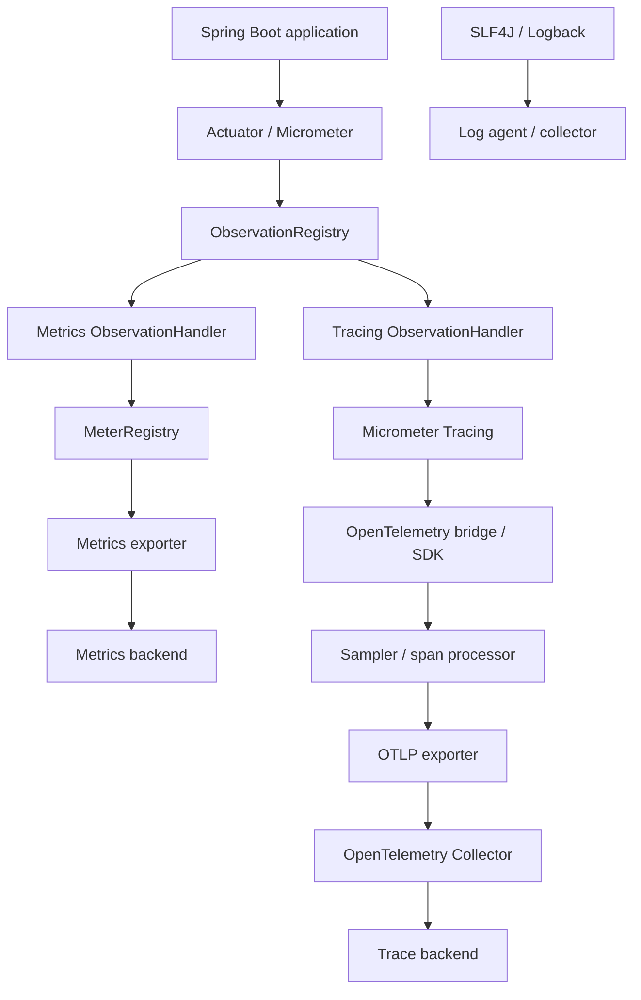
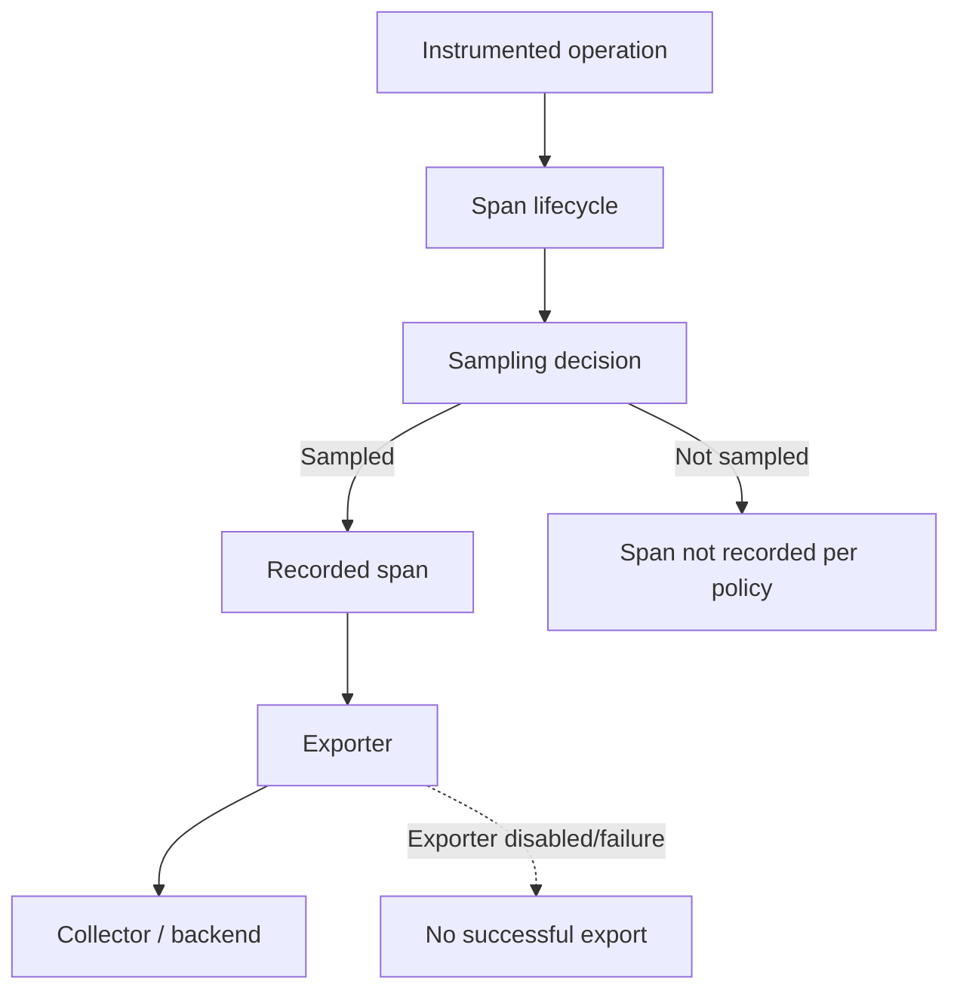

# Enabling and Disabling OpenTelemetry in Spring Boot

A Spring Boot application may need tracing in production to investigate latency, while local development does not run an OpenTelemetry Collector. Or an operations team wants to pause sending spans while keeping metrics and logs active. These are distinct requirements: **disabling instrumentation**, **disabling sampling**, **disabling the exporter**, and **stopping context propagation** each have different effects.

OpenTelemetry (OTel) is an ecosystem of APIs, SDKs, instrumentation, context propagation, and OTLP export for traces, metrics, and logs. Spring Boot typically integrates observability via Actuator and Micrometer Observation/Tracing. Therefore, enabling or disabling OpenTelemetry must be evaluated at the exact layer in use; a single property or dependency does not necessarily toggle every signal.

This lesson **Enabling and Disabling OpenTelemetry** belongs to the **OpenTelemetry** chapter of the **SPRING_BOOT_OBSERVABILITY** module. The module focuses on setting up observability for Spring Boot using Micrometer Observation, metrics, logs, and distributed tracing; covering context propagation, tags/cardinality, exporters, sampling, and signal correlation to investigate errors, latency, and application behavior in production environments.

## 1. Learning Objectives

After this lesson, you will be able to:

- Distinguish enabling/disabling instrumentation, recording, sampling, exporting, and propagation.
- Enable or disable tracing per environment using Spring Boot configurations supported by your version.
- Understand the impact of adding or removing OTel bridge/SDK/exporter dependencies.
- Keep metrics and logs running when only pausing trace export.
- Recognize why a sampling probability of `0` differs from not initializing tracing.
- Design profiles and deployment overrides to prevent accidentally enabling tracing.
- Verify effective configuration, trace backends, Actuator metrics, and log correlation.
- Avoid exposing management endpoints, secrets, or PII, or breaking trace continuity when disabling telemetry.

## 2. Layers That Can Be Enabled or Disabled

In a Spring Boot application, the term "OpenTelemetry" is sometimes used loosely for the entire stack, yet there are actually several independent layers:

| Layer | Responsibility | What Changes When Disabled? |
| --- | --- | --- |
| Instrumentation | Creates observations/spans from HTTP, clients, messaging, custom code | Instrumented operations stop or decrease |
| Tracing bridge/SDK | Supplies tracer, context, and span lifecycle | Tracing APIs/handlers may not be configured |
| Recording | Captures span data during execution | Spans may not be stored as exportable data |
| Sampling | Selects which traces/spans are recorded | Some or all new traces are not selected |
| Exporter/reporter | Ships telemetry to Collector/backend | Data may be created yet never sent to the backend |
| Propagation | Injects/extracts trace context across HTTP/messages | Service may lose ability to link context across boundaries |
| Metrics pipeline | Records and exports Counter/Timer/Gauge | Metrics stop recording or exporting depending on component |
| Logging pipeline | Writes, formats, and forwards logs | Application logs or correlation fields may change |

**Disabling one layer does not automatically disable all other layers.** For example, sampling can stop trace recording while Micrometer metrics handlers still record `Timer`s. Conversely, removing Actuator or a metrics registry can affect metrics even though a separately configured SDK tracing exporter keeps running.

## 3. Observability Architecture When Enabled

Spring Boot commonly uses Micrometer Observation to instrument operations. `ObservationRegistry` coordinates handlers: the metrics handler records measurements to `MeterRegistry`, while the tracing handler creates spans through the Micrometer Tracing bridge. When using the OTel bridge, the trace exporter ships spans over OTLP to the Collector.



Actuator provides management endpoints such as health and metrics. It is not synonymous with the OTel SDK or Collector. The Collector is a separate infrastructure receiver; applications typically send telemetry to it over OTLP.

### When Tracing Is Enabled

An HTTP request can create a server span; an instrumented HTTP client can create a client span; a custom `Observation` can create a business span. The tracing bridge maintains context, sampling selects traces, and the exporter ships recorded spans.

### When Tracing Is Disabled

The application still runs business logic, metrics, and logs. However, clarify whether you are disabling tracing instrumentation itself or merely stopping recording/export. If this service receives trace context from upstream, skipping span recording here leaves a gap in the trace. If headers are stripped, downstream services lose linkage to the root trace altogether.

## 4. Enabling OpenTelemetry Tracing in Spring Boot

Example for Spring Boot 3.x using Gradle Kotlin DSL and Spring Boot dependency management:

```kotlin
dependencies {
    implementation("org.springframework.boot:spring-boot-starter-actuator")
    implementation("io.micrometer:micrometer-tracing-bridge-otel")
    runtimeOnly("io.opentelemetry:opentelemetry-exporter-otlp")
}
```

Roles:

- `spring-boot-starter-actuator`: Actuator and observability integration infrastructure.
- `micrometer-tracing-bridge-otel`: connects the Micrometer Tracing API to OpenTelemetry.
- `opentelemetry-exporter-otlp`: provides the OTLP exporter to send trace data when configured and auto-configured compatibly.

The Spring Boot BOM should manage compatible versions of Spring Boot, Micrometer, and OTel. Do not add the Brave bridge simultaneously once the OTel bridge is chosen, unless following an explicitly designed and verified architecture.

### Configuring Endpoint and Sampling

Configuration example for Spring Boot versions supporting management OTLP tracing properties:

```yaml
spring:
  application:
    name: order-service
management:
  tracing:
    sampling:
      probability: 0.1
  otlp:
    tracing:
      endpoint: http://otel-collector:4318/v1/traces
```

- `spring.application.name` identifies the application; verify how it maps to the `service.name` resource for your stack/version.
- `management.tracing.sampling.probability` sets the sampling probability for the Spring Boot-configured sampler.
- Endpoint is the Collector's OTLP/HTTP destination. Port `4318` and path `/v1/traces` are common examples, not guaranteed addresses in every environment.

**OTLP tracing properties depend on the Spring Boot version and dependency set.** Inspect the configuration metadata of your exact version. If the project configures the SDK/exporter manually, do not layer a second configuration on top of auto-configuration.

## 5. Enabling and Disabling by Environment Profile

| Environment | Recommended Observability Goal | Typical Configuration |
| --- | --- | --- |
| Local | Easy development without external backends | Tracing disabled or optional sampling; keep local Actuator metrics |
| Test/CI | Verify instrumentation, propagation, and export | Enable tracing with a test backend or ephemeral Collector |
| Staging | Production-like pipeline validation | Enable exporter, controlled sampling |
| Production | Real request investigation within cost bounds | Enable tracing with operated sampling policy and exporter |

### Local and Production Profile Examples

```yaml
# application-local.yml
management:
  tracing:
    sampling:
      probability: 0.0
```

```yaml
# application-prod.yml
management:
  tracing:
    sampling:
      probability: 0.1
  otlp:
    tracing:
      endpoint: http://otel-collector.monitoring:4318/v1/traces
```

These illustrate two profiles; syntax and property binding must match your Boot version. A local probability of `0` usually prevents new root traces from being selected by the probabilistic sampler. Production probability `0.1` is an example only, not a universal default for every system.

Select a profile at startup, for example:

```bash
java -jar app.jar --spring.profiles.active=local
```

Or supply configuration via environment variables or deployment platform settings. Inspect effective values after Spring merges application config, profiles, environment variables, command-line args, and config servers; never rely solely on YAML files in the repository.

If local and production share the same container image, externalized profiles/configs decide sampling and endpoints. Verify release pipelines cannot accidentally activate the `local` profile in production or let environment overrides hijack endpoints.

## 6. Enabling/Disabling via Dependencies and Auto-Configuration

Dependencies determine which infrastructure exists at runtime:

| Dependency / Component | What It Enables | When Removed |
| --- | --- | --- |
| Actuator starter | Spring Boot management/Actuator infrastructure | Actuator endpoints and part of auto-configuration disappear |
| Micrometer OTel tracing bridge | Micrometer Tracing adapter to OTel | Micrometer tracing handlers/`Tracer` via OTel bridge are no longer configured |
| OTel OTLP exporter | Ability to export over OTLP | This exporter cannot be used; spans may stop shipping over OTLP |
| Micrometer metrics registry/exporter | Corresponding metrics backend | Metrics may stay in another registry or remain local only |
| OTel instrumentation agent/starter | Instrumentation packaged by the agent/starter | Spans created by that agent/starter stop appearing |

Do not remove Actuator entirely just to disable trace export if the application still needs health, metrics, or management endpoints. Removing the OTLP exporter also does not necessarily disable another exporter configured via an agent or SDK.

### Auto-Configuration Conditions

Spring Boot typically inspects the classpath, existing beans, and properties to drive auto-configuration. When an application defines its own `OpenTelemetrySdk`, `TracerProvider`, `Sampler`, `SpanProcessor`, or exporter beans, understand how auto-configuration backs off or combines beans.

Practical rules:

1. Prefer one tracing implementation and one clear configuration source.
2. Do not create a second OTel SDK/provider alongside a framework/agent-managed SDK.
3. Do not add a custom exporter if auto-configuration already registers one.
4. Inspect the bean/configuration report in authorized environments when checking effective configuration.

## 7. Disabling Sampling Differs from Disabling Tracing

Setting sampling probability to `0` is a common way to reject sampling new root traces under probabilistic sampling:

```yaml
management:
  tracing:
    sampling:
      probability: 0.0
```

This is a **sampling policy**; it does not necessarily stop the tracing bridge or propagator from running. With inbound trace context, parent-based semantics can cause child spans to follow the upstream sampling decision. Exact behavior depends on implementation, sampler, and configuration.

| Requirement | Approach | What Must Be Verified |
| --- | --- | --- |
| Reduce stored traces | Lower sampling probability or choose suitable sampler | Root and parent-based behavior |
| Sample no new root traces | Probability `0` or supported always-off sampler | Inbound context and effective policy |
| Record zero spans in all cases | Evaluate recording/export policy at service/collector | Parent sampled, agents, and custom instrumentation |
| Disable Micrometer Tracing integration entirely | Adjust tracing integration dependencies/auto-configuration | Impact on `Tracer`, Observation handlers, and MDC |
| Send no traces externally | Disable exporter/route or enforce egress/collector policy | Spans may still exist in-process; check other exporters |

Do not conclude that probability `0` erases trace context or every child span. If policy forbids recording any span from a service, test requests carrying a sampled parent as well.

## 8. Disabling the Exporter Differs from Disabling Instrumentation

The exporter transfers span data to the Collector/backend. If the exporter is unconfigured or unreachable, business code may still construct spans depending on implementation. Overhead from creating spans, holding context, or buffering may persist; only backend delivery fails.



Three distinct situations can share the symptom "no traces visible":

1. Sampler dropped the trace, so no span was exported.
2. Span was recorded, yet the exporter was disabled or failed.
3. Export to the Collector succeeded, yet the Collector/backend dropped it or the query is wrong.

Looking only at the trace backend cannot distinguish these. Inspect the sampler, exporter logs/metrics, and Collector ingestion.

### Disabling the Exporter Does Not Automatically Clear Propagation

If context propagation remains active, HTTP/message headers can continue carrying trace context even when this service exports no spans. That helps when downstream services still record traces and need correlation intact. If an untrusted boundary forbids forwarding metadata, apply separate propagation/egress policies.

## 9. Disabling Propagation Is a Separate Decision

Propagation injects/extracts trace context across HTTP headers or message headers. Disabling propagation can cause downstream services to start fresh root traces or lose trace ID linkage with upstream.

Do not strip tracing headers simply because sampling is disabled in one service. That can fragment a trace into multiple independent traces downstream. Conversely, at trust boundaries, filtering or stripping headers may be required by security policy.

| Situation | Decision to Consider |
| --- | --- |
| Local service without a backend | Disable recording/export while keeping propagation if testing requires it |
| Downstream service actively records traces | Keeping context lets downstream attach to the parent trace |
| Gateway crossing into another trust domain | Validate/allow-list or strip metadata per policy |
| Untrusted external messages | Treat context strictly as correlation metadata, never as identity |
| Pausing exporter during backend incident | Avoid stripping context unless security requires it |

## 10. Metrics and Logs Must Be Managed Independently

OpenTelemetry traces, Micrometer metrics, and application logs do not necessarily turn on or off together:

| Change | Traces | Metrics | Logs |
| --- | --- | --- | --- |
| Sampling probability = `0` | New sampler-decided traces not selected | Usually still recorded if metrics handler/registry active | Still written per logging config |
| Disable OTLP trace exporter | Stops reaching Collector via that exporter | Unchanged if metrics pipeline is separate | Unchanged if log pipeline is separate |
| Disable Micrometer tracing bridge | Micrometer tracing integration affected | Metrics handlers may remain | Logs remain; trace/span MDC may disappear |
| Remove Actuator starter | Actuator endpoints/integration change; separate tracing may remain if another SDK/agent exists | Registry depends on remaining dependencies | Logging framework can still operate |
| Disable OTel SDK/agent | Signals managed by that SDK/agent affected | Independent Micrometer metrics may remain | Independent SLF4J/Logback may remain |

### Metrics Are Not Controlled by Trace Sampling

A request without a sampled trace can still increment `http.server.requests`, business `Counter`s, or `Timer`s. Never use trace counts in the backend as a substitute for request counts when sampling is under 100%. To stop metrics export, adjust the metrics registry/exporter rather than changing trace sampling.

### Logs and MDC

If tracing integration populates `traceId`/`spanId` in MDC, disabling tracing integration can make correlation fields vanish from logs. Loggers and appenders still write messages normally.

Example correlation pattern:

```yaml
logging:
  pattern:
    correlation: "[%X{traceId:-},%X{spanId:-}] "
```

This format merely prints MDC values if present. It does not create traces, inject HTTP headers, or export logs to OTel. If log correlation is needed while tracing is off, use a validated business correlation ID rather than inventing a high-cardinality metric label.

## 11. Actuator Endpoints When OpenTelemetry Is Disabled

Example keeping Actuator health/metrics active while setting sampling to `0`:

```yaml
management:
  endpoints:
    web:
      exposure:
        include: health,info,metrics
  tracing:
    sampling:
      probability: 0.0
```

In an application with an active registry/metrics handler, `/actuator/health` and `/actuator/metrics` remain available for inspection. Sampling `0` does not control endpoint exposure; the two property groups solve separate concerns.

If you remove the Actuator starter from runtime, endpoints generally disappear. If you only disable tracing integration, Actuator health/metrics can keep working. Never expose `/actuator/env`, `/actuator/configprops`, or all endpoints publicly just to inspect configuration.

## 12. Enabling/Disabling OpenTelemetry per Deployment

In container/Kubernetes or similar deployment environments, settings are often passed via profiles and environment variables. Spring Boot relaxed binding can be used, though exact variable names must be verified against the property and Boot version.

Illustrative example:

```yaml
env:
  - name: SPRING_PROFILES_ACTIVE
    value: "prod"
  - name: MANAGEMENT_TRACING_SAMPLING_PROBABILITY
    value: "0.1"
```

This example sets the active profile and sampling probability; the OTLP endpoint can be configured via its corresponding environment variable for the supported property group. Never store secret tokens directly in public manifests or repositories. Use your environment's secret management.

### Release Checklist

1. Clarify whether the goal is lowering sampling, stopping export, disabling instrumentation, or halting propagation.
2. Inspect the dependency graph: OTel bridge, exporter, agent, and Micrometer registry.
3. Verify the final merged profile/properties in deployment.
4. Check Collector endpoint, TLS, auth, network, and backend.
5. Assess impact on traces, metrics, logs, baggage, and MDC.
6. Smoke-test both synchronous requests and async/messaging flows if used.
7. Confirm Actuator endpoints remain within intended scope/security.
8. Ensure configuration rollback and post-change monitoring are ready.

Many sampling/exporter settings bind at application startup. Updating a config server or environment does not necessarily reconfigure live beans without supported refresh mechanisms. Some contexts, tracers, or exporters require a restart/recreation to take effect. Verify your stack's refresh behavior instead of assuming properties update instantaneously.

## 13. Security and Privacy

Disabling OpenTelemetry does not replace data governance:

- Previously exported traces remain in the backend until retention/deletion policies purge them.
- Logs and metrics may still contain sensitive data.
- Baggage/trace headers may continue propagating unless disabled separately.
- Another agent or exporter may keep shipping telemetry.
- Actuator endpoints can still leak metadata if exposed too broadly.

| Risk | Mitigation |
| --- | --- |
| Traces contain tokens, cookies, payloads, or PII | Strip/mask at instrumentation and processors; never rely on sampling |
| Exporter sends to untrusted endpoint | TLS, authentication, egress allow-list |
| Actuator exposes config | Minimal exposure, Spring Security/network policies |
| Baggage crosses trust boundaries | Allow-list remote fields and validate inbound |
| Tracing off yet logs still leak data | Audit logging patterns, structured fields, retention |
| Accidentally enabling 100% sampling | Profile guardrails, config validation, and alerts |

## 14. Troubleshooting

| Symptom | Possible Cause | How to Check |
| --- | --- | --- |
| Sampling set to `0` yet spans still appear | Parent sampled, another agent, custom sampler bean, or stale traces | Check parent context, bridge, agent, and time window |
| No traces yet logs contain trace IDs | Sampling off or exporter failing; propagation still active | Inspect sampler and exporter separately |
| Metrics vanish when disabling tracing | Accidentally removed Actuator/metrics registry or metrics handler | Check dependencies and `MeterRegistry` |
| Logs lose trace IDs while keeping messages | Tracing MDC integration disabled or context not propagated | Check bridge, scope, and logging pattern |
| Downstream traces become new roots | Propagation disabled or headers stripped | Inspect inject/extract headers |
| Exporter disabled yet CPU stays elevated | Instrumentation/recording still active, buffers, or another exporter running | Check actual spans/processors/exporters |
| Dependency removed yet spans keep appearing | OTel agent or another SDK still instrumenting | Check JVM arguments, agents, and dependency graph |
| Disabled locally yet staging still emits traces | Different profile/environment overrides | Verify effective config on the running process |
| Actuator health returns 404 after changes | Starter removed or management path/port changed | Check dependencies and endpoint exposure |
| Collector receives nothing after enabling | Wrong OTLP transport, path, port, TLS, auth, or network | Check exporter logs and receiver |
| Old traces still appear after disabling | Backend displays previously ingested data | Filter by timestamp/service and check retention |

### Investigation Workflow

1. Determine whether traces/spans are newly created or old cached data.
2. Check which tracing bridge, SDK/agent, and instrumentation are loaded.
3. Check sampling decisions, both root and inbound parent.
4. Check whether the exporter is initialized and succeeding.
5. Check Collector receiver, processors, exporters, and backend ingestion.
6. Check propagation headers if downstream traces split.
7. Check metrics registry/handlers separately if Actuator metrics disappear.
8. Check MDC/log pipeline separately if correlation fields change.

## 15. Practice: Enabling/Disabling Tracing While Keeping Metrics

**Context:** `order-service` uses Spring Boot Actuator, Micrometer metrics, the OTel tracing bridge, and the OTLP exporter. Operations wants to verify that new trace sampling can be turned off locally while metrics and logs continue working.

### Part A — Preparation

1. Add compatible Actuator, OTel bridge, and OTLP exporter via the Spring Boot BOM.
2. Create a testable HTTP endpoint and a custom `Observation` with Counter/Timer.
3. Set up a test Collector or working tracing backend.
4. Expose health and metrics endpoints in the test environment.
5. Configure log correlation if testing MDC.

### Part B — Running Both Configurations

| Case | Configuration | Observed Result |
| --- | --- | --- |
| A — Tracing enabled | Appropriate sampling, valid exporter endpoint | New trace appears in backend after request |
| B — Sampling off | Probability `0` for new root traces | No new root traces per policy; metrics/logs still work |
| C — Exporter error | Sampling on but invalid test endpoint | Export logs errors; distinct from sampler rejection |
| D — Parent sampled | Send request with inbound sampled context | Verify child behavior per bridge/policy |
| E — Propagation | Call downstream with local sampling off | Verify whether headers/context still propagate |
| F — Metrics | Read Actuator meters after requests | Counter/Timer still increment if metrics pipeline is on |
| G — Logging | Inspect log correlation | MDC fields reflect tracing integration/context |

### Part C — Document Results

Record which settings changed, which layer was disabled, trace backend evidence, metrics output, log correlation, and propagation state. If a trace is absent in the backend, confirm whether it was a sampling decision or an exporter/backend failure.

### Self-Assessment Questions

1. Why doesn't disabling sampling equal disabling OTel instrumentation?
2. Why doesn't probability `0` necessarily override an already sampled parent trace?
3. If you want metrics to keep working when stopping trace export, which components must remain?
4. What happens to trace IDs in logs when the tracing bridge is removed?
5. Why shouldn't tracing headers be stripped just because the exporter is temporarily failing?
6. If spans still appear after removing the bridge dependency, which agent or SDK should you check?
7. Why can Actuator health work while the OTLP Collector receives no traces?
8. Why doesn't disabling the exporter necessarily remove all span-creation overhead?
9. How do you verify effective configuration after Spring merges profiles and environment overrides?
10. When disabling tracing for privacy, which data sources still require auditing?

## 16. Key Takeaways

**Enabling and disabling OpenTelemetry is a per-layer decision.** Dependencies and auto-configuration determine which instrumentation/bridge/exporter exists; sampling decides which traces are recorded; the exporter sends data to the Collector; propagators preserve context across HTTP/message boundaries. These layers are connected yet do not substitute for one another.

In Spring Boot, prefer version-appropriate profiles and properties, manage dependencies via the BOM, and keep one clear tracing implementation. Probability `0` generally prevents sampling new root traces without automatically disabling metrics, logs, baggage, or all propagation; test parent-based behavior separately. If you only want to pause trace export, avoid accidentally removing Actuator or the metrics registry. Verify traces, metrics, logs, headers, Collector, and Actuator after every change, and protect endpoints, secrets, and sensitive data across both enabled and disabled states so observability retains operational value.
