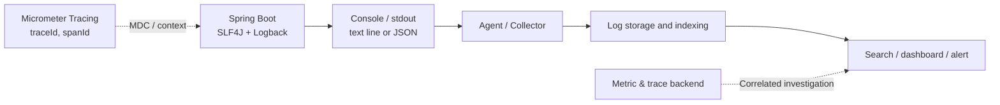

# Logging in Spring Boot

Among the three pillars of observability (**logs, metrics, traces**), logging answers the question: **“What event did the application record, at what time, and with what context?”** When a request is slow, a transaction fails, or a bug only appears in production, logs can help determine the specific sequence of events. However, logs are only truly useful when events are chosen well, messages contain sufficient context, and records are searchable and correlated with metrics and distributed tracing.

For the **SPRING_BOOT_OBSERVABILITY** module, the goal is to establish observability for Spring Boot applications using Micrometer Observation, metrics, logs, and distributed tracing; understand context propagation, tags/cardinality, exporters, sampling, and how to correlate signals to investigate errors, latency, and application behavior in real environments. This lesson focuses on **Logging** and how it fits into that overall workflow.

## Learning Objectives

After this lesson, you will be able to:

- Distinguish the role of logs compared to metrics and traces; choose the appropriate log level for each event.
- Write structured logs with sufficient business context while avoiding sensitive data leaks.
- Configure Spring Boot logging and correlate log records with `traceId` and `spanId` from Micrometer Tracing.
- Explain risks related to context propagation, cardinality, storage costs, and log loss.
- Use logs together with metrics and tracing to investigate a real-world incident.

## 1. What Does Logging Provide Among the Three Pillars?

A **log** is a discrete record of an event: a message, timestamp, severity level, and context fields. Logs can contain business outcomes, error codes, processing duration, or stack traces. They typically answer the question “what happened to this request or object?”.

| Signal | Core Question | Example | Limitations to Remember |
| --- | --- | --- | --- |
| **Logs** | What happened, and with what context? | `order_submit_failed`, `orderId`, error type, `traceId` | High data volume; difficult to compute system-wide rates and percentiles |
| **Metrics** | How well is the system performing? | HTTP 5xx rate, requests/second, p95 latency | Aggregated data; little detail for individual requests |
| **Traces** | Which steps and services did a request pass through, and where was it slow? | Span HTTP → inventory → database | Traces may be sampled; some requests will not have an exported trace |

The three signals **complement** each other. Metrics detect anomalies, traces narrow down the execution path and timing, and logs provide detailed facts to explain the incident. Logs should not be used as the sole mechanism for counting requests, calculating p95, or replacing legally required audit trails.

### Lifecycle of a Log Record



In containers, the common practice is to write logs to **stdout/stderr**, letting the infrastructure collect and forward them. Applications should not depend on a local log file path persisting permanently inside a container. The collection pipeline must have mechanisms for handling load, retention limits, access control, and monitoring itself.

## 2. What Fields Does a Good Log Record Need?

Useful logs must help investigators reconstruct the **event** without having to guess the meaning of a free-form string.

| Field Group | Example | Purpose |
| --- | --- | --- |
| Timestamp and severity | `timestamp`, `level=ERROR` | Determine ordering and severity |
| Source | `service=order-service`, `environment=prod`, `logger` | Identify which service and component logged the record |
| Event | `event=order_submit_failed` | Search reliably by event type |
| Request context | `traceId`, `spanId`, `requestId` (if present) | Correlate events within a single request |
| Controlled business context | `orderId`, `result`, `errorCode` | Answer which request/object was affected |
| Diagnostics | `durationMs`, `error.type`, stack trace when needed | Understand latency and root cause |

*Illustrative* example of a JSON log (actual field names depend on the format and pipeline):

```json
{
  "@timestamp": "2026-11-22T03:20:14.270Z",
  "level": "ERROR",
  "service": "order-service",
  "event": "order_submit_failed",
  "orderId": "ord-7842",
  "durationMs": 1265,
  "errorCode": "INVENTORY_TIMEOUT",
  "traceId": "4bf92f3577b34da6a3ce929d0e0e4736",
  "spanId": "00f067aa0ba902b7"
}
```

Principles for defining fields:

1. Use **consistent event names** (`order_submit_started`, `order_submitted`, `order_submit_failed`); these are much easier to filter and compare than varying free-form messages.
2. Separate a **stable error type** (`INVENTORY_TIMEOUT`) from exception messages that change per run.
3. Log business identifiers **only when compliant with privacy rules**; prefer internal IDs over email addresses, phone numbers, or directly identifiable information.
4. Keep data types consistent—for example, `durationMs` is always a number in milliseconds; timestamps use an explicit timezone, typically UTC.
5. Every logged event should have investigative value. Logging entire request/response bodies by default is both costly and risks exposing sensitive data.

**Structured logging** represents data fields in a machine-readable format (typically JSON). Putting multiple `key=value` pairs inside a message string is only a transitional step: the pipeline may have to re-parse the text, which is fragile when formatting changes. If you need to query by individual fields, choose a JSON encoder or configuration capable of emitting business fields into JSON in a controlled manner.

## 3. Choosing Log Levels and Where to Log

| Level | Use For | Avoid |
| --- | --- | --- |
| `TRACE` | Very detailed flow during temporary investigation | Leaving enabled long-term in production, especially in hot loops |
| `DEBUG` | Execution branches and technical state needed for debugging | Logging every variable, token, or payload |
| `INFO` | Important business events and operational state transitions | Logging every minor step of a normal flow |
| `WARN` | Abnormal situations that the system handled or recovered from | Treating every invalid user input as a system incident |
| `ERROR` | Operations that failed and require awareness/investigation | Logging the same exception at every layer and rethrowing it |

Example order placement flow: `INFO` for a successful order submission, `WARN` when retrying because the inventory service is temporarily slow, `ERROR` when the final operation fails. For requests returning 4xx due to invalid user input, `INFO` or `WARN` may be more appropriate than `ERROR`; this depends on operational policy.

Log at **meaningful boundaries**: receiving results from an external partner, completing a business operation, deciding to retry, or confirming a final failure. If the same error propagates from repository to service to controller, choose the layer with enough context to log the stack trace once; other layers can add context via exceptions or spans.

### Writing Logs with SLF4J

Spring Boot typically uses the **SLF4J** API with the default **Logback** implementation (when using standard starters). The example below illustrates a service with an application-provided `InventoryClient` dependency:

```java
import java.util.concurrent.TimeUnit;
import org.slf4j.Logger;
import org.slf4j.LoggerFactory;
import org.springframework.stereotype.Service;

@Service
public class OrderService {
    private static final Logger log = LoggerFactory.getLogger(OrderService.class);

    private final InventoryClient inventoryClient;

    public OrderService(InventoryClient inventoryClient) {
        this.inventoryClient = inventoryClient;
    }

    public void submit(String orderId, int itemCount) {
        long startedAt = System.nanoTime();
        try {
            inventoryClient.reserve(orderId, itemCount);
            long durationMs = TimeUnit.NANOSECONDS.toMillis(
                System.nanoTime() - startedAt
            );
            log.info(
                "event=order_submitted orderId={} itemCount={} durationMs={}",
                orderId, itemCount, durationMs
            );
        } catch (RuntimeException ex) {
            long durationMs = TimeUnit.NANOSECONDS.toMillis(
                System.nanoTime() - startedAt
            );
            log.error(
                "event=order_submit_failed orderId={} durationMs={}",
                orderId, durationMs, ex
            );
            throw ex;
        }
    }
}

interface InventoryClient {
    void reserve(String orderId, int itemCount);
}
```

Here `{ }` is an SLF4J placeholder: arguments are only formatted when the log level is enabled. This is better than string concatenation like `"order=" + orderId`, especially for `DEBUG` logs. Expensive computations before calling the logger must still be considered or guarded with `log.isDebugEnabled()`. Passing `ex` as the final argument allows the logger to record the exception and stack trace; there is no need to extract only `ex.getMessage()`.

The example treats `orderId` as an internal identifier permitted in logs; in real systems, data protection policies must be evaluated before logging. `durationMs` is useful for investigating a single request, while system-wide latency statistics should still rely on **Micrometer Timer/metrics** rather than computing from log lines that might be dropped or sampled.

## 4. Configuring Logging in Spring Boot

### Log Levels by Package

In `application.yml`:

```yaml
spring:
  application:
    name: order-service

logging:
  level:
    root: INFO
    com.example.orders: INFO
```

When investigating, you can temporarily enable `DEBUG` for a narrow package, such as `com.example.orders.inventory`, instead of the entire application. Do not leave verbose logging enabled for long periods if log volume spikes. Specific log levels and settings can vary by profile/environment.

### JSON Logging

**Spring Boot 3.4 and later** supports built-in structured logging. Example of outputting Logstash-compatible JSON to the console:

```yaml
logging:
  structured:
    format:
      console: logstash
```

Besides Logstash, other format options are available depending on the Spring Boot version. For versions **prior to 3.4**, you must configure an appropriate JSON encoder/appender manually (typically via `logback-spring.xml` and an encoder library). When changing the format, verify that `traceId`, `spanId`, and business fields appear as expected by your query system. **Configuring JSON logging does not automatically send logs to an OpenTelemetry Collector**: if logs are only written to the console, an agent or collector must read stdout and forward them to the backend.

### Path of a Log Record

In real environments, there are typically two independent pipelines:

- **Logs:** Spring Boot → stdout JSON → agent/collector → log backend (e.g., Loki, Elasticsearch, SIEM systems).
- **Traces:** Micrometer Tracing → exporter → tracing collector/backend (e.g., Jaeger, Tempo, or an APM platform).

Metrics go through a separate scrape/export system, such as Actuator/Micrometer and Prometheus. Sharing a common `traceId` enables correlated queries, though it does not mean all signals are sent to the same endpoint or automatically linked in the UI.

## 5. Correlating Logs with Distributed Tracing

Two key fields:

- **`traceId`:** The ID of a request's entire journey across multiple services.
- **`spanId`:** The ID of a specific unit of work within that journey, such as an HTTP server span or a database call.

When using **Micrometer Tracing** with Spring Boot 3.x, the trace/span context of instrumented execution segments can be placed into **MDC** (*Mapped Diagnostic Context*), allowing the log format to include `traceId` and `spanId` in each record. Typical dependencies in a project using Gradle Kotlin DSL:

```kotlin
dependencies {
    implementation("org.springframework.boot:spring-boot-starter-actuator")
    implementation("io.micrometer:micrometer-tracing-bridge-otel")
    runtimeOnly("io.opentelemetry:opentelemetry-exporter-otlp")
}
```

Dependency versions must be managed compatibly with the Spring Boot BOM in use. To export traces over OTLP HTTP, an example configuration is:

```yaml
management:
  tracing:
    sampling:
      probability: 0.1
  otlp:
    tracing:
      endpoint: http://localhost:4318/v1/traces
```

This is an example configuration for a Spring Boot 3.x stack with an actual Collector endpoint at that address; it must be adjusted for your deployment environment. `sampling.probability: 0.1` corresponds to a target of sampling roughly **10%** of traces according to the configured sampling mechanism—it does not mean “only write 10% of logs”. A trace may not be stored/exported when not selected, so looking up a `traceId` from a log might not find corresponding trace data in the backend.

If the application already has tracing and a compatible logging pattern configured, Spring Boot console logs can automatically display trace/span correlation. When customizing `logging.pattern.console` or using another JSON encoder, you must include the required MDC keys in the output; if omitted, logs will lose correlation capability even though tracing continues to work.

### Propagation Across Services and Asynchronous Threads

Suppose `order-service` calls `inventory-service` over HTTP. Standard **W3C Trace Context** headers (such as `traceparent`) propagate context across network boundaries when clients/servers are compatibly instrumented. Both services can then log the same `traceId` with different `spanId` values. Merely setting a `requestId` independently in each service will not produce a distributed trace.

MDC is typically backed by **ThreadLocal**. If you spawn threads manually, use a custom executor, or run asynchronous callbacks, the context may not automatically transfer to the new execution thread. For Spring MVC, WebFlux/Reactor, `@Async`, or message consumers, verify instrumentation and configure **Micrometer Context Propagation** appropriately. Do not assume trace context always follows every thread.

If you want to add an MDC field for a synchronous block of code, bound its lifetime using a scope:

```java
import org.slf4j.MDC;

try (MDC.MDCCloseable ignored =
         MDC.putCloseable("operation", "order-submit")) {
    log.info("event=order_validation_completed");
}
// 'operation' is removed from MDC after exiting the scope.
```

Do not generate or overwrite `traceId` or `spanId` with random strings in MDC when real tracing is active. Failing to clear MDC after a request can cause a reused thread to carry stale context into another request, causing confusion and data leaks.

## 6. Cardinality, Sampling, and Log Cost

**Cardinality** is the number of distinct values for a field. Its impact varies depending on where the data is used:

- In **metrics**, using `orderId` or `userId` as a label usually creates very high cardinality, leading to a huge number of time series and high resource consumption. Use bounded labels such as `http.method`, `http.status_code`, and `region` (after normalization).
- In **logs**, `orderId` or `traceId` can be useful search keys if permitted. Still, indexing every high-cardinality field consumes storage and hurts query speed. For Loki, for example, you should not turn every `traceId` into a **stream label**.
- In **traces**, detailed attributes help isolate incidents, but the number of spans and exported data volume must be balanced via a sampling policy.

Techniques to reduce log operational costs: choose high-value events; avoid duplicate logs; reduce `DEBUG`/`TRACE`; cap message and stack trace lengths per policy; configure retention per environment; and tier data between fast-query storage and long-term archival storage. Log sampling (if applied) is a separate policy from tracing sampling; critical error events and required audit data must be preserved.

A production system must account for the possibility of **log loss**: an application may crash before flushing, an async appender queue may fill up, a collector may be overloaded, or the backend may experience an outage. Therefore, never use ordinary application logs as the single source of truth for business state, billing, or compliance auditing.

## 7. Security and Reliability of Logs

Logs are often replicated to centralized systems accessible to more people than the application database. You should:

1. **Never log secrets:** passwords, API keys, bearer tokens, session cookies, Authorization headers, card numbers, or full request bodies containing sensitive data.
2. **Minimize personal data:** only log fields genuinely needed for investigation; mask, hash, or use surrogate IDs according to policy.
3. **Preserve semantic integrity:** sanitize input fields that could contain newline characters to prevent log injection; JSON encoders help escape characters, but they do not replace access control and input validation.
4. **Access control and retention:** restrict who can read logs, audit access to the logging system, and enforce appropriate deletion schedules.
5. **Check timestamps:** synchronize clocks across nodes, record timestamps with explicit timezones, and monitor skew between event time and collector ingestion time.

Exception messages from third-party libraries can also contain query strings, identifiers, or sensitive values. Before logging full exceptions or payloads, evaluate the data source and masking policies.

## 8. Investigating a Production Bug Using All Three Signals

**Scenario:** Customers experience intermittent order placement failures. `order-service` calls `inventory-service`, and some requests take more than 2 seconds and return HTTP 5xx.

**Step 1 — Identify symptoms with metrics.** Observe the 5xx rate and p95/p99 latency by service, route, and time range. If p95 spikes alongside 5xx errors, narrow the incident window. Do not put `orderId` into metric labels to track down transactions.

**Step 2 — Find specific events in logs.** Filter by `service=order-service`, the time window, and `event=order_submit_failed`; inspect `errorCode`, `durationMs`, permitted business IDs, and `traceId`. Then filter `inventory-service` logs by the same `traceId` to look for timeouts, retries, or data errors. Exact field names in queries depend on the log backend and ingestion setup.

**Step 3 — Open the corresponding trace (if sampled).** Inspect the HTTP → order-service → inventory-service → database path, compare span durations, and check which span reported an error. The trace may show most time was spent in the inventory call, while logs remain necessary to learn details like `INVENTORY_TIMEOUT` or retry branch behavior.

**Step 4 — Cross-check and conclude.** If logs report an inventory timeout, the trace shows a long-running inventory span, and inventory metrics also show elevated latency, the hypothesis of a bottleneck in inventory becomes much stronger. Continue checking DB connection counts, waiting pools, retries, and recent deployments before concluding the root cause.

**Step 5 — Act and verify.** Fix the identified issue, watch 5xx rates and latency recover, and confirm error log volume drops. Add any missing metrics, spans, or log events so future incidents can be isolated faster.

A log sequence tied to a trace might look like this:

```text
12:00:01.001 order-service     INFO  traceId=abc event=order_submit_started orderId=ord-7842
12:00:02.242 inventory-service WARN  traceId=abc event=inventory_call_timeout attempt=1
12:00:02.266 order-service     ERROR traceId=abc event=order_submit_failed errorCode=INVENTORY_TIMEOUT
```

The lines above are illustrative; `abc` is shortened for readability. In practice, W3C trace IDs are typically 32 hex characters. Observing a single `ERROR` log is not enough to confirm the fault lies in the service that logged it; you must inspect the entire call path and downstream dependencies.

## 9. Common Design Mistakes and Fixes

| Issue | Consequence | Fix |
| --- | --- | --- |
| Logging only `"Something went wrong"` | No investigative context | Log `event`, error type, permitted relevant fields, and exception |
| Outputting only free-form text with inconsistent formats | Difficult to search or parse | Standardize the schema and use JSON logging/pipelines |
| Logging the same exception at every layer | Noise and inflated error counts | Pick a final error-logging boundary and preserve the needed stack trace |
| Losing `traceId` after `@Async` or an executor | Hard to link logs across steps | Add context propagation and verify with a cross-thread request |
| Attaching `traceId` or `orderId` as metric labels | Cardinality explosion | Use only metric labels with bounded value sets |
| Enabling `DEBUG`/`TRACE` across all of production | Higher cost and data-leak risk | Enable temporarily and only for specific packages |
| Logging secrets or full payloads | Data leakage | Apply redaction, schema controls, and access restrictions |
| Assuming every log has a trace | Broken trail when sampled out | Search logs independently and verify tracing/exporter configuration |

## 10. Practical Checklist

On a Spring Boot service with an endpoint calling another service, practice in order:

1. Configure sensible log levels and emit one successful `INFO` event, one recovered `WARN` event, and one failed `ERROR` event. Observe how passing the exception preserves the stack trace.
2. Enable JSON logging if your version supports it, or configure a JSON encoder, then verify timestamp, severity, service, event, and context fields.
3. Enable Micrometer Tracing and set up a suitable tracing exporter. Send a request across two instrumented services; compare `traceId` across logs and `spanId` at each step.
4. Test across an executor/async boundary; if trace context is lost, configure propagation for your execution model and re-verify.
5. Trigger a controlled error; use metrics to pinpoint the time window, logs to find the event, and traces to find the slow step (if the trace was recorded).
6. Verify logs contain no tokens/PII, `orderId` does not appear as a metric label, and the pipeline has appropriate retention and access controls.

**Self-check:** If a request has an `ERROR` log with a `traceId` but the tracing backend cannot find the trace, list at least three possibilities: the trace was dropped by sampling, the exporter/collector encountered an issue, or context/ID propagation was inconsistent. Next, determine what information in logs and metrics is still sufficient to investigate without a trace.

## Key Takeaways

Logging is the **event evidence** of an observable system. In Spring Boot, design structured log events, use appropriate levels, add suitable business context, and correlate with Micrometer Tracing via `traceId`/`spanId`. In production operations, also account for context propagation, cardinality, sampling, privacy, cost, and pipeline reliability. Logs provide details; metrics show trends; traces show paths — combining all three gives a complete enough picture to investigate incidents.
