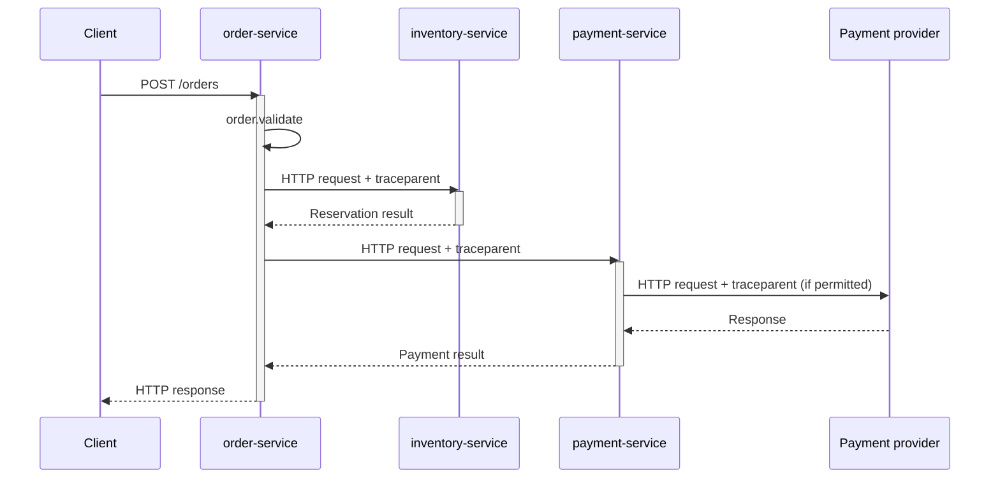
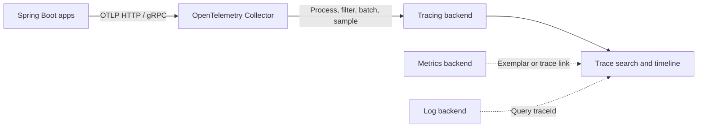

# Traces in Spring Boot Observability

Among the three pillars of observability (**metrics, logs, traces**), a **trace** helps answer the question: *Which components did a request pass through, how long did each step take, and where did errors occur?* This perspective is especially important when a Spring Boot application calls multiple services, databases, or messaging systems. Metrics show trends and impact magnitude; logs record discrete events; traces connect operations into the journey of a specific request.

This lesson focuses on **distributed tracing** in Spring Boot with **Micrometer Observation**, Micrometer Tracing, and the OpenTelemetry ecosystem. You will learn how to read traces, preserve context across service calls, create spans for essential business steps, export data to a tracing backend, and combine signals to investigate incidents in production environments.

## 1. What Is a Trace?

Suppose a user places an order in a system with three services:

1. `order-service` receives `POST /orders` and validates the order.
2. `inventory-service` confirms stock availability.
3. `payment-service` processes payment and calls an external payment gateway.

When the API responds slowly, a single log line in `order-service` only shows total elapsed time; it does not explain whether the system was waiting on a database query, an inventory check, or connecting to the payment gateway. A **distributed trace** links these operations into a chronologically ordered execution flow.

| Concept | Meaning | Example |
| --- | --- | --- |
| **Trace** | A collection of causally related spans belonging to the same processing journey | The end-to-end processing of an order request |
| **Trace ID** | Shared identifier used to retrieve all spans belonging to the same trace | A 32-character hex string in W3C format |
| **Span** | A unit of work with a start time, end time, name, and metadata | `HTTP POST /orders`, `payment.authorize` |
| **Span ID** | Unique identifier of an individual span | A 16-character hex string in W3C format |
| **Parent span** | The parent span representing work that encloses or spawns a child span | The HTTP server span of `order-service` |
| **Attributes/tags** | Properties used for filtering, grouping, and understanding span context | `http.request.method=POST`, `service.name=order-service` |
| **Event** | A point-in-time occurrence inside a span | Recording a retry attempt or an exception |
| **Span status** | Execution outcome at the tracing level, which may indicate failure | `ERROR` when instrumentation records an error |
| **Span link** | A link to another span context when a parent–child relationship is unsuitable | A consumer processing a batch of messages from multiple traces |

A trace typically contains many nested spans. Spans across different services share the **same Trace ID**, while having **different Span IDs**. This data is only useful when components agree on context propagation rules and system clocks are accurate enough to compare timestamps.

### Timeline of a Request

Illustrative example of a request taking roughly 870 ms:

```text
Trace: checkout request                                     0 ms -> 870 ms
order-service  POST /orders                  [==================================]
  order.validate                            [==]                              10–55
  inventory HTTP client                       [====]                           60–160
    inventory-service GET /reserve              [===]                          70–150
  payment HTTP client                                      [================]   190–840
    payment-service POST /authorize                         [===============]    200–825
      provider HTTP client                                      [===========]    260–790
```

*Timings are illustrative only, not benchmark results.* You can see that the `payment-service` branch accounts for most of the time. However, **do not sum the durations of all spans** to compute total time: parent spans enclose child spans, and multiple branches may run in parallel. Look at timeline positioning, *exclusive* duration if supported by the backend, and wait gaps between operations.

## 2. How Do Traces Flow Across Services?

When `order-service` calls `payment-service`, the two processes do not share in-memory variables. They must pass **trace context** over the inter-service protocol.



With **W3C Trace Context**, a typical header looks like:

```http
traceparent: 00-4bf92f3577b34da6a3ce929d0e0e4736-00f067aa0ba902b7-01
```

The segments represent the version, 128-bit Trace ID, 64-bit parent Span ID, and trace flags. In the example, the sampling flag at the end is enabled (`01`). When a client span sends a request, the target service extracts the context to create a new server span with the same Trace ID, linked to the calling span. **Never copy the Span ID** into the new span.

In addition to `traceparent`, there are:

- `tracestate`: metadata for W3C-compatible tracing systems.
- `baggage`: key/value pairs propagated across process boundaries independently of span attributes. Baggage increases wire overhead and can travel to external services; use it only when truly necessary and never place secrets, tokens, or personal data inside it.
- Other formats such as B3: encountered in legacy systems. Communicating services must configure compatible propagation formats; do not assume every application understands the same header format.

**Propagation** preserves relationships between spans, whereas **export** sends collected span data to storage. A system may propagate Trace IDs properly yet show no traces in the UI due to sampling, exporter configuration, networking, or backend issues.

## 3. Traces in the Spring Boot Ecosystem

The components typically work together as follows:

```text
HTTP / message / job
       |
Spring Boot instrumentation and Micrometer Observation
       |
Micrometer Tracing (bridge to OpenTelemetry or Brave)
       |
Trace context + spans
       |
Exporter (e.g., OTLP)
       |
OpenTelemetry Collector (architecture-dependent)
       |
Tracing backend (Tempo, Jaeger, or equivalent service)
```

**Micrometer Observation** is the API for describing an operation: name, context, tags, timing, and errors. A single Observation can be processed by multiple handlers, such as a metrics handler and a tracing span handler. **Micrometer Tracing** provides a unified tracing API and bridges to tracing ecosystems such as OpenTelemetry. **OpenTelemetry** defines common standards/APIs/SDKs and export formats. The tracing backend stores and displays traces for operators to query.

This separation helps design effective instrumentation: recording a business operation with Observation can drive both a latency metric and a span, provided the application has appropriate handlers installed. Not every log statement or method automatically creates a span.

### 3.1. Illustrative Setup with Spring Boot 3.x

Maven example for a Spring Boot 3.x application using Micrometer Tracing and OpenTelemetry. Assume the application already includes the corresponding web starter; dependency versions are managed by the Spring Boot BOM:

```xml
<dependencies>
    <dependency>
        <groupId>org.springframework.boot</groupId>
        <artifactId>spring-boot-starter-actuator</artifactId>
    </dependency>
    <dependency>
        <groupId>io.micrometer</groupId>
        <artifactId>micrometer-tracing-bridge-otel</artifactId>
    </dependency>
    <dependency>
        <groupId>io.opentelemetry</groupId>
        <artifactId>opentelemetry-exporter-otlp</artifactId>
    </dependency>
</dependencies>
```

Illustrative `application.yml` configuration:

```yaml
spring:
  application:
    name: order-service

management:
  tracing:
    sampling:
      probability: 1.0       # Use only for local testing
  otlp:
    tracing:
      endpoint: http://localhost:4318/v1/traces
```

In this example, `localhost:4318` is where an **OTLP/HTTP receiver** is listening, which may be an OpenTelemetry Collector or an OTLP-capable backend. This is an illustrative address: if the application runs inside a container, `localhost` refers to that container itself, so it usually must be changed to the Collector's hostname/DNS. Port `4318` is typically used for OTLP/HTTP, while `4317` is typically used for OTLP/gRPC; do not mix ports and protocols. The Collector must be configured with matching receivers, processors, exporters, and a traces pipeline.

Configuration and artifacts can vary across Spring Boot versions and tracing stacks. When deploying on Spring Boot versions other than 3.x, cross-check starter names, properties, and dependencies against the documentation for your version. Do not pin arbitrary OpenTelemetry or Micrometer versions when Spring Boot dependency management is already active.

When running the application, Spring Boot can automatically create observations/spans for the HTTP server and framework-managed HTTP clients. The exact instrumentation set depends on the stack (Servlet vs. WebFlux), libraries in use, and active configuration; verify in the tracing backend rather than assuming every call is traced.

### 3.2. Preserving Propagation When Calling HTTP Clients

With Spring Boot 3.2+ using `RestClient`, obtain the Spring-managed `RestClient.Builder`:

```java
import org.springframework.context.annotation.Bean;
import org.springframework.context.annotation.Configuration;
import org.springframework.web.client.RestClient;

@Configuration
class ClientConfiguration {
    @Bean
    RestClient paymentRestClient(RestClient.Builder builder) {
        return builder
                .baseUrl("http://payment-service")
                .build();
    }
}
```

The builder configured by Spring Boot serves as the instrumentation integration point. If you instantiate a client outside Spring, use a custom transport, or override observability configuration, context headers might not be injected. The same principle applies to `WebClient.Builder`, `RestTemplateBuilder`, or instrumented messaging clients. Always inspect actual traces after changing HTTP or messaging libraries.

**For connections outside your trust boundary**, consider header forwarding policies: Trace IDs and baggage are not authentication credentials; never let a receiver make access-control decisions based solely on tracing context.

## 4. Creating Spans for Important Business Steps

If you only observe HTTP spans, a developer might see that `POST /orders` took 900 ms without distinguishing time spent checking discount rules from time spent calling dependencies. Add spans for operations significant enough to aid diagnosis; avoid creating spans for individual lines of code or tiny helper functions.

Example of creating an observation in the service layer:

```java
import io.micrometer.observation.Observation;
import io.micrometer.observation.ObservationRegistry;
import org.springframework.stereotype.Service;

@Service
public class PricingService {
    private final ObservationRegistry observationRegistry;

    public PricingService(ObservationRegistry observationRegistry) {
        this.observationRegistry = observationRegistry;
    }

    public long calculateTotal(long subtotalCents, String tier) {
        String tierGroup = "premium".equals(tier) ? "premium" : "standard";

        return Observation.createNotStarted(
                    "order.price.calculate", observationRegistry)
                .lowCardinalityKeyValue("tier", tierGroup)
                .observe(() -> subtotalCents + 250L);
    }
}
```

When the Observation flows through the tracing handler, this operation can create a child span under the current span; a matching metrics handler can also record its duration. The code uses a stable operation name `order.price.calculate` and a small bounded set of `tier` values. Never use `order-123456` as a span name or turn transaction IDs into low-cardinality tags.

For complex operations requiring explicit lifecycle control, you can create an Observation and call `start()`, `openScope()`, `error(exception)`, and `stop()` inside a `try/catch/finally` block. You must close the scope and stop the observation even when an exception occurs; otherwise, durations and current context may become corrupted.

**When do you need a custom span?** Choose operations with clear business meaning, potential latency/failure risk, and well-defined boundaries: `order.validate`, `inventory.reserve`, `payment.authorize`. For trivial computations, excessive spans can introduce more overhead than diagnostic value.

### Span Attributes and Cardinality

**Cardinality** is the number of distinct values for an attribute. This is critically sensitive for metrics (each label combination can generate a separate time series) and also affects tracing storage and filtering efficiency.

| Data Type | Appropriate Usage | Avoid |
| --- | --- | --- |
| Low-cardinality tag | `outcome=success/failure`, `payment.method=card/wallet` | `userId`, `orderId`, raw URLs containing IDs |
| High-cardinality trace attribute | Non-sensitive technical correlation IDs, only when truly needed for trace queries | Passwords, emails, tokens, payment details, raw payloads |
| Span name | `HTTP POST /orders/{id}` or `payment.authorize` | Names embedding transaction IDs or dynamic per-request URLs |
| Event | `retry_scheduled` with retry attempt count within reasonable scope | One event per loop iteration or dumping full exception objects |

In Micrometer Observation, `lowCardinalityKeyValue(...)` can be consumed by both metrics and tracing; `highCardinalityKeyValue(...)` is intended for tracing and should not become a metric tag. **High cardinality does not mean it is safe to record sensitive data**. For attributes and baggage, enforce organizational security policies, length limits, and retention rules; never record raw request/response bodies or `Authorization` headers.

HTTP metric/trace names should use *route templates* (such as `/orders/{id}`) when supported by instrumentation. Exact attribute names under OpenTelemetry semantic conventions can change across library versions, so verify actual emitted names before building dashboards or queries.

## 5. Preserving Trace Context Across Asynchronous Boundaries

A trace can break when work crosses thread pools, Reactor pipelines, schedulers, message brokers, or batch consumers.

- **Synchronous HTTP:** Instrumented client libraries normally inject `traceparent` and reuse the active context.
- **`@Async`/thread pools:** Thread-bound context can vanish when work runs on another thread. Spring Framework 6.1+ provides `ContextPropagatingTaskDecorator` to copy relevant Micrometer context to the task.
- **WebFlux/Reactor:** Context flows through Reactor Context; you cannot rely on plain ThreadLocal/MDC when pipelines switch threads. Use the context propagation mechanism supported by your Spring/Reactor version.
- **Kafka/RabbitMQ:** Requires producer and consumer instrumentation with compatible header injection/extraction. For batches, fan-outs, or long-running workflows, span links often model relationships better than a single parent span.
- **Scheduled/background jobs:** Work not originating from a request typically starts a new root trace; do not link it by default to an already completed HTTP trace.

Example configuring a custom executor for `@Async` with Spring Framework 6.1+:

```java
import org.springframework.context.annotation.Bean;
import org.springframework.context.annotation.Configuration;
import org.springframework.core.task.support.ContextPropagatingTaskDecorator;
import org.springframework.scheduling.concurrent.ThreadPoolTaskExecutor;

@Configuration
class AsyncConfiguration {
    @Bean("observedExecutor")
    ThreadPoolTaskExecutor observedExecutor() {
        ThreadPoolTaskExecutor executor = new ThreadPoolTaskExecutor();
        executor.setCorePoolSize(4);
        executor.setMaxPoolSize(8);
        executor.setTaskDecorator(new ContextPropagatingTaskDecorator());
        return executor;
    }
}
```

After enabling `@EnableAsync` on an appropriate configuration class, methods can use `@Async("observedExecutor")`. The decorator only propagates context across tasks and threads when matching context accessors are registered. Verify using Trace IDs in spans before and after the async boundary; **do not** attempt to fix broken traces by manually copying a Trace ID string into MDC and calling it complete propagation. MDC supports logging, whereas tracing requires full span context, parent relationships, and sampling state.

## 6. Sampling and Operational Cost

A system handling tens of thousands of requests per second does not necessarily need to store 100% of traces. **Sampling** determines which traces are collected or retained.

| Strategy | Mechanism | Trade-off |
| --- | --- | --- |
| Head sampling | Decided near the start of the trace, e.g., probabilistic sampling | Low resource overhead, but may drop failing or slow requests before the outcome is known |
| Parent-based sampling | Downstream spans follow the upstream sampling decision | Keeps traces consistent across services; requires proper propagation |
| Tail sampling | Collector/backend buffers enough data to select traces by latency, error, or rules | More flexible, but requires buffering, compute capacity, and all spans must reach the decision point |

In Spring Boot 3.x configuration:

```yaml
management:
  tracing:
    sampling:
      probability: 0.10
```

The value `0.10` represents a 10% sampling probability where the setting is applied, **not a guarantee of exactly 10% in every time window**. Upstream decisions and sampler implementations can also influence the result. When testing a specific trace locally during development, you can temporarily set `1.0` and then return to an appropriate production value.

In production, balance traffic volume, ingestion/storage cost, incident investigation needs, and data protection requirements. Aggregated metrics should still reflect 100% of requests regardless of partial trace sampling. Never infer system-wide error rates from a biased sample of traces.

**Note:** Tail sampling in the Collector cannot recover spans that were already dropped earlier by head sampling in the application. If you want to capture error/slow traces via tail sampling, design the upstream data emission and pipeline accordingly.

## 7. Connecting Traces with Metrics and Logs

The three signals answer different questions:

| Signal | Core Question | Example |
| --- | --- | --- |
| **Metrics** | How many requests are slow or failing? Is the rate increasing over time? | p95 latency of `POST /orders` jumped from 250 ms to 900 ms |
| **Traces** | Where did a specific slow request go, and which span took the time? | A trace shows the client call to `payment-service` took 650 ms |
| **Logs** | What events and error details did the component record? | A log in `payment-service` records a timeout calling the provider |

A practical investigation workflow:

1. Check the metrics dashboard: error rate or p95/p99 crosses a threshold; identify the affected route, service, and time window.
2. In trace search, pick slow or failing requests from that window; if supported, follow an **exemplar** directly from a metric to its corresponding trace.
3. Inspect the timeline and span tree: distinguish internal processing time, dependency wait time, retries, and parallel branches.
4. Use `traceId` (and `spanId` if needed) to query logs from the involved services and read error messages alongside business context.
5. Cross-check multiple traces and metrics over time; a single trace is only one sample and is insufficient to prove a systemic cause.

Example of logs configured for correlation:

```text
INFO  [order-service,4bf92f3577b34da6a3ce929d0e0e4736,00f067aa0ba902b7] Order accepted
ERROR [payment-service,4bf92f3577b34da6a3ce929d0e0e4736,7a4d6af9134bf807] Gateway timeout
```

This is an illustrative format, not the default log pattern across all versions. With Micrometer Tracing, the application can populate `traceId`/`spanId` into MDC while a scope is active and configure logging patterns to render them. Verify that these fields actually appear in both normal requests and async flows. Logs missing Trace IDs may mean there is no active span, context was lost, or the log pattern was not configured.

**Correlation does not imply causation.** A slow span might be a symptom of an overloaded dependency, connection pool exhaustion, retries, network issues, or database locks. Traces help narrow down where to look; combine metrics, logs, and targeted measurements before concluding root cause.

## 8. Exporters, Collectors, and Tracing Backends

Traces may be collected in memory yet fail to appear if the export pipeline is misconfigured. A common architecture:



A Collector typically centralizes ingestion, batching, retries, rate limiting, and routing, though it is not strictly required in every environment. Backends such as **Grafana Tempo** or **Jaeger** provide trace storage and search; UI features, querying capabilities, exemplars, and retention policies vary by implementation.

Checklist to verify:

- Does the Collector/backend enable an OTLP receiver matching the application's protocol?
- Do DNS, networking, TLS, and permissions allow the exporter to reach the endpoint?
- Is `service.name` set properly to distinguish `order-service` from `payment-service`?
- Are spans being dropped due to sampling, queue limits, rate limits, or backend rejections?
- Do timestamps in the UI reflect accurate timezones, retention, and synchronized node clocks?

In production deployments, do not expose a collector publicly without proper protection; consider TLS, authentication, quotas, and metadata filtering per operational requirements. The Collector also cannot automatically protect sensitive data if the application already wrote it into span attributes.

## 9. Common Issues and How to Diagnose Them

| Symptom | Causes to Check | How to Verify / Fix |
| --- | --- | --- |
| No traces appear at all | Missing bridge/exporter, sampling, wrong OTLP endpoint, Collector not receiving | Temporarily set 100% sampling in dev; check dependencies/config and exporter/Collector logs |
| Only HTTP server spans appear | HTTP client uninstrumented, manually instantiated client, missing custom Observations | Use Spring-managed builders; add Observations around valuable business steps |
| Each microservice has a different Trace ID | `traceparent` not propagated/parsed, proxy strips headers, incompatible propagation format | Inspect headers at both ends and verify propagator configuration |
| Trace breaks after `@Async`/message handler | Context lost across thread switch or message send/receive | Use matching context propagation and verify parent/span links |
| UI misses failing requests | Head sampling dropped them before the error occurred | Combine with metrics/logs; evaluate tail sampling if outcome-based capture is needed |
| Too many tiny spans, slow queries | Overly granular instrumentation, oversized events/attributes | Restrict spans to meaningful operations and filter metadata |
| Sudden spike in metric time series | IDs, raw URLs, or transaction codes placed in low-cardinality tags | Use route templates, enums, and bounded value groups |
| Span reports success while HTTP failed | Instrumentation did not record exception/status as expected | Compare HTTP status, exception logs, and `Observation.error(...)` usage |
| Span timestamps appear out of order | Clock skew, timestamps from different sources, parallel execution | Verify clock synchronization; do not assume every span forms a strict sequential chain |

Distinguish **missing traces because they were not sampled** from **broken traces due to propagation bugs**. The first case simply leaves no trace data to look up; the second typically manifests as fragmented traces with Trace IDs changing at service boundaries.

## 10. End-to-End Verification Exercise

Use two Spring Boot services to verify the pipeline end-to-end, substituting your actual service names for `order-service` and `payment-service`.

1. Enable Actuator, the Micrometer Tracing bridge, and the OTLP exporter; configure both applications to send to an observable receiver. In the **development environment**, set sampling to `1.0`.
2. Ensure the `order-service → payment-service` call uses an instrumented HTTP client. Add an Observation with a stable name like `payment.authorize` for a key business step.
3. Send a request to the entry API and search traces by `service.name` and time range. Confirm you see HTTP server spans for both services and an HTTP client span on the caller.
4. Compare them: **Trace IDs must match** across related spans; **Span IDs must differ**; parent/context links must reflect the actual call edge.
5. Introduce a controlled downstream slowdown or error. Inspect the timeline and recorded error in the trace, then cross-reference `traceId` in logs. Do not assume every HTTP 4xx is marked `ERROR`.
6. Move a call across `@Async` or a message broker (if included in your exercise) and verify trace context or span links remain coherent; intentionally disable context propagation once to observe how broken traces look.
7. Lower sampling to `0.10`, send multiple requests, and observe that trace volume drops while traffic/latency metrics continue tracking the full workload. Do not judge exact 10% accuracy from only a handful of requests.
8. Verify attributes/logs/headers contain no sensitive data; confirm dynamic IDs never become low-cardinality metric tags.

**Expected outcome:** Given a slow request, you can pinpoint the service and span consuming the time; jump via Trace ID to logs; assess overall impact across requests via metrics; and explain missing traces caused by sampling or export failures.

## 11. Principles for Designing Valuable Traces

A useful tracing system must satisfy these principles together:

- **Use stable operation-based naming**, favoring route templates and clear business steps.
- **Preserve trace context across boundaries**—HTTP, async, and messaging; use span links when relationships are not simple parent–child trees.
- **Bound cardinality and protect sensitive data** directly at application instrumentation time.
- **Choose sampling based on investigative needs and cost**, pairing with logs/metrics so you never depend solely on sampled traces.
- **Observe the pipeline end-to-end** from Micrometer Observation through exporters, Collectors, and backends.
- **Interpret timelines carefully**: spans nest, can execute in parallel, and may be absent due to sampling or missing instrumentation; a trace is evidence of one execution, not automatic proof of root cause.

When used with Micrometer Observation, metrics, logs, and distributed tracing become complementary views of the same Spring Boot application behavior: **metrics detect the problem, traces isolate the execution path where it occurred, and logs supply the details needed to verify and fix the issue**.
