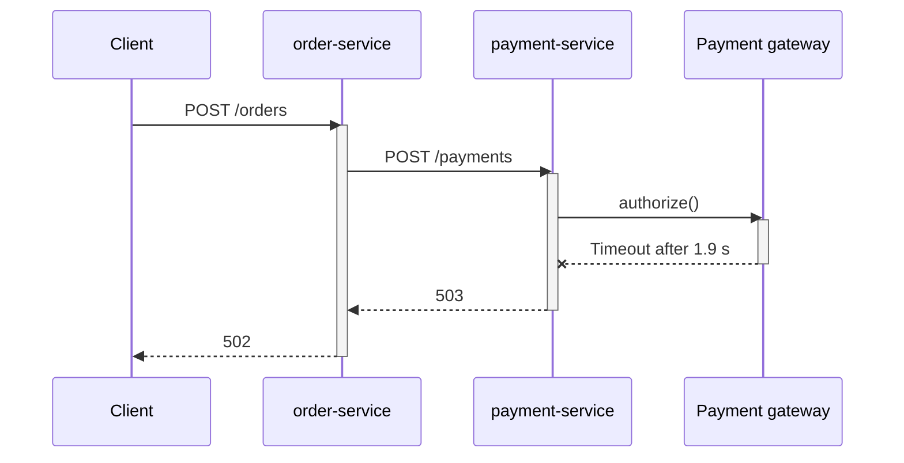
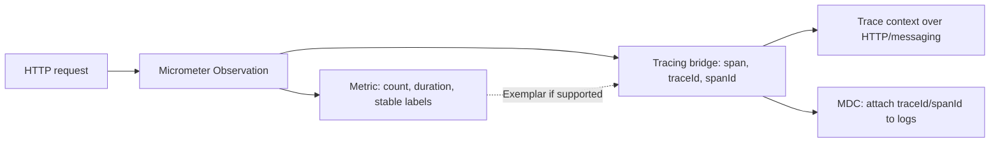

# Relationship Between Logs, Metrics, and Traces in Spring Boot Observability

A Spring Boot service might return HTTP 500, respond slowly, or consume abnormal CPU. To find the root cause, you must answer three different questions: **what happened**, **how wide the impact is**, and **which steps a request passed through**. Logs, metrics, and distributed traces provide three complementary perspectives. Being able to correlate those perspectives is what turns monitoring data into actionable investigative information.

This lesson belongs to the **Three Pillars** chapter of the **SPRING_BOOT_OBSERVABILITY** module: establishing observability for Spring Boot using Micrometer Observation, metrics, logs, and distributed tracing; understanding context propagation, tags/cardinality, exporters, sampling, and signal correlation to find errors, latency, and application behavior in production environments.

## 1. Three Signals Observing the Same System

Suppose `order-service` calls `payment-service` and a database to complete `POST /orders`. Over the last 5 minutes, users report slow checkouts. Each signal views the problem at a different resolution:

| Signal | Unit of Information | Questions It Answers Well | Limitations in Isolation |
| --- | --- | --- | --- |
| **Log** | An event with a timestamp and context | *What was the specific error?* How did the library report the timeout? What business data is involved? | Can produce thousands of lines; without shared context, it is hard to stitch lines from the same request. |
| **Metric** | Numerical values aggregated over time and label sets | *How many requests failed?* How do p95 latency, throughput, and error rates vary? | Aggregated values do not fully describe the execution path or cause of an individual request. |
| **Trace** | A tree/graph of spans recording a single execution, often across services | *Where did the request spend time?* Which service called which, and which call failed? | Reflects only recorded requests; sampling or missing instrumentation can leave gaps. |

Example from the same incident:

- **Metric:** HTTP 5xx rate for `/orders` rose from 0.2% to 8%; p95 duration rose to 2.4 seconds.
- **Trace:** In a slow request, `order-service` spent 60 ms, while the span calling `payment-service` lasted 1.9 seconds.
- **Log:** Inside the `payment-service` span, a `SocketTimeoutException` event occurred when calling the external payment gateway.

Metrics confirm the phenomenon is widespread, traces narrow down where the problem lies, and logs explain the specific details. A trace or log from a single request is **not enough** to infer system-wide error rates; aggregated metrics alone are **not enough** to prove root cause.

## 2. How Does a Single Request Generate All Three Data Types?

Consider an example flow:



An instrumented system might produce the following illustrative data (values and identifiers are for explanation only):

**Log — a single discrete event**

```json
{
  "timestamp": "2026-11-22T09:15:30.120Z",
  "level": "ERROR",
  "service": "payment-service",
  "traceId": "4bf92f3577b34da6a3ce929d0e0e4736",
  "spanId": "00f067aa0ba902b7",
  "event": "payment.gateway.timeout",
  "message": "Gateway did not respond within the configured timeout"
}
```

**Metric — statistics across many requests**

```text
# Example data converted by the exporter to Prometheus format
http_server_requests_seconds_count{method="POST",uri="/orders",status="502"} 84
http_server_requests_seconds_sum{method="POST",uri="/orders",status="502"} 173.4
```

`count` and `sum` here are cumulative values of a time series with a specific label set. To find requests/second or latency over a 5-minute window, use functions like `rate(...)` rather than reading a cumulative counter as an instantaneous rate. Histograms, when enabled and supported by the backend, also allow calculating latency percentiles.

**Trace — one specific execution**

```text
Trace 4bf92f3577b34da6a3ce929d0e0e4736 (approx. 2.0 s)
└─ POST /orders                         order-service      2.0 s
   └─ HTTP POST payment-service        order-service      1.95 s
      └─ POST /payments                payment-service    1.93 s
         └─ HTTP payment-gateway       payment-service    1.90 s  ERROR
```

Spans can overlap in time because client-side and server-side spans describe two ends of the same network call. **Do not mechanically add the durations of all spans** to calculate total request time. Use the span tree and start/end timestamps to identify slow branches, wait times, and concurrency.

### Volume and Cost Relationship

A single request can emit multiple logs, a trace contains multiple spans, while metrics typically update one or a few aggregated series. Logs and traces preserve rich detail but usually scale in storage cost with traffic volume; metrics are optimized for continuous charts and alerting. Therefore, choose collection mechanisms, retention periods, and sampling based on each signal's purpose instead of forcing them all under a single policy.

## 3. The Linking Key: Request Context and Identifiers

Correlating two log lines across two microservices by timestamp alone is error-prone when the system processes many concurrent requests. **Trace context** lets components know they are working on the same trace.

Key fields:

| Field | Meaning | Usage |
| --- | --- | --- |
| `traceId` | Identifies a trace, typically shared across the entire distributed request flow | Jump from an error log to the corresponding trace; find all logs sharing a `traceId` from a trace. |
| `spanId` | Identifies a span within a trace | Narrow down logs emitted during a specific operation. |
| `parentSpanId` | Indicates parent–child relationships between spans (stored in trace data) | Reconstruct execution structure and hop-by-hop paths. |
| `service.name` / service name | Identifies the process/service producing the data | Filter log, metric, and trace sources by service. |
| `environment`, deployment version | Operational attributes when properly configured and attached | Compare before/after deployments and distinguish environments. |

For example, an HTTP request forwarded to the next service can carry a **W3C Trace Context** header:

```http
traceparent: 00-4bf92f3577b34da6a3ce929d0e0e4736-00f067aa0ba902b7-01
```

Here `4bf...` is the `trace-id`, `00f...` is the propagated `parent-id`, and `01` represents the sampled flag in W3C format. The receiver reads the header and can create a child span in the same trace. The sampled flag is interpreted in the context of the sampler; the presence of the header **does not guarantee** the trace was ultimately stored in the backend.

A common relationship looks like this:



Not every system automatically has all of these arrows wired up. You must configure instrumentation, the tracing bridge, exporters, and compatible log formats; the collector/backend must also ingest and preserve the correlation fields.

### Correlation in Spring Boot Logs

When using Micrometer Tracing integrated into Spring Boot, tracing context can be populated into the logging framework's **MDC** (Mapped Diagnostic Context). A log emitted while a span is active can include `traceId` and `spanId`, either in a text pattern or as JSON fields depending on logger/encoder configuration.

Example of a correlated log line:

```text
2026-11-22 16:15:30 ERROR [payment-service,4bf92f3577b34da6a3ce929d0e0e4736,00f067aa0ba902b7] Gateway timeout
```

Do not rely on one exact character format across all Spring Boot versions: field names and default patterns can differ, and JSON encoders must be configured to promote MDC keys into searchable fields. Always inspect real logs in the target runtime environment.

**Asynchronous boundaries:** MDC is usually bound to the current execution thread. When switching to an executor, `CompletableFuture`, message consumer, or reactive stream, trace context must be properly propagated. A log missing `traceId` after a thread switch is not enough to prove a bug in the tracer or backend; check the context propagation step first. For message brokers, custom HTTP clients, and background tasks, verify that instrumentation actually injects and extracts context.

**Baggage** can carry selected contextual values across a request, but it differs from `traceId`/`spanId`, does not appear automatically in all logs, and must not be used to transmit emails, tokens, personal data, or values not meant to be shared across services.

## 4. Micrometer Observation Connects Application Logic to Metrics and Traces

In Spring Boot, **Micrometer Observation** models an operation with a start, stop, attributes, and error lifecycle. A single Observation can be handled by multiple `ObservationHandler` implementations: a timing handler creating meters, a tracing handler creating spans, or custom handlers adding other forms of observation. Consequently, teams can instrument **a single business operation** while feeding appropriate data to both metrics and traces.

Basic lifecycle:

1. Create an Observation with a stable name for the operation, such as `payment.authorize`.
2. Add key-values with appropriate cardinality.
3. Start the Observation and execute the work; record any error that occurs.
4. Stop the Observation so handlers receive the completion signal.

The Java snippet below illustrates instrumenting a synchronous method using the `Observation.observe(...)` API. This is a conceptual example; metric/span creation depends on whether the application has configured the corresponding handlers.

```java
import io.micrometer.observation.Observation;
import io.micrometer.observation.ObservationRegistry;
import org.slf4j.Logger;
import org.slf4j.LoggerFactory;
import org.springframework.stereotype.Service;

@Service
public class PaymentService {
    private static final Logger log = LoggerFactory.getLogger(PaymentService.class);
    private final ObservationRegistry observationRegistry;

    public PaymentService(ObservationRegistry observationRegistry) {
        this.observationRegistry = observationRegistry;
    }

    public void authorize(String orderId, String method, Runnable gatewayCall) {
        Observation.createNotStarted("payment.authorize", observationRegistry)
                .lowCardinalityKeyValue("payment.method", method)
                .highCardinalityKeyValue("order.id", orderId)
                .observe(() -> {
                    log.info("Starting authorization for orderId={}", orderId);
                    gatewayCall.run();
                    log.info("Authorization completed for orderId={}", orderId);
                });
    }
}
```

In a real application, `method` should belong to a predefined bounded set such as `card`, `bank_transfer`, `wallet` (or `unknown`), **not** an arbitrary raw input string. `orderId` should only be a permitted pseudonymous identifier; if there is no need to investigate by that ID, omit it completely. `observe(...)` manages start/stop around the work and records exceptions if the operation throws; do not swallow business exceptions.

When Spring Boot has Observation configured for HTTP, incoming server requests already have their own Observation. The `payment.authorize` Observation can appear as a child step inside the active trace. If the tracing bridge/propagation is not yet set up, the code can still measure the operation via a metrics handler, but it will **not automatically produce** a distributed trace visible across multiple services.

### Three Component Groups Often Confused

| Component | Role | Does Not Guarantee by Itself |
| --- | --- | --- |
| `ObservationRegistry` / Micrometer Observation | Models an operation and dispatches lifecycle events to handlers | That metrics or spans are exported to a backend. |
| Micrometer Metrics / `MeterRegistry` | Collects and aggregates counters, timers, and gauges by labels | That each measurement has a `traceId` for drill-down. |
| Micrometer Tracing bridge + tracer | Creates/continues spans, propagates context, supplies correlation IDs | That the backend receives traces, logs include MDC, or every trace is sampled. |

In a Spring Boot system, Actuator usually provides the foundation for auto-instrumentation and metrics endpoints; registries/exporters send metrics to Prometheus or another backend; the tracing bridge connects to OpenTelemetry or Brave; exporters/collectors deliver spans to systems like Tempo or Jaeger. Logs travel through the logging framework and a separate log pipeline. The Spring Boot version and dependencies determine default behavior: verify in the target application rather than assuming all three signals work just because one dependency was added.

## 5. Cardinality Determines Whether Signal Correlation Scales

**Cardinality** is the number of distinct label combinations. If you attach `userId`, `orderId`, or `traceId` to a metric, nearly every request creates a new time series; memory, storage, and query costs can escalate rapidly. Meanwhile, an individual span or log record typically tolerates more granular attributes because data is stored per record.

| Attribute | Metric label (low cardinality) | Span attribute / log field (controlled detail) |
| --- | --- | --- |
| `http.method` = `GET`, `POST` | Suitable | Suitable |
| `http.route` = `/orders/{id}` | Suitable | Suitable |
| `http.status_code` or status group | Suitable if values are bounded | Suitable |
| `payment.method` = `card`, `wallet` | Suitable once normalized | Suitable |
| `order.id`, `request.id`, `traceId` | **Do not use as metric labels** | Usable when permitted, truly needed, and properly protected |
| Full URL, query string, exception message | Usually unsuitable | Collect selectively, scrubbing secrets and personal data |

In the Java example above, `lowCardinalityKeyValue` is used for labels with bounded value sets, while `highCardinalityKeyValue` is intended for finer-grained attributes that tracing handlers can use. This **does not mean** every high-cardinality key is automatically written to logs or searchable in the backend. Each handler, exporter, and storage engine has its own rules.

Another key principle: use the **route template** `/orders/{id}` for HTTP metrics, not `/orders/832914`. If you need to investigate a specific order, search logs/spans carrying a permitted identifier. That way you still measure per-endpoint error rates without multiplying series by the number of orders.

## 6. From Metric to Trace to Log: A Complete Investigation Walkthrough

Suppose an alert fires: p95 latency of `POST /orders` exceeded 2 seconds for 5 minutes. An investigation can proceed as follows.

### Step 1 — Metrics Show *Where* and *When* the Incident Spread

Inspect throughput, error rate, and duration charts by `service`, `uri` (route template), `method`, `status`, and environment. Pick the time window of the incident and compare before and after. With Prometheus, requests/second on a route can be illustrated by:

```promql
sum(rate(http_server_requests_seconds_count{method="POST",uri="/orders"}[5m]))
```

Estimated 5xx ratio on the same route:

```promql
sum(rate(http_server_requests_seconds_count{method="POST",uri="/orders",status=~"5.."}[5m]))
/
sum(rate(http_server_requests_seconds_count{method="POST",uri="/orders"}[5m]))
```

To compute p95 via histograms, **bucket series must exist** (for example, percentile histograms enabled for `http.server.requests` and exported as buckets):

```promql
histogram_quantile(
  0.95,
  sum by (le) (
    rate(http_server_requests_seconds_bucket{method="POST",uri="/orders"}[5m])
  )
)
```

Actual series names and label sets depend on the meter, exporter, and configuration/version. Without buckets, the last query cannot compute p95; nor should you take the average `sum / count` and call it p95. When the error-rate denominator is 0 (no traffic), dashboards must handle missing data gracefully to avoid false conclusions.

### Step 2 — Pick a Representative Trace

During the period when metrics spiked, open traces with high duration or error status. If the system supports **exemplars**, a metric sample (commonly in a histogram) can carry a link directly to a corresponding trace, letting you jump straight from a chart to the trace. This is a *configuration- and backend-dependent* capability, not a default property of every time series.

If exemplars are unavailable, search traces by `service.name`, timestamp, HTTP route, status, or duration; confirm those attributes are actually recorded and indexed. Not finding a trace **does not prove** the request never happened, because traces can be sampled out, dropped, or missing propagation/export.

### Step 3 — Read Spans to Locate the Slow Branch

In the example trace, compare `POST /orders`, the HTTP client call to payment, the payment HTTP server span, and the external gateway span. If most time sits in the gateway span, inspect timeouts, retries, and call counts; if a database span stretches out, inspect connection pools, queries, locks, and DB load. Pay attention to *actual* span durations and parent–child relationships, not just display order.

### Step 4 — Use `traceId`/`spanId` to Pull Contextual Logs

From the trace, search logs sharing the `traceId`, filtering further by `spanId` or `service` if needed. Some tools link logs directly inside the trace UI when fields are mapped properly; others require manual querying. Detailed logs can reveal exceptions, retries, downstream status payloads, or fallback decisions that span durations alone cannot express.

### Step 5 — Return to Metrics to Verify the Hypothesis

If a trace reveals a gateway timeout, check whether timeout/error rates and latency metrics **for that dependency** also rose during the same window. Slice by status group or deployment region if appropriate labels exist. Avoid blaming an entire incident on one isolated trace. Correlate observations with deployments, traffic load, configuration changes, and dependency health before finalizing root cause.

| Symptom | Metrics Confirm | Traces Narrow Down | Logs Explain |
| --- | --- | --- | --- |
| HTTP 5xx spike | Error rate by service/route | Erroring span and preceding steps | Exceptions, dependency responses, fallbacks |
| p95 spike, few errors | Histogram/timer latency | DB wait, network, or lock branch | Slow queries, retries, pool wait time |
| CPU spike | CPU, throughput, saturation | Instrumented processing steps, if any | Batch events, processing mode shifts |
| Only one subset of requests fails | Error count across stable labels | Representative traces per path | Permitted parameters and business decisions |

## 7. Why Can Correlating All Three Signals Still Be Difficult Even When Traces Exist?

### Sampling Affects Each Signal Differently

**Head sampling** decides whether to capture a trace early, usually by probability; **tail sampling** can decide to keep a trace based on its full outcome at the collector if the pipeline supports it. A dropped trace still contributes to aggregated metrics and emits error logs. Therefore, you cannot divide errored traces by total traces and treat that as the system's true error rate: sampling introduces bias, especially when error or slow traces are retained at higher rates.

An illustrative Spring Boot configuration when compatible tracing is enabled:

```yaml
management:
  tracing:
    sampling:
      probability: 0.10
```

The value `0.10` illustrates a 10% sampling probability for the sampler configured by this property; final effective sampling also depends on the tracing SDK, parent sampling, and collector pipeline. Do not treat this as a strict 10% guarantee over every time window or service. When investigating rare incidents, establish an appropriate strategy for retaining error/slow traces alongside cost caps and data controls.

### Propagation Breaks at a Boundary

If an HTTP client fails to inject `traceparent`, a receiving server fails to extract it, or a consumer fails to resume context from a message, fragmented traces appear. It is also possible for spans to be recorded while logs emitted after a thread switch lose MDC. Inspect request headers, client/instrumentation libraries, executor/reactive context propagation, trace metadata, and log encoders in sequence.

### Exporters, Collectors, and Backends Process Each Signal Independently

Metrics ship via a registry or OTLP, spans ship via an exporter/collector, and logs flow through console/appenders or an OTLP/log collector. One working pipeline does not prove the other two are healthy. Differences in timestamps, service names, environments, retention, or access permissions can also prevent dashboards from linking data. When querying across systems, standardize service identifiers and field naming conventions.

### An Error in Logs Does Not Automatically Mean a Span Is Marked Failed

An exception might be caught and handled with a successful fallback; conversely, an HTTP 5xx might be returned without emitting an `ERROR` log. Distinguish between exceptions recorded on an Observation/span, HTTP status codes, and business failure semantics. Base alerts on SLIs/SLOs or metrics reflecting user behavior, not raw counts of `ERROR` log lines.

## 8. Hands-On Cross-Checking and Verification Questions

With a running Spring Boot service, you can verify the relationship among the three pillars in this sequence:

1. Send a request across at least two services; check whether request count and latency metrics increment under the **normalized** route.
2. For a traced request, locate the `traceId` and two or more spans across different services; inspect parent–child relationships and durations.
3. Emit a log inside an active span; verify that correlation fields actually appear in stored log records *after ingestion*, not only in local console output.
4. Query logs by `traceId` and open the corresponding trace; also test going the reverse direction from trace to logs.
5. Introduce a controlled error or latency in a test environment, then compare aggregated metrics, spans, logs, and behavior when sampling drops some traces.
6. Inspect the metric label list to ensure `traceId`, `userId`, order IDs, or URLs with variable parameters were not accidentally attached.

Answer these self-check questions to confirm you understand the relationships:

- If the p95 chart rises but no slow traces appear, what hypotheses should you check before concluding the metric is wrong?
- A `traceId` helps find logs for the same request; why should you not attach it as a metric label?
- Why shouldn't you add the duration of a client span and a server span to compute total latency?
- When a log inside a `CompletableFuture` is missing `traceId`, which context-propagation points should you check?
- Is one sampled trace containing an error enough evidence to conclude 8% of requests are failing? Which metric should you check?

## Conclusion

**Metrics reveal patterns and scale, traces reveal execution paths and where time is spent, and logs reveal discrete events and detailed causes.** In Spring Boot, Micrometer Observation provides a unified model of an operation, while the tracing bridge, meter registry, context propagation, MDC, and exporters/backends determine which signals are emitted and whether they correlate. An observability system becomes truly effective when operators can move from a metric alert to a relevant trace, read contextual logs, and return to metrics to verify impact across all traffic.
