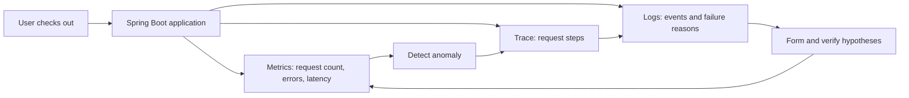
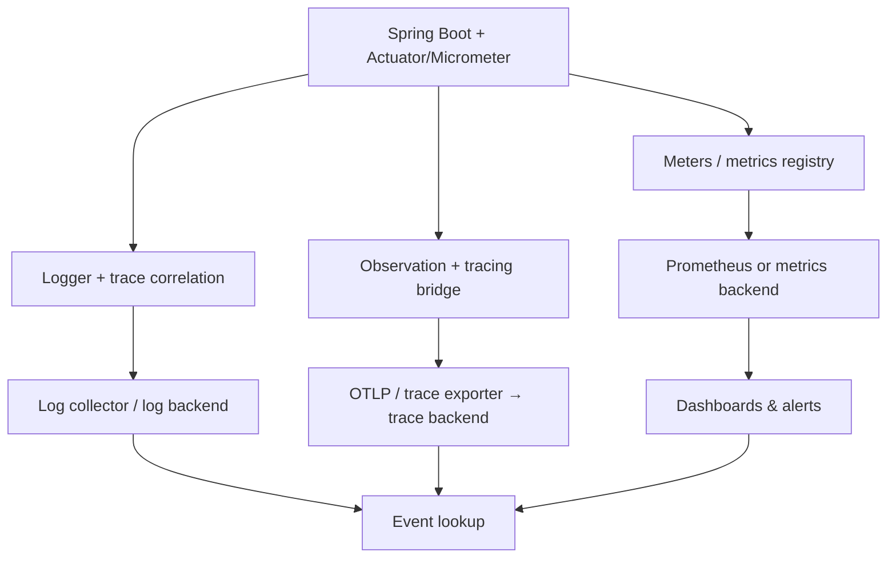

# Quantitative and Qualitative Signals in Spring Boot Observability

When a Spring Boot application is slow or returns errors, the first question is usually **“How big is the impact?”**. Immediately after comes **“What happened to the affected requests?”**. These two questions require two complementary perspectives: **quantitative signals** to measure magnitude, frequency, and trends; and **qualitative signals** to describe context, execution details, and potential causes.

In the **Three Pillars** chapter of observability, the three primary signal types are **metrics, logs, and distributed traces**. They do not live in three rigid silos: metrics are primarily quantitative, logs primarily supply qualitative context, and traces combine measured timings with the causal structure of a processing flow. Understanding this distinction helps choose the right signal to detect errors, analyze latency, and understand application behavior in real environments.

## 1. Distinguishing the Two Types of Questions

Suppose the `POST /checkout` API normally completes in a few hundred milliseconds, yet recently many users have been waiting a long time.

- **Quantitative:** How many requests per second are arriving? What is the HTTP 5xx rate? From what level to what level did p95 latency rise? When did the incident begin? Does it affect one endpoint or all endpoints?
- **Qualitative:** Which services did the slow requests pass through? Did the call to the inventory service time out? Did logs record a business error or a connection failure? Why is only a subset of requests affected?

A number like `p95 = 1.8 s` tells you the **severity** of the slowdown, not which code path caused it. A log saying `inventory reservation timed out` suggests **what happened**, yet that log alone does not tell you what percentage of all requests are affected. A trace of one request reveals **which call took time**, yet a single trace does not represent all traffic.

> **Rule of thumb:** Use quantitative signals to see the big picture and isolate the time window and scope; use contextual signals to investigate a specific case; return to quantitative signals to verify that the remediation works across the entire system.

## 2. How Do Metrics, Logs, and Traces Complement Each Other?

| Signal | Key Information | Questions It Answers Well | Limitations on Its Own |
| --- | --- | --- | --- |
| **Metrics** | Numerical values aggregated over time: call counts, error rates, latency, resource usage | *How many? How long? How is the trend changing?* | Typically cannot reconstruct the path or data of an individual request |
| **Logs** | Events with timestamps, severity levels, messages, and context fields | *What event occurred? What specific error was recorded?* | Large record volume; hard to stitch events without structure and correlation IDs |
| **Traces** | Ordered/parent–child spans with timestamps, durations, and attributes | *Where did the request go? Which step was slow or failed?* | Collection/storage cost; sampling may mean no trace exists for the target request |

Distinguish by actual content rather than signal name alone:

- A **log** can carry numbers, such as `duration_ms=1200`, yet it remains a record of **one event**.
- A **trace** contains `duration` measurements for each span while also expressing relationships across steps such as `checkout → inventory → database`.
- A **metric** has labels such as `method=POST` or `status=500`, yet labels only group measurements rather than storing the full story of a request.

### From One Business Operation to Three Perspectives



This diagram shows a common investigation workflow, not a rigid rule: sometimes errors appear in logs before becoming obvious on metrics dashboards.

## 3. The Quantitative Side: Measuring the System with Metrics

Metrics are useful when comparing **thousands or millions of executions** without opening individual requests. For APIs, a baseline metric set often follows the **RED** model:

| RED | Meaning | Example Monitoring `/checkout` |
| --- | --- | --- |
| **Rate** | Work volume per unit of time | 120 requests/second |
| **Errors** | Number or ratio of failed requests | 3% of requests received 5xx over 5 minutes |
| **Duration** | Distribution of response times | p50 = 180 ms, p95 = 1.8 s |

Three familiar Micrometer meter types are:

1. **Counter:** counts monotonically increasing events, such as failed order attempts. On dashboards, you typically compute the **rate of increase** of a counter over a time window rather than reading only the cumulative total.
2. **Gauge:** represents a current level, such as active connections or queued tasks. A gauge can rise or fall.
3. **Timer / DistributionSummary:** tracks counts and distributions of durations or sizes. For HTTP latency, a `Timer` can provide call counts and total duration; histograms require appropriate configuration to compute aggregated percentiles.

**Do not rely solely on averages.** For example, 95 requests taking 100 ms and 5 requests taking 4 seconds yield an average around 295 ms, while the latency tail is terrible. Percentiles such as p95/p99 expose the slow group, provided the percentile calculation matches how values are aggregated across instances. With Prometheus, **histograms** allow computing percentiles from summed buckets; averaging per-instance p95 values does not yield the system-wide p95.

In many Spring Boot configurations using Micrometer, HTTP server instrumentation emits the logical metric `http.server.requests`. When exported to Prometheus, series names and suffixes may be transformed (for example `http_server_requests_seconds_count` and `_bucket`). Final names depend on version, registry, and configuration; inspect the actual metrics/exporter endpoint before writing queries.

Illustrative PromQL query for HTTP 5xx ratio over a 5-minute window:

```promql
sum(rate(http_server_requests_seconds_count{status=~"5.."}[5m]))
/
sum(rate(http_server_requests_seconds_count[5m]))
```

Example p95 latency when **the corresponding histogram is enabled and exported**:

```promql
histogram_quantile(
  0.95,
  sum by (le) (rate(http_server_requests_seconds_bucket[5m]))
)
```

Both queries are templates to illustrate how measurements work and are not guaranteed to run unchanged in every project. When traffic is very low, ratios can be noisy; when there are zero requests, division is undefined. If business failures return HTTP 200, add business metrics instead of relying solely on 5xx codes.

## 4. The Qualitative Side: Logs Tell the Contextual Story

Logs answer the question **“What did the application observe at that moment?”**. A log's value lies not only in its message string, but also in fields that distinguish one event from another.

Example of a structured log:

```json
{
  "timestamp": "2026-11-22T03:10:15.421Z",
  "level": "WARN",
  "service": "checkout-service",
  "event": "inventory.reserve.failed",
  "reason": "downstream_timeout",
  "duration_ms": 1500,
  "traceId": "4f83a49c23a4bd73e6875a13137d2c01",
  "spanId": "9ab14c10ed3e42a7"
}
```

This is **illustrative data**, not a built-in Spring Boot log output. The `duration_ms` field is quantitative; `event` and `reason` carry business semantics; `traceId` and `spanId` allow locating the matching trace/span when correlation is configured.

To make logs useful for investigations:

- Use clear event names, such as `inventory.reserve.failed` instead of `something went wrong`.
- Record service name, timestamp, severity level, error type, and stable context. A consistent structure aids searching and aggregation.
- Attach correlation IDs when tracing is active; in Java/Spring Boot, correlation is usually populated into MDC via Micrometer Tracing and matching logging configuration.
- Avoid logging access tokens, passwords, personal data, full request/response bodies, or sensitive information. Having a `traceId` does not make sensitive data safe to log.
- Do not overuse `ERROR` for recoverable events, and do not log the same exception repeatedly at every layer without adding value.

Voluminous, detailed logs do not automatically create good observability. Without correlation IDs, structured fields, and proper retention policies, they remain difficult to use during an incident.

## 5. Traces Connect Timing Measurements to Execution Flow

In distributed tracing, a **trace** describes the journey of a task; **spans** represent processing steps with start time, end time, duration, attributes, and parent–child relationships. A span can carry an error status and events, recording only attributes that are useful and permitted to collect.

Example of a checkout request crossing multiple components:

```text
Trace T: POST /checkout                             1,750 ms
  ├─ checkout.validate                               70 ms
  ├─ inventory.reserve                             1,450 ms
  │    └─ HTTP POST inventory-service              1,420 ms
  └─ payment.authorize                               160 ms
```

These durations are hypothetical examples. Spans can execute with overlapping intervals, so **do not automatically sum child span durations** to compute total trace duration. Still, an inventory call span taking 1,450 ms out of 1,750 ms total is a strong clue to inspect the downstream dependency.

**Traces are both quantitative and qualitative:** durations highlight bottlenecks, while span names, relationships, and attributes identify the corresponding operations. A single trace remains only one example; cross-check with metrics to know whether the issue is widespread.

## 6. Micrometer Observation in Spring Boot Links the Signals

In Spring Boot with Micrometer, **Observation** provides a unified way to describe an operation with a name, context, and start/stop lifecycle. `ObservationRegistry` holds the configured handlers. Depending on dependencies and configuration:

- A metrics handler can turn an observation into duration and execution-count measurements.
- A tracing handler can create spans and manage trace context.
- Application logs are written **separately by a logger**; an `Observation` does not automatically emit business logs just by being created.

Example observing an inventory reservation operation:

```java
import io.micrometer.observation.Observation;
import io.micrometer.observation.ObservationRegistry;
import org.springframework.stereotype.Service;

@Service
public class InventoryReservationService {
    private final ObservationRegistry observationRegistry;

    public InventoryReservationService(ObservationRegistry observationRegistry) {
        this.observationRegistry = observationRegistry;
    }

    public String reserveForCheckout() {
        return Observation.createNotStarted(
                "checkout.inventory.reserve", observationRegistry)
            .lowCardinalityKeyValue("channel", "web")
            .observe(() -> {
                // Replace with actual call to inventory service.
                return "reserved";
            });
    }
}
```

`observe(...)` starts and stops the observation around the code block; when the block throws an exception, the observation lifecycle is still closed by the API. To know how errors are represented in metrics/spans, inspect the actual handlers and instrumentation behavior. This snippet only illustrates a custom observation and is not a standalone runnable Spring Boot application.

An observation can carry two groups of key-values:

| Attribute | Example | Usage |
| --- | --- | --- |
| **Low cardinality** | `channel=web`, `result=success` with bounded value sets | Suitable for metric labels; can also appear in traces |
| **High cardinality** | Internal per-request processing ID | Useful when searching spans, but **never** use as a metric label; must still protect sensitive data |

**Cardinality** is the number of distinct label value combinations. Attaching `customerId`, email, request UUID, or URLs with real IDs to a metric can create millions of time series, driving up RAM, cost, and query latency. Choose labels with bounded value sets; use route templates like `/orders/{id}` instead of `/orders/928374`. Tracing also has costs and attribute size limits, so “high cardinality” does not mean you can record arbitrary data unchecked.

## 7. Correlation, Propagation, and Sampling

To go from aggregated numbers down to a specific request, distinguish three mechanisms:

**Correlation (linking signals):** When logs and spans share a `traceId`, operators can open the trace from a log line or search logs by trace. Spans within the same trace have their own `spanId` values to identify individual steps.

**Context propagation:** When checkout calls inventory over HTTP or messaging, trace context must cross the service boundary. In the OpenTelemetry ecosystem, the W3C `traceparent` header is a common mechanism. Instrumented client/server libraries handle this; a hand-rolled HTTP client, custom executor, async task, or uninstrumented message consumer can break the trace. Never assume every thread and protocol automatically propagates context.

**Sampling:** Under high traffic, you may retain only a fraction of traces—such as 10%—to control cost. Thus, a log line containing a `traceId` does not guarantee the corresponding trace was stored in the backend. Trace sampling **does not replace** aggregated metrics; you still need metrics to monitor error rates and latency across 100% of traffic. Sampling, propagation, and collection behavior can depend on the SDK, collector, and backend policies.

When investigating a rare bug, check whether sampling is discarding important traces; consider an appropriate sampling strategy at collection time rather than unconditionally raising sampling to 100% on high-load systems.

## 8. Incident Investigation Example Using All Three Signals

**Hypothetical context:** After a deployment, `POST /checkout` still receives 120 requests/second, yet p95 rises from 300 ms to 1.8 s and the 5xx rate increases from 0.2% to 3%.

| Investigation Step | Signal Used | Takeaway |
| --- | --- | --- |
| 1. Confirm impact | Metrics: request rate, error rate, p95 by endpoint | Anomaly is concentrated on checkout and started after deployment |
| 2. Isolate path | Trace of a slow request (if captured) | Span `inventory.reserve` accounts for most of the duration |
| 3. Find specific event | Checkout/inventory logs by `traceId` and time window | Reveals `downstream_timeout` while calling the inventory service |
| 4. Verify hypothesis | Downstream dependency metrics, connection pools, timeouts; logs/traces across multiple requests | Verify whether inventory latency genuinely spiked across traffic in the same window |
| 5. Evaluate post-fix | Before/after metrics, traces, and new error logs | Confirm p95 and error rate return to baseline without regressions |

Keep in mind the difference between **correlation** and **causation**: a slow span or timeout log is evidence to investigate, not automatic proof of whether the issue lies in the network, database queries, or timeout settings. Cross-check multiple requests, infrastructure metrics, and recent changes near onset time.

### When One Signal Type Is Missing

- **Metrics only:** You know checkout is slow, but it is hard to tell inventory, payment, and internal processing apart.
- **Logs only:** You may spot timeouts, but it is hard to measure exact impact if logs are sampled, duplicated, or incomplete across requests.
- **Traces only:** You can see a slow call in a stored trace, but it is hard to know whether it is widespread or an isolated outlier.
- **All three present without correlation:** You must fall back to manual searches by timestamp and service; investigation accuracy drops.

## 9. Implementing Signals: A Practical Approach

In a Spring Boot application with Actuator and Micrometer, the data flow typically looks like:



In Spring Boot 3.x projects using Micrometer, common components include `spring-boot-starter-actuator`, a registry such as `micrometer-registry-prometheus`, a tracing bridge such as `micrometer-tracing-bridge-otel`, and a suitable exporter such as `opentelemetry-exporter-otlp`. Dependency sets, property names, and auto-configuration capabilities can differ across Spring Boot versions; cross-check the documentation for your exact version. You do not need to enable every exporter to begin; connect the signals your system can reliably collect, store, and query.

Illustrative configuration **for the Spring Boot 3.x ecosystem** once corresponding dependencies are added:

```yaml
management:
  endpoints:
    web:
      exposure:
        include: health,info,metrics,prometheus
  tracing:
    sampling:
      probability: 0.1
  metrics:
    distribution:
      percentiles-histogram:
        http.server.requests: true
```

This is a starting point for experimentation and is not sufficient by itself to export traces or logs to a backend: you still need bridges/exporters, collector addresses, log formatting, access controls, and suitable storage backends. The `/actuator/prometheus` endpoint only appears when the registry and exposure settings are properly configured; avoid exposing unnecessary management endpoints to the public Internet.

Verification checklist before trusting dashboards:

1. Generate controlled succeeding and failing requests; check that metric counts increment and latencies are measured.
2. Verify actual metric names, units, labels, and histograms at the registry/exporter.
3. Verify logs contain required fields and correlation IDs when tracing is active.
4. Open a trace in the backend; verify spans, durations, relationships, and propagation across services.
5. Test collector/exporter failure: the application should keep serving business traffic while emitting signals indicating the observability pipeline is disrupted.

## 10. Signal Quality and Operational Cost

More data is not always better. Each signal has limits and optimization practices:

| Issue | Consequence | Fix |
| --- | --- | --- |
| Metrics with `userId` or raw URL labels | Explosion in time series count | Keep only low-cardinality labels; use route templates and bounded groups |
| Tracking only average latency | Hides severely slow tail requests | Inspect p50/p95/p99 and proper histograms |
| Unstructured logs missing `traceId` | Hard to stitch events for one request | Standardize structured logging and tracing correlation |
| Logging excessive sensitive data | Security, privacy, and storage risks | Scrub/mask data; enforce retention and access controls |
| Overly aggressive sampling | Loses traces of rare errors | Tune sampling rate and strategy to investigative needs |
| Missing propagation across async or service boundaries | Fragmented traces and broken span trees | Instrument clients/servers properly and propagate context at boundaries |
| Unmonitored exporter/collector failures | Blank dashboards create a false sense of health | Monitor the telemetry pipeline, ingestion lag, and dropped data |

Question the **necessity of the data** before adding any metric label, log field, or span attribute. Schema stability, access permissions, and retention duration are also integral parts of observability design.

## 11. Self-Check Exercises

**Scenario A:** A dashboard shows an API's p95 latency jumped 5× while the 5xx rate remained unchanged. What should you inspect?

*Hint:* Check request rate and duration distribution by route, compare fast vs. slow traces to find time-consuming spans, and review logs for retries, queuing, and timeouts. Do not conclude “nothing is wrong” merely because HTTP 5xx did not rise.

**Scenario B:** Someone adds an `orderId` label to the `checkout.completed` metric to “make finding individual orders easy.” What is the problem?

*Hint:* `orderId` produces unbounded new values continuously, causing time series counts to surge. Keep bounded labels like channel/result; if you genuinely need to look up a specific order, use business data stores or access-controlled, data-protected logs/traces.

**Scenario C:** A request log has a `traceId`, yet no trace is found in the backend. Is instrumentation necessarily broken?

*Hint:* No. The trace may not have been sampled, failed during export, aged out of retention, or suffered a propagation break. Check tracing configuration, sampling, collector health, and retention before concluding.

**Scenario D:** One trace shows `inventory.reserve` took 2 seconds. Should you conclude every request takes 2 seconds in inventory?

*Hint:* No. That is one sample; cross-check multiple traces and downstream latency metrics over the same time window to determine scope and trends.

## 12. Key Takeaways

- **Metrics** quantify system health and trends across request populations; suited for dashboards, alerting, and verifying fixes.
- **Logs** describe contextual events; data structure and correlation IDs determine searchability.
- **Traces** combine timing with execution paths; valuable for identifying slow steps, while depending on propagation, instrumentation, and sampling.
- **Micrometer Observation** provides a consistent operation model so handlers can produce metrics/spans; logging uses its own mechanism. Metric labels must have controlled cardinality.
- Effective investigations follow the loop **measure magnitude → find context → verify root cause → measure again**. The three pillars deliver the most value when they complement and link to one another.
