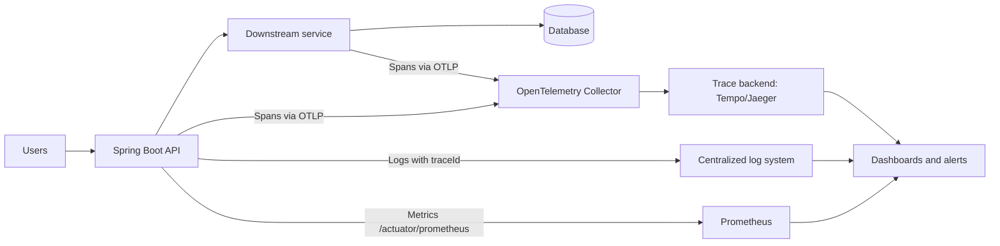

# From Metrics to Traces for Incident Investigation

When users report that an API is slow or returning errors, a spiking chart only tells you **the system has a problem**—it does not yet tell you **which requests are affected**, **which components they passed through**, or **what the verifiable root cause is**. In Spring Boot, combining metrics, logs, and distributed tracing lets you narrow the question step by step: from trends across thousands of requests down to the log lines and span chain of a single request.

This lesson belongs to the **Three Pillars** chapter of the **SPRING_BOOT_OBSERVABILITY** module, focusing on incident investigation workflows using **Micrometer Observation**, metrics, logs, and distributed tracing. Beyond root-cause tracking, we examine context propagation, tags/cardinality, exporters, sampling, and how to correlate all three signals in real environments.

## 1. Expected Outcomes

After this lesson, you will be able to:

1. Start from metrics to identify **the affected service, endpoint, time window, and impact magnitude** instead of picking a trace at random.
2. Use logs to locate **errors and business context**, then follow `traceId` to inspect the related execution flow.
3. Read a distributed trace, distinguishing parent/child spans, span durations, and where latency is actually spent.
4. Configure Spring Boot at a minimal level to emit metrics and traces while adding Observations for key business operations.
5. Avoid false conclusions caused by sampling, broken propagation, high-cardinality labels, or confusing correlation with causation.

## 2. Which Question Does Each Pillar Answer?

| Signal | Unit of Observation | Best at Answering | Limitations to Remember |
| --- | --- | --- | --- |
| **Metrics** | Measurements aggregated over time and label sets | How many requests failed? When did P95 rise? Which endpoint is affected? | Usually cannot pinpoint an individual request; high-cardinality labels are expensive. |
| **Logs** | Event records at a specific point in time | Which component threw the exception? Which business rule or state caused the failure? | Scattered logs are hard to stitch together; having `traceId` speeds up investigation. |
| **Traces** | A chain of spans sharing a `traceId` | Which services did a request visit? Which span took the time? How did errors propagate across hops? | Reflects only traced requests; spans may be missing due to sampling or lost context. |

**Observation** in Micrometer is the API layer allowing application code to describe an observed operation with a name, key-values, and events. Depending on the configured observation handlers, a single observation can produce a metric, a tracing span, or both. You therefore do not need separate timing code and span-creation code for the same business operation.

Typical data flow:



This diagram illustrates a reference architecture. In practice, logs may be collected from stdout by an agent, collector, or container runtime; metrics may be scraped directly or routed through another pipeline. Tracing does not automatically guarantee logs and metrics are available if their export paths are not configured.

## 3. End-to-End Scenario: Slow Order Lookup Endpoint

Suppose `order-api` serves `GET /orders/{id}`. After a deployment, the system exhibits these symptoms (numbers are **hypothetical for practice**):

| 5-Minute Metric | Before 10:15 | 10:15–10:20 |
| --- | ---: | ---: |
| Requests per second | 120 | 125 |
| P95 latency of `GET /orders/{id}` | 220 ms | 1,700 ms |
| HTTP 5xx rate | 0.2% | 4.5% |
| `order-api` CPU | 38% | 41% |

Traffic increased only slightly and CPU did not rise proportionally, yet P95 latency and 5xx errors jumped sharply. At this point **you cannot yet conclude whether the database, network, or deployment caused it**. Good investigation practice is to form hypotheses, gather evidence across each pillar, and confirm with post-fix measurements.

Timestamps, service names, environments, deployment versions, and route labels must all align on the same investigation reference. Otherwise, it is easy to compare production metrics with staging traces, or compare mismatched time windows.

## 4. Preparing Signals in Spring Boot

The examples below use common configuration patterns for **Spring Boot 3.x** with Micrometer. Dependency and property names can vary across Spring Boot versions and backends; consult documentation for your exact version when implementing.

A Gradle application may need the following dependencies (Spring Boot manages compatible versions via its BOM):

```groovy
dependencies {
    implementation 'org.springframework.boot:spring-boot-starter-actuator'
    implementation 'io.micrometer:micrometer-registry-prometheus'
    implementation 'io.micrometer:micrometer-tracing-bridge-otel'
    implementation 'io.opentelemetry:opentelemetry-exporter-otlp'
}
```

`spring-boot-starter-actuator` provides health/metrics/observation infrastructure; the Prometheus registry exports metrics; the Micrometer–OpenTelemetry bridge turns compatible observations into spans; and the OTLP exporter ships spans to a collector or OTLP-capable trace backend.

Example `application.yml` for a **controlled test environment**:

```yaml
spring:
  application:
    name: order-api

management:
  endpoints:
    web:
      exposure:
        include: health,info,metrics,prometheus
  metrics:
    distribution:
      percentiles-histogram:
        http.server.requests: true
  tracing:
    sampling:
      probability: 1.0
  otlp:
    tracing:
      endpoint: http://otel-collector:4318/v1/traces
```

A few points to understand before running:

- Enabling a histogram on `http.server.requests` creates buckets for computing percentiles across a **population of requests**, making it suitable for cluster-wide aggregated P95. Enabling histograms broadly increases time series counts and storage costs.
- `sampling.probability: 1.0` lets you observe virtually every request during hands-on practice; do not default to 100% tracing in high-traffic production. Choose sampling rates, policies, and costs to match operational needs.
- The OTLP endpoint in this example assumes a collector listening for HTTP/protobuf on port `4318` at `/v1/traces`. The collector/backend must run separately; merely declaring the endpoint does not create trace storage.
- `/actuator/prometheus` and other Actuator endpoints must be protected via network policies, authentication, or equivalent controls. Never expose operational telemetry publicly on the Internet.

Once the application receives traffic, verify both signal types:

```bash
curl -i http://localhost:8080/actuator/metrics/http.server.requests
curl -s http://localhost:8080/actuator/prometheus
```

The `/actuator/metrics/...` endpoint inspects metrics in Actuator's administrative format; the Prometheus endpoint returns metric names and labels in registry format. Data may not appear yet if no matching requests have arrived. Traces only appear in the trace backend after being created, successfully exported, and ingested by the backend.

### Creating an Observation for a Business Operation

Spring MVC typically already provides HTTP server observations when Actuator and compatible infrastructure are enabled. For important processing steps inside a request, you can create a manual observation:

```java
import io.micrometer.observation.Observation;
import io.micrometer.observation.ObservationRegistry;
import org.springframework.http.HttpStatus;
import org.springframework.stereotype.Service;
import org.springframework.web.server.ResponseStatusException;

@Service
public class OrderService {
    private final OrderRepository repository;
    private final ObservationRegistry registry;

    public OrderService(OrderRepository repository, ObservationRegistry registry) {
        this.repository = repository;
        this.registry = registry;
    }

    public Order load(long id) {
        return Observation.createNotStarted("order.load", registry)
                .lowCardinalityKeyValue("operation", "load")
                .lowCardinalityKeyValue("component", "order-service")
                .observe(() -> repository.findById(id)
                        .orElseThrow(() -> new ResponseStatusException(
                                HttpStatus.NOT_FOUND, "Order not found")));
    }
}
```

`Order` and `OrderRepository` are illustrative domain types that must be defined in a real application. `observe(...)` manages the observation lifecycle and records exceptions thrown inside the block. When an appropriate tracing handler is present, this observation can also appear as a child span inside the server span. Avoid creating overly granular spans for every line of code: measure steps with diagnostic value, such as checking inventory, calling a payment service, or executing critical database operations.

**Cardinality:** `operation=load` and `component=order-service` have bounded value sets, making them suitable for metrics. Conversely, attaching `orderId`, `userId`, email, raw URLs containing IDs, or request IDs to **low-cardinality tags** can create a distinct time series for nearly every request. If you genuinely need detailed attributes in traces, evaluate cardinality limits, privacy, and data-handling rules; never put sensitive data into spans or logs automatically.

## 5. Step One: Use Metrics to Scope the Incident

Start with user-facing signals: **traffic, errors, latency**, then check **saturation** (queues, connection pools, thread pools, CPU, memory, database). Answer:

1. When did the incident begin, and does it coincide with a deployment or configuration change?
2. Is only one `uri`, HTTP method, zone/instance affected, or are multiple services affected?
3. Did request volume spike? Are errors 4xx or 5xx?
4. Did latency increase at P50, P95, P99, or only for a small subset of requests?
5. Did resource or dependency signals shift at the same time?

Example PromQL queries for the HTTP server timer exported by Micrometer to Prometheus. Actual metric names and label sets must be **verified via `/actuator/prometheus`**, as registries, versions, and configurations can differ.

**Request throughput (requests/second)** for the route:

```promql
sum(rate(http_server_requests_seconds_count{uri="/orders/{id}",method="GET"}[5m]))
```

**HTTP 5xx error rate** for the route, as a percentage:

```promql
100 *
sum(rate(http_server_requests_seconds_count{
  uri="/orders/{id}",method="GET",status=~"5.."
}[5m]))
/
sum(rate(http_server_requests_seconds_count{
  uri="/orders/{id}",method="GET"
}[5m]))
```

**P95 latency** across instances, when histograms are enabled:

```promql
histogram_quantile(
  0.95,
  sum by (le) (
    rate(http_server_requests_seconds_bucket{
      uri="/orders/{id}",method="GET"
    }[5m])
  )
)
```

The Prometheus timer unit in this example is **seconds**, so `1.7` corresponds to roughly `1,700 ms`. If multiple services share the same Prometheus instance, filter additionally by labels identifying the actual service/namespace/job to avoid mixing series. When the error-rate denominator is zero, results can be empty or undefined; dashboards and alerts should handle low- or zero-traffic windows.

Never average per-instance P95 values to estimate system-wide P95: **percentiles are not additive**. Sum histogram buckets with matching boundaries before running `histogram_quantile`. Likewise, do not aggregate all routes together when searching for a failing endpoint; overall averages can mask a low-traffic route experiencing severe failure.

In the hypothetical scenario, metrics narrow the scope to `GET /orders/{id}`, the 10:15–10:20 window, and HTTP 5xx responses. That gives us a solid basis to inspect logs/traces; low CPU alone **does not prove** the fault lies in the database or network.

## 6. Step Two: Use Logs to Find Events and `traceId`

Within the narrowed time window, search `order-api` logs by service, environment, log level, exception type, and **normalized** request details. When Micrometer Tracing is configured and a context is active, Spring Boot's logging integration can populate `traceId` and `spanId` into MDC so they appear on log lines.

Example of **simulated** log lines belonging to the same trace:

```text
2026-11-22T10:17:06.104Z WARN  order-api traceId=b7a9a02f9bf44b8e9d07e2bdca7f0a11 spanId=8f932cf18cab920b inventory lookup slow elapsedMs=1082
2026-11-22T10:17:06.128Z ERROR order-api traceId=b7a9a02f9bf44b8e9d07e2bdca7f0a11 spanId=8f932cf18cab920b request failed upstream=inventory-service error=ReadTimeout
```

From this emerges a **hypothesis**: `order-api` is waiting too long on `inventory-service`. The two log lines are linked by sharing `traceId`, and `spanId` identifies the active span when each line was logged. However, a `ReadTimeout` message alone does not reveal whether the cause is inside `inventory-service`, its database, the network, or an overly tight client timeout.

Logs are valuable when they carry concrete diagnostic facts: dependency name, error type, duration, retry count, and outcome. Avoid logging access tokens, passwords, sensitive request bodies, personal information, or user-identifying IDs. Choose log structure and retention policies suited to the environment.

If `traceId` does not appear in logs, check in order: tracing dependencies and logging patterns, whether the request actually runs inside a tracing context, whether the exporter/backend is failing, and whether code switches threads or queues that drop context. **A log line lacking `traceId`** does not prove no request or error occurred.

## 7. Step Three: Open a Distributed Trace to Understand Request Flow

Look up `traceId=b7a9a02f9bf44b8e9d07e2bdca7f0a11` in the trace backend. If the backend supports log–trace linking, you can jump straight to the trace from the `traceId` field. If Prometheus and your observability UI support **exemplars** carrying trace IDs, you can start directly from a data point on a metric chart to open an illustrative trace. Exemplar linking depends on support and configuration across the registry, export protocol, backend, and UI; do not assume every chart has it.

A hypothetical trace might look like this:

```text
Trace b7a9a02f9bf44b8e9d07e2bdca7f0a11
└─ order-api: GET /orders/{id}                 1,420 ms
   ├─ order-api: order.load                    1,355 ms
   │  ├─ HTTP GET inventory-service             1,160 ms
   │  │  └─ inventory-service: GET /stock       1,110 ms
   │  │     └─ database SELECT stock              980 ms
   │  └─ order-api: map response                  24 ms
   └─ HTTP response 500
```

This is an **illustrative model**, not measurements from a live system. Indentation shows parent–child relationships, not necessarily strict sequential execution. Child spans can run in parallel, so never add all child span durations to calculate total request time.

When reading a trace, inspect:

- **Root/server span:** end-to-end request duration, HTTP status, service, and normalized route.
- **Client/server spans across HTTP or messaging:** Do both ends appear in the same trace, or were they split due to broken propagation? Is client duration much longer than server duration due to network latency, connection pooling, or retries?
- **Database spans:** How long did queries wait? Are there abnormal queries, lock contention, or missing connections? Never record SQL text containing sensitive data.
- **Events/attributes/errors:** Where are spans marked as errored? Are there timeouts, retries, exceptions, or signs of fallback handling?
- **Uninstrumented gaps:** If a parent span is long without matching child spans, there may be uninstrumented work, thread/lock waiting, or missing trace data.

In the example, the nearly `980 ms` database span inside `inventory-service` is a top priority to investigate. Yet **a long span only shows where time was spent**: cross-check slow query logs, connection counts, lock waits, execution plans, inventory logs, and recent changes near incident onset. A long database span can also be a symptom of connection pool exhaustion rather than a slow SQL statement.

### Propagation: The Requirement for Traces to Connect Across Services

Distributed tracing requires propagating trace context between hops. For HTTP, the W3C Trace Context standard typically uses `traceparent` (and optionally `tracestate`):

```http
GET /stock HTTP/1.1
Host: inventory-service
traceparent: 00-b7a9a02f9bf44b8e9d07e2bdca7f0a11-8f932cf18cab920b-01
```

The `traceparent` example contains version, trace ID, parent span ID, and flags; when the receiving service processes the request, it can create a new server span in the same trace with its own span ID. Observability-integrated HTTP client/server libraries handle context injection and extraction. For manually instantiated clients outside Spring Boot instrumentation, custom thread pools, `@Async`, reactive pipelines, or queues, verify that context propagates properly. Spawning a thread or publishing a message **does not automatically guarantee** MDC or tracing context travels with it.

A trace split in two at a hop often misleads investigations: a single operation looks like two unrelated requests. When this occurs, inspect headers, instrumentation on both ends, propagator format, message header mappings, and async context propagation. Never use headers containing sensitive data or uncontrolled baggage to “patch” correlation.

## 8. Step Four: Confirm Root Cause and Mitigate Impact

Once metrics define the scope and traces point to a suspicious branch, turn hypotheses into verification checks. For the `inventory-service` and database example:

| Hypothesis | Evidence to Look For | Verification Check or Action |
| --- | --- | --- |
| Slow query after schema/index change | Slow query logs, execution plans, scanned rows rising right at 10:15 | Compare query plans/deployments; optimize the query or roll back the regressing change. |
| Database connection pool exhausted | Active connections near cap, rising pending acquisitions, high connection wait times | Check for leaks, long-held connections, pool sizing, and database capacity. |
| `inventory-service` itself overloaded | Saturated queues/thread pools, rising CPU/GC or dependency latency | Shed load, fix bottlenecks, or scale if resources are genuinely constrained. |
| Client timeout/retry amplification | Multiple retries for one request; client span far longer than server span | Review timeout budgets, retry policies, backoff, and circuit breakers. |
| Lost trace context causing misdiagnosis | Trace ID changes between `order-api` and `inventory-service` even though calls arrive | Fix propagation, replay a controlled test, and compare the complete trace. |

Do not equate correlation with causation. If errors began after a deploy, examine the exact changes and dependency evidence before blaming the deploy. If a database span is slow in a trace, find out why it is slow. Pair every remediation with re-measurement criteria: P95, 5xx rate, traffic, saturation, timeout counts, and fresh post-fix traces.

For instance, if you confirm a new query lacks an index, restoring the index or rolling back the query can bring P95 down. Conclude that the incident is under control only when P95 charts, 5xx rates, and dependency signals stay at acceptable levels over a sufficiently long window; a single successful test request is not enough.

## 9. Sampling, Cardinality, and Signal Correlation Limits

The three pillars do not share the same collection mechanics or cost models. This directly affects what questions can be answered during an incident.

| Issue | Investigation Impact | Handling Principle |
| --- | --- | --- |
| **Head sampling** with low probability | Rare failing requests may lack traces even while 5xx metrics spike. | Choose an appropriate rate; understand sampling decisions happen early and propagate via context. |
| **Tail sampling** in a compatible collector | Can retain slow/errored traces by policy after observing spans. | Requires collector pipelines and resources to buffer spans; do not assume a single Spring Boot property provides this. |
| **High cardinality** from `orderId`, `userId`, raw URLs | Metric series explosion, higher cost, slow queries. | Use route templates `/orders/{id}`, operation, outcome, status, and bounded value sets. |
| **Missing context propagation** | Spans of one request land in separate traces; MDC may be empty. | Verify instrumentation across HTTP clients, async, Reactor, and messaging at every hop. |
| **Disconnected exporter/collector** | The app still serves requests, yet traces never reach the backend. | Monitor export errors, collector queues/buffers/drops, and backend health. |
| **Missing log–trace links or exemplars** | Requires manual lookup by timestamp and service. | Standardize `traceId`, `spanId`, service/environment fields; configure linking in compatible backends. |

Trace sampling **does not mean** metrics are sampled at the same rate: HTTP timers still aggregate 100% of observed requests inside the application while only a fraction of traces are exported. Therefore, if 5xx errors spike but you cannot find an error trace, inspect sampling and exporters before assuming the metric is “wrong.” Conversely, a single error trace does not prove the service-wide error rate; return to metrics to confirm magnitude.

For tags, distinguish **low cardinality** for grouping metrics from **high cardinality** used selectively in tracing context. Even attributes kept solely on spans incur storage costs and data-exposure risks if unmanaged. Attribute count, value length, and retention should be governed by actual search needs.

## 10. Runbook: From Alert to Evidence-Backed Conclusion

You can apply the following workflow for Spring Boot production incidents:

1. **Record incident basics:** timestamp, environment, service, deployment version, user symptoms, and priority.
2. **Scope impact via metrics:** check traffic, 5xx rate, and P95/P99 by route, method, instance, and region. Check traffic volume so tiny samples do not mislead you.
3. **Form hypotheses:** separate dependency, resource, deployment, network, and business-logic categories; prioritize by impact and evidence.
4. **Filter logs over the scoped window:** search for exceptions, timeouts, retries, and dependency details; extract `traceId` if present.
5. **Open representative traces:** inspect slow/errored requests alongside normal ones for comparison; use exemplars if supported by your pipeline.
6. **Read the waterfall:** locate time-consuming spans, uninstrumented gaps, retries, and gaps between client and server durations.
7. **Cross-check dependencies:** inspect connection pools, DB, queues, CPU, GC, or external systems at the exact same timestamp.
8. **Mitigate impact and fix root cause:** roll back, shed load, adjust queries/timeouts/retries, or scale resources based on evidence.
9. **Verify via metrics after the change:** observe error rate, latency, traffic, and saturation long enough to be sure; inspect fresh traces to confirm execution paths.
10. **Document operational lessons:** dashboards, alerts, missing signals, propagation gaps, and instrumentation improvements needed.

### Self-Check Exercises

**Scenario A.** System-wide P95 rises, yet `GET /health` is unchanged and only `POST /checkout` degrades. What is the logical next step?

*Hint:* Compare latency and error rate filtered by `uri` and `method` for `POST /checkout`, then inspect logs and traces for that time window. Do not keep staring only at an aggregate average across all endpoints.

**Scenario B.** The dashboard shows 3% HTTP 5xx, yet trace search turns up zero failing requests. How can this happen?

*Hint:* Check sampling, the OTLP export path, collector/backend health, time range, and service filters. Metrics can still be accurate when failing requests were sampled out or spans were dropped.

**Scenario C.** `order-api` has a 1,200 ms client span while the `inventory-service` server span is only 140 ms. Should you conclude inventory took 1,200 ms to process?

*Hint:* Not yet. The difference could stem from DNS, connection establishment, queuing, network latency, retries, timeouts, or uninstrumented work. Inspect timelines, logs on both sides, and connection metrics before concluding.

## 11. Reminders for Real-World Incident Investigation

**Metrics confirm scope and impact; logs supply concrete event facts; traces reveal execution paths and where time is spent.** Move across all three signals guided by clear investigative questions, continuously test hypotheses, and return to metrics to verify remediation.

In Spring Boot, Micrometer Observation provides a convenient bridge between business instrumentation and both metrics and tracing, while propagation, sampling, exporters, and cardinality control determine the quality of collected data. A gorgeous trace missing a critical segment—or a dashboard overloaded with high-cardinality labels—can cost an operations team precious time right when rapid response matters most.
