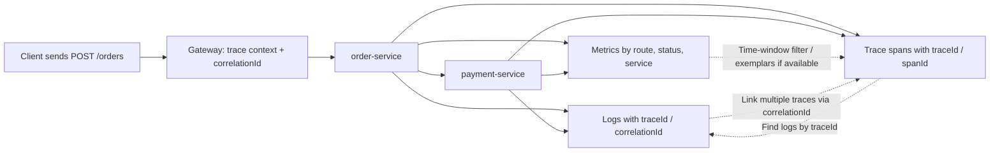

# Correlation IDs Across Signals

> **Chapter:** Three Pillars  
> **Scope:** SPRING_BOOT_OBSERVABILITY — building observability in Spring Boot with Micrometer Observation, metrics, logs, and distributed tracing; connecting signals to investigate errors, latency, and application behavior.

## Learning Objectives

After this lesson, you will be able to:

- Explain what a **correlation ID** is and distinguish it from **trace ID**, **span ID**, **request ID**, and business identifiers.
- Describe how a request links to **logs**, **distributed traces**, and **metrics**, even though aggregated metrics do not contain per-request IDs.
- Understand context propagation mechanisms across HTTP, asynchronous tasks, and message brokers; identify where correlation is easily lost.
- Implement basic correlation IDs in Spring Boot using a Servlet filter and MDC, integrate with Micrometer Tracing, and control security and cardinality.
- Use IDs alongside contextual attributes to investigate an error or latency issue across multiple services.

## 1. Why Do We Need Correlation IDs?

A checkout request in a distributed system can emit events across the API gateway, `order-service`, `payment-service`, databases, and queues. Each component writes its own logs and emits its own metrics. Searching by timestamp alone makes it very hard to know which records belong to **the same request**; during peak traffic, thousands of requests run concurrently.

A **correlation ID** is an identifier used to **associate events belonging to the same processing flow or an agreed-upon logical context**. The system attaches the ID at observation points and propagates it when work crosses service boundaries.

For example, the same ID `corr-7f3b` appears in:

```text
12:00:01.100  gateway          INFO  correlationId=corr-7f3b  POST /orders
12:00:01.170  order-service    INFO  correlationId=corr-7f3b  inventory reserved
12:00:04.215  payment-service  ERROR correlationId=corr-7f3b  provider timeout
12:00:04.230  order-service    WARN  correlationId=corr-7f3b  payment failed
```

Searching for `correlationId=corr-7f3b` groups related logs together. Still, **sharing an ID does not by itself prove causality** among log lines; you must examine timestamps, messages, parent–child spans, and business context.

An effective observability system needs to combine:

- **Logs:** describe specific events in the flow under investigation.
- **Traces:** show execution paths, parent–child relationships, and operation timings.
- **Metrics:** indicate how frequently the phenomenon occurs, which request groups are affected, and trends over time.

Correlation IDs are especially helpful for **linking logs and events spanning beyond a single trace**, while trace IDs serve as the primary identifier for distributed tracing.

## 2. Distinguishing Common ID Types

These names are often used interchangeably, yet their scopes and lifecycles can differ.

| Identifier | Represents | Typical Lifecycle / Scope | Where Used |
| --- | --- | --- | --- |
| **Correlation ID** | A group of events or application-defined workflow | Can span multiple requests, retries, messages, or traces | Logs, HTTP/message metadata, business event lookup |
| **Trace ID** | One distributed trace | From start to end of a trace across linked spans | Traces and logs when tracing is integrated |
| **Span ID** | A single operation inside a trace | An HTTP server span, HTTP client span, DB span, etc. | Pinpointing a specific step in a trace, logs with tracing context |
| **Request ID** | One specific HTTP request | Usually from receiving a request to returning a response | API gateway, application, logs, support tickets |
| **Business ID** | A business entity such as an order | Can persist for days or years | Database, business logic, access-controlled queries |

A typical trace has **one trace ID and multiple span IDs**. For example:

```text
Correlation ID: corr-7f3b
Trace ID:       4d45a9d0e7724d449ef59e00b2b4e23a

gateway            spanId=aaaabbbb11112222
  order-service    spanId=ccccdddd33334444
    payment call   spanId=eeeeffff55556666
      payment      spanId=9999aaaa77778888
```

The ID strings here only illustrate naming and linking; real trace IDs and span IDs must conform to the tracing system's format. A W3C Trace Context Trace ID is 16 bytes (32 hex characters), and a parent/span ID is 8 bytes (16 hex characters).

**When should you use a trace ID instead of a separate correlation ID?** If the goal is simply to find all logs for **one trace**, the trace ID provided by Micrometer Tracing is usually sufficient; there is no need to generate an extra ID. A separate business correlation ID is helpful when a journey spans **multiple traces**, such as order creation → queue processing → payment reconciliation minutes later, or retries triggered by an independent job.

**Do not substitute them for one another:** the same `orderId` may appear across multiple updates or requests, while one trace may touch multiple entities. Never use customer IDs or sensitive data as a trace ID or correlation ID merely because they are readily available.

## 3. Correlation Across Logs, Traces, and Metrics

### 3.1. Logs: Attaching Identifiers to Every Investigated Event

Important logs should include consistent fields, such as:

- `service.name`: the service emitting the log.
- `traceId` and `spanId`: populated from the active tracing context.
- `correlationId`: an application-defined workflow ID, if genuinely needed beyond a trace.
- `event`, `outcome`, `dependency`: meaningful event name, result, and dependency component.
- Timestamp and log severity level.

Example:

```json
{
  "timestamp": "2026-11-22T05:00:04.215Z",
  "level": "ERROR",
  "service": "payment-service",
  "event": "payment.provider.timeout",
  "correlationId": "corr-7f3b",
  "traceId": "4d45a9d0e7724d449ef59e00b2b4e23a",
  "spanId": "9999aaaa77778888",
  "provider": "provider_a",
  "durationMs": 3000
}
```

Use **structured logging** to search accurately by `correlationId` or `traceId`. If using plain-text logs, you can still include fields in the log pattern, provided they are consistent across services and not missing in certain execution branches.

### 3.2. Traces: Using Trace IDs and Span Relationships

Traces allow navigating from an API's server span to a dependency client span and into the target service's server span, provided **tracing context is propagated** properly. Spans carry durations, statuses, and attributes that can reveal bottlenecks:

```text
traceId = 4d45a9d0e7724d449ef59e00b2b4e23a
POST /orders [server]                        3.2s
├── inventory.reserve [internal]             80ms
├── POST /payments [client]                   3.0s
│   └── POST /payments [server]                2.9s
│       └── provider.authorize [client]       2.8s  ERROR
└── orders.save [internal]                    45ms
```

A `spanId` answers “which operation?”, while a `traceId` answers “which execution flow?”. If the same correlation ID appears in two distinct traces, their relationship can be modeled with dedicated metadata, message IDs, a parent workflow ID, or **span links** where appropriate. Avoid arbitrarily merging spans solely because they share a correlation ID.

### 3.3. Metrics: Correlating via Aggregated Context, Not Per-Request IDs

Metrics measure **distributions and trends**. For example, measuring HTTP latency with low-cardinality labels:

```text
http.server.requests
  method=POST
  uri=/orders
  status=504
  service=order-service
```

**Never attach `correlationId`, `traceId`, `spanId`, `orderId`, or `userId` to metric tags.** Every request generates a new value, causing time series counts to grow with traffic and straining memory, storage, and queries. Moreover, some values pose data-exposure risks.

When metrics show p95 of `POST /orders` rising, select the corresponding time range and label group to find slow traces or error logs. Some backends support **metric exemplars**: sample points on a chart can reference a trace ID to jump straight to a related trace. This capability works only when instrumentation, exporters, data formats, and backends all support it; do not assume every metric automatically carries trace IDs.

### 3.4. Correlation Map



This diagram illustrates data relationships only. Instrumentation, exporters, and backend configuration determine which links are actually navigable in practice.

## 4. Correlation ID Lifecycle and Context Propagation

### 4.1. At the Entry Point: Accept, Validate, or Generate

At the edge of the flow, the system needs a clear policy:

1. If accepting `X-Correlation-ID` from outside, validate its **length, character set, and trustworthiness**.
2. If absent or invalid, generate a new ID using a suitable random source such as UUID.
3. Place the ID into logging context and, if needed, echo it in the response header to assist diagnostics.
4. Forward the ID to downstream services according to the system contract.

**Trust boundary:** clients can send arbitrary strings in headers. Never treat a client-supplied correlation ID as proof of authentication, authorization, log access rights, or permission to view another user's data. If strict control over IDs is required, have a trusted gateway issue fresh IDs and trust gateway metadata only within the internal network.

Define the header name, maximum length, format, and generation rules clearly, applying the same policy across services. Even a stable ID used for customer support lookups is not a secret or access token.

### 4.2. Tracing Context over HTTP

Systems supporting **W3C Trace Context** typically use a `traceparent` header shaped like:

```http
traceparent: 00-4d45a9d0e7724d449ef59e00b2b4e23a-aaaabbbb11112222-01
X-Correlation-ID: corr-7f3b
```

In `traceparent`, the trace ID segment identifies the trace, the parent ID carries the sender's parent span ID, and the trailing field holds trace flags (such as the sampled flag). The receiver creates its own span, preserves the trace ID, and links to the sender's span when context is handled properly.

`X-Correlation-ID` is an **application-agreed header**, not part of the W3C Trace Context standard. Spring Boot/Micrometer Tracing can automatically propagate tracing headers across instrumented clients; **it does not automatically propagate this custom header by default**. To preserve a custom correlation ID, configure appropriate propagation, interceptors, or baggage mechanisms.

Multiple propagation standards/formats exist depending on platform; services must agree on a format and verify compatibility. Never try to hand-parse and assemble `traceparent` via string concatenation.

### 4.3. Asynchronous Boundaries and Message Brokers

Context handling is harder than synchronous HTTP:

- **Tasks on another thread:** MDC and tracing context bound to the current execution thread may fail to follow `@Async`, `Executor`, `CompletableFuture`, or reactive schedulers without context propagation mechanisms.
- **Queues/brokers:** producers must attach context in message headers/properties, and consumers must extract it upon receipt. A message processed hours later may belong to the same business journey without necessarily belonging to the active trace from message creation.
- **Retries:** each retry can create a new span; retries triggered by a scheduler or another system can start a new trace. A business correlation ID can stay constant to group those attempts.
- **Fan-out/fan-in:** one request produces multiple parallel messages. A correlation ID may simply group the work, while message IDs and parent links clarify which branch depends on which.

Do not assume forwarding HTTP headers will automatically work across Kafka, RabbitMQ, or background jobs. Verify the instrumentation in use, injection/extraction behavior, and logging context restoration at each boundary.

## 5. Implementation in Spring Boot

This section uses a Spring Boot application on the **Servlet stack** for illustration. Integration details can differ across Spring Boot versions, especially when using WebFlux, Micrometer Tracing bridges, and exporters.

### 5.1. Preparing Tracing and Logging

Typically, an application needs:

- `spring-boot-starter-actuator` to enable relevant operational capabilities and instrumentation.
- A bridge for **Micrometer Tracing** (such as the bridge to OpenTelemetry or Brave).
- A suitable exporter if shipping traces to a backend.
- The active logging system (usually SLF4J/Logback) with a format containing correlation fields.

An example configuration:

```yaml
spring:
  application:
    name: order-service

management:
  tracing:
    sampling:
      probability: 0.2

logging:
  pattern:
    level: "%5p trace_id=%X{traceId:-} span_id=%X{spanId:-} correlation_id=%X{correlationId:-}"
```

In this illustrative environment, trace sampling probability is 20% when compatible tracing is configured. Choose sampling based on traffic, error rarity, cost, and backend capacity; do not treat `0.2` as a mandatory value. Logback reads these values from `MDC`. When tracing is configured properly, Micrometer Tracing can populate `traceId`/`spanId` into MDC while a span scope is active.

**Note:** the configuration above does not add tracing/exporter dependencies on its own, does not generate a custom correlation ID, and does not guarantee context crosses every async boundary. In Spring Boot with full tracing configured, if you only need lookup by trace ID, prefer the built-in log correlation support.

### 5.2. Creating a Correlation ID in a Servlet Filter

When the system needs a correlation ID **separate from the trace ID** for workflow tracking, you can create a filter at the ingress boundary:

```java
package example.observability;

import java.io.IOException;
import java.util.UUID;
import java.util.regex.Pattern;

import jakarta.servlet.FilterChain;
import jakarta.servlet.ServletException;
import jakarta.servlet.http.HttpServletRequest;
import jakarta.servlet.http.HttpServletResponse;

import org.slf4j.MDC;
import org.springframework.stereotype.Component;
import org.springframework.web.filter.OncePerRequestFilter;

@Component
public class CorrelationIdFilter extends OncePerRequestFilter {
    private static final String HEADER = "X-Correlation-ID";
    private static final String MDC_KEY = "correlationId";
    private static final Pattern VALID_ID =
            Pattern.compile("[A-Za-z0-9._-]{1,64}");

    @Override
    protected void doFilterInternal(
            HttpServletRequest request,
            HttpServletResponse response,
            FilterChain chain) throws ServletException, IOException {

        String incomingId = request.getHeader(HEADER);
        String correlationId = incomingId != null
                && VALID_ID.matcher(incomingId).matches()
                ? incomingId
                : UUID.randomUUID().toString();

        response.setHeader(HEADER, correlationId);
        try (MDC.MDCCloseable ignored =
                     MDC.putCloseable(MDC_KEY, correlationId)) {
            chain.doFilter(request, response);
        }
    }
}
```

Key points of this example:

- Incoming headers are capped at 64 characters and restricted to an allowed character set; invalid strings are replaced with a fresh UUID.
- `MDC.putCloseable` sets the value in MDC for the request scope and cleans it up afterward to prevent leaking context to subsequent requests on reused threads.
- The response header helps callers report failures with the correlation ID attached.
- The filter only sets context on the active servlet processing thread; **it does not automatically propagate** the value to other services, reactive pipelines, or asynchronous tasks.

If you need logs during error dispatches, async dispatches, or MDC reuse from an enclosing context, verify actual filter behavior against your application's servlet lifecycle. With WebFlux, use Reactor Context mechanisms and appropriate instrumentation instead of copying this filter verbatim.

### 5.3. Propagating the Correlation ID When Calling Other Services

With Spring's `RestClient` HTTP client, you can add an interceptor to send the custom header:

```java
package example.observability;

import org.slf4j.MDC;
import org.springframework.context.annotation.Bean;
import org.springframework.context.annotation.Configuration;
import org.springframework.web.client.RestClient;

@Configuration
public class DownstreamClientConfig {
    @Bean
    RestClient downstreamClient(RestClient.Builder builder) {
        return builder.requestInterceptor((request, body, execution) -> {
            String correlationId = MDC.get("correlationId");
            if (correlationId != null) {
                request.getHeaders().set("X-Correlation-ID", correlationId);
            }
            return execution.execute(request, body);
        }).build();
    }
}
```

The example uses the Spring Boot-managed `RestClient.Builder` so it receives configured customizers and instrumentation. This interceptor only forwards the **custom correlation ID**; creating spans and propagating `traceparent` remain the responsibility of Micrometer Tracing and its instrumentation. If client calls run on a thread lacking MDC, the value may be null. Verify with actual requests instead of assuming the ID was propagated.

Do not forward raw headers from untrusted sources to external endpoints if doing so could expose internal metadata or violate partner contracts. For systems outside your trust boundary, consider generating a new outbound communication ID and keeping the mapping in your internal backend.

### 5.4. A Log Containing Both Correlation ID and Trace ID

In a controller or service, simply log as usual:

```java
import org.slf4j.Logger;
import org.slf4j.LoggerFactory;
import org.springframework.stereotype.Service;

@Service
public class PaymentService {
    private static final Logger log =
            LoggerFactory.getLogger(PaymentService.class);

    public void authorize() {
        log.info("event=payment.authorize.started");
        // Call dependency; tracing context can surround this operation.
    }
}
```

If both the filter and tracing integration are active, the logging pattern can output:

```text
INFO trace_id=4d45a9d0e7724d449ef59e00b2b4e23a
     span_id=ccccdddd33334444 correlation_id=corr-7f3b
     event=payment.authorize.started
```

The three values mean different things. `trace_id` opens the trace; `span_id` points to the specific operation; `correlation_id` can group additional executions belonging to the same workflow. Having placeholders in the log pattern does not mean every record contains all three fields—logs emitted outside a tracing context or MDC can leave them blank.

## 6. Correlation IDs in Micrometer Observation

**Micrometer Observation** describes an operation through `ObservationRegistry` and can connect to metrics and tracing via matching `ObservationHandler` instances.

Example business observation:

```java
import io.micrometer.observation.Observation;
import io.micrometer.observation.ObservationRegistry;
import org.springframework.stereotype.Service;

@Service
public class CheckoutOperation {
    private final ObservationRegistry registry;

    public CheckoutOperation(ObservationRegistry registry) {
        this.registry = registry;
    }

    public void submit(Runnable action) {
        Observation.createNotStarted("checkout.submit", registry)
                .lowCardinalityKeyValue("operation", "submit")
                .observe(action);
    }
}
```

`operation=submit` is a label with few possible values, suitable for metrics. **Do not do this**:

```java
// Wrong: per-request values create far too many time series.
Observation.createNotStarted("checkout.submit", registry)
        .lowCardinalityKeyValue("correlationId", correlationId);
```

If you need to attach a custom correlation ID to traces for searching, store an appropriate attribute on the **tracing span** or use **baggage** with an explicit propagation policy. High-cardinality attributes must be evaluated for cost and sensitive data; never turn them into metric tags. If you only need log correlation, MDC together with the trace ID may already suffice.

Whether custom span attributes or baggage are exported depends on the tracing bridge, exporter, and backend. An Observation also does not automatically emit business event logs; logging must be placed where meaningful.

## 7. Cross-Signal Error Investigation Workflow

**Scenario:** A user receives a `504 Gateway Timeout` while placing an order and sends support the ID `corr-7f3b`.

1. **Search logs by correlation ID.** Filter by `correlationId=corr-7f3b` within a reasonable time window. Identify the ingress request, participating services, retries, and the first recorded error.
2. **Extract the trace ID from logs.** If a `traceId` is present and the trace was exported, open the corresponding trace. Inspect span durations and which branch accounts for most latency.
3. **Cross-reference span IDs.** Locate log records during the exact `payment.authorize` operation to distinguish timeouts, retries, DB errors, or dependency exceptions.
4. **Check aggregated metrics.** Inspect p95/p99 latency, 5xx/timeout rates, and throughput for `POST /orders`, the payment dependency, and instances. This step determines whether the issue is isolated or widespread.
5. **Inspect context propagation.** If logs appear only at the gateway and are missing in payment, check `X-Correlation-ID`, `traceparent`, HTTP client/server instrumentation, async contexts, and message headers.
6. **Verify hypotheses.** Compare deployment timestamps, timeout/retry changes, connection pool saturation, and dependency health; use independent signals to separate cause from effect.
7. **Confirm after the fix.** Monitor error rate, latency, and system load, and test a sample request to verify IDs, logs, and traces correlate end to end across services.

**Example of valid reasoning:** “p95 on the order route rose; sampled traces show latency concentrated at the payment provider; logs with the same trace ID record timeouts; metrics on the provider call show errors rising at the same time.” This is a multi-evidence hypothesis ready to be verified through testing, configuration checks, and operational changes.

**Example of flawed reasoning:** “No trace was found for that correlation ID, so the request never reached `payment-service`.” The trace may have been sampled out, failed export, lacked instrumentation, or lost correlation ID forwarding; a missing trace does not prove the request never occurred.

## 8. Common Design Mistakes

| Symptom | Common Cause | How to Check or Fix |
| --- | --- | --- |
| Gateway logs have correlation ID, downstream service logs do not | Custom header not forwarded or ID not placed into MDC on receiver | Check HTTP/message metadata and filters/interceptors at each hop |
| Trace splits into multiple trace IDs | Incorrect or missing tracing context propagation; new root span created erroneously | Inspect `traceparent` and Micrometer Tracing integration on client/server |
| Logs inside `@Async` lack both correlation ID and trace ID | Thread-local context not captured/restored | Use context propagation or an appropriate task decorator; verify on async paths |
| Sudden explosion in time series count | Per-request ID used as a metric label | Remove IDs from metric tags; use low-cardinality route/status/result |
| Error log exists, but trace cannot be opened | Sampling, uninstrumented span, or exporter/collector failure | Check sampling, tracing bridge, pipeline health, and query filters |
| Two unrelated business flows share the same correlation ID | Trusting unvalidated client values or reusing IDs out of scope | Enforce ID scope and validation/generation policy at ingress |
| Dashboard shows trace, yet correlated logs are missing | Log pattern does not print trace ID or context was lost before logging | Check MDC/instrumentation and the logging pipeline |

### 8.1. Security and Operations

- Never treat a correlation ID as proof of identity or authorization. Support teams must verify permissions before accessing related records.
- Avoid putting emails, phone numbers, tokens, access keys, or sensitive data directly into IDs, logs, baggage, or tracing attributes.
- Constrain input length and character format to prevent log injection and collection pipeline abuse.
- Do not abuse large baggage payloads: they travel across many hops and add network overhead.
- Add a custom correlation ID only when it solves a concrete business need; avoid proliferating overlapping, poorly governed IDs.
- Monitor exporter/collector status, retention windows, and sampling. Missing signals may indicate an observability pipeline issue.

## 9. Verification Practice in a Test Environment

Set up two Spring Boot services: `order-service` calling `payment-service`, with tracing and log correlation enabled. Test in sequence:

1. Send `POST /orders` with header `X-Correlation-ID: demo-flow-001`. Check the response header and `order-service` logs.
2. Check whether `payment-service` logs share the same custom correlation ID and trace ID; confirm HTTP server/client spans appear in the same trace once tracing data is exported.
3. Temporarily disable the custom header interceptor: observe how log correlation changes while `traceparent` may still propagate via tracing instrumentation.
4. Run the payment step in an executor without context propagation: identify which records lose `traceId`/`correlationId`. Then configure proper context propagation and verify again.
5. Simulate a payment timeout: locate the related trace/logs, then use latency/error metrics to gauge frequency. Confirm that sampled-out traces may be absent.
6. Audit metric labels: keep only `method`, normalized `uri`, `status`, and bounded-cardinality groups; ensure no label varies per request.

**Success criteria:** Given a customer-provided correlation ID, you can locate logs across the involved steps; from the trace ID you can open the trace if captured; from metrics you can tell whether the failure affects many requests. Your test should also demonstrate limitations caused by sampling, instrumentation gaps, and async propagation.

## 10. Self-Check

**Question 1.** Should `traceId` be added as a tag on `http.server.requests` to “link metrics with traces”?  
**Answer:** No. Trace IDs are unique per trace and cause extreme cardinality; use bounded metric tags and correlate via time/route or exemplars when supported.

**Question 2.** Must `traceId` and `correlationId` always be identical?  
**Answer:** No. A Trace ID identifies one distributed trace; a correlation ID is application-defined and can span multiple traces. In simpler systems, the trace ID alone may suffice.

**Question 3.** If `X-Correlation-ID` is already sent, is `traceparent` still needed?  
**Answer:** Yes, for standards-compliant distributed tracing. The custom header only groups events; `traceparent` propagates context so spans link into a single trace.

**Question 4.** A log in an `@Async` task is missing the correlation ID; can you conclude the request does not exist?  
**Answer:** No. MDC/tracing context can be lost across thread boundaries; check context propagation.

**Question 5.** Do two traces sharing the same correlation ID automatically merge into one trace?  
**Answer:** No. Correlation ID links workflow events at the application level; trace/span structure is still determined by tracing context and span/link relationships.

**Key takeaway:** A correlation ID links **related events**, a trace ID links **spans within one trace**, and aggregated metrics show **magnitude and trends**. In Spring Boot, Micrometer Tracing, MDC, and context propagation create reliable links when configured consistently; keep each ID within its proper scope, never place per-request IDs into metric tags, and always account for sampling, exporters, and async boundaries.
