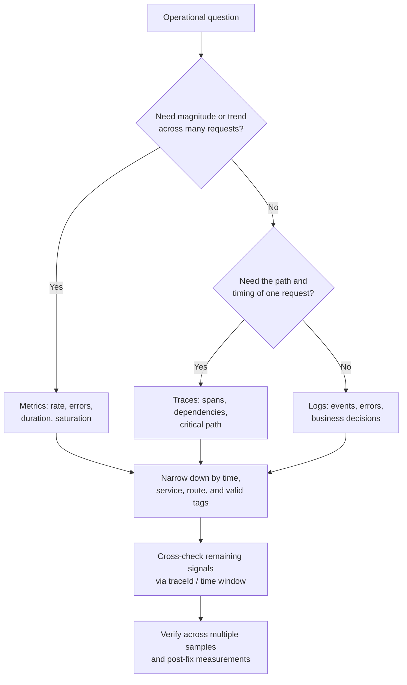
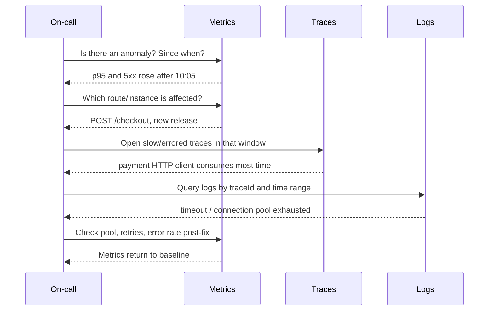

# Choosing the Right Signal for Each Operational Question

When a Spring Boot application hits an incident, the first question is not “which dashboard should I open?” but **“what am I trying to verify?”**. If you need the system-wide error rate, reading individual log lines is an inefficient place to start. If you need to know why **one** request took three seconds, an average latency chart is not enough either. Picking the right signal cuts investigation time and prevents false conclusions drawn from data lacking context.

This lesson belongs to the **Three Pillars** chapter of **SPRING_BOOT_OBSERVABILITY**: establishing observability in Spring Boot with Micrometer Observation, metrics, logs, and distributed tracing; understanding context propagation, tags/cardinality, exporters, and sampling; and correlating signals to explain errors, latency, and application behavior in production environments. Its focus is **deciding which signal to choose based on the operational question**, from detection to scoping, explanation, and verification.

## 1. Learning Objectives

After this lesson, you will be able to:

1. Choose **metrics**, **logs**, or **traces** as the starting point for each type of question, and explain when to combine them.
2. Turn a vague question (“the system is slow”) into a testable hypothesis (“p95 of `POST /checkout` rose on the newly deployed instances”).
3. Execute the **detect → scope → explain → verify** workflow with Spring Boot telemetry.
4. Recognize the limits of aggregated data, logs lacking correlation, and sampled traces.
5. Apply names, tags, and context just detailed enough to answer questions while controlling cost and protecting sensitive data.

## 2. Three Signals Answer Three Different Kinds of Questions

| Signal | Data Unit | Strongest at Answering | Weakness When Used Alone |
|---|---|---|---|
| **Metrics** | Aggregated numerical values or time series: counters, gauges, timers, histograms | **How many? How long? Since when? Did it cross a threshold? How wide is the impact?** | Usually loses details of individual calls; averages can hide tail distributions. |
| **Logs** | Event records with timestamp, level, message, and attributes | **What specific event or exception occurred? What did the application decide?** | Easily too noisy or too sparse; stitching logs across services is hard without correlation IDs. |
| **Distributed traces** | A trace containing spans, relationships, and durations per step | **Where did this request go? Which step consumed the time? Which call is a child of which?** | Traces may be dropped by sampling; uninstrumented code does not appear as spans. |

Example with `POST /checkout`:

- Metrics show p95 jumped from 300 ms to 2 s, concentrated on the checkout route.
- A slow trace shows the HTTP client span calling Payment Service took 1.7 s.
- Logs from Payment Service sharing the same `traceId` record `connection pool exhausted`.

These three pieces of evidence support a hypothesis of connection pool exhaustion in Payment Service. **They do not prove root cause on their own**: you still need to check pool metrics, error rates, and additional requests before concluding.

> **Principle:** use **metrics** to see magnitude and trends; use **traces** to understand the path of one unit of work; use **logs** to find specific events, decisions, and diagnostic details. When a question has multiple parts, move across signals in a deliberate sequence.

### “No Data” Is Not “No Incident”

A request may genuinely happen yet leave no stored trace because of sampling. An application may continue serving traffic while its exporter is disconnected. A log backend may have a gap because a collector failed. Therefore, failing to find a span or log is **not enough to conclude** an operation never occurred.

Health checks or synthetic probes provide an independent source of availability evidence, yet they **do not replace** metrics, logs, and traces for explaining system behavior.

## 3. A Question-First Process for Choosing Signals

Before opening any tool, define the four parts of your question:

1. **Subject:** Which service, endpoint, instance, dependency, queue, or business operation?
2. **Time window:** Since when, for how long, and before/after which change?
3. **Scope:** All traffic, a route group, a single transaction, or one user?
4. **What needs proving:** Detecting an anomaly, locating where it happens, explaining why, or confirming recovery?

Then pick the **first signal** matching the level of detail required:



You do not always have to go sequentially metrics → traces → logs. When you already have a `traceId` from a specific bug report, you can open the trace or query logs right away. When a JVM hits `OutOfMemoryError`, memory metrics and exception logs are usually more useful than HTTP traces.

### Quick Selection Matrix

| Operational Question | Start With | Supplement When Needed | Why |
|---|---|---|---|
| Is the service still receiving and handling requests? | **Metrics** for traffic, success/error; plus health/synthetic probes | Startup logs, dependency health | Confirms magnitude and impact window; health 200 does not guarantee all features work. |
| Is the HTTP 5xx rate increasing? | **Metrics** for request counts and error ratio by route/status | Exception logs and error traces | Measures scope first, then identifies error types and failing steps. |
| Where is p95/p99 latency increasing? | **Metrics** duration histograms by route | Slow **traces**, timeout/retry logs | Metrics confirm the distribution; traces pinpoint time-consuming segments. |
| Why did a specific request return an error? | **Logs** with `traceId`/request correlation | **Trace** if recorded; metrics in same window | You need the specific event and context of that call. |
| Which dependency is slowing down Order Service? | **Traces** via HTTP client/server spans | Latency/error metrics per dependency | Traces show the call path; metrics show how widespread the issue is. |
| Did traffic or errors change after a deployment? | **Metrics** before/after deploy by service/route | Config-change logs, sample traces | Compares trends and magnitude without bias from a handful of traces. |
| Is CPU, heap, or GC rising? | **Metrics** for JVM, process, GC | OOM/GC logs, profiler if needed | This is an aggregate resource issue; HTTP traces are rarely the best starting point. |
| Is a queue backing up and consumers falling behind? | **Metrics** for backlog, message age, throughput, retries | Message error logs, instrumented processing traces | Must separate ingress rate, consumption speed, and downstream dependency delays. |
| Did an `@Async` task lose its correlation ID? | **Logs** comparing before/after thread handoff | **Traces** for split spans; propagation config | Inspect the execution-context switching boundary. |
| Are many orders being rejected despite HTTP 200? | **Business metrics** counting rejections by reason group | Decision logs and traces if flow analysis is needed | HTTP status codes do not capture all business failures. |
| Why does a transaction fail intermittently? | **Logs** with failure reasons and correlation | **Traces** when captured; rate metrics | Rare issues need detailed evidence; traces may be sampled out. |
| Why did the dashboard suddenly go blank? | **Metrics** for scrape/exporter/collector and independent health checks | Pipeline logs, test config/traces | Must separate a down application from a broken telemetry pipeline. |
| A task succeeded, but which step took the time? | **Traces** for a single execution | Per-step duration/throughput metrics | Spans show the path; metrics verify whether the pattern is widespread. |

**Note:** The “first signal” is the option most likely to answer fastest—not an unbreakable rule. Confidence increases when a second independent signal **refutes or reinforces** the hypothesis.

## 4. Choose Metrics When the Question Is Quantitative

Metrics fit questions requiring **aggregation over time**, threshold tracking, and alerting.

### 4.1 Four Practical Question Groups

- **Traffic:** How many requests/second are arriving? Was there a sudden drop?
- **Errors:** How many requests are failing? Do 4xx and 5xx have the same business meaning?
- **Duration/latency:** How do p50, p95, and p99 differ? Is a long tail affecting a small group of users?
- **Saturation:** Are CPU, heap, GC, threads, DB connection pools, or queue lengths nearing limits?

For example, Spring MVC normally provides the `http.server.requests` meter. With a Prometheus registry, timers may export as series like `http_server_requests_seconds_count` and `http_server_requests_seconds_sum`. Enabling histograms produces the additional buckets needed to estimate percentiles in Prometheus.

Sample PromQL queries:

```promql
# Requests/second across the whole application
sum(rate(http_server_requests_seconds_count[5m]))

# 5xx ratio over 5 minutes; interpret only with sufficient traffic
sum(rate(http_server_requests_seconds_count{status=~"5.."}[5m]))
/
sum(rate(http_server_requests_seconds_count[5m]))

# p95 by URI template when histogram buckets are enabled
histogram_quantile(
  0.95,
  sum by (le, uri) (
    rate(http_server_requests_seconds_bucket[5m])
  )
)
```

Keep four conditions in mind:

1. **Verify metric names against your actual exporter/convention.** Micrometer's `http.server.requests` does not keep dots when exported to Prometheus.
2. **`p95` is not available merely because Actuator is enabled.** You need histogram buckets, enough samples, and the right query window; p95 over arbitrarily mixed request groups can be meaningless.
3. **HTTP error rate is not identical to business error rate.** `POST /checkout` returning 200 with `paymentDeclined` may still require a dedicated metric for declined transaction rate.
4. **Adding grouping dimensions multiplies time series.** Attaching `orderId` or `userId` to metric tags can cause an enormous series explosion.

### 4.2 Never Use Averages to Represent Every User

Suppose you have 100 requests: 95 take 100 ms and 5 take 4 s. Average latency is about 295 ms, yet some users still wait 4 s. For latency, inspect request counts, percentiles, histograms, and meaningful route groups together.

If traces are randomly sampled at 10%, computing percentiles from just a few slow traces you found will usually **not** give a reliable p95 estimate. Histogram metrics (when properly instrumented) are generally far better suited to measuring full-population distributions.

### 4.3 Metrics Tell “How Much,” Rarely “Why”

A rising `http_server_requests_seconds_count` chart does not tell you what in the code caused errors. A slow `pricing.quote` timer does not always reveal whether CPU, DB, or locks caused the delay. That is when you pivot to specific traces and logs in the same time window.

## 5. Choose Logs When the Question Needs Events and Explanations

Logs record **what the application observed or decided**: validation failures, timeouts, retries, state transitions, exceptions, dead-letters, configuration changes, and business logic branches.

A genuinely useful log record should convey the event, severity, timestamp, service, outcome, and correlation context:

```json
{
  "timestamp": "2026-11-22T10:15:23.456Z",
  "level": "WARN",
  "service": "order-service",
  "event": "payment.provider_timeout",
  "dependency": "payment-service",
  "durationMs": 1500,
  "traceId": "4bf92f3577b34da6a3ce929d0e0e4736",
  "spanId": "00f067aa0ba902b7"
}
```

This is a **structured log design pattern**, not JSON emitted by Spring Boot out of the box in all setups. To emit matching JSON fields, configure structured logging and ensure trace/span IDs are populated into MDC or log context while a scope is active.

### 5.1 What Should You Log?

- Unexpected errors and exceptions with clear cause and call site.
- Meaningful retries, circuit breaker decisions, and dependency timeouts.
- Important business state transitions and rejections requiring auditability.
- Configuration changes or startup/shutdown lifecycle events with operational impact.

Avoid logging every loop iteration or minor technical step just to “have more data”: excessive logging raises costs and buries critical events. Use `INFO` for notable normal events, `WARN` for controlled abnormal conditions, and `ERROR` for failures requiring action, following team conventions.

### 5.2 When Are Logs Not Enough?

If there are 10,000 “timeout” log lines, logs alone do not show the timeout ratio over total requests or the p95 trend—switch to metrics to measure impact. If you see a stack trace in Inventory Service without knowing which services the request traversed beforehand, use the trace ID and distributed tracing to reconstruct the flow.

Never log secrets: tokens, passwords, cookies, access keys, personal data, or sensitive payloads. Only log identifiers genuinely needed for investigation, subject to access control, masking, and retention policies.

## 6. Choose Traces When the Question Needs Execution Paths and Proximate Cause

A **trace** represents one execution across instrumented components. Each **span** holds an operation name, time interval, parent relationship, attributes, and sometimes errors/events.

Example:

```text
Trace: checkout request (traceId=T)
└── checkout-service HTTP POST /checkout       2500 ms
    ├── validate-cart                            25 ms
    ├── inventory HTTP POST /reserve             120 ms
    └── payment HTTP POST /authorize            2100 ms
        └── payment-service HTTP POST /authorize
            └── provider-adapter call           1850 ms
```

From this trace, a reasonable hypothesis is to inspect Payment Service or the provider adapter. However, **span durations can overlap** (especially during parallel work); never simply sum all child durations to infer total latency. Gaps without spans can also represent thread scheduling, queue wait, uninstrumented code, or network delay.

### 6.1 Questions Traces Answer Well

- How many services and dependencies did this request traverse?
- At which step did retries happen, and was there parallel fan-out?
- Did the timeout happen in the outbound HTTP client or inside the target server's processing?
- Was context propagated downstream, or was a new trace started?
- Which segment of the path shows evidence of delay?

Spring Boot can instrument HTTP servers, HTTP clients, and other operations depending on stack/dependencies. For custom business logic, use `Observation` to measure key segments. Not every database call or Java method automatically produces a span.

### 6.2 Sampling Changes How You Interpret Results

If sampling is 10%, a specific trace may not appear in the backend. Visible traces may not represent all traffic, especially if sampling decisions depend on endpoint, upstream parent, or error/slow retention policies.

Therefore:

- Use **metrics** to measure full-population latency distributions and error rates.
- Use **traces** to understand the executions that were captured.
- Use **logs** with correlation IDs when you need to follow a request that lacks a trace.
- When traces are missing, check the sampler, exporter, backend, and propagation before concluding no request occurred.

## 7. When Must You Combine All Three?

An incident often involves three sequential questions: **how severe is it → which path is involved → what happened at the failure point**.

### 7.1 General Investigation Workflow



**Every signal pivot should carry a specific question.** For example, “the trace shows Payment is slow; do Payment logs record timeouts, retries, or pool exhaustion?” is far better than opening all logs from every service.

### 7.2 Linking via Shared Context

Two complementary linking layers:

1. **Time + service/route/version names:** narrows down metrics and locates traces/logs from the right moment.
2. **`traceId` and `spanId`:** retrieves logs tied to an execution; one trace ID can encompass many span IDs. A business `requestId` can supplement tracing across async/messaging hops when carefully designed and governed.

W3C Trace Context uses the `traceparent` header to continue traces across HTTP services. Formal example:

```http
traceparent: 00-4bf92f3577b34da6a3ce929d0e0e4736-00f067aa0ba902b7-01
```

Spring Boot with Micrometer Tracing and Spring-configured HTTP clients can propagate context automatically. If you build raw HTTP clients, custom executors, or threads outside instrumentation/context propagation, traces easily break and logs can lose `traceId`. For messaging, propagation depends on the library/instrumentation and processing semantics; some relationships are best modeled with **span links** rather than direct parent–child trees.

**Never put `traceId` in metric tags**: nearly unique per-trace values create massive cardinality. Instead, tags like `uri=/checkout`, `status=500`, and `client.name=payment-service` (when target services are bounded) are suitable grouping dimensions.

## 8. Scenario A: 5xx Spikes Sharply After Deployment

**Initial question:** “Did the 10:00 deployment break the order API?”

**Primary signal: metrics.**

1. Check total request rate and 5xx ratio before and after 10:00; verify sample size is large enough.
2. Slice by route, service, instance, or deployment version if those bounded tags are collected.
3. Compare against traffic changes: 500 errors out of 1 million requests is very different from 500 errors out of 700 requests.
4. Open sampled error traces for the affected route/instance to spot failing dependencies or spans.
5. Search logs sharing the trace ID and time range to distinguish timeouts, database exceptions, and validation errors.
6. Check whether failures actually surface via HTTP status: business failures returning 200 require separate metrics.

**Potential trap:** After deployment, log level increased from INFO to DEBUG, causing log volume to spike; that is not proof that more requests are failing. Check error metrics independently first.

## 9. Scenario B: p95 Rises While 5xx Rate Remains Flat

**Question:** “Where are users waiting, and is an external dependency responsible?”

**Start with duration metrics**, then open slow traces:

1. Confirm p50/p95/p99 by **URI template** and time; separate one route from the whole service.
2. Check rate, queue backlog, DB connection pools, CPU/GC, and HTTP client latency to form hypotheses.
3. Open several slow traces and several normal traces on the same route and compare spans.
4. Search for timeout/retry logs in suspicious spans; note that retries can inflate total latency while still returning HTTP 200.
5. If traces show no slow segment, look for instrumentation gaps, thread/queue wait time, uninstrumented clients/servers, or external delays.
6. Verify improvement via p95 and throughput after remediation.

**Common mistake:** Seeing one trace with a long DB span and concluding “the DB is causing every slow request.” Verify numbers across many requests and compare before/after.

## 10. Scenario C: A Rare Single-Transaction Failure

**Question:** “Why was one specific checkout payment request declined?”

Start with **business logs containing the correlation ID** or trace ID returned through a safely designed support mechanism. Query the exact time window and service, and read the event chain “validate → authorize → fail/retry → response.” If a trace was captured, open it to see each step's placement and duration. Finally, use rejection-rate metrics to tell whether the case is isolated or spreading.

If no trace exists due to sampling, logs do not have to disappear along with it. Logging has its own policy; inspect preserved business trail records within security boundaries. If more traces are needed for rare bugs, design targeted sampling policies or controlled reproduction workflows rather than enabling 100% sampling indefinitely across production.

When a transaction returns HTTP 200 with a `declined` outcome, **never treat HTTP success rate as the sole measure** of user experience.

## 11. Scenario D: Slow Queue Processing and Asynchronous Tasks

**Question:** “Is the queue backing up because producers are publishing faster, or because consumers are processing slower?”

The starting signal is **metrics**:

- Queue depth and oldest message age (if exposed by the broker).
- Messages enqueued/completed per second, retries, and dead-letters.
- Active consumer count, processing duration, dependency latency, and resources.

Once slow consumption is confirmed, open **traces** of instrumented messages to inspect processing paths and downstream calls. Use **logs** to explain poison messages, deserialization errors, exhausted retries, or business rejections.

Notes:

- A message may be redelivered and processed multiple times. Do not assume an exact one-to-one mapping of spans or logs per business message.
- Propagating trace headers across brokers depends on tooling, interceptors, and consumer setup. `@Async` and custom executors also require context propagation.
- When messages switch contexts or fan out, verify parent/child semantics and span links; do not force every parallel flow into a linear tree.

## 12. Scenario E: Dashboards Suddenly Go Blank

**Question:** “Did the application stop serving traffic, or did the telemetry pipeline break?”

Never treat **missing metrics** as proof the application is down. Cross-check health/synthetic checks and ingress/load-balancer traffic, then inspect:

| Signal / Component | Indicators to Check |
|---|---|
| Metrics collector | `up`/scrape status, timeouts, does `/actuator/prometheus` return data? |
| Tracing exporter/collector | Disconnections, full queues, batch send errors, sampling, backend rejections. |
| Log collector | Stopped agent, full buffer, broken field-parsing pipeline, log retention/permissions. |
| Application | Crash/restart, changed exposure configuration, CPU/memory/network throttling. |
| Dashboard query | Service/namespace/label filters or time range no longer match. |

Losing one signal while the other two stay alive points to a **collection failure**, not necessarily application health or failure. Monitor the telemetry delivery pipeline itself.

## 13. Designing Question-Fit Signals Directly in Spring Boot

Not everything you need to know comes from auto-instrumentation. For an “inventory reservation” business flow, operational questions might be:

- “How many reservation attempts were rejected?” → **business counter**.
- “How long does the reservation operation take?” → **Observation** to emit a timing metric and optionally a span.
- “Why did a specific reservation attempt fail?” → **log** with outcome/reason and correlation context.

### 13.1 Configuration Baseline

In an application with Spring Boot Actuator, Prometheus metrics, and version-appropriate tracing integration:

```yaml
spring:
  application:
    name: inventory-service

management:
  endpoints:
    web:
      exposure:
        include: "health,info,metrics,prometheus"
  metrics:
    distribution:
      percentiles-histogram:
        http.server.requests: true
  tracing:
    sampling:
      probability: 0.1
```

To expose `/actuator/prometheus`, add `io.micrometer:micrometer-registry-prometheus`. To actually create, export, and query traces, you also need a tracer implementation/bridge, exporter, and backend compatible with your **Spring Boot version**; `sampling.probability` alone does not create a trace backend. Management endpoints must have restricted exposure and access controls in production.

Minimal dependencies for Actuator and Prometheus when the project already has a web starter:

```groovy
dependencies {
    implementation 'org.springframework.boot:spring-boot-starter-actuator'
    runtimeOnly 'io.micrometer:micrometer-registry-prometheus'
}
```

Tracing and JSON logging configuration can differ across versions. Check the reference docs for your exact version before deploying to production.

### 13.2 Observing Business Logic and Counting Rejections

```java
import io.micrometer.core.instrument.Counter;
import io.micrometer.core.instrument.MeterRegistry;
import io.micrometer.observation.Observation;
import io.micrometer.observation.ObservationRegistry;
import org.slf4j.Logger;
import org.slf4j.LoggerFactory;
import org.springframework.stereotype.Service;

@Service
public class InventoryService {
    private static final Logger log =
            LoggerFactory.getLogger(InventoryService.class);

    private final ObservationRegistry observations;
    private final Counter outOfStockRejections;

    public InventoryService(ObservationRegistry observations,
                            MeterRegistry meters) {
        this.observations = observations;
        this.outOfStockRejections = Counter.builder("inventory.reservation.rejected")
                .description("Reservation attempts rejected as out of stock")
                .tag("reason", "out_of_stock")
                .register(meters);
    }

    public boolean reserve(String rawCategory, boolean available) {
        // Fixed set of values; avoid pushing arbitrary categories into metric tags.
        String category = switch (rawCategory) {
            case "book" -> "book";
            case "electronics" -> "electronics";
            default -> "other";
        };

        Observation observation =
                Observation.createNotStarted("inventory.reserve", observations)
                        .contextualName("reserve inventory")
                        .lowCardinalityKeyValue("category", category);

        return observation.observe(() -> {
            if (!available) {
                outOfStockRejections.increment(); // metrics: how many attempts were rejected?
                observation.lowCardinalityKeyValue("outcome", "rejected");
                log.info("Reservation declined: category={} reason=out_of_stock",
                         category);              // logs: what happened?
                return false;
            }

            observation.lowCardinalityKeyValue("outcome", "accepted");
            log.debug("Reservation accepted: category={}", category);
            return true;
        });
    }
}
```

When `ObservationRegistry` is configured with a metrics handler, `inventory.reserve` can create a timer tracking count and duration by `category`/`outcome`. With a tracing handler, it can also create a child span inside the request scope. The dedicated `Counter` answers **how many attempts were rejected as out of stock**, even if the API returns HTTP 200.

Notes:

- `rawCategory` is only an example value; real systems must validate inputs and normalize null/unknown values before use. Never place raw SKUs, order IDs, or customer IDs in tags.
- `Observation` does not automatically emit `log.info(...)` lines; developers must explicitly decide which events to log.
- Avoid creating duplicate counters that merely mirror total HTTP requests already tracked automatically. Business counters add value when measuring outcomes that HTTP statuses do not express.
- If execution throws an exception, `observe(...)` handles stopping the Observation and recording the error via matching handlers; verify how response status and framework error marking behave.
- Never assign `outcome=accepted` before side effects actually complete. In real flows, set outcome based on the final result.

### 13.3 How to Verify Locally

Wire a controller or test calling `InventoryService.reserve(...)` with `available=true/false`, then inspect:

```bash
curl http://localhost:8080/actuator/metrics
curl http://localhost:8080/actuator/metrics/inventory.reserve
curl http://localhost:8080/actuator/metrics/inventory.reservation.rejected
curl http://localhost:8080/actuator/prometheus
```

Expected behavior: `inventory.reserve` appears after an execution; the rejection counter increments when `available=false`; console shows the `Reservation declined` log. When tracing is configured and the request runs inside a trace scope, logs can include trace/span IDs. Whether the span appears in the trace backend also depends on sampling and the exporter.

If you want to query a specific trace, verify first that tracing integration and the exporter are working. Having Actuator/Prometheus registry alone does not guarantee traces.

## 14. Data Constraints: Cardinality, Sampling, Cost, and Security

Choosing a signal also means choosing **how much data is permitted to be generated**.

| Decision | Metrics | Logs | Traces |
|---|---|---|---|
| Cardinality | Keep tag sets small: route template, status, method, outcome group. | May include IDs to link events when policy permits; do not dump every ID into logs. | Can carry detailed attributes useful for one execution, while still controlling sensitive data. |
| Sampling | Usually must preserve the full statistical picture; tune scrape frequency/resolution and cost. | Can reduce log levels or rate-limit repetitive events; never drop mandatory audit events. | Sampling rate is a cost-control tool; a missing trace does not mean the request did not occur. |
| Primary cost | Series count × retention × resolution. | Event count × size × indexing/retention. | Trace/span count × attributes × retention duration. |
| Reliability | Scrape/exporter health, counter resets, label mapping. | Collector, format, clock/time sync, access, retention. | Propagation, instrumentation, sampler, exporter, collector. |
| Security | Avoid PII in tags. | Mask/redact sensitive data and restrict search permissions. | Avoid secrets in span names, attributes, events, and baggage. |

In metrics, time series counts grow by the **product** of tag value counts: 10 routes × 5 statuses × 3 methods × 100,000 user IDs creates millions of potential combinations. Never use individual IDs as metric labels. Tracing and logs allow richer attributes, yet must still comply with collection and retention policies.

A system may use **exemplars** to link selected histogram/counter samples to a trace ID. This capability depends on the exporter, backend, and configuration; do not assume it is always available. When exemplars are unavailable, locate traces by time range, service, route, and indexed attributes.

## 15. Verifying Conclusions and Avoiding Bias

A rigorous investigation always checks:

1. **Aligned time windows:** dashboards, logs, and traces share the same timezone and range; account for clock skew.
2. **Comparable cohorts:** same route, request type, dependency, load level, and release version; never compare p95 across wildly different populations.
3. **Sufficient metric sample size:** percentiles on sparse traffic fluctuate wildly; 100% errors on one request does not mean total system outage.
4. **Sampling and instrumentation gaps:** visible traces are only a subset, not necessarily representative of all traffic.
5. **Do not equate correlation with causation:** CPU and p95 rising together could still stem from traffic shifts, queries, or locks; verify the mechanism.
6. **Re-measure post-fix:** rate, error ratio, p95/p99, backlog, saturation, and business metrics must return to acceptable baselines.

### Quick On-Call Checklist

| Before Concluding | Self-Check Question |
|---|---|
| Detection | Do I have quantitative metrics proving a real anomaly? |
| Scope | Do I know the affected service, route, version, and time window? |
| Hypothesis | Which span/log suggests the cause? Is there another plausible explanation? |
| Representativeness | Are traces sampled? Do metrics have enough samples and valid histograms? |
| Correlation | Are `traceId`, `spanId`, and correlation context propagating properly across HTTP, threads, and messages? |
| Telemetry quality | Is the collector/exporter dropping data, timing out, or failing? |
| Outcome | After the change, did metrics and user behavior actually improve? |

## 16. Scenario Exercises

**Exercise 1 — Lost conversions with no HTTP 5xx.** After a deployment, checkout completion drops from 85% to 60%, yet `POST /checkout` still returns HTTP 200. Which signals do you choose to *detect*, *group causes*, and *investigate a single failure*? Should `customerId` be added as a metric tag?

**Exercise 2 — “Healthy” traces while users still report slowness.** Metrics show p99 of `GET /search` is 4 seconds; you open three random traces and see only sub-200 ms durations. What aspects of sampling, histograms, sample size, trace selection, and instrumentation should you inspect?

**Exercise 3 — Growing queue backlog.** Backlog grows while consumers are still running. Which metrics distinguish an increased producer rate from decreased consumer throughput? Which logs or traces help locate the bottleneck?

**Exercise 4 — Lost log correlation after `@Async`.** Controller logs contain a trace ID, while worker logs do not. Explain why simply raising the log level will not fix the problem, and which layer needs inspection.

**Exercise 5 — Entire charts disappear.** Prometheus no longer shows series for a service, yet user-facing endpoints still work. Which independent data sources and telemetry pipeline checkpoints should you inspect first?

**Suggested answers:** Exercise 1 starts with business metrics grouped by bounded failure reasons, followed by logs/traces; never put customer IDs in metrics. Exercise 2 must not infer p99 from three fast traces; check sampling, time range, and histograms. Exercise 3 compares ingress/egress rates, message age, retries, worker concurrency, and dependency latency. Exercise 4 checks context propagation across the executor. Exercise 5 checks synthetic/ingress/health signals, then scrapes, endpoints, exporters, labels/filters, and networking.

## 17. Further Reading

- [Spring Boot — Observability](https://docs.spring.io/spring-boot/reference/actuator/observability.html): ObservationRegistry, instrumentation, and propagation.
- [Spring Boot — Metrics](https://docs.spring.io/spring-boot/reference/actuator/metrics.html): MeterRegistry, timers, metrics endpoints, and Prometheus.
- [Spring Boot — Tracing](https://docs.spring.io/spring-boot/reference/actuator/tracing.html): sampling, exporters, log correlation, and propagation.
- [Spring Boot — Actuator Endpoints](https://docs.spring.io/spring-boot/reference/actuator/endpoints.html): exposure and securing management endpoints.
- [Micrometer — Observation](https://docs.micrometer.io/micrometer/reference/observation/introduction.html): Observation, handlers, low/high-cardinality key-values.
- [Prometheus — Histograms and summaries](https://prometheus.io/docs/practices/histograms/): how to measure and query latency distributions.
- [OpenTelemetry — Signals](https://opentelemetry.io/docs/concepts/signals/): concepts of metrics, logs, and traces.
- [W3C Trace Context](https://www.w3.org/TR/trace-context/): the `traceparent` header used to link traces across systems.

**Key takeaway:** To answer an operational question, pick the signal matching **the level of detail you need**: metrics to measure scale and trends, logs to explain specific events, and traces to follow the path of a single execution. Then combine them by time and context, account for sampling/cardinality, and re-measure outcomes. Having many telemetry signals does not automatically make a system easy to debug; what matters is whether those signals answer the operator's real questions.
