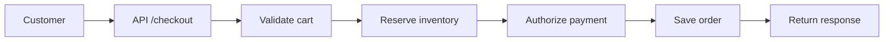
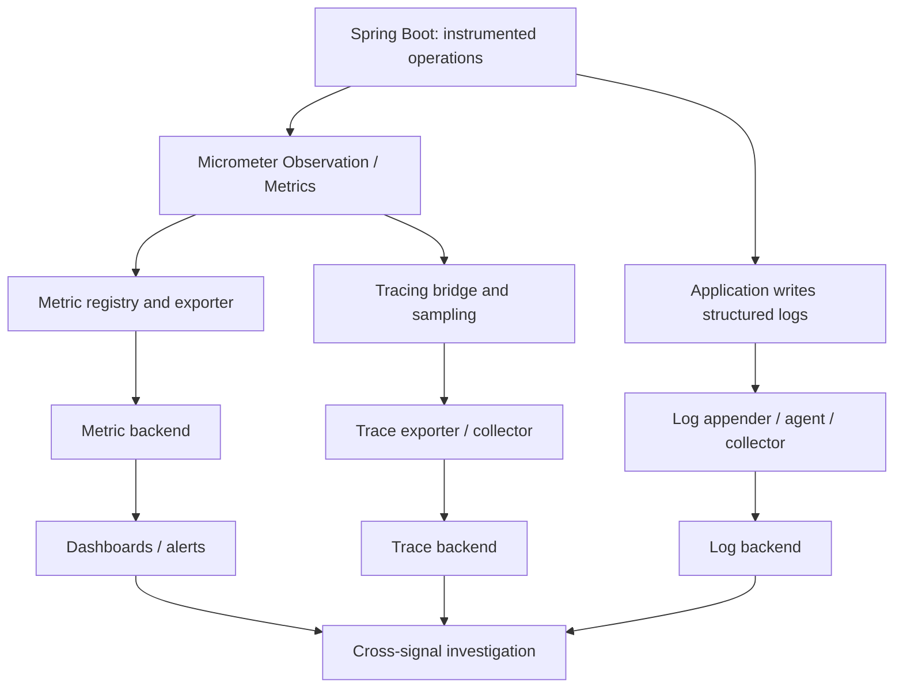

# Limitations of Each Pillar

In a Spring Boot system, **metrics, logs, and distributed traces** are commonly called the *three pillars of observability*. Each pillar answers one group of questions better than the others. However, no pillar on its own guarantees that you will understand the root cause of every incident.

For example, a chart shows the payment API is slower than normal, logs record numerous `Read timed out` errors, and a trace shows a call to the payment provider taking 1.5 seconds. Those clues seem to point in the same direction. Yet if the logs are not tied to the same request, the trace is only a sampled specimen, and the metric aggregates multiple deployment versions, concluding that all users are failing because of the external provider is premature.

This lesson belongs to the **Three Pillars** chapter of the **SPRING_BOOT_OBSERVABILITY** module. Its goal is to understand **what data each pillar preserves, what it discards, which conclusions cannot be inferred**, and how to coordinate Micrometer Observation, metrics, logs, distributed tracing, propagation, tags/cardinality, exporters, and sampling to investigate Spring Boot systems in production environments.

## Learning Objectives

After studying this lesson, you will be able to:

1. Distinguish the limits of **aggregation** in metrics, **context and volume** in logs, and **coverage and sampling** in traces.
2. Spot common faulty conclusions made when reading a dashboard, a log line, or a trace in isolation.
3. Explain why **cardinality**, **sampling**, **context propagation**, and the **telemetry pipeline** govern investigative data quality.
4. Select complementary signals to verify a hypothesis when one pillar lacks sufficient proof.
5. Design Spring Boot instrumentation so signals correlate reliably while controlling cost and sensitive data.

## 1. Observing One System, Yet Each Pillar Sees a Different Slice

Suppose the `POST /checkout` flow consists of:



When customers report “I clicked checkout and waited forever,” the signals typically supply different evidence:

| Pillar | Typical Data Unit | Questions It Answers Well | What Is Missing |
|---|---|---|---|
| **Metrics** | Measured values over time with a label set | How many requests? When did errors rise? How did the latency distribution shift? | Execution path and granular details of a single request |
| **Logs** | Record of an event or message | Which error appeared? What condition did the component observe? | Causality, full duration, and request path when context is missing |
| **Traces** | Spans describing operations in one execution flow | Where did a recorded request go, and which segment was slow or errored? | A complete statistical view of all requests, especially with sampling or instrumentation gaps |

Therefore, saying “metrics answer *what*, logs answer *why*, traces answer *where*” is only a rough mnemonic. **Logs do not prove root cause on their own**, and **traces do not guarantee pinpointing the exact faulty line of code**. You must combine signals, align timestamps, and test hypotheses.

## 2. Limitations of Metrics

Metrics capture numbers efficiently at large scale, making them ideal for SLI/SLO tracking, charts, and alerting. That efficiency comes from **aggregation** and restricting dimensions, so metrics typically trade away per-event detail.

### 2.1. Aggregation Loses Per-Request Circumstances

Suppose one minute sees 10,000 requests with an average latency of 150 ms. That number alone does not tell you:

- Whether a small subgroup of requests took 5 seconds.
- Whether the slow group shares the same deployment version or payment provider.
- Which processing steps each slow request passed through.
- Which condition triggered failures, such as retries, timeouts, or database locks.

Even with p95/p99, you know the **distribution**, not the cause. Elevated p95 could stem from DB locks, thread pool queuing, GC pauses, message queues, network latency, or external services.

**Reasoning trap:** “CPU is normal, so the application isn't bottlenecked.” Low CPU can easily accompany threads blocked on I/O, exhausted connection pools, or lock contention.

### 2.2. Overly Detailed Labels Cause Cardinality Explosions

In Micrometer Metrics, a meter is identified by its name and tag set. Each distinct combination of label values can create a separate time series in the backend.

Example:

```text
http.server.requests{
  method="POST",
  uri="/checkout",
  status="500",
  application="checkout-service"
}
```

Dimensions such as `method`, normalized route names, and HTTP status usually have bounded value counts. By contrast, adding `userId`, `orderId`, `traceId`, or URLs with dynamic IDs as tags lets series counts grow with customers or requests.

Suppose a metric has 6 `method` values, 40 `uri` values, 5 `status` groups, and 8 instances. Combinatorially, up to **6 × 40 × 5 × 8 = 9,600** series can arise for just one label set, before counting any other tags. Adding hundreds of thousands of distinct order IDs drives storage and query costs sharply higher. This is a data-model limit, not merely a disk-space issue.

**How to use it:** keep metric tags low-cardinality and stable. Individual IDs belong in logs or controlled trace attributes. For HTTP server metrics, use route templates such as `/orders/{id}` instead of `/orders/873214`.

### 2.3. Resolution and Aggregation Math Can Hide Anomalies

Backends typically store or display values at intervals: 10 seconds, 1 minute, or longer. An incident lasting only a few seconds can be smoothed over when viewed on charts with coarse steps.

Different meter types also carry different semantics:

- **Counters** accumulate over time; on JVM restart, values can reset to 0. Typically examine rate of increase and handle counter resets properly rather than taking the raw difference between two arbitrary points.
- **Gauges** reflect a value at sampling time; short spikes occurring between scrapes cannot be inferred.
- **Timers/histograms** provide durations and distribution data depending on configuration; percentile accuracy depends on buckets, calculation methods, and collected samples.
- **Percentiles** must not be summed or arbitrarily averaged across instances. For example, averaging the p99 of 3 instances **is not** the p99 across all requests. Compatible histograms enable approximate quantile calculations from aggregated buckets; accuracy still depends on bucket definitions and the pipeline.

Looking at a single `avg` or a single percentile is not enough to describe the whole user experience. View traffic, error rate, latency, and distributions together across meaningful business slices.

### 2.4. Metrics Do Not Prove Causation

Two charts rising together after a deployment do not prove the deployment directly caused the issue. Traffic may have spiked simultaneously, or a third-party provider may have suffered an outage. Metrics help **form questions and isolate time windows**, after which you need logs, traces, deployment records, and additional verification.

**Cue to pivot to another pillar:** charts prove “the API is slow” without explaining “where the request is slow” → check traces. When you need the exact failure condition → check contextual logs.

## 3. Limitations of Logs

Logs can preserve rich event details: error messages, outcome codes, business decisions, retries, timeouts, and stack traces. Yet details inside individual log lines **do not automatically produce a system-wide view**.

### 3.1. Scattered Logs Do Not Describe Causality on Their Own

Example:

```text
10:14:02.105 WARN  timeout calling payment provider
10:14:02.109 ERROR checkout failed
10:14:02.112 WARN  retry payment authorization
```

Three log lines close together in time do not necessarily belong to the same request. Multi-instance systems handle thousands of concurrent requests, and logs sometimes arrive at collectors out of order due to queuing or buffering.

Without `traceId`/`spanId`, service, instance, event name, and proper business context, engineers have to guess which lines belong together. **Display order in a log store does not equal parent–child causality or actual execution order.**

A structured log is much more helpful:

```json
{
  "timestamp": "2026-03-12T10:14:02.105Z",
  "level": "WARN",
  "service": "payment-service",
  "event": "payment_provider_timeout",
  "traceId": "8a1d23ef79ac4f4b8c2e19a861b34d40",
  "spanId": "0011223344556677",
  "provider": "provider-a",
  "elapsedMs": 1500
}
```

Fields are illustrated with hypothetical data. Having `traceId` lets you retrieve logs in the same trace **if** context was propagated and the log pipeline preserved the field. It does not guarantee every event was logged, or that both logs and spans made it to their backends.

### 3.2. Logs Depend on Developer Choices

What was never logged is hard to reconstruct later. An exception might be caught and swallowed, an error logged at too high a layer lacking context, or a log might merely say `payment failed` without stating the failure type (timeout, business decline, configuration error).

Conversely, logging every minor step in a request can produce millions of low-value records. Engineers must weigh:

- Which events help reconstruct state and critical decisions?
- Where do `INFO`, `WARN`, and `ERROR` belong? Are stack traces duplicated for the same error?
- Are there enough structured fields for querying?
- Can incidents still be investigated if a logger, exporter, or collector is disrupted?

A log is evidence of **an event the component chose to record**, not a complete snapshot of internal state.

### 3.3. Volume, Retention, and Data Loss

Logs can be large and expensive to ship, store, index, and query. Systems often apply filtering, sampling, rate limiting, or retention caps; these mechanisms can discard the exact line needed during a rare incident.

Additionally:

- Logging buffers or network glitches can delay logs, reorder them, or drop them.
- Clock skew across nodes can make cross-node timelines unreliable if clocks are unsynchronized.
- One exception logged across multiple layers can inflate error log counts without matching actual failed request counts.
- Errors occurring before the logger initializes, or when a process is killed abruptly, may never be flushed completely.

Consequently, **counting `ERROR` logs is not automatically equal to counting failed requests**. To measure impact ratios, rely on request- or transaction-level metrics/events with clear definitions.

### 3.4. Log Content Has Safety and Accuracy Limits

Request bodies, tokens, emails, card numbers, and personally identifiable data can be sensitive; never dump them verbatim into logs just for convenient debugging. Mask/redact sensitive values, restrict access permissions, and govern exports and retention.

Also avoid logging client-supplied values and blindly treating them as truth. For example, an external `X-Request-Id` can be forged or duplicated; distinguish trusted internal system identifiers from user-controlled fields.

**Cue to pivot to another pillar:** you found a timeout log but do not know which step of the request triggered it or how much total delay it caused → inspect the linked trace. Want to know what percentage of requests hit that timeout → inspect metrics.

## 4. Limitations of Distributed Traces

Distributed tracing tracks an execution flow via spans and trace context. It excels at analyzing paths across services, databases, HTTP clients, and message brokers. Still, a trace is **a record of operations that were instrumented and retained**, not an omniscient measurement.

### 4.1. Traces Only Show What Was Instrumented

Suppose you see:

```text
trace: POST /checkout (1.9 s)
  ├─ checkout-service: validate (20 ms)
  └─ checkout-service: payment (1.6 s)
```

The trace shows roughly 1.6 seconds spent in the `payment` span, yet that is not enough to conclude:

- Whether that time was CPU, I/O, waiting for a connection pool, or retries.
- How much time the remote payment provider actually took versus client-side queuing.
- Which code block inside `payment` caused the slowdown without child spans or reliable events.
- Which step accounted for the remaining gap if instrumentation does not cover all operations.

Auto-instrumentation typically covers specific libraries, protocols, and entry points. Custom business steps such as evaluating discount rules or enforcing idempotency policies will not automatically appear as meaningful spans.

A long span is therefore **where to look deeper**, not proof of root cause.

### 4.2. Sampling Can Drop Important Requests

Even if every request creates a trace context, the backend may store only a fraction of traces due to sampling policies.

- **Head-based sampling** decides at the start of the flow based on information available then. It can drop requests that later turn into rare failures downstream.
- **Tail-based sampling** decides after collecting enough trace data, potentially prioritizing error or slow traces if the pipeline supports it. In return, collectors need buffering and matching compute capacity.
- **Parent-based sampling** helps components honor the upstream parent's sampling decision, yet inconsistent configuration or propagation still breaks coverage.

For instance, with ~10% sampling configured, you cannot treat the count of error traces in the backend as the true count of failing requests. Ratios can be skewed by sampling rules, data loss, and error types. Never infer system-wide p99 from a few hand-picked slow traces.

A request **with no stored trace** can still contribute to HTTP metrics and emit logs, depending on instrumentation, sampling, and export settings.

### 4.3. Trace Context Can Break Across Execution Boundaries

A cross-service trace depends on creating, propagating, and restoring context across boundaries such as HTTP, gRPC, message brokers, queues, threads, or coroutines.

In a Spring Boot system, specifically check:

- Do HTTP clients and servers have compatible instrumentation?
- Do context headers (such as W3C `traceparent`) actually pass through proxies and gateways?
- When executing asynchronously via executors, thread pools, or consumers, is context restored in the proper scope?
- Do message consumers use parent–child relationships or span links suited to the processing model?
- Does the external service participate in tracing, or appear only as a caller-side client span?

**A broken trace does not prove the business flow broke.** It may simply reflect a propagation bug, missing instrumentation, or dropped span exports.

### 4.4. Span Durations, Timestamps, and Error Statuses Can Be Misread

A trace is a timeline of spans, yet:

- Spans can **overlap** due to parallel execution. Summing all span durations often exceeds total request time.
- A parent span's duration may include waiting on child spans. Analyzing “self time” requires understanding the tree structure and how the tool computes it.
- Clock skew across hosts can make span ordering and alignment look odd; never infer causality from timestamps alone.
- A span with `status=ERROR` depends on how instrumentation or code marks errors; an HTTP 4xx response may be an expected business outcome, and not every failure automatically marks a span as errored.
- A dependency call without child spans does not prove the dependency was fast. Data may simply be missing.

Check library-specific semantic conventions and span semantics before comparing durations or error rates across systems.

### 4.5. Traces Carry Their Own Costs and Data Risks

Spans carry operation names, attributes, and events. Too many spans, overly long attribute values, huge stack traces, or sensitive payloads increase both cost and risk. Never put tokens, emails, payment details, or sensitive user data into spans or baggage just to make searching easier.

Baggage travels between components, so strictly control its size and contents. Span names should remain stable and categorical, like `checkout.payment.authorize`; never embed order IDs in span names. Any ID genuinely needed for investigation should live in an attribute protected by access controls and retention rules.

**Cue to pivot to another pillar:** traces show a dependency is often slow, yet you do not know how many users are affected → inspect distribution and error-rate metrics. A span reports `ERROR` without explaining why → inspect structured logs and matching business data.

## 5. Limitations Can Overlap

In practice, the three pillars are not three isolated systems. They share instrumentation, context, exporters, collectors, and backends. A shared pipeline failure can cause **all three signals to vanish or skew together**.

| Scenario | What Metrics May Miss | What Logs May Miss | What Traces May Miss |
|---|---|---|---|
| Bug affects only a small customer segment | Masked in aggregated figures; personal IDs cannot be labels | Missing grouping fields; filters miss relevant logs | Rare error traces not sampled |
| API slow waiting for DB connections | p95 rises without pinpointing the wait point | May emit no exception or log while waiting | Only a coarse DB span, not separating pool wait from query |
| Flow via message queue | Aggregate metrics show only backlog | Consumer logs lack ingress request context | Trace breaks due to uninstrumented context propagation or async links |
| JVM crashes under heavy load | Final metric points may not be scraped | Unflushed buffers lose final logs | Unfinished spans never exported |
| Collector fails or stalls | Partial metric export loss | Dropped/delayed logs | Dropped/lost spans |
| Unsynchronized host clocks | Hard to align time series | Relative log ordering inaccurate | Cross-host span timelines unreliable |
| Multiple versions deployed | Charts blend versions together | Missing version field | Traces lack version resource attribute |

A key question whenever you see “no data” is: **did the event never happen, or did the system fail to observe/retain it?**

Beyond the three pillars, you may also need **deployment events, audit events, profiling, database diagnostics, synthetic checks, business records, or provider status updates**. These are valid complementary evidence when standard telemetry is insufficient to confirm root cause.

## 6. Real-World Scenario: Detecting an Incident Without Enough Evidence to Conclude

A hypothetical system consists of a gateway, `checkout-service`, `inventory-service`, and `payment-service`. After a 14:00 deployment, users complain checkout is slow. Observed telemetry:

1. **Metrics:** `POST /checkout` p95 rose from 350 ms to 1.7 seconds; 5xx error rate rose from 0.2% to 2.5%.
2. **Logs:** `payment-service` logged multiple `provider timeout` lines, though some logs lack `traceId`.
3. **Traces:** out of five inspected traces, three have an HTTP client span calling the provider for about 1.4 seconds.
4. **System changes:** `checkout-service` just released a new version; traffic also surged.

### Unfounded Conclusions

- **“Every request is slow at the payment provider.”** Unjustified from five traces, especially when sampling does not represent all traffic.
- **“The provider is having an outage, so the deployment is unrelated.”** The new release may have changed timeouts, retries, or connection pooling, or multiple factors may be interacting.
- **“There are many `ERROR` logs, so 2.5% of requests failed due to the provider.”** Logs can repeat per retry and do not map one-to-one with requests.
- **“CPU is steady, so `checkout-service` cannot be at fault.”** Waiting on connections or locks can still slow down the API.

### Signal Cross-Checking Workflow

**Step 1 — Confirm impact with metrics.** Slice by route, HTTP status, service, and version if tags were designed with safe cardinality. Examine traffic, error rate, and latency together; compare before and after the change.

**Step 2 — Check tracing coverage.** Review sampling policies, retained trace rates, broken propagation hops, and uninstrumented critical steps. Never assume sampled traces faithfully represent all requests.

**Step 3 — Narrow down the slow segment.** Compare multiple fast and slow traces with the same context. Inspect the provider client span, connection pool and retry spans (if instrumented), and pay attention to unexplained time gaps.

**Step 4 — Cross-check logs.** Query by `traceId` from relevant traces to examine timeouts, error codes, retry counts, and business messages. For logs missing trace IDs, narrow down with lower certainty using service, instance, time window, event, and trusted request IDs.

**Step 5 — Test hypotheses.** Check the new release's timeout/retry settings, upstream response times, connection pool metrics, and deployment events. Reproduce in an appropriate test environment if needed.

**Step 6 — Verify recovery.** Continue monitoring SLIs and user symptoms after a fix or rollback. One fast trace right after deploying a fix is not enough to declare the incident over.

This is the difference between **collecting many signals** and **having enough evidence to investigate**: quality lies in correlated data, consistent definitions, and the ability to verify outcomes.

## 7. Limitations in Spring Boot and Micrometer Observation

With **Spring Boot 3.x**, Actuator, Micrometer Metrics, Micrometer Observation, and Micrometer Tracing commonly form the instrumentation foundation; exact dependencies, exporters, and property names depend on the Spring Boot version in use.

**Micrometer Observation** models an observed operation as an observation. Matching `ObservationHandler` implementations can emit metrics and spans. However, **creating an observation does not mean all three pillars magically appear**:

- Without matching registries, handlers, and exporters, metrics or traces may not be recorded or exported.
- Logs remain a separate signal: the application still decides log messages, levels, and data schemas; trace context only assists correlation when integrated.
- Without propagating trace context across clients, executors, and message brokers, downstream logs or spans may fail to link.
- Trace sampling and log filtering policies can leave an operation with metrics yet without corresponding traces or logs.

### Example: Scoping Observation Around a Business Operation

Suppose Spring Boot automatically creates some HTTP server/client observations. The “authorize payment” business step may still warrant its own observation.

```java
import io.micrometer.observation.Observation;
import io.micrometer.observation.ObservationRegistry;
import org.slf4j.Logger;
import org.slf4j.LoggerFactory;
import org.springframework.stereotype.Service;

@Service
class PaymentApplicationService {
    private static final Logger log =
            LoggerFactory.getLogger(PaymentApplicationService.class);

    private final ObservationRegistry observationRegistry;
    private final PaymentGateway gateway;

    PaymentApplicationService(ObservationRegistry observationRegistry,
                              PaymentGateway gateway) {
        this.observationRegistry = observationRegistry;
        this.gateway = gateway;
    }

    PaymentResult authorize(PaymentRequest request) {
        return Observation.createNotStarted(
                        "checkout.payment.authorize", observationRegistry)
                .contextualName("authorize payment")
                .lowCardinalityKeyValue("operation", "authorize")
                .observe(() -> {
                    log.debug("Start payment authorization");
                    return gateway.authorize(request);
                });
    }
}
```

`PaymentGateway`, `PaymentRequest`, and `PaymentResult` are hypothetical domain types. The Observation wraps `gateway.authorize(request)` and can become a metric and/or span depending on integration. It **does not reveal internal operations inside the gateway** if inner steps lack instrumentation.

Here `operation=authorize` is a bounded tag far better suited to metrics than `orderId`. In an environment with Micrometer Tracing and matching log correlation configured, MDC/log patterns can append `traceId` and `spanId` to log records. `DEBUG` logs may be turned off in production, so do not design an investigation procedure assuming this log line is always present.

To see the full journey through `payment-service` and the provider, inspect HTTP client instrumentation, context propagation, sampling, and collectors/exporters. Having only the `PaymentApplicationService` span tells you how long the overall step took, not how time split across network, connection pool, retries, or the provider.

### Visualizing the Pipeline and Where Signals Can Drop



Signal-loss points include incomplete instrumentation, filtered tags, sampling, misconfigured exporters, congested collectors, network interruptions, expired retention, and querying wrong fields. When a log or span cannot be found, inspect **the entire data pipeline** before concluding the operation never happened.

## 8. Which Signal Should You Pick for a Specific Question?

| Question to Answer | Start From | Complementary Signals and What to Verify |
|---|---|---|
| Is checkout error rate currently breaching SLO? | Request/transaction metrics | Error definition, denominator, time window, metric ingestion |
| Does the error happen only for one payment method? | Grouped metrics if cardinality permits | Logs/traces with controlled business attributes; verify sample size |
| At which step did one specific request slow down? | Trace by trace ID / request context | Related logs, missing spans, overlapping span intervals |
| Why did the payment provider return a timeout? | Structured logs and HTTP client traces | Connection pool metrics, DNS/network, timeout config, provider status |
| How many customers are affected? | Business/SLI metrics and transaction records | Traces/logs may be sampled, retried, or duplicated |
| Why can't I find a trace for a recent error? | Sampling/propagation/export status | Metrics confirming error; logs and collector/retention health |
| Did errors rise due to the new post-deploy version? | Metrics by version and deployment events | Compare traffic cohorts, trace diffs, and concurrent changes |

**Practical rule:** use metrics to assess *scale and trends*, traces to inspect *paths and timings of observed operations*, and logs to read *recorded event details*. Every major conclusion should have at least one suitable independent cross-check.

## 9. Design to Mitigate Limits Instead of Trying to Eliminate Them Completely

You cannot retain every detail of every request forever at zero cost. Good observability design therefore chooses deliberate trade-offs.

### Priority 1: User-Facing Signals

Define essential SLIs: request volume, error rate, latency, and a few meaningful business outcomes. Metrics accurately measuring critical user journeys are usually more valuable than hundreds of resource gauges disconnected from service quality.

### Priority 2: Shared Context Across All Three Pillars

Standardize service names, environments, versions, route templates, operation names, and timestamp formats. When integrating tracing into logs, prefer `traceId`/`spanId` as correlation keys. Never use `traceId` as a metric label due to extreme cardinality; if your backend supports **exemplars**, link selected samples to traces via that mechanism instead of turning every trace ID into a time series.

### Priority 3: Selective Instrumentation Coverage

Observe high-value boundaries: HTTP entry points, databases, messaging, outbound calls, and risky business steps. Verify propagation across services and async threads in practice. Add instrumentation where real incidents reveal blind spots instead of creating spans for every line of code.

### Priority 4: Sampling, Retention, and Cost

- Choose trace sampling based on traffic, rare-error visibility, and investigative needs; evaluate head vs. tail sampling suited to your infrastructure.
- Retain critical metrics long enough to evaluate trends and SLOs; inspect storage downsampling/resolution.
- Use structured logs at sensible log levels; avoid duplicate logging and cap large payloads.
- Budget for cardinality, storage volume, ingestion, retention, and query load; monitor the **telemetry pipeline** itself.

### Priority 5: Test “Observability” Using a Simulated Incident

Run a controlled scenario: some `/checkout` requests slow down due to a dependency, some fail, and some flow through a message queue. Verify:

1. Metrics reflect the impact and trigger appropriate alerts.
2. Relevant sample traces can be found, key spans are identifiable, and sampling behavior is understood.
3. Logs sharing trace context can be found without exposing sensitive data.
4. When logs or traces are absent, operations can distinguish “did not occur” from “not collected/retained.”
5. After remediation, SLIs and business outcomes recover within defined thresholds.

## 10. Self-Assessment Questions

**Question 1.** A dashboard shows p99 for `POST /checkout` is 2 seconds. Can you conclude almost all requests take around 2 seconds?

**Hint:** No. p99 characterizes a latency distribution under a specific calculation and time window; it does not describe every request. Check traffic, histograms, and sample traces to understand the slow cases.

**Question 2.** There are 600 `ERROR payment timeout` logs, yet metrics show only 80 failed checkout requests. Which signal is wrong?

**Hint:** You cannot yet tell either is wrong. One request may retry multiple times or multiple layers may log the same failure. Verify counting units of each metric/log, trace IDs, and the inspection window.

**Question 3.** No trace is found for a failed request seen in logs. Can you conclude tracing is broken?

**Hint:** Not enough evidence. The trace might not have been sampled, context may have broken, an exporter/collector may have failed, retention may have expired, or the query ID may be wrong. Check sampling policy and the telemetry pipeline.

**Question 4.** Can you attach `orderId` to a metric timer to find the slowest order?

**Hint:** Unsuitable in most systems because cardinality is extremely high. Use metrics with bounded tags to identify concerning cohorts; use logs/traces with controlled attributes to investigate a specific order.

**Question 5.** A trace has a 2-second parent span and two parallel child spans each lasting 1.5 seconds. Did the request take 5 seconds in total?

**Hint:** No. Child spans can overlap in time and execute within the parent span's duration. Read the timeline and span relationships; never sum raw durations blindly.

## Conclusion

The limitations of the three pillars are a direct consequence of their design goals: **metrics trade detail for efficient aggregation; logs depend on recorded events and available context; traces depend on instrumentation coverage, propagation, and sampling**. To investigate reliably in Spring Boot, combine all three through Micrometer Observation and a sound collection pipeline, ask the right question of each signal, cross-check with business data, and maintain strict control over cardinality, cost, retention, and privacy.
