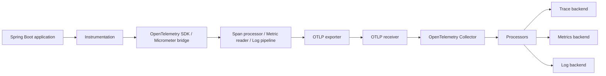

# What Is OTLP?

A Spring Boot application has already created spans, metrics, and logs in memory. Production observability systems typically live out-of-process: an OpenTelemetry Collector, a tracing backend, a metrics platform, or a log backend. The application needs a unified protocol to transfer telemetry to those components. **OTLP (OpenTelemetry Protocol)** is the data transmission protocol of OpenTelemetry, defining how traces, metrics, and logs are encoded and sent between SDKs, Collectors, and compatible backends.

OTLP solves the **telemetry transport** part. It does not create spans on its own, does not decide which requests are sampled, is not a trace database, and is not a dashboard. Those responsibilities belong to instrumentation, the SDK/sampler, the Collector, and the backend. Understanding this boundary helps diagnose accurately when an application generates traces that the Collector does not receive, or when the Collector receives them successfully but the backend does not display them.

This lesson belongs to the **OTLP export** chapter of the **SPRING_BOOT_OBSERVABILITY** module. The module teaches how to set up observability for Spring Boot using Micrometer Observation, metrics, logs, and distributed tracing; covering context propagation, tags/cardinality, exporters, sampling, and signal correlation to investigate errors, latency, and application behavior in real environments. This lesson presents OTLP from its data model and transport to exporter configuration, Collector pipelines, security, operations, and verification.

## Learning Objectives

After this lesson, you will be able to:

1. Explain OTLP and distinguish this protocol from the OpenTelemetry API/SDK, exporter, Collector, and backend.
2. Recognize how traces, metrics, and logs are transmitted over OTLP.
3. Distinguish OTLP/gRPC from OTLP/HTTP and understand commonly used ports and paths.
4. Explain how an exporter moves telemetry out of the application and how the Collector receives, processes, and routes data.
5. Understand batching, queues, retries, timeouts, backpressure, and scenarios where telemetry is dropped.
6. Configure endpoints and protocols according to the appropriate Spring Boot/Micrometer or OpenTelemetry Java Agent model.
7. Verify resource attributes, signal-specific endpoints, TLS, and authentication.
8. Distinguish sampling from export and ingestion/storage.
9. Troubleshoot OTLP issues from the application to the Collector/backend.
10. Roll out OTLP export to production with controlled capacity, privacy, cardinality, monitoring, and rollout practices.

## 1. Where Does OTLP Fit in the OpenTelemetry Architecture?

A common pipeline:



| Component | Responsibility | Example |
|---|---|---|
| Instrumentation | Creates telemetry from code/frameworks | HTTP span, DB operation, business Observation |
| API/SDK | API and lifecycle, sampling, processing | OTel TracerProvider, MeterProvider |
| Exporter | Transfers processed telemetry out | OTLP trace exporter |
| OTLP | Format/protocol for transmitting telemetry | gRPC or HTTP/protobuf |
| Receiver | Accepts OTLP payloads | Collector OTLP receiver |
| Collector processor | Batches, transforms, filters, routes | batch, memory_limiter |
| Backend exporter | Sends to target systems | Trace/metrics/log exporter |
| Backend | Storage, querying, dashboards, alerting | Trace store, metrics TSDB |

**OTLP is the protocol contract between sender and receiver.** Exporters use OTLP to send payloads; receivers must support the matching transport and signal. A Collector often decouples the application from backend details, though exporters can also send directly to a compatible OTLP endpoint.

### 1.1. OTLP Is Not the OpenTelemetry SDK

The SDK records telemetry and provides processors/readers/exporters. OTLP is only one protocol option for transporting data. An application using the SDK can use other exporters; a Collector can receive OTLP and then export to other protocols/backends.

### 1.2. OTLP Does Not Perform Context Propagation

The HTTP `traceparent` header, B3 headers, or message headers carry trace context between services. That is **context propagation**. OTLP carries recorded telemetry data to the Collector/backend. Do not confuse business request headers with OTLP export requests.

## 2. What Data Is Transmitted Over OTLP?

OTLP supports three primary signals.

### 2.1. Traces

Trace data is organized into resource spans, scope spans, and spans. A span typically has a trace ID, span ID, parent span ID or appropriate relationship, name, kind, start/end timestamps, attributes, events, links, and status.

```text
Resource:
  service.name = checkout-service
  service.version = 1.42.0

Instrumentation scope:
  name = checkout.payment

Span:
  trace_id = 0af765...
  span_id = b7ad6b...
  name = payment.authorize
  kind = INTERNAL
  start_time = ...
  end_time = ...
  attributes:
    payment.provider = provider-a
  status = OK
```

Trace ID/span ID are correlation identifiers. Do not turn them into regular metric labels because cardinality increases rapidly.

### 2.2. Metrics

Metrics data contains resource/scope metadata and metric points such as sum/counter, gauge, histogram, or exponential histogram when supported by the SDK/backend. A metric point can carry attributes, timestamp, aggregation temporality, and values according to the instrument type.

OTLP metrics are not synonymous with Prometheus scraping. A system can scrape a Prometheus endpoint while also exporting OTLP metrics, but it must avoid duplicate ingestion or two sources producing the same metric name with different semantics.

### 2.3. Logs

An OTel log record can carry timestamp, observed timestamp, severity, body, attributes, resource, instrumentation scope, and trace ID/span ID when the log is correlated with context.

Spring Boot can continue using Logback/SLF4J. Sending logs over OTLP requires a logging integration/appender/agent or an appropriate pipeline; adding a trace OTLP exporter does not automatically export Logback events.

### 2.4. Resource and Instrumentation Scope

**Resource** describes the entity emitting telemetry, typically including service name/version, environment, or process attributes. **Instrumentation scope** describes the library/module that produced the telemetry.

Resource identifies which service emitted a span and which deployment version emitted a metric; scope identifies the instrumentation library/version. Do not put request-specific IDs into resource because resource has a broader scope than individual requests.

## 3. OTLP/gRPC and OTLP/HTTP

OTLP has two common transports: gRPC and HTTP with protobuf payloads.

| Property | OTLP/gRPC | OTLP/HTTP |
|---|---|---|
| Transport | gRPC | HTTP |
| Payload | Protobuf messages | Protobuf over OTLP/HTTP |
| Common default port | 4317 | 4318 |
| Signal endpoints | Corresponding RPC service | Separate path per signal |
| Network | Requires compatible gRPC/HTTP2 | Usually passes through HTTP proxies/gateways more easily |
| Choose when | Infrastructure supports gRPC | Network/API gateway prefers HTTP |

4317 and 4318 are the common default ports of the Collector OTLP receiver; deployments can change ports. **Do not infer the protocol solely from the port**: verify the actual receiver and the exporter being used.

### 3.1. OTLP/HTTP Endpoints

Common signal paths:

```text
/v1/traces
/v1/metrics
/v1/logs
```

Example traces endpoint:

```text
http://otel-collector:4318/v1/traces
```

Metrics and logs have their own paths when exported over OTLP/HTTP. Some exporters accept a base endpoint and append the signal path automatically; other exporters require the full endpoint. Behavior depends on the SDK/framework integration.

### 3.2. gRPC Services

With OTLP/gRPC, signals go through their corresponding RPC services instead of the HTTP paths above. The exporter typically points to the Collector host/port. Do not copy the `/v1/traces` path into a gRPC endpoint.

### 3.3. Content Type and Encoding

OTLP/HTTP protobuf typically uses a protobuf content type such as `application/x-protobuf`; response/error formats and compression depend on the protocol/spec/version. Do not send arbitrary JSON to a protobuf endpoint and expect the receiver to understand it automatically. To test with an HTTP client, use a valid protobuf payload or an appropriate exporter/test tool.

## 4. What Does the Exporter Do in an Application?

The exporter is the component that transports telemetry from the SDK/framework integration to the destination. For tracing, spans are typically passed to the exporter after ending and going through a processor; for metrics, a reader/scheduler collects and exports periodically; logs have their own pipeline.

```text
Application creates span
        |
        v
SpanProcessor receives span end
        |
        v
Batch processor queues span
        |
        v
OTLP exporter serializes and sends
        |
        v
Collector receiver accepts request
```

The exporter is typically responsible for OTLP serialization, sending over gRPC/HTTP, endpoint, headers, TLS, timeouts, and integrating with batching/retry according to the SDK. The exporter does not guarantee successful backend storage. An HTTP success or gRPC success from the Collector only proves the receiver accepted the request; downstream processors/exporters can still drop or fail.

### 4.1. Batch Export

Sending a network request for every single span can create high overhead. A batch processor groups spans together and then exports them. Batching reduces request overhead but adds latency before data appears in the backend.

Parameters to consider: batch size, max queue size, scheduled delay, export timeout, retry/backoff if supported, and shutdown/flush timeout. Property names and defaults vary by SDK, Java Agent, and framework.

### 4.2. Full Queue and Dropped Data

If the Collector is slow, the network is disrupted, or the backend stops accepting data, the exporter queue can grow. When the limit is reached, new data may be dropped depending on the policy. Do not increase the queue unboundedly: a huge queue only delays data loss and increases memory pressure.

Monitor queue utilization, export failures, dropped spans, and Collector capacity.

### 4.3. Shutdown and Flush

When an application shuts down, the SDK/exporter may need to flush pending data. Containers killed immediately, overly short shutdown timeouts, or process crashes can lose unsent batches. Design an appropriate termination grace period, verify the SDK/Spring lifecycle, and do not assume a process crash can still flush.

## 5. Configuring OTLP Export in Spring Boot

A common integration approach is using Spring Boot Actuator with the Micrometer Tracing OTel bridge and an OTLP exporter.

Example Gradle configuration:

```groovy
dependencies {
    implementation 'org.springframework.boot:spring-boot-starter-actuator'
    implementation 'io.micrometer:micrometer-tracing-bridge-otel'
    runtimeOnly 'io.opentelemetry:opentelemetry-exporter-otlp'
}
```

Use versions managed by the Spring Boot/Micrometer BOM. Do not arbitrarily add the Brave bridge alongside the OTel bridge. The dependencies above illustrate the tracing path; OTLP metrics and logs require appropriate integrations/exporters.

### 5.1. Configuring Spring Boot Properties

Example configuration for sending traces over OTLP/HTTP:

```yaml
spring:
  application:
    name: checkout-service

management:
  tracing:
    sampling:
      probability: 0.10

  otlp:
    tracing:
      endpoint: http://otel-collector:4318/v1/traces
```

**Property prefixes and endpoint semantics depend on the Spring Boot/Micrometer version.** Check the reference configuration for your exact version. The example illustrates a Spring Boot version that supports `management.otlp.tracing.endpoint`, not a universal YAML format shared across all OTel SDKs.

`sampling` `probability` `0.10` is head sampling in supported Micrometer Tracing configuration; it is not part of the OTLP protocol and does not control metrics/log sampling.

### 5.2. Configuring the OpenTelemetry Java Agent

```bash
OTEL_SERVICE_NAME=checkout-service
OTEL_EXPORTER_OTLP_PROTOCOL=http/protobuf
OTEL_EXPORTER_OTLP_ENDPOINT=http://otel-collector:4318
OTEL_TRACES_SAMPLER=parentbased_traceidratio
OTEL_TRACES_SAMPLER_ARG=0.10
java -javaagent:/opt/otel/opentelemetry-javaagent.jar -jar app.jar
```

This is the Java Agent/OTel SDK autoconfiguration model. The base endpoint may be used by the exporter to construct signal paths; signal-specific endpoints can override the shared endpoint. Verify the agent version and receiver protocol. Do not mix OTel Agent environment variable names with Spring Boot properties without identifying the configuration source.

### 5.3. Resource Attributes

```text
service.name=checkout-service
service.version=1.42.0
deployment.environment.name=production
service.instance.id=pod-7f9c
```

Semantic convention names depend on the version. Align resource metadata across the app, Agent, and Collector. Do not use trace ID, order ID, or user ID as resource attributes.

## 6. Configuring the OpenTelemetry Collector to Receive OTLP

The Collector has an OTLP receiver for gRPC and HTTP. Conceptual example:

```yaml
receivers:
  otlp:
    protocols:
      grpc:
        endpoint: 0.0.0.0:4317
      http:
        endpoint: 0.0.0.0:4318

processors:
  memory_limiter:
    check_interval: 1s
    limit_mib: 512
  batch:
    timeout: 5s
    send_batch_size: 1024

exporters:
  debug:
    verbosity: basic

service:
  pipelines:
    traces:
      receivers: [otlp]
      processors: [memory_limiter, batch]
      exporters: [debug]
    metrics:
      receivers: [otlp]
      processors: [memory_limiter, batch]
      exporters: [debug]
    logs:
      receivers: [otlp]
      processors: [memory_limiter, batch]
      exporters: [debug]
```

This configuration illustrates a Collector distribution that includes the corresponding components. Schemas change by distribution/version. The debug exporter is for inspection, **not long-term telemetry storage**.

### 6.1. Receiver, Processor, and Exporter

A receiver listens on a protocol/port, accepts payloads, and passes them into a signal pipeline. Only open the necessary listeners and restrict network sources.

Processors can batch, limit memory, adjust resource/attributes, filter, transform, or tail-sample when supported by the configuration. Processor order affects the outcome; redaction must run before data crosses a trust boundary.

Collector exporters send data to backends. If a pipeline has multiple exporters, observe the outcome of each destination separately.

### 6.2. Separate Signal Pipelines

The Collector declares independent pipelines for traces, metrics, and logs. Each pipeline has its own receivers, processors, and exporters. Enabling the traces pipeline does not mean the metrics/logs pipelines automatically work.

## 7. Protocol, Endpoint, and Network Troubleshooting

| Symptom | Possible Cause | How to Check |
|---|---|---|
| Connection refused | Collector not running or wrong port | Listener, DNS, network policy |
| Timeout | Slow network/proxy or overloaded Collector | Latency, firewall, queue, CPU/memory |
| HTTP 404 | Wrong path or using a UI URL | Signal path and OTLP receiver |
| HTTP 415 | Unsupported content type/encoding | OTLP/HTTP protobuf config |
| HTTP 401/403 | Wrong credentials or missing permissions | Auth extension, headers, secret |
| gRPC UNAVAILABLE | Wrong endpoint/port or gRPC not enabled | Receiver protocol, TLS, HTTP/2, DNS |
| TLS handshake failure | Wrong scheme/certificate/trust chain | CA, SAN, TLS, mTLS |
| Collector receives but backend is empty | Processor/exporter/storage/query | Collector logs/metrics, backend ingest |
| Only one signal is missing | Signal-specific pipeline/endpoint | Separate traces/metrics/logs exporter |

### 7.1. Do Not Test gRPC With an HTTP Path

OTLP/gRPC uses RPC services, not `/v1/traces` like OTLP/HTTP. Sending a browser request to a gRPC endpoint is not a valid check. Use a protocol-aware client/tool or inspect exporter logs and Collector receiver metrics.

### 7.2. Network Namespaces and Proxies

Inside a container, `localhost` points to the container/network namespace itself. If the Collector is another container or Kubernetes Service, use the appropriate network DNS/service name.

An HTTP proxy might support OTLP/HTTP but not support gRPC/HTTP2 in the way the exporter requires. A gateway might strip auth headers, rewrite paths, or limit body sizes; inspect each hop.

## 8. Export, Sampling, and Context Propagation Are Three Different Things

- **Context propagation:** passes trace context to the next service/thread.
- **Sampling:** decides whether a trace/span is recorded according to policy.
- **Export:** transfers recorded telemetry to the Collector/backend over OTLP.
- **Storage:** the backend persists the data and serves queries.

| Scenario | Interpretation |
|---|---|
| Outbound HTTP has `traceparent` but no span in backend | Context was injected; sampling/export/storage could still fail |
| Span has correct parent in in-memory test but backend is empty | Propagation works; check exporter/Collector |
| Collector receives traces but downstream has a new trace ID | Export to Collector works; propagation may be misconfigured |
| Metrics exist but traces are missing | Different signal pipelines/sampling/exporters |
| Log has trace ID but trace is not found | Log correlation does not prove the trace was stored |

A trace dropped by sampling in the application cannot be recovered by the Collector if the span was never sent. Conversely, a recorded trace can still fail at the exporter or backend.

## 9. Batching, Retry, Timeout, and Backpressure

OTLP export typically runs asynchronously/in batches to reduce overhead.

**Batch size and schedule delay:** larger batches can reduce network overhead but increase memory usage and pre-export latency. Longer schedule delays can group batches better, but traces appear later.

**Timeout:** too short a timeout drops valid send attempts during high network/backend latency; too long keeps the queue occupied and slows down shutdown.

**Retry and backoff:** retries recover from transient failures but can add load when the backend is already overloaded. Use exponential backoff/jitter and bound retries/queues according to the actual exporter.

**Backpressure:** when telemetry generation rate exceeds export rate, the queue grows; a full queue can cause telemetry to be dropped.

Monitor queue utilization, enqueue failure/drop counters, export latency, Collector receiver refused data, exporter send failures, and Collector memory. Telemetry loss must be an alertable signal.

## 10. TLS, Authentication, and Headers

OTLP frequently traverses networks between applications, Collectors, and backends. In production:

- Use TLS or mTLS if the infrastructure requires mutual identity.
- Use an authentication mechanism supported by the Collector/backend.
- Manage API keys/tokens via a secret store; do not commit them into source code or YAML.
- Restrict network receivers to authorized workloads only.
- Configure CA/truststores with the correct certificate chain.
- Define additional headers for tenant routing, but do not put credentials into resource/span attributes.
- Ensure credential/certificate rotation does not unexpectedly disrupt export.

OTLP exporter headers are for authentication/routing to the Collector/backend. Baggage is context metadata propagated across service calls. Do not use one mechanism in place of the other, and do not copy secrets into baggage.

The Collector receiver is a network surface. Do not expose OTLP endpoints more broadly than needed; enable appropriate auth/TLS and monitor rates/sizes to avoid junk telemetry or spiked ingest costs.

## 11. Resource Metadata, Semantic Conventions, and Cardinality

| Metadata | Example | Scope |
|---|---|---|
| Resource | `service.name=checkout-service` | Service/process |
| Instrumentation scope | Library name/version | Instrumentation |
| Span attributes | `http.request.method=POST` | One operation |
| Metric attributes | `http.route=/orders/{id}` | Metric dimension |
| Log attributes | `event.name=payment.timeout` | One log record |

Service names must be stable. Routes should use templates, not raw paths containing order IDs. Metric attributes need low cardinality; span attributes can be richer, though they still carry index/storage costs and privacy risks.

Do not attach trace IDs to metric labels to correlate data. Use trace/log correlation or exemplars when supported by the backend.

Semantic conventions can change across versions. When upgrading OTel instrumentation/agents, compare attribute names and instrument changes so dashboards/queries do not break.

## 12. Verifying OTLP Export End-to-End

A pipeline-based verification checklist:

1. **Instrumentation:** does the application create the spans/metrics/logs that need to be exported?
2. **SDK/provider:** is the right SDK/bridge/provider active?
3. **Sampler:** was the trace selected for recording?
4. **Processor/reader:** has the span ended, has the metric reader collected, and has the log pipeline received the record?
5. **Exporter:** is the signal wired to the right OTLP exporter?
6. **Protocol:** HTTP/protobuf or gRPC; has the Collector enabled the corresponding receiver?
7. **Endpoint:** are hostname, port, and signal path correct?
8. **Security:** are TLS, CA, auth headers, and network policies correct?
9. **Collector:** did the receiver accept it, and did processors avoid unexpected drops?
10. **Backend exporter:** did the Collector send it out successfully?
11. **Backend:** are you querying the right service, signal, and time range?
12. **Shutdown:** are pending batches flushed during normal shutdown?

### 12.1. Testing With a Controlled Trace

In tests:

- Configure a deterministic sampler to keep the trace under test.
- Send a request across at least two services.
- Record the trace ID in the test context.
- Confirm client/server spans share the same trace ID.
- Confirm the Collector receives the OTLP payload.
- If testing the backend, query the trace and assert span names/parent relationships.
- Trigger an error to verify exceptions/status are exported when policy allows.

Not every unit test needs to run a real Collector. Use an in-memory exporter/test tracer for most tests; keep a few E2E tests for protocol/backend verification.

### 12.2. Signal-by-Signal Testing

Successful trace export does not prove metrics/logs are exported. If metrics are missing, inspect the separate reader/exporter/pipeline. If logs are missing, inspect the logging integration/appender. Do not infer all three signals work from a single signal.

## 13. Real-World Scenario: Application Records Traces, Collector Does Not Receive Them

A checkout application has spans in in-memory tests. When running on Kubernetes, the backend shows no new traces:

- HTTP requests succeed.
- Logs contain trace IDs.
- A tracing exporter is configured.
- The backend finds no traces.
- Collector metrics show the receiver received no requests from checkout.

### Investigation Workflow

**Step 1 — Verify protocol.** Is the application sending OTLP/HTTP or gRPC? Has the Collector opened the matching receiver? A gRPC exporter pointing at an HTTP port can fail.

**Step 2 — Verify endpoint.** Are the service DNS and port correct? `localhost` inside the checkout Pod may point to the Pod itself instead of the Collector Service.

**Step 3 — Check exporter errors.** Look for connection refused, timeout, UNAVAILABLE, TLS, or HTTP status errors; do not look only at business logs.

**Step 4 — Check network/TLS/auth.** NetworkPolicy, service mesh, certificate SAN/CA, or auth headers may be blocking requests.

**Step 5 — Verify receiver.** Once the receiver begins receiving traffic, check accepted/refused telemetry and whether the traces pipeline is declared.

**Step 6 — Trace processor/exporter.** If the Collector receives data but the backend sees nothing, inspect batch, memory limiter, filter, routing, and backend exporter settings.

**Step 7 — Query the right place.** Search by exact service name/resource and time window; do not confuse Collector debug output with persistent backend storage.

Logs having trace IDs and in-memory spans only prove the application had context/telemetry at the point of observation. The Collector not receiving anything indicates you should check transport, endpoint, and network first. Only after the receiver accepts data should you investigate processors/backend exporters.

## 14. Anti-Patterns to Avoid

| Anti-pattern | Consequence | Recommended Approach |
|---|---|---|
| Treating OTLP as a backend | Confusing protocol with storage/query | Separate exporter, Collector, and backend |
| Pointing a gRPC exporter at an HTTP receiver | Protocol mismatch | Match exporter and receiver |
| Sending OTLP/HTTP to a UI path | 404/405 or no ingestion | Use the signal ingestion endpoint |
| Copying `/v1/traces` into a gRPC endpoint | Wrong RPC endpoint | Use the gRPC host/port |
| Using `localhost` inside a container for an external Collector | Wrong network namespace | Use DNS/service name |
| Configuring only the traces pipeline | Metrics/logs do not export | Separate pipeline per signal |
| Increasing the queue unboundedly | Memory pressure, only delays drops | Capacity planning and queue limits |
| Retrying infinitely when the backend is overloaded | Amplifies incidents | Backoff, timeout, and bounded queue |
| Assuming HTTP 200 means the backend saved it | Ignores Collector processors/exporters | Check the entire pipeline |
| Sampling 100% indefinitely | High volume/cost | Policy aligned with budget |
| Attaching trace ID as a metric label | Cardinality explosion | Exemplars or log correlation |
| Putting tokens into OTLP resource/spans | Secret leakage | Auth headers/secret store and redaction |
| Monitoring only the app, not the Collector | Silent telemetry loss | Dashboards for exporter/Collector drops |
| Not flushing during normal shutdown | Loss of pending batches | Graceful shutdown and flush timeout |

## 15. Production Checklist for OTLP Export

1. **Protocol:** Is OTLP/gRPC or OTLP/HTTP explicitly chosen and compatible with the receiver?
2. **Endpoint:** Are hostname, port, and signal path correct; not confused with a UI URL?
3. **Dependency:** Are exporter/runtime versions compatible with Spring Boot, Micrometer, and OTel SDK?
4. **Signals:** Do traces, metrics, and logs have separate exporters/integrations and Collector pipelines?
5. **Resource:** Are service name/version/environment consistent across app, Agent, and Collector?
6. **Sampling:** Is the policy intentional and not confused with export?
7. **Batching:** Are batch size, delay, and queue suited to throughput/latency?
8. **Timeout/retry:** Are they bounded, with backoff, and not amplifying overload?
9. **Shutdown:** Does the application have enough time to flush during normal termination?
10. **Network:** Are DNS, ports, proxies, NetworkPolicy, and HTTP/2/gRPC verified?
11. **Security:** Are TLS/mTLS, authentication, CA, secret rotation, and receiver exposure secure?
12. **Collector:** Are receivers, processors, memory limiter, and exporters observed?
13. **Backend:** Are ingest capacity, persistence, query, retention, and access control appropriate?
14. **Cardinality/privacy:** Are attributes allowlisted; no trace ID metric labels or unnecessary PII?
15. **Monitoring:** Are export failures, queue/drops, Collector refused data, and backend failures alerted on?
16. **Testing:** Are context, sampler, protocol, ingestion, and backend queries tested separately?
17. **Rollout:** Are canary, rollback endpoint/config, and ownership clearly defined?

## 16. Self-Assessment Questions

**Question 1.** What is OTLP?

**Hint:** The OpenTelemetry protocol used to transmit traces, metrics, and logs between exporters, Collectors, and compatible backends.

**Question 2.** Does OTLP create spans in Spring Boot by itself?

**Hint:** No. Instrumentation and the API/SDK create telemetry; OTLP transports the data.

**Question 3.** How do OTLP/gRPC and OTLP/HTTP differ?

**Hint:** They differ in transport/encoding envelope and endpoint usage. Common ports are 4317 for gRPC and 4318 for HTTP, though you must check the actual receiver.

**Question 4.** What is the common OTLP/HTTP traces endpoint?

**Hint:** `/v1/traces`; metrics and logs use `/v1/metrics` and `/v1/logs`.

**Question 5.** Does the Collector returning HTTP 200 prove the backend stored the trace?

**Hint:** No. Downstream processors/exporters can still filter, drop, or fail.

**Question 6.** Why might traces exist while metrics do not?

**Hint:** Signals have separate readers/exporters/pipelines. Check metrics instrumentation, exporter, endpoint, and the Collector metrics pipeline.

**Question 7.** Does 10% trace sampling mean OTLP exports 10%?

**Hint:** Not strictly. Sampling decides trace recording in the SDK; OTLP export transports recorded data. The pipeline can also drop data at other layers.

**Question 8.** Why should the exporter queue not grow unboundedly?

**Hint:** Large queues increase memory pressure and only delay drops when telemetry creation outpaces sending.

**Question 9.** When using OTLP/HTTP in Kubernetes, why might `localhost` be wrong?

**Hint:** `localhost` points to the application's network namespace; a Collector in another Service/Pod needs the appropriate hostname/port.

**Question 10.** What should be used to correlate a metric with a trace instead of a trace ID label?

**Hint:** Log correlation or exemplars if the metrics backend supports them.

## Conclusion

**OTLP is OpenTelemetry's telemetry transport protocol for traces, metrics, and logs.** In Spring Boot, instrumentation and the Micrometer/OTel SDK generate data; an exporter sends it over OTLP/gRPC or OTLP/HTTP; and a Collector can receive, process, and route it to backends. To operate reliably, match protocols, endpoints, and signal pipelines; manage batching/queues/timeouts/retries/shutdown; secure TLS/auth and sensitive data; and monitor drops from the exporter through the Collector/backend. Sampling, context propagation, export, and storage are separate layers that must be verified independently before concluding telemetry has arrived and can be used for incident investigation.
