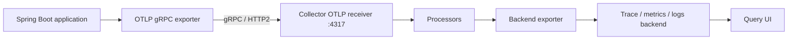
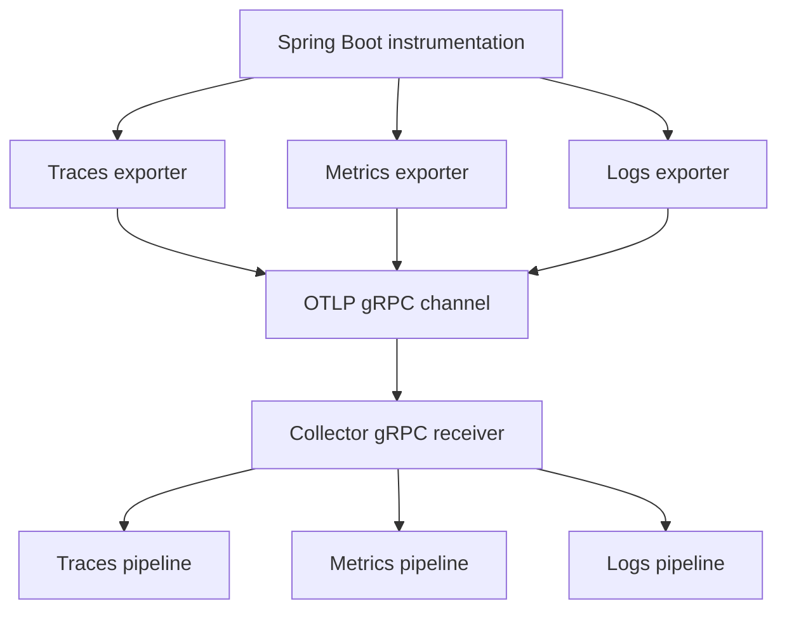

# OTLP gRPC Endpoints in Spring Boot Observability

An **OTLP gRPC endpoint** is the address of a service receiving telemetry over the gRPC protocol according to the OpenTelemetry Protocol (OTLP). A Spring Boot application can export spans, metrics, or logs through a corresponding exporter to an OpenTelemetry Collector or an OTLP/gRPC-capable backend. This endpoint belongs to the data transport path; it is not a trace search UI or dashboard.

In the **SPRING_BOOT_OBSERVABILITY** module, Micrometer Observation and Micrometer Tracing generate observability data at the application level. Exporters transfer that data to its destination. This lesson belongs to the **OTLP export** chapter, focusing on understanding and configuring gRPC endpoints, differences from OTLP/HTTP, ports and transport, compatible Spring Boot/Micrometer configurations, OpenTelemetry Java SDK examples, Collectors, TLS/authentication, Kubernetes networking, and diagnosing export failures.

## 1. What Are OTLP and a gRPC Endpoint?

**OpenTelemetry Protocol (OTLP)** is the standard protocol used to transmit telemetry from an SDK/exporter to a receiver. OTLP supports multiple signals:

- **Traces:** spans and relationships between spans.
- **Metrics:** measurements, aggregations, and metadata.
- **Logs:** log records along with Resource and attributes.

OTLP can be transmitted over common transports: **gRPC** and **HTTP**. An OTLP/gRPC endpoint is a receiver supporting OTLP gRPC services over HTTP/2.



In the diagram, Spring Boot produces telemetry, the exporter sends data, the Collector receives and forwards it, and the backend stores/serves queries. A backend may expose its own OTLP receiver and bypass the Collector; the exact architecture depends on the platform.

**An ingest endpoint is not a query endpoint.** Client exporters send telemetry to the receiver; to view traces or metrics, use the backend's UI/query API.

## 2. Distinguishing OTLP/gRPC From OTLP/HTTP

Both transports share the goal of transmitting OTLP, yet their connections and endpoint formats differ.

| Criterion | OTLP/gRPC | OTLP/HTTP |
| --- | --- | --- |
| Transport | gRPC over HTTP/2 | HTTP request/response |
| Common default port | 4317 | 4318 |
| Protocol | gRPC OTLP services | OTLP/HTTP |
| Traces | gRPC service/method | POST typically to `/v1/traces` |
| Metrics | gRPC service/method | POST typically to `/v1/metrics` |
| Logs | gRPC service/method | POST typically to `/v1/logs` |
| Content type | gRPC framing/protocol | Protobuf or JSON per configuration |
| Proxy/network | Requires HTTP/2 and gRPC passthrough/compatible proxy | Requires appropriate HTTP routing |
| Manual debugging | Use gRPC-aware tools/SDKs | Can inspect HTTP status/headers |

Ports 4317 and 4318 are common OTLP default ports, though they can be changed in the receiver config. Do not infer that a service supports gRPC merely because port 4317 is open; verify that the receiver actually enables that protocol.

### 2.1. Do Not Append `/v1/traces` to a gRPC Endpoint

Example gRPC endpoint:

```text
otel-collector:4317
```

Example OTLP/HTTP traces:

```text
http://otel-collector:4318/v1/traces
```

These are two different endpoint formats. OTLP/gRPC selects a service/method via the gRPC protocol and does not use the REST path `/v1/traces` of OTLP/HTTP.

When an SDK requires a URI-formatted endpoint, a scheme such as `http://` or `https://` may be required depending on the API and secure channel. When an SDK expects hostname/port or a gRPC target, pass the exact form specified by its constructor. Read the API docs for the exporter/version you use rather than copying an HTTP endpoint string into a gRPC configuration.

### 2.2. Protobuf Does Not Make the Two Transports Identical

OTLP typically serializes telemetry with Protocol Buffers. However, **gRPC transport and OTLP/HTTP protobuf transport remain two distinct framing and exchange mechanisms**. You cannot take an OTLP/HTTP protobuf body and send it straight to a gRPC endpoint using a plain HTTP POST.

## 3. Endpoint Format and Connection Components

A gRPC endpoint typically specifies:

- Hostname or DNS name of the receiver.
- Port the receiver listens on.
- Whether TLS or plaintext is used in a lab network.
- Authentication mechanism and metadata/headers if required by the backend.
- HTTP/2 connectivity across service mesh, ingress, proxy, or load balancer.

Example inside an internal container network:

```text
otel-collector:4317
```

Example when using TLS and DNS:

```text
https://otel-gateway.example.internal:4317
```

The hostname here is illustrative. Use a DNS name resolvable by the application and a certificate whose SAN matches the hostname.

### 3.1. Host and Port Must Be Viewed From the Application Side

If Spring Boot runs in a container, `localhost:4317` usually points to the Spring Boot container itself. It does not automatically point to an adjacent Collector container.

- Docker Compose: use the service name on the same network.
- Kubernetes: use a Service DNS reachable under the namespace/network policy.
- VM/host: use a hostname/IP with appropriate routing and firewall rules.
- Managed backend: use the provider-supplied endpoint and check TLS/auth requirements.

### 3.2. DNS, Authority, and TLS Name

gRPC uses HTTP/2; TLS can validate server certificates against the hostname. When connecting through a load balancer or proxy, ensure authority/server name is preserved properly and certificates are valid. Do not resolve certificate errors by disabling TLS verification in production.

## 4. Using OpenTelemetry Collector as a gRPC Receiver

The Collector centralizes receiving and processing telemetry from multiple services. A pipeline consists of:

1. **Receiver:** accepts OTLP/gRPC.
2. **Processor:** batches, limits memory, filters, or handles metadata/sampling per configuration.
3. **Exporter:** sends data onward to the backend.

Example lab Collector config receiving traces over gRPC and writing debug output:

```yaml
receivers:
  otlp:
    protocols:
      grpc:
        endpoint: 0.0.0.0:4317

processors:
  batch: {}

exporters:
  debug:
    verbosity: basic

service:
  pipelines:
    traces:
      receivers: [otlp]
      processors: [batch]
      exporters: [debug]
```

This is a lab example. The debug exporter shows that the Collector received and processed spans at the pipeline level, but it is **not long-term trace storage and does not provide a trace query UI**.

Notes:
- Components must match your Collector distribution/version.
- Binding `0.0.0.0` makes the receiver listen on all network interfaces; restrict network access and protect the receiver.
- To receive metrics/logs as well, add the corresponding pipelines.
- Monitor connections, spans/second, and batch sizes.

### 4.1. Forwarding to a Backend via OTLP/gRPC

Example OTLP/gRPC exporter for a backend with a receiver at `trace-backend:4317`:

```yaml
exporters:
  otlp/traces_backend:
    endpoint: trace-backend:4317
    tls:
      insecure: true  # Lab only

service:
  pipelines:
    traces:
      receivers: [otlp]
      processors: [batch]
      exporters: [otlp/traces_backend]
```

This is a configuration snippet augmenting a Collector file where receivers/processors are already defined. TLS and exporter fields may differ by Collector version/distribution. `insecure: true` only illustrates plaintext/lab usage; production requires proper TLS and authentication.

Do not take exporter/option names from another Collector distribution and assume the running binary includes that component. Check the component inventory and startup logs.

## 5. Spring Boot, Micrometer Tracing, and OTLP/gRPC Support

This is the most important part to pay attention to during integration. Spring Boot can auto-configure Micrometer Tracing and an OTLP exporter, yet **not every OTLP endpoint property in Spring Boot uses gRPC**.

Some Spring Boot versions/integrations configure OTLP tracing using an endpoint property meant for **OTLP/HTTP**. Therefore, do not put port 4317 into an HTTP endpoint property and assume the exporter switched to gRPC. You must verify the transport of the exporter that the actual dependencies instantiate.

### 5.1. Common Dependencies

Example for Spring Boot 3.x using the Micrometer Tracing bridge with OpenTelemetry:

```xml
<dependencies>
    <dependency>
        <groupId>org.springframework.boot</groupId>
        <artifactId>spring-boot-starter-actuator</artifactId>
    </dependency>
    <dependency>
        <groupId>io.micrometer</groupId>
        <artifactId>micrometer-tracing-bridge-otel</artifactId>
    </dependency>
    <dependency>
        <groupId>io.opentelemetry</groupId>
        <artifactId>opentelemetry-exporter-otlp</artifactId>
    </dependency>
</dependencies>
```

Use Spring Boot dependency management/BOM to lock compatible versions. The `opentelemetry-exporter-otlp` artifact provides OpenTelemetry's OTLP exporter; which exporter Spring Boot auto-creates, which transport it uses, and how configuration is read must be verified per version.

### 5.2. Configuring an HTTP Endpoint Is Not Configuring gRPC

An example OTLP/HTTP configuration in Spring Boot looks like:

```yaml
management:
  otlp:
    tracing:
      endpoint: http://otel-collector:4318/v1/traces
```

The configuration above illustrates **OTLP/HTTP traces**. Do not change the URL to `http://otel-collector:4317` and call it gRPC. gRPC requires a compatible gRPC exporter/transport and a receiver supporting HTTP/2 gRPC.

If your Spring Boot version provides a dedicated transport/protocol property for OTLP gRPC, use the exact property documented for that version. If there is no matching gRPC auto-configuration, configure an SDK exporter or custom integration suited to your application architecture.

### 5.3. Distinguishing Micrometer Metrics Exporters From Tracing Exporters

| Dependency/Component | Primary Signal/Function |
| --- | --- |
| `micrometer-tracing-bridge-otel` | Bridge between Micrometer Tracing and OpenTelemetry |
| `opentelemetry-exporter-otlp` | OTLP exporter of the OpenTelemetry SDK |
| `micrometer-registry-otlp` | Exports Micrometer metrics via OTLP |
| `micrometer-registry-prometheus` | Exposes Micrometer metrics via Prometheus exposition |
| OpenTelemetry Collector | Receiver, processors, and exporters independent of the application |

Adding `micrometer-registry-otlp` does not automatically enable distributed tracing. Adding the tracing bridge does not mean metrics are sent over OTLP either. Verify each signal pipeline independently.

## 6. OpenTelemetry Java SDK Example With a gRPC Span Exporter

When Spring Boot/Micrometer auto-configuration does not provide the gRPC transport as required, one option is configuring the OpenTelemetry SDK and gRPC exporter directly. This is a custom SDK integration; avoid creating two tracing SDKs/providers alongside Micrometer Tracing without a clear bridging plan.

Illustrative Java example creating a gRPC span exporter and `TracerProvider`:

```java
import io.opentelemetry.api.trace.propagation.W3CTraceContextPropagator;
import io.opentelemetry.context.propagation.ContextPropagators;
import io.opentelemetry.exporter.otlp.trace.OtlpGrpcSpanExporter;
import io.opentelemetry.sdk.OpenTelemetrySdk;
import io.opentelemetry.sdk.resources.Resource;
import io.opentelemetry.sdk.trace.SdkTracerProvider;
import io.opentelemetry.sdk.trace.export.BatchSpanProcessor;

import java.time.Duration;

public final class OtelGrpcConfiguration {

    private OtelGrpcConfiguration() {
    }

    public static OpenTelemetrySdk create(String endpoint) {
        OtlpGrpcSpanExporter exporter =
                OtlpGrpcSpanExporter.builder()
                        .setEndpoint(endpoint)
                        .setTimeout(Duration.ofSeconds(10))
                        .build();

        SdkTracerProvider tracerProvider =
                SdkTracerProvider.builder()
                        .setResource(Resource.getDefault())
                        .addSpanProcessor(
                                BatchSpanProcessor.builder(exporter).build()
                        )
                        .build();

        return OpenTelemetrySdk.builder()
                .setTracerProvider(tracerProvider)
                .setPropagators(
                        ContextPropagators.create(
                                W3CTraceContextPropagator.getInstance()
                        )
                )
                .build();
    }
}
```

The endpoint passed to `OtlpGrpcSpanExporter` must follow the format supported by that exporter version, such as a compatible gRPC target like `http://otel-collector:4317` in a lab or a proper TLS endpoint in production. Check the SDK version's API documentation for exact scheme, channel, and certificate setup.

This snippet creates a standalone tracing SDK and does not automatically replace the `ObservationRegistry`/Micrometer Tracing managed by Spring Boot. If the application already uses the Micrometer bridge, choose a unified integration architecture. Do not let both the Boot exporter and a manual SDK export the same spans and cause duplicate ingestion.

### 6.1. Ensuring Shutdown and Flush

The batch exporter buffers spans before sending. On application shutdown, close the provider to flush and release resources:

```java
tracerProvider.close();
```

In Spring, tie the lifecycle to a bean/container so `close()` runs when the context shuts down. Providers/exporters should live for the application lifecycle, not be closed after every request.

## 7. Configuring TLS and Authentication

In production, OTLP/gRPC should run over TLS or mTLS per topology and policy. The backend/Collector may require authentication metadata, API keys, or tokens.

### 7.1. TLS

TLS enables the client to verify the server and encrypts transport. When TLS is enabled:
- Use a hostname with a valid certificate.
- The trust store must contain the required CA.
- Monitor certificate expiry and rotation.
- If using mTLS, the client must also have a valid certificate/key.
- Do not disable certificate validation to bypass configuration errors.

Collector/exporter TLS config depends on the component and version. Do not copy an HTTP TLS configuration into a gRPC exporter without checking the schema.

### 7.2. Authentication Metadata

gRPC can send metadata/headers supported by the exporter. Authentication mechanisms depend on the exporter/backend. Principles:
- Do not hardcode tokens in source code.
- Read secrets from a secret manager/environment injection.
- Do not log request metadata containing credentials.
- Scope credential permissions by signal/tenant.
- Have a rotation and expiry plan.
- Distinguish TLS from authentication: TLS protects the channel; authentication identifies the client.

### 7.3. Lab Plaintext vs. Production

In an isolated lab network, plaintext can be used to test connectivity. Do not treat `tls.insecure=true` as a production configuration. If a receiver is exposed outside the application network, apply appropriate authentication, network restrictions, and TLS.

## 8. DNS, Kubernetes, and Service Mesh

OTLP/gRPC frequently fails due to network path or HTTP/2 incompatibility rather than instrumentation.

### 8.1. Kubernetes Service DNS

Example Collector Service:

```yaml
apiVersion: v1
kind: Service
metadata:
  name: otel-collector
  namespace: observability
spec:
  selector:
    app: otel-collector
  ports:
    - name: otlp-grpc
      port: 4317
      targetPort: 4317
      protocol: TCP
```

From a pod in another namespace, the hostname may need the form `otel-collector.observability.svc.cluster.local`. The DNS name depends on cluster domain and namespace. Check `NetworkPolicy`, Service selectors, `EndpointSlices`, and Pod readiness.

### 8.2. Service Mesh and Ingress

Not every HTTP ingress/proxy supports gRPC forwarding by default. Ensure:
- HTTP/2 is supported along the path from client to receiver.
- The proxy does not downgrade gRPC to HTTP/1.1.
- Idle timeouts and max connection age are appropriate.
- TLS termination/passthrough does not conflict with client TLS.
- Health/readiness checks prevent routing connections to unready pods.

Even if TCP port 4317 is open, misrouted protocol settings in the mesh can cause client timeouts or handshake errors.

### 8.3. Load Balancing

A Collector Service can distribute connections across multiple replicas. However, long-lived gRPC connections can stick for a long time and distribute traffic unevenly across Collectors. Monitor per-replica ingestion, bound connection lifetimes, and choose an appropriate load-balancing strategy.

With tail sampling, ensure spans with the same Trace ID are routed to the same tail-sampling state processor by design; random connection-level load balancing can fragment traces across Collectors.

## 9. Exporter Batching, Timeouts, and Retries

Exporters typically do not send individual spans one by one. `BatchSpanProcessor` holds spans in a queue/buffer and sends batches on a schedule or when reaching a threshold.

| Parameter | Impact |
| --- | --- |
| Schedule delay | Wait time before sending a scheduled batch |
| Max export batch size | Maximum size of a batch |
| Max queue size | Number of spans that can wait in the queue |
| Export timeout | How long the exporter waits for one send attempt |
| Retry/backoff | How transient failures are handled if supported by the exporter |
| Shutdown flush | Attempts to send remaining buffered data on stop |

Property/API names and defaults depend on the OpenTelemetry SDK, exporter, and framework. Do not assume Java agent settings are identical to Micrometer bridge settings.

### 9.1. Timeouts and Backpressure

Too short a timeout causes exports to fail on slow networks. Too long a timeout holds threads/resources and causes the queue to back up when the receiver is unavailable. Monitor exporter queues, failed exports, Collector receivers, and backend ingest latency.

Not every exporter guarantees all spans are delivered across every outage. When receiver disruption outlasts the retry/queue window, data can be dropped. Unbounded retries can create backlogs, memory pressure, or traffic bursts after recovery.

Designs should define acceptable telemetry loss levels, retry budgets, queue capacity, Collector persistent queues if needed, shutdown timeouts, and alerts when exporters fail to send.

### 9.2. Graceful Shutdown

In Kubernetes, a pod can receive `SIGTERM` and then be terminated after the termination grace period. Give the application and exporter time to flush data; the grace period must align with actual shutdown duration.

Do not block request/worker threads indefinitely to flush. Observe shutdown logs and verify the number of spans sent during rollouts.

## 10. OTLP/gRPC for Traces, Metrics, and Logs

OTLP/gRPC can transport multiple signals, yet each signal requires its corresponding exporter/pipeline.



Not every Spring Boot/Micrometer setup automatically exports all three signals over OTLP/gRPC. Check each provider/exporter:

- Which span exporter does Micrometer Tracing have?
- Do metrics use a Prometheus registry or an OTLP registry?
- Do logs have an OpenTelemetry Logs SDK/appender, or only a separate logging backend?
- Does the Collector have receivers/exporters and pipelines for the matching signals?

An application can push traces via gRPC while exposing metrics via Prometheus pull and shipping logs through another pipeline. Do not force all signals onto the same transport if the architecture does not require it.

## 11. OTLP/gRPC Endpoints and Resource Identity

When multiple services send telemetry to the same Collector, Resource attributes distinguish emission sources.

Example Resource:

```text
service.name = order-service
service.version = 2.4.1
deployment.environment.name = production
service.namespace = commerce
```

The exporter transmits the Resource along with telemetry. The Collector/backend can use `service.name`, version, and environment to group data. Do not put request ID, Trace ID, or customer ID into Resource attributes; they change per request and create high cardinality.

A gRPC endpoint does not assign `service.name` automatically. Configure Resource in the appropriate SDK/agent/framework and verify it in the backend.

## 12. Security and Data Limits

The OTLP receiver ingests telemetry from many applications. It is an ingestion surface that must be secured.

- Open the gRPC port only on required network interfaces.
- Use TLS/mTLS when traffic crosses untrusted networks.
- Authenticate clients if supported by the backend/Collector.
- Use `NetworkPolicy`/firewalls to restrict sending sources.
- Set quotas/rate limits and payload size limits per platform capacity.
- Protect Collector UI/health/diagnostic endpoints separately.

Do not export passwords, API keys, bearer tokens, cookies, card data, PII, or raw request bodies into spans/attributes/events. TLS encrypts data in transit but does not scrub sensitive data from storage/backends.

High-cardinality span attributes, large events, and dynamic Resource combinations inflate payloads and indexing costs. Sampling, filtering, and batching must be designed together. Do not use sampling to hide instrumentation that produces unnecessary data.

## 13. Troubleshooting OTLP gRPC Endpoints

| Symptom | Possible Cause | How to Check |
| --- | --- | --- |
| Connection refused | Collector not listening or wrong host/port | Receiver config, Service endpoints, and port |
| Deadline exceeded | DNS/network/timeout or overloaded Collector | Test from app pod, receiver latency |
| UNAVAILABLE | Network, proxy, TLS, or receiver restart | Channel status, logs, and pod health |
| UNAUTHENTICATED | Missing/invalid credentials | Metadata and secret injection |
| PERMISSION_DENIED | Credential lacks permission/tenant | Receiver/backend policy |
| TLS handshake failure | Wrong CA/certificate/SNI/hostname | Trust chain, expiry, and authority |
| HTTP/2 protocol error | Proxy/ingress does not support gRPC | Route protocol and end-to-end HTTP/2 |
| 404/405 when calling URL | Using HTTP path with gRPC receiver | Transport; gRPC does not use `/v1/traces` HTTP POST |
| Collector receives traces but backend is empty | Downstream pipeline/exporter failing | Traces pipeline and exporter logs |
| Export queue full | Slow backend or prolonged receiver failure | Queue size, retries, batch, and capacity |
| Only traces arrive, metrics do not | Missing metrics exporter/pipeline | `MeterRegistry`, OTLP metrics exporter |
| Wrong/unknown service name | Resource not configured | Resource after exporter/Collector |
| Duplicate traces | Multiple SDKs/exporters sending the same spans | Boot auto-config, Java agent, and manual SDK |
| Spans lost during rollout | Insufficient flush/shutdown time | Lifecycle, batch processor, and grace period |

### Layered Verification Process

1. **Application:** is the gRPC exporter actually created and configured with the endpoint?
2. **DNS/network:** does the hostname resolve and can the TCP port be reached from the right pod/process?
3. **Transport:** is the receiver exposing gRPC/HTTP2 rather than only OTLP/HTTP?
4. **Security:** are TLS, certificates, authority, and auth metadata valid?
5. **Collector:** is the receiver accepting spans/metrics/logs and is the pipeline processing them?
6. **Backend:** is the downstream exporter succeeding, and is data ingested/indexed/queryable?
7. **Lifecycle:** does the exporter flush on shutdown, and is the queue dropping data?

Do not treat an open TCP port as proof that OTLP/gRPC works. You need a valid gRPC request from an exporter or a gRPC-aware diagnostic tool and inspection of receiver logs/telemetry.

## 14. Hands-On Exercise: Spring Boot Sending Traces to Collector via gRPC

The goal is to verify a trace from Spring Boot is sent via OTLP/gRPC through a Collector and exported to a trace backend.

### Preparation

- Spring Boot 3.x application with Actuator and required instrumentation.
- Explicit Micrometer Tracing bridge or OpenTelemetry SDK configuration.
- Version-compatible OTLP gRPC exporter.
- OpenTelemetry Collector with an OTLP gRPC receiver.
- Backend/UI supporting trace ingestion and querying.
- Lab environment; do not use real secrets/PII.

### Step 1 — Enable the Collector Receiver

Use a lab configuration with an OTLP/gRPC listener at `0.0.0.0:4317` and a debug exporter as shown in section 4. Start the Collector and confirm in logs that the receiver bound the port successfully.

### Step 2 — Identify the Application Exporter

Check whether the application uses Spring Boot OTLP auto-configuration, the Micrometer Tracing bridge with a corresponding exporter, or a manually configured OpenTelemetry SDK. Record explicitly whether the actual transport is gRPC or HTTP.

### Step 3 — Configure the gRPC Endpoint

With a gRPC exporter, use the receiver address in the format expected by that version's API, such as a suitable endpoint pointing to `otel-collector:4317`. Do not add OTLP/HTTP's `/v1/traces` path.

If a Boot property configures an HTTP exporter, keep it for HTTP or switch to an explicitly supported gRPC mechanism. Do not just change the port.

### Step 4 — Generate Traffic

Send an HTTP request to an instrumented Spring Boot endpoint. Ensure a server span or business span is created and the sampler allows recording/exporting in the lab.

### Step 5 — Verify Collector Receipt

Inspect Collector debug output or receiver metrics. Confirm spans have valid Resource and Trace IDs.

### Step 6 — Connect the Backend

Replace the debug exporter with an OTLP/gRPC-compatible backend exporter. Ensure TLS/auth meets backend requirements. Open the UI and search for the trace by service/time range.

### Step 7 — Test Transport Failures

Test a wrong hostname, wrong port, or stopping the receiver in the lab. Record the exporter errors. Restore configuration and verify export resumes.

### Step 8 — Test HTTP/2/Proxy

If using a service mesh/ingress, verify the gRPC path end-to-end. Compare direct in-cluster connectivity with proxied connectivity to isolate issues.

### Step 9 — Test Shutdown

Stop or perform a graceful rollout of the application. Observe exporter flushing, Collector receiving the final batch, and the backend storing the trace. Do not assume queued spans are always sent if the process is forcefully killed.

### Step 10 — Cross-Check Signal Pipelines

If the service also emits metrics/logs, verify each signal separately. Confirming gRPC traces does not mean metrics and logs also travel through the same endpoint.

### Acceptance Checklist

| Item to Prove | Expected Outcome |
| --- | --- |
| Transport | Distinguish OTLP/gRPC and OTLP/HTTP |
| Endpoint | Host/port matches the gRPC receiver |
| Collector | OTLP receiver binds and receives spans |
| Exporter | Application actually uses a gRPC exporter |
| Spring Boot | HTTP endpoint properties are not confused with gRPC |
| Protocol | HTTP/2/gRPC traverses network/proxy |
| TLS/auth | Valid certificates and credentials |
| Backend | Trace is ingested and searchable |
| Resource | Correct `service.name`/version/environment |
| Lifecycle | Queue/flush/shutdown verified |
| Signals | Separate pipelines for traces, metrics, and logs |
| Security | Receiver restricted and metadata safe |

## 15. Principles to Remember

1. **OTLP/gRPC is gRPC transport running over HTTP/2**, commonly using port 4317; OTLP/HTTP commonly uses 4318.
2. **Do not append `/v1/traces` to a gRPC target.** That path belongs to OTLP/HTTP traces.
3. **An ingest endpoint is not a query UI.** Use the backend UI/API to look up stored traces.
4. **Identify the exporter actually instantiated in Spring Boot.** An OTLP HTTP property does not automatically become gRPC just by changing the port.
5. **Micrometer metrics, Micrometer Tracing, and the OpenTelemetry SDK play different roles.** Verify separate exporters/pipelines for each signal.
6. **The Collector can receive, process, and forward telemetry**, but the debug exporter is not a storage backend.
7. **gRPC requires HTTP/2 and a compatible network path.** Check DNS, service mesh, proxies, TLS, and authority.
8. **Batching, queues, retries, and graceful shutdown affect delivery reliability.** Do not assume all spans are always delivered during receiver outages or forced process kills.
9. **Protect receivers and metadata.** Use TLS/auth, restrict networks, control cardinality, and strip secrets/PII.
10. **Verify end-to-end from app to backend.** An open TCP port or a Collector receiving requests does not prove traces were stored and queried successfully.

An OTLP gRPC endpoint provides a standard transport path for Spring Boot and services to send telemetry over HTTP/2 to an OpenTelemetry Collector or compatible backend. By aligning transport, exporter, receiver, TLS/auth, and lifecycle, operations teams can keep trace pipelines stable, distinguish connection errors from instrumentation issues, and combine distributed tracing with metrics/logs to investigate real production systems.
