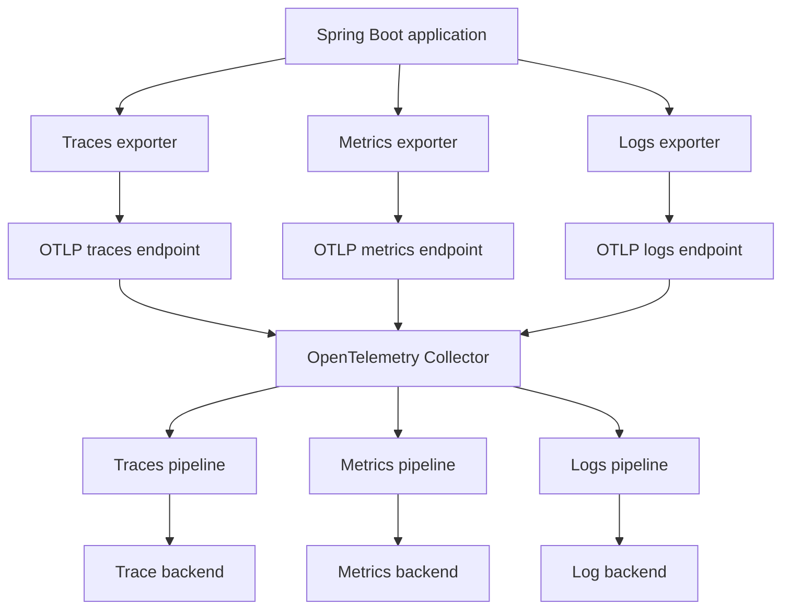

# Signal-Specific Endpoints in OTLP Export

A Spring Boot application can export multiple telemetry types over the OpenTelemetry Protocol (OTLP): **traces**, **metrics**, and **logs**. All three can go to the same OpenTelemetry Collector, yet they do not necessarily share the same URL path, receiver, pipeline, access permissions, or backend. Configuring **signal-specific endpoints** lets you specify a separate export destination per signal type for independent routing, security, scaling, and error handling.

The **Signal-specific endpoint** lesson belongs to the **OTLP export** chapter of the **SPRING_BOOT_OBSERVABILITY** module. The module teaches how to set up observability for Spring Boot using Micrometer Observation, metrics, logs, and distributed tracing; covering context propagation, tags/cardinality, exporters, sampling, and signal correlation to investigate errors, latency, and application behavior in production environments.

After this lesson, you will be able to explain per-signal endpoints, distinguish OTLP/HTTP from OTLP/gRPC, configure appropriate URLs/protocols, set up collector receivers and pipelines, understand the relationship between Spring Boot/Micrometer and OTel exporters, and verify each export path independently.

## 1. What Is a Signal-Specific Endpoint?

OTLP defines how to send telemetry over transport protocols. Common signals include:

- **Traces:** spans representing the path and timing of a request/operation.
- **Metrics:** measurements such as request count, duration, CPU, or queue depth.
- **Logs:** event records with timestamp, severity, body, and attributes.

A **signal-specific endpoint** is an endpoint configured for one specific signal type. With OTLP/HTTP, URLs typically end with `/v1/traces`, `/v1/metrics`, and `/v1/logs` respectively. With OTLP/gRPC, signals go through different RPC services on the same gRPC endpoint; client configuration typically uses host/port without appending HTTP paths to the gRPC URL.

Signal-specific **does not require** three separate servers or hostnames. Three endpoints can share a host and port while differing in path, or they can be split across separate collectors/tenants. Which approach to choose depends on architecture, scale, security boundaries, and operational policies.

## 2. Distinguishing Endpoint, Protocol, and Pipeline

| Concept | Question Answered | Example |
| --- | --- | --- |
| **Protocol** | Which transport does the client speak? | OTLP/HTTP, OTLP/gRPC |
| **Endpoint** | Which address is data sent to? | Collector host, port, and signal path |
| **Pipeline** | How does the Collector process and forward the signal? | traces receiver → batch → trace backend |

A valid endpoint with the wrong protocol still fails. A client sending HTTP to a gRPC port cannot work just because the hostname is identical. Likewise, a collector having a receiver accepting traces does not mean logs and metrics automatically get corresponding pipelines.



The diagram shows a logical architecture: client and collector can consolidate multiple signals on one host/port listener and then dispatch by request path or OTLP service. Each pipeline still needs to be declared explicitly.

## 3. OTLP/HTTP: Endpoints by Signal

With OTLP/HTTP protobuf, standard default paths are typically:

| Signal | HTTP path |
| --- | --- |
| Traces | `/v1/traces` |
| Metrics | `/v1/metrics` |
| Logs | `/v1/logs` |

Example of the three endpoints:

```text
Traces: http://otel-collector:4318/v1/traces
Metrics: http://otel-collector:4318/v1/metrics
Logs:   http://otel-collector:4318/v1/logs
```

Host and port illustrate a common OTLP/HTTP receiver. A Collector can be configured with different paths/ports; use the actual receiver config as the source of truth.

### Base Endpoints vs. Full Signal Endpoints

Some exporters/configurations allow setting a **base endpoint** and automatically append the signal path. For example, a base URL includes host and port; the traces exporter expands it to `/v1/traces`.

Other configurations require a **full URL** already including the signal path. If you pass a full traces URL into a property interpreted as a base URL, the exporter may append the path again and send erroneously to `/v1/traces/v1/traces`.

Read the exact contract of the exporter/property:

- If the endpoint property expects a full endpoint, enter the matching path.
- If the property expects a base URL, enter host/port and let the exporter build the path.
- Do not assume all OTLP HTTP libraries share identical semantics.
- Verify the actual request URL using a test receiver or debug logs without secrets.

## 4. OTLP/gRPC: Same Endpoint, Different Signals

OTLP/gRPC uses per-signal RPC services. Clients configure a gRPC endpoint pointing to the collector, commonly port 4317 in standard setups:

```text
OTLP/gRPC endpoint: http://otel-collector:4317
```

Do not append `/v1/traces` to a gRPC endpoint. Traces, metrics, and logs are sent via their corresponding OTLP RPC services. A gRPC exporter typically has its own code/property configuration; the protocol must match the receiver's gRPC listener.

| Characteristic | OTLP/HTTP | OTLP/gRPC |
| --- | --- | --- |
| Transport | HTTP request/response | gRPC over HTTP/2 |
| Common port | 4318 | 4317 |
| Signal routing | HTTP path `/v1/{signal}` | Per-signal RPC service |
| Ease of basic testing | Use HTTP client/test receiver | Use gRPC-aware client/server |
| Endpoint configuration | May be base/full URL depending on exporter | Usually gRPC authority/endpoint |

The ports are common conventions, not mandatory rules. Receivers can be configured to listen on other ports; clients must point to the right address.

## 5. Configuring Separate Endpoints in the OpenTelemetry SDK

When managing the OTel SDK directly, exporters for each signal can be configured independently. The example below illustrates OTLP/HTTP traces:

```java
OtlpHttpSpanExporter spanExporter =
    OtlpHttpSpanExporter.builder()
        .setEndpoint("http://otel-collector:4318/v1/traces")
        .build();

SdkTracerProvider tracerProvider =
    SdkTracerProvider.builder()
        .addSpanProcessor(
            BatchSpanProcessor.builder(spanExporter).build()
        )
        .build();
```

Class/package names and dependencies must match your OpenTelemetry Java SDK version. This traces exporter configures **traces** only. It does not automatically configure a metrics reader/exporter or logs exporter.

For metrics, the OTel SDK uses a corresponding metric reader/exporter; for logs, the SDK uses a corresponding logger provider and log record exporter. Each signal has its own lifecycle and pipeline. Do not assume one `SdkTracerProvider` manages all three signals.

If using an exporter API where `setEndpoint` requires a full endpoint, supply the full signal-specific URL. With default HTTP exporters, signal-specific paths are defined by the OTLP specification. When using a Spring Boot property or wrapper library, check that exact property's documentation, as it may accept a base endpoint and construct paths automatically.

## 6. Configuring Per-Signal Endpoints via Environment Variables

OpenTelemetry supports signal-specific endpoint configuration variables in common OTLP setups:

```bash
OTEL_EXPORTER_OTLP_ENDPOINT=http://otel-collector:4318
OTEL_EXPORTER_OTLP_TRACES_ENDPOINT=http://otel-collector:4318/v1/traces
OTEL_EXPORTER_OTLP_METRICS_ENDPOINT=http://metrics-collector:4318/v1/metrics
OTEL_EXPORTER_OTLP_LOGS_ENDPOINT=http://logs-collector:4318/v1/logs
OTEL_EXPORTER_OTLP_PROTOCOL=http/protobuf
```

These variables illustrate how configuration splits at the OTel SDK/exporter level:

- `OTEL_EXPORTER_OTLP_ENDPOINT` is usually the shared endpoint; with an OTLP/HTTP exporter, the default signal path may be appended.
- Per-signal endpoints override the shared endpoint for their corresponding signal.
- When a signal-specific endpoint is a full URL, specify the right path for that signal.
- `OTEL_EXPORTER_OTLP_PROTOCOL` selects the transport supported by the SDK, such as `http/protobuf` or `grpc`.

Verify support in the SDK/agent/bridge you run. A library might read only a subset of the standard variables or provide its own properties. Do not mix an OTLP/HTTP endpoint with the `grpc` protocol.

## 7. Spring Boot and Micrometer: Which Exporter Reads Which Config?

Spring Boot supports observability via Actuator, Micrometer Observation, and Micrometer Tracing. However, **not every Micrometer registry/exporter is an OTLP exporter**, and not every OTel SDK property automatically controls beans created by Spring Boot.

| Case | Configuration Path |
| --- | --- |
| Micrometer metrics OTLP registry | Version-specific Micrometer OTLP registry/export configuration |
| Micrometer Tracing using OTel bridge | Spring Boot/Micrometer tracing config and bridge |
| Self-managed OpenTelemetry Java SDK | OTel SDK/exporter API or supported OTel environment variables |
| OpenTelemetry Java agent | Agent configuration/environment variables |
| Collector routing | Collector receivers, processors, exporters, and pipelines |

Illustrative Spring Boot configuration when using a version-supported OTLP metrics exporter:

```yaml
management:
  otlp:
    metrics:
      export:
        url: http://metrics-collector:4318/v1/metrics
        step: 1m
```

Property names and auto-configuration vary by Spring Boot/Micrometer version. Some release lines may use different URL exporter properties; check configuration metadata/docs for your exact dependencies. Do not assume the metrics property above also configures traces and logs.

For tracing, exporter/endpoint configuration is separate. For logs, an appropriate logging appender/OTel Logs SDK or agent integration is needed. Merely adding the Micrometer OTLP metrics registry does not turn logs and spans into OTLP signals.

## 8. Collector: Receivers and Separate Pipelines per Signal

An OpenTelemetry Collector config typically declares receivers, processors, exporters, and service pipelines. Minimal example accepting OTLP/HTTP for all three signals:

```yaml
receivers:
  otlp:
    protocols:
      http:
        endpoint: 0.0.0.0:4318

processors:
  batch: {}

exporters:
  debug:
    verbosity: basic

service:
  pipelines:
    traces:
      receivers: [otlp]
      processors: [batch]
      exporters: [debug]
    metrics:
      receivers: [otlp]
      processors: [batch]
      exporters: [debug]
    logs:
      receivers: [otlp]
      processors: [batch]
      exporters: [debug]
```

This example uses the debug exporter to verify the Collector receives data; it is not a production storage backend. Your Collector distribution/version must include the corresponding components. One receiver can serve multiple signals, yet each pipeline must declare valid signal receivers/processors/exporters.

### Splitting Pipelines by Destination

The Collector can receive all three signals on one listener and then route each signal to a different destination:

```yaml
service:
  pipelines:
    traces:
      receivers: [otlp]
      processors: [batch]
      exporters: [otlp/traces-backend]
    metrics:
      receivers: [otlp]
      processors: [batch]
      exporters: [otlp/metrics-backend]
    logs:
      receivers: [otlp]
      processors: [batch]
      exporters: [otlp/logs-backend]
```

This illustrates the service pipelines section; exporter IDs must be declared under top-level `exporters` with real endpoints/auth. You cannot simply add an exporter ID to a pipeline without declaring the corresponding component.

Splitting pipelines lets each signal have different batching/transform/filtering/retention and access permissions. However, the Collector still shares process resources; an overloaded pipeline can affect the Collector process, so monitor queues, memory, dropped data, and scaling.

## 9. Different Routing Does Not Mean Correlation Is Lost

Traces, metrics, and logs can go to three independent backends and still remain correlated if the data is standardized:

- Traces carry `traceId`/`spanId` and resource attributes.
- Logs emitted within an active span scope can carry `traceId`/`spanId` via MDC or OTel log context.
- Metrics carry stable resource/service dimensions and low-cardinality route/status/outcome tags.

Do not add `traceId` to metric labels to create per-request links; cardinality will explode rapidly. Trace exemplars or dashboard integrations can be used when supported by the backend and exporter.

A useful dashboard lets you start from metric error rate/latency, narrow down by service/time range, open a sampled trace, and view related logs by trace ID. Sampling can cause a request to have metrics/logs without a stored trace; that is expected behavior to understand before concluding the pipeline is broken.

## 10. Authentication, TLS, and Network Boundaries

An endpoint is more than a hostname/path. In production, define how authentication and encryption work:

1. **TLS:** use HTTPS or gRPC TLS when telemetry traverses untrusted networks.
2. **Authentication:** API tokens, mTLS, or workload identity per organizational policy.
3. **Authorization:** restrict which services can send which signals to the collector/backend.
4. **Network policy:** open listeners only to authorized workloads.
5. **Tenant routing:** do not let clients arbitrarily select backend tenants via untrusted headers.
6. **Secrets:** do not commit tokens/passwords into source code or compose files.

You can split endpoints so traces go to an internal collector, metrics go through a quota-enforced gateway, and logs go through a redaction pipeline. However, separate endpoints do not create security boundaries on their own; receivers, gateways, and backends must enforce matching authentication/authorization.

## 11. Per-Signal Headers and Metadata

OTLP exporters can support headers or metadata used for authentication/routing. With HTTP, these are typically HTTP headers; with gRPC, metadata. Configuration syntax differs across exporters and SDKs.

Do not send unnecessary business headers such as the user request's original `Authorization`, cookies, or session data to the collector. Telemetry credentials must remain separate from application credentials. When using per-signal endpoints, consider per-signal auth so logs/traces/metrics have appropriate send permissions and retention.

Some collector gateways use a tenant header for routing. Assign the tenant based on platform/workload identity, rather than trusting arbitrary tenant IDs from request payloads or baggage.

## 12. Testing Signal-Specific Endpoints

Do not start by sending real data to a production backend. Test layer by layer:

| Test | What to Prove |
| --- | --- |
| Endpoint config test | URL/path/protocol are active for each signal |
| HTTP receiver test | Traces/metrics/logs arrive at the right path |
| gRPC receiver test | Exporter invokes the matching RPC on the right listener |
| Collector pipeline test | Signal enters the pipeline and routes to the right exporter |
| Auth/TLS test | Valid requests succeed; invalid requests are rejected |
| Signal payload test | Resource attributes and signal data reach the intended target |
| Failure isolation test | One signal's endpoint failure is not misattributed to another signal |
| Shutdown/flush test | Final batch flushes cleanly during application stop |

### Smoke Testing HTTP Endpoints

For OTLP, payloads must be protobuf per contract; do not send arbitrary JSON to a traces endpoint and treat HTTP 200/400 as a sampling check. It is better to use a real exporter with a test collector/receiver, or an OTel SDK in-memory/test exporter to inspect spans before testing the network.

An integration test can start a collector test container or a mock receiver capable of decoding OTLP, emit one trace, metric, and log individually, and assert that each receiver/pipeline receives the right signal. Do not check HTTP status alone; confirm payloads reach the right pipeline.

## 13. Common Errors and How to Handle Them

| Symptom | Possible Cause | Investigation Direction |
| --- | --- | --- |
| 404 Not Found on OTLP/HTTP | Wrong full/base endpoint or path appended twice | Inspect actual request URL |
| 415 Unsupported Media Type | Wrong content type/protocol | Verify OTLP protobuf and exporter protocol |
| HTTP request timeout | Slow Collector/network/backend or overloaded queue | Check latency, batch queue, and receiver |
| gRPC UNAVAILABLE | Wrong port, TLS/plaintext mismatch, or DNS | Check gRPC listener and network |
| Traces arrive but metrics do not | Only traces exporter/pipeline configured | Check metrics exporter/reader and pipeline |
| Metrics arrive but logs are empty | Missing logs SDK/appender/agent or logs pipeline | Check logging integration |
| All three signals go to the same backend unexpectedly | Only shared endpoint used when split routing was needed | Configure per-signal endpoints/exporters |
| Collector receives signal but backend has nothing | Processor/exporter/backend auth or queue error | Monitor received/sent/refused/dropped |
| `localhost` fails to connect in container | `localhost` points to the application container | Use service DNS or real network endpoint |
| One signal congests the collector | Pipelines share process/resources | Monitor memory/queues, split collectors if needed |
| Spring Boot property has no effect | Property does not match current version/exporter | Check configuration metadata and beans |
| Exporter sends data but backend query is empty | Wrong tenant/time range/service/resource filter | Check query and backend ingestion |

## 14. Real-World Scenario: Traces Work, Logs Go to the Wrong Destination

**Hypothetical context:** `checkout-service` sends traces to an internal trace backend, metrics to a centralized gateway, and logs to a logging platform with redaction rules. After deployment, traces and metrics work, but logs do not appear in the log backend.

Workflow:

1. **Check log source:** is the application creating OTel LogRecords, or only writing SLF4J/Logback without a bridge/appender/agent exporting to OTLP?
2. **Check endpoint:** does the logs exporter use the full logs path or a base endpoint per the SDK's contract?
3. **Check protocol:** did the exporter choose OTLP/HTTP or gRPC, and does the collector listener support that matching protocol?
4. **Check receiver/pipeline:** has the collector configured a logs receiver and a `logs` pipeline?
5. **Check redaction:** is a processor dropping or stripping fields per policy? Do not disable redaction just to make logs appear.
6. **Check backend exporter:** are there errors in auth, tenant, queues, or rejected payloads?
7. **Check correlation:** if logs have `traceId` but the trace UI cannot link them, cross-check resource/service names and trace IDs; do not put IDs into metrics labels.

Conclusion: a working trace exporter does not prove the logs pipeline is ready. Each signal needs its own data source, exporter, endpoint, and collector pipeline; correlation is maintained through appropriate context/resource fields.

## 15. Self-Check Exercises

**Exercise 1.** Why does OTLP/HTTP commonly use the three paths `/v1/traces`, `/v1/metrics`, `/v1/logs`?

*Hint:* These are signal-specific HTTP routes per OTLP/HTTP; the collector distinguishes payloads by path.

**Exercise 2.** You configure a full traces URL as a base URL, yet the exporter appends the path itself. What can happen?

*Hint:* The URL gets a duplicated path, such as `/v1/traces/v1/traces`; read the base vs. full endpoint contract.

**Exercise 3.** Does an OTLP/gRPC exporter need a `/v1/traces` endpoint?

*Hint:* Not in the HTTP configuration style. gRPC uses a gRPC endpoint and per-signal RPC services.

**Exercise 4.** The trace backend has data while the logs backend is empty. Can you conclude the collector is broken?

*Hint:* No. Inspect logs source/appender, logs exporter, endpoint, receiver, and the `logs` pipeline independently.

**Exercise 5.** Does a single OTLP receiver accepting traces, metrics, and logs need three service pipelines?

*Hint:* Yes, a pipeline per signal is needed in the collector config to attach signal-specific processors/exporters, even though the receiver component can be shared.

**Exercise 6.** Why should you not use the application's `Authorization` header as an OTLP exporter header?

*Hint:* User credentials are not telemetry credentials; doing so risks leaking tokens and misconfiguring permissions.

**Exercise 7.** Does adding only the Micrometer OTLP metrics registry make Spring Boot export logs and spans too?

*Hint:* No. The metrics registry handles metrics only; tracing and logs have separate pipelines/SDK integrations.

**Exercise 8.** The Collector receives 100 spans, yet the backend finds only 80. Where should you investigate?

*Hint:* Collector processors, backend exporter, queue/retries, auth, tenant, and backend query/retention.

## 16. Key Takeaways

- **Signal-specific endpoints** enable separate routing for traces, metrics, and logs; each signal needs matching exporters/receivers/pipelines.
- With **OTLP/HTTP**, common paths are `/v1/traces`, `/v1/metrics`, `/v1/logs`; distinguish base endpoints from full signal endpoints to avoid appending paths twice.
- With **OTLP/gRPC**, configure a gRPC endpoint; signals travel over corresponding RPC services without appending HTTP paths.
- Spring Boot/Micrometer properties depend on version and exporter. A metrics registry does not configure tracing or logging exporters automatically.
- A Collector can share one OTLP listener while requiring separate pipeline declarations per signal; separate endpoints do not create backend routes or security permissions by themselves.
- Verify independently: data source, exporter, protocol, endpoint, collector receiver, processor, final exporter, and backend query.
- Use TLS, telemetry credentials, authorization, and allowlists; do not forward application tokens or sensitive data into headers/baggage/logs.
- Maintain signal correlation with trace context/resource/log correlation; do not add trace IDs to metric labels to bypass sampling or link dashboards.
