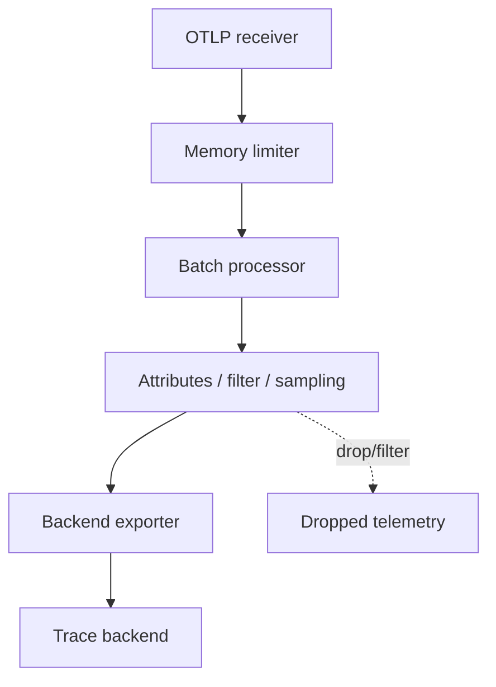

# Checking Exporter Connectivity in Spring Boot

A Spring Boot application created spans, yet traces do not appear in the backend. Application logs report export timeouts, the Collector sees no incoming requests, or the Collector receives telemetry while the backend remains empty. These symptoms can all be loosely called "the exporter cannot connect", yet the root cause could lie in the OTLP address, DNS, TCP, TLS, authentication, protocol, Collector pipeline, or target backend.

**Checking exporter connectivity** means verifying the entire path from telemetry generated by the application to the final destination by checking each boundary and its corresponding evidence. Do not check only whether a host/port is open: you must know whether the exporter was initialized, whether the sampler allowed recording the trace, whether the receiver accepts the right protocol, whether processors drop data, and whether the Collector's exporter sends successfully.

The **Checking exporter connectivity** lesson belongs to the **OTLP export** chapter of the **SPRING_BOOT_OBSERVABILITY** module. The module focuses on setting up observability for Spring Boot using Micrometer Observation, metrics, logs, and distributed tracing; covering context propagation, tags/cardinality, exporters, sampling, and signal correlation to investigate errors, latency, and application behavior in production environments.

## 1. Learning Objectives

After this lesson, you will be able to:

- Describe a span's path from Spring Boot/Micrometer Tracing through the OTLP exporter to the Collector and backend.
- Distinguish OTLP/HTTP and OTLP/gRPC, along with their corresponding endpoints, ports, and paths.
- Check DNS, TCP, TLS, certificates, authentication, and protocol compatibility step by step.
- Verify that the exporter is configured and actually used by the tracing implementation.
- Distinguish sampling/recording issues from connectivity errors and Collector/backend errors.
- Read Collector receiver, processor, and exporter telemetry to locate drops/errors.
- Understand retries, batches, queues, timeouts, backpressure, and the impact when the Collector is unavailable.
- Perform safe end-to-end checks without exposing credentials or sensitive telemetry.

## 2. The OTLP Data Path

In a Spring Boot application using Micrometer Tracing with the OpenTelemetry bridge, an Observation can create a span. The span is recorded according to the sampling policy, then the tracing SDK/bridge passes the span to the exporter. The OTLP exporter sends data to a Collector receiver or an OTLP-capable backend.

```
flowchart LR
    A["Spring Boot<br/>Observation / Tracer"] --> B["OTel bridge / SDK"]
    B --> C["Sampler + SpanProcessor"]
    C --> D["OTLP exporter"]
    D --> E["DNS / TCP / TLS / Auth"]
    E --> F["Collector OTLP receiver"]
    F --> G["Processors"]
    G --> H["Collector exporter"]
    H --> I["Trace backend"]
```

Each arrow is a boundary to verify. If the backend has no traces, do not immediately blame the application exporter:

1. Was the request instrumented and was a span created?
2. Did the sampler select the span and did the processor record it?
3. Was the OTLP exporter initialized and did it send batches?
4. Did the Collector receiver accept requests?
5. Did a processor filter/drop data?
6. Did the Collector exporter connect and send to the backend?
7. Did the backend store the trace and are queries using the right service/time range?

### Connectivity Is More Than TCP

TCP success proves only that a connection can be opened to an address/port. It does not prove the receiver speaks the right OTLP protocol, that the HTTP path or gRPC service path is right, that the TLS hostname/trust chain is valid, that authentication is accepted, that the payload is compatible OTLP protobuf, that the Collector is not dropping telemetry, or that the backend exporter can save traces.

Therefore, verify layer by layer and collect evidence on both client and server sides.

## 3. OTLP/HTTP and OTLP/gRPC

OTLP supports transmitting data over HTTP/protobuf and gRPC. The two modes have different endpoint configurations:

| Characteristic | OTLP/HTTP | OTLP/gRPC |
| --- | --- | --- |
| Transport | HTTP | gRPC over HTTP/2 |
| Common default port | 4318 | 4317 |
| Trace path | `/v1/traces` | OTLP TraceService RPC |
| Metrics path | `/v1/metrics` | OTLP MetricsService RPC |
| Logs path | `/v1/logs` | OTLP LogsService RPC |
| Network checks | DNS, TCP, TLS, HTTP response | DNS, TCP, TLS, HTTP/2, and gRPC status |
| Common errors | Wrong path, HTTP 404/415/401/403 | Wrong port, proxy lacks HTTP/2 support, gRPC UNAVAILABLE/UNAUTHENTICATED |

Ports 4317 and 4318 are common default ports in Collector deployments; they do not open automatically if the receiver is not configured or the container/service is not publishing/listening. Always inspect the actual receiver configuration and environment service discovery.

### OTLP/HTTP Endpoint

Example trace endpoint:

```text
http://otel-collector.monitoring:4318/v1/traces
```

The endpoint consists of scheme, hostname, port, and path. Some libraries take a base endpoint and append the signal path automatically; others take the full endpoint. Check your exporter's contract to avoid duplicated paths like `/v1/traces/v1/traces`.

### OTLP/gRPC Endpoint

Example target:

```text
otel-collector.monitoring:4317
```

With gRPC, configuration is typically target host/port and the exporter calls OTLP TraceService RPC; do not append HTTP path `/v1/traces` to a gRPC target. You must know whether the exporter uses plaintext or TLS and whether proxies/service meshes support HTTP/2/gRPC.

### Do Not Mix the Two Protocols

If the application sends gRPC to an HTTP/OTLP listener on port 4318, or sends HTTP to a gRPC listener on 4317, connections will fail or return protocol mismatches. Align protocols between exporter and receiver; do not merely change ports while ignoring TLS, paths, and proxy behavior.

## 4. Configuring the Exporter in Spring Boot

For Spring Boot 3.x using Actuator, Micrometer Tracing, and the OpenTelemetry bridge, illustrative dependencies in Gradle Kotlin DSL:

```kotlin
dependencies {
    implementation("org.springframework.boot:spring-boot-starter-actuator")
    implementation("io.micrometer:micrometer-tracing-bridge-otel")
    runtimeOnly("io.opentelemetry:opentelemetry-exporter-otlp")
}
```

The Spring Boot BOM should manage compatible versions. Do not set separate versions on individual Micrometer/OTel dependencies without verifying the compatibility matrix. Do not add the Brave bridge simultaneously just to "try another exporter" when the app has already chosen the OTel bridge.

### OTLP/HTTP Configuration Example

In Spring Boot versions supporting `management` OTLP tracing properties, configuration may look like:

```yaml
spring:
  application:
    name: order-service
management:
  tracing:
    sampling:
      probability: 0.1
  otlp:
    tracing:
      endpoint: http://otel-collector.monitoring:4318/v1/traces
```

**Property groups and auto-configuration depend on the Spring Boot version.** Check configuration metadata and docs for your exact version; do not assume all Boot lines bind the same properties. If the project configures SDKs/exporters manually or uses an agent, identify where the actual exporter is created and avoid registering two providers/exporters side by side.

### Exporters and Sampling Play Different Roles

- Sampling probability decides which traces are selected.
- Span processors decide how spans are handled on start/end.
- Exporters send spans handed to them by processors.
- Collectors receive payloads and continue the pipeline.

A probability of 0 can prevent new root traces from being exported even when connectivity is healthy. Conversely, 100% sampling cannot fix a wrong endpoint or failed TLS handshake.

### Application Name and Resource

The service name should be stable, such as `order-service`, and reflected in the `service.name` resource attribute according to the stack's configuration. When checking the backend, search the exact service name, environment, and time window; do not confuse service name/resource with the OTLP endpoint.

## 5. Checking Endpoint, DNS, and TCP

Start from the application's actual runtime environment, such as the Spring Boot container/pod/VM. Checking from an admin laptop does not prove the workload shares the same DNS, routes, network policies, or service mesh.

### Step 1: Confirm the Effective Endpoint

Record the following details from deployment configuration:

- Protocol: HTTP or gRPC.
- Scheme: HTTP or HTTPS/TLS.
- Hostname/service DNS.
- Port.
- HTTP path if using OTLP/HTTP.
- Authentication headers or identity.
- Timeouts and TLS configuration.

Do not print the entire environment/configuration to logs if secrets or credentials are present.

### Step 2: Resolve DNS

In a container or Linux environment with standard tools:

```bash
getent hosts otel-collector.monitoring
```

If resolution fails, verify service name/namespace/search domain, pod DNS policy/resolver, Collector Service/endpoints, and certificate hostname if using TLS. On Windows, you can use `Resolve-DnsName` or `nslookup`. Commands depend on the runtime; run within the right network namespace if possible.

### Step 3: Test TCP

PowerShell example:

```powershell
Test-NetConnection otel-collector.monitoring -Port 4318
```

Or Linux:

```bash
nc -vz otel-collector.monitoring 4318
```

If TCP fails, verify whether the Collector is listening on the port, service/port mappings or Kubernetes `targetPort`, firewalls, `NetworkPolicy`, security groups, egress rules, service mesh, and Collector ready/restart status.

TCP success is only the initial condition; proceed to verify protocol and application responses.

## 6. Checking HTTP Responses With OTLP/HTTP

When using OTLP/HTTP, verify HTTPS/TLS and that HTTP requests are accepted by the receiver. `curl` helps inspect server/routing, yet a simple GET request does not substitute for a valid OTLP export.

### Checking Base Connectivity

```bash
curl -v --connect-timeout 3 https://otel-collector.monitoring:4318/
```

A 404 response on the root path does not necessarily mean the receiver is broken; the receiver may serve only signal paths. This command mainly helps observe DNS, TCP, TLS, and HTTP responses. Do not add flags skipping certificate verification as a long-term solution.

### Checking the Endpoint Path

The OTLP/HTTP trace path is typically:

```text
POST /v1/traces
Content-Type: application/x-protobuf
```

`GET /v1/traces` may return 404 or 405 because the receiver expects `POST`; that does not prove OTLP `POST` fails. Use a real exporter or an OTLP test client to send a properly formatted payload.

### Interpreting HTTP Statuses

| Result | Likely Issue to Check |
| --- | --- |
| 200/2xx | Receiver accepted request; still inspect processor/exporter/backend |
| 400 | Invalid payload, encoding, or request format |
| 401 | Missing or invalid authentication credentials |
| 403 | Identity recognized but unauthorized |
| 404 | Wrong path, route, or receiver does not expose OTLP/HTTP |
| 405 | Unsupported method; likely used GET instead of POST |
| 413 | Payload/batch exceeds request limit |
| 415 | Unsupported `Content-Type` or encoding |
| 429 | Receiver/rate limit/backpressure temporary rejection |
| 5xx | Collector/proxy/server error; check logs and internal telemetry |
| Timeout | DNS/TCP/TLS, route, queue, overloaded server, or request waited too long |

HTTP 2xx only proves the receiver layer accepted the request. If a Collector processor drops data or a downstream exporter fails, traces may still be absent from the backend.

## 7. Checking gRPC and HTTP/2

With OTLP/gRPC, the exporter must connect to the gRPC listener and use HTTP/2. A proxy supporting only HTTP/1.1 may allow TCP connect while causing gRPC to fail.

Check:

1. Has the Collector enabled the OTLP gRPC receiver and is it listening on the right port?
2. Does the exporter target have the right host/port without an appended HTTP path?
3. Does the client's TLS mode match the receiver?
4. Does the load balancer/service mesh support end-to-end HTTP/2 or compatible gRPC?
5. Is authentication metadata forwarded to the right service?
6. Does gRPC status report `UNAVAILABLE`, `UNAUTHENTICATED`, `PERMISSION_DENIED`, `DEADLINE_EXCEEDED`, or another error?

Do not use an HTTP GET on the gRPC port to conclude the protocol is healthy. Prefer exporter/receiver telemetry and logs or a gRPC tool that understands OTLP services.

## 8. TLS, Certificates, and Authentication

Connecting to the Collector over HTTPS/gRPC TLS requires verifying both the trust chain and server identity:

| Issue | Common Symptom | Resolution |
| --- | --- | --- |
| Untrusted CA | Certificate verify/unknown authority | Install valid CA chain into the process's trust store |
| Hostname mismatches SAN | Hostname verification failed | Use a DNS name matching the cert or issue a proper cert |
| Expired certificate | Certificate expired | Renew and distribute new cert |
| mTLS missing client cert | Handshake rejected | Configure valid client certificate/key |
| Incompatible TLS version/cipher | Handshake failure | Align TLS policies on both ends |
| Wrong scheme | Plaintext to TLS listener or vice versa | Align HTTP/HTTPS and gRPC TLS/plaintext |
| Missing authentication | 401/UNAUTHENTICATED | Configure auth header/token or identity |
| Insufficient authorization | 403/PERMISSION_DENIED | Grant least-privilege permissions to workload identity |

### Do Not Disable Certificate Verification to "Fix" Connectivity

Disabling hostname/certificate verification might make tests connect, yet removes protection against Collector spoofing. Never use insecure configurations in production. Fix CAs, hostname/SAN, trust stores, cert rotation, and mTLS per your actual security architecture.

### Secret Management

- Do not hardcode bearer tokens, API keys, or private keys in source code.
- Use Secret Manager/Kubernetes Secrets or an organization-approved secret delivery mechanism.
- Do not print full OTLP headers in debug logs.
- Rotate tokens/certificates and verify exporter reload/restart per supported mechanism.
- Grant minimal export permissions to workload identities.

## 9. Checking Collector Receivers, Processors, and Exporters

A Collector typically has three component groups in a pipeline:

1. **Receiver:** accepts telemetry via OTLP or other protocols.
2. **Processor:** batches, limits memory, handles attributes, filters, transforms, or tail-samples.
3. **Exporter:** sends telemetry to the backend or next system.



The receiver may work while a processor filtering by service name/environment drops spans. Tail sampling may buffer while waiting for decisions; the memory limiter may refuse data when thresholds are exceeded. The backend exporter may time out or be rejected by authentication.

### Checking Collector Logs

Look for these groups of information:

- Receiver startup/listening and port bind errors.
- Requests received, decode/protocol errors.
- Queue full, refused spans, memory limiter, dropped data.
- Processor batch/tail sampling warnings.
- Exporter retries, timeouts, authentication, and backend responses.
- Shutdown/restart leaving queue flushes incomplete.

Do not enable debug logs indefinitely in production if they can expose payloads/metadata or generate massive log volume. Use short durations, narrow scope, and revert after investigation.

### Collector Internal Telemetry

The Collector can expose internal metrics depending on distribution/configuration. Exact metrics and meter names depend on version/build; look for these groups:

- Accepted/refused spans at the receiver.
- Sent/failed spans at the exporter.
- Queue size/capacity and enqueue failures.
- Processor dropped data.
- Retries and send latency.
- Process memory/CPU and uptime.

Compare **receiver accepted** against **exporter sent/failed** to pinpoint where data stops. Inspect the Collector's actual telemetry instead of relying on fixed metric names across versions.

## 10. Batching, Queues, Retries, Timeouts, and Backpressure

OTLP exporters usually do not send a separate HTTP request for every span. The SDK may use a batch span processor or equivalent mechanism to collect spans and export in batches. Consequently:

- After a single request, the backend might not show the trace yet because the batch has not flushed.
- The exporter may retry transient errors.
- Queues are bounded; when the Collector is slower than span creation rate, the queue can fill up.
- Shutdown must flush/close the provider cleanly in its lifecycle to send remaining batches.
- Overly short timeouts cause exports to fail; overly long timeouts tie up threads/resources.

| Parameter/Concept | Effect | Risk If Misconfigured |
| --- | --- | --- |
| Batch size | Maximum spans grouped into one export | Too large creates huge payloads; too small adds request overhead |
| Schedule delay | Wait period before sending a batch | Too long increases delay before traces appear |
| Queue size | Capacity waiting for export | Too small drops easily on bursts; too large increases memory |
| Export timeout | Wait duration for an export attempt | Too short causes false failures; too long causes backlogs |
| Retry/backoff | How transient failures are retried | Uncontrolled retries can prolong backlogs |
| Collector memory limit | Resource limit for receiver/processors | Can refuse data under high load |

Default values and property names depend on SDK/exporter/version. Do not copy property names from another OTel Java version into Spring Boot without verification. Tune each parameter based on throughput, p95 export latency, queue occupancy, failed spans, and actual memory.

### Graceful Shutdown

When Spring Boot stops, the tracing provider/exporter must close in its proper lifecycle to flush remaining batches in the queue. If a pod is killed immediately or the termination grace period is shorter than shutdown/export time, final spans may never reach the backend. Check shutdown hooks, provider/exporter lifecycle, timeouts, Kubernetes termination grace period, and Collector/backend availability.

Do not add `sleep` in business paths to wait for exports. Use proper lifecycle shutdown and exporter flush APIs.

## 11. Separating Sampling Issues From Connectivity Issues

When the backend shows no traces, sampling may be the cause before the exporter is even called.

| Observation | Possible Interpretation |
| --- | --- |
| Probability = 0, no sampled parent | New root traces may not be sampled; nothing to export |
| Sampling > 0, exporter reports UNAVAILABLE | Likely connectivity/receiver error |
| Exporter sends successfully, Collector receiver accepted rises | App connected and receiver accepted data |
| Receiver accepted rises, exporter failed rises | Error in downstream Collector pipeline/exporter |
| Collector exporter sent rises, yet backend query is empty | Check backend ingestion, tenant, auth, service/time filters |
| Log has `traceId`, yet backend has no trace | Context may exist, while recording/sampling/export/backend did not succeed |

### Parent Sampled Context

A parent's sampling decision can be inherited per sampler semantics. Therefore, probability 0 does not always guarantee downstream spans are never recorded. When testing connectivity, use a new root request with known sampling and inspect parent context to rule out confusion.

### Using an Identifiable Test Request

Send a test request with a stable route/service name and a non-sensitive correlation marker, then cross-check:

1. Application logs show the request ran.
2. Exporter logs/metrics show whether batches were sent.
3. Collector receiver accepted/refused counters.
4. Collector processor/exporter sent/failed metrics.
5. Backend trace lookup by exact service name and time window.

Do not put a per-request UUID into metric tags to identify tests. You can use a controlled log field or trace attribute in a test environment.

## 12. Practical Connectivity Verification Procedure

### Step 1 — Confirm Sampling and Instrumentation

- Confirm the right OTel bridge/exporter dependencies.
- Confirm HTTP/messaging/custom operations are actually instrumented.
- Set appropriate sampling in the test environment.
- Trigger a new root request and note the timestamp.

If no spans are created or sampled, connectivity is not the first failure point to investigate.

### Step 2 — Confirm Which Endpoint the Exporter Uses

Inspect bound configuration after applying profile/environment overrides. Confirm protocol, endpoint, path, TLS, auth, and signal. Do not print secrets to terminals/logs; show only redacted host/path if needed.

### Step 3 — Check DNS/TCP/TLS From the Workload

Perform DNS lookups and TCP checks from the exact container/pod/VM. For HTTPS, verify certificate chain and hostname. For gRPC, check HTTP/2 and status via a gRPC-aware client.

### Step 4 — Check the Receiver

Check whether the Collector listens on the right endpoint and protocol, receives requests, and increments accepted counters. If no requests reach the receiver, investigate network/client/protocol first.

### Step 5 — Check Processors

Inspect filters, attributes processors, tail sampling, memory limiter, and batch queues. Verify telemetry is not dropped by rules or pressure.

### Step 6 — Check Downstream Exporters

If the receiver accepts data while the backend is empty, check Collector exporter failures/retries, TLS/auth, tenant/project, and backend responses.

### Step 7 — Check Backend Queries

Search by resource service name, environment, time window, and trace ID if known. Check timezone, retention, ingestion delay, tenant, and UI/query filters.

## 13. Example: Checking an OTLP/HTTP Endpoint

In a test environment, you can run basic DNS/TCP/TLS checks to the Collector:

```bash
getent hosts otel-collector.monitoring
nc -vz otel-collector.monitoring 4318
curl -v --connect-timeout 3 \
  https://otel-collector.monitoring:4318/
```

The commands above **do not send a valid OTLP span**. They only verify hostname, TCP, and TLS/HTTP response. A 404 on the root path does not mean `/v1/traces` is wrong because the receiver may not serve the root route.

A proper end-to-end check must use an OTLP exporter/client or send a valid OTLP protobuf payload to `POST /v1/traces`, with matching content type, TLS, and auth as in the real environment. Prefer generating spans through a test application to validate instrumentation, sampling, and exporter integration together.

### Do Not Use `curl` With Arbitrary Bodies

A custom JSON POST to `/v1/traces` is not a valid OTLP payload merely because the URL is right. The receiver may return 400/415; that is a payload/protocol error and does not prove TLS/DNS are broken. Use an exporter or a tool generating schema-valid OTLP protobuf.

## 14. Security and Protecting Telemetry

Exporter connectivity must be verified without leaking access credentials or telemetry data:

- Use TLS and hostname verification; use valid CAs/certificates.
- Use workload identity or least-privilege credentials.
- Do not print bearer tokens, API keys, client private keys, or full request headers.
- Do not leave wire-level payload logging enabled indefinitely.
- Redact PII/secrets in instrumentation and Collector processors.
- Restrict egress destinations so applications only send telemetry to approved Collectors.
- Restrict Actuator endpoints and Collector receivers via network/security policies.
- Monitor queue sizes, retries, and dropped data without logging sensitive contents.

If connectivity works only when disabling TLS verification or using admin credentials, fix the policy; never keep that configuration.

## 15. Troubleshooting

| Symptom | Common Cause | Resolution |
| --- | --- | --- |
| DNS lookup fails | Wrong service name/namespace, DNS resolver error | Check service discovery and DNS from workload |
| TCP timeout/refused | `NetworkPolicy`, firewall, wrong port/listener | Check routes, egress, `targetPort`, and Collector listener |
| HTTP 404 | Wrong OTLP path or unexposed route | Check `/v1/traces` and receiver config |
| HTTP 405 | Used GET instead of POST | Test with an exporter/client sending OTLP with the right method |
| HTTP 415 | Wrong `Content-Type`/encoding | Use compatible OTLP protobuf exporter |
| HTTP 401/403 | Wrong authentication/authorization | Check workload identity, token scope, and policy |
| HTTP 413 | Batch exceeds request limit | Reduce batch size or raise limit per receiver capacity |
| HTTP 429 | Rate limit/backpressure | Check throughput, queue, and quota |
| HTTP 5xx | Collector/proxy/backend error | Read server logs, receiver, and exporter telemetry |
| TLS unknown authority | Untrusted CA chain | Configure valid CA in runtime trust store |
| TLS hostname mismatch | Certificate SAN mismatches hostname | Fix endpoint or issue cert matching hostname |
| gRPC UNAVAILABLE | Wrong port, route, HTTP/2, or server down | Verify gRPC receiver and proxy end-to-end |
| Exporter queue full | Slow Collector or prolonged unreachable endpoint | Check queue, batch, retries, and receiver capacity |
| Receiver accepted but backend empty | Processor drop or backend exporter error | Check Collector processors/exporters |
| Exporter sent rises but UI shows nothing | Wrong tenant/service/time range or ingestion delay | Check backend queries, retention, and resource |
| No exporter logs | No sampled spans, exporter not initialized, or wrong log level | Check instrumentation, sampling, and bean/config |

## 16. Hands-On: Finding the Break in an OTLP Pipeline

**Context:** `order-service` uses Spring Boot Actuator, Micrometer Tracing with the OTel bridge, and the OTLP exporter. The Collector receives OTLP/HTTP on port 4318 and exports to a trace backend. Traces do not appear after a test request.

### Part A — Preparation

1. Verify bridge/exporter dependencies are compatible with the Spring Boot BOM.
2. Configure non-zero sampling probability in testing.
3. Verify OTLP/HTTP endpoint, `/v1/traces` path, TLS, and authentication.
4. Check that the Collector receiver listens on the right port/path.
5. Record the service name and test start time.

### Part B — Simulating Failures Layer by Layer

| Case | Change in Test Environment | Expected Evidence |
| --- | --- | --- |
| A — Wrong DNS | Use a non-existent hostname | DNS lookup/exporter resolve error |
| B — Wrong port | Use a port without a listener | TCP refused/timeout |
| C — Wrong path | Use a path that is not the OTLP traces endpoint | HTTP 404 or route error |
| D — Wrong Content-Type | Send non-OTLP protocol request | HTTP 400/415 |
| E — Wrong TLS | Use invalid CA/hostname in test environment | TLS handshake/verification error |
| F — Missing auth | Remove valid credentials | 401/UNAUTHENTICATED or 403/PERMISSION_DENIED |
| G — Processor drop | Add filter excluding test service | Receiver accepted, yet exporter output drops/missing |
| H — Backend failure | Point Collector exporter to unavailable test backend | Receiver still accepts; exporter retries/failures rise |
| I — Sampling 0 | Set probability 0 for new root traces | No traces sent; connectivity not proven broken |

Never run test cases that break TLS/auth or backends in production. Restore configuration after each simulation and confirm the system returns to baseline.

### Part C — Recording Results

For each case, record the first point where failure is detected, client-side/exporter evidence, receiver/Collector evidence, processor/exporter/backend evidence, impact on metrics/logs, and how to recover.

### Self-Assessment Questions

1. Why does a successful TCP connect not prove OTLP export works?
2. How does OTLP/HTTP 4318 differ from OTLP/gRPC 4317?
3. Why is `GET /v1/traces` not a valid OTLP export test?
4. What does HTTP 2xx from the Collector prove, and what does it not prove?
5. When receiver accepted rises yet the backend is empty, should you inspect processors or the application first?
6. Why can probability 0 not be used to test exporter connectivity?
7. How do you distinguish a TLS hostname mismatch from an authorization error?
8. How do a full queue and prolonged retries affect new spans?
9. Why should you not disable certificate verification as a quick fix for TLS errors?
10. What evidence confirms a trace traversed the entire pipeline to the backend?

## 17. Key Takeaways

**Checking exporter connectivity means checking end-to-end across every boundary.** First confirm the operation is instrumented and traces are sampled; next verify the exporter, protocol, endpoint, DNS, TCP, TLS, authentication, and Collector receiver. Once the receiver accepts data, inspect processors, batches/queues, downstream exporters, and backend ingestion.

OTLP/HTTP typically uses port 4318 with signal paths like `/v1/traces`; OTLP/gRPC typically uses port 4317 and requires compatible HTTP/2/gRPC. Successful TCP or HTTP 2xx proves only part of the path. Sampling, recording, exporting, and backend storage are separate stages, so cross-check application, Collector, and backend telemetry before drawing conclusions. Keep TLS/auth secure, manage batches/timeouts/queues for realistic load, and test from the actual workload environment so Spring Boot observability operates reliably without exposing secrets or sensitive telemetry.
