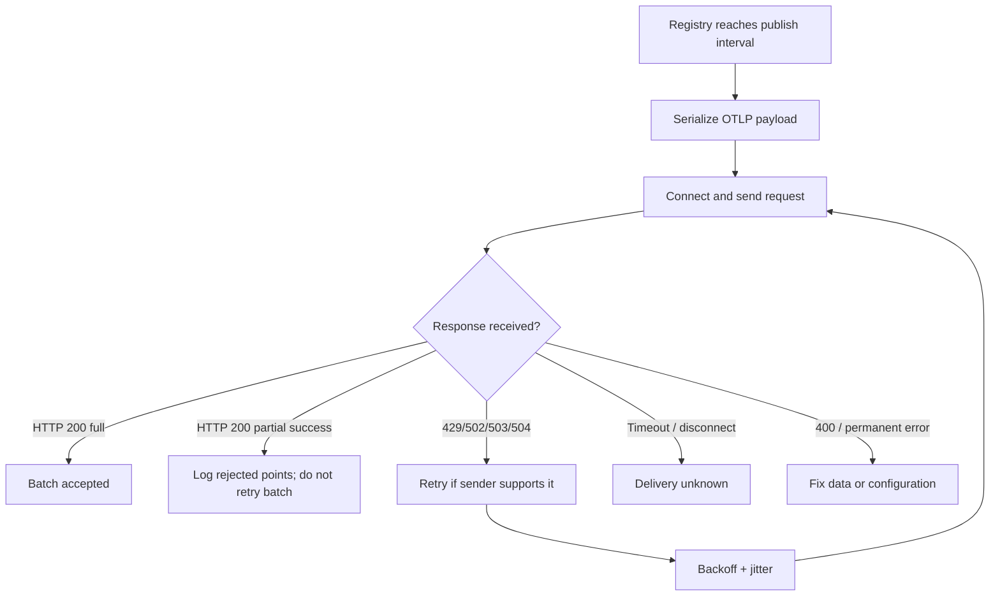

# Exporter Retry and Timeout in Spring Boot

When Spring Boot exports metrics via OTLP, data is sent periodically to a Collector or metrics backend. A receiver may be temporarily down, a gateway may return 503, DNS may fail to resolve, a TLS handshake may fail, or batch processing may be too slow. Without proper timeouts and recovery policies, the exporter can wait too long, delay the next publish cycle, or drop measurements on failed sends.

The **"Exporter Retry and Timeout"** lesson belongs to the **OTLP export** chapter of the **SPRING_BOOT_OBSERVABILITY** module. The module teaches how to set up observability for Spring Boot using Micrometer Observation, metrics, logs, and distributed tracing; covering context propagation, tags/cardinality, exporters, sampling, and signal correlation to investigate errors, latency, and application behavior in production environments.

**Timeouts and retries are two distinct mechanisms.** Timeouts bound the wait duration for a single send attempt. Retries decide whether to resend, on which errors, how many times, and how long to wait. The OTLP specification recommends retrying certain transient errors; however, that does not mean every client library implements retries. With Spring Boot using Micrometer `OtlpMeterRegistry`, standard configuration exposes connect/read timeouts, yet Micrometer's HTTP sender has no built-in retries according to the registry documentation.

## 1. Why Does an Exporter Need Timeouts and Retries?

A single export can fail at multiple stages:

1. DNS lookup or connection establishment fails.
2. TLS handshake does not complete.
3. Request body transmission is interrupted midway.
4. Collector receives the request yet is overloaded and returns 429/503.
5. Gateway returns 502/504 because upstream is unavailable.
6. Receiver processes slowly and the client hits read timeout.
7. Receiver accepts part of the data points and rejects the rest.

A failed request does not necessarily mean the receiver never received the data. The server may have finished processing while the connection closed before the client read the response. If the client resends, data may duplicate; if it does not resend, data may be lost. This is an acknowledgement and delivery semantics problem that cannot be solved merely by increasing timeouts.



A stable exporter requires finite timeouts, bounded retries, backoff, jitter, moderate batches, error monitoring, and a policy for when retries are exhausted.

## 2. Connect Timeout and Read Timeout

Spring Boot configures OTLP metrics via the `management.otlp.metrics.export.*` namespace. Two common timeouts:

| Property | Meaning | Example |
| --- | --- | --- |
| `connect-timeout` | Time limit to establish a connection to the receiver | `1s` |
| `read-timeout` | Time limit to wait for a response after sending the request | `10s` |

Example configuration:

```yaml
management:
  otlp:
    metrics:
      export:
        url: http://otel-collector:4318/v1/metrics
        connect-timeout: 1s
        read-timeout: 10s
        step: 30s
```

A short connect timeout detects unreachable endpoints/networks quickly. The read timeout must be large enough for the Collector to process a batch under normal load.

Overly short timeouts cause false failures when the network jitters or the Collector is busy. Overly long timeouts tie up export workers, delay incident detection, and can overlap consecutive publish cycles.

**Timeouts do not enable retries automatically.** Nor should you assume read timeout is an end-to-end deadline covering DNS, connect, write, server processing, and all retries across every HTTP sender. Verify the exact semantics of the sender you use.

## 3. Overall Deadline and Export Cycle Budget

Suppose the registry publishes every 30 seconds, connect timeout is 1 second, and read timeout is 5 seconds. If the sender executes three sequential attempts, total elapsed time can consume a substantial portion of one cycle.

A simple budget:

\[
T_{export}=\sum_{i=1}^{N}(T_{connect,i}+T_{response,i})+
\sum_{i=1}^{N-1}T_{backoff,i}
\]

Where `N` is the maximum number of attempts, including the initial attempt if defined that way by the policy.

For example, three attempts, each potentially taking 1 second to connect and 5 seconds for response; backoffs are 200 ms and 500 ms:

\[
3(1+5)+0.2+0.5=18.7\text{ s}
\]

This illustrates a boundary case. Reality also depends on connection reuse, DNS, TLS, request writes, schedulers, and implementation deadline caps. Do not pick a retry count without calculating the overall deadline.

## 4. Which Errors Does OTLP Specify as Retryable?

For OTLP/HTTP, the current specification distinguishes retryable and non-retryable responses:

| Outcome | Handling per OTLP |
| --- | --- |
| HTTP 429 Too Many Requests | Should retry |
| HTTP 502 Bad Gateway | Should retry |
| HTTP 503 Service Unavailable | Should retry |
| HTTP 504 Gateway Timeout | Should retry |
| HTTP 400 due to invalid payload | Do not retry |
| Other HTTP 4xx/5xx outside the retryable list | Do not retry per the OTLP response code table |
| Server disconnects with no response | Should retry with backoff |
| Unable to connect | Should retry with exponential backoff and jitter |
| HTTP 200 with `partial_success` | Do not retry that request |

For 429/503, the response may include a `Retry-After` header. Clients should honor this value; it may be an HTTP date or a number of seconds to wait. If absent, the specification recommends exponential backoff.

### Partial Success Is a Special Case

OTLP can return HTTP 200 while the response contains `partial_success`, such as `rejected_data_points` greater than 0. In that case, part of the payload was accepted and the remainder was rejected. Clients **must not retry a partial-success request**. Resending the whole batch can create duplicate data for the accepted portion.

Therefore, checking HTTP status 200 alone is insufficient. Clients must inspect the OTLP response body and record rejected points/error messages if supported by the implementation.

Source: [OpenTelemetry Protocol Specification — OTLP/HTTP response, retryable codes, and partial success](https://opentelemetry.io/docs/specs/otlp/).

## 5. Exponential Backoff and Jitter

Retrying immediately after the Collector returns 503 can overload the system further. Many applications retrying simultaneously create an extra traffic wave known as a retry storm.

**Exponential backoff** increases the wait time on each attempt:

\[
d_n=\min(d_{max},d_0 \times 2^{n-1})
\]

Where `d0` is the initial delay, `n` is the retry attempt index, and `dmax` is the backoff cap. With `d0 = 200 ms` and `dmax = 5 s`, base wait times are 200 ms, 400 ms, 800 ms, 1.6 s, 3.2 s, then capped at 5 s.

**Jitter** adds randomness so clients do not all retry at the exact same instant. Full jitter can be expressed as:

\[
d_{actual}\sim U(0,\min(d_{max},d_0 \times 2^{n-1}))
\]

If the receiver sends `Retry-After`, the policy should honor the server's requested wait rather than retrying sooner. You still need to cap retry counts and total deadlines.

Do not use unbounded backoff. Prolonged outages can bloat queues, consume memory, and increase pressure on the application.

## 6. What a Retry Policy Must Specify

| Parameter | Illustrative Example | Goal |
| --- | ---: | --- |
| Max attempts | 3 | Avoid infinite loops |
| Initial backoff | 200 ms | Ease load after initial failure |
| Multiplier | 2 | Increase wait intervals |
| Max backoff | 2 s | Cap delay |
| Jitter | Full jitter | Avoid synchronized retries |
| Per-batch deadline | 8 s | Protect export duration |
| Queue limit | Bounded | Prevent uncontrolled memory growth |

A complete policy must also define which errors are retried, how `Retry-After` is handled, max queue/buffer capacity, behavior when the queue is full, and metrics/logs to track attempts, successes, failures, and exhausted retries.

The values above are not Spring Boot/Micrometer defaults. Sizing should be based on export interval, batch size, Collector capacity, and SLOs.

## 7. Micrometer `OtlpMeterRegistry` and Built-In Retry Limits

For Spring Boot using the Micrometer OTLP metrics registry, dependencies are typically:

```groovy
dependencies {
    implementation 'org.springframework.boot:spring-boot-starter-actuator'
    runtimeOnly 'io.micrometer:micrometer-registry-otlp'
}
```

Basic configuration:

```yaml
management:
  otlp:
    metrics:
      export:
        url: http://otel-collector:4318/v1/metrics
        step: 30s
        connect-timeout: 1s
        read-timeout: 10s
        batch-size: 10000
```

Understand the implementation clearly:

- Spring Boot exposes timeout and export step properties.
- Micrometer `OtlpMeterRegistry` uses `OtlpMetricsSender` to send metric batches.
- The default HTTP sender uses an HTTP sender implementation.
- Micrometer documentation explicitly notes that the HTTP sender has no built-in retry support.
- The OTLP specification recommends retries for OTLP clients; that is not proof that a particular registry implements retries.

Do not add fictional properties like `retry.enabled: true` under `management.otlp.metrics.export`. If your project's version does not publish a retry property, that YAML produces no retries.

See [Micrometer OTLP registry — Customize metrics sender](https://docs.micrometer.io/micrometer/reference/implementations/otlp.html) and [Micrometer HttpSender with Resilience4j Retry](https://docs.micrometer.io/micrometer/reference/1.15/guides/http-sender-resilience4j-retry.html).

## 8. Ways to Add Retries

### Option A — Place a Collector as a Gateway


The application sends to an internal receiver. The Collector handles exporting to the backend and can configure retries, sending queues, persistent storage, and timeouts per exporter support.

Advantages include centralizing TLS/auth, routing, retries, and telemetry pipelines. Limitations are that the Collector itself can become unavailable; memory-only queues can lose data on restart; persistent queues require storage and sizing. The Collector receiving data also does not mean the backend stored it.

### Option B — Customize `OtlpMetricsSender`/`HttpSender`

Micrometer defines the `OtlpMetricsSender` abstraction and supports custom senders. You can wrap the HTTP sender with a retry decorator, such as using Resilience4j.

The adapter should:

1. Classify transport errors and HTTP statuses.
2. Retry 429/502/503/504 and connection failures per OTLP policy.
3. Read `Retry-After` when present.
4. Never retry HTTP 400 and never retry partial success.
5. Use exponential backoff and jitter.
6. Cap attempts and overall deadline.
7. Emit metrics for retry attempts, permanent failures, and exhausted retries.
8. Avoid holding registry locks during backoff if the implementation allows.

Do not copy a decorator meant for another registry and assume it works unchanged with OTLP. `OtlpMetricsSender`, `OtlpHttpMetricsSender`, and the HTTP sender API must match the Micrometer version in your project's BOM. Check the actual API before implementing.

### Option C — Custom Sender or Durable Queue

A custom `OtlpMetricsSender` implementation can enqueue batches into a bounded queue, with workers sending asynchronously and retrying per policy. This path requires deciding when a batch is considered published, shutdown flushing, in-memory vs. persistent queue, duplicate/replay behavior after restart, and drop policy when full.

Build a durable queue only if loss tolerance requirements and operational cost justify it. For many systems, a Collector gateway is easier to operate than a custom in-app queue.

## 9. Collector Exporter Retries and Sending Queues

Collector exporters can provide their own retries and queues. Illustrative configuration skeleton:

```yaml
exporters:
  otlphttp/metrics_backend:
    endpoint: https://metrics.example.com
    timeout: 10s
    retry_on_failure:
      enabled: true
      initial_interval: 1s
      max_interval: 30s
      max_elapsed_time: 5m
    sending_queue:
      enabled: true
      num_consumers: 4
      queue_size: 5000
```

This is an illustrative structure for a Collector exporter supporting retry/queue; fields and queue capabilities depend on the Collector version and exporter component. Check the component docs for the distribution you deploy.

A sending queue is not automatically durable across restarts. If enabling a persistent storage extension, configure the storage backend and test Collector restarts with queued data, full queues, sustained 429/503 backend responses, retry expiration, full disks, and scaling out.

### Retrying at Two Layers Can Amplify Load

If the application retries three times and the Collector also retries for several minutes, downstream send attempts can multiply sharply. Define retry ownership clearly:

| Layer | Responsibility |
| --- | --- |
| Application → Collector | Finite timeouts, limited retries if supported by sender |
| Collector → Backend | Retries tuned to backend, queue, and outage window |
| Backend | Clear rate limits/`Retry-After` and proper duplicate handling |

Do not blindly maximize retries at both layers. Total duration, queues, and load capacity must be sized together.

## 10. Duplicates and Delivery Semantics

A timeout can occur after the receiver accepted the payload yet before the client read the acknowledgement. A client retry will resend the batch. The OTLP specification acknowledges duplicates can occur under certain network/reconnection conditions.

Consequences:

- Do not use metric export as a billing/audit system requiring exactly-once guarantees.
- Counters can be double-counted if the backend does not deduplicate according to source semantics.
- Cumulative points and start timestamps help describe streams but are not an exactly-once guarantee.
- Delta points require proper replay handling to avoid double-counting.
- Backends/collectors may have their own deduplication mechanisms; do not assume every system does.

With custom retries, resend the exact same batch payload when OTLP calls for a retry. Do not re-serialize mutable data into a different batch after each failure if doing so alters measurement points. When receiving partial success, never resend the entire batch.

## 11. Queues, Backpressure, and When Retries Exhaust

Retries only help when data is still retained somewhere. Step-based registries may hold state in-process; they are not durable queues by default.

If the backend is unavailable for an extended period:

- Queues/buffers grow up to their limit.
- Memory or disk may be exhausted.
- New batches may be delayed, merged, or dropped depending on implementation.
- Process restarts can lose unexported data.
- Export workers may face backlogs after the backend recovers.

Set queue limits and define the policy when full: drop oldest/newest telemetry, block producers, or fail publish. For metrics, blocking business threads is usually risky. Telemetry failures should not inadvertently break business requests.

Durable queues help survive longer outages yet require capacity planning, disk monitoring, encryption, and replay policies.

## 12. Environment-Specific Spring Boot Configuration

Local:

```yaml
# application-local.yml
management:
  otlp:
    metrics:
      export:
        url: http://localhost:4318/v1/metrics
        step: 15s
        connect-timeout: 500ms
        read-timeout: 3s
```

Staging:

```yaml
# application-staging.yml
management:
  otlp:
    metrics:
      export:
        url: http://otel-collector:4318/v1/metrics
        step: 30s
        connect-timeout: 1s
        read-timeout: 10s
```

Production:

```yaml
# application-prod.yml
management:
  otlp:
    metrics:
      export:
        url: https://otel-collector.internal:4318/v1/metrics
        step: 30s
        connect-timeout: 1s
        read-timeout: 10s
```

These values are examples, not recommendations to apply verbatim. Production settings must reflect Collector p95/p99 latency, batch size, ingest SLA, and outage budget.

The standard Micrometer registry does not offer a universal retry property just by adding YAML. If custom retries are needed, implement a sender/registry per your version's API or configure the Collector exporter. Do not confuse metrics timeouts with tracing OTLP exporter timeouts: the two pipelines can have different properties and implementations.

## 13. Observing the Exporter

The exporter also needs its own telemetry to detect when data cannot be sent. Useful indicators (exact meter names depend on implementation):

| Indicator | Meaning |
| --- | --- |
| Export attempts | Number of batch send attempts |
| Export successes | Batches fully accepted by receiver |
| Export failures | Number of failed sends |
| Retry attempts | Number of retries |
| Retry exhausted | Batches that exhausted attempts/deadline |
| Export duration | Time to complete a send |
| Queue depth | Number of waiting batches |
| Queue dropped | Batches dropped under overload |
| Rejected data points | Points rejected in partial success |
| Last successful export | Timestamp of most recent successful export |

If creating custom metrics for retries, use low-cardinality tags such as `reason=timeout|429|503|connection`, `destination=collector-a`, and `outcome=success|exhausted`. Never attach payloads, URLs containing tokens, or trace IDs as metric labels.

Alerts should combine failure rate, last-success age, queue utilization, and business traffic. A single transient export error does not necessarily warrant paging; sustained data loss or near-full queues require alerts.

## 14. Error-Specific Diagnosis

| Symptom | Possible Cause | Action |
| --- | --- | --- |
| Connection refused | Collector stopped, wrong host/port, or network policy | Check receiver, DNS, port 4318 |
| Connect timeout | Network route, TLS handshake, or overloaded endpoint | Check connect timeout and network |
| Read timeout | Collector slow processing batches | Reduce batch size, check collector latency/queue |
| HTTP 429 | Rate limit/throttling | Honor `Retry-After`, slow down, or scale capacity |
| HTTP 502/503/504 | Gateway/upstream unavailable | Bounded retries with backoff + jitter |
| HTTP 400 | Invalid payload/format | Do not retry; fix schema or content type |
| HTTP 401/403 | Wrong credentials/permissions | Check token, secret, and tenant scope |
| HTTP 200 partial success | Receiver rejected part of data points | Log rejected points; do not retry whole batch |
| Metrics double-counted | Retry after lost ack or replay | Check temporality and duplicate handling |
| Queue grows continuously | Retries slower than drain rate or backend unrecovered | Adjust capacity/input/outage policy |
| Exporter slows application | Timeout/decorator blocking critical threads | Isolate workers, cap concurrency/deadlines |

Investigation workflow:

1. Determine whether the failure is app → Collector or Collector → backend.
2. Record endpoint, protocol, status code, and error timestamp.
3. Verify the retry policy actually implemented at that layer.
4. Cross-check `Retry-After`, attempt count, backoff, and deadline.
5. Check queue depth, dropped batches, and Collector internal telemetry.
6. Verify whether the backend received the batch before the client timed out.
7. Compare metrics during the outage against post-recovery data to spot gaps/duplicates.
8. After fixing, retest with fault injection in a test environment.

## 15. Hands-On Exercise: Testing Timeouts, Retries, and Recovery

Run in local/test with synthetic data:

1. Start a Collector with an OTLP/HTTP receiver and a debug exporter or test backend.
2. Create a Counter and Timer in Spring Boot; set a short step to observe publishing.
3. Stop the Collector or point to a port with no listener; observe connect timeouts.
4. Use a test receiver returning 429, 502, 503, 504, and 400; verify the sender retries only the error classes supported by policy.
5. Have the receiver return 503 with `Retry-After`; measure timing of the next attempt. Then test without the header to verify backoff/jitter if a custom sender is implemented.
6. Have the receiver return HTTP 200 `partial_success` with rejected data points; confirm the client does not retry the whole batch.
7. Simulate a receiver that accepts the payload yet closes the connection before responding; observe duplicate behavior on retry.
8. Trigger an outage long enough for the queue to grow, then restore the Collector; check queue drain, memory, shutdown flush, and dropped data.
9. Send business requests while the Collector is failing; verify business responses do not depend synchronously on the metrics exporter.

## 16. Self-Check Questions

1. At which stage do connect timeout and read timeout differ?
2. Why does setting a timeout not mean the exporter will retry?
3. Which status codes does OTLP/HTTP specify as retryable?
4. Why should HTTP 400 Bad Request not be retried?
5. In what formats can `Retry-After` express wait duration?
6. How do exponential backoff and jitter mitigate retry storms?
7. Why must an overall deadline be set in addition to a retry count?
8. Does Micrometer `OtlpMeterRegistry` have a built-in generic retry property in Spring Boot configuration?
9. How does `OtlpMetricsSender` allow customizing the data-sending layer?
10. Why must an HTTP 200 partial success not trigger retrying the whole batch?
11. How can a timeout after the server receives a payload create duplicates?
12. How does the Collector sending queue differ from in-app retries?
13. Why can a memory-only queue lose data when the Collector restarts?
14. Which metrics help monitor exporter health?
15. How do you prove a telemetry outage does not impact business requests?

## References

- [OpenTelemetry Protocol Specification — OTLP](https://opentelemetry.io/docs/specs/otlp/): retryable HTTP codes, `Retry-After`, exponential backoff, partial success, and duplicate-data caveat.
- [Spring Boot — Metrics](https://docs.spring.io/spring-boot/reference/actuator/metrics.html): OTLP metrics endpoint and Micrometer registry.
- [Spring Boot — Common Application Properties](https://docs.spring.io/spring-boot/appendix/application-properties/): `connect-timeout`, `read-timeout`, `step`, and batch properties.
- [Micrometer — OTLP Registry](https://docs.micrometer.io/micrometer/reference/implementations/otlp.html): `OtlpMetricsSender`, HTTP sender, and registry customization.
- [Micrometer — HttpSender with Resilience4j Retry](https://docs.micrometer.io/micrometer/reference/1.15/guides/http-sender-resilience4j-retry.html): example retry decorator for HTTP-based meter registries.
- [OpenTelemetry Collector — Resiliency](https://opentelemetry.io/docs/collector/resiliency/): queues, retries, backpressure, and pipeline protection.

## Conclusion

**Exporter retries and timeouts must be designed as two distinct yet coordinated mechanisms.** Timeouts bound a single connection/response wait; retries decide whether to resend, on which errors, how many times, and how long to wait. OTLP recommends retrying certain transient errors such as 429, 502, 503, 504, and connection failures, using `Retry-After` or exponential backoff with jitter; HTTP 400 and partial success must not be retried as a whole batch.

For Spring Boot/Micrometer OTLP metrics, configure connect/read timeouts explicitly and remember the registry's HTTP sender has no built-in retries per Micrometer documentation. If retries are needed, customize the sender in a controlled way or place a Collector gateway with appropriate retries/queues. Cap attempts, deadlines, and queues; monitor exporter health; test duplicates/loss during outages; and ensure telemetry failures never break business requests.
