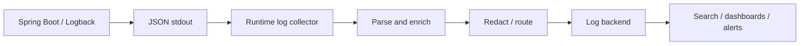

# Structured Logging in Spring Boot

A checkout service logs events whenever it receives a request, calls a payment gateway, or encounters an error. When logs are merely free-text lines such as "payment failed" or "request took too long", operators have to search by string, guess which service emitted the log, and manually piece events together. That approach does not scale well when many services, multiple instances, and millions of log records are operating at the same time.

**Structured logging** turns each log event into a structured record with named fields and clear data types, such as timestamp, severity, service name, event name, trace ID, span ID, and permitted business attributes. Instead of only searching prose sentences, a logging system can filter by field, aggregate occurrence counts, and link a log record with its corresponding trace.

In Spring Boot, applications typically use SLF4J as the logging facade and Logback as the default logging implementation. Structured output can be produced via a JSON encoder/appender or an appropriate logging integration, then forwarded to a collector or log backend. **JSON formatting alone does not automatically give logs good semantics**: schema, field consistency, context propagation, privacy, and operational practices still need to be designed.

This lesson belongs to the **Logging** chapter of the **SPRING_BOOT_OBSERVABILITY** module. The module guides setting up observability for Spring Boot using Micrometer Observation, metrics, logs, and distributed tracing; covering context propagation, tags/cardinality, exporters, sampling, and signal correlation to investigate errors, latency, and application behavior in production environments. This lesson focuses on structured logging, how to design an event schema, and linking logs with metrics/traces.

## Learning Objectives

After this lesson, you will be able to:

1. Explain structured logging and distinguish a structured log record from free-text logging.
2. Design a schema including timestamp, severity, service identity, event name, trace/span context, and attributes.
3. Understand the roles of SLF4J, Logback, JSON encoder/appender, and the log pipeline in Spring Boot.
4. Log using placeholders and structured key-value pairs without building inconsistent strings manually.
5. Correlate log records with traces via trace ID/span ID and context/MDC.
6. Choose operationally meaningful severity levels, event names, and field names.
7. Control cardinality, payload size, privacy, secret redaction, and log injection.
8. Collect, parse, route, and search structured logs in a collector/backend.
9. Verify logging behavior in unit/integration tests.
10. Operate logging alongside metrics and distributed tracing without turning logs into metric labels or a business data store.

## 1. What Is Structured Logging?

A structured log record represents an event using machine-readable and queryable fields. Example of a free-text log:

```text
2026-11-22 09:10:42 WARN Payment authorization failed for order 84721
```

This line contains information, but to filter all failed payment events, the system has to parse the string and rely on how it was phrased. A structured log expresses the same event using fields:

```json
{
  "timestamp": "2026-11-22T02:10:42.384Z",
  "level": "WARN",
  "service": "checkout-service",
  "event": "payment.authorization.failed",
  "message": "Payment authorization failed",
  "order_ref": "ord-84721",
  "payment_provider": "provider-a",
  "trace_id": "0af7651916cd43dd8448eb211c80319c",
  "span_id": "b7ad6b7169203331"
}
```

This is illustrative JSON, not a mandatory schema. In a real environment, `order_ref` should only be logged if permitted by data policy; for example, do not include card numbers, tokens, or sensitive personal data.

### 1.1. Free-Text vs. Structured Logs

| Characteristic | Free-text logging | Structured logging |
|---|---|---|
| Representation | A single line of text | Named fields with values |
| Filtering by event | String search, regex | Filter by event or field |
| Data types | Usually treated as text | Can preserve number, boolean, timestamp |
| Consistency | Depends on how each developer writes it | Common schema can be enforced |
| Aggregation | Requires additional parsing | Easy to group/count by field |
| Trace correlation | Embedded ID inside a sentence | Dedicated trace_id/span_id fields |
| Message changes | May break string queries | Queries rely on stable event/fields |

Structured logging does not make message text useless. The `message` field helps humans understand the event, while the other fields help machines filter and analyze it.

### 1.2. A Log Is an Event, Not a Dump of Every Variable

A useful structured log answers: **what happened, where, in what context, and with what outcome?** It should not contain all local variables, all request headers, or an entire object graph. Logging too much makes logs expensive, hard to read, increases security risk, and can expose unintended data.

## 2. Designing a Schema for Log Records

There is no single mandatory schema for all applications, but a core set of fields and naming conventions should be standardized. You can refer to the OpenTelemetry Logs Data Model and semantic conventions to improve interoperability.

### 2.1. Core Field Groups

| Group | Example field | Purpose |
|---|---|---|
| Time | timestamp | When the event occurred |
| Level | level or severity_text | Severity level |
| Source | service.name, service.version, deployment.environment.name | Service/version/environment |
| Event | event.name | Stable name of the event type |
| Content | message or body | Human-readable explanation |
| Tracing | trace_id, span_id, trace_flags | Links the log with a distributed trace |
| Operation | http.request.method, http.route, http.response.status_code | HTTP context |
| Outcome | payment.provider, payment.result | Permitted business attributes |
| Error | exception type/message/stack fields | Controlled error investigation |

Actual field names depend on the encoder, backend, and semantic conventions. For example, `service.name` is a resource attribute according to conventions, while a JSON appender may need configuration to render this field. Do not rename fields arbitrarily across services.

### 2.2. Event Names Must Be Stable

Use structured event names with consistent meaning:

```text
checkout.request.received
checkout.payment.authorization.started
checkout.payment.authorization.succeeded
checkout.payment.authorization.failed
inventory.reservation.rejected
```

Avoid putting dynamic values into event names:

```text
payment.failed.for.order.84721
payment.failed.for.order.84722
```

Dynamic values should be placed in an appropriate field if logging them is permitted. Stable event names allow queries and aggregations to work without knowing each specific message string.

### 2.3. Use Appropriate Data Types

Do not stringify every value:

```json
{
  "retry_count": 2,
  "payment_accepted": false,
  "duration_ms": 184,
  "http_response_status_code": 503
}
```

If the encoder outputs everything as strings, numeric queries and aggregations become harder. Verify that the log backend receives the right data types after parsing.

### 2.4. Distinguish Resource Attributes from Event Attributes

`service.name` describes the service emitting telemetry; `event.name` describes the event type; `trace_id`/`span_id` attach the record to an execution context; `payment.provider` describes a specific operation. Do not put request-specific values into a resource shared across the entire process.

## 3. Spring Boot Logging Stack: SLF4J and Logback

Spring Boot typically configures SLF4J as the logging facade and Logback as the default implementation when using the logging starter. Application code invokes the logger through SLF4J:

```java
import org.slf4j.Logger;
import org.slf4j.LoggerFactory;

class PaymentService {
    private static final Logger log =
            LoggerFactory.getLogger(PaymentService.class);

    void authorize(String paymentRef) {
        log.info("Payment authorization started");
    }
}
```

SLF4J keeps application code less coupled to the logging implementation. Logback decides how to format, filter, and write logs to console/file/appender. Structured output is usually configured in the Logback encoder/layout or an integration library.

### 3.1. Placeholder Logging

Use placeholders instead of manual string concatenation:

```java
log.info("Payment authorization started for provider={}",
        provider);
```

This lets the logger defer formatting when the level is not enabled and reduces string concatenation. However, a plain placeholder is still just message text; it does not automatically turn `provider` into a JSON field with a stable schema.

### 3.2. Structured Key-Value Logging

Recent versions of SLF4J provide a key-value logging API. For example:

```java
log.atInfo()
   .addKeyValue("event.name", "payment.authorization.started")
   .addKeyValue("payment.provider", provider)
   .log("Payment authorization started");
```

How key-value pairs are rendered depends on the logging provider and encoder/layout. For them to be emitted as JSON fields, you must configure a supporting Logback encoder/layout and verify the output. If the logging stack does not support this API or uses an older version, use structured arguments compatible with your encoder; do not manually format JSON via string concatenation.

### 3.3. Example Service with Success/Failure Events

```java
@Service
class PaymentService {
    private static final Logger log =
            LoggerFactory.getLogger(PaymentService.class);

    private final PaymentGateway gateway;

    PaymentService(PaymentGateway gateway) {
        this.gateway = gateway;
    }

    PaymentResult authorize(String provider, String paymentRef) {
        log.atInfo()
                .addKeyValue("event.name",
                        "payment.authorization.started")
                .addKeyValue("payment.provider", provider)
                .log("Payment authorization started");

        try {
            PaymentResult result = gateway.authorize(paymentRef);

            log.atInfo()
                    .addKeyValue("event.name",
                            "payment.authorization.succeeded")
                    .addKeyValue("payment.provider", provider)
                    .addKeyValue("payment.result", "approved")
                    .log("Payment authorization completed");

            return result;
        } catch (PaymentGatewayException error) {
            log.atWarn()
                    .addKeyValue("event.name",
                            "payment.authorization.failed")
                    .addKeyValue("payment.provider", provider)
                    .addKeyValue("error.type",
                            error.getClass().getSimpleName())
                    .log("Payment authorization failed", error);

            throw error;
        }
    }
}
```

`PaymentGateway`, `PaymentResult`, and `PaymentGatewayException` are illustrative domain types. The example does not log `paymentRef`; if business correlation is needed, use an approved reference identifier that contains no secrets. Stack traces should only be logged once at the appropriate boundary to avoid duplicate exception logs.

## 4. Emitting JSON Structured Logs with Logback

A common approach is configuring a JSON encoder for Logback, such as the encoder from the `logstash-logback-encoder` library. Dependencies and configuration should be pinned to a version compatible with Logback/Spring Boot.

Illustrative Gradle configuration:

```groovy
dependencies {
    implementation 'net.logstash.logback:logstash-logback-encoder:<compatible-version>'
}
```

`<compatible-version>` is a placeholder; choose a version compatible with your actual dependency tree and manage it with an internal version catalog/BOM if available.

Shortened `logback-spring.xml` example:

```xml
<configuration>
    <appender name="JSON_CONSOLE"
              class="ch.qos.logback.core.ConsoleAppender">
        <encoder
          class="net.logstash.logback.encoder.LogstashEncoder">
            <includeContext>false</includeContext>
        </encoder>
    </appender>

    <root level="INFO">
        <appender-ref ref="JSON_CONSOLE"/>
    </root>
</configuration>
```

This is a basic example demonstrating JSON output. Specific encoder properties may vary by version; configuring additional fields, MDC inclusion, timestamp format, stack trace, masking, and structured arguments requires checking the documentation of the encoder in use.

### 4.1. Structured Arguments and Field Mapping

The encoder can understand structured arguments or SLF4J key-value pairs to emit them as JSON fields. Inspect the actual log output:

- Do field names match the schema?
- Do values preserve number/boolean types?
- Is the timestamp in UTC and parseable?
- Does MDC include trace/span fields yet?
- Are exceptions rendered in a dedicated field or is the stack trace bounded?
- Are there duplicate fields added by both the message and the encoder?

Do not assume that enabling an encoder makes every MDC/structured key-value pair appear automatically. Write a smoke test that logs a representative event and parses the JSON to verify.

### 4.2. Console JSON or File JSON?

In containers/Kubernetes, it is usually best to write JSON to stdout/stderr so the runtime log collector can pick it up. File logging may be needed in legacy environments, but it requires handling rotation, disk pressure, permissions, and log shipping.

Do not write the same event to both console and file and forward both sources if the backend does not deduplicate; doing so can double-count events.

## 5. Correlation with Distributed Tracing

Structured logs become much more valuable when linked to a trace. When a log is written within an active span, the tracing integration can place `trace_id` and `span_id` into MDC or the log record according to configuration.

Example:

```json
{
  "timestamp": "2026-11-22T02:10:42.384Z",
  "level": "INFO",
  "service.name": "checkout-service",
  "event.name": "payment.authorization.started",
  "trace_id": "0af7651916cd43dd8448eb211c80319c",
  "span_id": "b7ad6b7169203331",
  "message": "Payment authorization started"
}
```

### 5.1. MDC and Trace Context

MDC (Mapped Diagnostic Context) is a logging mechanism that typically attaches key-value pairs to a thread. A tracing integration can put trace ID/span ID into MDC for the encoder to render. Default field names depend on the bridge/logging integration; some stacks use `traceId`/`spanId`, while others map them to different names.

Do not assume correlation works out of the box just because the application uses Micrometer Tracing or OpenTelemetry. Verify the log output during an actual request.

### 5.2. Threads and Async Boundaries

MDC is typically thread-bound; when a task crosses to an executor or a new thread, context may not be propagated. If the executor uses proper context propagation, the trace scope and MDC accessor can be captured and restored. Passing only the trace ID as a string does not restore the current span or the parent-child relationship.

Test task A/task B on the same worker to ensure A's context does not leak into B. For async work that outlives the request, consider a separate trace with a span link to the producer context instead of keeping the request span open indefinitely.

### 5.3. Correlation Is Not Causal Proof

Logs sharing the same trace ID help locate the same trace context; the span ID indicates the corresponding operation. A trace ID is neither a business transaction ID nor a credential. When a request is dropped by sampling, logs may still carry a trace ID even though the backend does not have the corresponding trace.

Use trace correlation to gather additional evidence, not as a substitute for business logic or security controls.

## 6. Severity and Event Semantics

| Level | When to use | Example |
|---|---|---|
| TRACE | Very deep detail, usually disabled outside debugging | Sanitized protocol detail |
| DEBUG | Non-permanent development/investigation info | Cache lookup decision |
| INFO | Normal events with operational value | Payment authorization completed |
| WARN | Unusual situation that is handled or needs attention | Provider retry, fallback activated |
| ERROR | Failed operation requiring investigation | Payment gateway call exhausted retries |

Do not log every exception at `ERROR` if the caller already logs the same error at another boundary. Choose a single owner for the stack trace to avoid producing multiple similar log records for one exception.

### 6.1. Event Name and Severity Are Separate Concepts

`event.name` describes the type of event; `level` expresses severity according to application policy. Do not encode severity into the event name like a dynamic string, and do not rely solely on the message to infer the event type.

### 6.2. Avoid Pointless Success Logs at Every Step

If every method logs "started", "entered", and "finished" for every request, log volume grows while adding little value. Choose events that create real operational evidence: integration boundaries, important business state transitions, retries/fallbacks, errors, and decisions requiring auditability.

## 7. Structured Exception Logging

An exception log should include a stable event name, error type/class, a safe message, a stack trace when helpful, trace/span context, service/operation, and a retry count or normalized dependency name when needed.

```java
try {
    gateway.authorize(request);
} catch (TimeoutException error) {
    log.atWarn()
            .addKeyValue("event.name", "payment.gateway.timeout")
            .addKeyValue("error.type",
                    error.getClass().getSimpleName())
            .addKeyValue("dependency.name", "payment-gateway")
            .addKeyValue("retryable", true)
            .log("Payment gateway timed out", error);

    throw error;
}
```

A logged stack trace does not replace span status/error events or metric error counters. Instrumentation can record the exception on the span, metrics count failure outcomes, and structured logs keep details for humans. Avoid having the three signals emit conflicting information.

### 7.1. Avoiding Duplicate Stack Traces

If the gateway layer logs a stack trace and then the service/controller logs the same exception again, one failure can produce multiple records. Decide which boundary owns exception logging. Other layers can throw or map the exception without repeating the stack trace.

## 8. Cardinality and Log Size

| Field | Typical cardinality | Notes |
|---|---|---|
| service.name | Low | Resource/service identity |
| event.name | Low if stable | Avoid dynamic values |
| http.request.method | Low | Finite set of methods |
| http.route | Low if templated | Do not use raw path |
| payment.provider | Low if allowlisted | Bounded list |
| trace_id | Very high | Correlation field; consider index cost |
| order_id | High | Log only if needed and permitted |
| email | High, contains PII | Avoid or mask per policy |

Log backends handle high-cardinality fields differently from metrics backends, but indexing every field can raise costs and slow down queries. Only index/make searchable the fields that serve concrete use cases.

### 8.1. Bounding Payloads

Do not serialize entire request/response bodies, entity graphs, or large objects into logs. Use a field allowlist, truncate necessary data, bound stack traces, and strip binaries/payloads. Large payloads increase ingestion costs, queue pressure, and data exposure risk.

## 9. Security and Privacy in Structured Logs

Logs are often centralized and accessible by many teams; treat them as controlled data.

Never log passwords, API keys, access/refresh tokens, authorization headers, cookies, full payment card numbers, security codes, session credentials, sensitive request/response bodies, or unnecessary PII.

### 9.1. Allowlists and Redaction

Actively choose which fields may be logged. Denylists easily miss new fields or nested objects containing secrets. For headers, log only a small allowlist such as content type or controlled correlation metadata; do not log the entire headers map.

If correlation with a business entity is needed, use a reference designed for logging, or apply hashing/tokenization or masking according to policy. Do not hash a secret yourself and assume the result is safe; weak or reversible hashes still pose risks.

Redaction should be applied close to the log source and can be supplemented at the collector. Do not rely solely on a backend filter because the data has already traveled across the network and may exist in queues/log files before filtering.

### 9.2. Log Injection

User-supplied values can contain newlines, control characters, or strings spoofing log entries. Use logging APIs and a JSON encoder properly so values are escaped. Never concatenate raw input into a log line manually. Test payloads containing newlines, tabs, and control characters to verify that one input cannot forge a fake record.

## 10. Collecting and Exporting Structured Logs



You can use an agent/collector tailing files or an appender sending directly. JSON stdout is usually a good fit for container platforms because the runtime already captures process logs.

### 10.1. Parsing Before Querying

The collector needs to recognize that the record is JSON and parse it properly. If JSON is nested inside the `message` field, the backend might only see a single string instead of separate fields. Verify that JSON is valid, timestamps parse correctly, levels map properly, resource metadata is preserved, trace/span fields parse accurately, multiline stack traces are merged by rules, and parse failures are detected.

### 10.2. Avoiding Duplicate Log Exports

If a Logback appender sends directly via OTLP while an agent/collector also reads stdout and forwards it again, the same record can appear twice. Inventory all log shipping paths and choose a single authoritative path for each source.

### 10.3. Structured Logs and OpenTelemetry Logs

The OTel Logs Data Model defines timestamp, observed timestamp, severity, body, attributes, resource, and trace context. JSON Logback output is one representation of structured logs; it does not automatically mean it is an OTel LogRecord or exported via OTLP.

An integration/bridge/appender/agent is required to convert log events into an OTel Logs pipeline if your architecture chooses OTel Logs. The collector receiver/exporter must have a dedicated logs pipeline.

## 11. Testing Structured Logging

Do not just test that a method returns a result. Test the schema and field behavior:

1. Emit a sample log event.
2. Capture the output using a test appender or by reading stdout in an integration test.
3. Parse the JSON into an object.
4. Assert field names, timestamp format, severity, and event name.
5. Verify secrets/PII do not appear.
6. When trace context exists, assert the trace/span IDs are accurate.
7. Test that error logs include exception type and stack trace per policy.
8. Check that input containing newlines is JSON-escaped and does not create a forged record.

### 11.1. Conceptual Test Example

```java
@Test
void writesStructuredPaymentFailureEvent() {
    // Arrange: attach ListAppender/TestAppender to the test logger.
    // Act: invoke service with a stub gateway throwing PaymentGatewayException.
    // Assert:
    // - event.name = payment.authorization.failed
    // - payment.provider has an allowlisted value
    // - error.type is the expected exception class
    // - secrets/request body do not appear
    // - exception is logged once at the chosen boundary
}
```

This is pseudocode because how you attach an appender and read structured key-value pairs depends on the Logback/SLF4J/encoder version. In real tests, parse the JSON emitted by the encoder if the goal is to guarantee the output schema; inspecting `LoggingEvent` directly only verifies the event prior to encoding.

### 11.2. Trace Correlation Test

Create a span context in a test, log while the span is active, and verify the output has the corresponding trace ID/span ID. Then close the scope, log outside the context, and assert the fields do not carry stale IDs. Add an async executor test if the application logs on worker threads.

## 12. Linking Logs, Metrics, and Traces

| Signal | Used for | Example |
|---|---|---|
| Metrics | Measuring scale and trends | Payment timeout rate rises |
| Traces | Understanding path and latency of sampled requests | Payment client span lasts 2 seconds |
| Structured logs | Event and error details | Provider timeout, retry_count=2 |

An investigation workflow:

1. Metrics dashboard detects a spike in payment timeout rate by provider.
2. Pick a representative trace with a long or failed payment client span.
3. From the trace ID/span ID, query structured logs in the same context.
4. Inspect event name, dependency name, retry count, and exception type.
5. Compare against successful requests and dependency metrics.
6. Determine whether the root cause is the provider, network, timeout configuration, or retry behavior.

Do not use trace ID as a metric label. Use exemplars or links/correlation in the logging platform when supported. Also, do not assume every log with a trace ID has a trace stored in the backend, since the trace may be dropped by sampling or fail to export.

## 13. Troubleshooting Structured Logging

| Symptom | Possible cause | How to check |
|---|---|---|
| Logs are still plain text | JSON encoder/layout not active | Actual Logback config and appender |
| Valid JSON but fields are inside message | Structured arguments not rendered by encoder | Encoder support/key-value provider |
| Missing traceId/spanId | MDC correlation not configured or context lost | Tracing integration, scope, executor propagation |
| Worker logs carry stale trace | MDC/context not restored | Thread pool reuse and TaskDecorator/accessor |
| Timestamp parses incorrectly | Timezone/format or field mapping | UTC, ISO-8601, and backend parser |
| Exception appears multiple times | Multiple layers logging the same exception | Choose boundary owning the stack trace |
| Duplicate logs in backend | Multiple shippers/appenders forwarding together | Logback appender, agent, stdout collector |
| Single request creates high log volume | Logging every step too verbosely | Reduce redundant events, apply controlled rate limiting |
| Field contains sensitive data | Unsafe object/header dump | Allowlist, redaction close to source |
| Queries fail to find events | Inconsistent field mapping/schema | Parse output and standardize event/field names |

## 14. Anti-Patterns to Avoid

| Anti-pattern | Consequence | Recommended approach |
|---|---|---|
| JSON with inconsistent schema | Queries differ across services | Standardize field/event names |
| Manual JSON string concatenation | Broken escaping, log injection, invalid JSON | Use encoder/structured API |
| Logging full request/response | PII/secrets, large payloads | Allowlist needed fields |
| Logging every error at ERROR on every layer | Duplicate stack traces and alert noise | Choose an owner for exception logging |
| Using message text as event identifier | Queries depend on wording | Stable `event.name` |
| Putting order ID into event name | High cardinality and fragmented schema | Move dynamic values to controlled fields |
| Attaching trace ID to metric tag | Time series explosion | Log correlation/exemplars |
| Assuming JSON automatically brings trace correlation | Missing MDC/context fields | Configure and test integration |
| Manually passing only trace ID into MDC | Logs have IDs but wrong span context | Tracing context propagation |
| Multiple appenders forwarding the same record | Duplicate logs | One authoritative shipping path |
| Filtering secrets only in backend | Secrets already traversed source/queue/network | Redact close to source and at collector |
| Unbounded stack traces/bodies | Cost and data exposure risk | Bounded payloads and policy |

## 15. Structured Logging Implementation Checklist

1. **Schema:** Are field names, types, and event names consistent across services?
2. **Service identity:** Are service name/version/environment consistent?
3. **Timestamp:** Are timezone and format parseable?
4. **Severity:** Does level reflect whether action is actually needed?
5. **Event semantics:** Are event names stable without dynamic IDs?
6. **Message:** Is it readable without being the sole basis for queries?
7. **Tracing:** Are traceId/spanId pulled from the proper context?
8. **Async:** Is MDC/trace context propagated and cleaned up after tasks?
9. **Encoder:** Is JSON valid, with accurate key-value and MDC fields?
10. **Exception:** Is the stack trace emitted once at the appropriate boundary?
11. **Privacy:** Have allowlist, redaction, masking, and secret handling been verified?
12. **Injection:** Are newlines/control characters safely escaped?
13. **Cardinality:** Are high-cardinality fields controlled and purposefully indexed?
14. **Payload:** Are body/object/stack trace sizes bounded?
15. **Shipping:** Is a single record prevented from being forwarded twice across pipelines?
16. **Collector/backend:** Are parsing, resource enrichment, retention, access, and alerting working?
17. **Testing:** Are JSON output, field types, correlation, secret absence, and async cleanup tested?
18. **Operations:** Are there dashboards/alerts for log volume, drops, parse failures, and ingestion latency?

## 16. Self-Assessment Questions

**Question 1.** How does structured logging differ from free-text logging?

**Hint:** Structured logging represents events with named fields and data types, making parsing, querying, and aggregation more reliable.

**Question 2.** Why might a JSON log still not be good structured logging?

**Hint:** The JSON might only contain a single message string; inconsistent schemas, wrong field types, or missing event/context fields.

**Question 3.** What roles do SLF4J and Logback play in Spring Boot?

**Hint:** SLF4J is the facade application code calls to log; Logback is the implementation that formats, filters, and writes logs.

**Question 4.** Why should `event.name` be stable?

**Hint:** Queries/aggregations by event type do not break when message wording changes; dynamic values belong in other fields.

**Question 5.** How do you correlate a log with a trace?

**Hint:** Emit trace ID/span ID from the current tracing context via integration/MDC and verify the actual JSON output.

**Question 6.** Does a log with a trace ID prove the trace exists in the backend?

**Hint:** No. Sampling, span lifecycle, exporter, or collector issues can prevent the trace from being stored.

**Question 7.** Why shouldn't you log all HTTP headers?

**Hint:** Headers can contain authorization, cookies, tokens, or sensitive data; use an allowlist.

**Question 8.** Why test task A and task B on the same worker when verifying MDC?

**Hint:** To catch stale MDC/trace context left over from task A leaking into task B.

**Question 9.** If JSON logs are forwarded twice, what should you check?

**Hint:** Logback appenders, Java Agent log bridges, stdout collectors, and file tailers; pick one authoritative shipping path.

**Question 10.** What should you use instead of a trace ID metric label to link metrics with logs/traces?

**Hint:** Log correlation or exemplars if supported by the backend; metrics should use low-cardinality labels.

## Conclusion

**Structured logging turns logs into events with a stable schema for humans to read and systems to query.** In Spring Boot, SLF4J provides the facade, Logback/encoders format and emit JSON, and the collector/backend parses, enriches, routes, and stores records. The design should standardize event names, field types, service identity, and severity; obtain trace/span context from proper propagation mechanisms; and control cardinality, payload size, secrets, PII, log injection, and duplicate shipping. When structured logs are linked with metrics and traces, operations teams can move from an anomaly on a dashboard to a specific trace and the log event explaining the failure, latency, or application decision.
