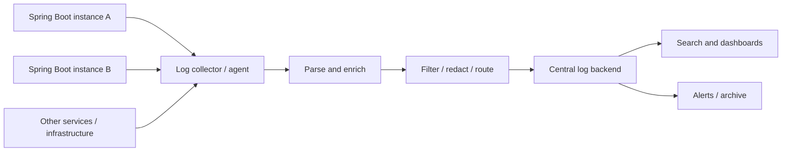
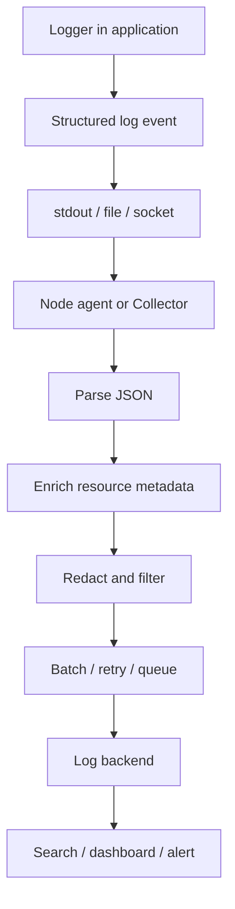
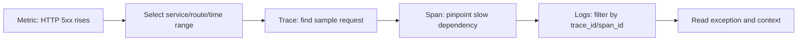
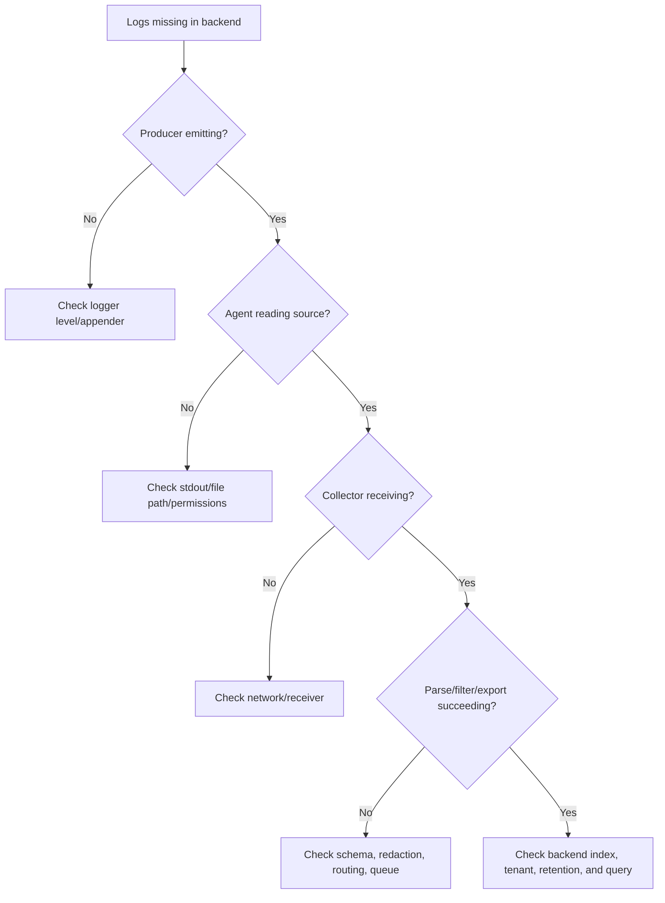

# Log Aggregation in Spring Boot Systems

A Spring Boot application typically writes logs to the console or a local file. That is enough to debug a single instance locally, yet difficult to operate when requests traverse multiple instances, containers, or services. On-call operators have to hunt down timestamps, stitch log lines across machines, and figure out which lines belong to the same request.

**Log aggregation** collects logs from multiple sources, normalizes metadata, and ships them to a centralized system for searching, filtering, storage, and alerting. When logs are correlated with traces and metrics, operations teams can jump from an anomalous metric to a specific trace and then read logs from every service involved in that request.

The **"Log Aggregation"** lesson belongs to the **Logging** chapter of the **SPRING_BOOT_OBSERVABILITY** module. The module guides setting up observability for Spring Boot using Micrometer Observation, metrics, logs, and distributed tracing; covering context propagation, tags/cardinality, exporters, sampling, and signal correlation to investigate errors, latency, and application behavior in production environments.

**Log aggregation is not simply dumping log files into one place.** An effective pipeline requires a consistent schema, service identity, accurate timestamps, routing, data security, retention, and trace correlation. It also needs backpressure policies and handling for data loss during Collector/backend outages.

## 1. Why Do We Need Log Aggregation?

When a service runs across multiple replicas, each instance writes its own logs. In containerized environments, instances can be spun up or terminated after deployments; log files inside a container filesystem can vanish along with the instance.

A centralized pipeline delivers:

- **Cross-service search:** query requests by trace ID, service, time range, or severity.
- **Incident investigation:** piece together events across gateways, applications, database clients, and message consumers.
- **Deployment tracking:** compare logs by service version, environment, or pod.
- **Alerting:** detect rising error logs, repeated exceptions, or components that stop emitting data.
- **Governance:** apply centralized access control, retention, redaction, and auditing.
- **Time savings:** no need to SSH into individual hosts to read files.



Log aggregation can collect logs from ingress, reverse proxies, Kubernetes, databases, message brokers, operating systems, and security infrastructure. Each source needs explicit parsing rules and ownership.

## 2. Centralized Log Pipeline Architecture

A deployment commonly has four layers:

| Layer | Responsibility | Examples |
| --- | --- | --- |
| **Producer** | Emit log events | Spring Boot, Nginx, Kubernetes |
| **Collector/agent** | Read stdout/files/sockets, buffer, and forward | Fluent Bit, Vector, OpenTelemetry Collector |
| **Processing/routing** | Parse, enrich, filter, redact, route | Collector processors, gateway |
| **Backend** | Index, store, query, alert | Loki, Elasticsearch/OpenSearch, cloud logging |



Not every pipeline requires a separate gateway. Small systems can ship directly from agents to the backend. Across multiple teams, environments, or backends, a gateway helps manage routing and policies centrally.

### Collector Is Not the Backend

The Collector receives and forwards telemetry; the backend stores and queries it. The Collector reporting that logs were received does not prove they were indexed or survived retention. Inspect receiver, exporter, and backend ingestion separately.

## 3. Choosing How the Application Outputs Logs

Spring Boot can emit logs via Logback. In containers, the common approach is writing to stdout/stderr so the runtime or node agent collects them.

| Output method | Strengths | Things to watch |
| --- | --- | --- |
| `stdout`/`stderr` | Container-friendly, agent reads runtime stream | Needs structured format and runtime log driver |
| Rolling files | Useful on VMs or bare metal | Rotation, disk usage, permissions, and file tailing |
| Socket/forwarder | Can send directly to collector | Timeouts, queues, and outage behavior |
| OTLP Logs | Transports log records via OpenTelemetry protocol | Needs compatible SDK/bridge/appender/exporter |

Do not simultaneously emit a single event through multiple appenders to multiple pipelines without intent. Duplicate logs skew counts, inflate costs, and complicate investigations.

### `stdout` Fits Containers Well

Typical container deployments have Spring Boot emit console output as JSON, and a node-level collector reads container logs. The application does not need to know backend addresses or hold backend credentials.

On VMs, rolling files can fit well; an agent tails the file and resumes across rotations. Define format, path, owner, permissions, and disk retention.

## 4. Structured Logging and JSON Schema

Log aggregation works far better when each event has a stable structure instead of free-form prose.

Plain-text log:

```text
2026-11-22 10:15:30 ERROR [checkout-service] Payment authorization failed for order 8472
```

JSON log:

```json
{
  "timestamp": "2026-11-22T10:15:30.123Z",
  "severity": "ERROR",
  "message": "Payment authorization failed",
  "service.name": "checkout-service",
  "environment": "production",
  "order.reference": "ord-7f31",
  "error.type": "PaymentTimeoutException"
}
```

JSON lets the Collector parse fields cleanly instead of splitting messages with wording-dependent regexes.

A basic schema should include:

| Field | Purpose | Example |
| --- | --- | --- |
| `timestamp` | Event timestamp | ISO-8601 UTC |
| `severity` | Log level | `INFO`, `WARN`, `ERROR` |
| `message` | Human-readable text | Payment authorization failed |
| `service.name` | Emitting service | `checkout-service` |
| `service.version` | Artifact version | `2.4.1` |
| `deployment.environment` | Environment | `production` |
| `service.instance.id` | Instance/pod identity | `pod-7b9c` |
| `trace_id` | Trace link | 32 hex chars |
| `span_id` | Span link | 16 hex chars |
| `logger` | Logger/category | `c.p.checkout.PaymentService` |
| `thread` | Thread name | `http-nio-8080-exec-4` |
| `error.type` | Exception type | `PaymentTimeoutException` |

The OpenTelemetry Logs Data Model defines `Timestamp`, `ObservedTimestamp`, `SeverityText`, `SeverityNumber`, `Body`, `Resource`, `InstrumentationScope`, `Attributes`, and `TraceId`/`SpanId`. Backends may display different field names, yet you should preserve the corresponding semantics so information is not lost during translation.

**Never use `message` as the sole place to store data.** Fields needed for filtering/alerting should be structured attributes with stable types and names.

## 5. Timestamps and Timezones

Logs can arrive from many machines, regions, and runtimes. Timestamps should be standardized, typically serialized in ISO-8601 UTC.

```json
{
  "timestamp": "2026-11-22T03:15:30.123Z",
  "observed_timestamp": "2026-11-22T03:15:30.450Z",
  "message": "Order accepted"
}
```

- `timestamp` is when the producer recorded the event.
- `observed_timestamp` is when the collector/backend observed or received the event.
- The delta can help surface clock skew, buffering, or network delay.

Synchronize clocks across host/pod nodes using your platform's standard time mechanism. If a producer drifts by several minutes, time-range queries can miss logs or misorder event sequences.

Do not overwrite the source timestamp with the collector timestamp without preserving the original value. If timestamp normalization is needed, keep both original and observed times in the schema.

## 6. Resource Metadata and Service Identity

Every log must answer: which service, which version, which environment, and which instance emitted it?

```json
{
  "service.name": "checkout-service",
  "service.version": "2.4.1",
  "deployment.environment": "production",
  "service.instance.id": "checkout-7b9c",
  "cloud.region": "ap-southeast-1"
}
```

Resource metadata should be managed via deployment configuration, environment variables, or Collector enrichment. Do not force developers to add these fields manually to every message.

- `service.name` stays stable across replicas of the same service.
- `service.version` changes with each release.
- `deployment.environment` uses a standardized value set such as `dev`/`staging`/`prod`.
- `service.instance.id` distinguishes instances; it does not necessarily belong as a dimension on every metric.
- Kubernetes metadata such as namespace, pod, and node can be added by the agent.

Resource describes the producer; log record attributes describe the specific event. Never confuse these two layers.

## 7. Correlation with Traces and Metrics

Logs are far more valuable when they can open the associated trace. Per the OpenTelemetry Logs Data Model, a log record can carry `TraceId` and `SpanId`. A log emitted inside an active tracing context links to the current span when the logging integration supports it.

Example:

```json
{
  "timestamp": "2026-11-22T03:15:30.123Z",
  "severity": "ERROR",
  "message": "Payment authorization timed out",
  "service.name": "checkout-service",
  "trace_id": "4bf92f3577b34da6a3ce929d0e0e4736",
  "span_id": "00f067aa0ba902b7",
  "error.type": "PaymentTimeoutException"
}
```

Operators can find `ERROR` logs, filter by service/route, open the trace via `trace_id`, inspect the slow or failed span, read logs for that trace to inspect exception details, and cross-check metrics to gauge blast radius.



### Do Not Embed Trace IDs into Metric Labels

A trace ID is nearly unique per request. Adding it as a metric tag creates massive numbers of time series. Keep trace IDs in trace/log context; use exemplars or backend correlation to jump from metrics to traces when supported.

Log correlation is not the same as log sampling. Sampling decides which traces are stored; logs may still exist even when the trace is absent from the backend. A missing trace does not mean the request never happened.

## 8. Spring Boot and Logback JSON

Spring Boot typically uses Logback in standard starter applications. You can use a third-party JSON encoder such as Logstash Logback Encoder or another logging integration; manage dependencies and compatible versions carefully.

Example Logback console appender with JSON encoder (requires the corresponding encoder dependency):

```xml
<configuration>
    <appender name="JSON_CONSOLE" class="ch.qos.logback.core.ConsoleAppender">
        <encoder class="net.logstash.logback.encoder.LogstashEncoder">
            <includeMdc>true</includeMdc>
            <includeContext>true</includeContext>
        </encoder>
    </appender>

    <root level="INFO">
        <appender-ref ref="JSON_CONSOLE"/>
    </root>
</configuration>
```

This example is based on Logstash Logback Encoder; class names and options depend on version. Do not add this configuration unless the encoder dependency is present. Newer Spring Boot releases may offer built-in structured logging format support; check docs for your exact version before choosing.

In containers, `stdout` is usually collected by the runtime already. Writing JSON to `stdout` while also writing the same event to a file tailed by an agent causes duplicates in the backend. If a local file is required, separate its purpose and distinguish the source.

## 9. OpenTelemetry Collector for Logs

The OpenTelemetry Collector can receive logs over OTLP, tail files, or use receivers available in its distribution, process them, and export them to a backend. Minimal OTLP logs pipeline example:

```yaml
receivers:
  otlp:
    protocols:
      grpc:
        endpoint: 0.0.0.0:4317
      http:
        endpoint: 0.0.0.0:4318

processors:
  memory_limiter:
    check_interval: 1s
    limit_mib: 512
  batch:
    timeout: 5s
    send_batch_size: 1024

exporters:
  debug:
    verbosity: basic

service:
  pipelines:
    logs:
      receivers: [otlp]
      processors: [memory_limiter, batch]
      exporters: [debug]
```

The `debug` exporter suits local/test environments. Production needs an exporter to your log backend, auth/TLS, queues, retries, resource limits, and retention. Not every Collector distribution includes every component; verify the deployed binary.

If the application writes files, the agent must tail the right path and handle rotation. If the application writes to `stdout`, the container runtime stores container logs for the node agent to read. Avoid having two collectors tail the same source. The Collector should parse JSON before enrichment/routing; if parsing fails, retain the raw body or route to an error pipeline.

## 10. Parse, Normalize, and Enrich

A log processing pipeline typically consists of:

1. **Parse:** read JSON or source format.
2. **Normalize:** map severity, timestamp, field names, and exception representation.
3. **Enrich:** attach service/environment/host/container metadata.
4. **Redact:** remove or mask sensitive data.
5. **Filter:** drop controlled noise, such as excessive health checks.
6. **Route:** send to the appropriate backend.
7. **Batch/queue:** group batches and absorb network hiccups.
8. **Export:** deliver log records to storage.

Example mappings:

| Source | Normalized |
| --- | --- |
| `level` | `severity_text` |
| `@timestamp` | `timestamp` |
| `app` | `service.name` if semantics match |
| `traceId` | `trace_id` or OpenTelemetry `TraceId` |
| `spanId` | `span_id` or OpenTelemetry `SpanId` |
| `exception.class` | `error.type` |
| `exception.message` | `error.message` after sensitive-data checks |

Do not map fields solely because names look similar. For example, `app` sometimes represents a module or logger rather than true service identity.

## 11. Filtering, Routing, and Log Classification

Not all logs need the same backend, access permissions, or retention.

| Log type | Suggested routing | Notes |
| --- | --- | --- |
| Application `INFO`/`WARN` | Central application log store | Query by service/environment |
| Application `ERROR` | Application store + alert rule | Avoid per-event alerts that cause noise |
| Security/audit | Security-controlled store | Separate permissions and retention |
| Debug/trace logs | Short retention, controlled activation | May contain sensitive data |
| Access logs | Log platform or analytics store | Normalize route/status/latency |
| Health-check noise | Controlled filter or sampling | Do not drop important SLO signals |

Do not drop all health endpoint logs if they help spot unhealthy targets. When filtering at ingest, keep metrics on dropped event counts to catch overly broad rules.

### Log Aggregation Is Not an Audit Ledger

Logs can be buffered, dropped, sampled, transformed, or expire via retention. If you need immutable audit records or delivery guarantees, use a dedicated audit system with appropriate access controls and retention. Log aggregation supports investigation but does not replace a transaction ledger.

## 12. Security, Privacy, and Redaction

Centralized logs can be accessed by many teams, replicated, and stored longer than local logs. One logging mistake can broaden a data leak.

Never log by default:

- Passwords, API keys, bearer tokens, cookies, and session secrets.
- Full request/response bodies containing personal or payment details.
- Authorization headers.
- Private keys or connection strings containing credentials.
- Personal data lacking a valid basis and retention policy.
- SQL parameters or exception text containing secrets.

Safeguards:

1. Redact at the producer whenever possible, before data leaves the trust boundary.
2. Add Collector transform/redaction processors as defense in depth.
3. Use field allowlists for structured logs.
4. Restrict who can query logs by team, service, tenant, and sensitivity.
5. Encrypt in transit and at rest.
6. Enforce retention by data category.
7. Audit access or exports of sensitive logs.
8. Never copy baggage/MDC fields into logs without privacy review.

Backend redaction cannot recall data already shipped to other systems earlier. Sanitize data at the producer or a collector close to the source.

## 13. Cardinality and Storage Cost

Structured logs let you query across many fields, but too many unique values inflate index sizes and query costs. Keep certain high-cardinality fields unindexed in the payload or index them only when justified.

| Field | Typical cardinality | Strategy |
| --- | --- | --- |
| `service.name` | Low | Index/filter |
| `deployment.environment` | Low | Index/filter |
| `severity` | Very low | Index/filter |
| `http.route` | Low if route-templated | Index/filter |
| `http.status_code` | Bounded | Index/filter |
| `trace_id` | Very high | Index for correlation, watch cost |
| `user.id` | Very high and sensitive | Do not collect by default |
| Full URL/query string | Potentially high and sensitive | Normalize route, strip query |
| Request body | Unpredictable | Do not log by default |

Log cost depends on ingested bytes, indexing strategy, storage tier, replication, queries, and retention. Cutting noisy verbosity, removing redundant fields, and avoiding unnecessary stack traces lowers cost without sacrificing data needed for incident response.

## 14. Buffering, Backpressure, and Log Loss

If the backend is slow or unavailable, collectors/agents can buffer logs, yet queues are always finite.

- Full queues cause the collector to drop events.
- Disk buffers run out of space or hit permission errors.
- Collector restarts wipe memory-only buffers.
- Log rotation completes before the agent finishes reading a file.
- Network partitions grow backlogs.
- Backends rate-limit or reject oversized payloads.
- Producers emit faster than the runtime log driver can read.

Define delivery expectations for each log category:

| Category | Acceptable data loss |
| --- | --- |
| Debug noise | Controlled drops acceptable |
| Application `INFO` | Monitor drop rate |
| `ERROR`/security events | Stronger policy and alert on loss |
| Audit/financial records | Never rely on a best-effort log pipeline |

Never advertise a log pipeline as zero-loss without durable queues, acknowledgements, and outage testing. Critical data needs dedicated delivery guarantees.

## 15. Querying Logs Effectively

A good query starts with a narrow time range and scope, then drills down. Syntax varies by backend:

```text
service.name = "checkout-service"
AND deployment.environment = "production"
AND severity >= "ERROR"
AND timestamp within last 15 minutes
```

Find logs for a trace:

```text
trace_id = "4bf92f3577b34da6a3ce929d0e0e4736"
```

Find exceptions by type:

```text
error.type = "PaymentTimeoutException"
AND service.name = "payment-service"
```

Avoid running unbounded full-index queries without a time range on large systems. Use resource/service/environment filters and route templates to narrow results.

Useful dashboards can include error logs by service/version, top exception types, log volume and ingest/drop rates, Collector queue utilization, exporter failures, trace-linked logs from trace detail views, and release markers.

Never use a dashboard counting `ERROR` logs alone as an SLO. One request might log multiple `ERROR`s or none at all; request/error rate metrics are better suited for aggregates.

## 16. Alerting from Logs

Log-based alerts help catch specific exceptions, certificate warnings, or security events lacking dedicated metrics. However, alerting on individual lines is usually noisy.

- Aggregate over a time window.
- Fingerprint/group identical exceptions.
- Distinguish expected errors from actionable errors.
- Configure thresholds, cooldowns, and routing.
- Attach service/environment/version and a query link.
- Ensure alerts are not triggered by test deployments or health checks.
- Monitor ingest failures so you know if the alert pipeline stops receiving logs.

For request success/latency SLIs, metrics or trace-derived metrics fit better than log counts. Logs supply evidence and root-cause detail.

## 17. Diagnosing Missing Logs in the Backend

| Symptom | Possible cause | How to investigate |
| --- | --- | --- |
| Logs appear in console, backend empty | Agent not reading stdout or wrong routing | Check runtime log driver and agent |
| JSON parse fails | Encoder differs from parser schema | Inspect raw event and parse error pipeline |
| Timestamps skewed | Clock skew or non-standard timezone | Check UTC and node time sync |
| Missing `service.name` | Missing resource enrichment | Check env/resource attributes |
| Cannot link trace | MDC/OTel correlation inactive or wrong `trace_id` | Check active context and field mapping |
| Duplicate logs | Both console + file sent, or two agents reading one source | Audit input ownership |
| Delayed logs | Buffer/queue/backpressure or ingest lag | Check queue depth, batching, and backend latency |
| Logs lost on restart | Memory-only buffer or file rotation gap | Check durable queues and checkpoints |
| Missing `ERROR` alerts | Filter dropped logs or misrouted | Check filter order and alert source |
| Slow queries | Wide time range or high-cardinality index | Narrow range and tune schema |

Workflow:

1. Confirm the application emits logs at the expected level.
2. Inspect JSON output and timestamps at the producer.
3. Verify the runtime/agent reads the right source.
4. Check Collector receivers and parse errors.
5. Check whether filters/redaction/routing dropped the logs.
6. Inspect exporter queues, retries, and backend status.
7. Filter by service/time range before querying specific fields.
8. If logs have `trace_id`, open the trace and compare span context.
9. Check drop counters at each layer to pinpoint where data was lost.



## 18. Lab Exercise: Centralizing Spring Boot Logs

Practice in local/test before rolling out to production.

1. **Standardize console output:** configure a Logback JSON encoder or structured logging support matching your Spring Boot version. Each event is one JSON object per line.
2. **Add service metadata:** inject service name, version, and environment from deployment config; never hardcode pod IDs or credentials.
3. **Emit correlated logs:** send requests through an instrumented HTTP server and outbound HTTP client. Verify trace ID/span ID appear when the logging integration is configured; never fabricate trace IDs.
4. **Collect with Collector/agent:** run a local agent receiving stdout/files or OTLP Logs; verify JSON parsing and resource metadata.
5. **Route to a test backend:** use the `debug` exporter or a local backend; query by service, severity, and trace ID; check for duplicates.
6. **Test redaction:** emit a test log containing a fake token and confirm the producer/collector strips or masks it before shipping. Never use real secrets.
7. **Test outage/backpressure:** stop the backend or Collector during testing; observe queues, drop counters, disk buffers, and recovery.
8. **Build an investigation query:** simulate a payment timeout; query `ERROR` logs, open the trace by trace ID, and cross-reference `Timer`/HTTP metrics.

## 19. Self-Check Questions

1. How does log aggregation differ from writing logs to local files?
2. Which layers make up a typical centralized log pipeline?
3. Why does a Collector receiving logs not guarantee the backend stored/indexed them?
4. How does structured JSON help parsing and querying?
5. What are the key components of the OpenTelemetry Logs Data Model?
6. Why distinguish producer timestamps from observed timestamps?
7. How does resource metadata differ from log record attributes?
8. How do `TraceId` and `SpanId` enable correlation?
9. Why must trace IDs never go into metric labels?
10. Does log correlation imply the trace is always sampled and stored?
11. When is `stdout` a better fit than rolling files?
12. What must a Collector do before routing logs?
13. Why should log aggregation not be used as an audit ledger?
14. Which data should never be written to logs?
15. How do trace ID, user ID, and full URL cardinalities affect index cost?
16. How can full queues or Collector restarts lose logs?
17. Why is log count not a reliable request error rate SLI?
18. When logs do not reach the backend, which boundaries should you inspect in order?

## References

- [Spring Boot Logging](https://docs.spring.io/spring-boot/reference/features/logging.html): logging system, Logback, and logging configuration.
- [Spring Boot Structured Logging](https://docs.spring.io/spring-boot/reference/features/logging.html#features.logging.structured): structured log formats and field customization by version.
- [OpenTelemetry Logs Data Model](https://opentelemetry.io/docs/specs/otel/logs/data-model/): log records, resources, scopes, timestamps, severity, and trace correlation.
- [OpenTelemetry Collector](https://opentelemetry.io/docs/collector/): receivers, processors, exporters, pipelines, and deployment patterns.
- [OpenTelemetry Collector Resiliency](https://opentelemetry.io/docs/collector/resiliency/): queues, retries, backpressure, and data loss.
- [Logstash Logback Encoder](https://github.com/logfellow/logstash-logback-encoder): JSON encoder for Logback and MDC.

## Conclusion

**Log aggregation transforms scattered log events into searchable data for cross-service investigation.** To do it well, Spring Boot must emit structured logs with consistent service metadata; the Collector/agent must parse, enrich, redact, route, and buffer; and the backend must provide indexing, retention, access control, and effective queries.

Keep timestamps and identities accurate, link logs to traces via trace/span context, keep high-cardinality values out of metric tags, and protect sensitive data before it leaves the trust boundary. Test both normal operation and outage/backpressure scenarios to know how logs traverse each layer and where loss can occur. When logs, traces, and metrics maintain shared service identity and correlation, investigating errors, latency, and application behavior in production becomes dramatically clearer.
