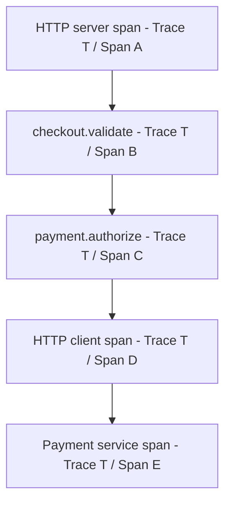
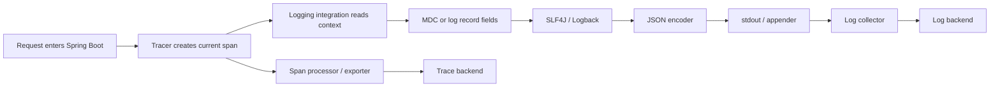

# Correlating Logs with Traces in Spring Boot

When a checkout request fails, a trace shows which services the request passed through and which span took the most time. However, the trace does not necessarily hold every detail explaining the failure. Logs can specify that a provider timed out, the retry count, a normalized error code, or a fallback decision. When every log record carries the right **trace ID** and **span ID**, operators can pivot from a span in a trace straight to the logs recorded inside that same execution context.

**Log-trace correlation** attaches a log record to the trace context active at log emission time. The trace ID identifies the entire trace; the span ID identifies the current operation within that trace. In Spring Boot, this link is typically established by a tracing integration paired with a logging context like MDC, then emitted as dedicated fields in structured logs. Backends can use those fields to filter logs by trace or jump from a log record to the trace.

This link is trustworthy only when context comes from the active tracer and propagates cleanly across thread, executor, HTTP, and Reactor boundaries. Manually placing a trace ID string into MDC does not create a span, does not restore parent-child relationships, and does not prove the trace was exported.

This lesson belongs to the **Logging** chapter of the **SPRING_BOOT_OBSERVABILITY** module. The module guides setting up observability for Spring Boot using Micrometer Observation, metrics, logs, and distributed tracing; covering context propagation, tags/cardinality, exporters, sampling, and signal correlation to investigate errors, latency, and application behavior in production environments. This lesson focuses on correlating logs with traces, verifying correlation, and handling limitations in real systems.

## Learning Objectives

After this lesson, you will be able to:

1. Distinguish trace ID, span ID, parent span ID, and request/business correlation IDs.
2. Explain log-trace correlation and how it accelerates cross-service incident investigation.
3. Understand the roles of Micrometer Tracing, OpenTelemetry, SLF4J, Logback, and MDC.
4. Configure logging output so trace/span context becomes JSON fields.
5. Verify logs pull context from an active span rather than passing an ID string manually.
6. Preserve correlation accurately across executors, `@Async`, `CompletableFuture`, and Reactor.
7. Understand how sampling, span lifecycle, and export affect trace lookup.
8. Query logs from traces and traces from logs based on backend capabilities.
9. Test correlation in unit/integration/E2E suites and detect context leakage.
10. Protect trace/log metadata from cardinality, privacy, and trust-boundary risks.

## 1. What Are Trace ID and Span ID?

A trace describes the journey of a distributed request or operation. A trace usually contains multiple spans; each span represents an operation with start/end timestamps, attributes, events, status, and relationships to other spans.



- **Trace ID:** identifies the entire trace; spans within the same trace share the Trace ID.
- **Span ID:** identifies a specific span; each span has its own Span ID.
- **Parent Span ID:** references the parent span when parent-child relationships apply.
- **Trace flags/state:** propagation metadata such as sampling decision or vendor-specific state.
- **Request ID:** identifier of a request in a gateway/application; not necessarily a Trace ID.
- **Business ID:** business identifier such as an order reference; follows a different lifecycle and policy from traces.

A trace can start in service A and traverse services B/C. Logs inside span A share the Trace ID and carry Span ID A; logs inside span C carry the same Trace ID and Span ID C. Thus operators can both find all logs for the trace and pinpoint which operation emitted each log.

### 1.1. Trace ID Is Not Span ID

Never overload a single field named `correlation_id` to hold trace ID, request ID, and order ID interchangeably. When business correlation is needed, emit a dedicated approved field like `order_ref`; when tracing correlation is needed, emit `trace_id` and `span_id` using a consistent schema.

### 1.2. A Trace ID Does Not Prove the Full Trace Exists

A trace ID can appear in logs even when the trace was dropped by a sampler, failed to export, or was not saved by the backend. Correlation proves the log was emitted in an execution context carrying trace identity; it does not guarantee the trace reached the backend.

## 2. What Does Log-Trace Correlation Solve?

Metrics can show a rising error rate, traces show a slow payment call, and logs hold exception details. When all three signals share a common key, investigation time shrinks dramatically.

1. Metrics dashboard alerts on rising payment timeouts.
2. Operator opens the trace of a failing request.
3. Selects the `payment.authorize` span and grabs its Trace ID/Span ID.
4. Queries structured logs by Trace ID to view every event for that request.
5. Filters further by Span ID to view only logs from the payment operation.
6. Reads error type, retry count, provider, and fallback events.
7. Compares against successful traces and dependency metrics to isolate the root cause.

| Investigation direction | Action |
|---|---|
| Trace -> Logs | Open span, grab trace/span ID, and query matching log records |
| Logs -> Trace | Use trace ID to open trace and span ID to locate the operation |

Not every backend provides automatic two-way links. Some backends require configuring field names or derived fields; others need UI link templates. Check the actual capabilities of your platform.

## 3. Correlation Architecture in Spring Boot

| Component | Responsibility |
|---|---|
| Micrometer Observation | Models operations and lifecycles |
| Micrometer Tracing | Manages span abstraction and trace context |
| Tracing bridge (Brave/OTel) | Connects abstraction to tracer implementation |
| OpenTelemetry SDK or Brave | Provides runtime span/context implementation |
| SLF4J | Logging facade called by application code |
| Logback | Logging implementation and appender/encoder |
| MDC | Context map supplying fields to log events |
| JSON encoder | Renders fields as structured JSON |
| Collector/log backend | Ingests, parses, indexes, and queries logs |
| Trace backend | Stores/queries spans upon successful export |



Logs and spans usually travel through two separate pipelines. They are linked by context identifiers, not necessarily exported by the same exporter or stored in the same backend.

## 4. MDC and Tracing Integration

MDC (Mapped Diagnostic Context) is a logging mechanism for attaching key-value pairs to log events. In Logback, MDC is typically thread-bound and read by patterns/encoders when rendering events.

```java
MDC.put("request.channel", "web");
try {
    log.info("Checkout request accepted");
} finally {
    MDC.remove("request.channel");
}
```

The tracing integration can populate the active span's trace ID and span ID into MDC before a log event is created. Field names depend on integration/version; some stacks use `traceId`/`spanId`, while others map them to `trace_id`/`span_id`.

**Prefer the official tracer/bridge integration** to read the active context and populate MDC. Never build a custom interceptor setting a static trace ID or pass IDs manually through every method when the framework already provides correlation.

### 4.1. MDC Is Not Tracer Context

MDC is strictly a map for logging. It does not replace `SpanContext` and does not create spans. If code merely copies a value from an inbound header into MDC, logs may display that string while the tracer has no corresponding current span. External headers must also be validated according to the propagator and trust policy.

Never use MDC to establish trace identity, parent-child relationships, or sampling decisions. Use the tracer API/context propagation and let the logging integration read from that context.

### 4.2. MDC Cleanup Matters Greatly

Thread pools reuse workers. If MDC is not properly restored/cleared, logs for request B can carry request A's trace ID. When using context propagation, verify MDC accessors are captured/restored and prior context is reinstated after tasks finish. Do not call `MDC.clear()` indiscriminately inside callbacks because that can wipe outer-scope MDC entries; use wrappers/integrations that manage scopes properly.

## 5. Configuring Trace/Span Fields in Structured Logs

Field names and how correlation is enabled depend on Spring Boot, Micrometer Tracing, the bridge, the logging stack, and versions. Some Spring Boot versions/integrations populate trace/span IDs into MDC automatically when tracing is configured. Check actual JSON output before adding custom mechanisms.

### 5.1. Logback Pattern

```xml
<configuration>
    <appender name="CONSOLE"
              class="ch.qos.logback.core.ConsoleAppender">
        <encoder>
            <pattern>
                %d{yyyy-MM-dd'T'HH:mm:ss.SSSXXX}
                %-5level [%thread]
                trace=%X{traceId:-}
                span=%X{spanId:-}
                %logger{36} - %msg%n
            </pattern>
        </encoder>
    </appender>
    <root level="INFO">
        <appender-ref ref="CONSOLE"/>
    </root>
</configuration>
```

`traceId` and `spanId` are only illustrative MDC names. Check the exact keys provided by your bridge; the pattern must match those exact names.

### 5.2. JSON Output

```json
{
  "timestamp": "2026-11-22T03:20:15.042Z",
  "level": "WARN",
  "service.name": "checkout-service",
  "event.name": "payment.authorization.failed",
  "trace_id": "0af7651916cd43dd8448eb211c80319c",
  "span_id": "b7ad6b7169203331",
  "message": "Payment authorization failed"
}
```

These field names represent a suggested schema; encoders/backends may use `traceId`/`spanId` or a different mapping. What matters is that fields are parsed separately and consistently across services.

### 5.3. Verifying Field Output

Log during a request with an active span, then parse the JSON. Verify Trace ID matches the current trace, Span ID matches the current span, format is valid, logs outside spans do not carry stale IDs, service metadata is consistent, and no secrets were added via MDC. The mere presence of a config file does not prove the encoder loaded or the integration populated MDC.

## 6. Correlating Logs Inside a Span

Logs should be written inside the scope of the operation they describe. When the active span is payment authorization, failure logs written while that span is active carry the shared Trace ID and that operation's Span ID.

```java
@Service
class PaymentAuthorizationService {
    private static final Logger log =
            LoggerFactory.getLogger(PaymentAuthorizationService.class);

    PaymentResult authorize(PaymentRequest request) {
        log.atInfo()
                .addKeyValue("event.name",
                        "payment.authorization.started")
                .addKeyValue("payment.provider",
                        request.provider())
                .log("Payment authorization started");

        try {
            PaymentResult result = callProvider(request);
            log.atInfo()
                    .addKeyValue("event.name",
                            "payment.authorization.succeeded")
                    .addKeyValue("payment.provider",
                            request.provider())
                    .log("Payment authorization succeeded");
            return result;
        } catch (PaymentTimeoutException error) {
            log.atWarn()
                    .addKeyValue("event.name",
                            "payment.authorization.timeout")
                    .addKeyValue("error.type",
                            error.getClass().getSimpleName())
                    .log("Payment authorization timed out", error);
            throw error;
        }
    }

    private PaymentResult callProvider(PaymentRequest request) {
        // Call an instrumented dependency.
        throw new UnsupportedOperationException("example");
    }
}
```

This is a structured event example. Domain types are illustrative. In a real application, the method should run within an active server span/Observation or an intentionally created `payment.authorize` span. Never generate trace IDs inside a business service.

### 6.1. Span ID Pinpoints the Operation

One trace contains multiple spans. Logging only the trace ID finds all logs for the trace, making it hard to tell which operation emitted each log. Span ID adds that precision. Whenever supported by the backend, retain both.

### 6.2. Logs Before and After a Span

Logs emitted before creating a span may lack a span ID or inherit the parent span. Logs emitted after a scope closes lose the child span context. Place logs inside the exact scope of the operation they describe.

## 7. Micrometer Tracing and OpenTelemetry

Spring Boot can use Micrometer Tracing with either the Brave or OpenTelemetry bridge. Logging correlation depends on the active bridge and integration.

**Micrometer Tracing:** supplies the tracer/span abstraction for Spring applications. When the bridge and logging integration are configured, trace/span context populates MDC while application code continues calling SLF4J.

**OpenTelemetry:** the SDK provides `Span.current()` and current `Context`. A logging appender/bridge or agent integration attaches trace context to log records. Having only the OTel SDK does not automatically make Logback JSON output trace IDs; the matching integration is required.

If a Java Agent already injects trace context into MDC while a custom filter also writes the same fields, duplicate fields or inconsistent values can appear. Choose one integration as the authoritative source. When migrating from Brave to the OTel bridge, check MDC field names and output schemas.

## 8. Context Propagation Across Async Boundaries

MDC and the current span usually depend on execution context. When work moves to an executor, raw thread, or scheduler, logs inside callbacks can lose trace/span IDs.

### 8.1. Executors and `TaskDecorator`

In Spring Framework versions supporting Micrometer Context Propagation, `ContextPropagatingTaskDecorator` captures and restores context when tasks are submitted and executed:

```java
@Configuration
class AsyncConfiguration {
    @Bean
    ThreadPoolTaskExecutor applicationTaskExecutor() {
        ThreadPoolTaskExecutor executor =
                new ThreadPoolTaskExecutor();
        executor.setCorePoolSize(4);
        executor.setMaxPoolSize(16);
        executor.setTaskDecorator(
                new ContextPropagatingTaskDecorator());
        executor.initialize();
        return executor;
    }
}
```

The API depends on your Spring Framework version and requires corresponding accessors for the contexts being captured. Test with a real executor and check log output in callbacks; asserting the bean has a decorator is not enough.

### 8.2. `@Async` and `CompletableFuture`

`@Async` methods must be invoked through the Spring proxy/configured executor. With `CompletableFuture`, callbacks like `thenApplyAsync`, `thenComposeAsync`, or `handleAsync` may run on a different executor. Context must be propagated across every async callback boundary. Never assume MDC follows a `CompletableFuture` automatically just because callbacks share a chain.

### 8.3. Reactor and WebFlux

In Reactor, context is bound to the subscription; threads can switch via `publishOn`/`subscribeOn`. Use the context propagation integration suited to your Reactor and Spring Boot versions. Test logs inside executing operators and confirm trace context remains accurate. Never rely on reading `ThreadLocal` directly inside operators without bridge support.

### 8.4. Context Cleanup and Leakage

A solid test runs task A with trace A, task B with trace B, and finally task C without a trace on the same worker. Expect log A to carry A, log B to carry B, and log C to carry no trace ID. Test exception/cancellation branches as well to prove context is restored even when tasks fail abnormally.

For background tasks that outlive the HTTP response, consider a separate root/consumer span with a span link to the producer context. Keeping the request scope open indefinitely just so logs share the trace ID breaks span lifecycles and retains context too long.

## 9. Sampling and Correlation Limits

Sampling decides which traces are recorded/exported, while logging can emit records independently.

- A log with a trace ID whose trace cannot be found may mean sampling dropped the trace.
- A sampled trace whose logs lack trace IDs points to a broken MDC integration or context scope.
- Both log and trace having IDs while a span is missing points to export/lifecycle/backend issues.
- Logs and traces can have different retention periods, causing one to expire earlier.

Never use the count of logs carrying trace IDs to estimate stored trace counts. Never use backend trace counts as the denominator for overall request error rates.

### 9.1. Trace Sampling Is Not Log Sampling

The logging framework or collector may enforce its own filtering/rate-limiting policy. Sampling traces does not automatically sample logs at the same rate unless the pipeline is explicitly built that way. If log volume must be cut, define a dedicated policy per event/level while ensuring critical errors stay visible.

### 9.2. When a Trace Is Dropped

Logs can still retain the trace ID for internal correlation or cross-referencing upstream/downstream logs. However, the UI cannot open a trace if the backend holds no spans. Operators can still search using approved business correlation, service, timestamp, and dependency.

## 10. Two-Way Querying in Observability Backends

Field mappings differ across backends. Queries below are pseudocode; adapt syntax to your platform.

### 10.1. From Trace to Logs

```text
trace_id = "0af7651916cd43dd8448eb211c80319c"
```

Filters log records carrying that Trace ID. To narrow down to an operation:

```text
trace_id = "0af7651916cd43dd8448eb211c80319c"
AND span_id = "b7ad6b7169203331"
```

Add service name, time range, and event name to narrow results further.

### 10.2. From Logs to Trace

When viewing a log record, the UI can use `trace_id` as a link to the trace and `span_id` to highlight the span. For links to work, fields must be parsed/indexed or mapped to trace correlation fields, IDs must match the trace backend format, the backend must support ID lookup, and the UI needs derived fields/link templates if not built in.

### 10.3. Time Range and Retention

Failing to find a trace can stem from a mismatched time range or trace retention being shorter than log retention. A valid ID cannot retrieve an expired trace. Keep clocks synchronized (NTP), timestamp formats clear, and retention aligned with investigation needs.

### 10.4. Access Control

A trace ID is a technical identifier, yet business correlation fields like account/order IDs can be sensitive. Allow only appropriately authorized users to query them; avoid embedding personal data in dashboard URLs/links where they might be exposed.

## 11. Testing Log-Trace Correlation

| Test layer | Goal | Technique |
|---|---|---|
| Unit | Logger emits expected event/attributes | Test appender or mocked logging boundary |
| Integration | Trace/span context in log output | Create test span, capture Logback event/JSON |
| Async integration | Context/MDC propagated and cleaned up | Single-thread executor, `TaskDecorator` |
| HTTP integration | Logs across two services share Trace ID | Request via client/server instrumentation |
| E2E | Two-way log <-> trace link in backend | Real export, query by trace ID, verify UI link |

### 11.1. Testing the Current Span

Create a span/Observation in a test, open its scope, emit a log, parse the JSON, and assert Trace ID/Span ID match the test span's IDs. Close the scope, log again, and assert the fields carry no stale IDs. Logs outside a context must never be filled with fake IDs or IDs from a prior request.

### 11.2. Testing Worker Reuse

Run three sequential tasks on the same worker: A with context, B with a different context, and C with no context. Capture JSON logs and compare fields. Repeat with task A throwing an exception. This catches cleanup bugs missed by tests that spawn fresh threads every run.

### 11.3. Testing Independently of Exporters

Unit/integration correlation tests should read log output and current context locally. No tracing backend is needed to prove MDC is correct. Separate E2E tests verify traces are exported and queryable.

## 12. Security and Privacy

Trace IDs are typically not secrets, yet logs can carry sensitive attributes. Correlation is not an excuse to dump extra metadata.

- Never log authorization headers, cookies, access/refresh tokens, or API keys.
- Never put payment credentials, full card numbers, or sensitive payloads into logs/spans.
- Never use emails/phones/account identifiers as event names or metric labels.
- Protect log and trace backends with access control, TLS, and auditing.
- Restrict who can jump from a log record to a trace and vice versa.
- Set retention for logs and traces per operational/privacy policy.
- Govern baggage because baggage propagates across service boundaries.

Trace ID has a cardinality of roughly one value per trace. Never add `traceId`/`spanId` as metric tags. When supported by the backend, use exemplars to connect metric observations to traces without creating a separate time series per ID.

If a client sends `X-Request-ID` or a similar header, do not trust its value by default. Validate length/character set, enforce trust policies, and generate an internal identifier when needed. Never log raw headers that might carry unwanted data or cause log injection.

## 13. Troubleshooting Correlation Issues

| Symptom | Possible cause | How to check |
|---|---|---|
| Log has no trace ID | No active span or integration not enabled | Current span and MDC at log emission time |
| Trace ID right, span ID missing | MDC mapping adds only trace ID or log outside child span | Integration/field names/current span |
| Every log shares the same trace ID | MDC not restored or static ID assigned manually | Single-thread worker test and scope cleanup |
| Async logs lose trace ID | Context not propagated to executor/scheduler | `TaskDecorator`/context wrapper/Reactor integration |
| Log has trace ID, backend has no trace | Sampling/export/retention/query | Sampler, exporter, Collector, and trace retention |
| Trace has spans, logs not found | Log shipping/parsing/indexing/field mapping | JSON output, parser, and index |
| Log link opens wrong trace | Wrong field mapping or ID normalization | Raw ID, mapping, and link config |
| One request has two trace IDs | Boundary starts new root trace or fails header extraction | Propagator and HTTP/messaging headers |
| Subsequent worker task carries prior context | Context/MDC leakage | Cleanup on success/error/cancel |
| Trace UI has spans, zero logs | Not every span emits logs or log path broken | Logging policy and log shipping |

### Investigation Workflow

1. Send a test request with a known trace context.
2. Inspect the active Trace ID/Span ID at the logging call site.
3. Capture the Logback event prior to the encoder to verify MDC holds the fields.
4. Inspect JSON after the encoder to verify mapping/formatting.
5. Verify the log collector parses and indexes fields properly.
6. Query the log backend by Trace ID.
7. Query the trace backend using the same ID and time range.
8. If the trace is missing, check sampling, span completion, exporter, and Collector.
9. If lost only in async code, check propagation and worker reuse.
10. Review privacy/redaction before altering schemas.

## 14. Anti-Patterns to Avoid

| Anti-pattern | Consequence | Recommended approach |
|---|---|---|
| Generating trace ID manually into MDC | Logs disconnected from real tracer/spans | Obtain context via tracing integration |
| Logging trace ID without span ID | Hard to locate the operation | Log both `trace_id` and `span_id` when available |
| Treating `traceId` as `requestId` | Confused semantics | Separate fields stating their origin |
| Hardcoding MDC field names without checking bridge | Missing or broken correlation in JSON | Verify MDC/output per version |
| Testing only the request thread | Misses async/thread-reuse bugs | Test executors/async/reactive |
| Adding `TaskDecorator` without accessors | Context not captured as expected | Verify accessors/current span |
| Assuming a logged ID means the trace exported | False conclusions when sampling/export drops | Query the trace backend separately |
| Adding trace ID as a metric label | Cardinality explosion | Log links/exemplars |
| Putting secrets in baggage | Leaks across service headers | Allowlist, never carry secrets |
| Keeping request span open for background tasks | Broken lifecycle, context held too long | Separate span/consumer with span link |
| Multiple integrations writing duplicate trace fields | Duplicate/conflicting fields | One authoritative source |
| Using logs instead of span events for everything | Loses timeline/causality | Pick each signal for its strength |

## 15. Log-Trace Correlation Implementation Checklist

1. **Tracing runtime:** Are tracer/bridge active with a current span where logs are emitted?
2. **Field semantics:** Are trace ID, span ID, request ID, and business ID clearly separated?
3. **MDC integration:** Is context populated into the logging context from an authoritative source?
4. **Encoder:** Is JSON output parseable with consistent field names and types?
5. **Scope:** Are logs emitted inside the span describing the operation?
6. **Async:** Do executors, `@Async`, `CompletableFuture`, and Reactor preserve context?
7. **Cleanup:** Is MDC/context restored on exceptions, cancellations, and worker reuse?
8. **Sampling:** Is it understood a trace may not exist even when logs carry its ID?
9. **Export:** Are the trace exporter and log shipper verified as two separate pipelines?
10. **Backend links:** Do trace -> logs and logs -> trace queries work?
11. **Time/retention:** Are clocks synchronized and time ranges/retention aligned?
12. **Privacy:** Are logs/baggage free of tokens, PII, and sensitive payloads?
13. **Cardinality:** Is trace ID excluded from metric labels?
14. **Testing:** Do unit/integration/async/E2E tests cover correlation?
15. **Operations:** Are alerts configured when the log pipeline fails parsing/drops or the trace exporter drops data?

## 16. Self-Assessment Questions

**Question 1.** How do Trace ID and Span ID differ?

**Hint:** Trace ID identifies the whole trace; Span ID identifies one operation within the trace. Spans in the same trace share the Trace ID.

**Question 2.** Does a log with a trace ID prove the trace was stored in the backend?

**Hint:** No. Sampling, span lifecycle, exporter, Collector, or retention can prevent the trace from appearing.

**Question 3.** What is MDC?

**Hint:** A context map for logging, typically thread-bound; the tracing integration populates trace/span IDs for the encoder to render.

**Question 4.** Why shouldn't you copy a trace ID from an inbound header directly into MDC and conclude correlation works?

**Hint:** The header may not be validated/extracted; a string in MDC creates neither an active span nor parent-child relationships.

**Question 5.** Why is Span ID needed if you already have Trace ID?

**Hint:** One trace has many spans; Span ID identifies which specific operation emitted the log.

**Question 6.** Why do logs in an async worker lose their trace ID?

**Hint:** Context/MDC was not captured and restored across the executor or scheduler.

**Question 7.** Why run a contextless task after a contextualized task in tests?

**Hint:** To detect stale context left behind on a reused worker thread.

**Question 8.** Should you add trace ID to metric tags so dashboards can click through to traces?

**Hint:** No. Cardinality explodes; use exemplars or log-trace links.

**Question 9.** A log query by trace ID succeeds, yet the trace backend returns nothing. What should you do?

**Hint:** Check sampling, span completion, exporter/Collector, backend retention, and time range; logs can still assist the investigation.

**Question 10.** Who should be responsible for putting trace/span IDs into logs?

**Hint:** The tracing/logging integration reading current context; application code emits events and approved business fields without creating trace identity.

## Conclusion

**Log-trace correlation links each log record to the trace and span active when the log was written.** In Spring Boot, the tracing integration supplies context, MDC supports the logging context, SLF4J/Logback writes the event, and the JSON encoder outputs trace/span fields for two-way backend queries. Reliability depends on context propagation across thread/async/reactive boundaries, cleanup when workers are reused, and a consistent cross-service schema. A log carrying a trace ID does not guarantee the trace was sampled, exported, or stored; therefore verify the log and trace pipelines independently while protecting sensitive data and keeping trace IDs out of metric labels.
