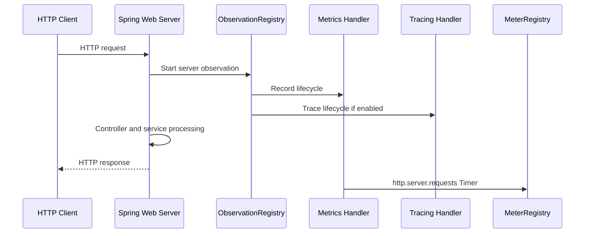
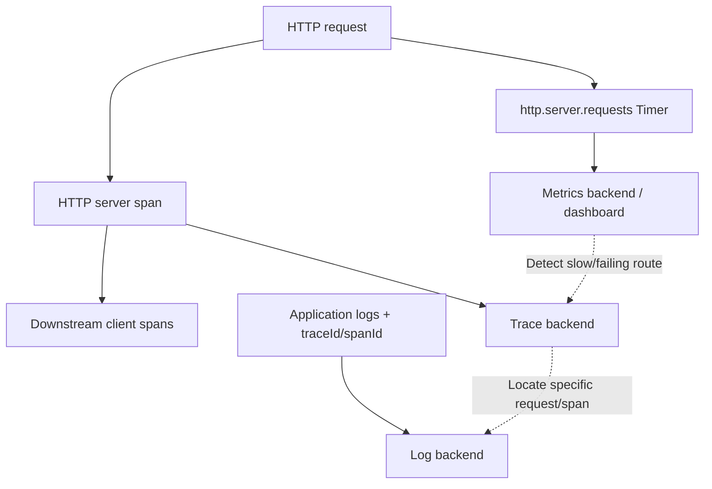

# http.server.requests in Spring Boot

A Spring Boot API receives thousands of HTTP requests per minute. Operators need to know which routes are slow, whether error rates are rising, which endpoints receive the most traffic, and how latency changes after a new release is deployed. Micrometer's **`http.server.requests`** meter provides a standard observation point for the duration and count of HTTP server requests, typically created automatically when Actuator/Micrometer integrates with the web stack.

`http.server.requests` is a Timer: it records request processing duration and the number of recorded invocations. Depending on the registry/configuration, the Timer also exports total time, histogram buckets, or percentile distributions. Tags such as method, status, outcome, and URI route template help group the metrics. The URI tag must use a stable route template; if raw URLs containing IDs or query parameters are included, the number of time series can grow with every request.

The **http.server.requests** lesson belongs to the **HTTP server observability** chapter of the **SPRING_BOOT_OBSERVABILITY** module. The module focuses on setting up observability for Spring Boot using Micrometer Observation, metrics, logs, and distributed tracing. You will learn context propagation, tags/cardinality, exporters, sampling, and signal correlation to investigate errors, latency, and application behavior in production environments.

## 1. Learning Objectives

After this lesson, you will be able to:

- Explain how the `http.server.requests` meter is created and recorded in Spring MVC/WebFlux.
- Read count, total time, max, histograms, and percentiles of the HTTP server Timer.
- Understand common tags such as method, uri, status, outcome, and exception.
- Distinguish route templates from raw request paths and avoid high-cardinality tags.
- Configure histograms/percentiles and export metrics appropriately.
- Create or customize HTTP observations using the Micrometer/Spring Boot mechanism.
- Correlate HTTP metrics with traces/logs to investigate latency and errors.
- Diagnose missing meters, unexpected tag values, or abnormal cardinality growth in the metrics backend.

## 2. What Is `http.server.requests`?

Spring Boot integrates Micrometer with the web server to observe incoming HTTP requests. For supported Spring MVC and Spring WebFlux stacks, instrumentation creates an Observation for the server request lifecycle. The metrics `ObservationHandler` records the corresponding Timer into `MeterRegistry`; the tracing handler can create a server span if Micrometer Tracing is configured.



The diagram illustrates the high-level flow. Exact meter names, tags, and recording timing depend on the Spring Boot, web stack, and Micrometer versions. Standard instrumentation gives the application baseline metrics without requiring a custom Timer in every controller.

### What Does the Timer Record?

`http.server.requests` is typically a Timer with the following measurements:

| Measurement | Meaning | Usage |
| --- | --- | --- |
| `COUNT` | Number of recorded requests | Request volume over a time interval |
| `TOTAL_TIME` | Cumulative processing duration | Total latency; divide by count to get the average |
| `MAX` | Maximum duration in the reporting window/period | Detect very slow requests; does not replace a histogram |
| Histogram buckets | Distribution of observations across time thresholds | Compute quantiles in a backend that supports histograms |
| Percentiles | Quantiles computed locally in the process per Micrometer config | Observe local p50/p95/p99; cannot be arbitrarily aggregated across instances |

Actuator typically displays Timer units in seconds, though export/naming conventions and backend units depend on the registry. Check the meter metadata and exporter conventions rather than assuming all backends represent them identically.

## 3. Common Tags

| Tag | Example | Meaning |
| --- | --- | --- |
| `method` | `GET`, `POST` | HTTP method |
| `uri` | `/orders/{orderId}`, `/actuator/health` | Normalized route/path template |
| `status` | `200`, `404`, `500` | HTTP response status |
| `outcome` | `SUCCESS`, `CLIENT_ERROR`, `SERVER_ERROR` | Result category derived from status |
| `exception` | `None`, exception name | Exception per convention |

The exact list may vary by Spring Boot version, MVC/WebFlux, custom conventions, and filters. Some tags only appear when an applicable value is present.

### Why Must `uri` Be a Route Template?

Suppose an API receives these requests:

```text
GET /orders/10001
GET /orders/10002
GET /orders/10003
```

They belong to the same route template:

```text
GET /orders/{orderId}
```

A route template groups requests for the same endpoint into a single time-series dimension. If metrics record the raw path, each order ID can produce a different tag value. Under high traffic, the series count grows rapidly.

Do not put query strings or identifiers into the URI tag. Paths like `/search?q=some-free-text`, `/users/alice@example.com`, or `/download?token=...` can introduce high cardinality, PII, or secrets. Use route templates and policy-approved low-cardinality business categories.

## 4. Reading Metrics in Actuator

When an application includes `spring-boot-starter-actuator`, web server metrics are registered; the metrics endpoint must be exposed via configuration:

```http
GET /actuator/metrics
GET /actuator/metrics/http.server.requests
```

To filter by a tag, pass a query parameter:

```http
GET /actuator/metrics/http.server.requests?tag=method:GET
GET /actuator/metrics/http.server.requests?tag=status:200
GET /actuator/metrics/http.server.requests?tag=uri:/orders/{orderId}
```

Encoding curly braces in the URI query depends on the HTTP client. Use URL encoding or your client's urlencode option when calling from a terminal. Replace the illustrative values with the actual tags reported by the meter.

### Illustrative Response Example

```json
{
  "name": "http.server.requests",
  "measurements": [
    {"statistic": "COUNT", "value": 1200},
    {"statistic": "TOTAL_TIME", "value": 18.4},
    {"statistic": "MAX", "value": 0.82}
  ],
  "availableTags": [
    {"tag": "method", "values": ["GET", "POST"]},
    {"tag": "status", "values": ["200", "400", "500"]}
  ]
}
```

This is an illustrative response, not real measurements. Actual values, tags, and units are provided by the meter/registry.

### Calculating Average Latency

\[
\text{Average latency}=\frac{\text{TOTAL\_TIME}}{\text{COUNT}}
\]

For example, with `TOTAL_TIME = 18.4` seconds and `COUNT = 1200`, the average is approximately 0.0153 seconds, or 15.3 milliseconds. Average is useful for an overview, but it can hide tail latency: a small fraction of very slow requests gets masked by the mean.

### MAX Is Not p99

`MAX` is the maximum recorded within the window/period reported by the meter/registry; it is not a percentile. p95/p99 require a histogram or appropriate percentile configuration. Never interpret MAX as "99% of requests are faster than this value."

## 5. Enabling Histograms and Percentiles

A Micrometer Timer can publish histogram buckets or percentile values. Histograms are useful when you need to aggregate quantiles across multiple instances in a histogram-capable backend. Client-side percentiles are computed individually within each process and should not be summed or averaged across replicas to infer cluster-wide p95/p99.

Histogram configuration example:

```yaml
management:
  metrics:
    distribution:
      percentiles-histogram:
        http.server.requests: true
```

Local percentiles:

```yaml
management:
  metrics:
    distribution:
      percentiles:
        http.server.requests: 0.5,0.95,0.99
```

SLA/explicit bucket boundaries:

```yaml
management:
  metrics:
    distribution:
      slo:
        http.server.requests: 50ms,100ms,250ms,500ms,1s
```

Property names and how the registry uses histograms/SLOs must match your version. With Prometheus, histogram buckets can be queried to compute quantiles; other backends have different syntax and support.

### Histograms Have a Cost

Histograms generate additional series for each combination of meter tags and bucket boundaries. Before enabling them in production:

1. Bound tag values and normalize routes.
2. Choose bucket boundaries aligned with actual SLAs/latency.
3. Estimate the number of routes × methods × outcomes × buckets × instances.
4. Verify ingestion/storage quotas and dashboard queries.
5. Monitor series count after rollout.

## 6. Exporting `http.server.requests` to a Metrics Backend

Actuator `/actuator/metrics` reads meters in-process. To store time series externally, you need an appropriate registry/exporter or scrape mechanism.

### Prometheus Scrape

```kotlin
dependencies {
    implementation("org.springframework.boot:spring-boot-starter-actuator")
    runtimeOnly("io.micrometer:micrometer-registry-prometheus")
}
```

Expose the endpoint:

```yaml
management:
  endpoints:
    web:
      exposure:
        include: health,metrics,prometheus
```

Prometheus scrapes the application at `/actuator/prometheus`. This is a metrics pipeline; it does not export distributed traces.

### OTLP Metrics or Other Registries

If the metrics backend ingests OTLP, configure a Micrometer registry/exporter that supports OTLP for your application version. The OTel tracing bridge does not automatically guarantee that Micrometer meters are sent as OTLP metrics. The tracing exporter and metrics registry are two separate pipelines that must be verified independently.

Meter names may be converted according to the registry's naming convention. Prometheus typically converts dots to underscores and represents a Timer using series such as count, sum, max, or bucket, depending on the registry/configuration.

## 7. Observations and Custom HTTP Server Metrics

For most Spring MVC/WebFlux applications, leverage the built-in HTTP server instrumentation. Do not add a Timer in every controller just to measure the same request; doing so can create duplicate metrics or measure a different lifecycle segment than the server request.

If a low-cardinality business dimension is needed, use an Observation convention/filter supported by your version. For example, you might group a finite set of channels like `channel=web|partner`, if genuinely required and permitted by policy.

### Custom Observation for Another Business Operation

`order.validation` is an internal operation, not a replacement for `http.server.requests`:

```java
import io.micrometer.observation.Observation;
import io.micrometer.observation.ObservationRegistry;
import org.springframework.stereotype.Service;

@Service
public class OrderValidationService {
    private final ObservationRegistry registry;

    public OrderValidationService(ObservationRegistry registry) {
        this.registry = registry;
    }

    public void validate(Order order) {
        Observation observation = Observation
            .createNotStarted("order.validation", registry)
            .lowCardinalityKeyValue("operation", "validate")
            .start();

        try (Observation.Scope scope = observation.openScope()) {
            try {
                performValidation(order);
                observation.lowCardinalityKeyValue("outcome", "success");
            } catch (RuntimeException ex) {
                observation.lowCardinalityKeyValue("outcome", "error");
                observation.error(ex);
                throw ex;
            }
        } finally {
            observation.stop();
        }
    }

    private void performValidation(Order order) {
        // Business validation
    }
}

record Order(String id) {}
```

If metrics and tracing handlers are active, the observation can contribute meters/spans according to configuration. Do not attach `order.id` as a low-cardinality key; per-order IDs can cause metrics cardinality to explode.

Spring Boot allows customizing HTTP server observations through extension points depending on the stack/version, such as `ObservationConvention` or `ObservationFilter`. When customizing, keep meter names stable, preserve route templates, add only finite-set dimensions, avoid removing standard tags needed for diagnostics, and check the stack in use. Specific APIs must match the version.

## 8. Correlating HTTP Metrics with Distributed Tracing

`http.server.requests` answers aggregate questions: which endpoint is slow, whether a route's 5xx rate is rising or falling, and how traffic is distributed by method/route. Distributed traces answer per-sampled-request questions: which services a request traversed, which span accounted for most of the latency, which dependency/database call was slow, and at which boundary an exception occurred.



Metrics provide aggregate signals; traces support investigating individual requests; logs provide controlled business/error details. Because sampling means the trace backend only holds a subset of requests, metrics remain essential for tracking trends across all traffic.

Do not use trace ID as a metric tag. Each trace has a unique trace ID; adding it to `http.server.requests` tags can create one series per request. Use trace/span IDs in logs or trace backend correlation; keep metric tags low-cardinality.

## 9. Analyzing Latency and Error Rate

### Latency

Compare latency across route templates, methods, and status/outcome:

- Average latency increases: most requests or a subset of requests may have slowed down.
- p95 increases while average stays stable: tail latency is degrading for a slower subset of requests.
- p99 spikes sharply: investigate outliers, queueing, connection pools, GC, and downstream calls.
- Max spikes while p95 stays stable: there may only be isolated outliers; histograms/traces are needed to understand further.

### Error Rate

You can calculate the error ratio as the number of requests with error status/outcome divided by total requests in the same time window and tag scope:

\[
\text{Error ratio}=\frac{\text{Error requests}}{\text{All requests}}
\]

Distinguish 4xx and 5xx based on operational goals. 4xx may reflect client input/behavior; 5xx is usually more critical for server reliability, though some APIs have specific contracts. Do not treat every 4xx as a server failure.

An HTTP 500 response may come from an exception; a 400 response may come from validation; a request might return 2xx while still representing a business failure under its own semantics. The status, outcome, and exception tags describe different perspectives. Dashboards should define errors clearly rather than counting every non-2xx response without considering the contract.

## 10. Cardinality, Security, and Request Data

| Data | Should It Be a Metric Tag? | Reason |
| --- | --- | --- |
| HTTP method | Yes | Small value set |
| Route template | Yes | Finite and stable route set |
| Status code | Yes | Relatively bounded value set |
| Outcome | Yes | Finite result categories |
| Exception class | Consider carefully | Can grow if exception types are dynamically generated |
| Raw URL/query string | No | Cardinality and privacy risk |
| User ID/order ID/email | No | Nearly unique and potentially PII |
| Trace ID/span ID | No | Cardinality nearly equals request count |
| Authorization header/cookie | No | Secrets and sensitive data |
| Client IP | Usually no | Cardinality, privacy, and policy |

Request/response payloads do not belong in metric tags. If specific payloads must be investigated, use logging/tracing with proper redaction, access control, and retention. Never record tokens, passwords, payment card data, or personal data in Observation key-values.

Metrics endpoints can expose internal route names, meter names, and workload patterns. Expose the minimum required and protect them via network policy or Spring Security. Do not expose all Actuator endpoints publicly just to read `http.server.requests`.

## 11. Configuration Checks and Troubleshooting

| Symptom | Possible Cause | How to Check |
| --- | --- | --- |
| `http.server.requests` is missing | Missing Actuator/Micrometer web instrumentation or different web stack/configuration | Check dependencies, server stack, and `MeterRegistry` |
| `/actuator/metrics` returns 404 | Metrics not exposed, Actuator missing, or different management path/port | Check endpoint exposure and management server settings |
| Count does not increase | No requests after startup, meter not recording, or viewing a different instance | Send a test request and verify the right process |
| Missing `uri` tag | Route unresolved, request did not match a handler, or different stack convention | Inspect `availableTags` and request mappings |
| `uri` contains raw IDs/query | Custom convention/tag provider does not normalize routes | Use route templates and strip query values |
| Count exists but no percentiles | Histograms/percentiles not enabled or unsupported by registry | Check distribution config and export format |
| Actuator shows meter but backend is empty | Registry/exporter or scrape target not configured | Check the metrics pipeline |
| Latency metrics look low but users see slowness | Delay is outside server observation or in downstream/queue/client | Check traces and timing at client/load balancer |
| Duplicate HTTP timers | Duplicate instrumentation or custom Timer wrapping the same request | Review filters/observations |
| Metrics cardinality spikes unexpectedly | URI/exception/custom tag has too many values | Check series count and tag samples |
| p95 differs across replicas | Local percentiles or differing request volumes | Use histogram buckets and backend aggregation |

### Investigation Checklist

1. Confirm whether the app runs MVC or WebFlux and check its version.
2. Verify Actuator, `MeterRegistry`, and web instrumentation dependencies.
3. Send a request to a known route template.
4. Read `/actuator/metrics/http.server.requests` and inspect `availableTags`.
5. Confirm `uri` is a template, not a raw path/query.
6. Check histogram/percentile config and the registry backend.
7. Cross-check count/latency with access logs, traces, and load balancer metrics.
8. Check whether custom timers/filters are creating duplicates.
9. Estimate cardinality and review privacy before deploying new tags/conventions.

## 12. Lab: Analyzing HTTP Server Requests

**Context:** `order-service` has routes for GET collection, GET item, and POST order. The operations team wants to monitor request count, p95 latency, and server error rate per route.

### Part A — Setup

1. Add Actuator and configure an appropriate `MeterRegistry`.
2. Expose health and metrics in the test environment.
3. Enable histograms for `http.server.requests` using compatible configuration.
4. Send successful requests and controlled 4xx/5xx requests.
5. Read the meter via Actuator and note the available tags.

### Part B — Analysis

| Case | Action | Expected Observation |
| --- | --- | --- |
| A — GET collection | Call the collection route multiple times | Count for that route template increases |
| B — GET item | Call with multiple order IDs | Requests are grouped under the same route template |
| C — POST success | Create a valid order | Status/outcome reflect success |
| D — Client error | Send an invalid validation payload | 4xx and corresponding outcome |
| E — Server error | Trigger a test error in the handler | 5xx, exception, and latency |
| F — Histogram | Query the backend with buckets | Quantiles can be computed via backend query |
| G — Cardinality | Test raw path IDs in a custom tag in an isolated test | Observe series growth and remove the improper tag |

### Part C — Self-Assessment Questions

1. Is `http.server.requests` a Counter or a Timer? What does it measure?
2. Why are `COUNT` and `TOTAL_TIME` used to compute average latency?
3. How does `MAX` differ from p99?
4. Why is a route template better than a raw path containing an order ID?
5. When are histograms needed instead of local-only percentiles?
6. Why should `traceId` or `userId` not be put into metric tags?
7. If Actuator has the meter but Prometheus has no data, which pipeline should you check?
8. Why can a 2xx response still represent a business failure?
9. How do you combine `http.server.requests` with traces to find a latency-causing dependency?
10. Why should you avoid creating a manual Timer in every controller when web instrumentation already measures the full request?

## 13. Key Takeaways

**`http.server.requests` is the standard Timer for observing HTTP server requests in Spring Boot/Micrometer.** It provides request count and duration; depending on configuration, it can also include max, histogram buckets, or percentiles. Tags such as method, route template, status, outcome, and exception allow analyzing traffic, latency, and errors along bounded dimensions.

Inspect the meter via Actuator to verify instrumentation, then export or scrape with an appropriate registry to store time series. Use histograms when you need quantiles aggregated across multiple instances; do not treat MAX as p99, and do not arbitrarily merge local percentiles. Keep URIs as route templates, avoid raw IDs/queries/PII, and never place trace IDs in metric tags. Metrics show trends across all traffic; traces and logs help investigate individual requests. Combining these signals supports evidence-based HTTP service operations while keeping cardinality, security, and observability costs under control.
