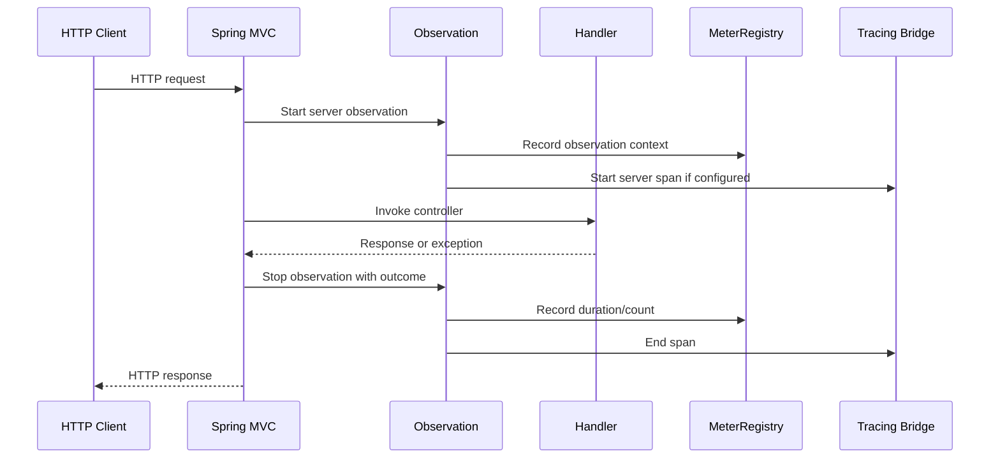
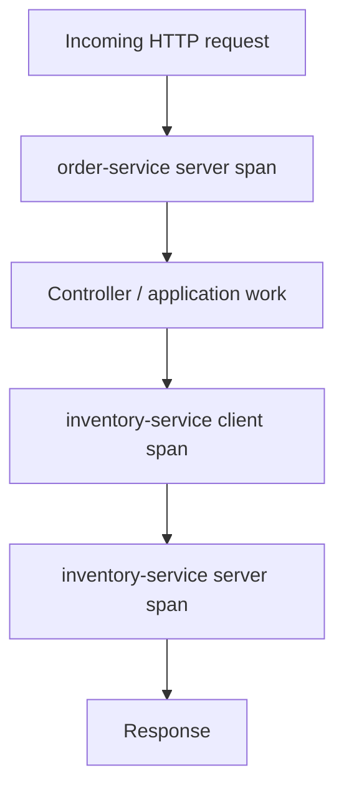

# HTTP Server Observation in Spring Boot

**HTTP server observation** describes the lifecycle of an HTTP request as it enters a Spring Boot application and is processed on the server side. An observation provides context to record processing time, request outcome, route, and errors. When Micrometer Tracing is integrated, the observation can create a span; when an appropriate `MeterRegistry` is configured, the same observation can contribute to metrics such as request count and processing duration.

In the **SPRING_BOOT_OBSERVABILITY** module, logging, metrics, and distributed tracing provide complementary perspectives on application behavior. This lesson belongs to the **HTTP server observability** chapter and covers observation in Spring MVC, lifecycle, key values, route templates and cardinality, error/async handling, customizing conventions, and troubleshooting.

## 1. What Is HTTP Server Observation?

When a client sends a request, Spring MVC accepts the request, resolves a handler, runs the controller/service, produces a response, and returns the result to the client. HTTP server observation wraps server-side request processing to record the properties needed for observability.

Observation helps answer: which request is being processed; which logical route was invoked; what the HTTP method and status are; how long the request took; whether an exception occurred; which service/trace the request belongs to; and how aggregate metrics change by route/status.

Observation does not replace request handling or business transactions. It is an instrumentation layer wrapping the operation so the application can measure and correlate data.

### High-Level Flow



The diagram illustrates the conceptual roles. Exact start/stop points depend on the Spring Boot/Spring Framework version, Servlet stack, and async lifecycle. Do not assume every custom filter runs inside the same observation scope.

## 2. How Do Observation, Metrics, and Tracing Connect?

Micrometer Observation is an abstraction for instrumenting an operation and connecting it to corresponding handlers. An observation can be processed by:

- **Meter observation handler:** records metrics such as Timer/Counter.
- **Tracing observation handler:** creates spans and links trace context.
- **Logging/correlation integration:** supplies trace/span context for log correlation if supported by configuration.

| Signal | Typical Data | Question |
| --- | --- | --- |
| Metrics | Request count, duration, method, route, status | How many requests? Which route is slow? |
| Trace | Server span, Trace ID, Span ID, parent context | Which services did the request pass through? |
| Logs | Application events, exceptions, Trace ID/Span ID | What happened during processing? |

Signals have separate export pipelines and retention policies. An observation does not guarantee every signal is automatically exported: you need the corresponding registry, tracing bridge, exporter, and logging integration.

### 2.1. Observation vs. Span

Observation is a Micrometer abstraction; a span is a distributed tracing concept. When a tracing handler is active, an observation can create a span. If tracing is not configured, the observation can still record metrics without creating a span.

### 2.2. Observation vs. Standalone Metric

A manual Timer can measure the duration of a method. HTTP server observation carries request-level semantics, typically including method, route, status, and outcome by convention. Avoid creating duplicate manual Timers for the same request when the default metrics suffice.

## 3. HTTP Server Observation in Spring MVC

In Spring Boot applications using Spring MVC and compatible Actuator/Micrometer versions, the framework can instrument requests to create a default server observation. The observation typically appears under a metric name such as `http.server.requests`; span names and conventions depend on the version, tracing bridge, and instrumentation.

For automatic instrumentation to work, verify:
- The application uses the corresponding Servlet/Spring MVC stack.
- Required actuator/observation dependencies are present with compatible versions.
- Spring Boot configures `ObservationRegistry`.
- `MeterRegistry` is configured if metrics are needed.
- Micrometer Tracing bridge/exporter is configured if spans are needed.
- No filter or custom instrumentation suppresses or duplicates the observation.

Do not assume that merely adding the web starter exports all metrics/traces to a backend. Auto-instrumentation, signal handlers, and exporters are distinct parts.

### 3.1. Dependencies

Example of a Spring Boot application using Actuator and Spring MVC:

```xml
<dependencies>
    <dependency>
        <groupId>org.springframework.boot</groupId>
        <artifactId>spring-boot-starter-web</artifactId>
    </dependency>
    <dependency>
        <groupId>org.springframework.boot</groupId>
        <artifactId>spring-boot-starter-actuator</artifactId>
    </dependency>
</dependencies>
```

The Spring Boot BOM/parent should manage versions. Add a tracing bridge and exporter only when the application needs distributed traces. Do not add tracing dependencies arbitrarily if the platform already provides another instrumentation mechanism.

### 3.2. Illustrative Controller

```java
package com.example.orders;

import org.springframework.http.ResponseEntity;
import org.springframework.web.bind.annotation.GetMapping;
import org.springframework.web.bind.annotation.RequestMapping;
import org.springframework.web.bind.annotation.RestController;

@RestController
@RequestMapping("/api/orders")
public class OrderController {

    @GetMapping("/{orderId}")
    public ResponseEntity<String> findOrder() {
        return ResponseEntity.ok("order found");
    }
}
```

This example omits extracting `orderId` to focus on the endpoint. In a real application, the route has a path variable; the observation should use a route template rather than a raw URI containing a specific ID.

## 4. Lifecycle of HTTP Server Observation

An observation typically starts when the request is received and stops when the framework determines the response has finished processing according to request semantics. Conceptual steps:

1. Receive the HTTP request.
2. Extract trace context from headers if propagation/tracing is enabled.
3. Create the server observation and span if the tracing handler is active.
4. Resolve the handler/route and execute the controller.
5. Record the response status, exception/outcome.
6. Stop the observation, record duration, and end the span.

The exact timing of route resolution, status capture, and stop events depends on the framework version and dispatch type. With async requests, processing may continue after the initial thread returns; the observation must follow the async lifecycle supported by the framework.

### 4.1. Exceptions and Response Status

If a handler throws an exception, the framework may pass the exception through an exception resolver, produce a corresponding response status, and record the outcome. A business error mapped to HTTP 4xx does not necessarily mean a 5xx server error. Observe both status and exception semantics, avoiding treating every non-2xx response as a system failure.

### 4.2. Async Requests

With Servlet async or `DeferredResult`, a request may complete after the initial dispatch. Do not manually close the observation in a filter right after the controller returns an async handle if the framework continues processing. Use Spring-supported integration/lifecycle hooks so the observation stops at the actual completion time.

## 5. Low-Cardinality and High-Cardinality Key Values

An observation can attach key values to describe the operation. Micrometer distinguishes:

- **Low-cardinality key values:** small, stable value sets suitable for metric tags.
- **High-cardinality key values:** values that can vary widely, typically better suited as span attributes if genuinely needed.

| Key | Example | Classification |
| --- | --- | --- |
| method | GET, POST | Low cardinality |
| status | 200, 404, 500 | Low cardinality |
| outcome | SUCCESS, CLIENT_ERROR, SERVER_ERROR | Low cardinality |
| uri | /api/orders/{orderId} | Low cardinality when using a route template |
| Raw request URI | /api/orders/8f2... | High cardinality |
| Trace ID | One value per trace | High cardinality |
| User ID | Many values | High cardinality, potentially sensitive |

Exact key names depend on the convention and framework version. The table describes common semantics; inspect the actual measurements/traces of your running version.

### 5.1. Why Are Route Templates Important?

If raw URIs are used as a metric tag, each order ID can create a separate time series:

```text
/api/orders/101
/api/orders/102
/api/orders/103
```

These are different URIs representing the same logical route:

```text
/api/orders/{orderId}
```

A route template groups metrics by logical endpoint and prevents cardinality from growing with the number of resources. Do not replace `uri` with raw paths in a custom convention.

### 5.2. Do Not Put Request Identity in Metric Tags

Avoid attaching Trace ID, request ID, user ID, email, order ID, or raw query strings as metric tags. Use Trace ID to look up traces, log correlation to link logs to traces, and properly protected business identifiers in appropriate systems when needed.

## 6. HTTP Server Metrics

The standard metric for server requests is `http.server.requests`, typically represented as a Timer. The Timer can provide invocation count and total duration; histograms/percentiles depend on registry configuration.

Common dimensions:
- HTTP method.
- Route/URI template.
- Response status.
- Outcome.
- Exception if included by convention and values are bounded.

Illustrative tags example:

```text
http.server.requests{
  method="GET",
  uri="/api/orders/{orderId}",
  status="200",
  outcome="SUCCESS"
}
```

Actual output may have more or fewer tags or a different metric representation depending on registry and framework version. Do not treat the example as exact output for every application.

### 6.1. Reading Metrics via Actuator

If the metrics endpoint is exposed:

```http
GET /actuator/metrics
```

Inspect the request metric:

```http
GET /actuator/metrics/http.server.requests
```

You can filter by tag if the metric and endpoint support it:

```http
GET /actuator/metrics/http.server.requests?tag=method:GET
```

The Actuator metrics endpoint is useful for inspecting measurements locally on the application. It does not replace Prometheus/Grafana or a metrics backend with stronger retention, alerting, and querying capabilities. Only expose management endpoints according to security policy.

### 6.2. Timer, Histograms, and Percentiles

A basic Timer provides count and total time. Histograms allow the backend to compute distributions/quantiles in the registry's format. Histogram and percentile configuration depends on the meter type, registry, and backend.

Do not compare percentiles between two backends if bucket/aggregation semantics differ. With Prometheus, design histogram buckets carefully to avoid excessive series growth.

## 7. HTTP Server Tracing and Distributed Context

When a Micrometer Tracing bridge is configured, HTTP server observation can create a server span. If the client sends W3C Trace Context and server instrumentation extracts the headers, the server span can join the existing trace.

Request example:

```http
GET /api/orders/42 HTTP/1.1
Host: order-service
traceparent: 00-4bf92f3577b34da6a3ce929d0e0e4736-00f067aa0ba902b7-01
```

Trace ID and parent span ID are used according to the propagation protocol to establish the relationship. The server span has its own span ID. Do not parse `traceparent` manually if instrumentation already manages propagation.

### 7.1. Server Span and Downstream Spans

If a controller calls an inventory service through an instrumented HTTP client, the outgoing client span can be a child of the server span. If the client is not instrumented or context is not propagated, the trace may split.



The diagram shows the conceptual relationship. In practice, there may also be spans for databases, messaging, and other internal operations.

### 7.2. Sampling

Server observation can create a span, but the span is only exported according to the sampling policy. Not finding a trace does not prove a request was not processed. Use metrics to monitor all traffic and traces as sampled request records.

## 8. Resource, Baggage, and Correlation

Distinguish the types of metadata:
- **Resource:** identifies service, version, environment, instance.
- **Observation low-cardinality values:** method, route template, status, outcome.
- **Span attributes:** properties of a specific operation/request if permitted.
- **Baggage:** key-values propagated alongside trace context across services.
- **Log correlation:** Trace ID/Span ID and necessary fields in logs.

Do not confuse `service.name` with a route, do not turn a request ID into a Resource attribute, and do not copy every baggage field into metric tags.

Server observation is most useful when route and status values are stable. Custom fields must be classified as low/high cardinality and checked for data privacy.

## 9. Customizing HTTP Server Observation Convention

Spring Framework provides an observation convention to define the observation name and key values for an HTTP server context. In Spring MVC, integration can use the default convention; an application can supply a custom convention when an additional small-value-set business dimension is needed.

Example extending the default convention:

```java
import io.micrometer.common.KeyValue;
import io.micrometer.common.KeyValues;
import org.springframework.http.server.observation.DefaultServerRequestObservationConvention;
import org.springframework.http.server.observation.ServerRequestObservationContext;

public class ApplicationServerObservationConvention
        extends DefaultServerRequestObservationConvention {

    @Override
    public KeyValues getLowCardinalityKeyValues(
            ServerRequestObservationContext context) {

        return super.getLowCardinalityKeyValues(context)
                .and(KeyValue.of("application", "orders"));
    }
}
```

This example uses Spring Framework observation APIs; verify the package/API matches the Spring Framework version managed by Spring Boot. The convention must be registered through the configuration mechanism supported by your version; do not just instantiate it and expect the framework to pick it up automatically.

### 9.1. Only Add Tags with Operational Value

A custom low-cardinality key value should have a small value set, be meaningful when grouping metrics, not depend on request IDs or arbitrary client data, contain no PII/secrets/raw query strings, and have a clear contract.

For example, `application=orders` is only useful if you genuinely need to distinguish a logical component. If `service.name` is already present in Resource, a duplicate tag may be unnecessary.

### 9.2. Preserve Default Conventions

When overriding a convention, extending the default convention typically preserves the key values provided by the framework. If you replace the entire convention with a minimal implementation, metrics may lose method/route/status or unexpectedly change the observation name.

Verify the effective observation name and low/high-cardinality values after changing a convention.

## 10. Observation Filters and Handlers

A convention determines the name and key values of a specific observation. A filter can adjust the observation context as supported by Micrometer APIs; handlers receive lifecycle events and translate them into metrics/tracing or other integrations.

| Component | Role |
| --- | --- |
| `ObservationRegistry` | Registry managing observations |
| `ObservationConvention` | Assigns name and key values from context |
| `ObservationFilter` | Transforms observation context per policy |
| `ObservationHandler` | Processes observation lifecycle events |
| `MeterRegistry` | Stores/publishes metrics |
| Tracing bridge | Translates observations into spans/context |

Do not add a handler that creates a Timer if the default handler already records a Timer. Duplicate instrumentation can cause request count/duration to be counted twice.

### 10.1. Ignoring Certain Requests

Health checks or internal endpoints can generate many observations and cause noise. Filter/ignore mechanisms may exist depending on the integration/version, or you can use appropriate routing/management metrics rules.

Do not blindly drop all health checks: they are important for distinguishing user traffic from infrastructure health. Establish a clear policy and prefer route templates over dynamic raw URIs.

## 11. Exceptions, Status, and Business Outcomes

HTTP status signals the protocol-level outcome, but it is not enough to understand every business failure.

- 200: the request succeeded at the HTTP level, but the response may describe a business decline per contract.
- 400: client sent an invalid request.
- 401/403: authentication/authorization failed.
- 404: resource/route not found per endpoint semantics.
- 409: business or resource conflict.
- 429: rate limited.
- 5xx: server/gateway error.

Do not turn every business rejection into an ERROR exception if the business logic normally represents it with 4xx. Conversely, an internal failure mapped to 200 requires a separate business/log/metric signal if investigations require it.

Framework conventions typically record status/outcome and exceptions via their own mechanisms. Check `ControllerAdvice`/resolvers: an exception caught and converted to a response may not show up as an exception escaping the handler.

## 12. Async Processing and Thread Context

An HTTP request may initiate async work or return a response after asynchronous processing. Trace context and observation lifecycle must be propagated properly across executors/async frameworks.

Principles:
- Use the context propagation integration appropriate for Spring/Micrometer.
- Do not leave an observation/span scope open on a thread outside its lifecycle.
- Do not stop the observation early before an async response completes.
- Ensure callback/error paths also close the context.
- Verify worker threads are restored/cleaned up after tasks finish.

If background work continues after the HTTP response, create a separate observation/span for the background work and link it to the original trace using the appropriate mechanism, rather than extending the server span indefinitely.

## 13. Security and Privacy

HTTP requests can contain sensitive data in paths, queries, headers, cookies, and bodies. Do not record entire requests into observation attributes or default logs.

Avoid:
- Raw query strings containing access tokens or emails.
- Authorization/Cookie headers.
- Raw URIs containing customer/order IDs in metric tags.
- Request/response bodies with PII or payment data.
- Unapproved user identities in low-cardinality tags.

Prefer route templates over raw URIs, method/status/outcome, normalized error categories, allowlisted custom dimensions, and redaction at the source. HTTPS protects data in transit, but it does not remove sensitive data from stored telemetry.

## 14. Troubleshooting HTTP Server Observation

| Symptom | Possible Cause | How to Check |
| --- | --- | --- |
| Missing `http.server.requests` | Missing Actuator/Micrometer auto-configuration or registry | Check dependencies and `MeterRegistry` |
| Metrics exist but no server span | Missing tracing bridge/handler or dropped by sampling | Check bridge, sampler, and exporter |
| Span exists but route is `UNKNOWN` | Route unresolved at capture time or different convention | Check MVC mapping and version |
| All routes become raw URIs | Custom convention/filter uses raw request URI | Switch to route templates |
| Cardinality spikes unexpectedly | Raw IDs/query strings/dynamic custom tags | Inspect tags/attributes |
| Request duration is too short | Observation stopped before async completion | Check async lifecycle and filter ordering |
| Exception does not appear | Exception handled by resolver or handler does not record error | Check `ControllerAdvice`/status |
| Request counted twice | Custom filter/handler creates duplicate observation | Check instrumentation/manual Timer |
| Trace ID not linked from client | Missing/invalid `traceparent` or server does not extract | Check headers and propagator |
| Logs missing Trace ID | Incorrect MDC/correlation or async context | Check logging integration |
| Actuator cannot see metric | Endpoint not exposed, wrong meter name, or no requests yet | Check exposure and send a test request |
| Metrics not reaching backend | Registry/exporter/Collector pipeline failure | Check the metrics pipeline |
| Status/outcome inaccurate | Exception resolver/status mapping differs from expectation | Check response and convention |
| Sensitive data in traces/logs | Custom attributes or raw request logging | Redact at the source |

### Investigation Workflow

1. Send a test request to a known route.
2. Check the `http.server.requests` metric or equivalent meter.
3. Inspect tags: method, route template, status, and outcome.
4. If traces are needed, verify the Micrometer Tracing bridge and exporter.
5. Check inbound `traceparent` and downstream context propagation.
6. Check sampling before concluding a server span was lost.
7. Cross-check response status, exception resolver, and observation lifecycle.
8. If using async, inspect duration and context in callbacks.
9. Check Collector/exporter/backend independently per signal.
10. Review cardinality and sensitive data after adding custom conventions/filters.

## 15. Lab: Verifying HTTP Server Observation

The goal is to send requests to Spring Boot, verify that the observation produces metrics, and—if tracing is configured—confirm the server span connects to the incoming trace context.

### Preparation

- Spring Boot 3.x application using Spring MVC.
- `spring-boot-starter-actuator`.
- Controller with GET/POST endpoints.
- Appropriate `MeterRegistry`.
- Micrometer Tracing bridge/exporter if a trace backend is needed.
- Actuator metrics endpoint safely exposed in the lab.

### Step 1 — Create Endpoint

Use the controller from Section 3. Add a route path variable to test route templating.

### Step 2 — Enable Metrics Endpoint in Lab

```yaml
management:
  endpoints:
    web:
      exposure:
        include:
          - health
          - metrics
```

Only expose endpoints needed for the lab. In production, protect management endpoints with a security policy.

### Step 3 — Generate Requests

Send requests to the endpoint, including 2xx responses, an intentional 4xx response, and a test-only 5xx error if needed. Never trigger test errors in production.

### Step 4 — Inspect Metrics

Read `/actuator/metrics/http.server.requests` and verify count/duration by method, URI template, status, and outcome if those tags exist in your current version.

### Step 5 — Verify Route Cardinality

Call `/api/orders/101`, `/api/orders/102`, and `/api/orders/103`. Confirm metrics aggregate under the route template rather than creating three separate URI tags. If not, locate the custom convention/filter altering the URI.

### Step 6 — Enable Tracing

Configure a tracing bridge and exporter to the lab backend. Send a request with a valid `traceparent`. Verify the server span appears with the corresponding Trace ID when sampling keeps the trace.

### Step 7 — Call Downstream

From the controller, call another service using an instrumented HTTP client. Confirm the client span and downstream server span link into the same trace.

### Step 8 — Test Custom Convention

Extend the default server request observation convention to add a stable low-cardinality field. Verify the field appears in metric tags without losing the default keys.

### Step 9 — Test Async or Exception Mapping

If the app has an async route, verify the observation duration completes when the response finishes. If `ControllerAdvice` is present, verify status and exception behavior per actual semantics.

### Step 10 — Check Privacy/Cardinality

Inspect tags/attributes on metrics and traces. Confirm there are no order IDs, raw query strings, cookies, tokens, or unallowlisted PII.

### Acceptance Checklist

| Item to Prove | Expected Result |
| --- | --- |
| Observation lifecycle | Understand start/stop and async caveats |
| Metrics | Request count/duration appear |
| Tags | Sensible method, route template, status/outcome |
| Trace | Server span appears when tracing and sampling allow |
| Propagation | Incoming trace context links properly |
| Downstream | Client/server spans link in the same trace |
| Cardinality | Path variable does not become a raw metric tag |
| Convention | Custom values do not drop defaults |
| Exception | Distinguish HTTP status from business failure |
| Security | No tokens/PII in attributes/logs |
| Export | Verify each signal pipeline independently |
| Runtime | Actuator endpoints properly exposed/protected |

## 16. Principles to Remember

1. **HTTP server observation describes the server-side request lifecycle**, measuring duration, outcome, and attaching observability context.
2. **Micrometer Observation is an abstraction; metrics and spans are outputs of corresponding handlers.** Never assume a single observation is automatically exported to every signal.
3. **Spring MVC/Actuator can provide default instrumentation**, but dependencies, registries, tracing bridges, and exporters must be configured properly.
4. **Use route templates for low-cardinality metrics.** Do not use raw URIs, IDs, or query strings as metric tags.
5. **Server observation, spans, and log correlation are related but distinct.** Trace ID links spans, metrics describe trends, and logs explain events.
6. **Parent context and sampling affect trace export.** Missing traces do not prove requests did not occur.
7. **Async lifecycles must be handled properly.** Observations must stay open until request completion, and context must be propagated and cleaned up.
8. **Custom conventions should extend defaults**, adding only stable, operationally meaningful, low-cardinality key values.
9. **Avoid duplicate instrumentation.** Manual Timers/filters/handlers can double-count if the framework already measures the request.
10. **Protect request data.** Never put tokens, cookies, raw bodies, PII, or dynamic identifiers into metric tags/telemetry metadata.
11. **Verify end-to-end per signal.** Check observation, registry/tracing handler, exporter, Collector, and backend.

HTTP server observation is the foundation for understanding requests passing through Spring Boot on the server side. When framework observation is consistently configured, routes are normalized, and context propagates accurately, metrics reveal traffic trends, traces provide timelines of sampled requests, and logs supply events for investigation. Controlling cardinality, async lifecycles, and sensitive data keeps telemetry useful in production while keeping costs and risks appropriate.
