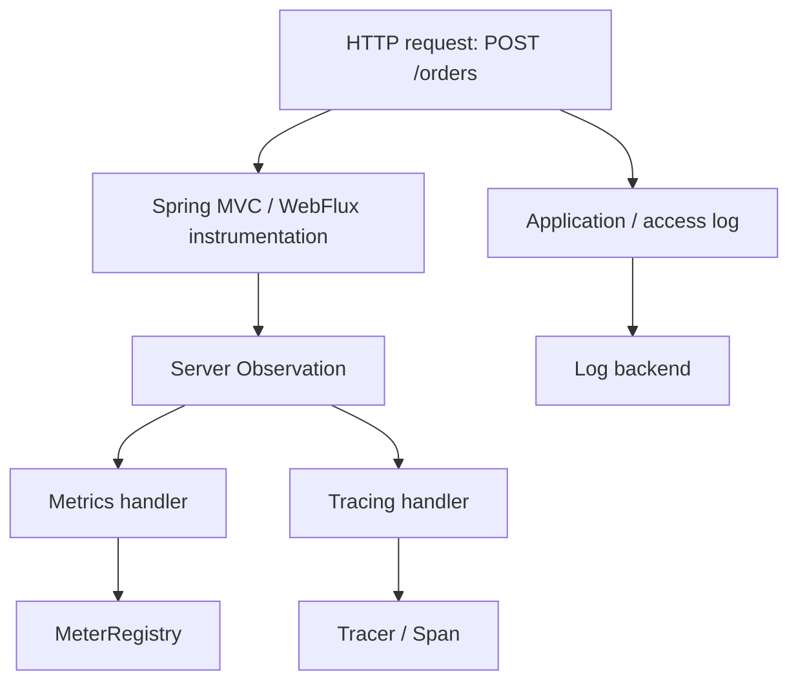

# Request Method in HTTP Server Observability

When a Spring Boot service receives HTTP traffic, operations teams often want to know which requests are slow or failing: does a GET read behave differently from a POST creating a transaction, which endpoints receive many DELETE requests, or is a client sending an unusual method? The HTTP request method is a useful dimension for analyzing server behavior. When recorded properly, metrics can compare latency/error rates by method, while traces and logs provide context for individual requests.

The **Request method** lesson belongs to the **HTTP server observability** chapter of the **SPRING_BOOT_OBSERVABILITY** module. The module guides setting up observability for Spring Boot using Micrometer Observation, metrics, logs, and distributed tracing; you will learn context propagation, tags/cardinality, exporters, sampling, and signal correlation to investigate errors, latency, and application behavior in production environments.

After this lesson, you will be able to explain the meaning of the HTTP method in server telemetry, understand how Spring MVC/WebFlux records requests, distinguish method from route/URI, design low-cardinality dimensions, normalize uncommon methods, and test that method is reflected consistently across metrics/traces/logs.

## 1. What Does the HTTP Request Method Represent?

The HTTP method describes the semantics of the operation that the client asks the server to perform:

| Method | High-Level Meaning | Example |
| --- | --- | --- |
| GET | Retrieve a representation of a resource | Read the list of orders |
| HEAD | Similar to GET but returns no response body | Check resource metadata |
| POST | Submit data for the resource to process; often triggers an action or creates a subordinate resource | Create an order, submit a payment command |
| PUT | Create or replace resource state at the target URI per PUT semantics | Replace profile contents |
| PATCH | Apply partial modifications to a resource | Update a few fields |
| DELETE | Request deletion of a resource | Delete a saved address |
| OPTIONS | Query supported communication options | Check capabilities / CORS preflight |
| TRACE | Used for HTTP path diagnostics; usually disabled for security reasons | Inspect intermediary behavior |
| CONNECT | Establish a tunnel to the target | Proxy tunnel |

Methods carry semantics per the HTTP specification. Do not infer all business logic from the method alone: POST does not always mean creating a new entity, PUT is not always implemented strictly per its semantics, and GET should not be used to mutate business state.

In observability, method answers the question **what kind of operation did the client request?** It complements route, status, duration, and service name.

## 2. Where Does Request Method Appear in Telemetry?

An HTTP server request is typically measured by a server request Observation. From that Observation, handlers can produce metrics and tracing data. Logging integration can also record the method as a structured field.



The method may be represented differently depending on the signal:

| Signal | Method Representation | Purpose |
| --- | --- | --- |
| Metrics | Tag/dimension such as `method=POST` | Aggregate count, duration, and error rate by method |
| Trace | Span attribute per HTTP semantic conventions | Filter and analyze a specific request |
| Structured log | Field such as `http.request.method` | Search log events and correlate with traces |

Not every custom-configured application writes the same key. Verify the convention and schema in use rather than assuming a Micrometer metric field name must match the OTel span attribute identically.

## 3. How Does Spring Boot Record Request Method?

In Spring Boot, Actuator and Micrometer provide HTTP server instrumentation for supported stacks. With proper configuration, server requests are recorded under an Observation/Meter commonly named `http.server.requests`. Method is one of the dimensions available to analyze request volume and processing time.

Hypothetical metrics example:

| method | status | count | p95 duration |
| --- | --- | ---: | ---: |
| GET | 200 | 18,420 | 42 ms |
| POST | 201 | 2,180 | 95 ms |
| POST | 400 | 130 | 31 ms |
| DELETE | 204 | 260 | 28 ms |

These numbers only illustrate how to read the data. COUNT and percentiles depend on meter type, histogram configuration, and backend queries.

### Do Not Measure the Same Request Twice

If Spring Boot already instruments HTTP server requests, do not add another Filter or WebFilter just to create a second Timer for the same request. Two timers may have different lifecycles, routes, exceptions, and statuses, causing dashboards to double-count or produce incomparable results.

Before customizing:

1. Verify that Actuator/Observation instrumentation is already active.
2. Identify the meter/observation name and existing tags.
3. Check whether the framework can add fields via a convention.
4. Create custom instrumentation only for a genuinely distinct operation or an unsupported dimension.

## 4. Method vs. Route and URI

HTTP method does not replace the route. A request is typically described by multiple attributes:

| Attribute | Example | Question Answered |
| --- | --- | --- |
| Method | POST | What type of operation did the client request? |
| Route template | `/orders/{id}` | Which handler/resource pattern processed it? |
| Raw URI | `/orders/ORD-9238` | Which exact path did this request use? |
| Status | 201 | What HTTP result did the server return? |
| Duration | 84 ms | How long did the server take to process it? |

Metrics should use the route template instead of the raw URI. If raw URIs are used, each order ID can create a separate time series. Method has a much more bounded set of values, so it is generally a suitable metric dimension.

Some endpoints share a route but differ by method:

- `GET /orders/{id}` reads an order.
- `PUT /orders/{id}` replaces the order content.
- `DELETE /orders/{id}` deletes an order.

Grouping by route without method mixes operations with different latencies and error rates. Combining method + route template clarifies specific behavior while keeping cardinality under control.

## 5. Method and Cardinality

**Cardinality** is the number of distinct values of a dimension or combinations of dimensions that can appear in metrics. Standard HTTP methods have a small value set, making them suitable as a low-cardinality tag.

For example, if a service has 6 method categories, 20 route templates, and 5 status categories, the theoretical number of combinations across these three dimensions is:

\[
6 \times 20 \times 5 = 600
\]

Adding a field with tens of thousands of values, such as a raw URL or request ID, can cause the series count to spike.

Best practices:

- Keep method within a controlled set of values.
- Use route templates, not paths containing resource IDs.
- Use status codes/categories according to the appropriate convention.
- Do not attach user IDs, order IDs, trace IDs, or raw query strings as metric tags.
- Normalize arbitrary methods into a bounded value such as `_OTHER`.

A small standard method set **does not mean all method inputs are safe**. A client can send arbitrary extension methods or very long strings; if passed verbatim into metrics, an attacker could trigger high cardinality and log noise.

## 6. Normalizing Uncommon and Extension Methods

HTTP allows custom method tokens, and systems may implement extension methods. In telemetry, you do not need to keep every rare value as a new tag. You can retain supported/common methods and group the rest under `_OTHER`.

Example normalization function for a service that only wants a defined set of methods in metrics:

```java
final class HttpMethodTag {
    private HttpMethodTag() {}

    static String normalize(String rawMethod) {
        if (rawMethod == null || rawMethod.isBlank()) {
            return "_OTHER";
        }

        String normalized = rawMethod.toUpperCase(
            java.util.Locale.ROOT);
        return switch (normalized) {
            case "GET", "HEAD", "POST", "PUT",
                 "PATCH", "DELETE", "OPTIONS" -> normalized;
            default -> "_OTHER";
        };
    }
}
```

This illustrative function fits when a system only wants common methods in metric dimensions. It does not decide whether a request is valid and does not replace method validation in the server/security layer. Do not alter the actual request method to fit metrics; only normalize the **telemetry value**.

If the system intentionally supports extension methods, place them in a controlled allowlist/configuration. OTel HTTP semantic conventions define how to represent unrecognized methods, where `_OTHER` is a useful normalized value; verify the exact semantic convention/version and instrumentation in use.

### Keep Details in the Appropriate Place

Metrics can use normalized methods to limit cardinality. If you need to investigate a specific extension method, record the size-bounded raw method in a controlled log event or trace attribute per policy. Do not push arbitrary raw strings into metric labels just for debugging.

## 7. Method in Micrometer Metrics

A server request Observation can create a Timer with low-cardinality key-values. In common Spring Boot configurations, the method is represented by the `method` tag, alongside tags such as `uri`, `status`, `outcome`, and `exception` depending on version/convention.

Conceptual query example:

```promql
sum by (method) (
  rate(http_server_requests_seconds_count[5m])
)
```

Actual metric and label names depend on the registry/exporter naming convention. Some Prometheus setups use `http_server_requests_seconds_count`; other backends may rename or represent Timers differently. Check the actual series in your registry before copying queries.

Example comparing latency by method:

```promql
histogram_quantile(
  0.95,
  sum by (le, method) (
    rate(http_server_requests_seconds_bucket[5m])
  )
)
```

This query only works if the Timer is published as histogram buckets with the corresponding naming/labels. If histograms are not enabled, percentiles may require configuring Micrometer histograms or computing them appropriately on the client/backend side.

### Method Is Low-Cardinality, but Not Every Tag Is

A tag set like method + route template + status category is usually manageable. However:

- Raw paths varying by ID are high-cardinality.
- Query strings can have nearly infinite values.
- Exception messages are not a stable dimension.
- Client-sent headers should not automatically become tags.

Tagging policy must evaluate both **each individual tag** and **the combination of all tags**.

## 8. Method in Tracing and HTTP Semantic Conventions

In distributed tracing, a server span typically describes an inbound HTTP request. HTTP semantic conventions standardize span attributes, including request method, route, response status, and server/network metadata.

Illustrative attribute set:

```json
{
  "http.request.method": "POST",
  "http.route": "/orders/{id}",
  "http.response.status_code": 201,
  "url.scheme": "https",
  "server.address": "orders.internal"
}
```

Attribute names and sets may vary by semantic convention version and instrumentation. Do not attach the same field to a span multiple times under slightly different keys if the framework already records it.

Method helps the trace UI filter slow POST operations or failing GETs. However, sampling may leave only a subset of requests stored as traces. Metrics are still required for overall trends, while traces support investigating specific selected requests.

## 9. Method in Logs and Correlation

Structured logs can record the method along with route, status, duration, service name, and trace context:

```json
{
  "event": "http.server.request.completed",
  "service.name": "orders-service",
  "http.request.method": "DELETE",
  "http.route": "/orders/{id}",
  "http.response.status_code": 204,
  "event.duration_ms": 37,
  "traceId": "4bf92f3577b34da6a3ce929d0e0e4736",
  "spanId": "00f067aa0ba902b7"
}
```

Do not log raw URIs or request bodies solely to know which operation occurred. Method + route template + status are usually sufficient to group access events. Trace ID/span ID link logs to traces, but should not be put into metric tags.

If logging manually in a Filter, avoid emitting duplicate log events alongside an enabled access logger or framework instrumentation. Agree on event ownership so each request is not logged repeatedly across multiple layers.

## 10. Spring MVC and WebFlux

Spring MVC and WebFlux have different execution models, yet both can provide HTTP server observations when using the appropriate starter/instrumentation.

### Spring MVC

Requests flow through the Servlet container, filters, `DispatcherServlet`, and handler mappings. Framework instrumentation can capture the request method and metadata. When customizing an observation convention, use the proper context/extension point for your Spring Boot/Micrometer version.

Avoid:

- Recording raw URIs as metric tags.
- Creating a second Timer for the same inbound request.
- Reading the method from a custom header instead of the actual request method.
- Using a filter order where route/status are not yet resolved and inferring other values.

### Spring WebFlux

WebFlux runs on a reactive stack; the request method is still server request metadata, so you should never block or subscribe to the body to obtain the method. The method can be read from the server request context supplied by instrumentation. Use supported Observation/`WebFilter` extension points without altering the reactive chain.

For both stacks, prefer framework instrumentation. When customizing, verify that each request produces exactly one primary server observation/span with the accurate method and route.

## 11. Customizing the Observation Convention

When you need to change how method is represented, customize the convention/instrumentation at your stack's extension point rather than creating duplicate metrics. Customization goals may include:

- Normalizing unknown methods to `_OTHER`.
- Adding allowlisted metadata.
- Keeping tag sets consistent across multiple services.
- Preventing arbitrary-length raw methods from entering metrics.

The example below is pseudocode illustrating the logic, not a fixed API signature across all Micrometer versions:

```java
String rawMethod = requestContext.getMethod();
String methodTag = HttpMethodTag.normalize(rawMethod);

// Use methodTag as a low-cardinality Observation value.
// Let the framework continue managing the server request lifecycle.
```

In Micrometer, low-cardinality values are used for metric dimensions and usually appear in tracing as well; high-cardinality values are mainly intended for tracing per convention/handler. Do not promote arbitrary user-supplied values into the low-cardinality set.

## 12. Operational Scenarios by Method

### POST Has Higher Latency Than GET

POST often involves validation, database writes, or downstream service calls. Analyze p95/p99 by method, then drill down by route template and dependency spans. Do not conclude POST is always slower; compare the same route/traffic profile when possible.

### DELETE Returns Many 404s

A high 404 rate on DELETE may indicate repeated client calls or an already-deleted resource. Combine method + route + status/outcome with normalized business logs. You do not need to log full IDs or resource bodies.

### Unknown Methods Appear

If the method tag shows unusual values, a client/proxy might be sending extension methods, a scanner might be probing endpoints, or instrumentation might be recording raw input. Normalize the dimension, track unknown counts with a separate bounded-tag counter, and inspect safe logs within the time window to investigate.

## 13. Testing Request Method Observability

A solid test suite should verify method handling across the appropriate layers:

| Test | What to Verify |
| --- | --- |
| Normalization unit test | Common methods are preserved; unknown methods map to the OTHER value |
| MVC integration test | GET/POST/DELETE create server observations with the correct method |
| WebFlux integration test | Reactive server instrumentation records the correct method |
| Metrics test | Meter has the `method` tag matching the expected convention |
| Route test | Different IDs share the same route template without creating separate series |
| Trace test | Server span carries valid method/route/status attributes |
| Security/cardinality test | Long/arbitrary raw methods do not create unbounded metric tags |
| Regression test | No duplicate timers/server spans for the same request |

### Unit Test Example for Normalization

```java
import org.junit.jupiter.api.Test;
import static org.junit.jupiter.api.Assertions.assertEquals;

class HttpMethodTagTest {
    @Test
    void keepsKnownMethods() {
        assertEquals("GET", HttpMethodTag.normalize("GET"));
        assertEquals("POST", HttpMethodTag.normalize("post"));
        assertEquals("DELETE", HttpMethodTag.normalize("DELETE"));
    }

    @Test
    void boundsUnknownMethods() {
        assertEquals("_OTHER", HttpMethodTag.normalize("CUSTOM"));
        assertEquals("_OTHER", HttpMethodTag.normalize("X-VERY-LONG-METHOD"));
        assertEquals("_OTHER", HttpMethodTag.normalize(null));
    }
}
```

This is a unit test for the normalization helper; it does not yet prove Spring Boot attaches that tag to server metrics. Add an integration test with a real `MeterRegistry` (such as `SimpleMeterRegistry`) and requests executed via `MockMvc`/`WebTestClient` to assert the actual meter and tags.

## 14. Common Pitfalls

| Symptom | Possible Cause | Troubleshooting Direction |
| --- | --- | --- |
| Metrics lack the `method` tag | Different instrumentation/convention version or server observation not enabled | Check meter and observation configuration |
| Every request has method OTHER | Method normalized too early or mapped incorrectly | Compare actual request method with the tag builder |
| Abnormal cardinality growth | Arbitrary raw methods used as tags | Allowlist/normalize method before recording metrics |
| POST latency counted twice | Both framework and custom filter create a Timer | Clarify instrumentation ownership |
| Metric method differs from trace attribute | Two different conventions/semantic schemas | Standardize naming and document mapping |
| Route tag contains order ID | Raw URI used instead of route template | Obtain route template from handler mapping |
| WebFlux requests slow down | Custom instrumentation blocks or subscribes to chain | Remove blocking and use reactive extension points |
| Method missing from logs | Structured event lacks field or different access logger | Check logger config and event schema |
| Trace backend shows only a subset of methods | Sampling | Use metrics for total traffic distribution |
| Unknown method missing from metric | Normalized to OTHER | Inspect raw value in tests/safe logs if permitted |

## 15. Practical Scenario: POST /orders 5xx Spike

**Hypothetical context:** `orders-service` has HTTP server request metrics. Over 15 minutes, the error rate climbs; the dashboard shows 5xx errors concentrated on POST while GET remains stable.

Investigation workflow:

1. **Group by method:** confirm whether 5xx errors are concentrated on POST or affect all methods.
2. **Drill down by route template:** determine whether `POST /orders` or `POST /orders/{id}` is affected; do not use raw URIs as metric tags.
3. **Compare duration:** check p95/p99 and request counts over time windows to see whether errors correlate with latency or fail fast.
4. **Open sampled traces:** inspect database/dependency spans and exception categories for representative POST requests.
5. **Cross-check logs:** search log events by trace ID, method, route, status, and error category; avoid reading raw bodies if payloads contain customer data.
6. **Check client behavior:** verify retries, request volume, and method semantics; clients retrying POST can amplify load if idempotency is not designed.
7. **Verify after fix:** use metrics to monitor all traffic, traces to inspect sampled failing requests, and logs to verify normalized business events.

Method helps isolate the affected operation group. It does not reveal the root cause by itself; route, status, timing, spans, and logs supply the remaining evidence.

## 16. Self-Check Exercises

**Exercise 1.** Why is method generally more suitable as a metric tag than a raw URI?

*Hint:* Method usually has a small value set; raw URIs may contain resource IDs/query values that inflate cardinality.

**Exercise 2.** Should GET and POST on the same `/orders/{id}` route be merged on a latency dashboard?

*Hint:* Only if the analysis does not need to distinguish operations. Method separates different semantics and workloads.

**Exercise 3.** A client sends an arbitrary extension method. Should the raw string be used as a low-cardinality tag?

*Hint:* No. Normalize/allowlist into OTHER or a supported method set.

**Exercise 4.** Spring Boot already creates `http.server.requests`. Why can adding a Timer in a Filter cause issues?

*Hint:* It can double-count the same request with differing lifecycles/tags/routes.

**Exercise 5.** Metrics show POST 5xx increasing, but there are not enough traces. How do you investigate further?

*Hint:* Use logs/correlation, metrics by route/status, and review sampling policy; never assume a request without a trace did not happen.

**Exercise 6.** Why is route template important when combined with method?

*Hint:* It distinguishes handler/resource patterns while avoiding creating a series per path ID.

**Exercise 7.** Should the method normalization function change the actual request method?

*Hint:* No. Only normalize the telemetry value; the server/security/routing layers still process the original method per HTTP semantics.

**Exercise 8.** The metric tag is named `method`, while the trace attribute is `http.request.method`. Must you force both keys to be identical?

*Hint:* Not necessarily. Respect each signal's convention, but maintain clear mapping/documentation so operators know they represent the same dimension.

## 17. Key Takeaways

- **Request method** indicates the type of HTTP operation requested by the client and is a useful dimension for analyzing request count, latency, and error rate.
- In Spring Boot, leverage built-in HTTP server Observation/instrumentation before writing custom Filters/Timers to avoid duplicate measurement.
- Combine method with **route template**, status, and duration; raw URIs/query strings are unsuitable as metric dimensions.
- Normalize uncommon methods into a bounded value such as OTHER; never let arbitrary input create metric series.
- Metrics, traces, and logs have different schemas/keys. Maintain consistent semantic mapping rather than assuming field names must be identical.
- Metrics provide total traffic distribution; tracing may be sampled; logs support searching events by method and trace context.
- Test common methods, unknown methods, cardinality, route templates, and the absence of duplicate instrumentation.
