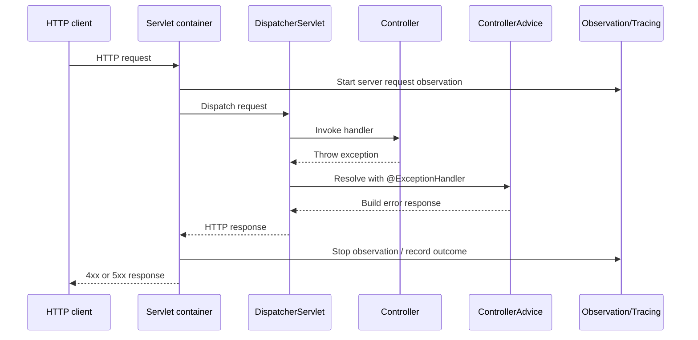

# Exception in Spring Boot HTTP Server Observability

## 1. Objectives and Context

An HTTP request can fail during validation, controller execution, service logic, repository calls, downstream calls, or serialization. Merely knowing the response is 500 is not enough: operations teams also need to know which exception occurred, whether the error was handled, which trace the request belongs to, and whether the error repeats across many requests.

**Exception observability** is the practice of tracking exceptions throughout the HTTP processing lifecycle using logs, metrics, and distributed tracing. Spring Boot combines Spring MVC/WebFlux, Micrometer Observation, and Micrometer Tracing to establish context for HTTP server requests; applications complement this with error handling and logging at the appropriate boundaries.

This lesson belongs to the **HTTP server observability** chapter of the **SPRING_BOOT_OBSERVABILITY** module. The module guides setting up observability for Spring Boot using Micrometer Observation, metrics, logs, and distributed tracing; you will learn context propagation, tags/cardinality, exporters, sampling, and signal correlation to investigate errors, latency, and application behavior in production environments.

After this lesson, you will be able to:
1. Explain how an exception flows through HTTP server observation.
2. Distinguish between thrown exceptions, handled exceptions, exceptions converted into responses, and HTTP status.
3. Understand how exception/error information is used in request metrics and tracing.
4. Design `@ControllerAdvice`/`@ExceptionHandler` while preserving sufficient observability information.
5. Choose where to log stack traces and avoid duplicate logging.
6. Correlate exception logs with `traceId`/`spanId`, status, route, and metrics.
7. Keep cardinality low and protect sensitive data.
8. Test success, handled exceptions, unhandled exceptions, async failures, and error responses.

**Baseline:** Spring Boot 3.5.x, Java 17+, Spring MVC, Actuator, and Micrometer Tracing. Properties/configurations and backends may vary by version. This lesson focuses on the Servlet stack; WebFlux has its own reactive lifecycle.

## 2. Exceptions in HTTP Requests

An exception signals that the execution flow cannot continue along the normal path. In an HTTP server, an exception may:
- Be thrown from a controller/service/repository and propagate up to `DispatcherServlet`.
- Be handled by a Spring MVC resolver or `@ExceptionHandler`.
- Be converted into a 4xx/5xx response.
- Be caught and handled completely inside a service.
- Occur after the response has already committed, when the server can no longer change the status/body.

Not every 4xx/5xx response originates from an exception. A controller can intentionally return 404 or 503 as a business outcome. Conversely, an exception can be caught and turned into a fallback or contract response. Therefore, you must distinguish **exception lifecycle**, **HTTP status**, and **application outcome**.

### 2.1. Typical Flow in Spring MVC



This is a conceptual diagram. Exact instrumentation hooks may differ across Servlet, Spring MVC, WebFlux, and framework versions. Observation wraps the HTTP server operation; the exception resolver determines how the exception is handled and how the response is constructed.

### 2.2. Concepts to Distinguish

| Concept | Question | Example |
| --- | --- | --- |
| Exception | What was thrown in code? | `DataAccessException` |
| Error/cause | What error is attached to the operation/span? | `SQLException` |
| HTTP status | Which code did the server return? | 404, 500 |
| Outcome | Request result category | `SUCCESS`, `CLIENT_ERROR`, `SERVER_ERROR` |
| Exception class | Type of exception observed | `OrderNotFoundException` |
| Trace/span | Which request and related operation? | `traceId`/`spanId` |
| Application outcome | How did business logic finish? | `rejected`, `fallback`, `retry scheduled` |

Status is not another name for exception. Never infer the exception class from the status code, nor infer the final status solely from the initial exception.

## 3. HTTP Server Observation

Spring Boot Actuator and Micrometer create observations for instrumented HTTP server requests. With Spring MVC, the common observation is named **`http.server.requests`**.

An Observation describes a request lifecycle and can supply:
- HTTP method.
- Normalized URI/route template.
- Response status.
- Outcome grouped by status.
- Exception classification per convention.
- Request processing duration.

When a tracing handler is configured, the same observation can create a server span. Observation conventions and handlers determine which values are used for metrics or traces.

### 3.1. Metrics and Exceptions

The HTTP server request timer is typically exposed under the meter name **`http.server.requests`**.

Default tags usually include `method`, `status`, `outcome`, `uri`, and `exception`; the exact tag set depends on convention, version, and framework integration.

| Tag | Example | Meaning |
| --- | --- | --- |
| `method` | `GET` | HTTP method |
| `uri` | `/orders/{id}` | Route template, not raw ID |
| `status` | `500` | Response status |
| `outcome` | `SERVER_ERROR` | Status category |
| `exception` | `DataAccessException` | Exception type if recorded by observation |

Requests without an exception may use a value such as **`none`** for the `exception` tag depending on convention. Check the actual series before writing queries/dashboards; do not assume all versions share identical values.

The `exception` tag is a **low-cardinality classification**. Never add exception messages, request IDs, order IDs, SQL, or stack traces to metric tags.

### 3.2. How Are Handled Exceptions Observed?

When an exception is caught by `@ExceptionHandler`, the HTTP request can still complete from `DispatcherServlet`'s perspective and return the constructed response. Whether the observation records the exception class/error depends on where instrumentation sees the exception and how the resolver marks errors in that framework version.

Therefore:
- Do not assume every handled exception automatically appears in the `exception` tag identically across versions.
- Do not assume a 500 response always carries a corresponding `exception` tag.
- If you need metrics for business rejections or validation failures, create a dedicated counter with finite outcomes.
- Use integration tests to verify actual tags for handled and unhandled exceptions in your running stack.

## 4. Tracing and Span Errors

When Micrometer Tracing is configured, HTTP server observation is typically linked to a server span. The span reveals where the request occurred, how long it took, and which operation failed.

Relevant details may include:
- `traceId`/`spanId` to link logs and the trace backend.
- Span name and HTTP attributes per semantic conventions.
- Error status or exception events depending on the tracing bridge/instrumentation.
- Parent context received from inbound propagation headers.
- Resource attributes such as service name and deployment environment.

Not every exception needs its own span. An exception is usually an event/error attached to the span representing the operation. A separate child span is appropriate when there is an independent operation to measure, such as calling a payment provider or querying a database.

### 4.1. HTTP Status and Span Status Are Not the Same

For example:
- An invalid request returns 400. This may be an expected input error; tracing policy does not necessarily consider it a system failure.
- A service hits a database error and returns 500. The server span typically needs to reflect the error for querying/alerting.
- A downstream timeout falls back to a 200 response. The parent operation may succeed per contract, yet the child span calling the downstream service should still reflect the timeout.
- An exception is handled to return 404. Logs can record a `WARN` business event without needing a full stack trace.

Do not automatically mark a span `OK` just because the controller produced a response. Reflect both the operation outcome and the actual error according to your chosen semantics.

## 5. Handling Exceptions with `@ControllerAdvice`

A global exception handler converts exceptions into consistent responses and serves as the right boundary to log unhandled request failures.

Domain exception:

```java
public class OrderNotFoundException extends RuntimeException {
    public OrderNotFoundException(String orderId) {
        super("Order not found");
    }
}
```

Handler:

```java
import org.slf4j.Logger;
import org.slf4j.LoggerFactory;
import org.springframework.http.HttpStatus;
import org.springframework.http.ProblemDetail;
import org.springframework.web.bind.annotation.ExceptionHandler;
import org.springframework.web.bind.annotation.RestControllerAdvice;

@RestControllerAdvice
public class ApiExceptionHandler {
    private static final Logger log =
            LoggerFactory.getLogger(ApiExceptionHandler.class);

    @ExceptionHandler(OrderNotFoundException.class)
    ProblemDetail handleNotFound(OrderNotFoundException ex) {
        log.warn("Order lookup did not find a resource");

        ProblemDetail body =
                ProblemDetail.forStatus(HttpStatus.NOT_FOUND);
        body.setTitle("Order not found");
        body.setDetail("The requested order does not exist.");
        return body;
    }

    @ExceptionHandler(Exception.class)
    ProblemDetail handleUnexpected(Exception ex) {
        log.error("Unhandled HTTP request failure", ex);

        ProblemDetail body =
                ProblemDetail.forStatus(HttpStatus.INTERNAL_SERVER_ERROR);
        body.setTitle("Internal server error");
        body.setDetail("The request could not be completed.");
        return body;
    }
}
```

Design notes:
- Not-found may be an expected outcome; a brief `WARN` log is usually sufficient.
- Unexpected errors are logged once at the boundary with the `Throwable` to preserve the stack trace.
- Responses never return internal class names, SQL, tokens, or stack traces.
- Services/repositories only log when adding distinct context; do not log in full and then rethrow.

### 5.1. Recording Errors in Business Observations

If an exception is handled internally and not propagated to HTTP observation, yet the application still needs to record the operation error, you can create a dedicated Observation at the business boundary.

```java
import io.micrometer.observation.Observation;
import io.micrometer.observation.ObservationRegistry;

public class InventoryService {
    private final ObservationRegistry registry;

    public InventoryService(ObservationRegistry registry) {
        this.registry = registry;
    }

    public void reserve(String sku) {
        Observation.createNotStarted("inventory.reserve", registry)
                .contextualName("reserve inventory")
                .observe(() -> doReserve(sku));
    }

    private void doReserve(String sku) {
        // Perform business logic; exceptions are allowed to propagate.
    }
}
```

`Observation.observe` manages the lifecycle and records exceptions thrown from the callback via registered handlers. Do not create a second observation solely to re-log an exception already captured at the HTTP boundary; create an observation when there is an independent operation to measure.

With reactive code or async work, use APIs/instrumentation tied to the subscription/task lifecycle. Never wrap a `Mono` or `CompletableFuture` construction in a synchronous callback and assume future exceptions are captured.

## 6. Do Not Swallow Exceptions or Lose the Cause

A common mistake is catching an exception and returning a fallback without recording any error state:

```java
public Receipt loadReceipt(String orderId) {
    try {
        return gateway.fetch(orderId);
    } catch (GatewayException ex) {
        return Receipt.empty();
    }
}
```

The HTTP request might return 200, metrics only show success, and traces might not reveal that the downstream failed if the exception was swallowed before instrumentation.

If fallback is intentional behavior, record the dependency failure:
- Mark the child span/dependency observation as an error.
- Increment a counter with bounded tags such as `dependency` and `outcome`.
- Emit a structured log if the event needs investigation.
- The parent operation can return fallback success per contract without hiding the child operation's error.

Illustrative example:

```java
public Receipt loadReceipt(String orderId) {
    try {
        return gateway.fetch(orderId);
    } catch (GatewayException ex) {
        Counter.builder("application.dependency.failures")
                .tag("dependency", "receipt-provider")
                .tag("failure", "timeout")
                .register(meterRegistry)
                .increment();
        log.warn("Receipt provider failed; fallback will be used", ex);
        return Receipt.empty();
    }
}
```

The `Counter` in the example should be injected from a configured meter, with bounded tag values. If repeated retry errors generate excessive stack traces, consider sampling/rate limiting while preserving metrics and final failure tracking.

When wrapping exceptions, preserve the cause:

```java
catch (DataAccessException ex) {
    throw new OrderStorageException(
            "Order storage operation failed", ex);
}
```

Do not construct a new exception with only a message and drop the cause, as the boundary will lose the root cause and original stack trace.

## 7. Correlating Logs with Exceptions and Trace Context

When Micrometer Tracing is active, Spring Boot typically populates `traceId` and `spanId` into MDC for log correlation.

Structured log example:

```json
{
  "timestamp": "2026-11-22T10:20:30Z",
  "level": "ERROR",
  "service": "order-service",
  "traceId": "4bf92f3577b34da6a3ce929d0e0e4736",
  "spanId": "00f067aa0ba902b7",
  "httpMethod": "POST",
  "route": "/orders",
  "status": 500,
  "exception": "OrderStorageException",
  "event": "http.request.failed",
  "message": "Unhandled HTTP request failure"
}
```

This is an illustrative schema, not a mandatory default Spring Boot output. Configure a JSON encoder/structured logging and verify actual output.

### 7.1. Fields to Record

- Service name, environment, and instance/pod when useful.
- `traceId`/`spanId` provided by tracing integration.
- HTTP method and normalized route template.
- Response status and exception class.
- Stable event code such as `http.request.failed`.
- Error category, dependency name, or attempt when meaningful.
- Request/correlation ID if defined by contract and permitted by logging policy.

Never log raw request bodies, `Authorization` headers, cookies, passwords, tokens, personal data, or exception messages that might contain user data. Stack traces require appropriate access controls and retention policies.

### 7.2. Avoiding Duplicate Exception Logs

Pick a single owner to log the full stack trace for the same error along a call path:
- Services/repositories propagate or wrap exceptions without re-logging them in full.
- `ControllerAdvice` logs unhandled errors at the HTTP boundary.
- Access logs record method/status/duration without needing stack traces.
- Logs from a gateway or downstream service are records of another boundary, not duplicates by default.

## 8. Metrics for HTTP Exceptions

The HTTP request timer helps analyze latency, status, outcome, route, and exception classification. The standard meter is **`http.server.requests`**.

Applications can add counters for business/dependency errors that the request timer does not express sufficiently:

```java
Counter.builder("application.operation.failures")
        .tag("operation", "order.reserve")
        .tag("failure", "storage")
        .register(meterRegistry)
        .increment();
```

The tags above have finite values. Do not add exception messages, stack traces, raw URLs with path variables, request/correlation IDs, order IDs, customer IDs, or dynamic SQL statements.

If exceptions need classification, use a controlled class/category or the HTTP observation's default exception classification. Do not create metric series per message/cause.

### 8.1. Do Not Count the Same Error Multiple Times

An exception can be observed across multiple layers. If every layer increments the same counter, one failure gets counted multiple times. Define clear semantics:
- Request failure counter: increment once at the HTTP boundary per policy.
- Dependency failure counter: increment once at the dependency call boundary.
- Business rejection counter: increment at the business operation boundary.
- Retry attempt counter: increment per actual attempt.

Meter names and event definitions must make clear whether they count requests, operations, or attempts.

## 9. Exceptions in Async and Reactive HTTP Handlers

### 9.1. Servlet Async

If a controller returns `Callable`/`DeferredResult` or uses `@Async`, processing may run on another thread. Request observation and Servlet async lifecycle can extend until the response completes, but `ThreadLocal`/MDC do not automatically transfer across worker threads.

Use an executor with `ContextPropagatingTaskDecorator` or an equivalent mechanism; ensure task exceptions wire into the completion/error path so the boundary sees the outcome. If a task failure is caught and only logged on the worker, HTTP observation might miss the exception. Decide whether it is a request error or an independent background job error.

### 9.2. WebFlux

In WebFlux, errors are terminal signals in the Reactor pipeline (`onError`); exceptions can be handled via `onErrorResume` or `WebExceptionHandler`. Do not assume every exception passes through the same Servlet `HandlerExceptionResolver` lifecycle.

When using fallbacks:
- Record the child operation error before switching to the fallback if required.
- Avoid logging the same error in `onErrorResume` and again in a global `WebExceptionHandler`.
- Use Reactor `Context`/context propagation so trace/log context stays accurate across scheduler thread switches.
- Inspect cancellations separately; a cancel is not necessarily an application error.

Do not wrap `Mono` creation in a synchronous Observation if actual work only executes upon subscription. Use reactive-aware instrumentation or verify the subscription lifecycle.

## 10. Exceptions vs. Explicitly Constructed Responses

| Scenario | Exception Thrown? | HTTP Status | What to Observe |
| --- | --- | --- | --- |
| Valid request, completes | No | 2xx | Latency, route, span |
| Controller explicitly returns 404 | Not necessarily | 404 | Status/outcome; business counter if needed |
| `@ExceptionHandler` maps `NotFoundException` to 404 | Exception thrown/handled | 404 | Lifecycle and status per instrumentation |
| Unhandled `NullPointerException` | Yes | Usually 500 | Error span/log, status, stack trace at boundary |
| Dependency timeout, parent uses fallback | Yes on child operation | Parent may be 200 | Child error, dependency counter, fallback event |
| Client disconnect/cancel | Not necessarily | Response may be incomplete | Client abort/cancellation per server behavior |

Status codes cannot replace exception classification. Each scenario requires its own event semantics and tests.

## 11. Security and Cardinality

Exception messages, causes, and stack traces can contain SQL, table/column names, file paths, internal URLs, user input, or infrastructure details. Therefore:
- Never return stack traces to clients.
- Redact or omit unsafe exception messages from structured fields.
- Store full throwables in a logging backend with access controls.
- Use exception class/category instead of messages as metric tags.
- Use route templates instead of raw paths.
- Never attach request/correlation IDs to metric tags.
- Enforce retention/access permissions on error logs and traces.
- Never log all HTTP headers just to diagnose an exception.

## 12. Testing Exception Observability

Tests should simultaneously verify response, log, metric, and trace behavior on the actual running stack.

### 12.1. Test Cases

1. Success request: 2xx status, request timer recorded, no unexpected exception classification.
2. Controller explicitly returns 404: verify status/outcome and do not assume an exception exists.
3. Domain exception mapped to 404 by `@ExceptionHandler`: verify response and version-specific exception tags/error events.
4. Unexpected unhandled exception: 500, a single boundary error log with throwable, error trace/span if tracing is configured.
5. Wrapped dependency exception: cause chain remains intact.
6. Exception turned into fallback: parent outcome, child operation error, and counter reflect intended semantics.
7. Async failure: exception reaches the right completion handler; trace/log contexts do not mix.
8. WebFlux `onErrorResume`: verify error is recorded prior to fallback if required by policy.
9. Client abort/cancel: do not automatically classify as a server exception if the framework emits no application error.
10. Cardinality: metric tags contain no request IDs, raw URLs, or exception messages.

### 12.2. Inspecting Metrics

Use the Actuator metrics endpoint in dev/test environments to inspect exposed meters and tag keys; do not expose this endpoint casually in production.

Verify:
- The `http.server.requests` meter is created.
- Tags `method`, `uri`, `status`, `outcome`, and `exception` have expected value sets.
- Route template uses a template instead of specific IDs.
- `exception` tag carries a value in expected scenarios.
- Custom error counters increment exactly once per intended semantics.
- A single request does not spawn numerous time series from dynamic tags.

### 12.3. Inspecting Traces and Logs

- Locate the server span by `traceId`.
- Check span status/error events and exception attributes per bridge.
- Find logs with the same `traceId`/`spanId`.
- Ensure only one full stack trace exists for the same error along a call path.
- Compare the parent span with child dependency spans during downstream failures.
- A sampled-out trace does not mean the exception did not happen; rely on logs/metrics independently.

## 13. Troubleshooting

| Symptom | Possible Cause | Resolution |
| --- | --- | --- |
| 500 response lacks an `exception` tag | Resolver/filter handled the exception before the observation hook or different convention | Check version, lifecycle, and test actual tags |
| 404 response has a non-empty `exception` tag | `NotFound` exception was thrown and then handled by resolver | Distinguish handled exceptions from status |
| `ERROR` log exists but span status is `OK` | Exception caught/fallen back before tracing handler or different bridge policy | Record child operation error and check the bridge |
| Span has error but log lacks stack trace | Boundary did not log the throwable | Check exception handler and appender |
| Stack trace repeated multiple times | Multiple layers log and then rethrow | Pick a single owner at the boundary |
| Error counter incremented twice | Same exception counted in both service and controller | Define metrics per request/dependency/attempt |
| Metrics cardinality grows | Exception message/request ID/raw URI became tags | Use class/category and route templates |
| Async request lacks `traceId` | Context not propagated across executor | Check `TaskDecorator`/Context Propagation |
| WebFlux error lost after fallback | `onErrorResume` swallows error without recording child failure | Record operation error before fallback per policy |
| HTTP 2xx yet dependency span reports error | Parent used fallback; child dependency failed | Semantics may be valid; observe both parent and child |
| Spans missing from backend | Sampling/exporter/collector issue | Check the tracing pipeline independently |
| Client disconnects flood stack traces | Aborts logged as application failures | Classify client aborts separately |

## 14. Production Checklist

- [ ] Understand where framework/server instrumentation starts and ends HTTP observation.
- [ ] Distinguish exception, HTTP status, outcome, and business result.
- [ ] Designate one owner to log full stack traces for unhandled request exceptions.
- [ ] Wrapped exceptions preserve their cause.
- [ ] Handled/fallback exceptions are still recorded when operation errors require investigation.
- [ ] Do not log the same exception at every layer.
- [ ] HTTP metrics use low-cardinality tags and route templates.
- [ ] Error counters distinguish requests, dependencies, retry attempts, and business rejections.
- [ ] Span/error semantics are verified by integration tests.
- [ ] Async/reactive paths maintain proper context and error lifecycles.
- [ ] `traceId`/`spanId` are correlated in logs when tracing is enabled.
- [ ] Stack traces, secrets, and PII are never returned to clients.
- [ ] Sampling/exporter failures do not drop critical metrics and error logs.
- [ ] Tests cover handled, unhandled, fallback, retry, cancellation, and concurrency cases.

## 15. Practice Questions

1. Why does HTTP 500 not tell you the exact exception class?
2. Can a 404 response occur without an exception?
3. When `@ControllerAdvice` handles an exception, why should you test the `exception` tag rather than guessing?
4. Which aspects does an HTTP server request observation track?
5. Why are exception messages unsuitable as metric tags?
6. When a dependency timeout falls back to 200, how should it be observed on the parent and child?
7. Should full stack traces be logged in the service layer or at the HTTP boundary?
8. Why must you preserve the cause when wrapping exceptions?
9. What happens if you catch an exception and return a fallback without recording a child error?
10. How do you avoid incrementing a counter twice for the same request failure?
11. Why does MDC not automatically follow `@Async` worker threads?
12. How does WebFlux `onErrorResume` differ from Spring MVC's exception resolver in lifecycle?
13. Is a client abort always an application exception?
14. Does trace sampling cause HTTP request metrics to be lost?

## References

- [Spring Boot 3.5 — HTTP Server Observations](https://docs.spring.io/spring-boot/3.5/reference/actuator/metrics.html)
- [Spring Boot 3.5 — Tracing](https://docs.spring.io/spring-boot/3.5/reference/actuator/tracing.html)
- [Spring Framework — Observability Support](https://docs.spring.io/spring-framework/reference/integration/observability.html)
- [Spring Framework — MVC Exceptions](https://docs.spring.io/spring-framework/reference/web/webmvc/mvc-controller/ann-exceptionhandler.html)
- [Micrometer Observation — Concepts](https://docs.micrometer.io/micrometer/reference/observation.html)
- [Micrometer Tracing — API](https://docs.micrometer.io/tracing/reference/api.html)
- [OpenTelemetry — Trace API](https://opentelemetry.io/docs/specs/otel/trace/api/)
- [OpenTelemetry — HTTP Semantic Conventions](https://opentelemetry.io/docs/specs/semconv/http/)
