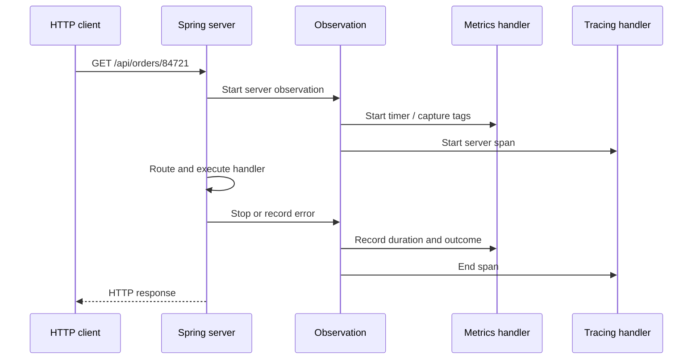

# Server Request Convention in Spring Boot

A Spring Boot API receives a `GET /api/orders/84721` request, authenticates the caller, queries data, and returns a 200 response. As system load grows, the operations team wants to measure request count, latency, error rate, and identify which endpoints are slowing down. If each request is recorded with its raw URI, order ID, user ID, or query string, the metrics backend can generate millions of time series. If all requests share only one generic label, dashboards lack enough detail to isolate issues.

**Server request convention** defines how an HTTP server observation describes an incoming request through its observation name, contextual name, and standardized key-values. In Spring Boot, Micrometer Observation uses conventions to standardize how applications record inbound HTTP operations. A good convention provides stable dimensions for metrics and useful names/attributes for tracing while keeping cardinality and sensitive data under control.

A convention is not merely span naming. It is a contract between instrumentation, metrics, tracing, and query systems: the same request must be described consistently so operators know which request occurred, which route it matched, what method/status it had, and how it turned out.

This lesson belongs to the **HTTP server observability** chapter of the **SPRING_BOOT_OBSERVABILITY** module. The module teaches setting up observability for Spring Boot using Micrometer Observation, metrics, logs, and distributed tracing; you learn context propagation, tags/cardinality, exporters, sampling, and signal correlation to investigate errors, latency, and application behavior in production environments. This lesson focuses on the convention for inbound HTTP server requests and how to customize it in a controlled manner.

## Learning Objectives

After this lesson, you will be able to:

1. Explain the role of the server request observation convention in Spring Boot.
2. Distinguish observation name, contextual name, low-cardinality keys, and high-cardinality keys.
3. Understand common HTTP dimensions such as method, route, status, outcome, and exception.
4. Explain why a URI route template must be used instead of a raw path containing IDs.
5. Customize a server request convention without breaking default semantics.
6. Distinguish Spring MVC and WebFlux conventions, and identify where instrumentation is created.
7. Understand how conventions affect metrics, traces, and log correlation.
8. Design safe tags, avoiding cardinality explosions, PII, and secret leakage.
9. Test conventions for success, not-found, exception, async, and unmatched route cases.
10. Diagnose when metric tags or span attributes do not behave as expected.

## 1. What Is a Server Request Observation?

A server request observation represents an inbound HTTP operation accepted and processed by the application. In Spring MVC, the observation typically wraps request processing through the Servlet stack; in WebFlux, it wraps reactive HTTP handling per framework integration.

An observation provides a start/stop/error lifecycle and a context containing request/response information. Registered `ObservationHandler`s can convert the observation into metrics, tracing spans, or other integrations.



The convention answers these questions:

- What stable technical name does the observation have?
- How does the contextual name describe the operation in human-readable form?
- Which key-values have low cardinality?
- Which attributes belong only in tracing/high-cardinality contexts?
- Which data must not be recorded due to privacy or cardinality?

### 1.1. Convention vs. Instrumentation

Instrumentation decides where to start/stop the observation and builds the context from the request. The convention defines how to interpret that context into names and key-values.

If a request does not pass through instrumentation, adding a convention bean will not automatically create an observation. Conversely, if an observation already exists but the convention is inappropriate, metrics may record unsafe URIs or span names may become hard to query.

## 2. Observation Name, Contextual Name, and Key-Values

| Component | Meaning | Example |
|---|---|---|
| Observation name | Stable technical name for the observation type | `http.server.requests` |
| Contextual name | Human-readable name tied to the operation/route | `GET /api/orders/{id}` |
| Low-cardinality key-values | Dimensions with a bounded value set | `method=GET`, `status=200`, `outcome=SUCCESS` |
| High-cardinality key-values | Values that vary per request | Full URL or exception details per policy |
| Observation context | Request/response and related framework data | `ServerRequestObservationContext` |

Exact names may differ by Spring Framework/Micrometer version and integration. In operation, inspect the actual observations emitted by the framework rather than assuming every stack uses identical names.

### 2.1. Observation Name Should Be Stable

The observation name represents the operation type, not each concrete URL or request ID. If every route produces a dynamic observation name, the metrics registry may treat each name as a separate meter and cause fragmentation.

Keep the name general like `http.server.requests`; place the route template and method in key-value dimensions.

### 2.2. Contextual Name Should Be Readable

The contextual name helps make span trees readable, such as `GET /api/orders/{id}`. Do not use a raw path like `GET /api/orders/84721`, as every request would generate a different name, making queries difficult and exposing data via URLs.

## 3. Low-Cardinality Keys for HTTP Server

Low-cardinality key-values can become metric tags. Their values must belong to a finite or practically bounded set. Common HTTP dimensions:

| Key | Example | Meaning |
|---|---|---|
| `method` | `GET`, `POST`, `PUT`, `DELETE` | HTTP method |
| `uri` / `route` | `/api/orders/{id}` | Normalized route template |
| `status` | `200`, `404`, `500` | HTTP response status |
| `outcome` | `SUCCESS`, `CLIENT_ERROR`, `SERVER_ERROR` | Result category |
| `exception` | `None` or exception name per convention | Bounded error info |

The exact list depends on the Micrometer/Spring integration version. Do not copy one version's tag set and assume every framework stack emits the exact same keys.

### 3.1. Method

HTTP method generally has low cardinality and is useful for dashboards. With extension/custom methods, values outside the common list may appear; decide how to normalize them so clients cannot send arbitrary methods and create unbounded values.

### 3.2. URI Must Be a Route Template

This is the most critical dimension. Use the route pattern resolved by the framework:

- Good: `/api/orders/{id}`
- Good: `/api/customers/{customerId}/invoices/{invoiceId}`
- Bad: `/api/orders/84721`
- Bad: `/api/customers/0938123456/invoices/998122`
- Bad: `/download/report?token=secret`

Raw paths can contain IDs, emails, phone numbers, or arbitrary slugs. If put into metric tags, each value spawns a new time series; if put into traces/logs, the values can leak personal data.

If a request does not match a known route, use a stable fallback value per the framework and version convention instead of the raw URI. Test unmatched-route behavior in your test suite.

### 3.3. Status and Outcome

Status codes have bounded cardinality within the HTTP domain. `outcome` typically groups statuses into classes such as `INFORMATIONAL`, `SUCCESS`, `REDIRECTION`, `CLIENT_ERROR`, or `SERVER_ERROR`, depending on implementation.

Use `status` for exact HTTP code granularity; use `outcome` to aggregate result groups. Understand when the observation captures status: errors may be handled into 4xx/5xx responses or throw exceptions before the response completes.

### 3.4. Exception

Exceptions can be recorded in tracing/high-cardinality contexts or mapped into a stable group. Putting full exception messages into metric tags is wrong: messages can contain IDs, inputs, and dynamic text. If metrics need error classification, use a controlled exception class or error category with bounded cardinality.

## 4. High-Cardinality Keys and Usage Limits

High-cardinality key-values can be useful in traces when investigating a specific request, but you must weigh payload size, indexing cost, and privacy.

| Value | Metric Tags? | Trace Attributes? | Notes |
|---|---|---|---|
| Route template | Usually suitable | Suitable | Normalized route |
| Raw URL | Avoid | Only with justification and sanitization | May contain query/PII |
| Request ID | Avoid | Possible per policy | Usually nearly unique |
| User/account ID | Avoid | With extreme caution | Identifying data |
| Trace ID | No | Already a dedicated context field | No need to copy into custom tags |
| Exception message | No | Consider carefully and sanitize | May contain input/secrets |
| Query string | No | Avoid or filter via allowlist | May contain tokens |
| Client IP | Not by default | Only per policy | May be personal data |

Low/high cardinality in Micrometer Observation serves as an important signal to handlers. High-cardinality does not mean safe to log everything; trace backends also have indexing, storage, and access limits.

### 4.1. Do Not Leak High-Cardinality Values into Metrics Indirectly

A high-cardinality value attached to the context could accidentally be converted into a meter tag by a custom handler. Audit custom `ObservationHandler` mappings; do not rely solely on method names to assume handlers filter safely.

## 5. Spring Boot Default Convention

Spring Boot uses Spring Framework HTTP instrumentation and Micrometer Observation to record inbound requests when appropriate dependencies/configuration are enabled. In many MVC setups, the default observation is named `http.server.requests` and the convention supplies `method`, URI template, `status`, and `outcome`. Exact key names and behavior depend on version and stack.

The key takeaway is understanding that **the default convention is the foundation**; you do not need to create manual observations in every controller. Before customizing, inspect:

1. The actual observation name.
2. Whether route templates resolve properly.
3. How `method` and `status` tags are recorded.
4. Outcome mapping for success/error.
5. How unmatched routes are handled.
6. Whether server spans carry accurate trace context without duplicates.

### 5.1. MVC and WebFlux

Spring MVC is built on the Servlet stack; WebFlux is built on the reactive stack. Both have server request instrumentation, but their request contexts and lifecycles differ. Do not assume one convention bean applies to both if a project has multiple application contexts or separate stacks.

Test the actual deployed server runtime. With WebFlux, the lifecycle can depend on subscription/cancellation; do not evaluate it using tests that merely execute controller functions synchronously.

### 5.2. Request Routing and Route Patterns

A good convention should obtain the route template after the framework selects a handler. If it simply pulls the request URI from the servlet/request object, code may receive a raw path instead of a pattern. Use the framework's resolved route data when available, and check behavior for static resources, actuator endpoints, error dispatches, and unmatched routes.

## 6. Customizing `ServerRequestObservationConvention`

When a custom dimension is needed, Spring Framework provides extension points for the server request observation convention. Exact interface/context names depend on version; for Servlet/MVC, the APIs typically involve `ServerRequestObservationConvention` and `ServerRequestObservationContext`.

A safe strategy:

1. Start from the framework's default convention.
2. Preserve standard key-values.
3. Add only attributes needed operationally.
4. Choose low-cardinality or high-cardinality according to proper semantics.
5. Never override the route with a raw URL.
6. Write integration tests for the application's request paths.

### 6.1. Conceptual Custom Convention Example

The snippet below illustrates adding a low-cardinality key to the default convention. API imports/constructors and extension points must match your project's Spring Framework version:

```java
@Bean
ServerRequestObservationConvention serverRequestObservationConvention() {
    return new DefaultServerRequestObservationConvention() {
        @Override
        public KeyValues getLowCardinalityKeyValues(
                ServerRequestObservationContext context) {

            return super.getLowCardinalityKeyValues(context)
                    .and(KeyValue.of("api.tier", "public"));
        }
    };
}
```

This is a conceptual example; verify constructors, class extensibility, and imports for your version. The value `public` is fixed, keeping cardinality low. If distinguishing versions, only add it when version belongs to a small controlled set such as `v1`/`v2`.

### 6.2. When Should You Add a Custom Key?

Add a key when it answers an operational question that standard dimensions do not—such as API tier, normalized channel, or grouped tenant class. Do not add customer ID, order ID, request parameters, or arbitrary headers out of convenience.

### 6.3. Do Not Break Standard Semantics

If a custom convention drops the default `method`/`status`/`route`/`outcome`, shared dashboards and other instrumentation can lose compatibility. Append keys to the default convention's `KeyValues` whenever possible rather than rewriting everything from scratch.

## 7. Connecting Server Observation to Metrics

The metrics handler converts low-cardinality key-values into meter tags. A timer for HTTP server requests can report count and duration by route/method/status/outcome.

Conceptual example:

```text
http.server.requests{
  method="GET",
  uri="/api/orders/{id}",
  status="200",
  outcome="SUCCESS"
}
```

Exact metric/tag names depend on the Micrometer registry and naming convention. The Prometheus registry may convert dots to underscores; other exporters may format differently.

Useful dashboard dimensions include route template, method, status/outcome, normalized API tier/channel, and service version. Avoid grouping by trace ID, user ID, or raw URL. When investigating an individual request, use traces/logs.

A Timer can export count/total time and histograms if supported by the registry. p95/p99 are meaningful only when histogram buckets/aggregation are enabled and computed properly by the backend. A convention determines tags; it does not automatically enable histogram distributions for every meter.

HTTP metrics typically record requests via instrumentation independently of the tracing sampler. Even if trace sampling keeps only 10%, server request metrics still measure all traffic per configuration. Never infer request counts from exported span counts.

## 8. Connecting Server Observation to Tracing

The tracing handler creates a server span from the observation context. The span can carry method, route, status, and other attributes per semantic conventions/integration.

- Observation name is the operation type.
- Span name is the operation name in the trace.
- Span attributes are metadata for the specific request.
- Trace ID/Span ID are managed by the tracer, not generated by the convention itself.
- Parent context is extracted from inbound headers by the propagator.

Span names should use the route template or a stable operation name rather than raw paths. HTTP 500 may come from an unhandled exception or an intentionally constructed response. Do not assume every 4xx is a server exception or every 5xx carries an exception object.

## 9. Connecting Logs to Server Request Context

Logs emitted while a server observation/span is active can carry trace ID/span ID via logging integration and MDC. Log records can also include method/route/event fields if provided by application code or integration.

```json
{
  "event.name": "http.request.completed",
  "http.request.method": "GET",
  "http.route": "/api/orders/{id}",
  "http.response.status_code": 200,
  "trace_id": "0af7651916cd43dd8448eb211c80319c",
  "span_id": "b7ad6b7169203331"
}
```

This is an illustrative schema. Do not log raw query strings or full headers. Trace/span IDs must come from the active tracing context; never populate MDC from a user-supplied header and treat it as valid correlation.

## 10. Request Scenarios to Test

| Scenario | Convention Behavior to Verify |
|---|---|
| Successful GET route | Method, route template, 2xx status, success outcome |
| POST creating a resource | Method POST, route template, appropriate status |
| Non-existent route | Stable fallback URI; no raw ID/dynamic path |
| Validation error | 4xx status and accurate outcome |
| Unhandled exception | 5xx status, error mapping, and span lifecycle |
| Async request | Observation/span ends per actual lifecycle |
| WebFlux cancellation | Observation lifecycle matches cancellation |
| Actuator/static resource | Instrumented or excluded per policy |
| Uncommon HTTP method | Value normalized/bounded |
| Query string with token | Absent from tags/attributes outside allowlist |

## 11. Testing Server Request Conventions

A test suite should verify both the metrics and tracing views of the convention.

### 11.1. Testing Route Templates

Send two requests:

- `GET /api/orders/1001`
- `GET /api/orders/1002`

Both must emit the same route tag `/api/orders/{id}`, not two separate meter series. This directly tests protection against dynamic-ID cardinality.

### 11.2. Testing Method/Status/Outcome

Send a successful request, a validation failure, and a server error; verify `method`, `status`, and `outcome` match the actual responses. Test both exceptions handled into 4xx and exceptions genuinely returning 5xx.

### 11.3. Testing Custom Conventions

If a custom key like `api.tier` exists, verify its values stay within the low-cardinality set with a small value count. Also verify standard keys remain present. If a convention targets only high-cardinality tracing attributes, confirm the custom value is not turned into a metric tag.

### 11.4. Testing MVC and WebFlux

Run tests against the real web application type. For MVC, use `MockMvc` or an appropriate random-port test. For WebFlux, use `WebTestClient` and verify the reactive lifecycle. Never use MVC tests to conclude WebFlux behavior.

### 11.5. Testing Unmatched Routes and Sensitive Data

Send a raw URL with an ID, a simulated query token, and a header containing sensitive data. Verify metric tags use a stable fallback/route template and do not emit tokens or headers outside the allowlist. Inspect logs/traces as well as metrics, since each signal may have its own processing path.

## 12. Cardinality, Privacy, and Security

HTTP request data is a common source of cardinality and sensitive data:

- Raw URL paths can contain account/order IDs.
- Query strings can contain tokens or search terms.
- Headers can contain `Authorization`, `Cookie`, or tenant identifiers.
- Exception messages can contain request values or SQL fragments.
- Client IPs may qualify as personal data under organizational policy.

Principles:

1. Metric tags use only dimensions with bounded value sets.
2. Use route templates instead of raw paths.
3. Never log/record entire query strings or request headers.
4. Never add user/order IDs to low-cardinality keys.
5. Record high-cardinality trace attributes only with clear need and policy alignment.
6. Redact close to the telemetry source; downstream filters are only a secondary layer.
7. Restrict backend access permissions and retention.
8. Verify inbound headers cannot force the convention to emit arbitrary unbounded values.

Route templates reduce cardinality, but they do not solve privacy on their own. A custom pattern could still embed tenant/user info. Ensure patterns are normalized from route definitions rather than concatenated from raw request input.

## 13. Diagnosing Incorrect Conventions

| Symptom | Possible Cause | How to Investigate |
|---|---|---|
| Metrics contain raw URIs | Convention grabs request URI instead of route pattern | Check framework context and route resolver |
| Every ID creates a time series | URI tag contains resolved path variable | Query series cardinality and fix route template |
| Missing status/outcome | Observation stopped before response or wrong handler/config | Inspect lifecycle and context |
| Custom key does not appear | Bean not selected or overridden by auto-config | Check application context and convention selection |
| Key appears in trace but not metrics | Key is only in the high-cardinality set | Inspect handler mapping |
| Key causes cardinality explosion | Dynamic values added as low-cardinality | Aggregate values and normalize |
| Two server spans exist | Java Agent and Spring instrumentation both active | Identify instrumentation owner |
| MVC works, WebFlux fails | Different stack/context/lifecycle | Test and configure separately |
| Trace names contain IDs | Contextual/span name uses raw path | Use route templates |
| Query tokens appear in telemetry | Header/URL capture is unfiltered | Allowlist/redact at the source |

### Investigation Workflow

1. Identify whether the request runtime is MVC or WebFlux.
2. Check the selected observation name and convention.
3. Send requests with two different route parameter values.
4. Read metric tags and trace span name/attributes.
5. Verify which keys are low-cardinality vs. high-cardinality.
6. Search for custom `ObservationConvention`/`ObservationHandler` beans that may override defaults.
7. Check whether a Java Agent or other instrumentation creates duplicate spans.
8. Inspect exception/status and observation stop lifecycle.
9. Check raw paths, queries, headers, and privacy redaction.
10. Monitor series count/export drops after adjustments.

## 14. Anti-Patterns to Avoid

| Anti-Pattern | Consequence | Proper Approach |
|---|---|---|
| Raw URI as a low-cardinality tag | Every ID creates a time series | Route template |
| Dynamic observation name per request | Fragmented meter/span naming | Stable name, dimensions via keys |
| Recording all query parameters | Secret/PII exposure and high cardinality | Allowlist or omit queries |
| Putting user ID/order ID in metric tags | Cardinality explosion | Trace/log correlation per policy |
| Replacing default convention and dropping method/status | Loss of dashboard semantics | Extend and append to default keys |
| Treating high-cardinality as safe for everything | Storage/index/privacy risk | Allowlist and retention |
| Manually creating server observations in controllers when framework already does | Duplicate measurements/spans | Use standard instrumentation |
| Testing only one route parameter value | Cardinality bugs go undetected | Two requests with different IDs, same route template |
| Mixing MVC and WebFlux assumptions | Lifecycle/route mismatch | Test the actual stack |
| Treating every HTTP 4xx as an exception | Incorrect error semantics | Distinguish response outcome from exception |
| Checking metrics only, ignoring traces | Span names/attributes may be wrong | Assert each signal |
| Assuming adding a convention creates instrumentation | No observation at the boundary | Verify instrumentation first |

## 15. Pre-Merge Checklist for Custom Server Conventions

1. **Observation:** are inbound HTTP requests instrumented at the right boundary?
2. **Name:** is the observation name stable and the contextual name readable?
3. **Route:** does the URI dimension use a route template, not a raw path?
4. **Method:** is method recorded with bounded values?
5. **Status:** is response status captured after processing?
6. **Outcome:** does the mapping reflect response/exception with proper semantics?
7. **Exception:** is raw exception data kept out of metric tags?
8. **Cardinality:** do low-cardinality keys have bounded value sets?
9. **High cardinality:** does tracing-only data have clear purpose and policy compliance?
10. **Defaults:** does the custom convention preserve necessary standard keys?
11. **Stack:** is the MVC/WebFlux runtime tested with the proper integration?
12. **Duplicates:** do Java agents and Spring avoid double-instrumenting the boundary?
13. **Correlation:** do server spans and logs carry accurate trace/span context?
14. **Security:** are queries/headers/PII/tokens prevented from leaking into telemetry?
15. **Testing:** are success, 4xx, 5xx, unmatched routes, and parameter variations covered?
16. **Operations:** can series count, request latency/errors, and exporter drops be monitored?

## 16. Self-Assessment Questions

**Question 1.** What is the responsibility of a server request convention?

**Hint:** Standardize observation name, contextual name, and key-values describing an inbound HTTP operation; handlers use that data for metrics/tracing.

**Question 2.** Why should the `uri` tag use a route template?

**Hint:** Route templates keep the dimension stable; raw paths create per-order values and inflate cardinality.

**Question 3.** Should an observation name contain an order ID?

**Hint:** No. Observation names must stay stable; dynamic data does not belong in the operation name.

**Question 4.** How are method/status/outcome useful?

**Hint:** They allow analyzing requests by HTTP method, response code, and result category.

**Question 5.** How do low-cardinality key-values differ from high-cardinality key-values?

**Hint:** Low-cardinality has a bounded value set suitable for metric tags; high-cardinality varies widely and is recorded only per appropriate policy.

**Question 6.** Where should a custom convention start?

**Hint:** Preserve the default convention and append operationally valuable dimensions rather than rewriting from scratch and dropping standard semantics.

**Question 7.** Should you add user ID to metric tags to investigate requests?

**Hint:** No. Use log/trace correlation or protected business tools; user ID causes cardinality and privacy risks.

**Question 8.** Why does an MVC test not prove a WebFlux convention works?

**Hint:** The two stacks have different request contexts and lifecycles; test using the appropriate runtime/client.

**Question 9.** If logs have trace IDs yet the metric route is a raw URI, where is the fault?

**Hint:** Correlation may be working while the server convention/route resolution or metric tag mapping is misconfigured.

**Question 10.** How do you verify a custom low-cardinality key does not cause a series explosion?

**Hint:** Define the valid value set, send requests with varied inputs, and assert series/tag values remain within the bounded set.

## Conclusion

**Server request conventions standardize how Spring Boot describes each inbound HTTP request for metrics and tracing.** Observation names should stay stable; contextual/span names and URI dimensions should use route templates; low-cardinality keys such as method, status, and outcome power dashboards; high-cardinality attributes must be restricted by operational need and privacy policy. When customizing, start from the default convention, preserve standard semantics, and add only operationally valuable dimensions. Test multiple route parameters, statuses, exceptions, MVC/WebFlux, and async lifecycles to ensure route tags do not explode cardinality, log/span correlation works accurately, and telemetry reflects real requests.
