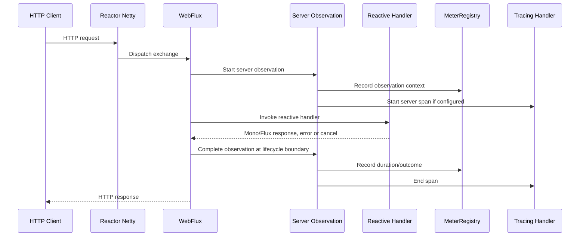
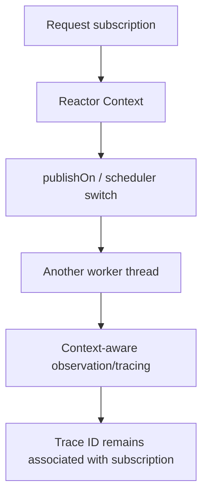
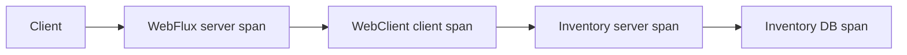

# Reactive Server Instrumentation in Spring Boot

**Reactive server instrumentation** is the practice of measuring and producing telemetry for requests handled by Spring's reactive web stack—typically Spring WebFlux running on Reactor Netty. Instrumentation observes the request lifecycle, records metrics such as request count and processing duration, and can create a server span when Micrometer Tracing is configured. Because reactive execution can switch across threads and relies on Reactor Context, propagating observation/tracing context must follow the reactive execution model.

In the **SPRING_BOOT_OBSERVABILITY** module, reactive server instrumentation connects the HTTP server to metrics, logs, and distributed tracing. This lesson belongs to the **HTTP server observability** chapter and covers WebFlux architecture, the server observation lifecycle, differences between Reactor Context and `ThreadLocal`, route/status/cardinality, async boundaries, custom conventions, testing, and troubleshooting.

## 1. What Is Reactive Server Instrumentation?

In traditional Spring MVC, requests are typically handled under the Servlet model. In Spring WebFlux, requests are processed through a reactive pipeline, commonly using Reactor Netty and publishers such as `Mono`/`Flux`.

Instrumentation observes a request as:
1. The server receives the HTTP request.
2. WebFlux creates an exchange and resolves a handler.
3. The reactive chain executes.
4. The response is written to the network or terminates with an error/cancel.
5. The observation stops and metrics/tracing handlers record the result.

Instrumentation must follow the publisher's actual lifecycle. Returning a `Mono` from a method does not mean the request is finished; the publisher may not even be subscribed to yet or may still be executing.

### High-Level Flow



The diagram is conceptual. Exact start/stop points depend on Spring Boot, Spring Framework, Reactor Netty, and instrumentation versions. Cancellations and client disconnects must be interpreted per framework semantics; do not assume every request ends with a normal response.

## 2. WebFlux and Reactor Netty

Spring Boot WebFlux is a reactive web framework. The default embedded server in many WebFlux apps is Reactor Netty; Spring WebFlux can also run on other supported server runtimes.

Instrumentation must match the stack:
- WebFlux server observation integrates at the framework layer.
- Reactor Netty provides the network/server runtime.
- Micrometer Observation manages the observation lifecycle.
- `MeterRegistry` receives metrics.
- The Micrometer Tracing bridge converts observations into spans if configured.

Do not add a Servlet filter to instrument WebFlux requests as if the app were running Spring MVC. WebFlux does not use the Servlet filter chain in the same way; use `WebFilter` or appropriate reactive extension points when customization is needed.

### 2.1. Basic Dependencies

Example of a WebFlux application with Actuator:

```xml
<dependencies>
    <dependency>
        <groupId>org.springframework.boot</groupId>
        <artifactId>spring-boot-starter-webflux</artifactId>
    </dependency>
    <dependency>
        <groupId>org.springframework.boot</groupId>
        <artifactId>spring-boot-starter-actuator</artifactId>
    </dependency>
</dependencies>
```

Spring Boot dependency management handles compatible versions. Add a tracing bridge and exporter if distributed tracing is needed. Do not mix MVC and WebFlux starters in the same application without understanding how application type and server stack selection work; dependency combinations can cause the app to boot on a different stack than expected.

## 3. Reactive Server Observation Lifecycle

The observation for a reactive HTTP server must start when the framework accepts the request and stop when the corresponding reactive processing completes. Possible terminal outcomes include:

- **Complete:** publisher finishes normally and response is written.
- **Error:** reactive chain emits an exception.
- **Cancel:** subscription is cancelled, e.g., downstream/client disconnect or operator cancellation.
- **Timeout:** timeout operator or server timeout terminates execution.

Cancellation does not automatically equate to HTTP 5xx. A client disconnecting may prevent the server from sending a response; distinguish cancellations from business errors and server failures.

### 3.1. Why Not Time Around Method Invocation?

A controller may return a `Mono` almost instantaneously:

```java
@GetMapping("/{id}")
public Mono<Order> find(@PathVariable String id) {
    return orderService.findById(id);
}
```

Method execution time measures only constructing the publisher. Fetching data and building the response happen later when the publisher is subscribed to. Wrapping the method call in a manual Timer does not reflect full request latency.

Use the framework's reactive-aware instrumentation or measure the publisher using the appropriate Micrometer/Reactor mechanism so the Timer completes on the actual terminal signal.

## 4. Observation, Metrics, and Tracing in WebFlux

Micrometer Observation is a shared abstraction. Observation handlers can translate the lifecycle into metrics or spans:

| Signal | Example Data | Meaning |
| --- | --- | --- |
| Metrics | Request count, duration, method, route, status | Track overall traffic trends |
| Trace | Server span, Trace ID, parent context | Investigate specific retained requests |
| Logs | Exception, business event, Trace ID/Span ID | Supplement events within the request |

Observation can operate without a tracing exporter. Metrics can still be recorded even when sampling drops a trace. Conversely, having a server span does not mean logs have been shipped to a backend.

### 4.1. Server Metrics

The common metric is `http.server.requests`, represented as a Timer per Spring/Micrometer conventions. Tags usually include method, URI template, status, outcome, and normalized exception. Exact names/tags depend on version and stack.

Inspect the metric via Actuator if exposed:

```http
GET /actuator/metrics/http.server.requests
```

Do not treat one version's tag list as an immutable contract. Check the actual output of your application and registry.

### 4.2. Server Span

When a Micrometer Tracing bridge is configured, the server observation can create a server span. If an inbound `traceparent` is extracted properly, the span can be a child of the remote parent span. Sampling policy decides whether the span/trace is recorded/exported.

## 5. Reactive Context vs. `ThreadLocal`

This is the core principle of reactive instrumentation.

In the imperative model, many libraries store request context in `ThreadLocal` or MDC. In a reactive pipeline, one request can hop across many threads, and one thread can interleave many different requests over time. Therefore `ThreadLocal` is not a reliable place to hold context across a reactive chain.

**Reactor Context** attaches metadata to the subscription, allowing context to follow the reactive pipeline even when execution switches threads.



### 5.1. Context Propagation

Micrometer Context Propagation provides a bridge between context mechanisms such as Reactor Context and `ThreadLocal` accessors. Spring Boot/Reactor integrations can configure propagation depending on version and properties.

Do not blindly copy every Reactor Context entry into `ThreadLocal`. Register accessors only for required contexts and control lifecycle/cleanup to prevent context leaks across requests.

### 5.2. MDC and Logging

Traditional MDC relies on `ThreadLocal`. In a reactive app, log lines on another thread may miss MDC if context propagation is not integrated. When `Trace ID`/`Span ID` are needed in logs:
- Use supported tracing/logging integration.
- Ensure context is restored within the processing scope.
- Verify log output across scheduler switches.
- Do not set MDC once at the start of a request and assume every callback runs on the same thread.
- Ensure cleanup so context from a previous request does not leak into another request.

## 6. Propagating Trace Context Across Reactive Boundaries

When a controller calls a downstream service using an instrumented `WebClient`, tracing context can be injected into the outgoing request. The downstream server extracts the context and creates a span in the same trace.

Reactive controller example:

```java
@RestController
@RequestMapping("/api/orders")
class OrderController {

    private final WebClient webClient;

    OrderController(WebClient.Builder builder) {
        this.webClient = builder.baseUrl("http://inventory-service").build();
    }

    @GetMapping("/{id}")
    Mono<String> find(@PathVariable String id) {
        return webClient.get()
                .uri("/api/inventory/{id}", id)
                .retrieve()
                .bodyToMono(String.class);
    }
}
```

In Spring Boot, use the auto-configured `WebClient.Builder` when you need Boot's customizers/observation instrumentation. Creating `WebClient` via a static factory or a standalone builder can bypass registered customizers.

### 6.1. Trace Topology



If downstream calls lack spans, inspect `WebClient` instrumentation, the builder in use, and context propagation. Never generate a new Trace ID per service call if the goal is connecting the same distributed trace.

## 7. Route Templates and Cardinality

Reactive server metrics require low-cardinality tags. Use route templates instead of raw paths containing identifiers.

```text
GET /api/orders/1001
GET /api/orders/1002
GET /api/orders/1003
```

Same logical route:

```text
GET /api/orders/{id}
```

If raw paths are used as metric tags, each ID can spawn a new time series.

| Field | Classification | Guidance |
| --- | --- | --- |
| HTTP method | Low | Use directly |
| Route template | Low if normalized | Use instead of raw URI |
| Status code | Low | Use HTTP status |
| Outcome | Low | Finite value set |
| Trace ID | High | Keep in trace/log correlation |
| User/order ID | High, potentially sensitive | Never use as a metric tag |
| Raw query string | Potentially high/sensitive | Exclude from metrics |

## 8. Status, Exceptions, and Cancellation

A reactive chain can terminate with `complete`, `error`, or `cancel`. These outcomes must not be conflated.

- HTTP 2xx generally indicates a protocol-level success response.
- HTTP 4xx may be an input error or business rejection.
- HTTP 5xx generally indicates a server-side failure.
- An error signal can be handled by `onErrorResume` and turned into a normal response.
- Cancellation can occur when the client disconnects or an operator cancels the subscription.

Example:

```java
return orderService.findById(id)
        .onErrorResume(OrderNotFoundException.class,
                error -> Mono.empty());
```

After error handling, the actual HTTP response depends on controller/handler mapping. Observation sees the outcome per lifecycle/framework hooks; if an exception is converted into a response, it may no longer be reported as an escaping exception.

During investigations, cross-check response status, exception logs, observation outcome, and cancellation metrics if available. Do not automatically turn every cancel into `ERROR`.

## 9. Customizing Reactive Server Observation

Spring Framework provides observation conventions for HTTP server contexts. You can extend a convention to add useful low-cardinality values, such as a stable API group or controlled traffic class.

Principles:
- Extend the default convention when you want to keep framework key values.
- Add only small value sets.
- Never use request ID, user ID, raw URL, or query string as metric tags.
- Verify the convention is registered using the proper mechanism for your Spring Boot/Framework version.
- Avoid unintended convention differences across replicas.

A custom `WebFilter` must not create a second observation for the same request when WebFlux already instruments requests by default. If a filter is needed to attach metadata, use the proper extension point to enrich context instead of creating duplicate timers/spans.

### 9.1. `ObservationRegistry` and Handlers

`ObservationRegistry` manages observation scopes and handlers. `MeterRegistry` records metrics; the tracing handler/bridge translates observations into spans. When adding a custom handler, clarify which events it handles and whether it runs alongside the default handler.

Never add a handler that creates its own Timer if the default handler already records the same request duration; request count and latency could be double-counted.

## 10. Filters, `WebFilter`, and Endpoint Exclusion

WebFlux uses `WebFilter` for request/response processing in the reactive stack. Filters are suitable for authentication, adding headers, or cross-cutting logic. However, a filter is not automatically the right place to instrument observations.

When excluding health/internal endpoints:
- Check instrumentation ignore/filter mechanisms.
- Evaluate whether the endpoint is needed for operations and SLOs.
- Keep traffic classification clear.
- Avoid dropping all probes without assessment.
- Never use raw paths containing IDs to decide metric tags.

Some management endpoints may run on a separate management context/port. Check whether they share the same WebFlux server and observation pipeline.

## 11. Async Boundaries and Reactor Schedulers

A reactive chain can switch schedulers via `publishOn`, `subscribeOn`, `parallel`, or custom schedulers. Context must follow the subscription rather than assuming threads stay constant.

Example:

```java
Mono.deferContextual(contextView -> {
    String requestKey = contextView.getOrDefault("requestKey", "unknown");
    return Mono.just("processed");
})
.publishOn(Schedulers.boundedElastic());
```

This example shows Reactor Context being read from the subscription context; it does not mean every context key automatically becomes a trace attribute or log field.

Notes:
- Never block event-loop threads.
- Use an appropriate scheduler for blocking work.
- Propagate context when leaving Reactor for another callback API.
- Restore/clear `ThreadLocal` when returning threads to a pool.
- Test context across retries, timeouts, cancellations, and nested publishers.
- Avoid storing request context in mutable singleton fields.

If background work continues after the HTTP response, create a separate observation/span for the background work and link it to the initial trace via an appropriate mechanism rather than extending the server span indefinitely.

### 11.1. Blocking Code in Reactive Handlers

Calling JDBC/blocking SDKs directly on the event loop can degrade request latency and throughput. Move blocking work onto an appropriate scheduler or use reactive clients/drivers. Instrumentation may show a long server span without automatically identifying blocking as the cause; combine thread/CPU profiling and downstream spans.

## 12. Sampling and Server Observation

Observations can be created for every request while the tracing sampler retains only a fraction of spans. Request metrics typically have broader coverage than trace sampling.

Example:
- 10,000 requests counted by metrics.
- 10% of traces selected by the sampler.
- Some failing requests may have no trace if head sampling dropped them early.
- `INFO`/`WARN`/`ERROR` logs can still be written independently.

Never conclude a request did not happen just because no trace was found. Use metrics to evaluate overall traffic and logs to inspect related events.

## 13. Security and Privacy

Reactive instrumentation should not record full request headers/bodies. Avoid putting into attributes:
- `Authorization` and `Cookie` headers.
- Access tokens or API keys.
- Raw query strings containing PII.
- Raw URIs containing customer/order identifiers.
- Sensitive request/response bodies.
- Unapproved user identities.

Use route templates, method, status, and allowlisted dimensions. Redact data at the source; TLS only protects transport and does not scrub data from backends.

With baggage and custom context, treat client-supplied data as untrusted. Never use baggage or observation tags as the basis for authorization.

## 14. Testing Reactive Server Instrumentation

Tests should verify both response behavior and telemetry. You can use `WebTestClient` to send requests to a WebFlux application context or running server.

Test example:

```java
@WebFluxTest(OrderController.class)
class OrderControllerTest {

    @Autowired
    WebTestClient client;

    @Test
    void returnsOrder() {
        client.get()
                .uri("/api/orders/42")
                .exchange()
                .expectStatus().isOk();
    }
}
```

This example tests HTTP behavior. `@WebFluxTest` may not initialize the full production exporter/registry pipeline; to verify end-to-end observation, use an integration test with an appropriate application context and test registry/exporter.

### 14.1. Verifying Metrics

After sending requests, verify `MeterRegistry` has the server request timer/meter with expected tags. Do not rely solely on one version's tag names; verify actual output.

### 14.2. Verifying Tracing

Use an in-memory/test exporter or lab Collector to verify server spans are created, Trace IDs are preserved, and context propagates through `WebClient`. Configure sampling appropriately so tests do not flake randomly due to dropped traces.

### 14.3. Verifying Context Propagation

Write a test with `publishOn` so the pipeline switches schedulers. Verify trace/log correlation stays accurate inside callbacks and context does not leak between two independent requests.

## 15. Troubleshooting Reactive Server Instrumentation

| Symptom | Possible Cause | How to Check |
| --- | --- | --- |
| No server request metric | Missing Actuator/registry or instrumentation not applied | Check dependencies, `MeterRegistry`, and WebFlux stack |
| Metrics exist but no spans | Missing tracing bridge or dropped by sampling | Check handler, bridge, sampler, and exporter |
| Duration is too short | Measuring the method returning the publisher instead of publisher lifecycle | Use framework instrumentation/reactive-aware timer |
| Trace ID lost after `publishOn` | Context propagation not configured | Check Reactor Context and accessor integration |
| MDC missing Trace ID on worker thread | `ThreadLocal` does not follow reactive subscription | Use context-aware logging integration |
| Trace splits on downstream calls | `WebClient` uninstrumented or context not injected | Use auto-configured `WebClient.Builder` and check headers |
| Cardinality increases | Raw URI or ID became a metric tag | Use route templates and remove dynamic tags |
| Requests counted twice | `WebFilter`/custom handler creates duplicate observation | Check auto-instrumentation and custom filters |
| Error missing from span | `onErrorResume` turned into response or exception handled | Cross-check response/status/error handling |
| Cancellation recorded as server error | Custom handler equates cancel with error | Check terminal signal semantics |
| Wrong async duration | Observation stops at wrong lifecycle boundary | Check async handling and response completion |
| High event-loop latency | Blocking work on event-loop | Check thread dumps, schedulers, and downstream calls |
| Metrics fail to export | Registry/exporter/Collector pipeline issue | Check the metrics pipeline independently |
| Logs lack correlation | MDC/context integration inactive | Check logging integration and scheduler switches |

### Investigation Workflow

1. Confirm whether the application actually runs WebFlux or MVC.
2. Verify Actuator, `ObservationRegistry`, and `MeterRegistry`.
3. Send a test request and inspect the server request metric.
4. Check route template, method, status, and cardinality.
5. Verify tracing bridge, sampler, and exporter.
6. Test inbound `traceparent` and downstream `WebClient` propagation.
7. Insert a scheduler boundary in tests to verify Reactor Context.
8. Test `complete`, `error`, and `cancel` individually.
9. If duration is abnormal, inspect blocking calls and event-loop behavior.
10. Check metrics, traces, and logs exports per pipeline.

## 16. Lab: Verifying WebFlux Server Instrumentation

The goal is to run a WebFlux application, issue requests, and verify observations, metrics, server spans, and context propagation.

### Preparation

- Spring Boot 3.x application using `spring-boot-starter-webflux`.
- Actuator and `MeterRegistry`.
- Micrometer Tracing bridge/exporter if traces are needed.
- Endpoints returning `Mono` or `Flux`.
- `WebClient.Builder` auto-configured by Spring Boot.
- Lab Collector/backend or test exporter.

### Step 1 — Create Reactive Endpoints

Create a GET controller returning `Mono` and an endpoint with a path variable. Avoid blocking calls on the event loop.

### Step 2 — Enable Actuator Metrics in Lab

```yaml
management:
  endpoints:
    web:
      exposure:
        include:
          - health
          - metrics
```

Expose only endpoints needed for the lab; secure management endpoints in shared environments.

### Step 3 — Send Requests

Use `WebTestClient` or an HTTP client to call the endpoint multiple times. Generate successful responses and a test-only error.

### Step 4 — Inspect Server Metrics

Read `/actuator/metrics/http.server.requests` or the corresponding meter. Check count, duration, method, route template, and status.

### Step 5 — Verify Cardinality

Call the same route with multiple path variables. Confirm metrics group by template rather than creating a series per ID.

### Step 6 — Enable Tracing

Configure a Micrometer Tracing bridge/exporter and appropriate sampling in the lab. Send a request with trace context. Confirm a server span is created when the trace is sampled.

### Step 7 — Call Downstream with `WebClient`

Use the auto-configured `WebClient.Builder` to call a mock service. Verify the client span and downstream server span share the same Trace ID.

### Step 8 — Test a Scheduler Boundary

Use `publishOn` in a test pipeline. Verify Reactor Context, Trace ID, and log correlation remain accurate after switching threads.

### Step 9 — Test Errors and Cancellations

Create a publisher that emits an error and test a controlled cancel/disconnect. Observe response, observation outcome, and span status; do not assume cancel equals 5xx.

### Step 10 — Check Privacy

Review tags/attributes/logs to eliminate raw IDs, tokens, cookies, and PII. Confirm only allowlisted dimensions are present.

### Acceptance Checklist

| Item to Prove | Expected Result |
| --- | --- |
| Stack | WebFlux/Reactor Netty identified |
| Lifecycle | Observation follows reactive terminal signal |
| Metrics | Server request count/duration recorded |
| Tracing | Server span appears when sampling allows |
| Context | Reactor Context crosses scheduler boundaries |
| MDC | Log correlation does not depend on fixed threads |
| `WebClient` | Downstream spans link into the same trace |
| Cardinality | Route templates used, no raw IDs |
| Error/cancel | Error, complete, and cancellation distinguished |
| Performance | Event-loop not blocked |
| Security | No tokens/PII exported |
| Export | Each signal pipeline verified |

## 17. Principles to Remember

1. **Reactive server instrumentation must follow the publisher lifecycle**, not merely time how long a controller method takes to construct a `Mono`/`Flux`.
2. **WebFlux and Spring MVC have different execution models.** Use reactive extension points like `WebFilter` when needed instead of mechanically applying Servlet filters.
3. **Micrometer Observation connects metrics and tracing handlers**, yet each signal's exporter/pipeline still needs to be configured.
4. **Reactor Context is the foundation for subscription-scoped context propagation.** `ThreadLocal`/MDC do not automatically follow a request across scheduler changes.
5. **Use the auto-configured `WebClient.Builder`** when Spring Boot observation/tracing customizers are needed.
6. **Distinguish `complete`, `error`, and `cancel`.** Client disconnects are not necessarily server-side 5xx errors.
7. **Use route templates and low-cardinality values** for metrics; never use raw URIs, IDs, or query strings.
8. **Avoid duplicate instrumentation.** Custom `WebFilter`s/handlers must coordinate with default observations.
9. **Never block the event loop.** Blocking work degrades throughput and latency even though instrumentation still records duration.
10. **Sampling only affects which traces are retained**, never proving whether a request did or did not occur.
11. **Protect metadata.** Redact secrets/PII at the source and never use baggage for authorization.
12. **Verify end-to-end.** Check requests, observations, metrics, spans, logs, exporters, and Collector/backends per signal.

Reactive server instrumentation provides visibility into WebFlux requests while respecting the asynchronous execution model. When observations follow the true publisher lifecycle, context travels via Reactor Context, route tags remain low-cardinality, and downstream calls are instrumented, metrics reveal aggregate traffic behavior while traces and logs provide investigative detail. This is the foundation for operating reactive Spring Boot applications reliably and explainably in production.
