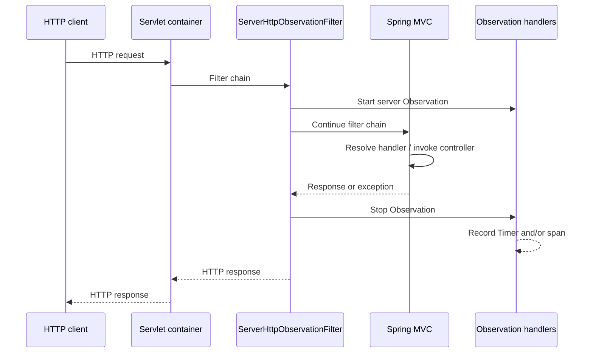
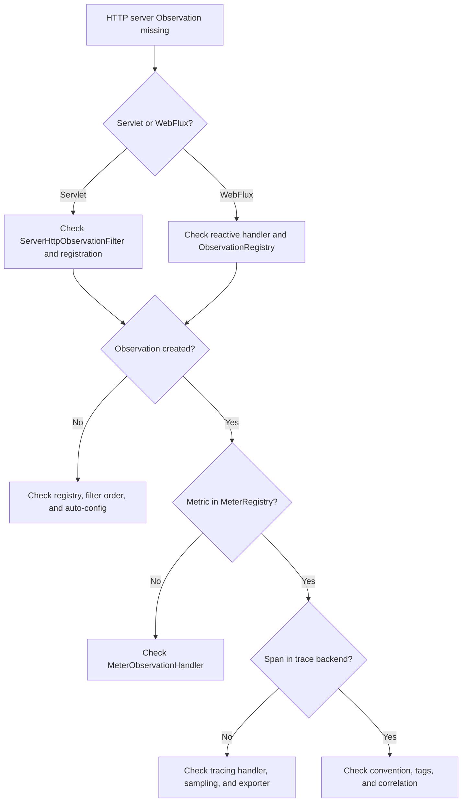

# Server Observation Filter in Spring Boot

The HTTP server is the first boundary for observing a request entering an application. Here, the system needs to measure processing time, recognize method/status/route, create trace spans, and preserve context throughout the request lifecycle. Spring Framework provides an HTTP server Observation mechanism; in Servlet/MVC applications, the central component is `ServerHttpObservationFilter`. This filter wraps request processing in an Observation so `ObservationHandler`s can produce metrics and tracing data.

The **"Server observation filter"** lesson belongs to the **HTTP server observability** chapter of the **SPRING_BOOT_OBSERVABILITY** module. The module guides setting up observability for Spring Boot using Micrometer Observation, metrics, logs, and distributed tracing; you will learn context propagation, tags/cardinality, exporters, sampling, and signal correlation to investigate errors, latency, and application behavior in production environments.

Distinguish two separate responsibilities: **the server observation filter records an HTTP exchange**, whereas `ObservationRegistry`/handlers decide whether that data produces metrics, traces, or both. Enabling the filter without matching handlers in the registry will not automatically produce all signals.

## 1. What Does the Server Observation Filter Do?

In the Servlet stack, `ServerHttpObservationFilter` is a Spring Framework `OncePerRequestFilter`. It creates an Observation for the HTTP request/response exchange and stores the related context in request attributes so the web framework or downstream components can contribute additional metadata.

High-level lifecycle:



The filter captures the processing duration at the Servlet filter layer. The Observation can produce:

- A Timer metric for HTTP server exchange processing duration.
- A server span for distributed tracing if a tracing handler is configured.
- Metadata such as method, route, status, outcome, and error.
- Context for log correlation or other instrumentation to read while the request is executing.

The filter does not replace web server access logs, is not a security filter, and does not send data directly to a backend. It emits an Observation; `MeterRegistry`, the tracing bridge, and exporters handle the subsequent steps.

## 2. Distinguishing Servlet/MVC and WebFlux

The name `ServerHttpObservationFilter` refers strictly to a Servlet filter. Never apply it directly to the reactive stack.

| Stack | Instrumentation Mechanism | Observation Boundary |
| --- | --- | --- |
| Spring MVC / Servlet | `ServerHttpObservationFilter` | Servlet filter chain and downstream request handling |
| Spring WebFlux | Reactive HTTP server observation integrated with `WebHttpHandlerBuilder` and `ObservationRegistry` | Reactive HTTP handler/exchange |
| Jersey | Spring Boot Jersey observation instrumentation | Jersey request processing |
| Custom server/framework | `ObservationRegistry` integration and appropriate convention | Per framework adapter |

In Spring Boot, auto-configuration can enable HTTP server instrumentation for supported web stacks. In a standalone Spring Framework application, you must configure the filter/handler alongside `ObservationRegistry` per the framework documentation. Therefore, before creating a filter yourself, verify whether the framework and Boot version already register instrumentation; avoid creating two server observations for the same request.

### WebFlux Does Not Use a Servlet Filter

In WebFlux, observation is configured on the reactive HTTP handler. Spring Framework lets you build an `HttpHandler` via `WebHttpHandlerBuilder` and attach an `ObservationRegistry`. In Spring Boot, auto-configuration usually handles this for standard WebFlux applications.

Context in a reactive chain must travel via Reactor Context and Micrometer Context Propagation. Never assume a `ThreadLocal` in a Servlet filter can cover reactive processing.

## 3. Observation Name and Default `KeyValues`

The standard HTTP server Observation is typically named:

```text
http.server.requests
```

Metric names can be converted according to registry/backend naming conventions. The default `ObservationConvention` produces low-cardinality and high-cardinality key values.

Low-cardinality values commonly used for metrics and traces:

| Key | Meaning | Example |
| --- | --- | --- |
| `error` | Exception name if any; otherwise typically `none` | `PaymentTimeoutException` |
| `method` | HTTP method | `GET`, `POST` |
| `outcome` | Result category based on response status | `SUCCESS`, `CLIENT_ERROR`, `SERVER_ERROR` |
| `status` | HTTP status | `200`, `404`, `500` |
| `uri` | Route pattern or fallback URI category | `/orders/{id}` |

A high-cardinality value such as `http.url` can contain the full URI and is intended for trace metadata, not metric tags.

Fallback URIs can be values such as `NOT_FOUND`, `REDIRECTION`, `root`, or `UNKNOWN` when no matching route template exists. Therefore, if every request gets tagged with `uri=UNKNOWN`, inspect route mapping/instrumentation before manually stuffing raw paths into metrics.

Exact key names vary by Spring Framework version and active convention. Some older versions use the key `exception`; newer versions have `error` and mark `exception` as deprecated. Check actual output when upgrading the framework.

## 4. Low Cardinality and High Cardinality

This is a pivotal design decision in server observation:

- **Low cardinality** has a finite, stable set of values suitable for metrics aggregation.
- **High cardinality** can have unbounded values, better suited for span attributes or log records depending on need.

Examples:

| Metadata | Classification | Appropriate Usage |
| --- | --- | --- |
| HTTP method | Low | Metric tags and spans |
| Status code/outcome | Low/finite | Metric tags and spans |
| URI template | Low if route mappings are stable | Metric tags and spans |
| Full URL | High | Spans/logs if permitted |
| User ID | High and potentially sensitive | Never use as metric tag; restrict in logs |
| Trace ID | Nearly unique per trace | Trace/log correlation, not metric tags |
| Query string | Potentially high and sensitive | Exclude from metrics by default |

Never record raw request URIs as metric tags. For an `/orders/{id}` endpoint, the route template maintains one representative time series; raw `/orders/1`, `/orders/2`, `/orders/3` create separate series and grow cardinality with order volume.

## 5. Spring Boot Auto-Configuration and When to Register the Filter

In a standard Spring Boot MVC application, actuator/observability auto-configuration registers server instrumentation for requests. Spring Boot documentation notes that all requests are handled by default; if you need to customize filter registration, you can provide a `FilterRegistrationBean<ServerHttpObservationFilter>`.

In a non-Boot Spring Framework application, register `ServerHttpObservationFilter` with `ObservationRegistry`:

```java
import io.micrometer.observation.ObservationRegistry;
import org.springframework.web.filter.ServerHttpObservationFilter;

import jakarta.servlet.Filter;

public class ServletObservationConfiguration {

    public Filter serverObservationFilter(ObservationRegistry registry) {
        return new ServerHttpObservationFilter(registry);
    }
}
```

This snippet illustrates creating the filter in a standalone Servlet configuration; actual registration depends on container/framework configuration. Do not add this filter to Spring Boot before checking existing auto-configuration, as duplicate registration can cause duplicated Observation/metric spans or unintended nested scopes.

### Customizing Filter Scope

If you want the filter to run only on certain URLs or need to adjust dispatcher types/order, configure a `FilterRegistrationBean` for the Boot-provided filter. Never use include/exclude URL patterns as a substitute for security authorization; observability filters are not security boundaries.

Conceptual example:

```java
@Bean
FilterRegistrationBean<ServerHttpObservationFilter> observationFilterRegistration(
        ServerHttpObservationFilter filter) {

    FilterRegistrationBean<ServerHttpObservationFilter> registration =
            new FilterRegistrationBean<>(filter);

    registration.addUrlPatterns("/api/*");
    registration.setOrder(Ordered.HIGHEST_PRECEDENCE + 1);
    return registration;
}
```

Use this customization only when your Boot version provides the matching filter bean and the real goal is scoping URL patterns/ordering. Check auto-configuration conditions and avoid creating a second parallel filter instance.

## 6. `ObservationRegistry` and Handlers

The server filter creates Observations through `ObservationRegistry`. The registry holds configuration and the handlers participating in the Observation lifecycle.

Common handlers:

| Handler | Output |
| --- | --- |
| `MeterObservationHandler` | Records metrics into `MeterRegistry` |
| `TracingObservationHandler` | Creates spans via the Micrometer Tracing bridge |
| `ObservationFilter` | Modifies Observation context/key values after conventions have contributed data |
| `ObservationPredicate` | Decides whether an Observation is created/recorded per predicate |

If the registry is not configured with appropriate handlers, an Observation can become a no-op or produce only one signal type. Do not equate the existence of `/actuator/metrics` with tracing being configured.

In Spring Boot, prefer the auto-configured `ObservationRegistry` and Boot-managed `MeterRegistry`/`Tracer`. Creating a separate registry without attaching the right handlers can prevent framework Observations from reaching backends.

## 7. Defining a Custom `ServerRequestObservationConvention`

`ObservationConvention` determines the Observation name and the `KeyValues` extracted from `ServerRequestObservationContext`. This is the official extension point when adding metadata from requests.

To add tags while keeping default metadata, extend `DefaultServerRequestObservationConvention`:

```java
import io.micrometer.common.KeyValue;
import io.micrometer.common.KeyValues;

import org.springframework.http.server.observation.DefaultServerRequestObservationConvention;
import org.springframework.http.server.observation.ServerRequestObservationContext;

public class ExtendedServerRequestObservationConvention
        extends DefaultServerRequestObservationConvention {

    @Override
    public KeyValues getLowCardinalityKeyValues(
            ServerRequestObservationContext context) {

        return super.getLowCardinalityKeyValues(context)
                .and(KeyValue.of("api.channel", channel(context)));
    }

    private String channel(ServerRequestObservationContext context) {
        Object value = context.getCarrier().getAttribute("api.channel");
        return value != null ? value.toString() : "unknown";
    }
}
```

Register the convention via a bean using the mechanism supported by your framework/version:

```java
@Bean
ServerRequestObservationConvention serverRequestObservationConvention() {
    return new ExtendedServerRequestObservationConvention();
}
```

When a custom convention is applied, retain default low-cardinality keys if existing dashboards/alerts still depend on them. Replacing the entire convention can strip default dimensions like `method`, `status`, `outcome`, and `uri` from metric queries.

### Conventions Are Not for Dumping Every Request Field into Metrics

Add only keys with small, controlled value sets. Never pull email, customer ID, raw path, query string, or tokens from the request to form low-cardinality tags. Data that is analytically valuable yet high-cardinality should be considered for span attributes/logs under privacy policies.

## 8. Recording Handled Exceptions

A common point of confusion: the filter records an exception when it bubbles up to the filter; exceptions already handled by a controller into a response are not automatically recorded as Observation errors.

In Spring MVC:

- Unhandled exceptions bubbling up to the filter can be recorded as errors.
- 5xx server errors handled by Spring MVC, including some `ProblemDetail` responses, are handled per framework convention.
- 4xx client errors or exceptions handled by `@ExceptionHandler` usually are not automatically recorded as Observation errors.

If you want to record a specific handled exception, use the filter's API:

```java
import jakarta.servlet.http.HttpServletRequest;
import org.springframework.http.ResponseEntity;
import org.springframework.stereotype.Controller;
import org.springframework.web.bind.annotation.ExceptionHandler;
import org.springframework.web.filter.ServerHttpObservationFilter;

@Controller
public class UserController {

    @ExceptionHandler(MissingUserException.class)
    ResponseEntity<Void> handleMissingUser(
            HttpServletRequest request,
            MissingUserException exception) {

        ServerHttpObservationFilter.recordHandledException(
                request, exception);

        return ResponseEntity.notFound().build();
    }
}
```

This snippet merely illustrates attaching a handled exception to the request Observation. It does not mean a 404 response must be treated as a 5xx; status and error are two distinct dimensions. Deciding whether to flag a 4xx business exception as an error must follow your service's SLI definitions and operational policy.

In WebFlux, use `ServerRequestObservationContext.recordHandledException(...)` on exchange attributes per the corresponding API; never call Servlet filter APIs inside a reactive controller.

## 9. Filter Order and Observed Scope

Because instrumentation runs at the Servlet filter level, the Observation scope covers filters executing after `ServerHttpObservationFilter` along with request handling. Filters running before it may sit outside the scope; container-level error handling can also happen outside this scope.

Consider relative positioning with:

- Spring Security filter chain.
- Custom authentication/authorization filters.
- Request logging/correlation filters.
- CORS, compression, and other infrastructure filters.
- Filters that mutate request attributes or response status.

For instance, if a custom authentication filter runs before the observation filter, authentication duration may not be included in the Observation. If it runs after, those operations fall within the observation scope, though context/trust boundaries must also be evaluated.

Never rearrange filter ordering arbitrarily. Diagram the filter chain, determine exactly which work should be measured, and verify trace/timer durations after changes.

## 10. `ObservationFilter` vs. `ServerHttpObservationFilter`

These two components have similar names but different roles:

| Component | Role |
| --- | --- |
| `ServerHttpObservationFilter` | Servlet filter that creates an Observation for the HTTP request/response |
| `ObservationFilter` | Post-processing hook for `Observation.Context` to add/remove/adjust metadata |
| `ObservationPredicate` | Filter deciding whether an Observation is created or not |
| `ServerRequestObservationConvention` | Defines the name and `KeyValues` of the HTTP server Observation |

Micrometer `ObservationFilter` does not replace the Servlet filter. It receives an already-created context and transforms it, typically to add or adjust tags:

```java
import io.micrometer.common.KeyValue;
import io.micrometer.observation.Observation;
import io.micrometer.observation.ObservationFilter;

import org.springframework.http.server.observation.ServerRequestObservationContext;

public class ServerRequestMetadataFilter implements ObservationFilter {

    @Override
    public Observation.Context map(Observation.Context context) {
        if (context instanceof ServerRequestObservationContext serverContext) {
            Object channel = serverContext.getCarrier().getAttribute("api.channel");
            if (channel != null) {
                context.addLowCardinalityKeyValue(
                        KeyValue.of("api.channel", channel.toString()));
            }
        }
        return context;
    }
}
```

Register `ObservationFilter` on `ObservationRegistry` using your application's registry configuration mechanism. When a convention already emits a key with the same name, avoid adding duplicates or conflicting values.

## 11. Context, Trace Propagation, and Log Correlation

Server Observation establishes a tracing scope around the request when a tracing handler is configured. Trace context from inbound requests can be extracted by tracing instrumentation and used as the parent. When calling downstream via an instrumented HTTP client, context continues to be injected.

Logs during the request can be linked using `traceId`/`spanId` if logging integration/MDC is configured. The filter does not automatically guarantee every log line carries correlation fields; logs must be emitted within the active context and the logging backend must encode those fields.

Do not manually read or write trace IDs as a replacement for propagators. Do not turn trace IDs into metric tags. Use trace/span context for correlation, low-cardinality metrics for aggregation, and logs for event details.

## 12. Metrics and Tracing Produced from Server Observation

The common metric name is `http.server.requests`. Default tags provide ways to aggregate requests:

```text
http.server.requests
  method=GET
  uri=/orders/{id}
  status=200
  outcome=SUCCESS
  error=none
```

Metric backends may normalize names per convention—for example, dots to underscores. Tracing backends display span attributes matching the tracing bridge and `ObservationConvention`.

A Timer can report count, total time, and histograms/percentiles if distribution config is enabled. Traces provide waterfalls and span relationships. The two signals complement each other without replacing one another.

For example:

- Metrics show p95 rising for `/orders/{id}`.
- Traces reveal a database span or outbound call accounts for most of the duration.
- Logs filtered by trace ID show the corresponding exception/context.

## 13. Customizing Observation Name and Convention

Spring Boot allows changing the HTTP server observation name via the corresponding version property, typically:

```yaml
management:
  observations:
    http:
      server:
        requests:
          name: http.server.requests
```

Keep the standard name unless there is a specific compatibility reason. Renaming can break meter queries, dashboards, alerts, and tracing backend conventions.

If using OpenTelemetry semantic conventions for HTTP, Spring Framework provides `OpenTelemetryServerRequestObservationConvention` to emit metadata following OpenTelemetry HTTP metrics/spans conventions. Convention choices must align with your backend schema and sibling services. Never mix key names across conventions without a migration plan.

## 14. Intentionally Ignoring Certain Requests

Some requests do not need recording, such as static assets or certain health probes, depending on goals. You can apply filter registration URL patterns, `ObservationPredicate`, or appropriate filter logic.

However:

- Do not drop liveness/readiness checks if they are important operational signals.
- Do not drop all 4xx responses just because they are client errors; rising 404s can indicate a routing regression.
- If static routes are excluded, retain another metric/source if you still need visibility into their traffic or errors.
- Ensure drop decisions can be explained, measured, and tested.
- Never use observation filtering to enforce authorization.

When excluding by path, use explicit route patterns rather than raw URIs containing path parameters and query strings. Account for context paths and servlet mappings.

## 15. Testing the Server Observation Filter

An integration test should verify that the Observation is created and stopped across the proper lifecycle, not merely that the application starts up.

Key test cases:

1. Normal HTTP 2xx has accurate `method`, `route`, `status`, and `outcome`.
2. Returned HTTP 4xx has client error status and outcome.
3. Exceptions bubbling to the filter are recorded properly.
4. Exceptions handled by `@ExceptionHandler` exhibit error behavior matching policy.
5. Framework-handled 5xx errors are reflected properly.
6. Async requests/dispatches do not create duplicate observations or finish prematurely.
7. Security/filter ordering covers the expected processing work.
8. Trace ID/parent span propagate properly across inbound and outbound calls.
9. Low-cardinality tags contain no raw URLs, user IDs, or trace IDs.
10. WebFlux paths are tested separately via reactive handlers, not Servlet filters.

You can test observations with a test registry/`ObservationHandler` spy or inspect the Timer after a request. Avoid only asserting that an Actuator endpoint returns HTTP 200; that does not prove the meter was recorded.

## 16. Diagnosing Missing HTTP Server Observations

| Symptom | Possible Cause | How to Check |
| --- | --- | --- |
| Missing `http.server.requests` | Missing Actuator/registry, filter, or `ObservationRegistry` unconfigured | Check dependencies, auto-config, and registry |
| Metric exists but no spans | Missing tracing handler/bridge or trace not sampled | Check Micrometer Tracing and sampling |
| Each request creates two timers | Duplicate filter registration or another instrumentation also measuring | Check `FilterRegistrationBean` and auto-config |
| `uri` tag always `UNKNOWN` | Handler mapping fails to supply route pattern or request unresolved | Check MVC mappings and request path |
| 404 lacks expected route tag | Request did not match a handler | Check fallback URI convention |
| Handled exception missing from `error` key | Exception handler converted it into a response | Record handled exception if required by policy |
| Filter does not cover security work | Filter ordered before/after security unexpectedly | Inspect actual filter chain order |
| Logs missing trace ID | MDC/logging correlation unconfigured or scope lost | Check active trace and encoder |
| WebFlux lacks Observation | `ObservationRegistry` not attached to reactive handler | Check Boot auto-config/`WebHttpHandlerBuilder` |
| Metrics cardinality spikes | Convention added raw URL or ID as low-cardinality key | Inspect `KeyValues` and tag values |

Investigation workflow:

1. Determine whether the app runs Servlet/MVC, WebFlux, or another framework.
2. Verify HTTP server instrumentation is auto-configured/registered exactly once.
3. Inspect `ObservationRegistry` and `MeterRegistry`/Tracing handlers.
4. Call a test endpoint and inspect the `http.server.requests` meter.
5. Verify tags, route fallbacks, and error semantics.
6. If tracing is missing, inspect tracing bridge, sampler, exporter, and parent propagation separately.
7. Check filter order and exception handling.
8. Compare log correlation against trace context.



## 17. Lab: Observing Requests in Spring MVC

Carry out in local/test:

1. Create a Spring MVC application with Spring Boot Actuator and a configured `MeterRegistry`.
2. Verify Boot registered the server observation filter; do not create a second filter.
3. Create a GET endpoint returning 200, an endpoint returning 404, and an endpoint throwing an exception.
4. Send requests and verify `http.server.requests` increments accurately with proper `method`/`uri`/`status`/`outcome` tags.
5. Create a custom convention extending `DefaultServerRequestObservationConvention`, adding a finite-value field such as `api.channel`.
6. Test an `@ExceptionHandler` returning 404; compare the `error` field before and after calling `recordHandledException`.
7. Add a Micrometer Tracing bridge and verify server spans are created when traces are sampled.
8. Use an instrumented HTTP client to call downstream, verifying trace relationships and log correlation.
9. Verify tag values contain no raw IDs, raw URLs, or query strings.

For WebFlux, repeat the tests on a reactive application using the corresponding WebFlux instrumentation and verify context across scheduler boundaries.

## 18. Self-Check Questions

1. Does `ServerHttpObservationFilter` belong to the Servlet or WebFlux stack?
2. At which boundary of an HTTP request does the filter create an Observation?
3. How does an Observation differ from `MeterRegistry` and a tracing exporter?
4. Why can a single Observation produce metrics, traces, or both?
5. What is the typical default HTTP server Observation name?
6. How do low-cardinality `KeyValues` differ from high-cardinality values?
7. Why should raw URLs never become metric tags?
8. How does filter order affect the observed request scope?
9. How does Spring Boot auto-configuration affect filter registration?
10. Why should you verify existing setup before manually registering an extra filter?
11. Does an exception handled by `@ExceptionHandler` automatically appear as an Observation error?
12. What is `recordHandledException` used for?
13. How does `ObservationFilter` differ from `ServerHttpObservationFilter`?
14. What is `ServerRequestObservationConvention` used to customize?
15. Why does WebFlux need a reactive handler/`ObservationRegistry` instead of a Servlet filter?
16. What can cause HTTP metrics to exist while spans are missing?
17. How do you avoid duplicate timers caused by duplicate filter registrations?
18. Which test cases prove the server Observation works properly?

## References

- [Spring Framework — Observability Support](https://docs.spring.io/spring-framework/reference/integration/observability.html): HTTP server instrumentation, `ServerHttpObservationFilter`, conventions, handled exceptions, and reactive applications.
- [Spring Framework — ServerHttpObservationFilter Javadoc](https://docs.spring.io/spring-framework/docs/current/javadoc-api/org/springframework/web/filter/ServerHttpObservationFilter.html): filter lifecycle, request context, and API for recording handled exceptions.
- [Spring Boot — Metrics](https://docs.spring.io/spring-boot/reference/actuator/metrics.html): HTTP server metrics, auto-configuration, and convention customization.
- [Spring Boot — Observability](https://docs.spring.io/spring-boot/reference/actuator/observability.html): `ObservationRegistry`, metrics/tracing handlers, and instrumentation.
- [Micrometer Observation](https://docs.micrometer.io/micrometer/reference/observation.html): `Observation`, `ObservationRegistry`, handlers, conventions, filters, and predicates.
- [OpenTelemetry HTTP semantic conventions](https://opentelemetry.io/docs/specs/semconv/http/http-metrics/): HTTP metrics attributes and semantics.

## Conclusion

**The server observation filter provides a consistent recording point for HTTP requests in the Servlet stack.** It opens an Observation around the request/response and supplies context to the convention, `MeterObservationHandler`, and tracing handler. In Spring Boot, auto-configuration usually manages registration; in standalone Spring Framework apps, configure the filter alongside `ObservationRegistry`. WebFlux uses dedicated reactive HTTP instrumentation.

To operate reliably, verify the filter is registered exactly once, understand its scope via filter order, keep low-cardinality tags stable, and explicitly handle controller-caught exceptions. Metrics show traffic-wide trends, traces show the path of sampled requests, and logs supply details keyed by trace/span context. When all three signals maintain the same service identity and context, operations teams can investigate errors and latency across components far more effectively.
