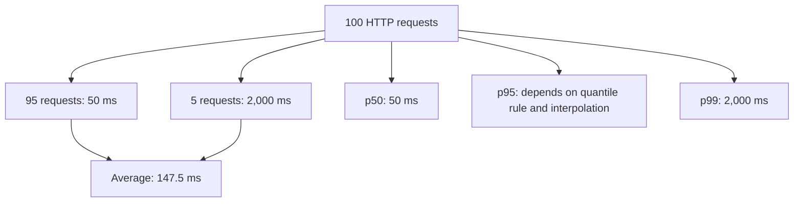
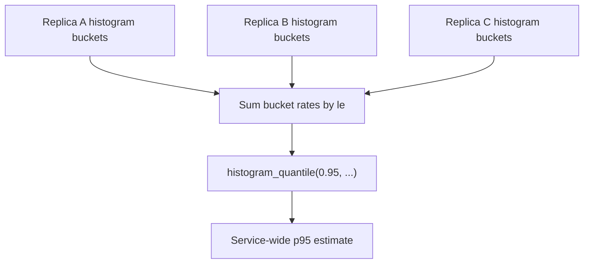

# Tracking Percentile Latency in Spring Boot

An endpoint can answer most requests quickly while still making a subset of users wait a long time. Average latency can look healthy even when some requests are severely slow. To see the tail of the response-time distribution, operations teams track **latency percentiles** such as p50, p90, p95, and p99. This lets you read performance from the experience of many requests rather than relying on a single average value.

The **Tracking percentile latency** lesson belongs to the **HTTP server observability** chapter of the **SPRING_BOOT_OBSERVABILITY** module. The module guides setting up observability for Spring Boot using Micrometer Observation, metrics, logs, and distributed tracing; you will learn context propagation, tags/cardinality, exporters, sampling, and signal correlation to investigate errors, latency, and application behavior in production environments.

After this lesson, you will be able to interpret p50/p90/p95/p99, distinguish histograms from summaries/client-side quantiles, configure Micrometer Timers to export histograms, query percentiles in Prometheus, aggregate accurately across multiple instances, and use percentiles to track SLOs without confusing percentiles with maximum or average values.

## 1. What Is Percentile Latency?

**Latency** is the time an operation takes to complete between defined start and end points. For an HTTP server, it is typically measured from when the server begins handling the request until the response completes per instrumentation. Be clear about whether a metric measures server processing time, dependency time, or the time the user actually sees the response.

A **percentile** indicates the threshold at or below which a given percentage of observations fall:

| Percentile | Interpretation |
| --- | --- |
| p50 | 50% of requests have latency no greater than this value; approximates the median |
| p90 | 90% of requests have latency no greater than this value |
| p95 | 95% of requests have latency no greater than this value |
| p99 | 99% of requests have latency no greater than this value; highlights tail latency |
| p99.9 | 99.9% of requests have latency no greater than this value; sensitive to very long tails and requires high sample volume |

For example, p95 = 420 ms means roughly 95% of observations in the selected set and time window finished in at most 420 ms; the remaining ~5% took longer. It does **not** mean every request took 420 ms, nor does it show the single slowest request.

## 2. Why Is Average Latency Not Enough?

Suppose there are 100 requests: 95 requests take 50 ms, and 5 requests take 2,000 ms.

\[
\text{Average} =
\frac{95 \times 50 + 5 \times 2000}{100}
= 147.5\text{ ms}
\]

The average is 147.5 ms, yet 5% of requests took 2 seconds. Looking only at the average masks the group of users experiencing high latency.



Exact percentile values depend on the quantile definition, interpolation method, and bucket boundaries; the diagram simply illustrates the difference between the center and the tail. For production data, use a consistent histogram/quantile implementation with sufficient observations.

Inspect at least average, p50, p95, p99, and request count. Percentiles do not replace throughput, error rate, or saturation. A service with a good p95 that drops half its traffic to errors is still unhealthy.

## 3. Reading Percentiles from a Data Sample

Suppose the latencies of 10 requests sorted in ascending order (ms) are:

```text
20, 22, 25, 28, 30, 35, 40, 55, 90, 500
```

The median sits around 30–35 ms, while the last request took 500 ms. Quantile algorithms can compute p50/p90 with different interpolation rules; therefore, do not compute percentiles by hand from a few numbers and expect them to match Prometheus, Micrometer, or your backend exactly.

When reading a dashboard:

1. Check the metric name and unit (seconds, milliseconds, or microseconds).
2. Check the time window and number of observations.
3. Determine whether the percentile is computed per instance or across the entire service.
4. Determine whether the metric is a histogram or a summary.
5. Compare within the same route/method/status group to avoid mixing different workloads.

A p99 from 20 requests does not carry the same reliability as a p99 from millions of requests. Tail percentiles are especially sensitive when sample counts are small.

## 4. Micrometer Timer and Distribution Statistics

In Spring Boot, HTTP server requests are typically measured using Micrometer Observation and a Timer. A Timer records invocation count, total duration, and can provide distribution statistics depending on registry configuration.

Timers typically expose `count`, `totalTime`, and `max` per implementation semantics. Histogram buckets or percentile statistics appear only when enabled. Illustrative Spring Boot/Micrometer configuration:

```yaml
management:
  metrics:
    distribution:
      percentiles-histogram:
        http.server.requests: true
      slo:
        http.server.requests:
          - 100ms
          - 250ms
          - 500ms
          - 1s
```

This configuration illustrates settings for the HTTP server request meter; verify property bindings and meter names for your Spring Boot/Micrometer version. Choose SLO boundaries based on service requirements rather than copying example thresholds without defining latency objectives.

### Percentiles vs. Histograms

- **Client-side percentiles/quantiles:** the SDK/registry computes percentiles inside each process or meter instance. They are convenient locally, yet generally cannot be accurately aggregated across multiple instances by averaging percentiles.
- **Histogram:** records the distribution into buckets. The backend can sum bucket counts across instances and then estimate quantiles over the aggregated distribution.
- **Summary:** typically records count/sum and may publish client-computed quantiles; those quantiles cannot be summed across instances like histogram buckets.

For services running multiple replicas, histograms are usually the right choice when service-wide aggregated percentiles are needed.

## 5. Histogram Buckets and Quantiles

Histograms divide latency into intervals. Example bucket boundaries:

```text
le=0.1   seconds
le=0.25  seconds
le=0.5   seconds
le=1.0   seconds
le=+Inf
```

Buckets are **cumulative**: the `le=0.5` bucket counts all observations with latency at most 0.5 seconds, including smaller buckets. The `+Inf` bucket contains all observations.

Illustrative counts:

| Bucket Boundary | Cumulative Count |
| --- | ---: |
| `le=0.1` | 700 |
| `le=0.25` | 900 |
| `le=0.5` | 970 |
| `le=1.0` | 995 |
| `le=+Inf` | 1,000 |

From the histogram, the backend estimates where the percentile falls within a bucket. If p95 falls into the 0.25–0.5 second bucket, the quantile can be interpolated across that interval. Accuracy depends on bucket boundaries and the actual distribution inside the bucket.

Choose bucket boundaries around your latency objectives/SLOs for resolution in the critical region. If all buckets are too wide, estimated quantiles are coarse; if there are too many buckets, cardinality and cost increase.

## 6. Prometheus: Computing p95 with `histogram_quantile`

With histograms exported to Prometheus, querying aggregated p95 by service or route can use `histogram_quantile`:

```promql
histogram_quantile(
  0.95,
  sum by (le) (
    rate(http_server_requests_seconds_bucket[5m])
  )
)
```

This query estimates p95 from bucket rates across all series in the selected scope. Metric names may vary by registry naming convention; verify the actual metric before using it.

### p95 by Route and Method

```promql
histogram_quantile(
  0.95,
  sum by (le, uri, method) (
    rate(http_server_requests_seconds_bucket[5m])
  )
)
```

Keep only the dimensions needed for the analysis. Adding `status`, `outcome`, or `service` increases the number of groups. Never use raw URIs with IDs or query strings as labels; use route templates like `/orders/{id}`.

### p99 by Service Instance

```promql
histogram_quantile(
  0.99,
  sum by (le, instance) (
    rate(http_server_requests_seconds_bucket[5m])
  )
)
```

This query shows per-instance p99 when the `instance` label exists. It is useful for spotting a single degraded replica, but it is not service-wide p99. For service-wide view, omit `instance` from the grouping.

## 7. Aggregating Percentiles Across Multiple Instances

Suppose a service has three replicas with p95 values of 100 ms, 200 ms, and 800 ms. You cannot average them as (100+200+800)/3 = 366.7 ms and call that the service-wide p95.

A percentile is a non-linear function of a distribution. The quantile of a union of datasets does not equal the average of each dataset's quantile. To obtain an aggregated percentile, sum the histogram bucket counts first and then compute the quantile:



Prometheus queries aggregate by `le` (preserving desired dimensions) and then call `histogram_quantile`. With client-computed summary quantiles, you cannot perform an equivalent aggregation by averaging p95 values.

If higher percentile accuracy or more analytical dimensions are required, select an appropriate histogram implementation and bucket scheme. Native histograms in Prometheus have their own mechanics; queries must match the stored histogram type.

## 8. Client-Side Percentiles and Distribution Summaries

Micrometer can configure percentiles directly on a meter. For example:

```yaml
management:
  metrics:
    distribution:
      percentiles:
        http.server.requests: 0.5, 0.9, 0.95, 0.99
```

Properties and percentile export behavior depend on registry/version. Percentiles computed within each meter/process are convenient for instance-level dashboards. With multiple instances, never average per-replica p95s to compute a service-wide p95.

| Configuration | Output | Aggregatable Across Instances? |
| --- | --- | --- |
| Client-side percentile | Quantiles computed in-process | Not by summing/averaging quantiles |
| Histogram buckets | Counts per bucket boundary | Yes, sum corresponding buckets then compute quantile |
| Count/sum | Observation count and total duration | Yes, can compute aggregated average |
| Max | Maximum value per semantics/window | Cannot derive percentiles |

If your backend is Prometheus, histograms are typically the natural choice for aggregated quantiles. With other backends/registries, read their exact semantics before building dashboards.

## 9. Latency Percentiles and SLOs

An SLO (Service Level Objective) defines a service quality target. A latency SLO can be expressed via a percentile—for example, p95 of a defined request group must not exceed 300 ms over an evaluation window. However, percentile SLOs and threshold-based good-event SLOs are two distinct formulations; align on the definition with product and operations teams.

Another common formulation is the **good event ratio**:

\[
\text{Good ratio} =
\frac{\text{requests with latency} \leq T}
{\text{eligible requests}}
\]

For example, 99% of eligible requests complete within 500 ms. This can be expressed directly using histogram bucket counts and total request counts, and tracked with an error budget.

Illustrative PromQL query for the ratio of requests completing in at most 0.5 seconds:

```promql
sum(rate(http_server_requests_seconds_bucket{le="0.5"}[5m]))
/
sum(rate(http_server_requests_seconds_count[5m]))
```

Queries must filter the exact service/route/status and handle error requests according to the SLO definition. If the numerator and denominator cover different request populations, the ratio is meaningless. Clearly define which requests are eligible and whether HTTP errors count as bad events independently or as a latency-only objective.

### Choosing p95 or p99?

- p50 reflects the median user experience.
- p95 is suitable for tracking the bulk of traffic and is usually less noisy than p99.
- p99 is sensitive to tail latency and surfaces impact on smaller groups, yet requires sufficient volume and bucket resolution.
- p99.9 is only meaningful when traffic is high enough, instrumentation is stable, and storage/querying supports the needed distribution resolution.

Do not pick the highest percentile merely because it sounds stricter. Choose based on user impact, traffic volume, SLOs, and measurement capability.

## 10. Choosing Time Windows and Sample Counts

Percentiles are always tied to a set of observations and a time interval. A 1-minute p95 can swing wildly under low traffic; a 1-hour p95 can smooth away a short incident.

Consider viewing multiple windows:

- 5 minutes: detects fast changes, though sample counts may be small.
- 15–30 minutes: balances responsiveness and stability.
- 1 hour or 1 day: longer-term trends, though it hides brief spikes.

Dashboards should display request rate/count alongside percentiles so readers know the sample size. When traffic drops near zero, percentiles may have no data or return values that are hard to interpret.

Never compare p99 across two routes with vastly different traffic volumes without checking sample counts. A route with 20 requests in a window does not provide strong evidence for p99.

## 11. Cardinality and Histogram Cost

Histograms generate more series than a Timer with only count/sum. Series counts scale with meter names, tag combinations (`method`, `route`, `status`, `outcome`, `instance`), bucket boundaries, and service/instance counts.

For example, 30 route templates × 7 method categories × 5 status categories × 12 bucket series can easily produce thousands of series for a single metric before factoring in additional dimensions.

Keep cardinality under control:

- Use route templates, never raw URIs.
- Never add user ID, order ID, trace ID, or query strings to tags.
- Keep only necessary `method`/`status`/`outcome` dimensions.
- Choose bucket boundaries aligned with SLOs; avoid adding excessive arbitrary buckets.
- Check series counts after deployment and set limits/alerts for cardinality growth.

Histograms are a trade-off: more data in exchange for accurate aggregated quantiles. Choose the right resolution for the latency range you need to monitor.

## 12. Querying by Route, Method, and Status

A useful HTTP server dashboard typically allows filtering by route template and method. For example:

```promql
histogram_quantile(
  0.95,
  sum by (le, uri, method) (
    rate(http_server_requests_seconds_bucket{
      application="orders-service",
      status=~"2.."
    }[5m])
  )
)
```

Label names `application`, `status`, and `uri` are illustrative only; actual metrics may use `service`, `status_code`, `http_route`, or other names. Before deploying queries, verify label names, route values, and exporter naming.

When investigating latency, do not look only at p95 across all statuses combined. Error responses often fail fast, pulling down the overall percentile even while successful requests are slow. Separate successful responses, client errors, server errors, and dependency timeouts/retries into distinct views or metrics.

Status groupings must match operational goals; do not exclude 5xx from every dashboard, as they represent bad user experiences too.

## 13. Correlating Percentiles with Traces and Logs

Latency percentiles reveal **when and which group** is slow; traces show **where a selected request spent time**; logs provide detailed events at each step.

Workflow:

1. Dashboard alerts that p95 for `POST /orders` is rising.
2. Filter by route/method and time window to pinpoint the service/instance.
3. Open sampled traces in the same window and look for database or dependency spans with high duration.
4. Use Trace ID/Span ID to look up corresponding logs.
5. Cross-check retries, status, and error categories.

Sampling can leave slow tail requests without stored traces. That is why metric histograms must cover traffic per instrumentation policy; never infer percentiles from sampled traces.

Do not put Trace IDs into metric labels to link dashboards. Use trace exemplars if supported by your registry/backend, or correlate logs/traces via trace context.

## 14. Testing Percentiles and Histograms

| Test | What to Prove |
| --- | --- |
| Timer unit test | Count/total time increment properly when recording observations |
| Histogram configuration test | Meter publishes expected bucket boundaries |
| Registry integration test | Exported meters/labels follow naming conventions |
| Multi-instance query test | Bucket counts are summed before computing quantiles |
| Low-traffic test | Dashboard handles no-data/low-sample cases sensibly |
| SLO test | Numerator/denominator cover the same eligible population |
| Cardinality test | Raw URIs/IDs do not create separate series |

Example testing a Timer with `SimpleMeterRegistry`:

```java
import io.micrometer.core.instrument.simple.SimpleMeterRegistry;
import io.micrometer.core.instrument.Timer;
import java.time.Duration;

SimpleMeterRegistry registry = new SimpleMeterRegistry();
Timer timer = Timer.builder("http.server.requests")
    .tag("method", "GET")
    .tag("uri", "/orders")
    .register(registry);

timer.record(Duration.ofMillis(40));
timer.record(Duration.ofMillis(80));

assert timer.count() == 2;
assert timer.totalTime(java.util.concurrent.TimeUnit.MILLISECONDS) == 120;
```

This example illustrates recording count/total time; it does not prove histograms are published. For histograms, construct a registry/configuration supporting distribution statistics and assert actual bucket counts/measurements.

Do not test percentiles with two observations and assert p99 must equal a production figure. Percentile implementations have their own rules; tests should verify configuration and registry/backend semantics.

## 15. Common Pitfalls

| Symptom | Possible Cause | Troubleshooting Direction |
| --- | --- | --- |
| Average exists, no p95 | Histograms/percentiles not enabled | Check distribution configuration |
| Service-wide p95 unusually low | Averaging client-side quantiles or mixing fast error responses | Use histogram aggregation and split by status |
| p99 jumps erratically | Low sample count or window too short | Display request count and widen window appropriately |
| p95 differs across replicas | One slow instance, uneven traffic, or differing resources | Query per-instance and compare to service-wide histogram |
| Histogram has too many series | Too many tags/buckets | Reduce dimensions, normalize routes/methods and buckets |
| `histogram_quantile` returns no data | Wrong metric/bucket name or `le` label | Inspect actual emitted series |
| Percentiles mismatch trace durations | Different time window, sampling, scope, or unit | Verify metric scope/unit and sampling |
| p95 drops while errors rise | Fast error responses lower overall latency | Separate success/error and monitor error rate |
| SLO ratio exceeds 100% or looks invalid | Numerator/denominator cover different request sets | Align filters and eligible population |
| No histogram after deploy | Wrong meter name in config or inactive profile | Check effective configuration and registry |
| p99.9 unstable | Insufficient observations or sparse buckets | Choose a percentile suited to traffic and increase resolution |

## 16. Practical Scenario: p95 Rises While Average Barely Moves

**Hypothetical context:** `orders-service` handles 8,000 requests/minute. Average latency stays around 90 ms, yet p95 jumps from 180 ms to 750 ms and p99 hits 1.8 seconds. Error rate remains nearly flat.

Investigation workflow:

1. **Verify the metric:** confirm the Timer has histograms and the query computes p95 from bucket counts rather than averaging quantiles across instances.
2. **Isolate the population:** slice by method/route/status; see whether the spike is concentrated on `POST /orders` or also affects GET.
3. **Check replicas:** query p95 by instance to spot a pod with abnormal tail latency.
4. **Check sample counts:** confirm sufficient traffic for the inspected route group.
5. **Open sampled traces:** search for slow database, inventory, or payment spans; remember not every slow request has a trace.
6. **Cross-check logs:** inspect trace correlation and retry/error categories while avoiding raw payloads.
7. **Check infrastructure:** CPU throttling, connection pools, thread/event-loop saturation, GC pauses, and dependency latency.
8. **Evaluate SLO:** inspect the percentage of requests completing within target thresholds rather than p95 alone; measure error budget burn if applicable.

The average may barely budge when only a small fraction of requests slow down. p95/p99 expose that subset, helping operations find bottlenecks before impact spreads.

## 17. Self-Check Exercises

**Exercise 1.** What does p95 = 300 ms mean?

*Hint:* Roughly 95% of observations in the selected set/time window did not exceed 300 ms; roughly 5% took longer.

**Exercise 2.** Why should you not average the p95 of three replicas to get the service-wide p95?

*Hint:* Quantiles are non-linear. Sum the corresponding histogram buckets first, then compute the quantile over the combined distribution.

**Exercise 3.** When are histograms better than client-side percentiles?

*Hint:* When you need to aggregate latency distributions across multiple instances or query quantiles by dimensions in the backend.

**Exercise 4.** What does it mean that histogram buckets are cumulative?

*Hint:* The `le=0.5` bucket contains all observations <= 0.5 seconds, including all smaller buckets.

**Exercise 5.** Why is p99 from 20 requests less reliable than p99 from millions of requests?

*Hint:* Tail quantiles are highly sensitive to sample count; few observations cannot accurately represent the tail.

**Exercise 6.** p95 drops while 5xx rises. How can that happen?

*Hint:* Error responses may fail fast and pull overall latency down; separate status groups and monitor error rate.

**Exercise 7.** If you want to track that 99% of requests finish within 500 ms, what can you use?

*Hint:* Good-event ratio from the 0.5-second histogram bucket count divided by eligible request count, matching the SLO definition.

**Exercise 8.** Why should raw URIs not be put into histogram tags?

*Hint:* IDs/queries create high cardinality, multiplying series and backend costs.

## 18. Key Takeaways

- **Percentile latency** describes the time threshold within which a given percentage of requests complete; p50 is the median, and p95/p99 expose tail latency.
- Averages do not capture the experience of slow requests. Always read percentiles alongside request count, error rate, and time window.
- Micrometer Timers record count/total time; computing quantiles requires configuring histograms or percentile statistics appropriate to your registry.
- **Histograms** allow summing bucket counts across instances and then computing aggregated quantiles; never average per-replica client-side p95s.
- Prometheus `histogram_quantile` requires bucket series and the `le` label; queries must preserve the proper dimensions, units, and time ranges.
- Choose bucket boundaries around latency objectives/SLOs; overly sparse buckets produce coarse quantiles, while overly dense buckets inflate cardinality and cost.
- Use metrics to spot trends, sampled traces to investigate execution paths, and logs to inspect events; because of sampling, trace percentiles do not represent all traffic.
- Test histograms, query aggregation, no-data handling, SLO populations, and cardinality; never expect stable p99 from tiny sample sizes.
