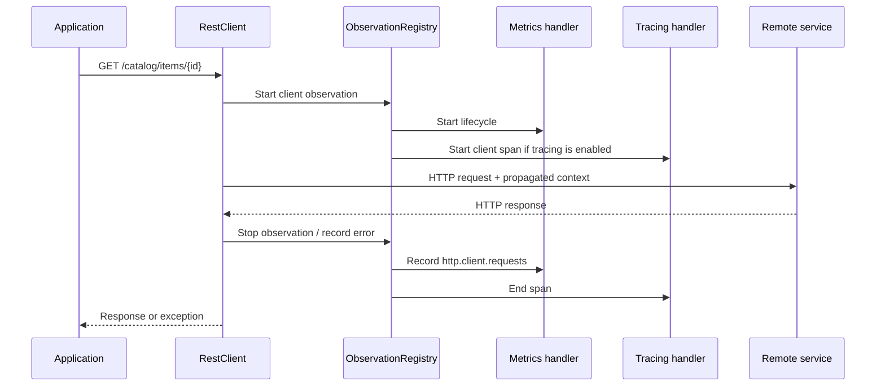
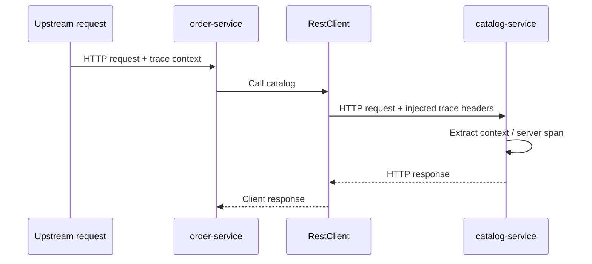

# RestClient observation in Spring Boot

A Spring Boot service calls `payment-service`, `inventory-service`, or a partner API. When outbound requests are slow, the operations team needs to know which client is taking time, what HTTP status was returned, whether the error occurred during DNS/connect/TLS or in the response, and whether the trace connects from the calling service to the receiving service. **RestClient observation** enables observing the lifecycle of HTTP client calls using Micrometer Observation, thereby generating metrics and distributed tracing when the corresponding handlers are configured.

`RestClient` was introduced by Spring Framework in the 6.1 line and is a synchronous HTTP client API. In Spring Boot 3.2 and later applications, the builder auto-configured by Boot can integrate with Micrometer Observation. When using the proper builder and instrumentation, client calls can produce the `http.client.requests` meter and tracing spans. Creating a standalone client/builder or bypassing the Boot-managed builder can lose customizers and observation configuration.

The **RestClient observation** lesson belongs to the **HTTP client observability** chapter of the **SPRING_BOOT_OBSERVABILITY** module. The module focuses on setting up observability for Spring Boot using Micrometer Observation, metrics, logs, and distributed tracing; learning context propagation, tags/cardinality, exporters, sampling, and signal correlation to investigate errors, latency, and application behavior in production environments.

## 1. Learning Objectives

After this lesson, you can:

- Explain `RestClient` observation and the role of `ObservationRegistry`.
- Use `RestClient.Builder` configured by Spring Boot to preserve observation integration.
- Understand the `http.client.requests` meter and common tags.
- Distinguish client request latency from server request latency.
- Track status, exceptions, timeouts, and connection errors via metrics/traces.
- Keep URI templates stable to avoid high-cardinality metric tags.
- Understand how trace context is propagated from client to server.
- Customize observation appropriately and test instrumentation.

## 2. What is RestClient and Where Does Observation Operate?

`RestClient` is a synchronous, fluent HTTP client API built around the request/response exchange. The application builds a request, sends it to the remote server, waits for the response, and reads the body. Observation wraps the exchange process to measure duration and record relevant attributes.

Micrometer Observation provides a unified lifecycle. An `ObservationRegistry` orchestrates the registered handlers:

- The metrics handler records a Timer/meter for the client exchange.
- The tracing handler creates a client span if Micrometer Tracing is configured.
- Observation conventions determine the operation's name and key-values.



The diagram illustrates the general flow. Specific tag details, stop timing, and exception mapping depend on Spring Framework, Boot, Micrometer, and the request factory.

### Client observation differs from server observation

| Observation | Where it is measured | Question answered |
| --- | --- | --- |
| `http.server.requests` | Application receiving an HTTP request | How long did the server take to process the route? |
| `http.client.requests` | Application sending an HTTP request | How long did calling the remote dependency take? |

An inbound request can create a server observation. During processing, the application calls `RestClient`, creating a separate client observation. The two measurements describe different segments of the request path; do not sum them mechanically as there may be overlap and overhead.

## 3. Using RestClient.Builder Managed by Spring Boot

With Spring Boot 3.2+ and Spring Framework 6.1+, you can inject `RestClient.Builder` auto-configured by Boot:

```java
import org.springframework.stereotype.Service;
import org.springframework.web.client.RestClient;

@Service
public class CatalogClient {
    private final RestClient restClient;

    public CatalogClient(RestClient.Builder builder) {
        this.restClient = builder
            .baseUrl("https://catalog.internal")
            .build();
    }

    public CatalogItem getItem(String itemId) {
        return restClient.get()
            .uri("/catalog/items/{id}", itemId)
            .retrieve()
            .body(CatalogItem.class);
    }
}

record CatalogItem(String id, String name) {}
```

When the builder is auto-configured by Boot with observation support, `RestClient` can use the `ObservationRegistry` and conventions provided by the framework. Other customizers such as message converters, request factory, interceptors, or SSL settings can also be applied by Boot/the application.

### Why should you not create a standalone builder arbitrarily?

The following example creates a standalone builder:

```java
RestClient client = RestClient.builder()
    .baseUrl("https://catalog.internal")
    .build();
```

A standalone builder does not necessarily receive the customizers/observation settings that Spring Boot has configured. If you use this approach, you must manually ensure the observation registry, conventions, interceptors, and request factory are configured properly. Prefer injecting `RestClient.Builder` in Spring-managed components.

### Manual ObservationRegistry configuration

In applications managing `RestClient` outside auto-configuration, Spring Framework allows attaching the registry to the builder:

```java
RestClient client = RestClient.builder()
    .baseUrl("https://catalog.internal")
    .observationRegistry(observationRegistry)
    .build();
```

This is a manual integration example; a valid `ObservationRegistry` with registered handlers is required. Do not create a new empty registry if you intend to share Spring Boot's metrics/tracing handlers.

## 4. The http.client.requests Meter

When the observation metrics handler is active, the client exchange is recorded as a Timer commonly named `http.client.requests`. The Timer measures the duration of the request/response exchange according to the convention and registry.

| Measurement | Meaning |
| --- | --- |
| `COUNT` | Number of client exchanges recorded |
| `TOTAL_TIME` | Total duration of exchanges |
| `MAX` | Maximum within the registry window/interval |
| Histogram buckets | Latency distribution across thresholds, if enabled |
| Percentiles | Local quantiles if configured |

The Actuator unit for Timer is usually represented in seconds; backend exporters may convert names/units. Check the metadata of the actual registry.

### Common tags

Common tags used for HTTP client observations include:

| Tag | Example | Meaning |
| --- | --- | --- |
| `method` | `GET`, `POST` | HTTP method |
| `uri` | `/catalog/items/{id}` | URI template or normalized path |
| `client.name` | `catalog.internal` | Host/client destination per convention |
| `status` | `200`, `404`, `503` | Response status if available |
| `outcome` | `SUCCESS`, `CLIENT_ERROR`, `SERVER_ERROR` | Result category |
| `exception` | `None`, exception class | Error per convention |

The specific tag set can vary by Spring Boot/Spring Framework version, request factory, and custom observation convention. Inspect `availableTags` instead of assuming every tag is always present.

### Reading the meter via Actuator

Expose the metrics endpoint according to policy:

```yaml
management:
  endpoints:
    web:
      exposure:
        include: health,metrics
```

Then inspect:

```http
GET /actuator/metrics/http.client.requests
GET /actuator/metrics/http.client.requests?tag=method:GET
```

Actuator returns measurements and available tags in-process. To view historical time series, an appropriate registry/exporter or scrape backend is needed.

## 5. URI Templates and Cardinality

`RestClient` supports URI template variables:

```java
restClient.get()
    .uri("/catalog/items/{id}", itemId)
    .retrieve()
    .body(CatalogItem.class);
```

Using a URI template gives instrumentation the opportunity to record routes like `/catalog/items/{id}` instead of each individual item ID. If custom code passes a raw URI with dynamic values, the URI tag can become high-cardinality.

Do not use order ID, customer ID, email, query strings containing free text/tokens, full URLs with session identifiers, trace ID/span ID, `Authorization` headers, or cookies as metric tags. Such data causes high cardinality and can leak sensitive information.

### Client name should be stable

The client destination tag should distinguish dependencies at a finite level, such as `catalog`, `payment`, `inventory`. If the tag contains dynamic hosts, ephemeral IPs, or arbitrary tenant URLs, cardinality will grow. With service discovery, use the logical service name if supported by the convention.

## 6. HTTP Errors, Status, and Timeouts

An HTTP client call can end in several ways:

| Scenario | Observable Result |
| --- | --- |
| 2xx response | Success status, success outcome |
| 4xx response | Client error; depending on API/error handler may return response or throw exception |
| 5xx response | Server error; `retrieve()` by default may throw an exception for error statuses |
| DNS/connect failure | No HTTP response status; connection exception |
| TLS handshake failure | No response status; SSL exception |
| Read timeout | Client exchange ends with a timeout exception |
| Connection pool/acquire timeout | Request waits to acquire a connection and fails before sending |

A failed request does not necessarily have a `status` tag: if no response was received, the status may not exist. Read `exception` and `outcome` together to understand the cause.

### Timeouts must be configured on the request factory

`RestClient` uses `ClientHttpRequestFactory` to perform HTTP I/O. Connect timeout, read/response timeout, and connection pool settings depend on the implementation (JDK, Apache HttpComponents, Jetty, or another request factory) and version.

General example with a request factory supporting timeouts:

```java
var requestFactory = new JdkClientHttpRequestFactory(
    HttpClient.newBuilder()
        .connectTimeout(Duration.ofSeconds(2))
        .build()
);
requestFactory.setReadTimeout(Duration.ofSeconds(5));

RestClient client = builder
    .requestFactory(requestFactory)
    .baseUrl("https://catalog.internal")
    .build();
```

The example requires importing `java.net.http.HttpClient`, `java.time.Duration`, and `JdkClientHttpRequestFactory`. Specific timeout APIs may differ by Spring Framework version. Set timeouts based on SLOs/dependency behavior; timeouts that are too long hold request threads and increase latency, while timeouts that are too short cause false errors.

### Where is latency measured?

The client Timer typically wraps the exchange observed by `RestClient`. It may include waiting for the response body depending on the lifecycle implementation, though not necessarily all business processing before/after the call. Check the convention and version in use; do not assume it equals the end-to-end duration perceived by the user.

## 7. Trace Context Propagation via RestClient

When Micrometer Tracing and a tracing bridge are configured, the client observation can create a client span. The propagator injects trace context into HTTP headers; the receiving server extracts the context to create a child server span in the same trace.



For propagation to work:

1. Use a consistently configured tracing bridge/propagator.
2. Use a `RestClient` builder with observation integration.
3. Ensure the request factory/interceptors do not remove or overwrite tracing headers.
4. The receiving server must have compatible instrumentation and propagator.
5. Keep trust boundaries clear; do not trust trace headers as authentication credentials.

If metrics show `http.client.requests` but traces do not appear, the tracing handler may not be enabled, sampling may be dropping traces, the exporter may be failing, or context may not be propagating. These are distinct issues.

## 8. Custom Observation Convention

The observation convention determines the name and key-values attached to an observation. For HTTP clients, Spring provides a default convention. Customize only when you need a useful, stable dimension that the default convention does not provide.

Principles:

- Keep the metric name stable so dashboards/alerts do not break.
- Add only low-cardinality values.
- Do not put full URLs, IDs, tokens, request bodies, or user data into tags.
- Do not remove standard tags if dashboards depend on them.
- Verify behavior with both successful responses and exceptions.

If you need to categorize clients by business group, use a logical dependency name with a finite set of values instead of dynamically generated hostnames.

### Do not create manual Timers duplicating HTTP observation

If `http.client.requests` is already present, adding another Timer wrapping the entire `RestClient` call can be useful if measuring a distinct business operation, but it should not duplicate the name/meaning and be summed together. For example, `payment.authorization` can measure a business operation comprising multiple HTTP calls; `http.client.requests` measures each exchange.

## 9. Testing RestClient Observation

You can use `MockRestServiceServer` or an appropriate HTTP test server to test requests without depending on real APIs. The goal is not only a correct response but also verifying that the Observation is created with appropriate tags.

### Integration testing with ObservationRegistry

Example using a test registry with a handler observing the lifecycle:

```java
ObservationRegistry registry = ObservationRegistry.create();

List<String> started = new ArrayList<>();
registry.observationConfig().observationHandler(
    new ObservationHandler<Observation.Context>() {
        @Override
        public boolean supportsContext(Observation.Context context) {
            return true;
        }

        @Override
        public void onStart(Observation.Context context) {
            started.add(context.getName());
        }
    }
);

RestClient client = RestClient.builder()
    .observationRegistry(registry)
    .baseUrl("http://localhost:8089")
    .build();
```

This is a skeleton illustrating the registry/handler part; a complete test needs to start a mock server, execute a request, and assert both the response and the observation name. In Spring Boot integration tests, inject the auto-configured builder to verify the application's real configuration.

### Test matrix

| Case | Mock response/condition | What to verify |
| --- | --- | --- |
| A — Success | HTTP 200 | Observation start/stop, Timer count increases |
| B — Client error | HTTP 404 | Status/outcome/exception per error handler |
| C — Server error | HTTP 503 | Error recorded and exception mapping correct |
| D — Connect failure | Port not listening | Exception present, status may be absent |
| E — Timeout | Server delays response | Duration/exception reflects timeout |
| F — URI template | Call multiple item IDs | URI tag remains in template form |
| G — Tracing | Enable appropriate OTel/Brave bridge | Client span and propagation headers generated |
| H — Builder | Use Boot-injected builder | Observation customizers applied |

## 10. Troubleshooting

| Symptom | Possible Cause | Inspection Direction |
| --- | --- | --- |
| No `http.client.requests` | Builder lacks observation registry, missing metrics handler, or not using Boot builder | Check builder bean, `ObservationRegistry`, and `MeterRegistry` |
| Meter exists but no trace | Tracing handler not configured, sampling off, or exporter error | Check bridge, sampler, and exporter |
| Using Boot builder still shows no meter | Observation/metrics integration not auto-configured or different version | Check dependencies and auto-configuration report |
| URI tag contains IDs | Raw URI/custom convention does not use template | Use URI template variables |
| Client name has many values | Dynamic host or tenant host attached to tag | Use logical dependency name |
| No status tag on error | DNS/TLS/connect/read timeout before response | Read `exception`/`outcome` instead of expecting `status` |
| Unusually high latency | Remote server, DNS, TLS, connection pool, or timeout | Inspect client span, request factory, and remote service |
| Trace breaks at remote service | Header propagation disabled/stripped or server not instrumented | Check inject/extract and tracing bridge on both ends |
| Duplicate client spans | Agent instrumentation and Micrometer observation both instrumenting | Review agent, bridge, and client instrumentation |
| Timeout has no effect | Request factory differs from the one configured | Confirm `RestClient` uses the intended request factory |

### Investigation checklist

1. Identify the Spring Boot/Spring Framework version; `RestClient` requires Spring Framework 6.1 or later.
2. Confirm required Actuator/Micrometer Tracing dependencies.
3. Inject the Boot-managed `RestClient.Builder` or manually attach the proper `ObservationRegistry`.
4. Send a test request and read `http.client.requests` via Actuator.
5. Check `availableTags`, URI templates, and client destination.
6. Trigger 4xx/5xx responses, connect failures, and timeouts to observe error semantics.
7. If tracing is enabled, inspect the client span, injected headers, and server span.
8. Check the metrics exporter/backend separately if Actuator has the meter but the backend is empty.

## 11. Hands-on Exercise: Observing Catalog API Calls

**Context:** `order-service` uses `RestClient` to call `catalog-service` to read product information. The team wants to measure call count, latency, remote errors, and trace correlation.

### Part A — Preparation

1. Use Spring Boot 3.2+ with Spring Framework 6.1+.
2. Add Actuator and a metrics registry; configure an OTel/Brave bridge if tracing is needed.
3. Inject `RestClient.Builder` into `CatalogClient`.
4. Use a URI template for the catalog item ID.
5. Expose the Actuator metrics endpoint in the test environment.

### Part B — Sending Different Request Types

| Case | Action | Result to Observe |
| --- | --- | --- |
| A — Success | Catalog returns 200 | `http.client.requests` count increases, success status |
| B — Not found | Catalog returns 404 | Client error/status/exception per handler |
| C — Remote failure | Catalog returns 503 | Server error and latency recorded |
| D — Connect error | Shut down mock server | Connection exception, not necessarily a status |
| E — Slow response | Mock server delays | Duration increases or timeout per configuration |
| F — Many IDs | Call multiple item IDs via URI template | URI tag does not create a value per ID |
| G — Trace | Call catalog inside an inbound trace | Client span connects to server span if both sides are instrumented |

### Part C — Self-Assessment Questions

1. Which signal types does `RestClient` observation produce when the corresponding handlers are active?
2. Why is using the Boot-injected `RestClient.Builder` more important than calling `RestClient.builder()` directly?
3. How does `http.client.requests` differ from `http.server.requests`?
4. Why might a connect failure not have a `status` tag?
5. How do URI templates limit cardinality?
6. At which layer of `RestClient` should timeouts be configured?
7. If metrics exist but traces do not, which components need to be checked?
8. How is trace context injected/extracted across the client/server boundary?
9. When should you create a separate business Observation instead of a Timer duplicating the HTTP client timer?
10. Why should you not put customer ID or trace ID into client metric tags?

## 12. Remember

**RestClient observation** uses Micrometer Observation to observe outbound HTTP exchanges from a Spring application. In Spring Boot 3.2+ with Spring Framework 6.1+, prefer the Boot auto-configured builder to receive `ObservationRegistry`, metrics/tracing handlers, and appropriate customizers. The common `http.client.requests` meter is a Timer for the client exchange; tags such as `method`, URI template, client destination, `status`, `outcome`, and `exception` help analyze dependency latency and errors.

Use URI templates to keep tag cardinality low, configure timeouts on the proper request factory implementation, and inspect `exception` when there is no HTTP response status. When tracing is enabled, client spans and propagated context help connect the request to the remote server span; metrics still provide aggregated trends for all traffic. Verify successful responses, 4xx/5xx, connect failures, and timeouts; keep tags stable, protect request data, and verify which builder is actually in use. This makes `RestClient` calls an observable part of your Spring Boot system without inflating cardinality or creating duplicate instrumentation.
