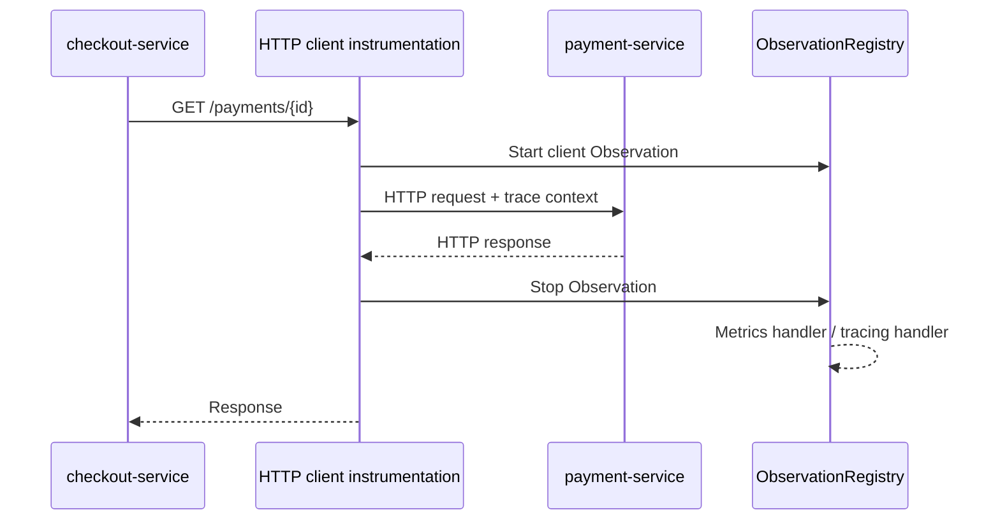
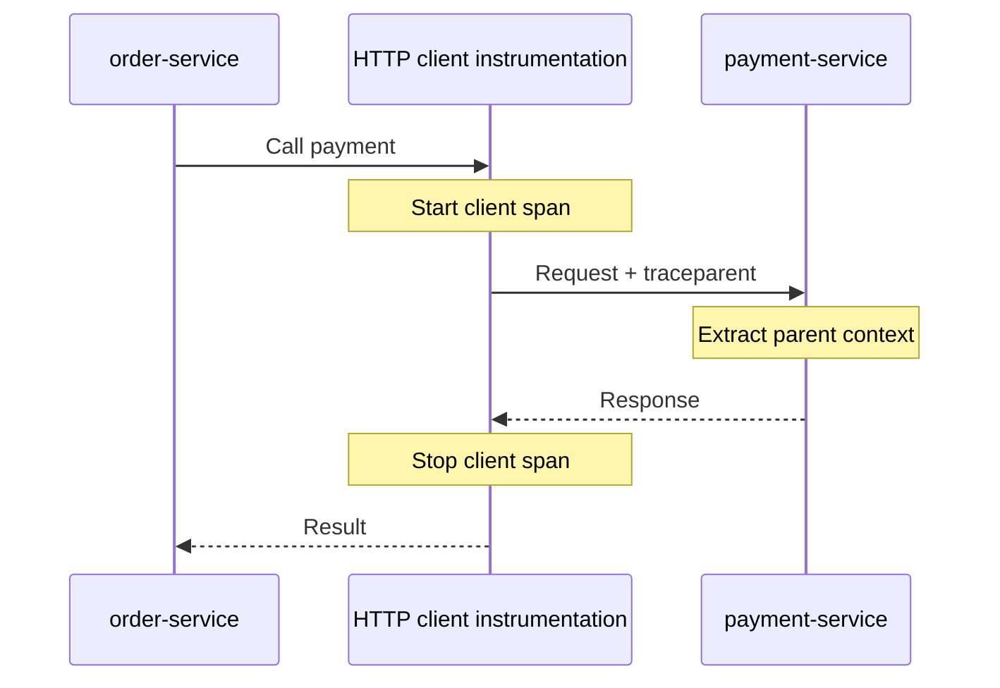
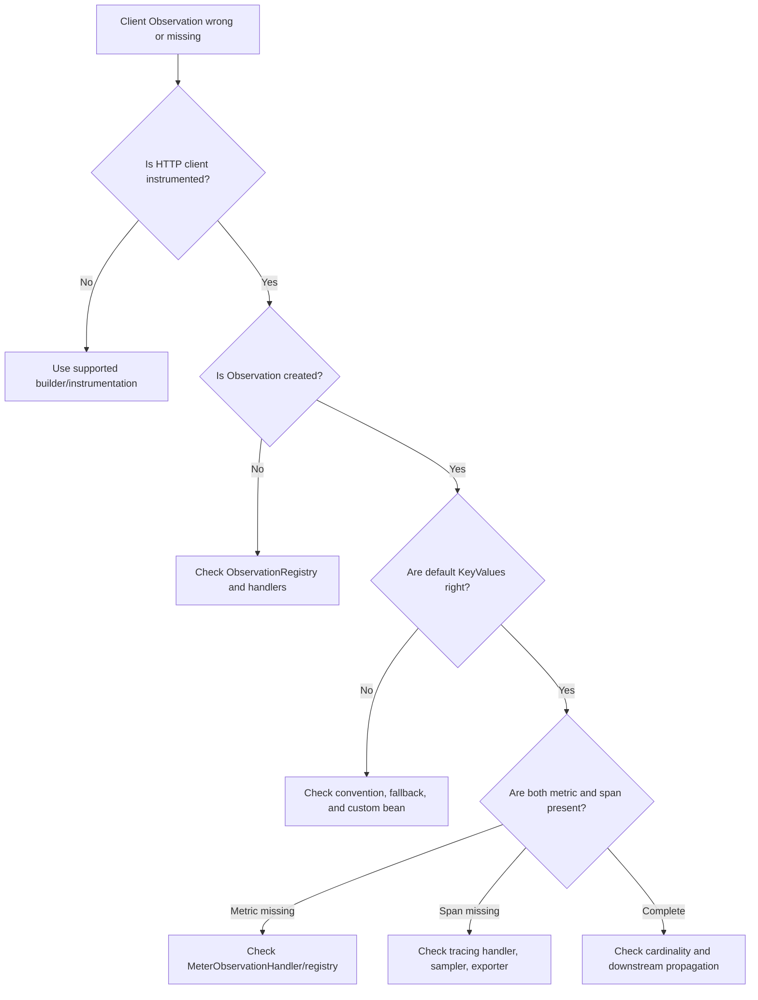

# Client request convention in Spring Boot

When a Spring Boot application calls another HTTP service, client instrumentation can create an Observation wrapping the outbound request. The Observation provides call duration, method, destination, status, outcome, and error information; the tracing handler can create a client span, while the metrics handler records duration and call counts. The **Client request convention** determines the Observation name and the `KeyValues` attached to it, directly affecting metric dimensions and span attributes.

The **"Client request convention"** lesson belongs to the **HTTP client observability** chapter of the **SPRING_BOOT_OBSERVABILITY** module. The module guides setting up observability for Spring Boot using Micrometer Observation, metrics, logs, and distributed tracing; learning context propagation, tags/cardinality, exporters, sampling, and signal correlation to investigate errors, latency, and application behavior in production environments.

The convention does not instrument the HTTP client itself and does not send data to a backend. HTTP client instrumentation creates the Observation; the convention describes the Observation; `ObservationRegistry` handlers convert it into metrics/traces. All three layers must be understood to customize the right extension point.

## 1. What is a Client Request Observation?

An outbound HTTP call can include DNS, connection pool wait, TCP/TLS setup, request write, remote processing, and response read. Client Observation measures duration according to the scope wrapped by instrumentation, typically starting before sending the request and ending when the response/error is handled according to the client API.

Example of `checkout-service` calling `payment-service`:



Client Observation helps answer which service called which dependency, which method/route was slow, what the status/outcome was, which connection/timeout error occurred, and whether the client span connects to the current trace.

The common Observation name is `http.client.requests`. The metric registry may convert this name to its own format. Do not use a backend-normalized meter name to infer the original Observation name.

## 2. Role of ClientRequestObservationConvention

In Micrometer Observation, the convention defines the Observation name, low-cardinality `KeyValues`, and high-cardinality `KeyValues`. Spring Framework provides `ClientRequestObservationConvention` and the default implementation `DefaultClientRequestObservationConvention` for HTTP client observations.

| Component | Responsibility |
| --- | --- |
| HTTP client instrumentation | Creates Observation around the outbound exchange |
| ClientRequestObservationContext | Holds request/response and client exchange state |
| ClientRequestObservationConvention | Defines name and `KeyValues` |
| ObservationRegistry | Orchestrates the Observation lifecycle |
| MeterObservationHandler | Records metrics |
| TracingObservationHandler | Creates client span via tracing bridge |

The convention does not execute requests, perform retries, or decide HTTP connection timeouts. Those policies belong to the HTTP client/transport.

## 3. Low-cardinality and High-cardinality KeyValues

Client request convention must distinguish metadata meant for aggregation from detailed metadata for tracing.

Common low-cardinality values:

| Key | Meaning | Example |
| --- | --- | --- |
| method | HTTP method | GET, POST |
| uri | URI template or destination category | /payments/{id} |
| client.name | Normalized target host/service name | payment-service |
| status | HTTP response status | 200, 404, 503 |
| outcome | Result category | SUCCESS, CLIENT_ERROR, SERVER_ERROR |
| error | Exception name or none | SocketTimeoutException |

Exact keys and fallback values depend on the Spring Framework version/convention implementation. Check your application version's convention instead of assuming all releases use the same schema.

High-cardinality values can include full URLs, query parameters, or request identifiers. They should not become metric tags. The tracing convention may retain detailed data in span attributes if semantics and privacy policies permit.

### Why are URI templates important?

Suppose the client calls:

```text
https://payment.internal/payments/1001
https://payment.internal/payments/1002
https://payment.internal/payments/1003
```

If the metric tag stores the raw URL, each payment ID can create a separate series. Using the template `/payments/{id}` groups the calls into the same dimension. If client instrumentation lacks a route template, the convention may only receive a URI/destination fallback; do not arbitrarily infer templates by naive string slicing.

Do not put user IDs, order IDs, tokens, or raw query strings into low-cardinality tags.

## 4. DefaultClientRequestObservationConvention

Spring Framework provides a default convention to name the Observation and contribute common `KeyValues`. When custom metadata is not needed, keep the default convention for a consistent schema across services.

The default convention typically preserves method, URI/destination, status, outcome, and error. Key names, low/high classification, and fallback behavior may vary by version.

Customization is appropriate when you need to normalize dimensions to an internal taxonomy, add a stable logical dependency name, map destination hosts to service aliases, add a finite operation category, or adjust the fallback URI.

Do not change default names/keys if dashboards, alerts, or queries depend on them without a migration plan.

## 5. HTTP Client Instrumentation in Spring Boot

Spring Boot can configure Observation for supported HTTP clients. Instrumentation depends on the client type, how instances are created, and whether the builder is auto-configured.

| Client API | Preferred Usage | Notes |
| --- | --- | --- |
| RestClient | Use Boot-provided `RestClient.Builder` | Builder can be customized to attach observation registry |
| WebClient | Use Boot-provided `WebClient.Builder` | Reactive Observation needs to preserve context through Reactor |
| RestTemplate | Use Boot-managed builder/observation configuration | Self-instantiated instances may lack customizers |
| Apache HttpClient/OkHttp | Use appropriate instrumentation | Not automatically instrumented just because Actuator is present |
| Java HttpClient | Check support by version/adapter | May require separate integration |

`WebClient` example:

```java
import org.springframework.stereotype.Component;
import org.springframework.web.reactive.function.client.WebClient;

@Component
public class PaymentClient {
    private final WebClient client;

    public PaymentClient(WebClient.Builder builder) {
        this.client = builder
                .baseUrl("http://payment-service")
                .build();
    }
}
```

`RestClient` example:

```java
import org.springframework.stereotype.Component;
import org.springframework.web.client.RestClient;

@Component
public class InventoryClient {
    private final RestClient client;

    public InventoryClient(RestClient.Builder builder) {
        this.client = builder
                .baseUrl("http://inventory-service")
                .build();
    }
}
```

If creating clients or custom builders manually, verify that the observation registry/customizer is applied. A successful request does not prove that a client Observation was created.

## 6. Customizing the Convention via a Bean

You can extend `DefaultClientRequestObservationConvention` to preserve default `KeyValues` and then add controlled metadata.

Example adding a logical dependency group:

```java
import io.micrometer.common.KeyValue;
import io.micrometer.common.KeyValues;
import org.springframework.http.client.observation.ClientRequestObservationContext;
import org.springframework.http.client.observation.DefaultClientRequestObservationConvention;

public class ServiceClientObservationConvention
        extends DefaultClientRequestObservationConvention {

    @Override
    public KeyValues getLowCardinalityKeyValues(
            ClientRequestObservationContext context) {

        return super.getLowCardinalityKeyValues(context)
                .and(KeyValue.of("dependency.group", dependencyGroup(context)));
    }

    private String dependencyGroup(ClientRequestObservationContext context) {
        String host = context.getCarrier().getURI().getHost();

        if (host == null) {
            return "unknown";
        }
        if (host.endsWith(".internal")) {
            return "internal";
        }
        return "external";
    }
}
```

This is an illustrative example. Host classification logic must fit your naming and trust model; do not use raw caller-controlled hosts as metric tags with unbounded cardinality.

Registering the convention:

```java
import org.springframework.context.annotation.Bean;
import org.springframework.context.annotation.Configuration;
import org.springframework.http.client.observation.ClientRequestObservationConvention;

@Configuration(proxyBeanMethods = false)
public class ClientObservationConfiguration {

    @Bean
    ClientRequestObservationConvention clientRequestObservationConvention() {
        return new ServiceClientObservationConvention();
    }
}
```

Check the extension point in your Spring Boot version to ensure the bean applies to the intended client instrumentation. If there are multiple client types with different conventions, you may need separate customizers/registries per client instead of one global convention.

## 7. Preserving Default KeyValues When Extending

A common mistake is implementing the interface from scratch and returning only the new tags. This can drop `method`, `uri`, `status`, `outcome`, and `error` that dashboards rely on.

If the goal is only to add tags, extending the default convention and calling `super.getLowCardinalityKeyValues(context)` generally preserves the default schema.

If replacing the convention completely, list removed keys and affected consumers; update dashboards/alerts/queries; ensure stable key names; test fallback values when response/URI is missing; and plan a migration if changing the observation name.

Do not add the same key twice with different values. Duplicate `KeyValues` can lead to unexpected results depending on the registry/handler.

## 8. Exception, HTTP Status, and Outcome

A client call can end with a 2xx response, 4xx/5xx response, timeout/connection reset, DNS/TLS failure, or cancellation.

HTTP 4xx/5xx is a response status, not necessarily an exception in every client API. Some clients return a response object for the application to handle; others may throw an exception on unsuccessful statuses. The convention reflects the state that instrumentation actually sees.

| Outcome | Metadata to inspect |
| --- | --- |
| 2xx | `status` and success `outcome` |
| 3xx | `status`/`outcome` per convention |
| 4xx | `status`/client error; business logic may treat as expected |
| 5xx | `status`/server error |
| Connect/read timeout | `error` type if exception is recorded |
| DNS/TLS failure | `error` type and destination |
| Cancellation | Semantics depend on client |

Do not automatically treat every 4xx as an exception or every 5xx as a fault of the calling service itself. Separate dependency errors from errors caused by callers sending invalid requests.

If you want a metric measuring dependency failures, clearly define status/error classes according to your SLIs. Keep the `status` tag finite; do not record exception messages as metric tags.

## 9. Destination Naming and Service Identity

Client Observation needs to identify a stable target dependency. Raw hosts may contain tenant subdomains or ephemeral hosts. Turning raw hosts into metric tags can create high cardinality.

| Raw destination | Logical name |
| --- | --- |
| payment-v2.internal.svc.cluster.local | payment-service |
| inventory.prod.internal | inventory-service |
| auth.example.net | identity-provider |
| partner-123.example.net | external-partner |

Mapping should rely on client configuration or an allowlist, not arbitrary string parsing. If you need to distinguish operations, add a finite tag like `dependency.operation`.

Do not put full URLs or query strings into metric dimensions. Detailed URLs can be stored in spans/logs subject to policy and redaction.

## 10. How Do ObservationFilter and Convention Differ?

A convention creates the name and `KeyValues` from the request context. An `ObservationFilter` processes an already-created context to add or adjust metadata after the convention contributes.

| Extension point | Purpose |
| --- | --- |
| ClientRequestObservationConvention | Generates observation name and `KeyValues` for HTTP clients |
| ObservationFilter | Post-processes `Observation.Context` |
| ObservationPredicate | Decides whether an Observation is created |
| ObservationHandler | Converts lifecycle into metrics/tracing |

Use a convention when metadata depends on the HTTP request/response context. Use `ObservationFilter` for general post-processing policies across multiple Observation types. Do not confuse conventions with handlers; conventions do not export data.

## 11. Correlation and Propagation to Downstream

Client instrumentation works with the tracing handler to create client spans. When an active trace context exists, the propagator injects the W3C `traceparent` header into the outbound request. Downstream server instrumentation extracts the context to create a related server span.



The convention determines attributes of the client Observation; the propagator determines context headers; the exporter sends completed spans to the backend. These three mechanisms work together and do not replace one another.

If metrics show client request counts but traces lack client spans, check the tracing handler, sampler, client instrumentation, and exporter. If downstream starts a new trace, check inject/extract and propagation formats.

## 12. Sampling and Metrics

Trace sampling does not mean client metrics are sampled at the same probability. `MeterObservationHandler` can record metrics for created Observations, while the tracing handler applies a separate sampling decision for spans.

Client Timers/Counters can reflect all instrumented calls; the trace backend only contains retained spans; log correlation may still have a trace ID even when the trace is not exported. Do not use the count of client spans in the backend as the total number of outbound requests.

Use metrics to measure dependency request rate/error rate/latency; use traces to investigate specific requests.

## 13. URI Templates and Safe Custom Metadata

Suitable fields when the value set is small:

- `dependency.group`: internal/external/partner.
- `dependency.operation`: authorize/capture/refund.
- `api.version`: v1/v2.
- `client.name`: logical dependency name.

Do not use `customerId`/`orderId`/`userId`, authorization tokens/session IDs, full URLs with dynamic paths/queries, exception messages, or trace IDs as low-cardinality values.

If detailed values are needed, consider high-cardinality span attributes or log records after redaction and access control. High-cardinality does not automatically mean safe to collect.

## 14. Testing ClientRequestObservationConvention

Integration tests need to verify that real requests are instrumented and the convention is actually applied.

1. Use MockWebServer/WireMock or a test HTTP server as downstream.
2. Create `RestClient`/`WebClient` from the auto-configured builder.
3. Send requests with various methods/routes/statuses.
4. Inspect `MeterRegistry` or use a test `ObservationHandler`.
5. Verify the expected observation name.
6. Verify low-cardinality values `method`, `uri`, `status`, `outcome`, and `error`.
7. Verify custom `dependency.group` has finite values.
8. Send URLs with different IDs/queries and confirm metric series do not multiply per ID.
9. Test connect timeout, read timeout, and connection refused; verify error semantics.
10. Enable test tracing and inspect the client span, outbound `traceparent`, and server-side parent relationship.
11. Test cancellation with `WebClient` to understand the lifecycle.
12. Verify there are not two Observations for the same request due to duplicate custom instrumentation.

Do not check only for a successful HTTP response. Tests must verify the Observation is created, stopped, and has the expected `KeyValues`.

## 15. Diagnosing Missing or Incorrect Client Observations

| Symptom | Possible Cause | How to Investigate |
| --- | --- | --- |
| No `http.client.requests` | Client not instrumented or missing registry/handler | Check builder and auto-configuration |
| Metrics exist but no client span | Tracing handler/bridge not configured or trace unsampled | Check tracing pipeline |
| URI tag has too many values | Raw URL/path/query in low-cardinality | Check convention and URI templates |
| Destination tag changes continuously | Raw host/ephemeral hostname | Map logical dependency name |
| Custom tag does not appear | Convention bean not applied | Check context/configuration |
| Default tags disappear | Custom convention does not call `super` | Compare default `KeyValues` |
| Each request has two observations | Duplicate instrumentation registration or wrapper adds another | Check builders/interceptors |
| 5xx does not show error | Client returns normal response and app handles it | Check `status`/`outcome`/`error` semantics |
| Timeout has no error tag | Exception not attached to Observation context | Check client instrumentation/version |
| Downstream trace broken | Not injected/extracted or format mismatch | Check `traceparent` and propagator |
| `WebClient` loses context after async | Reactor context propagation not set up properly | Check Reactor/Micrometer bridge |

Investigation workflow:

1. Identify the client API and version.
2. Check whether the client uses the auto-configured builder or a custom instance.
3. Check `ObservationRegistry` and `MeterRegistry`.
4. Send a test request and inspect the Observation name/`KeyValues`.
5. Check URI/destination cardinality.
6. If spans are missing, check tracing bridge, sampling, and exporter.
7. If downstream does not connect the trace, check propagation headers.
8. If custom tags are missing, check the convention bean and customizer ordering.
9. Compare behavior against the default convention before modifying.



## 16. Hands-on Exercise: Custom Client Request Convention

Run locally/in tests:

1. Create a Spring Boot application with Actuator and an appropriate HTTP client.
2. Create a downstream mock server returning 200, 404, 503, and a delay causing a timeout.
3. Send requests using the Boot-managed `RestClient.Builder` or `WebClient.Builder`.
4. Verify the `http.client.requests` Observation and default `KeyValues`.
5. Implement a convention extending `DefaultClientRequestObservationConvention`.
6. Add `dependency.group` with the value set `internal`/`external`/`unknown`.
7. Send URLs with multiple path IDs and query values; verify metric cardinality does not increase per value.
8. Enable a Micrometer Tracing bridge and inspect client span/`traceparent`.
9. Verify timeouts and connection failures are represented appropriately.
10. Compare output before/after the custom convention; ensure no default keys are lost.
11. Check backend metric queries and trace attributes after export.

Expected outcome: metrics aggregate by logical dependency and route pattern; traces allow drilling down to specific requests; no raw identifiers in metric tags.

## 17. Self-Check Questions

1. Which part of an outbound HTTP call does a client request Observation wrap?
2. How does `ClientRequestObservationConvention` differ from HTTP client instrumentation?
3. What does `DefaultClientRequestObservationConvention` provide?
4. How do low-cardinality `KeyValues` differ from high-cardinality values?
5. Why are raw URLs and query strings unsuitable as metric tags?
6. How do Spring Boot auto-configured builders help `RestClient`/`WebClient`?
7. When might a custom HTTP client fail to create an Observation?
8. Why is extending the default convention usually safer than implementing from scratch?
9. How does status 404 differ from a connect timeout exception?
10. How do logical destination names help control cardinality?
11. How does `ObservationFilter` differ from `ClientRequestObservationConvention`?
12. What are the responsibilities of the convention, propagator, and exporter?
13. Does trace sampling automatically reduce client request metrics?
14. Why might metrics be complete while the trace backend is missing client spans?
15. What should be tested to verify that a convention is actually applied?

## References

- [Spring Framework — HTTP Client Observations](https://docs.spring.io/spring-framework/reference/integration/observability.html): client request Observation, context, and conventions.
- [Spring Framework — ClientRequestObservationConvention Javadoc](https://docs.spring.io/spring-framework/docs/current/javadoc-api/org/springframework/http/client/observation/ClientRequestObservationConvention.html): convention contract.
- [Spring Framework — DefaultClientRequestObservationConvention Javadoc](https://docs.spring.io/spring-framework/docs/current/javadoc-api/org/springframework/http/client/observation/DefaultClientRequestObservationConvention.html): default naming and `KeyValues`.
- [Spring Boot — HTTP Client Metrics](https://docs.spring.io/spring-boot/reference/actuator/metrics.html): client instrumentation and builder customization.
- [Micrometer Observation](https://docs.micrometer.io/micrometer/reference/observation.html): `ObservationRegistry`, conventions, filters, and handlers.
- [OpenTelemetry HTTP semantic conventions](https://opentelemetry.io/docs/specs/semconv/http/http-spans/): HTTP client span attributes and semantics.

## Conclusion

**Client request conventions define how outbound HTTP calls are described in Micrometer Observation.** HTTP client instrumentation creates the Observation; the convention supplies the name and `KeyValues`; `ObservationRegistry` handlers turn that lifecycle into metrics and spans. Spring Framework provides a default convention to retain standard dimensions, while applications can extend it with custom conventions.

In Spring Boot, prefer auto-configured HTTP client builders, keep low-cardinality values stable such as method, route template, status, outcome, and logical dependency. Do not put raw URLs, queries, user/order IDs, or trace IDs into metric tags. Test responses, timeouts, errors, custom tags, and downstream propagation so metrics, traces, and logs work together to investigate dependency latency and failures in production.
