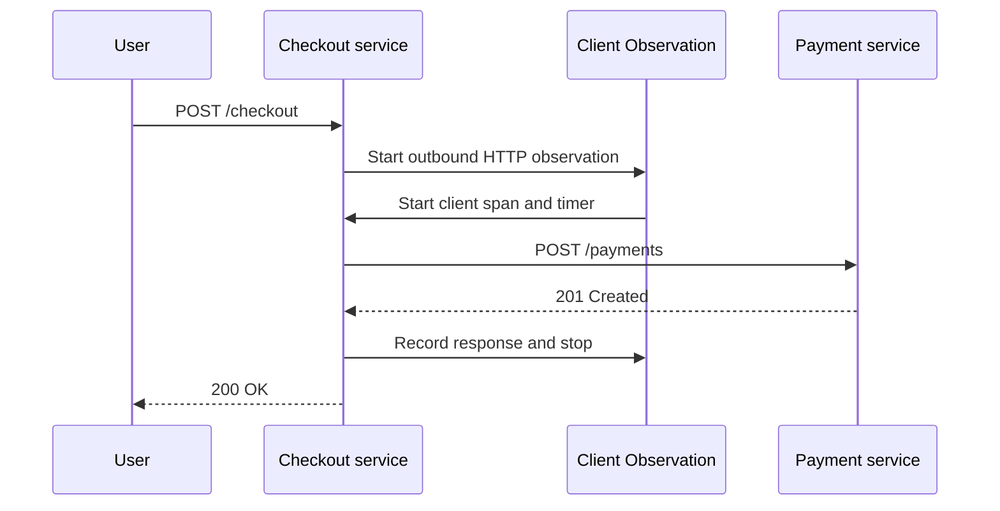
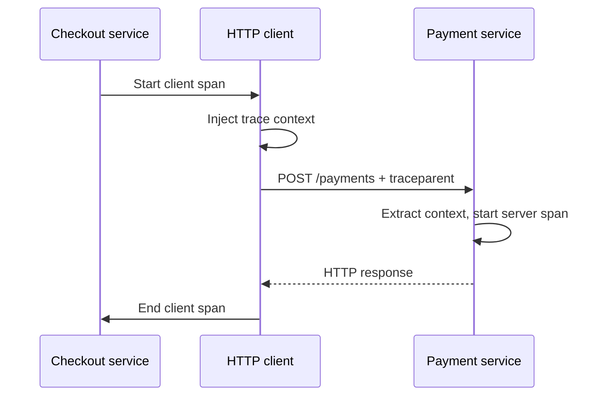

# HTTP client method in Spring Boot

A checkout service makes HTTP calls to a payment service, an inventory service, and partner APIs. When checkout is slow, the operations team needs to know which client call is taking time, which dependency is failing, and whether the request is linked to the server-side trace. If you only measure total controller duration, the latency of each outbound call is hidden.

**HTTP client method observation** records an outbound HTTP operation from the application to a dependency. The Observation can produce metrics for call count and duration; the tracing handler can create a client span to represent the dependency call in a distributed trace. Method, URI template, status, outcome, and exception provide context for analysis. In Spring Boot, instrumentation depends on the HTTP client API, Spring Framework version, Micrometer, and how the client is configured.

This lesson belongs to the **HTTP client observability** chapter of the **SPRING_BOOT_OBSERVABILITY** module. The module teaches setting up observability for Spring Boot using Micrometer Observation, metrics, logs, and distributed tracing; learning context propagation, tags/cardinality, exporters, sampling, and signal correlation to investigate errors, latency, and application behavior in production environments. This lesson explains HTTP client method observation, instrumentation boundaries, and how to measure outbound dependency calls safely.

## Learning Objectives

1. Explain HTTP client observation and its role.
2. Distinguish server observation from client observation.
3. Understand instrumentation of `RestClient`, `WebClient`, and `RestTemplate` by version.
4. Distinguish `method`, URI template, `status`, `outcome`, and `exception`.
5. Use URI templates instead of dynamic URLs to control cardinality.
6. Understand client spans, parent context, and propagation downstream.
7. Recognize the effects of retries, timeouts, redirects, and exceptions.
8. Customize client conventions while preserving default semantics.
9. Test metrics, traces, propagation, and failure paths.
10. Diagnose when outbound calls are missing or measured inaccurately.

## 1. What is HTTP Client Observation?

HTTP client observation represents an application sending an outbound HTTP request and receiving a response or ending due to an error/timeout. It typically starts when the client executes the request and ends when the response is processed or the operation fails according to the client integration's lifecycle.



Observation handlers can:
- Record count/duration with low-cardinality tags.
- Create client spans and inject trace context into outbound headers.
- Add correlation/logging per configuration.

If the client is not instrumented, HTTP calls still work, but there will be no corresponding observation/span. Adding a custom convention does not automatically create instrumentation for an unsupported client.

### 1.1. Client observation differs from server observation

| Aspect | Server observation | Client observation |
|---|---|---|
| Request direction | Request entering the application | Request leaving the application |
| Boundary | Server connector/framework | HTTP client execution |
| Span kind | SERVER | CLIENT |
| URI | Route template resolved by server | Outbound URI template/target |
| Status | Response returned by the application | Response from dependency |
| Propagation | Extracts context from inbound headers | Injects context into outbound headers |

An end-to-end request typically has a server span at the receiving service and a client span at the service calling the dependency. Downstream creates the next server span upon extracting the same trace context.

## 2. HTTP Client APIs in Spring

Instrumentation availability depends on the framework version, client implementation, and auto-configuration.

| Client API | Usage Style | Observability Notes |
|---|---|---|
| RestClient | Modern synchronous API | Has observation integration in supported Spring Framework versions |
| RestTemplate | Traditional synchronous API | Needs appropriate request factory/observation configuration |
| WebClient | Reactive, non-blocking API | Observation/tracing is tied to reactive context |
| Java HttpClient/Apache/OkHttp | Dedicated library clients | Requires corresponding instrumentation, agent, or wrapper |

Do not assume simply having Actuator on the classpath automatically instruments every HTTP library in the JVM. Check the client bean, request factory/connector, `ObservationRegistry`, and Java Agent.

### 2.1. RestClient

```java
RestClient restClient = RestClient.builder()
        .baseUrl("https://payment.internal")
        .build();

PaymentResponse response = restClient.post()
        .uri("/payments")
        .body(paymentRequest)
        .retrieve()
        .body(PaymentResponse.class);
```

This is an API call example. To get observations, the client needs observation support matching the Spring version. In Spring Boot, prefer the auto-configured builder when provided by the framework to receive customizers, message converters, the registry, and tracing propagation.

### 2.2. RestTemplate

```java
RestTemplate restTemplate = new RestTemplate();

PaymentResponse response = restTemplate.postForObject(
        "https://payment.internal/payments",
        paymentRequest,
        PaymentResponse.class);
```

This snippet only illustrates the call. A `RestTemplate` created via its direct constructor is not guaranteed to receive Spring Boot customizers. Use the builder/customizer provided by Boot or configure the registry/request factory appropriate for your version.

### 2.3. WebClient

```java
Mono<PaymentResponse> response = webClient.post()
        .uri("/payments")
        .bodyValue(paymentRequest)
        .retrieve()
        .bodyToMono(PaymentResponse.class);
```

Observation and span lifecycles must track when the publisher is subscribed to and completes/cancels/errors, not merely when creating the `Mono`. If code creates a publisher without subscribing, the request may not have been sent.

## 3. Client Observation Convention

The client convention standardizes how outbound requests are described. Depending on the version, components typically include:

| Component | Example | Purpose |
|---|---|---|
| Observation name | `http.client.requests` | Stable operation type |
| Contextual name | `POST payment` | Human-readable span name |
| Method | `POST` | HTTP method |
| URI/target | payment endpoint | Destination/URI dimension |
| Status | `201` | Response status |
| Outcome | `SUCCESS` | Result category |
| Exception | `TimeoutException` | Bounded error info |

Observation names and tag keys depend on the Micrometer/Spring version. Inspect actual meters/spans before creating dashboards or custom conventions.

### 3.1. Observation name and contextual name

The Observation name describes the type of HTTP client operation and contains no dynamic URLs or IDs. The contextual name makes traces readable, e.g., `POST payment`. Avoid raw URLs with order IDs or query tokens because trace search becomes fragmented and data may leak.

## 4. Method, URI, and Cardinality

Outbound client URIs easily cause cardinality explosion because URLs are often constructed from business identifiers or query parameters.

| URI | Assessment |
|---|---|
| `https://payment.internal/payments` | Stable |
| `https://inventory.internal/items/{id}` | Stable template if instrumentation receives the template |
| `https://inventory.internal/items/84721` | Dynamic raw ID |
| `https://partner/search?q=customer-email` | May contain PII and dynamic values |
| `https://api.example.com/orders?token=secret` | Tokens must never enter telemetry |

### 4.1. URI template vs. actual URI

A URI template describes the endpoint structure, e.g., `/items/{id}`. The actual expanded URI contains the value for a single request. Some client APIs allow passing the template and variables separately; if code only passes a pre-built String URL, instrumentation may only see the expanded URI.

Use APIs that support templates/variables when available, and check convention output. If no template is available, use a stable allowlisted dependency label instead of the raw URL.

### 4.2. Host and dependency identity

You may need to distinguish payment, inventory, and identity services. Use a stable dependency name like `payment` or `inventory` if the convention/project supports it and the value set is controlled. Do not use arbitrary user-supplied hostnames as metric tags.

### 4.3. Do not record query strings by default

Query parameters can contain search terms, emails, tokens, or personal data. Record only allowlisted parameters if required by a specific need and policy; it is better to record an operation name or endpoint template.

## 5. Status, Outcome, and Exception

A client observation typically ends with a response status or an error. Distinguish:

- **Status:** HTTP status code received from the remote server.
- **Outcome:** result category such as `SUCCESS`, `CLIENT_ERROR`, `SERVER_ERROR`, or `UNKNOWN` depending on the implementation.
- **Exception:** transport/client error such as connect timeout, read timeout, DNS failure, or connection reset.

| Result | Status | Interpretation |
|---|---:|---|
| Payment accepted | 201 | Success per HTTP |
| Resource not found | 404 | Client error response; may be valid business outcome |
| Remote server error | 503 | Server error response |
| Connect timeout | No response | Exception/transport failure |
| DNS resolution failure | No response | Exception/transport failure |
| 500 response | 500 | Client API may throw an exception or return response depending on method |

Do not assume every 4xx is a system error. Separate HTTP outcome from business success/failure.

### 5.1. Error mapping

Client APIs may throw an exception upon receiving 4xx/5xx depending on how they are invoked. `retrieve`/status handlers and exchange APIs behave differently. The convention should reflect the actual response status; business code decides whether the result is a business error.

### 5.2. Exception messages are not metric tags

Exception messages can contain URLs, hosts, queries, inputs, or dynamic content. Do not put them verbatim into low-cardinality metrics. Use controlled exception classes/error categories; stack details belong in tracing/logging per privacy policy.

## 6. Configuring Observability for HTTP Clients

Spring Boot can provide builders/customizers to attach `ObservationRegistry` and tracing integration to HTTP clients. Configuration details vary by version.

### 6.1. Prefer the auto-configured builder

When Spring Boot provides a `RestClient.Builder` or `WebClient.Builder` bean, inject that builder instead of creating a standalone client:

```java
@Configuration
class HttpClientConfiguration {
    @Bean
    RestClient paymentRestClient(RestClient.Builder builder) {
        return builder
                .baseUrl("https://payment.internal")
                .build();
    }
}
```

This example depends on a Spring Boot version with an auto-configured builder. If you create a client outside the application context or swap the request factory after builder configuration, observation/tracing customizers may no longer apply.

### 6.2. ObservationRegistry

HTTP client integration requires `ObservationRegistry` to create observations. In Spring Boot, the registry is usually auto-configured and wired with appropriate handlers. For self-created clients, ensure they use the right registry; do not create a new empty registry and expect metrics/tracing handlers to appear.

### 6.3. Tracing bridge and exporter

For a client observation to create spans, a compatible tracing implementation/bridge and exporter pipeline are required. For metrics to be recorded, a metrics handler and registry/exporter are required. An observation can produce metrics without spans if no tracing handler is present, and vice versa.

## 7. Client Spans and Context Propagation

A client span describes an outbound request. The tracer typically injects trace context into headers before sending the request, such as W3C `traceparent` or B3 depending on the propagator.



If an upstream server span is active, the client span is normally its child span. The downstream server span continues the trace when it extracts the context properly.

### 7.1. Verifying propagation

Send a request from service A to service B and confirm the client span has the expected trace ID, the outbound request carries the propagator header, the server span in B shares the same trace ID, span IDs differ, and the parent relationship makes sense. There should not be two root traces caused by dropped headers or incompatible propagators.

Do not manually add trace IDs to headers in business code if tracing integration already injects them. Manual headers can create fake traces or corrupt context.

### 7.2. Trust boundaries

Inbound trace headers from external clients must be handled according to trust policies. Do not let users arbitrarily force sampling or pass sensitive baggage through the system. Propagators and samplers must be configured per boundary.

## 8. Retries, Redirects, and Timeouts

A single logical business operation can produce multiple HTTP attempts. Know which layer instrumentation sits at.

- Application-layer retries can create one client observation/span per attempt or an outer observation wrapping the operation.
- HTTP client middleware retries can create spans per attempt if instrumentation supports it.
- Redirects can create additional network exchanges and spans depending on the client.
- Connect/read/response timeouts end the call with an exception or timeout signal.
- Circuit breakers can short-circuit before sending an HTTP request; in that case there is not necessarily an HTTP client span.

Distinguish a **logical operation** from a **network attempt**. Attempt metrics help measure dependency load; logical operation metrics help measure business flows.

Timeouts must be configured explicitly according to the HTTP client implementation. Record stable timeout categories/dependencies for analysis; do not put dynamic exception messages into tags. Retrying `POST` can cause side effects if the remote already processed the request and the response was lost; appropriate idempotency keys and retry policies are required.

## 9. Metrics from HTTP Client Observations

The metrics handler can create timers/counters with low-cardinality tags:

```text
http.client.requests{
  method="POST",
  uri="/payments",
  client_name="payment.internal",
  status="201",
  outcome="SUCCESS"
}
```

Actual metric/tag names depend on the Micrometer version, registry, and convention. Inspect the meter registry before building dashboards.

Useful dimensions include HTTP method, URI template/operation template, allowlisted dependency name, status/outcome, and stable error category. Avoid raw URLs, request IDs, trace IDs, user IDs, or query strings in metric tags.

Timers can record count and duration. Histograms/percentiles require appropriate registry/backend configuration. Distinguish per-attempt latency from total logical operation latency with retries. Tracing may sample at 10% while client metrics still measure all outbound requests; use metrics for overall traffic throughput/error rates.

## 10. Linking Client Observations with Logs

Logs emitted while a client span is active can carry trace ID/span ID via MDC or structured logging integration:

```json
{
  "event.name": "dependency.payment.response",
  "dependency.name": "payment",
  "http.request.method": "POST",
  "http.response.status_code": 503,
  "trace_id": "0af7651916cd43dd8448eb211c80319c",
  "span_id": "b7ad6b7169203331"
}
```

Do not log `Authorization`, `Cookie`, tokens, or raw response bodies. Trace/span fields must come from the current context. A log containing a trace ID does not prove the client span was exported.

## 11. Custom Client Observation Convention

When custom dimensions are needed, you can customize the convention for HTTP client observations using the extension point of your Spring Framework/Micrometer version. The API may include an interface like `ClientRequestObservationConvention` and corresponding context.

Strategy:

1. Inspect the default convention and actual tag set.
2. Keep standard observation name, method, URI/status/outcome.
3. Add a stable, allowlisted dependency label.
4. Do not add URLs, user IDs, or query parameters to low-cardinality values.
5. Do not override the contextual name to a raw URI.
6. Test metrics and spans after customizing.

Conceptual example adding a low-cardinality dependency label:

```java
@Bean
ClientRequestObservationConvention clientObservationConvention() {
    return new DefaultClientRequestObservationConvention() {
        @Override
        public KeyValues getLowCardinalityKeyValues(
                ClientRequestObservationContext context) {
            return super.getLowCardinalityKeyValues(context)
                    .and(KeyValue.of("dependency.name", "payment"));
        }
    };
}
```

Classes/interfaces, method signatures, and how Spring selects the convention depend on the version. This illustrates the principle of extending the default convention and adding a fixed value. Check your actual dependency API before using.

## 12. Testing HTTP Client Observability

| Scenario | What to Verify |
|---|---|
| HTTP 200/201 | Observation finishes, status/outcome correct |
| HTTP 404 | Status correct; business code may treat as valid |
| HTTP 500 | Error/status accurate per client API |
| Connect timeout | Exception category and span lifecycle |
| Read/response timeout | Duration and timeout classification |
| DNS/connect failure | No status; exception recorded |
| Retry | Attempt count and logical operation semantics |
| Redirect | Behavior/span count matches client |
| Circuit breaker open | Short-circuit not mistaken for an HTTP request |
| Cross-service request | Trace context is propagated |
| Different URI variables | URI tag remains templated/stable |
| `WebClient` cancellation | Observation/span ends per lifecycle |

Use a mock HTTP server to return controlled statuses, delays, and errors. Assert request headers when testing propagation; inspect the meter registry and a test span exporter to confirm observations.

Unit/integration tests can use an in-memory meter registry and an in-memory span exporter/test observation handler. Separate E2E tests verify the OTLP Collector/backend. Do not require a live observability backend for every test.

To test cardinality, call the same endpoint template with two different IDs and confirm metric series do not split per ID. If the client API only accepts raw URLs, check whether the convention can normalize them or use an explicit dependency label; do not assume templates are recognized automatically.

## 13. Diagnosing Missing or Incorrect HTTP Client Observations

| Symptom | Possible Cause | What to Check |
|---|---|---|
| Outbound call has no metric/span | Client not instrumented or created outside Boot builder | Client bean, request factory/connector, registry |
| Only metrics exist, no client span | Tracing handler/bridge inactive | Tracer, bridge, span exporter |
| Span exists but no metric | Metrics handler/registry or meter filter | Observation handlers and registry |
| Client span has no parent | Current context lost or wrong async handling | Context propagation/executor/Reactor |
| Downstream trace ID differs | Header inject/extract failed or proxy dropped it | Propagator and outbound headers |
| URI tag contains dynamic IDs | Expanded URL instead of template | URI builder/convention |
| 4xx treated as exception | Client API status handling | `retrieve`/status handler/exchange semantics |
| No status on timeout | No HTTP response received | Exception/timeout classification |
| Span duration only measures `Mono` submission | Misunderstood reactive lifecycle | Subscribe/terminal signal |
| Multiple spans for one logical call | Retries/redirects or duplicate instrumentation | Attempt-level instrumentation and agent |
| Metrics count lower than traffic | Confusing sampling with metrics or filters | Meter registry, observation handler |
| Host tag has many values | Raw arbitrary host | Logical dependency mapping |

### Investigation workflow

1. Identify the client API and Spring Boot/Spring Framework version.
2. Check whether the client instance is created from an auto-configured builder/customizer.
3. Verify `ObservationRegistry` and handlers are attached to the client.
4. Send a successful test request and a timeout test request.
5. Inspect meter tags and span names/attributes.
6. Check URI template, method, status, outcome, and exception.
7. Check outbound propagation headers and downstream context.
8. Check retries/redirects/circuit breakers to understand attempt counts.
9. Check the exporter/Collector separately if spans are created but missing in the backend.
10. Check cardinality and sensitive data in output.

## 14. Anti-patterns to Avoid

| Anti-pattern | Consequence | Appropriate Approach |
|---|---|---|
| Instantiating `new` HTTP client outside Boot config and expecting observations | Missing registry/customizers | Use auto-configured builder or configure explicitly |
| Assuming every Java HTTP library auto-instruments | Calls lack spans/metrics | Check integration/agent |
| Raw URL as metric tag | Cardinality grows per ID/query | URI template/logical dependency |
| Recording query strings/tokens | Leaks secrets and PII | Allowlist and redaction |
| Treating every 4xx as a system error | Skewed error rate | Separate HTTP outcome from business result |
| Counting retry attempts as logical requests | Skewed SLI/throughput | Define metrics per attempt/operation |
| Enabling overlapping agent and framework instrumentation | Duplicate client spans | Choose an instrumentation owner |
| Creating manual Observations around an already-instrumented client | Double timing/spans | Use existing observation or clear boundaries |
| Using trace count to compute outbound request rate | Sampling bias | Use client metrics |
| Testing only 200 responses | Misses timeouts/5xx/cancellations | Test multiple failure modes |
| Keeping spans open when `Mono` is unsubscribed | Incorrect lifecycle | Understand reactive execution |
| Adding raw hostnames as tags | Unbounded cardinality | Dependency name allowlist |

## 15. Production Checklist

1. **Client API:** Are `RestClient`, `RestTemplate`, `WebClient`, or other clients identified?
2. **Instrumentation:** Do client instances have observation support and the right registry?
3. **Version:** Are Spring Boot/Spring Framework/Micrometer integrations compatible?
4. **Convention:** Are observation names and contextual/span names stable?
5. **URI:** Are URI templates or normalized dependency identities used?
6. **Method/status:** Are values recorded accurately and bounded?
7. **Outcome:** Are HTTP responses, transport exceptions, and business results distinguished?
8. **Cardinality:** Are raw URLs, IDs, queries, or arbitrary hosts excluded from metric tags?
9. **Tracing:** Are client spans created with the right parent context?
10. **Propagation:** Do outbound headers and downstream extraction work?
11. **Async/reactive:** Are context/lifecycles correct with executors and Reactor?
12. **Retry/timeout:** Are attempt-level and logical-operation metrics separated?
13. **Logs:** Is trace/span correlation accurate without logging secrets/bodies?
14. **Export:** Are metrics/traces pipelines verified independently?
15. **Testing:** Do tests cover success, 4xx, 5xx, timeout, DNS, retry, redirect, cancel, and URI variables?
16. **Capacity:** Are overhead, span volume, meter cardinality, and exporter drops monitored?
17. **Operations:** Do dependency latency/error dashboards and alerts pinpoint the affected service/operation?

## 16. Self-Assessment Questions

**Question 1.** Which boundary does HTTP client observation measure?

**Hint:** An outbound HTTP operation from the application to a dependency, from executing the request through response/error per the client lifecycle.

**Question 2.** How does client observation differ from server observation?

**Hint:** Client describes an outbound call and creates a `CLIENT` span; server describes an inbound request and creates a `SERVER` span.

**Question 3.** Why should you inject the Spring Boot-managed `RestClient.Builder`?

**Hint:** The builder can receive auto-configured customizers, observation registry, message converters, and tracing support.

**Question 4.** How does a URI template differ from an expanded URI?

**Hint:** A template uses placeholders like `/items/{id}`; an expanded URI contains a specific ID and can cause high cardinality.

**Question 5.** Is HTTP 404 always a system error?

**Hint:** No. It is an HTTP client error response, but it can be a valid business outcome.

**Question 6.** Does a timeout have a status code?

**Hint:** Usually there is no response status because no HTTP response was received; record the exception/timeout category.

**Question 7.** Why might a client span have no parent?

**Hint:** Current context was lost across an async boundary or the client was called outside a request/trace context.

**Question 8.** How do retries affect spans and metrics?

**Hint:** One logical operation can generate multiple network attempts; distinguish attempt counts from operation counts.

**Question 9.** Can exported client span counts be used to calculate dependency request rates?

**Hint:** No, if sampling/filtering can drop spans; use independent metrics instead.

**Question 10.** How do you verify client propagation end-to-end?

**Hint:** Confirm the client span, outbound trace header, and downstream server span share the same trace ID, have distinct span IDs, and have a valid parent relationship.

## Conclusion

**HTTP client method observation enables Spring Boot to measure and trace outbound HTTP calls to dependencies.** Observations can generate timers/counters with low-cardinality dimensions and client spans to represent dependencies in distributed traces. Confirm the instrumented client API and version, use the proper builder/registry, normalize URI templates and dependency identities, distinguish response statuses from transport exceptions, and understand retries/timeouts/redirects and reactive lifecycles. Test downstream propagation, keep metrics independent of trace sampling, and protect URLs, queries, headers, and sensitive identifiers so telemetry accurately reflects dependency behavior without cardinality explosion.
