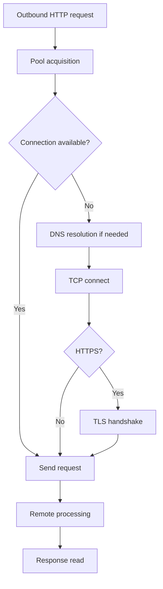
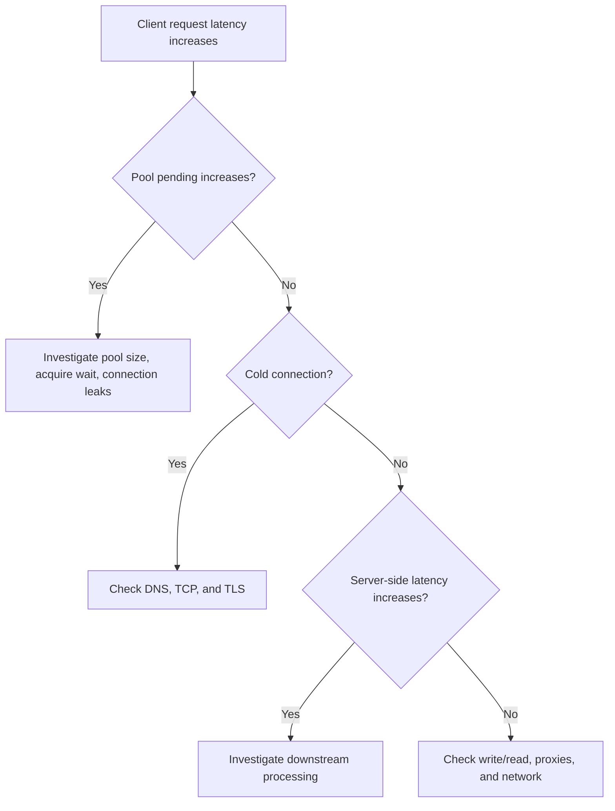

# Connection establishment time in Spring Boot HTTP clients

When a Spring Boot application calls an HTTP service, the request may wait before sending the first byte: resolving the IP address, acquiring a connection from a pool, opening a TCP connection, and negotiating TLS. This total duration is often grouped together as connection establishment time, though each component has distinct causes and ways of being observed.

Properly analyzing connection establishment time distinguishes a slowly processing dependency from a client unable to establish a connection. High latency on a request may come from an exhausted connection pool, slow DNS, retried TCP handshakes, expensive TLS handshakes, or a remote endpoint refusing connections. Standard HTTP client Observation measures the entire outbound exchange; it does not automatically provide an independent metric for each DNS/TCP/TLS phase.

The **"Connection establishment time"** lesson belongs to the **HTTP client observability** chapter of the **SPRING_BOOT_OBSERVABILITY** module. The module teaches setting up observability for Spring Boot using Micrometer Observation, metrics, logs, and distributed tracing; learning context propagation, tags/cardinality, exporters, sampling, and signal correlation to investigate errors, latency, and application behavior in production environments.

## 1. What Does Connection Establishment Time Include?

An outbound HTTP request can pass through these phases:

1. **DNS resolution:** translating a hostname into one or more IP addresses.
2. **Connection pool acquisition:** obtaining an available connection from the pool; if the pool is exhausted, the request may wait.
3. **TCP connect:** establishing a TCP connection to the target address.
4. **TLS handshake:** negotiating TLS, verifying certificates, and establishing a secure session if using HTTPS.
5. **Request write:** sending request headers/body.
6. **Remote processing:** server processes the request.
7. **Response read:** receiving response headers/body.

Not every request executes all steps. If the connection pool reuses an open connection, the request can skip DNS/TCP/TLS. TLS session resumption, DNS caching, and connection reuse also alter costs.



### Connection establishment differs from request latency

- **Connection establishment time** focuses on obtaining a usable connection.
- **HTTP client request duration** usually measures more broadly, covering the exchange until the response completes per instrumentation.
- **Remote server processing time** is the time the server spends processing; the client cannot infer it accurately from total duration alone.
- **Pool pending time** is the time spent waiting for a connection from the pool; it is not TCP connect time.

Do not treat the entire `http.client.requests` duration as TCP connect latency. Separating phases requires HTTP client/connection pool instrumentation or dedicated tracing spans/events.

## 2. Connection Pool Acquisition Time

HTTP clients typically reuse connections to avoid opening TCP/TLS per request. The pool manages idle connections, active connections, and waiting requests.

When the pool has an available connection, acquisition is usually fast. When the pool reaches its limit, requests may wait until a connection is returned or an acquisition timeout occurs.

Signs of pool pressure:

- Pending acquisitions rise.
- Pending acquire time rises.
- Active connections stay near max connections.
- Idle connections remain at 0 for prolonged periods.
- Pool acquire timeouts appear.
- Request latency climbs even though server-side latency is stable.

With Reactor Netty, `ConnectionProvider` manages the connection pool. Pool metrics can be enabled and observed through Micrometer integration depending on the version/configuration. Useful measurements typically include active, idle, pending connections, max connections, pending acquire time, and acquire failures. Verify exact meter names in the Reactor Netty/Micrometer version in use.

### ConnectionProvider configuration example

```java
import java.time.Duration;

import reactor.netty.resources.ConnectionProvider;

ConnectionProvider provider = ConnectionProvider.builder("payment-pool")
        .maxConnections(100)
        .pendingAcquireMaxCount(500)
        .pendingAcquireTimeout(Duration.ofSeconds(2))
        .maxIdleTime(Duration.ofSeconds(30))
        .build();
```

This is an example of configuring a dedicated pool. Limits must be sized for concurrency, response times, downstream capacity, and allowed connection counts. Do not raise `maxConnections` indefinitely to hide pool waits; that can overload the dependency or exhaust ephemeral ports/file descriptors.

When creating a `WebClient` using Reactor Netty `HttpClient` with a custom `ConnectionProvider`, attach the provider to the connector and ensure the provider's lifecycle/disposal is managed on application shutdown.

## 3. TCP Connection Establishment

TCP connect involves the handshake between client and server. Latency can rise due to:

- Long network routes or congestion.
- Packet loss and retransmissions.
- Firewalls/security groups dropping packets.
- Overloaded server backlog or accept queue.
- Unreachable endpoint IP.
- NAT, proxies, or service meshes adding hops.
- Connection limits or ephemeral port exhaustion on the client.

If a TCP connect timeout occurs, there is usually no HTTP response status. This is a transport failure, not an HTTP 5xx from downstream.

Distinctions:

| Symptom | Possibility |
| --- | --- |
| Connection refused | Target reachable but no listener or rejected |
| Connect timeout | Packets dropped, route unreachable, or endpoint unresponsive |
| Unknown host | DNS resolution failed |
| Too many open files | File descriptor/resource exhaustion |
| No route to host | Routing/network policy |
| Connection reset | Peer/proxy reset connection during setup or use |

Do not conclude the server is processing slowly solely from connection timeouts. Inspect network, client pool, and server accept metrics.

## 4. DNS Resolution Time

DNS can noticeably affect initial connections or cache expirations. In containers/Kubernetes, DNS queries may go through an internal resolver, CoreDNS, or upstream DNS.

Factors:

- Resolver latency and retries.
- DNS cache TTL.
- Multiple A/AAAA records.
- Search domains in containers.
- DNS timeout/retry configuration.
- Service discovery and endpoint churn.

Connection reuse reduces the number of DNS lookups; therefore, measuring a single request on a fresh connection can differ markedly from steady-state traffic.

To investigate, compare cold connections against reused connections, inspect resolver metrics/logs, and test DNS lookups inside the actual runtime/container. Do not hard-code IPs to bypass DNS unless the architecture has matching service discovery and failover mechanisms.

## 5. TLS Handshake Time

With HTTPS, the TLS handshake occurs after the TCP connection is established. Duration depends on the certificate chain, algorithms, CPU, network round trips, OCSP/revocation checks if any, and TLS session resumption.

Signs:

- HTTPS connections are slower than HTTP in the same environment.
- Cold connections are slow while keep-alive requests are fast.
- CPU spikes when opening many TLS connections concurrently.
- Certificate validation or truststore errors.
- Proxy/service mesh terminates TLS and initiates another TLS connection upstream.

Connection pools and keep-alive reduce handshake frequency. However, certificate rotation, connection max lifetime, and idle timeouts can cause connections to be recreated periodically.

Do not disable certificate validation to reduce handshake latency. Profile and configure trust/certificates properly instead.

## 6. Which Timeouts Control Connection Establishment?

HTTP client timeouts span multiple layers, and not all share the same meaning.

| Timeout | Phase | Meaning |
| --- | --- | --- |
| DNS timeout | Name resolution | Bounds hostname resolution time; usually belongs to the resolver |
| Pool acquire timeout | Connection pool | Bounds time waiting for an available connection |
| Connect timeout | TCP connect | Bounds time to establish a TCP connection |
| TLS handshake timeout | TLS | Bounds TLS negotiation time if exposed separately by the client |
| Response/read timeout | Response | Bounds waiting for data/response per client semantics |
| Overall request timeout | Entire exchange | Bounds total request duration if supported by client/operator |

Connect timeout does not include pool acquisition or DNS in every implementation. Read the documentation for the HTTP client connector in use and test each phase.

### Reactor Netty HttpClient example

```java
import java.time.Duration;

import reactor.netty.http.client.HttpClient;

HttpClient httpClient = HttpClient.create()
        .option(
                io.netty.channel.ChannelOption.CONNECT_TIMEOUT_MILLIS,
                2_000)
        .responseTimeout(Duration.ofSeconds(5));
```

This example sets TCP connect timeout and response timeout. Response timeout is not an overall deadline for all phases. If you need pool acquire timeout, configure `ConnectionProvider`. If you need TLS handshake timeout, use the API matching your Reactor Netty version and verify its semantics.

### Attaching the connector to WebClient

```java
import org.springframework.http.client.reactive.ReactorClientHttpConnector;
import org.springframework.web.reactive.function.client.WebClient;
import reactor.netty.http.client.HttpClient;

HttpClient httpClient = HttpClient.create()
        .option(
                io.netty.channel.ChannelOption.CONNECT_TIMEOUT_MILLIS,
                2_000);

WebClient client = WebClient.builder()
        .clientConnector(new ReactorClientHttpConnector(httpClient))
        .baseUrl("https://payment-service")
        .build();
```

In Spring Boot, if you need to preserve auto-configuration and Observation customizers, integrate the connector through the builder/customizer mechanism of the Boot version in use. Do not accidentally replace the builder bean and lose instrumentation.

## 7. Observing Total Request Latency with Micrometer Observation

Spring Boot and Micrometer provide the common HTTP client Observation named `http.client.requests`. This Observation typically provides overall exchange duration and dimensions such as `method`, `uri`, `status`, `outcome`, and `error` per convention.

Metrics example:

```text
http.client.requests
  method=POST
  uri=/payments/{id}
  client.name=payment-service
  status=200
  outcome=SUCCESS
```

This metric reveals overall dependency latency and error rates. It does not necessarily separate DNS, pool acquire, TCP connect, and TLS handshake.

If request latency climbs without a matching increase in downstream server metrics, the cause may sit in client-side pools, DNS, network, or TLS. Compare client observation duration with server-side observations and pool metrics to narrow it down.

Do not add raw URLs, remote IPs, payment IDs, or trace IDs as low-cardinality tags. Use logical destination names and URI templates.

## 8. Connection Pool Metrics in Reactor Netty

Reactor Netty provides metrics for the connection provider/pool when metrics are enabled and compatible Micrometer integration is on the classpath. Configuration is typically done on `ConnectionProvider`:

```java
ConnectionProvider provider = ConnectionProvider.builder("payment-pool")
        .metrics(true)
        .maxConnections(100)
        .build();
```

API names and meter names depend on the version. Inspect the metrics registered in `MeterRegistry` instead of relying on names from a different version.

Measurements to observe:

| Measurement | Operational Question |
| --- | --- |
| Active connections | How many connections are currently in use? |
| Idle connections | Are idle connections available for reuse? |
| Pending connections | How many requests are waiting on the pool? |
| Max connections | Is the pool hitting its cap? |
| Pending acquire time | How long does waiting for a connection take? |
| Acquire failures | How many times did acquiring a connection fail? |

Pool metrics explain the wait before obtaining a connection. They do not replace TCP connect timing for new connections; combine them with network/connector instrumentation.

## 9. Separating Phases via Tracing or Connector Instrumentation

Standard HTTP client spans usually wrap the outbound request. To measure DNS, pool acquisition, TCP connect, and TLS handshake accurately, instrumentation is needed at the connector, resolver, or connection pool level.

You can use:

- Reactor Netty connection provider metrics.
- Netty channel lifecycle instrumentation.
- HTTP client connector instrumentation or event hooks.
- JVM/network diagnostics and packet captures in permitted environments.
- Service mesh/proxy metrics if connections traverse a sidecar.
- Distributed traces to compare client spans and downstream server spans.

Do not assume every phase automatically appears as child spans. If creating manual spans for connection phases, define clear names and parent relationships, avoiding double-counting duration alongside the overall client span.

## 10. Cold Connections and Connection Reuse

Two identical requests can have different latencies:

- Cold connection: DNS, TCP, and TLS may need to execute.
- Reused connection: acquires a connection from the pool and sends the request.
- Expired connection: old connection closed, client must re-establish.
- Pool saturated: requests wait for a connection even when the server is healthy.

When benchmarking, separate cold-start tests from steady-state tests. A single measurement after the pool is warm does not reflect initial connection latency. Conversely, measuring only cold connections exaggerates cost compared to traffic with healthy keep-alive.

Check idle timeouts, max lifetimes, server keep-alive timeouts, and proxy timeouts to avoid unexpected connection drops and continuous re-establishment.

## 11. Calculating the Latency Budget

Total client-observed duration can be conceptualized as:

\[
T_{client} =
T_{pool} + T_{dns} + T_{tcp} + T_{tls} +
T_{write} + T_{remote} + T_{read}
\]

This is a conceptual decomposition model. Some phases do not happen on every request; there may be overlap, retries, or connection reuse. Do not sum metrics from different boundaries as if they were strictly sequential intervals.

Example:

| Phase | Illustrative Duration |
| --- | ---: |
| Pool acquire | 4 ms |
| DNS | 2 ms |
| TCP connect | 8 ms |
| TLS handshake | 15 ms |
| Request write | 1 ms |
| Remote processing | 40 ms |
| Response read | 5 ms |
| Total | 75 ms |

With a reused connection, DNS/TCP/TLS may be near zero for that request. With a saturated pool, pool wait can dominate latency even when connect time and server processing remain normal.

Use histograms/percentiles instead of averages alone. A small percentage of slow connection establishments can push up p99 while the average remains low.

## 12. Diagnosing by Symptom

| Symptom | Possible Cause | How to Check |
| --- | --- | --- |
| High client latency, normal server latency | Pool wait, DNS, TCP, or TLS | Compare client duration, pool metrics, and connector timings |
| Pending acquire rises | Pool exhausted or connections held too long | Active/idle/pending, max connections, response time |
| Connect timeout | Network route, firewall, or unresponsive endpoint | TCP diagnostics, connect timeout, network policy |
| Unknown host | DNS resolver failure | DNS lookup from the actual container/pod |
| HTTPS slower than HTTP | TLS handshake/certificate/proxy | TLS timing, session reuse, certificate chain |
| Cold requests slow, subsequent requests fast | DNS/TCP/TLS setup and connection warm-up | Compare cold vs. reused connections |
| Acquire timeout | Pool wait exceeded limit | Pool sizing, pending queue, and downstream latency |
| Connection reset | Peer/proxy closed connection | Keep-alive/idle timeouts and proxy logs |
| Latency rises with concurrency | Pool saturation or downstream capacity | Load tests, active/pending connections |
| Many new TCP connections | Keep-alive inactive or pool churn | Connection reuse, max life/idle settings |

Workflow:

1. Identify the actual client API and connector.
2. Measure total client Observation duration.
3. Read active/idle/pending connection metrics.
4. Distinguish requests using reused connections vs. cold connections.
5. Check DNS lookups and resolver logs.
6. Measure TCP connect and TLS handshake if connector/tooling supports it.
7. Compare against downstream server Observation duration.
8. Check timeouts, retries, proxies, and service mesh.
9. Run controlled load tests to find pool saturation thresholds.



## 13. Hands-on Exercise: Measuring Connection Establishment

Run locally/in tests:

1. Create a `WebClient` using the Reactor Netty connector.
2. Configure `ConnectionProvider` with bounded max connections and pending acquire timeout.
3. Enable pool metrics and verify active/idle/pending measurements in `MeterRegistry`.
4. Set TCP connect timeout and response timeout.
5. Call an HTTPS endpoint for the first time to observe a cold connection.
6. Call the same endpoint repeatedly to observe connection reuse.
7. Generate concurrency above max connections to observe pending acquisitions and acquire timeouts.
8. Test an unresolvable hostname and an unopened port to distinguish DNS from TCP failures.
9. Compare client Observation duration with server-side Observation duration.
10. Document limits: which phases have dedicated metrics and which are only observable via total duration or network diagnostic tools.
11. Rerun with TLS and keep-alive; do not disable certificate validation to alter latency.

Expected outcome: ability to identify pool wait, connect timeouts, DNS/TCP failures, and downstream processing latency without confusing total request duration with connection establishment.

## 14. Self-Check Questions

1. Which phases make up connection establishment time?
2. How does pool acquisition differ from TCP connect?
3. Why might a request on a reused connection incur no DNS/TCP/TLS?
4. Where is DNS latency observed?
5. How does TCP connection refused differ from connect timeout?
6. At which phase does the TLS handshake occur?
7. Does connect timeout always include DNS and pool wait?
8. How does response timeout differ from overall request timeout?
9. Why is `http.client.requests` duration not TCP connect latency?
10. What does Reactor Netty `ConnectionProvider` manage?
11. What does rising pending connections indicate?
12. How do you distinguish pool saturation from slow downstream processing?
13. Why should `maxConnections` not be increased indefinitely?
14. How does a cold-connection benchmark differ from a steady-state benchmark?
15. Which metrics/traces/network diagnostics must be combined to decompose latency?

## References

- [Spring Boot — HTTP Client Metrics](https://docs.spring.io/spring-boot/reference/actuator/metrics.html): HTTP client observations and metrics.
- [Spring Framework — HTTP Client Observations](https://docs.spring.io/spring-framework/reference/integration/observability.html): client Observation lifecycle and conventions.
- [Reactor Netty — HTTP Client](https://projectreactor.io/docs/netty/release/reference/http-client.html): `HttpClient`, connection provider, timeouts, and pool metrics.
- [Reactor Netty — Connection Pool](https://projectreactor.io/docs/netty/release/reference/http-client.html#_connection_pool): pool configuration and measurements.
- [Micrometer Observation](https://docs.micrometer.io/micrometer/reference/observation.html): `ObservationRegistry`, handlers, and conventions.
- [OpenTelemetry HTTP semantic conventions](https://opentelemetry.io/docs/specs/semconv/http/http-spans/): HTTP client span semantics.

## Conclusion

**Connection establishment time is the cost incurred before an HTTP client can exchange data over a usable connection.** It can include pool acquisition, DNS, TCP connect, and TLS handshake; each phase has distinct timeouts, metrics, and failure causes. Connection reuse skips many steps, while pool saturation can make requests wait long even when the network and downstream server are healthy.

In Spring Boot, use `WebClient` instrumentation to measure the overall outbound exchange and Reactor Netty connection pool metrics to detect pool pressure. When you need to isolate DNS/TCP/TLS, add appropriate connector/network instrumentation. Do not treat `http.client.requests` as connect latency; combine client/server observations, pool metrics, and network diagnostics to pinpoint exactly where latency arises.
