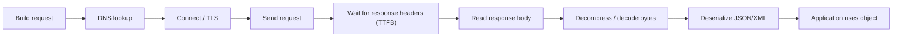

# Body deserialization time in HTTP client observability

## 1. Objectives and Context

An HTTP client may receive response headers very quickly yet still spend significant time before the application can use the data. The body may be large, compressed, deeply nested JSON, or contain many objects; reading bytes, decompressing, parsing JSON, and converting into Java objects can consume CPU, memory, and time.

**Body deserialization time** is the time needed to convert a response body from bytes/text into the data type used by the application. When investigating outbound HTTP call latency, distinguish network wait time from body reading and decoding time. Looking at a single aggregate number can make operations mistake a slow dependency for an application spending heavy CPU parsing payloads.

This lesson belongs to the **HTTP client observability** chapter of the **SPRING_BOOT_OBSERVABILITY** module. The module teaches setting up observability for Spring Boot using Micrometer Observation, metrics, logs, and distributed tracing; learning context propagation, tags/cardinality, exporters, sampling, and signal correlation to investigate errors, latency, and application behavior in production environments.

After this lesson, you can:
1. Break HTTP client latency down into network, body transfer, and deserialization phases.
2. Understand the meaning and limits of the `http.client.requests` timer.
3. Identify the roles of `HttpMessageConverter` and `WebClient` Codecs.
4. Measure decode time separately using Micrometer Observation/Timer when needed.
5. Distinguish eager decoding, reactive body consumption, and streaming.
6. Record payload size/decode outcome without increasing cardinality.
7. Handle decode errors, timeouts, cancellations, and memory pressure.
8. Design tests/benchmarks to isolate the real bottleneck.

**Baseline:** Spring Boot 3.5.x, Java 17+, Micrometer Observation, Actuator. Blocking examples use `RestClient`; reactive uses `WebClient`. Lifecycle details depend on the client connector, message converter/codec, and framework version.

## 2. Where Does Deserialization Sit in an HTTP Exchange?

An outbound HTTP request has multiple phases:



Phases can overlap or execute lazily depending on the client:
- DNS/connect/TLS: establishing transport and security.
- Request write: sending headers and body.
- TTFB: time from sending the request until receiving response headers/first byte.
- Body transfer: reading the response bytes.
- Decompression: decompressing gzip/br if performed by the connector.
- Deserialization: parsing JSON/XML and instantiating objects.
- Application processing: validating, mapping, or computing after decoding.

Not every client exposes each of these phases separately. A timer wrapping the exchange typically reports total duration per instrumentation lifecycle; it does not automatically report the percentage spent solely on JSON parsing.

### 2.1. Why distinguish the phases?

Consider two requests that both take around 900 ms:

| Phase | Request A | Request B |
| --- | ---: | ---: |
| DNS + connect + TLS | 80 ms | 70 ms |
| Waiting for headers/TTFB | 650 ms | 180 ms |
| Reading body | 120 ms | 150 ms |
| Decoding body | 30 ms | 500 ms |
| Illustrative total | 880 ms | 900 ms |

Request A is mostly waiting for the dependency to respond; Request B receives headers early but has heavy decoding. The fixes differ: A requires investigating downstream/network; B requires optimizing payload, codec, object mapping, or CPU.

This is an illustrative breakdown, not default sub-timers automatically emitted by Spring Boot.

## 3. What Does http.client.requests Measure?

Spring Boot/Micrometer instruments common HTTP clients with an observation named **http.client.requests** when the application uses auto-configured builders and appropriate dependencies.

The timer reflects the duration of the HTTP client exchange according to the lifecycle managed by client instrumentation. With blocking clients, the response body is usually read and converted before the synchronous call returns, so decoding can fall inside the observed duration. With reactive clients, the body may be consumed after the method returning `Mono`/`Flux` completes; the observation must follow the reactive lifecycle rather than measuring only publisher creation.

Do not conclude universally that the timer measures only the network or always isolates deserialization accurately. Actual behavior depends on:
- `RestClient`/`RestTemplate` vs. `WebClient`.
- Connector and execution model.
- Whether the body is materialized or streamed.
- Whether the response body is fully consumed or discarded.
- Observation instrumentation of the running version.
- Error handler and how the application subscribes/consumes the body.

### 3.1. Checking client observation

A meter is typically named `http.client.requests`. Low-cardinality tags can include `method`, `uri`, `client.name`, `status`, `outcome`, and `error` depending on version/convention.

Using the auto-configured builder:

```java
@Component
public class CatalogClient {
    private final RestClient client;

    public CatalogClient(RestClient.Builder builder) {
        this.client = builder
                .baseUrl("https://catalog.internal")
                .build();
    }

    public CatalogItem find(String id) {
        return client.get()
                .uri("/v1/items/{id}", id)
                .retrieve()
                .body(CatalogItem.class);
    }
}
```

With a blocking call, `body(CatalogItem.class)` requires the client to read the body and convert it to `CatalogItem` before the method returns. The HTTP client observation timer may include this work per instrumentation lifecycle; verify with tests on your exact connector/version.

### 3.2. WebClient and the reactive lifecycle

```java
@Component
public class ReactiveCatalogClient {
    private final WebClient client;

    public ReactiveCatalogClient(WebClient.Builder builder) {
        this.client = builder
                .baseUrl("https://catalog.internal")
                .build();
    }

    public Mono<CatalogItem> find(String id) {
        return client.get()
                .uri("/v1/items/{id}", id)
                .retrieve()
                .bodyToMono(CatalogItem.class);
    }
}
```

The `find` method returns a `Mono` immediately; the HTTP call and body decoding occur when the publisher is subscribed to. If you measure duration around the line that creates the `Mono`, the result reflects only pipeline assembly time, not request/decode duration.

To measure reactive operations properly, use instrumentation provided by Spring Boot/`WebClient` and measure inside the reactive chain or via the reactive-aware Observation API. Do not subscribe a second time just to record a timer, as that can send the request a second time.

## 4. HttpMessageConverter and Codecs

### 4.1. RestClient/RestTemplate: HttpMessageConverter

`RestClient` and `RestTemplate` use Spring HTTP message converters to convert bodies into Java types. For example:
- `MappingJackson2HttpMessageConverter` reads JSON and instantiates objects via Jackson.
- `StringHttpMessageConverter` reads text.
- `ByteArrayHttpMessageConverter` returns a byte array.
- `ResourceHttpMessageConverter` handles `Resource`/streams appropriately.

For JSON, decode cost depends on:
- Payload size and record count.
- Nesting depth and field count.
- Custom deserializers, polymorphic mapping, and validation.
- Object graphs, collections, and allocations.
- Jackson configuration, modules, and target Java types.

If a payload contains 50,000 objects, parsing and allocation time can be substantial even when the server responds quickly.

### 4.2. WebClient: codecs

`WebClient` uses codec infrastructure:
- `Decoder` reads bytes and converts them to the target type.
- `Jackson2JsonDecoder` typically handles JSON.
- `StringDecoder` handles text.
- `ByteArrayDecoder` handles byte arrays.
- `DataBuffer` and reactive operators influence how the body is read/streamed.

Reactive decoding can process buffers and emit objects on demand. Not every `bodyToMono`/`Flux` materializes the entire payload the same way. `Mono<Order>` usually needs one complete object; `Flux<Order>` can decode multiple elements as a stream if the media type/decoder supports it.

## 5. Measuring Deserialization Time Separately

If the overall HTTP client timer does not answer "how long did decoding take?", you can create a separate observation/timer around the conversion step. Keep the operation name stable and tags low-cardinality.

### 5.1. Measuring blocking decode with a Timer

Example decoder service receiving an already-read payload:

```java
import com.fasterxml.jackson.databind.ObjectMapper;
import io.micrometer.core.instrument.MeterRegistry;
import io.micrometer.core.instrument.Timer;
import org.springframework.stereotype.Component;

@Component
public class CatalogPayloadDecoder {
    private final ObjectMapper objectMapper;
    private final MeterRegistry registry;

    public CatalogPayloadDecoder(
            ObjectMapper objectMapper,
            MeterRegistry registry) {
        this.objectMapper = objectMapper;
        this.registry = registry;
    }

    public CatalogResponse decode(byte[] body) throws IOException {
        Timer.Sample sample = Timer.start(registry);
        String outcome = "success";
        try {
            return objectMapper.readValue(body, CatalogResponse.class);
        } catch (IOException ex) {
            outcome = "failure";
            throw ex;
        } finally {
            sample.stop(Timer.builder("http.client.body.decode")
                    .description("Time spent deserializing an HTTP response body")
                    .tag("format", "json")
                    .tag("target", "catalog-response")
                    .tag("outcome", outcome)
                    .register(registry));
        }
    }
}
```

The example assumes the body is already materialized into `byte[]`. The timer measures only Jackson `readValue`, not network reads, prior decompression, or post-decode business processing.

The tags `format`, `target`, and `outcome` are finite values. Do not attach raw URLs, IDs, payloads, exception messages, or content hashes as metric tags.

If using `RestClient` `body(CatalogResponse.class)` directly, the converter decodes inside the framework. To measure that step separately, you can:
- Read the response as `byte[]`/`String` and decode in an application-managed component, if payload size allows.
- Configure an instrumented custom `HttpMessageConverter`.
- Use an observation/timer around application-side mapping after the body is read.
- Use a profiler/JFR/benchmark to determine converter CPU and allocations.

Do not read the body twice and do not buffer large payloads solely to record a timer.

### 5.2. Using Observation for decode operations

If you want both a timer and a tracing span for the decode operation, create a separate `Observation`:

```java
import io.micrometer.observation.Observation;
import io.micrometer.observation.ObservationRegistry;

public CatalogResponse decode(
        byte[] body,
        ObjectMapper mapper,
        ObservationRegistry registry) throws IOException {

    return Observation.createNotStarted("http.client.body.decode", registry)
            .lowCardinalityKeyValue("format", "json")
            .lowCardinalityKeyValue("target", "catalog-response")
            .observe(() -> {
                try {
                    return mapper.readValue(body, CatalogResponse.class);
                } catch (IOException ex) {
                    throw new UncheckedIOException(ex);
                }
            });
}
```

`Observation.observe` manages the lifecycle and records exceptions thrown from the callback via registered handlers. Wrapping `IOException` into `UncheckedIOException` inside the lambda must align with the caller's exception contract; the calling layer can unwrap or preserve the appropriate cause.

The Observation name must be stable; do not concatenate dynamic target classes or URLs into the observation name. Add only low-cardinality values from a finite set.

## 6. Measuring Body Consumption in WebClient

With `WebClient`, body decoding sits inside the reactive pipeline. You can place timing around consumption of the publisher, for example:

```java
public Mono<CatalogItem> findMeasured(String id) {
    return client.get()
            .uri("/v1/items/{id}", id)
            .retrieve()
            .bodyToMono(CatalogItem.class)
            .transformDeferred(publisher ->
                    measuredDecode(publisher, "catalog-item"));
}

private <T> Mono<T> measuredDecode(
        Mono<T> source,
        String target) {
    return Mono.defer(() -> {
        long started = System.nanoTime();
        return source
                .doOnSuccess(value -> recordDecodeDuration(
                        target, "success", started))
                .doOnError(error -> recordDecodeDuration(
                        target, "failure", started))
                .doOnCancel(() -> recordDecodeDuration(
                        target, "cancelled", started));
    });
}
```

The snippet illustrates timing from when subscription starts until the body publisher completes. It is **not a pure measurement of Jackson CPU**: the interval may include body transfer, decoder, scheduler queues, and downstream operators depending on where the transform is placed.

`recordDecodeDuration` should record a `Timer` with fixed tags such as `target`/`outcome`. In production, ensure it records exactly once per terminal signal; consider `doFinally` with per-subscription state so you do not double-record across success/error/cancel. Do not share a single timestamp variable across subscribers.

If you need to measure pure decoder CPU, instrument the codec/decoder or isolate payloads into bytes and benchmark decoding independently. Buffering can increase memory usage and alter backpressure.

### 6.1. Flux and streaming

With `bodyToFlux(Item.class)`, the publisher can emit multiple items. Decide what the timer measures:
- Time to first item.
- Time to decode each item.
- Total time until stream completion.
- Consumer processing time per item after decoding.

These are distinct questions. A timer around an entire `Flux` can be dominated by consumer demand and downstream processing time, not just the decoder. If measuring per item, record aggregated stats and avoid a separate metric series per item.

For large streams, do not collect an entire `Flux` into a `List` just to measure duration; that sacrifices backpressure benefits and can cause memory pressure.

## 7. Distinguishing Body Decoding from Application Processing

A realistic pipeline:

```text
HTTP response bytes
    -> decompress
    -> deserialize JSON
    -> validate schema
    -> map DTO to domain model
    -> business calculation
    -> persist result
```

The decode segment should stop once the DTO is constructed. Validation, mapping, business calculation, and persistence should have their own operations/timers if analysis is needed.

If a timer named `body.decode` also encompasses database writes, the metric name misleads and optimization decisions will be wrong.

Name operations accurately:
- `http.client.body.decode`: parse body into target representation.
- `catalog.response.validate`: validate parsed data.
- `catalog.response.map`: map DTO to domain model.
- `catalog.sync.persist`: write data to storage.

Names and tags must remain stable across versions so dashboards/queries do not fragment.

## 8. Payload Size and Supporting Indicators

Decode time generally increases with payload size and structure. You can track:
- Response body size in bytes, if the connector/application can measure it safely.
- Decode duration timer.
- Decoded item count.
- Decode failure count by format/target.
- JVM CPU, allocation rate, and GC pauses.
- HTTP client total duration and response status.
- Timeout/cancel counts.

Do not use the exact byte size of each request as a tag. If grouping is needed, use finite buckets such as:
- `lt_64_kb`
- `64_kb_to_1_mb`
- `gt_1_mb`

If histograms/percentiles are enabled, use appropriate timer distributions. Base bucket boundaries on real payloads and operational goals; do not create hundreds of buckets arbitrarily.

Do not assume a `Content-Length` response header is always present or accurate: bodies may be chunked, compressed, streamed, or omit the header. If measuring actual bytes read, distinguish compressed bytes from decompressed bytes.

## 9. Decode Errors and Timeouts

Decoding can fail even when HTTP status is 200:
- Malformed JSON.
- Incompatible schema/field types.
- Truncated payload mid-stream.
- Invalid charset.
- Overly large payload causing memory pressure.
- Custom deserializer throws an exception.

This is a **client-side body processing failure**, distinct from HTTP 5xx. In observability:
- HTTP status may still be 200 because the server returned a successful response.
- The client observation may record an error/exception if the decode error arises inside the instrumented lifecycle.
- A custom decode timer should have a `failure` outcome.
- Logs record the exception class and safe context, without logging the full body.
- Metrics count decode failures separately from HTTP response failures.

Timeouts must also be distinguished:
- Connect timeout: failed to establish connection.
- Response/read timeout: body not received completely within the limit.
- Decode CPU taking too long: may not be a network timeout; the thread is busy inside the parser.
- Reactive cancellation: subscriber cancels the stream, not necessarily a server error.

## 10. Payload Security and Memory

Response bodies can contain personal data, tokens, or business information. Do not log raw bodies to measure decoding.

Principles:
- Do not log payloads, `Authorization`, cookies, or sensitive queries.
- Record body size/buckets only if permitted.
- Cap maximum in-memory buffers via client/codec configuration.
- With `WebClient`, mind `DataBuffer` lifecycle and release when handling buffers manually.
- Avoid blocking reactive event-loops to parse huge payloads or run CPU-heavy mapping.
- Offload CPU-bound work to an appropriate scheduler if needed, while preserving context propagation.
- Check GC/allocations on large payloads.
- Do not retain byte arrays/DTO references longer than necessary.

## 11. Testing and Benchmarking

### 11.1. Integration tests with fixed payloads

Using a mock HTTP server or test server:
1. Return small valid JSON; verify the DTO is right and the decode timer is recorded.
2. Return large JSON; observe duration/bytes without asserting brittle machine-dependent thresholds.
3. Return malformed JSON with HTTP 200; verify decode failure and exception classification.
4. Return HTTP 500; distinguish HTTP status failure from decode failure.
5. Return a slow/chunked body; verify body transfer affects the total exchange timer.
6. With `WebClient`, subscribe and consume the publisher; do not just call the method returning `Mono`.
7. Cancel the subscription; verify cancellation is not miscounted as decode success.
8. Check that metric tags contain no URLs, payloads, IDs, or exception messages.

### 11.2. Isolated parser benchmarks

When suspecting Jackson/codec as the bottleneck:
- Benchmark the parser with representative payloads and real target DTOs.
- Warm up the JVM before measuring.
- Use multiple iterations and result distributions, not a single run.
- Monitor allocations/GC and CPU.
- Compare mappers/modules/custom deserializers.
- Avoid synthetic payloads overly simplified compared to production.

JMH fits isolated parser microbenchmarks. End-to-end HTTP tests fit exchange and body lifecycles. The two measurements answer two different questions.

## 12. Troubleshooting

| Symptom | Possible Cause | How to Check |
| --- | --- | --- |
| `http.client.requests` high while server responds fast | Slow client-side decoding or body consumption | Measure decode separately, profile CPU and allocations |
| `RestClient` slow on large JSON | Message converter/Jackson parsing and object allocations | Benchmark representative payloads |
| `WebClient` custom metric timer stops too early | Measured around `Mono` creation instead of subscription | Place timing inside the reactive chain |
| `WebClient` timer longer than actual decode | Timer includes network, backpressure, or downstream operators | Separate body transfer/decode/consumer timing |
| HTTP 200 yet client call reports error | Deserialization or body processing failed | Check converter exceptions and client logs |
| Decode timer records two samples for one request | Recorded in both success/error/finally or multiple subscriptions | Use per-subscription state, record one terminal outcome |
| Memory rises on large payloads | Buffering full body or retaining DTOs/byte arrays | Cap buffers, stream, and profile heap |
| High CPU, normal network | CPU-bound parser/custom deserializer or mapping | JFR/profiler/JMH |
| Metric cardinality grows with payloads | Using URL, dynamic target class, or ID as tags | Map format/target via allowlist |
| Decode errors mistaken for HTTP failures | Relying solely on status codes | Track a dedicated metric for body decode outcomes |
| Missing body size | `Content-Length` absent or chunked body | Count actual bytes read if needed |
| Reactive cancellation counted as failure | Not distinguishing cancel from `onError` | Record `cancelled` outcome separately |
| Event-loop blocked | CPU-heavy parsing or mapping running synchronously on event-loop | Offload CPU-bound tasks per reactive design |

## 13. Production Checklist

- [ ] Understand which client lifecycle `http.client.requests` wraps for the client in use.
- [ ] Distinguish DNS/connect/TLS, TTFB, body transfer, decompression, decoding, and business processing.
- [ ] Use auto-configured builders so client observation is active.
- [ ] Do not measure reactive requests by `Mono`/`Flux` creation time.
- [ ] If needed, maintain a dedicated timer for body decoding with stable names and tags.
- [ ] Do not measure network time and label it parser CPU time.
- [ ] Distinguish body decode failures from HTTP status failures.
- [ ] For `Flux`/streaming, clarify whether the timer measures first item, per item, or full stream.
- [ ] Do not buffer entire large payloads solely to measure them.
- [ ] Do not log payloads or put dynamic values into metric tags.
- [ ] Monitor payload size buckets, allocations, GC, and decode failures as appropriate.
- [ ] Test success, malformed payloads, slow bodies, cancellations, and high concurrency.
- [ ] Use a profiler/JMH when needing to pinpoint parser bottlenecks.

## 14. Self-Study Questions

1. How does body deserialization time differ from TTFB and body transfer time?
2. Why is `http.client.requests` not a pure network measurement by default?
3. Which mechanism do `RestClient`/`RestTemplate` use to convert a response body into a Java object?
4. When does `WebClient` `bodyToMono` execute decoding?
5. Why does measuring duration around creating a `Mono` yield inaccurate results?
6. When is a dedicated custom `Timer` for body decoding needed?
7. Why should you not buffer an entire `Flux` just to measure duration?
8. How should HTTP 200 with a deserialization error be classified?
9. Which tags suit a decode timer and which tags cause high cardinality?
10. How do you distinguish CPU-bound parser latency from network-bound latency?
11. Why does `Content-Length` not always reflect the actual bytes decoded?
12. How should cancellations and malformed payloads be tested?

## References

- [Spring Boot 3.5 — HTTP Client Metrics](https://docs.spring.io/spring-boot/3.5/reference/actuator/metrics.html)
- [Spring Framework — REST Clients](https://docs.spring.io/spring-framework/reference/integration/rest-clients.html)
- [Spring Framework — WebClient](https://docs.spring.io/spring-framework/reference/web/webflux-webclient.html)
- [Spring Framework — HTTP Message Conversion](https://docs.spring.io/spring-framework/reference/web/webmvc/message-converters.html)
- [Spring Framework — WebFlux Codecs](https://docs.spring.io/spring-framework/reference/web/webflux/reactive-spring.html)
- [Micrometer Observation — Concepts](https://docs.micrometer.io/micrometer/reference/observation.html)
- [Micrometer — Timers](https://docs.micrometer.io/micrometer/reference/concepts/timers.html)
- [OpenTelemetry — HTTP Semantic Conventions](https://opentelemetry.io/docs/specs/semconv/http/)
