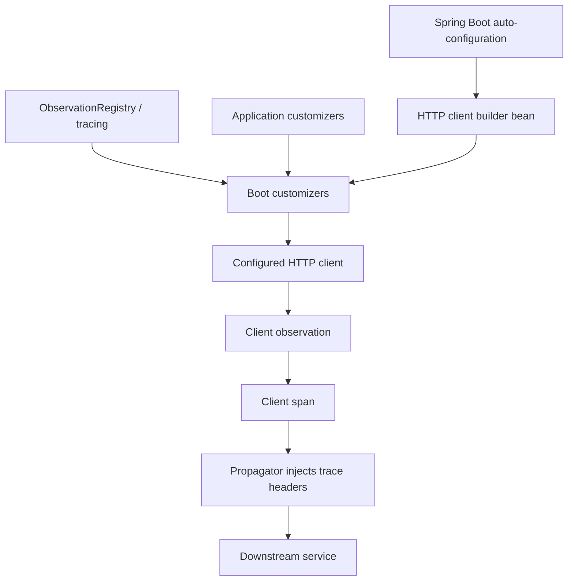
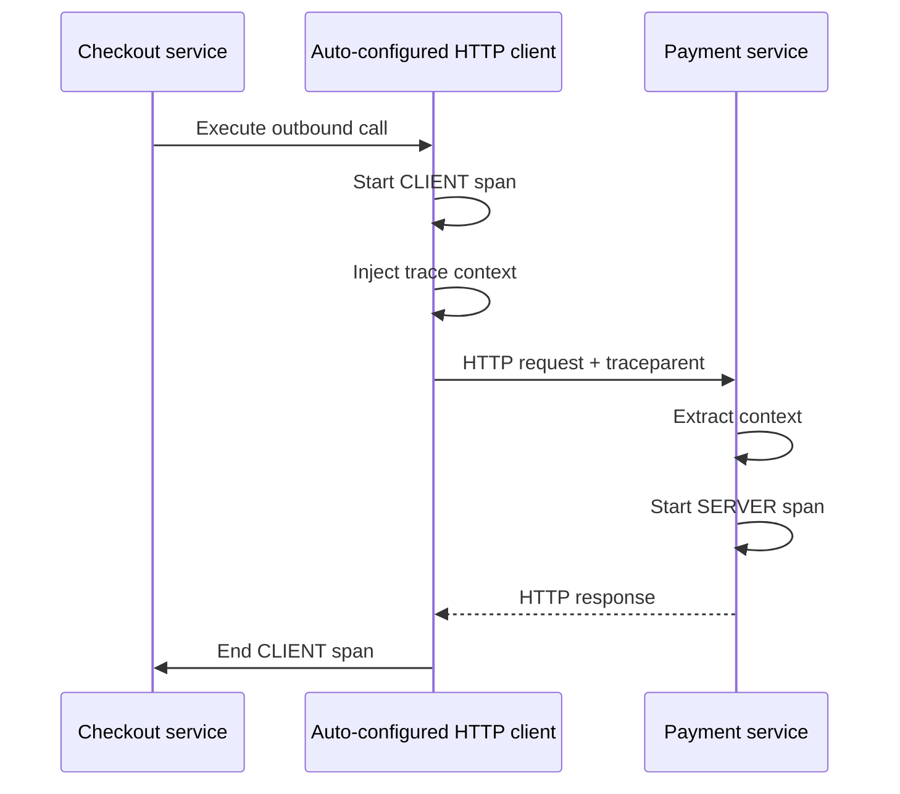

# Preserving propagation with auto-configured builders

A request enters `checkout-service` with trace context, and the application then calls `payment-service` via an HTTP client. For the trace to represent both services, the client must create a client span and pass trace context in outbound headers. In Spring Boot, auto-configured HTTP client builders can receive customizers registered by the framework and the application, including observation, tracing propagation, codecs, connectors, and shared settings. If the application creates a standalone client or accidentally replaces configured components, outbound requests may lose client spans or fail to inject trace headers.

**Preserving propagation with auto-configured builders** means building HTTP clients from Spring Boot-managed builders to retain the observability integrations already configured in the application context. The builder serves as the extension point for the application to add base URLs, timeouts, or authentication while keeping the observation registry, tracing customizers, and required framework configuration intact.

This is not a guarantee that every client automatically gets tracing. You need the right Spring Boot/Spring Framework version, the right builder bean, the right client connector, and a tracing implementation. After configuration, verify the client span, outbound propagation header, and downstream server span.

This lesson belongs to the **HTTP client observability** chapter of the **SPRING_BOOT_OBSERVABILITY** module. The module teaches setting up observability for Spring Boot using Micrometer Observation, metrics, logs, and distributed tracing; learning context propagation, tags/cardinality, exporters, sampling, and signal correlation to investigate errors, latency, and application behavior in production environments. This lesson focuses on using auto-configured builders to preserve observation integrations and trace context across outbound HTTP calls.

## Learning Objectives

After this lesson, you can:

1. Explain the role of auto-configured HTTP client builders in Spring Boot.
2. Distinguish a Spring Boot-managed builder from an independently instantiated client.
3. Understand how `ObservationRegistry`, tracing bridges, and client instrumentation attach to the client.
4. Configure `RestClient` and `WebClient` from injected builders.
5. Recognize how customizers, request factories/connectors, and configuration order affect propagation.
6. Avoid accidentally replacing interceptors/filters or observation support.
7. Verify trace ID, span ID, outbound headers, and downstream parent relationships.
8. Handle propagation across async/reactive boundaries.
9. Test success, errors, timeouts, and client configuration.
10. Diagnose when outbound requests lack client spans or trace context.

## 1. Why Do Builders Affect Observability?

An HTTP client is not just an object that sends requests. It is also where the framework attaches cross-cutting components across the request lifecycle:

- Observation instrumentation starts/stops client observations.
- Tracing handler creates client spans.
- Propagator injects trace context into outbound headers.
- Interceptors/filters apply authentication, correlation, or policies.
- Connector/request factory performs I/O.
- Timeout, redirect, and retry configurations govern call behavior.

Spring Boot can provide pre-configured builders with customizers applied in the application context. When the application injects this builder and configures it further, the attached components continue working.



### 1.1. Builder and client instance differ

The builder is the configuration object used to create a client. The client instance is the object used to execute requests. When a builder has received customizers, creating a client from that builder preserves the applied configurations. Calling another client constructor directly does not automatically inherit configurations from the Spring application context.

### 1.2. Auto-configured does not mean everything is automatic

The application still needs appropriate dependencies and configuration. For example, client spans only appear if observation/tracing integration is active; trace context is exported only if the sampler retains the trace and the exporter pipeline succeeds. The builder wires the client into existing configuration; it does not replace the SDK, bridge, or exporter.

## 2. Components That Must Be Preserved

| Component | Role | Symptom When Lost |
|---|---|---|
| `ObservationRegistry` | Receives and orchestrates observations | No client observations/metrics |
| Observation handlers | Convert observations into metrics/tracing | Only one signal or no spans |
| Tracing bridge | Connects Micrometer Tracing with Brave/OTel | No client spans created |
| Propagator | Injects/extracts trace context | Downstream starts a new trace |
| Client interceptor/filter | Adds headers or processes requests | Missing policy/correlation headers |
| Request factory/connector | Performs network I/O | Timeout/TLS behavior differs from config |
| Boot customizers | Applies framework/app configuration | Client inconsistent with other clients |

Not every interceptor is a tracing interceptor. Observation may be attached at the client infrastructure layer while the propagator runs within tracing instrumentation. Whenever replacing a component, verify the entire chain.

## 3. Using Auto-Configured RestClient.Builder

In Spring Boot versions providing a `RestClient.Builder` bean, inject the builder instead of creating a standalone client builder. Example:

```java
@Configuration
class PaymentClientConfiguration {

    @Bean
    RestClient paymentRestClient(RestClient.Builder builder) {
        return builder
                .baseUrl("https://payment.internal")
                .build();
    }
}
```

The injected builder may already have been configured by Boot customizers for observation and other features. The application simply adds the base URL and builds the client.

### 3.1. Injecting the builder into service configuration

Centralize client configuration per dependency so base URLs, timeouts, authentication, and metrics/tracing can be managed consistently.

```java
@Configuration
class RemoteClientsConfiguration {

    @Bean
    RestClient inventoryRestClient(RestClient.Builder builder) {
        return builder
                .baseUrl("https://inventory.internal")
                .build();
    }

    @Bean
    RestClient paymentRestClient(RestClient.Builder builder) {
        return builder
                .baseUrl("https://payment.internal")
                .build();
    }
}
```

Depending on how Spring Boot creates the builder bean and its scope, check whether multiple injections produce separate builders or share the same bean. Do not mutate a shared builder after creating clients in multiple places. If independent configurations are needed, use a builder clone/copy mechanism supported by your version or a clearly scoped customizer.

### 3.2. Do not create a new builder manually

Example requiring caution:

```java
RestClient client = RestClient.builder()
        .baseUrl("https://payment.internal")
        .build();
```

This snippet creates a builder directly from the API. It does not automatically receive the Boot customizers applied to the auto-configured bean. If you want to use a builder directly, the application must configure observation/tracing and other components completely on its own; normally, inject the Boot-provided builder.

### 3.3. Avoid configuration that drops customizers

Do not replace the entire request factory after Boot has configured the builder without understanding which customizers depend on the factory. When needing a custom connector, configure it via the builder/customizer at the proper extension point and verify observation remains attached.

## 4. Using Auto-Configured WebClient.Builder

`WebClient` is a reactive client. In Spring Boot versions providing a `WebClient.Builder` bean, inject the builder:

```java
@Configuration
class PaymentWebClientConfiguration {

    @Bean
    WebClient paymentWebClient(WebClient.Builder builder) {
        return builder
                .baseUrl("https://payment.internal")
                .build();
    }
}
```

The builder can receive Boot's codec configuration, connector, observation, and tracing customizers. Requests only actually execute when the publisher is subscribed to; client observation/span lifecycles follow reactive execution.

### 4.1. Do not instantiate a new WebClient.Builder

```java
WebClient client = WebClient.builder()
        .baseUrl("https://payment.internal")
        .build();
```

A directly created builder does not automatically inherit Boot customizers. If using this approach, you must manually attach a compatible observation registry, filters, connector, and tracing propagation. Prefer the injected builder to preserve shared configuration.

### 4.2. Builder and reactive context

`WebClient` instrumentation must bind the current observation/trace context to the subscription and outbound exchange. Do not check only that the client object was created; execute a real request inside an active server span and confirm downstream receives the same trace ID.

## 5. RestTemplate and Legacy Clients

`RestTemplate` is the traditional synchronous API. Spring Boot can provide a builder/customization matching the version; wiring differs from `RestClient.Builder` and `WebClient.Builder`.

When using `RestTemplate`:

1. Use the Boot-provided builder if available in your version.
2. Verify the request factory is configured properly.
3. Check that the observation registry and client instrumentation are applied.
4. Avoid replacing the interceptors list with a new list that drops existing interceptors.
5. Check outbound trace headers and downstream spans.

A `RestTemplate` created via its direct constructor does not automatically receive Boot customizers. For other client libraries such as Apache HttpClient, OkHttp, or Java HttpClient, a corresponding integration/agent is needed; do not assume Spring builders can instrument every library.

## 6. Customizers and Configuration Order

Spring Boot allows customizers to modify builders. A customizer can configure base URLs, default headers, connectors, timeouts, or observation support. Application order and exact APIs depend on the version and builder type.

### 6.1. Adding configuration without replacing existing configuration

Example customizer that only adds a default header:

```java
@Bean
RestClientCustomizer paymentHeadersCustomizer() {
    return builder -> builder
            .defaultHeader("X-Client-Application", "checkout");
}
```

This example follows Spring Boot versions with `RestClientCustomizer`. The header is client metadata; do not use this approach to construct `traceparent` manually when tracing integration already handles propagation.

### 6.2. Be careful with interceptor/filter replacement

Some APIs use lists of interceptors or filters. If a customizer calls a setter with a new list, it may replace the entire previously configured list. This can strip instrumentation, authentication, or correlation logic.

When adding an interceptor, prefer append/add APIs or chain composition per your version. After changes, test both old and new interceptors as well as trace propagation.

### 6.3. Customizer ordering

If one customizer replaces the connector after another customizer configured observation, results may differ from expectations. Avoid relying on unguaranteed ordering. Centralize client configuration in one place or use extension points with explicit contracts. Verify the resulting builder with a test request.

## 7. ObservationRegistry and Tracing Integration

Micrometer `ObservationRegistry` is the hub receiving observations. HTTP client integration needs to use the registry configured by Spring Boot with the corresponding handlers.

A self-created registry without handlers can create observations without exporting metrics or spans. Similarly, a client builder that does not receive observation support will not emit client observations.

### 7.1. Metrics and tracing are separate handlers

A client observation can be processed by both a metrics handler and a tracing handler. If metrics appear while traces do not, check the tracing bridge/handler/exporter. If traces appear while metrics do not, check the meter registry/filters. Do not use the presence of one signal to conclude the other is working.

### 7.2. Brave and OpenTelemetry

Micrometer Tracing can connect to a Brave or OpenTelemetry bridge depending on architecture. Choose the implementation matching your dependency tree. Do not add both bridges simultaneously and expect them to sync automatically. Check the active tracer, propagator, and exporter in use.

## 8. Trace Propagation Across Outbound HTTP

When a current span exists, client instrumentation creates a client span and injects context according to the configured propagator, usually W3C Trace Context or B3.



Expectations:

- The client span belongs to the active trace in `checkout-service`.
- The outbound header carries valid trace context.
- Payment service extracts the same Trace ID.
- The downstream server span has the appropriate parent relationship.
- The client span ends when the outbound operation completes.

Do not set `traceparent` manually in business code. Manual headers can overwrite real context or break trace relationships.

### 8.1. Propagator and trust boundaries

If inbound requests come from the Internet, deciding whether to trust parent context/sampling flags must follow trust policies. Auto-configured builders only inject current context; inbound context policies are handled at server instrumentation/propagator/sampler layers.

### 8.2. Exporting is a separate step

A created client span does not mean the backend has stored it. Sampling may drop the trace; the exporter or Collector may fail. Check the current span, outbound header, collector ingestion, and backend query separately.

## 9. Timeout, Connector, and TLS Configuration

Customizing the connector is a common requirement, but you must ensure observation instrumentation continues to function.

Settings typically needing management:

- Connect timeout.
- Response/read timeout.
- Connection pool.
- TLS trust material/client certificates.
- Proxy and DNS.
- Redirect behavior.
- Retry policy.

For example, configuring a new connector may replace a connector already attached by a Boot customizer. Do not test only that requests succeed; verify metrics/spans still appear after swapping the connector.

### 9.1. Authentication and headers

Default client headers can be added via the builder. Secrets should come from a secret manager/secure configuration, not hard-coded in source. Do not add trace IDs or `traceparent` into default headers; tracing integration must generate fresh values per operation.

### 9.2. Retries and client spans

Retries can create one span for the logical call or spans for each attempt depending on where instrumentation sits. When changing connectors/retry filters, verify span counts and durations do not shift unexpectedly. Clearly define attempt-level vs. operation-level metrics.

## 10. Testing Propagation End-to-End

The most important test is not whether the builder exists, but whether requests created from that builder preserve context.

An integration test should:

1. Boot the Spring Boot application with a tracing implementation.
2. Create an inbound request with a known trace context or create a root span in the test.
3. Call an endpoint using the auto-configured `RestClient`/`WebClient`.
4. Use a mock server/downstream service to capture outbound headers.
5. Confirm the `traceparent`/B3 header per the propagator.
6. Confirm the client span is created in the same trace.
7. Confirm the downstream server span extracts the same Trace ID.
8. Verify client observation metrics are recorded.
9. Test timeouts/5xx and confirm spans finish properly.
10. Verify there are no duplicate spans from agent and framework instrumentation both being active.

### 10.1. Testing with an in-memory exporter

In unit/integration tests, use a test span exporter or in-memory tracing implementation matching your stack to assert span names, kinds, trace IDs, and parent relationships. A production backend is not required to verify instrumentation at the application boundary.

### 10.2. Testing with a mock HTTP server

A mock server can record received headers. Assert that the trace context header was injected, rather than attaching a static value yourself in the test client. If also testing downstream extraction, run a test Spring Boot server with corresponding instrumentation.

### 10.3. Testing WebClient subscriptions

Creating a `Mono` does not mean sending a request. Tests must subscribe/block or use `WebTestClient`/reactive test utilities to trigger the pipeline, then await the terminal signal and assert that the span has ended. Avoid asserting immediately after merely creating the publisher.

## 11. Diagnosing Lost Propagation

| Symptom | Possible Cause | How to Check |
|---|---|---|
| No client span | Client created outside auto-configured builder or missing instrumentation | Check bean, registry, bridge |
| Metrics exist but no trace | Tracing handler/bridge inactive | Tracer, handler, and exporter |
| Client span exists but missing `traceparent` | Propagator or client instrumentation replaced | Inspect outbound headers |
| Downstream starts a new trace ID | Header dropped or not extracted | Proxy, propagator, and server instrumentation |
| One client has traces, another does not | Inconsistent builders/customizers | Compare bean creation paths |
| Propagation lost after changing connector | Connector replacement dropped integration | Check request factory/connector and customizers |
| Lost after adding an interceptor | Interceptor list replaced | Check ordering and chain |
| `WebClient` has no span | Publisher not subscribed or context lost | Subscription/reactive context |
| Span does not end | Pending/cancel/timeout request lifecycle | Terminal signals and client timeouts |
| Duplicate client spans | Java Agent and framework instrumentation both active | Choose instrumentation owner |
| Trace exists but missing in backend | Sampling/export/Collector/storage | Check pipeline after span ends |

### Investigation workflow

1. Identify the Spring Boot and Spring Framework versions.
2. Confirm which builder creates the client bean.
3. Check `ObservationRegistry` and the active tracing bridge.
4. Compare builders/customizers/interceptors/connectors before and after changes.
5. Capture outbound headers at a mock server.
6. Inspect the client span in a test exporter.
7. Inspect downstream Trace ID and parent relationships.
8. Check retries/timeouts/redirects and reactive subscriptions.
9. If spans exist locally but are missing in the backend, check sampler/exporter/Collector.
10. Verify no raw URLs, tokens, or sensitive data appear in telemetry.

## 12. Anti-patterns to Avoid

| Anti-pattern | Consequence | Appropriate Approach |
|---|---|---|
| Creating a standalone builder and expecting Boot customizers | Missing observation/tracing | Inject auto-configured builder |
| Creating an empty `ObservationRegistry` | Observations never reach handlers | Use Boot-managed registry |
| Replacing the entire interceptors/filters list | Loses tracing/auth/correlation | Append/compose via API |
| Swapping connectors without testing | Loses instrumentation or timeout behavior | Test requests after changes |
| Setting default `traceparent` manually | Wrong context or duplicated across requests | Let propagator inject |
| Sharing a mutable builder carelessly | Client config becomes order-dependent | Centralize config/clone per API |
| Assuming every HTTP client is instrumented | Missing spans/metrics in other libraries | Use matching integration/agent |
| Asserting only that builder bean exists | Does not prove propagation | Test outbound headers and downstream |
| Creating a `WebClient` publisher without subscribing | No request/span | Trigger reactive pipeline in tests |
| Assuming a client span means backend stored it | Ignores sampling/export | Check collector/backend |
| Enabling overlapping agent and framework instrumentation | Duplicate spans | Choose an instrumentation owner |
| Putting tokens in default headers then logging all headers | Secret leak | Allowlist/redaction |

## 13. Production Checklist

1. **Builder:** Is the client built from a Spring Boot-managed builder?
2. **Version:** Are Boot/Framework/Micrometer APIs compatible?
3. **Registry:** Is the right `ObservationRegistry` attached to the client?
4. **Handlers:** Are both metrics and tracing handlers active?
5. **Bridge:** Is there one clear primary tracing implementation?
6. **Customizers:** Do customizers avoid replacing required configuration?
7. **Interceptors:** Does the filter/interceptor chain preserve existing entries?
8. **Connector:** Does the request factory/connector support observation?
9. **Propagation:** Do outbound headers and downstream extraction work?
10. **Async:** Are `WebClient` subscriptions and reactive context right?
11. **Timeout/retry:** Are semantics and span lifecycles verified?
12. **Security:** Are secrets kept out of headers/logs/attributes per policy?
13. **Cardinality:** Are URI/host dimensions normalized?
14. **Testing:** Are mock servers, test exporters, and downstream integration tests in place?
15. **Export:** Are sampling, OTLP exporter, Collector, and backend verified independently?
16. **Operations:** Can client latency, error rates, span drops, and dependency identities be monitored?

## 14. Self-Assessment Questions

**Question 1.** Why does an auto-configured builder help preserve propagation?

**Hint:** The builder is configured by Spring Boot customizers to attach observation/tracing and required client components. Creating clients from that builder retains the applied configuration.

**Question 2.** How does calling `RestClient.builder()` directly differ from injecting `RestClient.Builder`?

**Hint:** A directly created builder does not automatically receive Boot customizers in the application context; an injected builder can be auto-configured.

**Question 3.** What role does `ObservationRegistry` play?

**Hint:** It receives observations and passes them through handlers to produce metrics/tracing or other integrations.

**Question 4.** Why should you not add `traceparent` manually to default headers?

**Hint:** Trace context changes per operation; the propagator must inject the active context and manage flags/state.

**Question 5.** What problems can replacing the request factory cause?

**Hint:** It can drop customizers or instrumentation attached to the client; verify observations/spans after changes.

**Question 6.** What should you check if client metrics exist but client spans do not?

**Hint:** Tracing handler, bridge, tracer, and exporter; an active metrics handler does not prove the tracing handler is active.

**Question 7.** Why does `WebClient` require subscribing in tests?

**Hint:** Reactive publishers are lazy; requests and client observations usually only execute when subscription is triggered.

**Question 8.** How do you prove downstream receives the same trace?

**Hint:** Capture outbound propagation headers and inspect the downstream server span for the same Trace ID and proper parent relationship.

**Question 9.** Does a client span prove the trace was stored?

**Hint:** No. Sampling, exporter, Collector, or backend may drop/fail.

**Question 10.** When adding a new interceptor, what must be verified?

**Hint:** Previous interceptors remain present, chain ordering is correct, headers are injected, and client observations/spans are still created.

## Conclusion

**Using an auto-configured HTTP client builder helps Spring Boot preserve the customizers and observability integrations configured for outbound requests.** Inject `RestClient.Builder` or `WebClient.Builder` provided by the application context, add dependency configuration through appropriate extension points, and avoid inadvertently replacing interceptors, connectors, or registries. Propagation is only confirmed when client spans, outbound trace headers, and downstream server spans all reflect the right trace context. Finally, test reactive subscriptions, timeouts, retries, and failure paths; verify sampling/export separately to distinguish instrumentation errors from telemetry transport failures.
