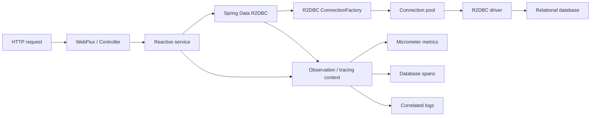
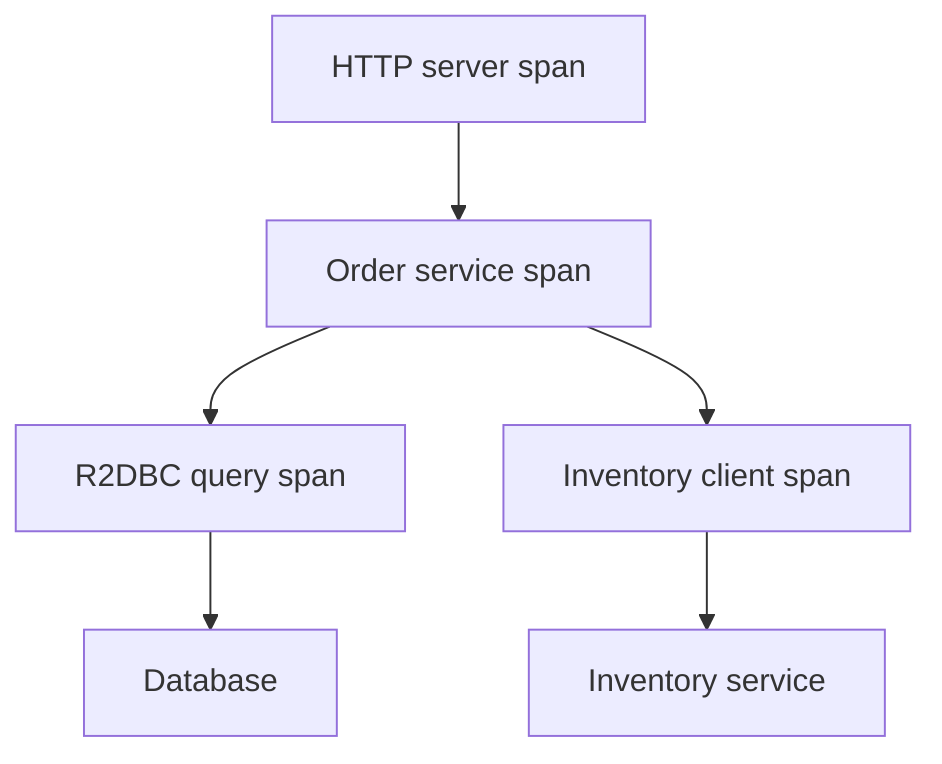

# R2DBC observability in Spring Boot

**R2DBC observability** is the practice of measuring and monitoring reactive database access in Spring Boot. With Spring Data R2DBC and a compatible driver, applications perform non-blocking database I/O using reactive streams. Observability helps determine whether the connection pool is exhausted, how long database operations take, which queries fail most often, and whether wait time occurs in the application, pool, or database.

Within the **SPRING_BOOT_OBSERVABILITY** module, R2DBC observability connects database access to Micrometer Observation, metrics, logs, and distributed tracing. This lesson belongs to the **Database observability** chapter and focuses on R2DBC instrumentation, differences from JDBC, connection pool metrics, query spans, Reactor Context, transaction lifecycle, cardinality/PII controls, testing, and troubleshooting.

## 1. What is R2DBC and why does it need observability?

R2DBC (Reactive Relational Database Connectivity) is a reactive streams API for accessing relational databases. Instead of the synchronous JDBC model, R2DBC lets database operations return publishers such as `Mono` and `Flux`, allowing applications to compose I/O operations in reactive pipelines.

R2DBC observability helps answer:
- Does the connection pool have enough connections, or are requests waiting?
- How long do queries/statements take?
- Are database operations failing due to timeouts, constraints, or connectivity?
- Are transactions committing/rolling back properly?
- Are database spans linked to HTTP server spans?
- Does rising database load correlate with application request rate/latency?

Not every database driver or API provides the same level of instrumentation. Verify the R2DBC driver, Spring Data R2DBC, connection pool, and Micrometer integration for your exact versions.

### 1.1. Differences between R2DBC and JDBC

| Criterion | R2DBC | JDBC |
| --- | --- | --- |
| Execution model | Reactive, non-blocking when supported by driver | Blocking API |
| Result | Publishers such as `Mono`/`Flux` | `ResultSet`/return value |
| Context | Reactor Context and context propagation | Typically based on thread/request scope |
| Connection usage | Reactive connection lifecycle | Connection held across blocking operation |
| Instrumentation | Reactive-aware observation | JDBC instrumentation/datasource metrics |
| Best suited for | Reactive applications | Imperative applications |

R2DBC does not automatically make queries faster. It helps manage I/O in a non-blocking manner; performance still depends on query plans, indexes, database capacity, pool sizing, and how the application uses publishers.

## 2. R2DBC architecture in Spring Boot

A request can flow through a WebFlux controller, reactive service, Spring Data R2DBC repository, R2DBC driver, and database server.



Instrumentation can appear at multiple layers: repository/`DatabaseClient`, driver, pool, and application service. Avoid measuring the exact same operation redundantly across every layer without distinguishing their meaning.

### 2.1. Core dependencies

Example dependencies for Spring Boot WebFlux and Spring Data R2DBC:

```xml
<dependencies>
    <dependency>
        <groupId>org.springframework.boot</groupId>
        <artifactId>spring-boot-starter-webflux</artifactId>
    </dependency>
    <dependency>
        <groupId>org.springframework.boot</groupId>
        <artifactId>spring-boot-starter-data-r2dbc</artifactId>
    </dependency>
    <dependency>
        <groupId>org.springframework.boot</groupId>
        <artifactId>spring-boot-starter-actuator</artifactId>
    </dependency>
</dependencies>
```

Add the corresponding R2DBC driver, such as PostgreSQL or MariaDB, and a connection pool if your architecture requires pooling. Use the Spring Boot BOM to manage compatible versions.

### 2.2. Auto-configuration and exporters

Having the Actuator dependency does not mean query spans are automatically sent to a tracing backend. You need to verify:
- Are Micrometer Observation handlers configured?
- Does the R2DBC instrumentation in your version emit observations?
- Which `MeterRegistry` receives metrics?
- Which Micrometer Tracing bridge and span exporter are configured?
- Does the connection pool expose metrics yet?

A metrics pipeline can work while tracing is not yet enabled, and vice versa.

## 3. R2DBC Observation and Micrometer

Micrometer Observation provides an abstraction to describe an operation. When R2DBC-capable integration is enabled, database operations can be instrumented to record metrics and/or spans via handlers.

An observation can wrap:
- Statement creation or execution.
- Query completion duration.
- Success or error outcome.
- Database system/operation metadata defined by conventions.

Exact observation names, tag keys, and instrumentation mechanisms depend on Spring Boot, Spring Framework, Spring Data R2DBC, and Micrometer versions. Do not assume every version creates spans for individual SQL statements automatically.

### 3.1. Observation is not a query logger

Observation primarily provides structured metadata and timing. It does not require writing raw SQL or full bind parameters to logs. Query text and parameters must be controlled because they can contain sensitive data.

### 3.2. Metrics and spans have different scopes

| Signal | Scope | Purpose |
| --- | --- | --- |
| Pool metrics | Connection pool | Capacity, acquired/idle/pending |
| Query metrics | Database operations | Count, duration, errors |
| Database span | One operation within a trace | Investigating request latency |
| Application logs | Specific events/errors | Understanding exceptions and business context |

Do not use trace sampling as a substitute for pool metrics. Pool metrics usually require continuous monitoring to catch saturation.

## 4. Connection pool observability

The R2DBC connection pool manages allocation and reuse of connections. If the pool saturates, requests can wait for a connection even when actual database queries are fast.

Useful metrics depend on pool implementation/version:

| Metric concept | Meaning |
| --- | --- |
| Allocated | Total connections allocated in the pool |
| Acquired | Connections currently used by the application |
| Idle | Connections ready to be acquired |
| Pending | Requests waiting for a connection |
| Max allocated | Connection pool limit |
| Acquire time | Time spent waiting to acquire a connection if instrumented |
| Creation/validation errors | Errors creating or validating connections |

Exact metric names and tags depend on the R2DBC pool/Micrometer integration. Do not copy metric names from another version without inspecting the registry.

### 4.1. Why pending connections matter

If pending rises while acquired is near max, the application may be experiencing pool saturation. Repository-level query latency can include connection wait time; separate acquire time from execution time when instrumentation provides both.

Possible causes:
- Pool max size is too small for concurrency.
- Connections are held too long.
- Broad transaction scopes.
- Slow or capacity-exhausted database.
- Reactive chains not subscribed or cancelled properly.
- Connection leaks from custom code failing to release resources properly.

Immediately increasing max pool size is not always beneficial. Databases have connection limits; opening too many connections can overload the database.

### 4.2. Pool configuration

Configuring the R2DBC pool via URL or properties depends on the driver and Boot version. Verify property prefixes and the active pool implementation before applying changes.

Do not mix HikariCP/JDBC settings with an R2DBC pool. HikariCP is a popular pool for JDBC; R2DBC uses its own reactive connection factory/pool.

## 5. Query spans and trace correlation

When tracing integration instruments database operations, spans can sit beneath the active HTTP server span or application span. This shows how much of total request latency is spent in the database.



Span names and database semantic attributes depend on instrumentation/version. Spans can describe operations like SELECT/INSERT and the database system, without necessarily including verbatim SQL.

### 5.1. Propagating context in reactive pipelines

R2DBC operations normally run in Reactor chains. Trace context must follow the subscription across repository and service boundaries. Reactor Context and Micrometer Context Propagation help preserve context across scheduler switches.

Do not rely on `ThreadLocal` as if a request always stays on one thread. If custom code hands off to an executor or callback API outside Reactor, bridge the context appropriately.

### 5.2. Parent/child relationships

A database span is typically a child of the active span when the query is invoked. If context is lost, the database span can become a root span or detach from the trace. When investigating, check Trace ID and parent span ID rather than relying only on close timestamps.

## 6. Spring Data R2DBC and DatabaseClient

Spring Data R2DBC provides reactive repositories; `DatabaseClient` allows executing SQL directly. Both use R2DBC infrastructure, though actual observation/instrumentation depends on integration.

Repository example:

```java
@Table("orders")
public class Order {
    @Id
    private Long id;
    private String status;

    // getters/setters omitted
}

public interface OrderRepository
        extends ReactiveCrudRepository<Order, Long> {
}
```

Service example:

```java
@Service
class OrderQueryService {

    private final OrderRepository repository;

    OrderQueryService(OrderRepository repository) {
        this.repository = repository;
    }

    Mono<Order> findOrder(Long id) {
        return repository.findById(id);
    }
}
```

A method returning `Mono` does not mean the query has finished. Queries typically execute when the publisher is subscribed to. Do not measure timing only around calling `findById` if you want database operation latency.

### 6.1. DatabaseClient

Query example with `DatabaseClient`:

```java
@Repository
class OrderLookup {

    private final DatabaseClient databaseClient;

    OrderLookup(DatabaseClient databaseClient) {
        this.databaseClient = databaseClient;
    }

    Mono<String> findStatus(Long id) {
        return databaseClient.sql(
                "SELECT status FROM orders WHERE id = :id")
                .bind("id", id)
                .map((row, metadata) -> row.get("status", String.class))
                .one();
    }
}
```

This example uses bind parameters instead of SQL string concatenation. Do not log bind values or customer/order data into span or metric tags.

## 7. Transaction observability

Reactive transactions are typically managed using `TransactionalOperator` or annotation integration compatible with a reactive transaction manager. Transaction context flows through Reactor Context rather than assuming thread-bound transactions like imperative JDBC.

Example:

```java
@Service
class TransferService {

    private final DatabaseClient databaseClient;
    private final TransactionalOperator tx;

    TransferService(DatabaseClient databaseClient,
                    TransactionalOperator tx) {
        this.databaseClient = databaseClient;
        this.tx = tx;
    }

    Mono<Void> transfer(long fromId, long toId, BigDecimal amount) {
        return debit(fromId, amount)
                .then(credit(toId, amount))
                .as(tx::transactional);
    }
}
```

This is a structural example; `debit`/`credit` must validate balances, concurrency, and business invariants. `TransactionalOperator` manages the reactive transaction lifecycle according to the configured transaction manager.

### 7.1. Transaction duration

Overly long transactions can hold connections and locks for extended periods, driving up pool pending counts. Monitor transaction/operation durations, commit/rollback errors, and database lock waits if provided by the backend.

Do not use transaction IDs or account IDs as metric tags if they create high cardinality or expose sensitive data.

### 7.2. Rollbacks and exceptions

A reactive chain can emit an error triggering rollback; if an error is converted to a normal result via `onErrorResume` before the transaction boundary, semantics can change. Verify transaction boundaries and actual terminal signals, and avoid swallowing exceptions before the transaction manager sees errors that require rollback.

## 8. Query duration, timeouts, and error classification

Database operations can fail due to:
- Connection acquisition timeouts.
- Network/connect timeouts.
- Query execution timeouts.
- Deadlocks or lock timeouts.
- Constraint violations.
- Authentication/permission failures.
- Database unavailability or failover.

Distinguish error groups:
- Pool acquisition: capacity or connection lifecycle.
- Driver/network: connectivity, DNS, TLS.
- Database execution: query plans, locks, CPU/IO, database capacity.
- Application: malformed queries, mapping errors, transaction boundaries.

Do not fold every exception into a tag containing the exception message. Messages can include SQL, values, or sensitive data and create massive cardinality. Use stable error categories such as `timeout`, `constraint`, `connectivity`, or `unknown` where conventions allow.

## 9. Cardinality and semantic attributes

Database telemetry needs useful metadata without generating millions of tag combinations.

| Attribute/dimension | Recommendation |
| --- | --- |
| `db.system` | Low cardinality, useful |
| `db.operation.name` | Normalized operation like SELECT/INSERT |
| `db.namespace` | Logical database/schema, requires control |
| Query summary/name | Template or normalized query name |
| Raw SQL | Do not put in metric tags; evaluate for traces too |
| Bind parameters | Do not export if containing sensitive data |
| Connection ID | Do not use as metric tag |
| Customer/account ID | Do not use as metric tag |
| Exception class/category | Normalize into a bounded set if needed |

OpenTelemetry database semantic conventions evolve over time; old/new key names may differ by instrumentation version. Follow the appropriate convention/schema and avoid inventing lookalike keys with different meanings.

### 9.1. Query normalization

When distinguishing query shapes, use a stable query name/template instead of raw SQL with literal values.

```text
SELECT status FROM orders WHERE id = ?
```

instead of:

```text
SELECT status FROM orders WHERE id = 982734
```

Templates help group executions of the same query shape. Never put raw query strings into metric labels.

## 10. Actuator and inspecting database metrics

Actuator can expose the metrics endpoint in a lab environment:

```yaml
management:
  endpoints:
    web:
      exposure:
        include:
          - health
          - metrics
```

List metrics:

```http
GET /actuator/metrics
```

Inspect a specific metric after confirming its actual name:

```http
GET /actuator/metrics/r2dbc.pool.acquired
```

The name `r2dbc.pool.acquired` is an illustrative example; metric names depend on pool implementation/version. First read the exposed metric list, then inspect existing meters.

The Actuator endpoint lets you inspect in-process measurements. Prometheus/OTLP exporters and backends provide retention, dashboards, alerts, and historical analysis. Protect management endpoints in shared/production environments.

## 11. Combining database spans with logs

When trace context is propagated, log events within a request can include Trace ID/Span ID to locate the exact trace. Database errors should be logged with an appropriate operation category, transaction outcome, and error class.

Do not log:
- Passwords or connection strings containing credentials.
- Raw SQL bind parameters containing PII.
- Authorization tokens/cookies.
- Full customer/account records.
- Raw exception messages if they embed sensitive queries or values.

Prefer allowlisted structured fields, such as `db.operation`, `error.type`, `service.name`, and Trace ID. Keep metric tags low-cardinality; trace/log fields can be more detailed but still require privacy review.

## 12. Testing R2DBC observability

Testing should verify both query behavior and telemetry. You can use Testcontainers with a matching database and R2DBC driver, or a dedicated test database for integration tests.

### 12.1. Testing a reactive repository

Example using `StepVerifier`:

```java
@Test
void loadsOrder() {
    Mono<Order> result = repository.findById(1L);

    StepVerifier.create(result)
            .expectNextMatches(order -> order.getId().equals(1L))
            .verifyComplete();
}
```

This test checks publisher results, not that the observation/export pipeline works. To test telemetry, inspect `MeterRegistry`, observation handlers, or an in-memory span exporter.

### 12.2. Checking metrics

After subscribing and completing the query, verify:
- Query/request counters or timers increment.
- Duration is recorded.
- Tags contain no raw IDs.
- Pool acquired/idle/pending reflect expected states.

Exact metric names depend on the integration.

### 12.3. Checking tracing

Use an in-memory/test exporter or lab Collector to verify:
- A database span is created when instrumentation supports it.
- The span belongs to the right Trace ID.
- The parent span is the expected server/application span.
- Error status/attributes reflect operation failures.
- Raw SQL/bind parameters are not exported outside policy.

## 13. Troubleshooting R2DBC observability

| Symptom | Possible cause | How to check |
| --- | --- | --- |
| No database metrics | Missing registry/pool instrumentation or meters not yet created | Check dependencies and `MeterRegistry` |
| No database spans | Missing tracing bridge or R2DBC observation integration | Check versions/instrumentation |
| Pool pending increasing | Pool saturation, connections held too long, or slow DB | Compare acquired/idle/max and query latency |
| Acquire timeout | Pool exhausted or database cannot create new connections | Inspect pool metrics and driver logs |
| High query span duration | Slow query, lock wait, or acquire time included in span | Cross-check database monitoring and pool metrics |
| Trace ID lost | Reactor Context propagation failure | Inspect context across scheduler boundaries |
| Transaction does not roll back | Error swallowed or wrong transaction boundary | Check terminal signals and `TransactionalOperator` |
| High metric cardinality | Queries/raw IDs used as tags | Normalize operation/query names |
| SQL/PII appears in traces | Instrumentation captures statements/parameters | Redact/filter at source |
| Queries counted twice | Custom instrumentation duplicates default integration | Inspect Observation handlers |
| Connections not released | Broken publisher/custom code lifecycle | Inspect cancel/dispose and resource cleanup |
| Meter missing on Actuator | Endpoint not exposed or wrong metric name | List `/actuator/metrics` |
| Metrics not reaching backend | Exporter/Collector pipeline error | Test metrics export separately |
| Query errors unclassified | Missing exception mapping or handler | Inspect error type/status conventions |

### Investigation workflow

1. Confirm the application actually uses R2DBC, not a JDBC fallback.
2. Identify the driver and connection pool implementation/version.
3. Inspect `MeterRegistry` and the meter list after running a query.
4. Check pool acquired/idle/pending/max before concluding the database is slow.
5. If traces are needed, verify compatible Micrometer Tracing bridge and R2DBC instrumentation.
6. Send a request with trace context and inspect parent-child spans.
7. Check transaction boundaries, errors, and cancellations.
8. Cross-check query latency with database-side metrics, slow queries, and lock waits.
9. Audit raw SQL, bind values, IDs, and cardinality.
10. Check exporter/Collector/backend separately for metrics and traces.

## 14. Hands-on exercise: observing an R2DBC query

The goal is to run a reactive Spring Boot application, query the database, and verify pool metrics, query observations, and trace correlation.

### Preparation

- Spring Boot 3.x with WebFlux and Spring Data R2DBC.
- R2DBC driver and lab database.
- R2DBC connection pool if needed.
- Actuator and `MeterRegistry`.
- Micrometer Tracing bridge/exporter if spans are needed.
- Testcontainers or a resettable lab database.

### Step 1 — Configure R2DBC

Configure the connection URL and credentials via appropriate secrets/environment variables. Do not commit passwords to source control. Confirm the driver matches the database.

### Step 2 — Create a reactive repository

Create an entity and reactive repository. Add a service calling `findById` or a `DatabaseClient` query.

### Step 3 — Create an HTTP endpoint

Create a WebFlux endpoint returning a `Mono` from the service. Do not block with `block()` inside the controller.

### Step 4 — Invoke the query

Send HTTP requests multiple times to generate database activity. Verify expected responses.

### Step 5 — Check pool metrics

List Actuator metrics and locate pool meters exposed by the registry. Inspect acquired/idle/pending/max under lab load.

### Step 6 — Check query timing

Identify database operation metrics/observations supported by your stack version. Compare latency between a fast query and a controlled slow test query.

### Step 7 — Enable tracing

Configure the tracing bridge/exporter and send requests with trace context. Verify database spans appear under server/application spans if supported by instrumentation.

### Step 8 — Test transaction rollback

Create a test transaction where one operation fails. Verify rollback and inspect observation/error logs. Do not use production data.

### Step 9 — Test pool pressure

In the lab, limit pool size and apply controlled concurrency. Observe pending/acquired/acquire latency. Restore pool settings after testing.

### Step 10 — Check privacy/cardinality

Audit metric tags, span attributes, and logs. Confirm there are no raw bind values, credentials, account IDs, or PII.

### Acceptance checklist

| What to prove | Expected outcome |
| --- | --- |
| R2DBC stack | Distinguish R2DBC from JDBC |
| Instrumentation | Identify integration/version producing observations |
| Pool metrics | Monitor acquired/idle/pending/max if supported |
| Query timing | Measure operation latency following reactive lifecycle |
| Tracing | Database spans attach to the right trace if supported |
| Context | Reactor Context preserved across reactive boundaries |
| Transactions | Commit/rollback accurately reflects outcome |
| Cardinality | No raw IDs/SQL literals as metric tags |
| Privacy | No credentials/PII/bind values exported |
| Testing | Distinguish query tests from telemetry tests |
| Export | Verify metrics and trace pipelines separately |
| Diagnosis | Distinguish pool wait, driver/network, and DB execution |

## 15. Principles to remember

1. **R2DBC observability must follow the reactive lifecycle.** A method returning `Mono`/`Flux` does not mean the query has finished.
2. **Distinguish pool wait from database execution time.** Pool pending/acquire latency can be the primary cause of slow requests.
3. **Micrometer Observation, metrics, and tracing are related but distinct layers.** Exporting each signal requires its corresponding registry/bridge/exporter.
4. **Reactor Context propagates trace context across reactive chains.** Do not rely on fixed `ThreadLocal` assumptions as in imperative models.
5. **Reactive transactions bind to Reactor Context.** Verify commit/rollback, error handling, and cancellation at the right boundaries.
6. **Use normalized query/operation names.** Do not put raw SQL, bind parameters, connection IDs, or business IDs into metric tags.
7. **Do not confuse R2DBC pools with HikariCP/JDBC.** Use metrics and configuration matching the actual pool implementation.
8. **Avoid duplicate instrumentation.** Check framework integration before adding custom Timers/spans for the same query.
9. **Protect database data.** Redact credentials, SQL values, and PII before exporting telemetry.
10. **Combine pool metrics with query spans and database-side metrics.** A single duration is insufficient to identify bottlenecks.
11. **Verify end-to-end.** Check queries, observations, registry, exporter, Collector, and backend for each signal.

R2DBC observability helps distinguish connection wait time, query execution time, and errors arising in reactive transactions. When instrumentation follows the publisher lifecycle, context propagates through Reactor, pool metrics are monitored, and query metadata is normalized, operations teams can correlate database activity with HTTP requests while keeping cardinality and sensitive data under control.
