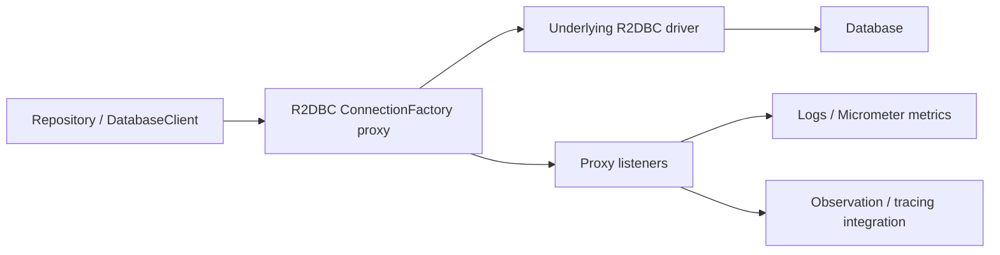
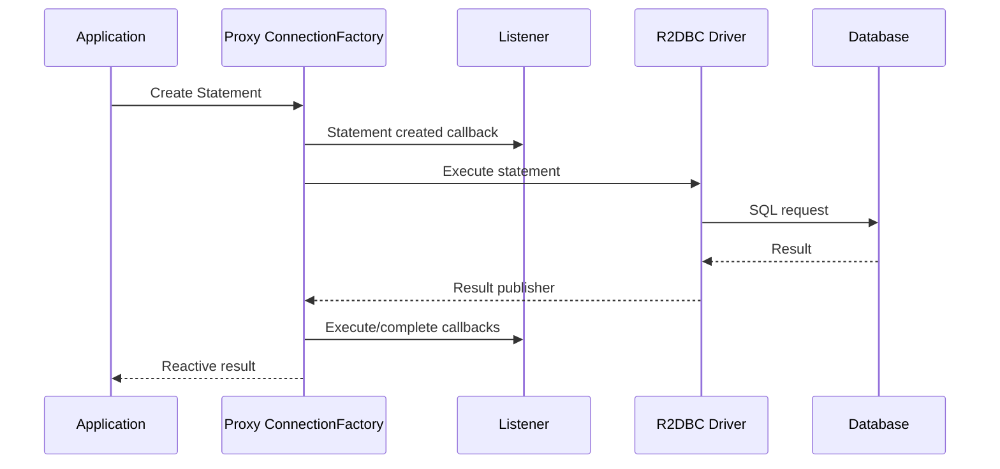
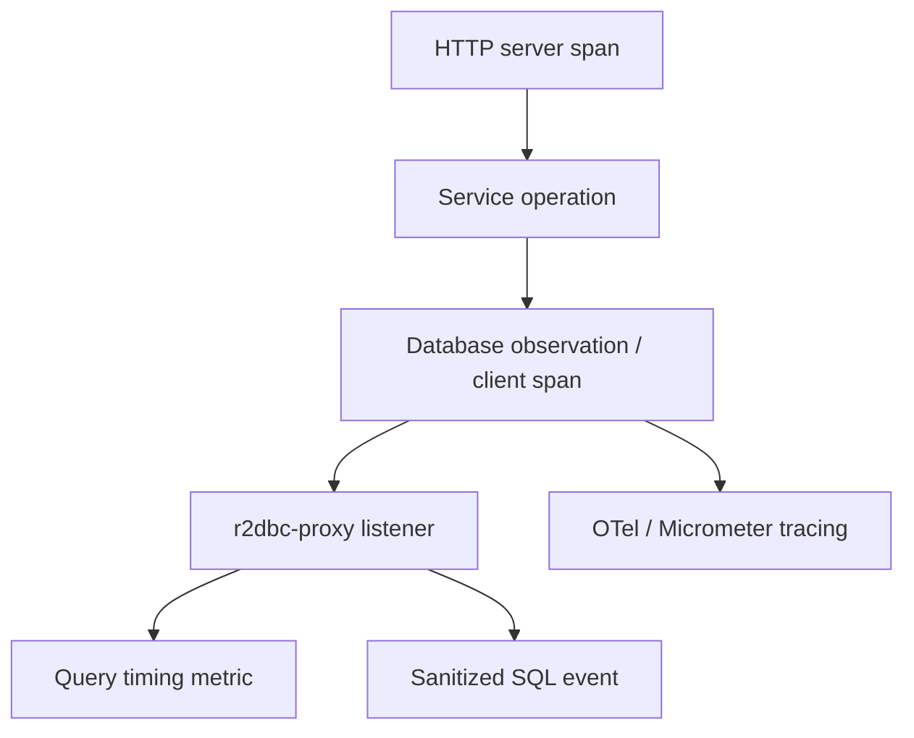

# r2dbc-proxy in Spring Boot

A Spring WebFlux application uses R2DBC to access PostgreSQL reactively. When an API slows down, operations teams must distinguish connection wait time, SQL execution time, row fetching time, and service-layer processing time. HTTP metrics reveal which endpoint is slow, but not which SQL statement is consuming the time. **r2dbc-proxy** provides a proxy layer around R2DBC `Connection`/`Statement`/`Result` to observe database operations without modifying every repository.

`r2dbc-proxy` can capture the lifecycle of R2DBC operations and emit listener callbacks. Applications can use listeners to log SQL executions, count queries, measure durations, or feed data into an observability pipeline. However, the proxy does not automatically replace Micrometer Observation, connection pool metrics, or distributed tracing; you must choose version-compatible integrations and listeners.

This **r2dbc-proxy** lesson belongs to the **Database observability** chapter of the **SPRING_BOOT_OBSERVABILITY** module. The module focuses on setting up observability for Spring Boot using Micrometer Observation, metrics, logs, and distributed tracing; covering context propagation, tags/cardinality, exporters, sampling, and signal correlation to investigate errors, latency, and application behavior in real environments.

## 1. Learning Objectives

After this lesson, you will be able to:

- Explain where `r2dbc-proxy` sits in the R2DBC connection pipeline.
- Distinguish query execution time, connection acquisition time, and HTTP request latency.
- Add a proxy DataSource/ConnectionFactory to a reactive Spring Boot application.
- Use listener callbacks to observe query lifecycles and errors.
- Record database timings into Micrometer metrics/Observation in a controlled way.
- Avoid high metric cardinality caused by raw SQL, bind parameters, and dynamic values.
- Understand how to correlate query observations with Reactor context and distributed tracing.
- Protect SQL, bind values, and sensitive data in logs/telemetry.

## 2. What is r2dbc-proxy?

R2DBC defines an SPI for reactive applications to access relational databases. A driver supplies a `ConnectionFactory` that creates connections, statements, and results. `r2dbc-proxy` wraps these R2DBC interfaces to observe operations performed by the application.

The proxy can emit callbacks for events such as:

- Connection creation or closure.
- Statement creation and execution.
- Query/batch execution start and completion.
- Result consumption.
- Errors occurring during R2DBC operations.

Exact callback names and APIs depend on the `r2dbc-proxy` version. Check the documentation for your exact version before copying listener code.



`r2dbc-proxy` sits between the application and the driver. It observes calls passing through the proxy; if a component creates connections directly from another factory, those operations will not be observed.

## 3. When should you use r2dbc-proxy?

Spring Boot and Micrometer already provide metrics for connection pools or database-related instrumentation depending on the stack. `r2dbc-proxy` is useful when finer visibility at the R2DBC API boundary is needed:

| Need | Appropriate signal |
| --- | --- |
| Which API endpoint is slow? | `http.server.requests` |
| Which HTTP client dependency is slow? | `http.client.requests` and client spans |
| Is the connection pool exhausted? | Pool metrics: active, idle, pending, acquire time |
| How long did statement execution take? | `r2dbc-proxy` listener timing |
| Which SQL raised an error? | Listener error event and sanitized logs |
| Which request invoked the database operation? | Observation/tracing context propagation |

Do not use `r2dbc-proxy` to replace database slow query logs or database-native query plans. The proxy observes behavior at the R2DBC client boundary; only the database server has deep visibility into query plans, lock waits, I/O, and execution internals.

## 4. Adding r2dbc-proxy to Spring Boot

Dependency artifacts and integration approaches may change across releases. Gradle example declaring an `r2dbc-proxy` module compatible with your application's R2DBC SPI:

```kotlin
dependencies {
    implementation("org.springframework.boot:spring-boot-starter-data-r2dbc")
    implementation("io.r2dbc:r2dbc-proxy:<compatible-version>")
}
```

Replace the version placeholder with a verified compatible version in your project's dependency management. Do not blindly pick the newest version if it changes the R2DBC SPI or listener APIs.

### Wrapping ConnectionFactory

The configuration idea is to take the driver `ConnectionFactory` created by Spring Boot/R2DBC configuration and wrap it with a proxy factory before repositories/`DatabaseClient` use it:

```java
import io.r2dbc.spi.ConnectionFactory;
import org.springframework.context.annotation.Bean;
import org.springframework.context.annotation.Configuration;

@Configuration
class R2dbcProxyConfiguration {

    @Bean
    ConnectionFactory observedConnectionFactory(
            ConnectionFactory target) {
        return ProxyConnectionFactory.builder(target)
            .build();
    }
}
```

This is pseudo-code illustrating wiring; constructor/builder imports and bean setup must match your `r2dbc-proxy` version. Do not register a `ConnectionFactory` bean that injects itself. In Spring Boot, use an appropriate customizer/bean-wrapping pattern so the underlying factory is wrapped once without circular dependencies.

### Avoiding double proxying

If auto-configuration or a starter already wraps `ConnectionFactory`, do not wrap it in another proxy without good reason. Nested proxies can run listeners twice, double-count query timings, and duplicate SQL logs. Verify the object graph and callback counts on a test request.

## 5. Listener callbacks and query lifecycle

`r2dbc-proxy` provides listener APIs to receive notifications when operations occur. Depending on the API, a listener can capture metadata such as operation type, SQL text, execution duration, success/failure, and connection identifiers.



With reactive APIs, execution and result consumption occur when the `Publisher` is subscribed to, not necessarily when the `Statement` is created. Listener timing must therefore account for whether it measures statement creation, publisher execution, receiving results, consuming all rows, or the full lifecycle from subscribe to terminal signal.

Do not label all of this duration as "SQL server execution time." It can include network latency, driver processing, backpressure, and consumer behavior.

## 6. Measuring query duration and feeding Micrometer

A listener can record durations into a `Timer`. The pseudocode below illustrates the design pattern, not a fixed API signature across all `r2dbc-proxy` versions:

```java
Timer queryTimer = meterRegistry.timer(
    "db.client.operation",
    "system", "postgresql",
    "operation", "select"
);

long startedAt = System.nanoTime();

// In the proxy's corresponding completion callback:
long elapsedNanos = System.nanoTime() - startedAt;
queryTimer.record(elapsedNanos, TimeUnit.NANOSECONDS);
```

In a real implementation, start time must be stored per execution context/statement; never use a shared variable across concurrent requests. In reactive flows, ensure the `Timer` is recorded exactly once on the terminal signal, including error/cancel if semantics require counting them.

### Meter names and tags

A database client meter can use stable dimensions:

| Tag | Example | Purpose |
| --- | --- | --- |
| `system` | `postgresql` | Database engine |
| `operation` | `select`, `insert`, `update`, `delete` | Operation group |
| `name` | `orders.findById` | Logical repository/query name |
| `outcome` | `success`, `error` | Outcome |

This is an illustrative naming design. If your project already follows Micrometer/SemConv naming conventions, follow those instead of inventing duplicate meters.

### Never use raw SQL as a metric tag

Do not put the following values into metric labels:

- Full SQL containing literal values.
- Bind parameters like customer ID/order ID/email.
- Dynamic query strings or generated SQL containing tenant identifiers.
- Connection URLs with username/password.
- Trace ID/span ID.

Each distinct SQL string can spawn a new time series; bind values can contain PII/secrets. Use a logical query name or bounded operation type.

## 7. SQL logging and bind parameter redaction

SQL logs are helpful for debugging but can expose data. Example query:

```sql
SELECT * FROM customers WHERE email = ?
```

Keeping placeholders in logs is usually safer than logging actual email values. However, depending on the listener/configuration, the proxy may provide expanded SQL or bind values; proactively disable or redact them.

Guidelines:

1. Never log passwords, tokens, emails, phone numbers, addresses, or payment data.
2. Never log full connection URLs/credentials.
3. Use query names/operations for metrics.
4. Restrict log levels and how long SQL debug logging stays enabled.
5. Enforce proper access controls and retention for database logs.
6. Check exception messages to ensure they do not embed parameter values.

Do not assume `r2dbc-proxy` automatically masks all bind parameters. Redaction must be configured and tested with identifiable test data.

## 8. Combining with Micrometer Observation and tracing

Database operations typically execute inside an HTTP request or message consumer. When Observation/tracing context is propagated properly, listeners can correlate the operation with the active trace or create a child observation/span depending on the integration.



There are two design options:

- Use existing instrumentation/integration to create database spans, and use `r2dbc-proxy` primarily for query listeners/logging.
- Create Observations/spans from the listener if the stack lacks suitable built-in instrumentation.

Do not create duplicate database spans if an agent or framework already instruments the same operation. Inspect the trace graph with a sample query to verify how many spans exist and what each span measures.

### Reactor Context

R2DBC is reactive. Context can attach to Reactor Context and be used by the Micrometer context propagation bridge. Do not rely solely on `ThreadLocal` because callbacks may run on different threads. When a listener creates asynchronous observations, preserve scope/context across reactive execution and restore it properly after the terminal signal.

Do not store mutable `Observation` or `Span` instances in a singleton field shared across requests. Context must belong to each individual subscription/execution.

## 9. Connection pool metrics vs. query metrics

A slow database API may be waiting on connections rather than SQL execution. Common R2DBC pool metrics include:

| Metric concept | Meaning |
| --- | --- |
| Acquired/active connections | Connections currently in use by the application |
| Idle connections | Connections available in the pool |
| Pending acquire | Requests waiting for a connection |
| Acquire duration | Time spent waiting to acquire a connection |
| Allocation/creation | Creating new connections |
| Validation/idle eviction | Connection validation and lifecycle management |

Exact meter names depend on the R2DBC pool and version. Compare pool metrics against query duration:

- High acquire duration, low query duration: pool capacity or connection lifecycle is suspect.
- Low acquire duration, high query duration: database/network/query plan is likely the cause.
- Both high: system load, saturation, or database contention may be contributing simultaneously.
- Continuously rising pending acquire: pool may be saturated or connections are not being released properly.

Do not conclude a query is slow solely from HTTP latency or connection pool saturation.

## 10. Error handling and reactive lifecycle

R2DBC operations return Reactive Streams `Publisher`s. Errors can occur during subscribe/execute or while consuming results. Listeners should distinguish connection creation errors, statement execution errors, row decoding/mapping failures, result consumption errors, downstream cancellations, and driver/database/network timeouts.

A query can execute successfully while row mapping fails at the application layer. If a listener only observes the execute callback, it might miss mapping failures. Conversely, if timing spans until all results are consumed, duration can include backpressure and application consumption.

### Recording timing exactly once

In reactive execution, use appropriate terminal callbacks so `Timer` is recorded once per subscription. Handle cancellation separately: depending on your goals, cancellation can be recorded with outcome `cancelled` rather than automatically as a database error.

Do not manually subscribe a second time just to measure a query; each subscription can actually re-execute the query. Hook the listener into the existing lifecycle rather than creating side subscriptions.

## 11. Safe configuration and operations

Before deploying `r2dbc-proxy` to production:

1. Verify version compatibility with Spring Boot, Spring Data R2DBC, R2DBC SPI, and the driver.
2. Wrap the underlying `ConnectionFactory` exactly once.
3. Limit listener callbacks and avoid logging every query at high traffic.
4. Choose low-cardinality meter names/tags.
5. Redact SQL literals and bind values.
6. Monitor listener overhead and memory allocations.
7. Verify cancellation/error semantics in reactive flows.
8. Protect metrics endpoints and log destinations.
9. Provide a feature flag/profile to reduce verbosity once an incident ends.

Listeners sit on the database hot path, so heavy callbacks can impact latency. Avoid blocking I/O, synchronous remote calls, or large payload serialization inside callbacks. If events/logs must be dispatched externally, use a bounded logging/queuing mechanism.

## 12. Troubleshooting

| Symptom | Possible cause | Investigation approach |
| --- | --- | --- |
| No callbacks firing | The active `ConnectionFactory` bypasses the proxy | Inspect the actual bean injected into `DatabaseClient`/repositories |
| Callbacks fire twice | `ConnectionFactory` wrapped in multiple proxies or listener registered twice | Check wiring and callback counts |
| Timer always 0 | Start/stop timing placed in wrong callback or recorded in wrong unit | Check `nanoTime`, `TimeUnit`, and lifecycle |
| Timer doubles counts | Query recorded across multiple callbacks or repeated subscribes | Establish a single recording point |
| High query timing but fast DB logs | Timing includes network/driver/row consumption | Compare measurement scope with database-native duration |
| Slow HTTP, fast queries | Pool acquire, application processing, or another downstream | Cross-check pool metrics and traces |
| Pending acquire rising | Pool saturated or connections not released | Check concurrency, pool sizing, and cancellations |
| SQL logs expose bind values | Listener/config logs expanded SQL | Disable bind logging or redact before writing |
| Metrics cardinality spikes | SQL/raw parameters used as tags | Replace with bounded query name/operation |
| Trace missing database span | Listener does not create spans or instrumentation unconfigured | Check tracing bridge and integration |
| Trace has duplicate DB spans | Agent/framework and listener both instrumenting | Remove duplicate instrumentation |
| Wrong context in reactive callbacks | Relying on `ThreadLocal` or sharing mutable state | Use Reactor/Micrometer context propagation properly |

### Investigation checklist

1. Identify the slow request and trace ID in an authorized environment.
2. Compare the HTTP server span, service span, and database span.
3. Inspect pool acquire/pending/active/idle metrics.
4. Identify the query operation and duration from the listener.
5. Compare proxy timing against database-native slow query logs.
6. Check exceptions, timeouts, and cancellations.
7. Confirm SQL/bind values are redacted.
8. Verify proxies/listeners are not registered redundantly.

## 13. Hands-on exercise: measuring an R2DBC query without leaking data

**Scenario:** `order-service` uses Spring WebFlux, Spring Data R2DBC, and PostgreSQL. An order-reading endpoint shows rising latency; you need to determine whether time is spent waiting on the pool or in database exchange.

### Part A — Preparation

1. Verify Spring Boot/R2DBC/driver versions.
2. Add a compatible `r2dbc-proxy` version.
3. Wrap the underlying `ConnectionFactory` once.
4. Register a listener recording only operation, duration, and outcome; never log bind values.
5. Enable pool metrics and HTTP metrics.
6. Configure tracing in the test environment.

### Part B — Verification

| Case | Action | Expected observation |
| --- | --- | --- |
| A — Fast query | Run a SELECT by primary key | Timer records duration and success |
| B — Slow query | Use a test query with controlled delay | Query duration increases |
| C — Pool pressure | Reduce pool size in test and apply concurrency | Pending acquire/acquire time increases |
| D — DB error | Run a failing statement in test database | Listener receives error outcome |
| E — Cancellation | Cancel a reactive subscription | Callback/outcome reflects cancellation by design |
| F — Redaction | Query with sensitive test data | Logs contain no bind values |
| G — Trace correlation | Call endpoint triggering DB operation | DB observation/span attaches to trace if integration enabled |
| H — Cardinality | Run same query with many IDs | Metric series still use bounded operation/query name |

### Part C — Self-assessment questions

1. Where does `r2dbc-proxy` sit in the R2DBC pipeline?
2. Why does query execution time differ from connection acquire time?
3. Why must reactive query timing account for subscription and result consumption?
4. How do you avoid recording a `Timer` multiple times for one execution?
5. Why are raw SQL and bind values unsuitable as metric tags?
6. When should you use database-native slow query logs instead of proxy timing?
7. How do you distinguish pool saturation from a slow query plan?
8. Why can plain `ThreadLocal` lose context in reactive flows?
9. How do you detect duplicate proxy/listener registrations?
10. Which data must be redacted before logging database events?

## 14. Key takeaways

**r2dbc-proxy** wraps R2DBC `ConnectionFactory`/`Statement`/`Result` to emit listener callbacks for database operations. It provides visibility into query lifecycles, timings, and errors on the application side; Micrometer can record these measurements as metrics, while tracing integration can correlate database operations with HTTP request context.

Distinguish connection acquisition, statement execution, and result consumption; they measure different stages. Correlate query timings with pool metrics, HTTP metrics, and database-native diagnostics to locate root causes. Keep metric tags to low-cardinality operation/query names, redact SQL/bind values, and avoid blocking inside listener callbacks. In reactive flows, tie timing/context to the subscription lifecycle, handle errors/cancellations exactly once, and do not rely on plain `ThreadLocal`. Configuring a single proxy layer and checking version compatibility delivers valuable R2DBC observability without adding latency, leaking data, or producing duplicate telemetry.
