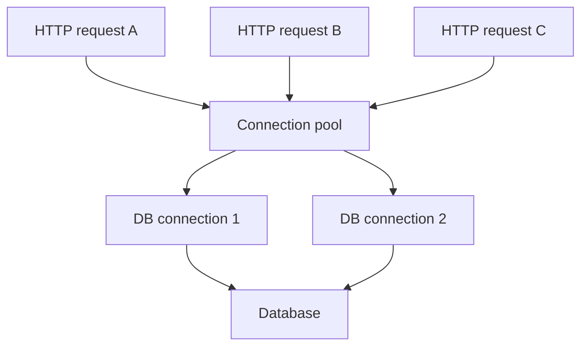
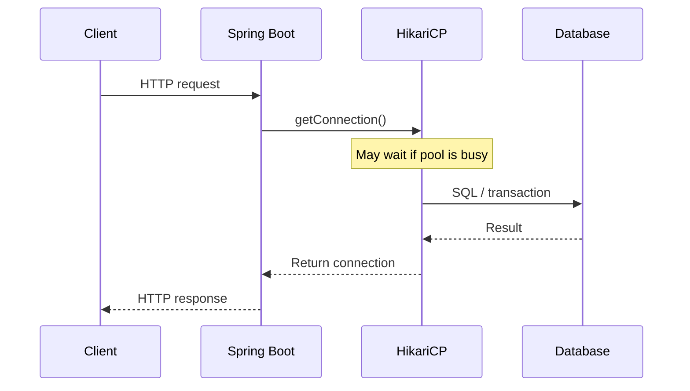

# Connection pool metrics in Spring Boot

A Spring Boot application may handle many concurrent requests that need database access. Each request typically borrows a connection from a connection pool, executes SQL, and returns the connection to the pool. If the pool runs out of available connections, requests must wait; as wait times grow, HTTP latency can climb even though SQL statements have not changed. Monitoring **connection pool metrics** helps detect pool saturation, distinguish connection starvation from slow database queries, and tune configurations based on evidence.

This **Connection pool metrics** lesson belongs to the **Database observability** chapter of the **SPRING_BOOT_OBSERVABILITY** module. The module guides you through setting up observability for Spring Boot with Micrometer Observation, metrics, logs, and distributed tracing; covering context propagation, tags/cardinality, exporters, sampling, and signal correlation to investigate errors, latency, and application behavior in real environments.

After this lesson, you will be able to read active/idle/pending/max connections, understand HikariCP metrics, inspect metrics through Actuator and Prometheus, identify pool saturation, design dashboards/alerts, and cross-check pool metrics with database-side telemetry before raising pool size.

## 1. What problem does a connection pool solve?

Opening a database connection has overhead: establishing TCP/TLS, authenticating, creating a session, and allocating database resources. If every HTTP request opened and closed its own connection, the application would pay this cost repeatedly and risk creating too many simultaneous sessions.

A connection pool keeps a set of pre-opened connections. When database access is needed, the application borrows a connection; once done, the connection is returned for another request to reuse.



The pool bounds concurrent connections and reuses them. It also introduces a wait queue when all connections are busy. Queuing smooths load within a limit, but prolonged waiting increases request latency and timeouts.

Spring Boot typically uses HikariCP as the default connection pool when a JDBC starter and compatible driver are present. If the application uses R2DBC, pooling mechanics and metrics differ; this lesson focuses on JDBC/HikariCP.

## 2. Important HikariCP metrics

HikariCP can provide pool metrics through Micrometer when integrated with a compatible registry/binder. Meter names typically carry the `hikaricp.connections` prefix, with common states:

| Metric | Meaning | How to interpret |
| --- | --- | --- |
| active | Number of connections currently borrowed | Sustained high values may indicate a busy pool |
| idle | Number of available connections | Zero during high load warrants deeper inspection |
| pending | Number of threads waiting for a connection | Continuous growth signals pool cannot keep up |
| connections | Total connections currently in the pool | Compare against max and active/idle states |
| max | Maximum connection limit | Baseline for evaluating saturation |
| min | Configured minimum idle connections | Shows maintained pool baseline |
| acquire | Time spent acquiring a connection | Increases may stem from pool waiting or connection creation |
| usage | Time a connection is held/used | High values may reflect slow queries/transactions holding connections |
| creation | Time to establish a connection | Increases may reflect slow DB/network/auth |

Meter names and statistics can vary by HikariCP/Micrometer version, registry naming conventions, and binders. Explore actual exposed metrics rather than treating table names as immutable contracts.

The three easiest states to interpret:

- **Active:** connections issued to application code and not yet returned.
- **Idle:** connections currently ready to be borrowed.
- **Pending:** threads waiting for the pool to issue a connection.

If active hits max, idle equals 0, and pending is greater than 0 for a sustained period, the pool is likely saturated.

## 3. Reading active, idle, pending, and max together

| Observation | Possible interpretation |
| --- | --- |
| Low active, high idle, pending = 0 | Pool has spare capacity at measurement time |
| High active, idle = 0, pending = 0 | Pool is busy without queuing yet; watch the trend |
| Active = max, idle = 0, pending > 0 | Requests are waiting for connections; clear saturation sign |
| Pending rises with acquire latency | Pool cannot issue connections fast enough for current load |
| Low active yet high pending | Possibly creating connections, constrained pool, or mismatched timestamps/scopes |
| Sustained high active, rising usage duration | Connections held too long; check queries, transactions, and hold sites |

Illustrative hypothetical snapshot:

```text
active  = 20
idle    = 0
pending = 14
max     = 20
```

The pool is using all 20 connections and 14 threads are waiting at the moment of sampling. This alone does not prove the database is slow; check acquire time, usage time, query latency, and database saturation.

A single snapshot may just be a brief spike. Dashboards should show time series and state duration rather than alerting on a single data point.

## 4. HikariCP metrics in Spring Boot

With properly configured Spring Boot Actuator, Micrometer, and HikariCP, pool metrics can be bound into `MeterRegistry`. Common prerequisites:

1. The application has a Spring Boot-managed JDBC DataSource or properly configured `HikariDataSource`.
2. Actuator/Micrometer registry is on the classpath.
3. HikariCP metrics binding is enabled via auto-configuration or a binder.
4. Pools have stable names to distinguish them when multiple DataSources exist.

Gradle dependencies example:

```groovy
dependencies {
    implementation 'org.springframework.boot:spring-boot-starter-actuator'
    implementation 'org.springframework.boot:spring-boot-starter-jdbc'
    runtimeOnly 'org.postgresql:postgresql'
    runtimeOnly 'io.micrometer:micrometer-registry-prometheus'
}
```

Dependency versions should be managed by the Spring Boot BOM. Do not add standalone Micrometer versions unless there is a specific compatibility requirement.

### Inspecting via Actuator

When the metrics endpoint is exposed and secured appropriately, you can query:

```text
GET /actuator/metrics
GET /actuator/metrics/hikaricp.connections.active
GET /actuator/metrics/hikaricp.connections.pending
```

Meter names must match the running registry. The metrics endpoint returns available tag names and measurements for a specific meter. If multiple pools exist, inspect the `pool` tag to distinguish them.

Do not expose all Actuator endpoints publicly. Protect endpoints with network policies/authentication and expose only what monitoring requires.

## 5. Configuring pool names and multiple DataSources

A service may have multiple DataSources, such as a primary database and a reporting database. Dashboards then need to identify which pool is saturating.

HikariCP has a pool name property. Example:

```yaml
spring:
  datasource:
    hikari:
      pool-name: orders-primary
      maximum-pool-size: 20
      minimum-idle: 5
```

Pool names should be stable and free of instance IDs or request-specific values. With multiple DataSources, give each pool a clear name and appropriate metric tags.

The values above are illustrative only. `maximum-pool-size` must not be increased arbitrarily; the sum of connections across all replicas must stay within database capacity.

## 6. Prometheus queries for connection pools

Prometheus metric names are typically normalized from Micrometer meter names, for example:

```promql
hikaricp_connections_active
hikaricp_connections_idle
hikaricp_connections_pending
hikaricp_connections_max
```

Actual series names depend on registry/version and scrape configuration. Check the Prometheus expression browser or `/actuator/prometheus` to confirm.

### Pool utilization

Ratio of active to max:

```promql
hikaricp_connections_active
/
hikaricp_connections_max
```

This query shows the fraction of capacity currently in use. You can group by pool/instance if those labels exist. High utilization is not automatically an error; combine with pending and acquire latency.

### Pending threads

```promql
max by (pool, instance) (
  hikaricp_connections_pending
)
```

Sustained high pending is a much stronger warning than a brief spike. If the metric lacks `pool` or `instance` labels, substitute the actual labels present.

### Active and max by pool

```promql
sum by (pool) (hikaricp_connections_active)
/
sum by (pool) (hikaricp_connections_max)
```

This query computes aggregate utilization for a named pool across multiple instances, provided labels and pool naming consistently represent the same DataSource type. If replicas have different max values, total active divided by total max still yields a capacity-weighted utilization.

## 7. Acquire time, usage time, and connection creation

Active/pending show how busy the pool is; timers help explain why:

- **Acquire time:** how long the application waits to obtain a connection from the pool. Spikes sharply when the pool runs out of connections or new connections are slow to create.
- **Usage time:** how long a connection is held from borrow to return. Increases can result from slow SQL, long transactions, code doing other work while holding the connection, or lock contention.
- **Creation time:** how long opening a new connection takes. Increases can result from slow database accepts, DNS/network/TLS/auth issues, or an overloaded DB.

| Active | Pending | Acquire p95 | Usage p95 | Likely area to investigate |
| --- | --- | --- | --- | --- |
| High | High | High | Normal | Pool size/capacity or burst concurrency |
| High | High | High | High | Queries/transactions holding connections too long |
| Low | High | High | Low | Connection creation or pool configuration |
| High | 0 | Low | High | Operations holding connections long without queuing yet |
| Low | 0 | Low | Low | No pool saturation observed in window |

Timer percentiles require appropriate histogram/distribution statistics. Not every registry exports p95 by default.

## 8. Connection pool saturation and HTTP latency

A request can spend time across several stages:



If the pool is out of connections, waiting happens before SQL even starts. Elevated HTTP server latency can therefore come from acquire waits rather than database execution time.

To distinguish them:

1. Compare HTTP request latency with Hikari acquire time.
2. Compare acquire time with connection usage time.
3. Inspect database query latency, lock waits, and active sessions.
4. Check transaction boundaries and connection leak detection.
5. Cross-check traces: gaps before a DB client span may reflect connection wait time depending on instrumentation.

Not all JDBC instrumentation creates a dedicated span for connection acquisition waits. Use Hikari metrics to observe the pool and DB instrumentation to observe SQL statements.

## 9. Larger pool sizes are not always better

Increasing `maximumPoolSize` can reduce pending threads in the short term, but each connection consumes a session and resources on the database. If there are 10 replicas each with max 30, theoretical capacity reaches 300 connections, not counting job workers, migration tools, and other services.

\[
\text{Potential connections}
= \text{replicas} \times \text{pool max per replica}
\]

For example, 8 replicas × 20 connections = 160 max connections from this service alone.

Before increasing pool size:

- Confirm database max connections and headroom reserved for admin/maintenance.
- Sum max pool sizes across all replicas and services.
- Measure query/transaction durations and lock contention.
- Check DB CPU, I/O, active sessions, and throughput.
- Check whether connections are held while no SQL is executing.
- Consider throttling concurrency or optimizing queries rather than enlarging the pool.

Oversized pools can cause database contention over CPU, memory, locks, and context switching, making queries slower and degrading the entire system.

## 10. Alerting: combining multiple signals

Do not alert just because active/max crosses 80% for a few seconds. A pool with high utilization, zero pending, and low acquire latency may be operating normally.

Alerts should combine sustained pending > 0, active near max with idle = 0, rising acquire latency p95/p99, connection timeouts/errors, and concurrent rises in HTTP latency/error rates.

Example Prometheus rule:

```yaml
groups:
  - name: database-pool
    rules:
      - alert: HikariPoolWaitingForConnections
        expr: hikaricp_connections_pending > 0
        for: 2m
        labels:
          severity: warning
        annotations:
          summary: Hikari pool has waiting threads
```

This is a simple rule; production rules should include labels identifying the service/pool, exclude pools not serving live traffic, and set thresholds against baselines. Sustained pending > 0 should be correlated with acquire time and request impact before escalation.

## 11. Cardinality and naming for pool metrics

Pool metrics typically carry a `pool` tag. This tag should have a small, stable set of values. Never name pools after request IDs, tenant IDs, or ephemeral pod UUIDs.

With multiple instances, an `instance` label managed by the scrape target is reasonable for distinguishing sources, though service-wide dashboards can aggregate across instances. Avoid putting SQL text, connection URLs with credentials, database users, or customer identifiers into tags.

A basic dashboard should show active/idle/pending/max per pool, utilization and acquire latency, usage/creation duration if available, connection timeout counts, HTTP latency/error rates, and database-side sessions/locks/CPU/query latency.

## 12. Testing connection pool metrics

| Test | What to verify |
| --- | --- |
| Binder test | Hikari pool registers expected meters |
| Active/idle test | Borrowing/returning connections updates state |
| Pending test | When pool is held full, a second thread waits and pending rises |
| Timeout test | Acquiring past timeout returns an appropriate error |
| Multi-pool test | Pool names accurately distinguish DataSources |
| Registry export test | Prometheus endpoint exposes expected series and labels |
| Lifecycle test | Pool shutdown and metric cleanup behave properly |

Pending tests should use a test database/pool constrained to a very small size, holding a connection with a latch/barrier and releasing it deterministically. Avoid fixed sleeps or production databases to induce saturation.

Example pseudocode for test logic:

```java
// Create HikariDataSource with maximumPoolSize = 1.
// Thread A borrows a connection and holds it using a CountDownLatch.
// Thread B calls getConnection() and must wait.
// Inspect MeterRegistry and verify pending increases.
// Release the latch, verify B receives the connection and pending drops.
```

This illustrates a test strategy, not a complete runnable test as-is. Real integration tests must manage threads, timeouts, and cleanup in `finally` blocks so the suite never hangs.

## 13. Common pitfalls

| Symptom | Possible cause | How to check |
| --- | --- | --- |
| No Hikari meters visible | Binder/registry inactive or pool not bound | Inspect DataSource, Actuator, and meters |
| Active always equals max | High load, long transactions holding connections, or leaks | Compare usage time, queries/transactions, and leak logs |
| Pending increasing | Pool cannot issue connections fast enough | Check acquire time, usage time, DB capacity |
| High acquire time, low usage | Connection creation or pool contention | Check creation time, network, `maxLifetime`/`minIdle`/config |
| Idle always equals 0 | Busy pool or small minimum idle/capacity | Check active, pending, and traffic |
| Connection timeouts | Waiting past `connectionTimeout` or DB rejecting connections | Check pool state, DB availability, and network |
| Increasing pool slows DB further | Too many sessions / DB contention | Check DB CPU, locks, I/O, active sessions |
| Metrics fail to distinguish DataSources | Duplicate pool names or missing tags | Set stable `pool-name` values |
| PromQL returns no data | Series names/labels differ from conventions | Inspect `/actuator/prometheus` output |
| Pending does not reflect request waits | Reading wrong pool or scrape window | Verify exact DataSource and timestamps |

## 14. Real-world scenario: API slow due to pool saturation

**Hypothetical scenario:** `orders-service` sees p95 HTTP latency climb from 120 ms to 1.4 seconds. Database CPU is modest, and query durations on the DB dashboard remain nearly flat.

Pool metrics over the same period:

```text
active  = 30
idle    = 0
pending = 42
max     = 30
acquire p95 = 1.1 s
usage p95   = 85 ms
```

Signals show requests spend most of their time waiting for connections; connection hold time is only around 85 ms at p95. Investigate:

1. **Traffic/concurrency:** did request rates or worker concurrency spike suddenly?
2. **Transaction scope:** does code hold a connection while calling another HTTP service or processing files?
3. **Pool budget:** does total pool max across replicas fit within DB capacity?
4. **Connection lifecycle:** are there leaks or unclosed resources?
5. **Queries/locks:** did usage duration or database lock waits rise on a specific route?
6. **Remediation:** tighten transaction scopes, reduce concurrency, or tune pool size within DB budget.
7. **Verification:** monitor pending/acquire p95 and HTTP p95 after changes; confirm DB is not overloaded.

Simply bumping max from 30 to 60 without checking total capacity could allow 8 replicas to open up to 480 connections. The database could become overloaded and latency could worsen further.

## 15. Self-check exercises

**Exercise 1.** Do active = max, idle = 0, and pending = 0 prove the pool is failing?

*Hint:* Not yet. The pool is busy without queued threads yet; inspect duration, pending trends, and traffic.

**Exercise 2.** Pending increases alongside acquire p95 while usage p95 stays low. What do you suspect?

*Hint:* Pool capacity/concurrency, connection creation, or pool configuration; also check creation time and DB/network health.

**Exercise 3.** Why should you not average p95 acquire times across replicas?

*Hint:* Quantiles are non-linear. Aggregate histogram buckets if you need a service-wide percentile.

**Exercise 4.** With 10 replicas and a pool max of 25 each, what is the service's total potential connection count?

*Hint:* 10 × 25 = 250, excluding other clients.

**Exercise 5.** Database CPU is low, yet HTTP latency is high and pending is large. Where do you investigate?

*Hint:* Connection acquisition, transaction scope, connection leaks, pool sizing, and network/connection creation.

**Exercise 6.** Why can increasing pool size make things worse?

*Hint:* More sessions can trigger DB contention, memory/CPU pressure, and lock competition.

**Exercise 7.** Does pending = 0 mean no request is waiting on the database?

*Hint:* It only means no thread is waiting for a connection in the pool at measurement time; requests can still wait on locks, queries, or network after acquiring a connection.

**Exercise 8.** Which signals should be combined with pool metrics to isolate root causes?

*Hint:* HTTP latency/errors, acquire/usage/creation time, database query latency, locks, active sessions, CPU, and I/O.

## 16. Key takeaways

- Connection pools reuse and cap database connections; when connections run out, requests wait.
- Read **active, idle, pending, and max** together. Active hitting max, idle at 0, and sustained rising pending indicate saturation.
- HikariCP/Micrometer can expose pool state and timer metrics; verify meter names and labels against your version and registry.
- **Acquire time** measures waiting for a connection; **usage time** measures holding a connection; **creation time** surfaces connection setup issues.
- High HTTP latency is not necessarily caused by slow SQL: requests may be waiting on connections before queries even start.
- Never resize pools on guesswork. Sum connections across all replicas/services and compare against your database budget.
- Alerts should combine pending, utilization, acquire latency, timeouts, and HTTP impact; avoid alerting on a single snapshot.
- Combine pool metrics with traces, logs, and database-side metrics to distinguish pool saturation, query latency, lock contention, and connection lifecycle issues.
