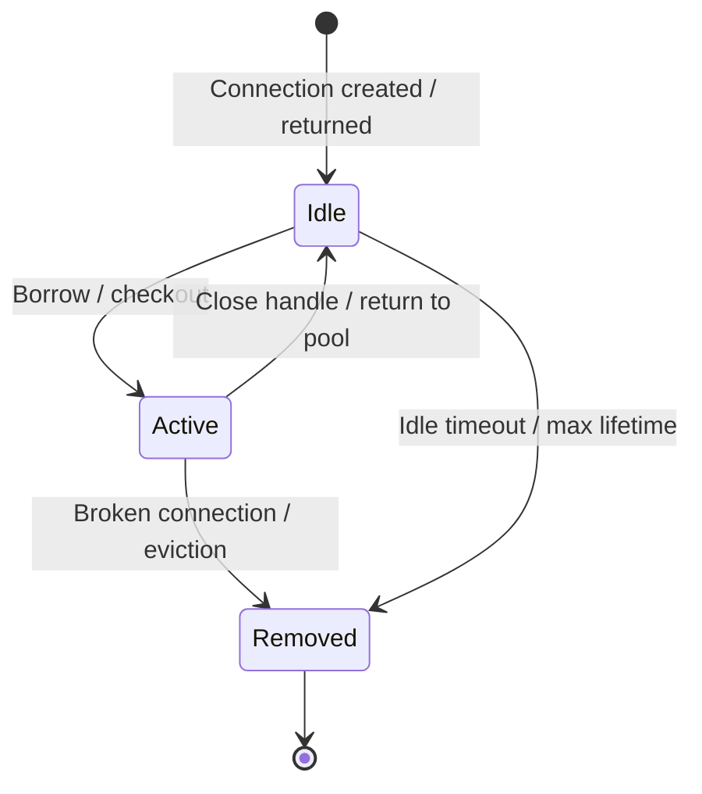

# Active and idle connections in Spring Boot

A Spring Boot application uses a connection pool to reuse database connections. When a request needs to run a query, the application borrows a connection from the pool; after the transaction or when closing the connection handle, the connection is typically returned to the pool for other requests to reuse. At any point in time, the pool may contain connections currently borrowed by the application and idle connections waiting to be borrowed next.

An **active connection** is a connection currently checked out from the pool and held by a caller. An **idle connection** is a connection sitting in the pool, ready to be issued to the next caller. These two states help reveal pool utilization, capacity shortages, connections held too long, and appropriate pool sizing.

In Spring Boot, HikariCP is the default connection pool when using the JDBC starter without replacing it with another pool. Spring Boot Actuator/Micrometer can expose pool metrics such as active, idle, pending, and max connections depending on pool/version. Read these metrics alongside request latency, transaction duration, and database-side session metrics to determine whether an issue lies in the application, pool, or database.

This lesson belongs to the **Database observability** chapter of the **SPRING_BOOT_OBSERVABILITY** module. The module guides you through setting up observability for Spring Boot using Micrometer Observation, metrics, logs, and distributed tracing; covering context propagation, tags/cardinality, exporters, sampling, and signal correlation to investigate errors, latency, and application behavior in real environments. This lesson focuses on active/idle connections and how to measure, interpret, and troubleshoot connection pool states.

## Learning Objectives

After this lesson, you will be able to:

1. Distinguish active, idle, total, and maximum connections in a connection pool.
2. Describe the lifecycle of borrowing, using, and returning a connection to the pool.
3. Read HikariCP pool metrics in Spring Boot Actuator/Micrometer.
4. Distinguish pool saturation from database overload or slow queries.
5. Recognize long-held connections, leaks, and overly broad transaction scopes.
6. Understand how `minimum-idle`, `maximum-pool-size`, and timeouts affect active/idle counts.
7. Design dashboards/alerts for pool utilization, pending borrowers, and acquire latency.
8. Combine pool metrics with database sessions, traces, logs, and transaction metrics.
9. Test pool behavior under load and during database slowdowns/disconnects.
10. Diagnose connection starvation without blindly increasing pool size.

## 1. How does a connection pool manage connections?

Opening a new database connection is expensive: TCP handshake, TLS if enabled, authentication, session initialization, and database-side resource allocation. A connection pool maintains a group of already-opened connections for reuse.

A request typically follows these steps:

1. Code requests a connection from the `DataSource`.
2. The pool provides an idle connection if one is available.
3. If none are idle and the pool has remaining capacity, the pool may create a new connection.
4. The caller executes SQL/transactions.
5. The caller closes the connection handle.
6. The pool reclaims the connection and transitions it back to idle if still valid.



In a JDBC pool, `Connection.close()` usually does not immediately close the physical database session. It returns the logical connection handle to the pool; the pool keeps the physical connection open for reuse.

### 1.1. Active connections

A connection counts as active when a caller has borrowed it and has not yet returned it to the pool. The caller may be executing SQL, waiting for database results, holding a transaction across multiple SQL statements, mapping data while keeping the connection, or doing no useful work because it forgot to close the connection.

Therefore, active does not mean the database is CPU-bound or the connection is actively running a query. A connection can be active while the application waits on network, locks, or business logic.

### 1.2. Idle connections

An idle connection has been returned to the pool and can be handed to another caller. Idle is not necessarily wasteful: keeping connections warm reduces connection creation latency.

Idle connections can be closed by the pool based on minimum idle, idle timeout, maximum lifetime, or validation policies. Databases/proxies may also close idle sessions; the pool must detect and evict invalid connections.

### 1.3. Total, minimum idle, and maximum pool size

With HikariCP:

- **Active:** connections currently borrowed.
- **Idle:** connections currently idle in the pool.
- **Total:** total connections managed by the pool, usually equal to active + idle.
- **Maximum pool size:** upper bound on the number of connections the pool can manage.
- **Minimum idle:** target number of idle connections the pool tries to maintain; unless configured otherwise, HikariCP typically runs fixed-size with minimum idle defaulting relative to maximum pool size.

Actual numbers depend on configuration and lifecycle. Do not judge optimal pool operation from a single snapshot.

## 2. HikariCP metrics in Spring Boot

Spring Boot typically auto-configures HikariCP when a JDBC DataSource and HikariCP are on the classpath. Actuator/Micrometer can bind pool metrics into `MeterRegistry`.

Common metric names:

| Metric | Meaning |
|---|---|
| `hikaricp.connections.active` | Number of connections currently borrowed |
| `hikaricp.connections.idle` | Number of idle connections |
| `hikaricp.connections` | Total connections managed by the pool |
| `hikaricp.connections.max` | Maximum pool size |
| `hikaricp.connections.min` | Minimum idle target |
| `hikaricp.connections.pending` | Number of callers waiting for a connection |
| `hikaricp.connections.acquire` | Time spent acquiring a connection |
| `hikaricp.connections.usage` | Time a connection is held by the caller |
| `hikaricp.connections.creation` | Time to create a connection |
| `hikaricp.connections.timeout` | Number of acquire timeouts |

Names/availability and units depend on Micrometer, HikariCP, and registry versions. Check actual meter names in Actuator or the registry; do not assume every metric exists in every version.

### 2.1. Viewing metrics via Actuator

Example exposing the metrics endpoint in a secured environment:

```yaml
management:
  endpoints:
    web:
      exposure:
        include: health,info,metrics
  endpoint:
    metrics:
      access: read-only
```

Access controls and property semantics vary across Spring Boot versions. Expose endpoints only behind proper network/auth policies; do not leave metrics endpoints open publicly if they expose operational metadata.

You can list meters at `/actuator/metrics`, then inspect a specific meter such as `/actuator/metrics/hikaricp.connections.active` if bound.

### 2.2. Pool name and multiple DataSources

An application can have multiple DataSources/pools. Micrometer typically attaches a `pool` tag to distinguish them. Dashboards should group by pool name and database role; do not merge all pools if they serve distinct workloads.

Do not put JDBC URLs containing credentials or dynamic tenant IDs into tags. Pool names should be stable, such as `primary`, `reporting`, or `inventory`.

## 3. Reading active and idle together

```text
total_connections = active_connections + idle_connections
pool_capacity = maximum_pool_size
available_capacity = idle_connections
```

Example with pool maximum 20:

| State | Active | Idle | Pending | Interpretation |
|---|---:|---:|---:|---|
| Normal | 5 | 15 | 0 | Plenty of idle connections available |
| Rising load | 15 | 5 | 0 | Pool is heavily utilized |
| Near saturation | 19 | 1 | 0 | Approaching capacity |
| Saturated | 20 | 0 | 8 | Callers must wait for connections |
| Idle-heavy | 2 | 18 | 0 | Much unused capacity |

These numbers are examples, not universal recommended thresholds.

### 3.1. High active is not necessarily an error

High active counts can reflect high throughput and short transactions. If pending is 0, acquire latency is low, and the database has spare capacity, the pool may be performing well.

Watch trends over time and compare with request rate, latency, database CPU/locks, and connection limits.

### 3.2. High idle is not necessarily misconfigured

High idle counts may result from keeping warm capacity for bursts. However, many service replicas each maintaining a large pool can push total database sessions over the limit. Calculate total connections across the whole deployment.

### 3.3. Pool metrics and database sessions

Pool metrics describe connections managed by the pool. Database-side sessions may also include connections from migrations, admin tools, batch jobs, monitoring, or other pools. Compare pool metrics against database session views to explain discrepancies.

## 4. Pending and acquire latency

Active/idle only show current state. Two key metrics reveal blocked callers:

- **Pending borrowers:** number of threads/callers waiting for a connection.
- **Acquire latency:** time from request until a connection is granted.

If active hits max, idle is 0, and pending increases, the pool is experiencing contention/saturation. If pending is 0 yet acquire latency increases, connection creation may be slow, scheduling delays may occur, or snapshots may miss brief queues.

### 4.1. Sustained rising pending

Sustained rising pending can raise request latency before SQL even starts executing. Traces may show a large gap during connection acquisition if instrumentation wraps acquire. Do not assume all latency is database query time.

### 4.2. Acquire timeouts

HikariCP provides `connectionTimeout`: the maximum configured time a caller waits for a connection before the pool throws an error. Requests can fail before executing SQL.

Log entries for connection-unavailable exceptions should correlate with active/idle/pending and transaction usage. Raising `connectionTimeout` only makes callers wait longer without adding capacity.

## 5. Connection usage time and connection leaks

Connection usage time reflects how long a connection is held by a caller after borrowing. Extended usage time can stem from slow SQL/locks, transactions wrapping too much logic, callers reading responses slowly, code making network calls while a transaction remains open, unclosed connection handles, or threads blocking while holding connections.

### 5.1. Connection leaks

A leak occurs when a caller borrows a connection and fails to return it properly to the pool. Active counts climb steadily without dropping, eventually causing pending to rise and pool timeouts.

Use try-with-resources for raw JDBC connections/statements/result sets or Spring transaction management. With JPA/`JdbcTemplate`, the framework manages most lifecycles, though custom code can still hold resources unintentionally.

### 5.2. Leak detection threshold

HikariCP provides `leakDetectionThreshold` to log a warning when a connection is held longer than a threshold. This is a heuristic, not definitive proof of a leak: legitimate long transactions can also exceed the threshold.

```yaml
spring:
  datasource:
    hikari:
      maximum-pool-size: 20
      minimum-idle: 5
      connection-timeout: 30000
      idle-timeout: 600000
      max-lifetime: 1800000
      leak-detection-threshold: 60000
```

Values in HikariCP are in milliseconds. This is an illustrative configuration; pick thresholds based on actual transaction durations and database/proxy timeouts. Avoid setting leak detection too low and creating log noise.

## 6. Pool sizing and total connection budget

Do not choose `maximumPoolSize` solely from CPU counts or generic formulas. Databases have session caps, workloads differ, and hold times vary.

```text
total_possible_connections =
    application_replicas
    * pool_maximum_per_replica
    + non_application_connections
```

For example, 8 replicas each with pool max 20 can open up to 160 connections from the application alone, excluding admin tools, migrations, batch workers, and other services.

### 6.1. Undersized pool

A pool too small for concurrency can create pending queues and raise acquire latency even when the database has spare capacity. Before enlarging the pool, measure database utilization, query latency, lock waits, and session capacity.

### 6.2. Oversized pool

An oversized pool can drive database contention over CPU, memory, locks, and scheduler resources. More concurrent queries do not always increase throughput; sometimes shrinking the pool makes the database more stable.

### 6.3. Minimum idle and maximum pool

`minimum-idle` keeps connections ready for bursts at the cost of more idle sessions. A fixed-size pool reduces connection creation churn at the cost of holding more sessions. Choose based on traffic patterns, database connection limits, and session setup cost.

## 7. Idle timeout, max lifetime, and validation

Idle connections do not necessarily live forever:

- `idleTimeout`: how long a connection may sit idle before the pool evicts it, provided the pool can shrink toward minimum idle.
- `maxLifetime`: maximum age of a physical connection before the pool retires it.
- `keepaliveTime`: interval to test/keep idle connections alive if supported/configured.
- Validation: verifying a connection is still valid before lending or during pool checks.

HikariCP enforces specific rules and bounds for each property; `idleTimeout` only takes effect when `minimumIdle` is less than `maximumPoolSize`. Consult your version's docs before tuning.

### 7.1. Coordinating with database/proxy timeouts

If the database, firewall, or proxy closes idle connections after a timeout, `maxLifetime`/`keepalive` should be tuned so the pool retires or checks connections before the server closes them unexpectedly. Avoid overly aggressive keepalives that create unnecessary load.

### 7.2. Connection validation and stale connections

An idle connection may have been closed by the database without the pool knowing. When handed out again, the first query can fail. The pool/driver must detect and evict broken connections; watch connection creation failures, validation errors, and SQL exceptions after idle periods.

## 8. Combining pool metrics with database metrics

| Application pool | Database side |
|---|---|
| Active/idle/pending | Active/idle sessions |
| Acquire latency | Connection accept/auth latency |
| Usage duration | Query duration/transaction duration |
| Timeout count | Max sessions/connection errors |
| Connection creation | Authentication/session creation cost |
| Pool saturation | CPU, locks, I/O, memory, worker saturation |

If both active/pending and query duration are high, the database or queries/locks are likely the cause. If pending is high while database sessions/CPU are low, connections may be held in application code or overly broad transaction scopes.

Never diagnose from only one side. Use matching time ranges and synchronized clocks.

## 9. Correlating pool metrics with traces and logs

A request trace can show receiving the HTTP request, starting a transaction, waiting for a connection, executing SQL, mapping results, and returning the response.

Not every JDBC stack creates a dedicated span for pool acquisition. When you need to separate acquire waits from SQL execution, use HikariCP metrics alongside appropriate instrumentation; do not assume JDBC spans always include exact pool wait times in every implementation.

Useful logs for pool timeouts/leak detection include: pool name, exception class/category, normalized operation name, and trace ID/span ID if available. Never log JDBC URL credentials, sensitive SQL parameters, or connection objects.

Use Trace ID to find logs for the same request, then inspect active/idle/pending at that timestamp. Pool metrics are typically aggregated per pool without per-request tags.

## 10. Dashboards and alerts for active/idle connections

Pool dashboards should display active, idle, total, maximum, pending, acquire latency, connection usage duration, acquire timeout count/rate, connection creation failures, and database sessions, CPU, locks, and query latency.

### 10.1. Pool utilization

```text
pool_utilization = active_connections / maximum_pool_size
```

This is capacity utilization at measurement time. Do not alert on this ratio alone: 95% active with 0 pending and low acquire latency can be normal under steady workloads.

### 10.2. Multi-signal alerting

Alerts are far more actionable when combining sustained high utilization, pending borrowers > 0 or climbing continuously, acquire latency exceeding SLO, rising timeout rates, and concurrent rises in request latency/error rates.

Thresholds depend on pool size, traffic, and database capacity. Use real baselines and SLOs instead of one-size-fits-all static thresholds.

### 10.3. Avoiding high-cardinality tags

Pool name is a stable dimension; request ID, trace ID, SQL literals, or user ID must never be metric tags. Break down dashboards by pool/service/database role with a small set of values.

## 11. Example inspection via Actuator

Once the application includes Actuator and a metrics registry, you can query meters:

```http
GET /actuator/metrics/hikaricp.connections.active
GET /actuator/metrics/hikaricp.connections.idle
GET /actuator/metrics/hikaricp.connections.pending
GET /actuator/metrics/hikaricp.connections.acquire
```

Actuator returns measurements and available tags per meter. You can filter by the `pool` tag if exposed. Protect endpoint access and exposure.

For Prometheus, scrape the appropriate endpoint and check names transformed under naming conventions, such as dots converted to underscores. Do not assume Actuator metric names and Prometheus exposition names are always identical.

## 12. Testing active/idle behavior

Pool tests need controlled concurrency and database behavior. You can use Testcontainers or an appropriate test database.

1. **Idle baseline:** start the application and observe minimum idle and total.
2. **Borrow connection:** hold a connection within test scope and verify active rises.
3. **Return connection:** close the handle and verify active drops while idle rises.
4. **Pool saturation:** configure a small pool, hold all connections, and launch another borrower; verify pending rises.
5. **Timeout:** hold a connection past `connectionTimeout` and verify acquisition fails.
6. **Leak warning:** hold a connection past the threshold in a controlled test and verify the warning.
7. **Database unavailable:** stop the DB and observe creation/validation failures.
8. **Concurrent workload:** verify acquire/usage latency and request latency under load.

Do not assert metrics immediately without waiting for scrape/update cycles or synchronizing tests. Use bounded timeouts so tests cannot hang.

### 12.1. Testing connection return on exception paths

Ensure connections return to the pool when SQL throws an exception. With raw JDBC, use try-with-resources; with Spring transactions, verify rollback/cleanup. After the test, active count must return to baseline.

## 13. Diagnosing abnormal active/idle patterns

| Symptom | Possible cause | Investigation approach |
|---|---|---|
| Active always equals max | Long queries/transactions, leaks, or small pool | Usage duration, pending, thread dumps |
| Idle = 0 and pending rises | Pool saturation | Acquire latency, DB load, transaction scope |
| High active with pending = 0 | High load but pool still keeps up | Throughput, acquire latency, query duration |
| Sustained high idle | Warm capacity held or low traffic | Minimum idle, replicas, DB session budget |
| High acquire latency, low DB CPU | Connections held in app or slow creation | Usage duration, thread dumps, creation |
| Timeout count increases | Pool out of capacity or DB/network error | Active/idle/pending, DB sessions, logs |
| Active does not drop after requests | Leak or broad transaction scope | Leak detection, thread dumps, transaction lifecycle |
| Connection errors after idle | DB/proxy closed stale sessions | `maxLifetime`, keepalive, validation |
| Pool metrics differ from DB session count | External sessions or different timing | Database session views and other clients |
| One pool overloaded, another idle | Skewed workload/transaction routing | DataSource usage and pool tags |

### Investigation workflow

1. Identify the pool name and maximum/minimum configuration.
2. Inspect active, idle, total, and pending over the same time window.
3. Check acquire latency and usage duration.
4. Cross-check request latency, transaction duration, and SQL spans.
5. Inspect database sessions, CPU, locks, and connection limits.
6. Check logs for timeouts, leak detection, and connection creation/validation.
7. Capture thread dumps during sustained pending/active to find callers holding connections.
8. Verify connection closing/transaction cleanup on both success and exception paths.
9. Sum the connection budget across all replicas/services.
10. Adjust pool/timeouts after identifying the bottleneck, then re-run load tests.

## 14. Anti-patterns to avoid

| Anti-pattern | Consequence | Appropriate approach |
|---|---|---|
| Treating active connections as actively running queries | Misdiagnosis when callers wait on network/code | Combine usage, SQL, and thread metrics |
| Raising max pool immediately when pending is high | Worse database overload | Measure DB capacity/queries/locks first |
| Treating idle connections as waste | Pool churns connections, raising latency | Balance min idle with session budget |
| Looking only at active/idle snapshots | Misses queues and wait times | Monitor pending and acquire latency |
| Holding transactions across HTTP calls | Connections held during network waits | Shrink transaction scope |
| Neglecting to close JDBC resources | Connection leaks | Use try-with-resources / transaction manager |
| Setting leak threshold too low | Log noise and false positives | Base on baseline usage duration |
| Sizing per-replica max without summing | Exceeds database connection limit | Calculate deployment-wide budget |
| Putting request/trace IDs in pool metric tags | Cardinality explosion | Tag by stable pool name |
| Increasing `connectionTimeout` to mask saturation | Callers wait longer without added capacity | Fix the bottleneck and concurrency |
| Monitoring only the application pool | Misses external sessions and DB overload | Dashboard both sides |

## 15. Production checklist for active/idle connections

1. **Pool identity:** does every DataSource/pool have a stable name?
2. **Capacity:** do maximum/minimum idle match traffic and DB session budgets?
3. **Replica budget:** is total max connections across the deployment calculated?
4. **Metrics:** are active, idle, total, max, pending, and timeouts exported?
5. **Latency:** are acquire and usage durations dashboarded?
6. **Database side:** are sessions, CPU, locks, and query latency correlated?
7. **Transactions:** are scopes short, avoiding unnecessary network calls while holding connections?
8. **Cleanup:** are connections returned even on exceptions/cancellations?
9. **Leak detection:** is the threshold baseline-driven without creating log noise?
10. **Timeouts:** do `connectionTimeout`, `idleTimeout`, `maxLifetime`, and `keepalive` align with DB/proxy?
11. **Validation:** are stale connections detected and evicted?
12. **Security:** are Actuator metrics protected and free of JDBC credentials?
13. **Cardinality:** do tags only include stable pool/service/dimensions?
14. **Alerts:** are pending, acquire latency, timeout rates, and utilization alerted on?
15. **Load testing:** is pool behavior verified under realistic concurrency?
16. **Incident runbook:** is there a procedure correlating pool metrics, thread dumps, DB sessions, traces, and logs?

## 16. Self-assessment questions

**Question 1.** What is an active connection?

**Hint:** A connection borrowed from the pool by a caller and not yet returned; not necessarily executing SQL at that instant.

**Question 2.** What is an idle connection?

**Hint:** A connection sitting in the pool, unused by any caller and ready to be issued to another request.

**Question 3.** Do active equal to maximum and pending equal to 0 always indicate an error?

**Hint:** No. The pool may be busy yet still keeping up; check whether pending rises or acquire latency stays elevated.

**Question 4.** Why are pending and acquire latency important?

**Hint:** They show callers are waiting for connections and how long they wait before queries begin.

**Question 5.** What does `Connection.close()` normally mean in a JDBC pool?

**Hint:** Returning the logical connection handle to the pool; the physical database connection may stay open for reuse.

**Question 6.** What can steadily rising active connections that never drop indicate?

**Hint:** A connection leak, long-running transactions, or callers holding connections while blocked.

**Question 7.** Why should you not immediately increase pool size when pending rises?

**Hint:** The database may already be overloaded; adding concurrent sessions increases CPU, lock, and memory contention.

**Question 8.** With pool max 20 across 8 replicas, what is the maximum connections the application can open?

**Hint:** 160 connections, excluding other clients/services.

**Question 9.** Does a leak detection threshold prove a leak with certainty?

**Hint:** No. Legitimate long transactions can also exceed the threshold.

**Question 10.** Which data must be combined to distinguish pool saturation from DB overload?

**Hint:** Active/idle/pending/acquire/usage metrics alongside database sessions, CPU, locks, query duration, and application traces/logs.

## Conclusion

**Active and idle connections show how a connection pool is being utilized and how much capacity remains available.** Active connections are currently borrowed by callers; idle connections have been returned to the pool for reuse. In Spring Boot, HikariCP/Micrometer metrics such as active, idle, total, max, pending, acquire, and usage provide visibility into pool behavior over time. To diagnose issues accurately, read them alongside database sessions, query/transaction latency, thread states, and timeout/leak logs. Never enlarge pool size just because active is high; analyze pending/acquire waits, connection usage, and database capacity, calculate the budget across all replicas, and re-test after tuning.
