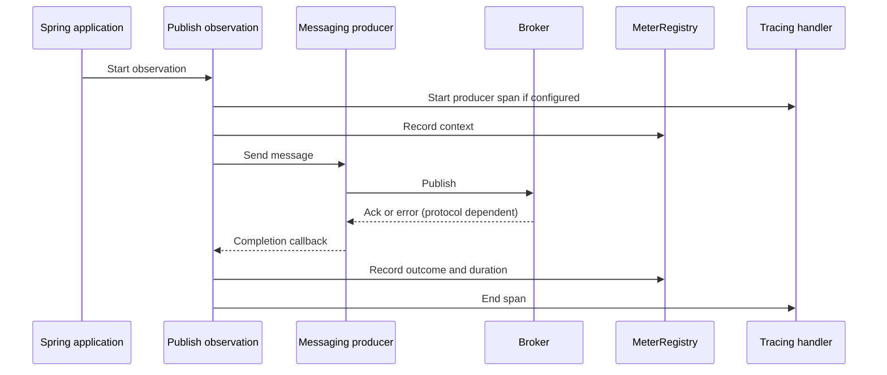
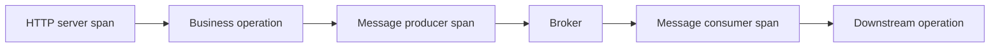

# Message publish observation in Spring Boot

**Message publish observation** is an observation that describes the activity of sending a message from an application to a message broker. On the producer side, an observation helps record the publish start time, send result, completion time, errors, and the metadata needed to link the message with the current trace. With Micrometer Observation and the appropriate tracing integration, a single publish operation can produce both metrics and a producer span.

In the **SPRING_BOOT_OBSERVABILITY** module, messaging observability complements the visibility provided for HTTP, databases, and background tasks. This lesson belongs to the **Messaging and task observability** chapter and focuses on publisher-side observation: the lifecycle of a send operation, distinguishing publish invocation from broker acknowledgement, metrics/tracing, context propagation via message headers, retry/error handling, cardinality, security, and testing.

## 1. What is message publish observation?

When an application sends a message, the producer typically invokes an API from Kafka, RabbitMQ, or a messaging abstraction. The call may return a future/publisher immediately, while the actual transmission and acknowledgement from the broker happen later.

Message publish observation wraps the send operation to answer:
- Has the application requested to send the message?
- At what level has the broker/client confirmed the result?
- How long did the publish take?
- Were there serialization, connection, timeout, or broker rejection errors?
- Which destination was the message sent to?
- Does the publish belong to the trace of the HTTP request or task currently being processed?

Observation is instrumentation metadata; it does not replace the broker's delivery guarantees. A successful span must be interpreted according to the semantics of the client callback/ack observed by the instrumentation.

### 1.1. Conceptual flow



The actual end point depends on the messaging client and integration. Some APIs only indicate that the message has been enqueued into the client buffer; others complete when receiving a broker acknowledgement. You must read the specific semantics before interpreting duration or success.

## 2. Publish invocation differs from broker acknowledgement

This is an important distinction when reading producer telemetry.

| Stage | What happened | What can be concluded |
| --- | --- | --- |
| Method invocation | Application calls send/publish | The producer has requested the send |
| Client enqueue | Client accepts the message into its internal buffer | The message was accepted into the client buffer |
| Network send | Client sends the request to the broker | The message has been transmitted over the network |
| Broker acknowledgement | Broker responds according to protocol/config | Broker confirmed according to the selected ack level |
| Consumer processing | Consumer receives and processes the message | Cannot be inferred solely from producer ack |

A producer span whose duration ends at the ack callback has a different meaning from a span that ends as soon as the API returns. With Kafka, acknowledgement depends on producer configuration such as `acks` and broker semantics. With RabbitMQ, publisher confirms are a separate mechanism for confirming publishes; sending over a channel does not by itself prove the broker has confirmed it.

Do not call a publish end-to-end delivered just because the producer received an ack. The consumer may not have received it yet, may fail processing, or may not have committed the offset/ack.

## 3. Micrometer Observation in messaging

Micrometer Observation provides an abstraction so instrumentation creates an observation once and connects it to handlers for metrics and tracing. The Spring ecosystem has multiple integrations for messaging; automatic instrumentation capability depends on the Spring Boot, Spring Kafka, Spring AMQP, Micrometer, and client versions.

You need to determine:
- Whether the producer API used is a Spring abstraction or a native client.
- Whether the integration creates an observation for publish.
- Whether the observation ends when the method returns, when the future completes, or upon broker confirm.
- Whether `MeterRegistry` has a corresponding handler.
- Whether the Micrometer Tracing bridge and exporter are working.
- Whether custom instrumentation is double-measuring.

Do not assume every message broker or every Spring Boot version automatically produces the same observation name or tag set.

### 3.1. Observation can produce metrics and spans

| Signal | Example | Used for |
| --- | --- | --- |
| Metrics | Publish count, duration, result, destination | Tracking error rates and trends |
| Producer span | Send operation, destination, messaging system | Investigating a publish within a trace |
| Logs | Serialization error, broker failure, retry | Understanding detailed events |
| Resource | Service, version, environment | Identifying the producer service |

Metrics and tracing have separate pipelines. Having metrics does not prove spans were exported; having a producer span does not prove the consumer processed the message.

## 4. Kafka producer observation

Spring Kafka and the Kafka client provide instrumentation mechanisms depending on the version. Some versions support Micrometer Observation for listeners/producers when enabled via the corresponding configuration; check the exact API/property of the Spring Kafka version in use.

For a Kafka producer, distinguish between:
- Sending via `KafkaTemplate` or `KafkaProducer`.
- Completion callback/future.
- Producer acknowledgement according to `acks` configuration.
- Internal producer retries and delivery timeout.
- Serialization/partition selection errors.

Example using `KafkaTemplate`:

```java
@Service
class OrderPublisher {

    private final KafkaTemplate<String, OrderCreated> kafkaTemplate;

    OrderPublisher(KafkaTemplate<String, OrderCreated> kafkaTemplate) {
        this.kafkaTemplate = kafkaTemplate;
    }

    CompletableFuture<SendResult<String, OrderCreated>> publish(
            OrderCreated event) {
        return kafkaTemplate.send("orders.created", event);
    }
}
```

This example illustrates Spring Kafka's asynchronous API in versions that support `CompletableFuture`. Return types and APIs may differ in older versions. Returning the future to the caller helps observe completion/errors; do not ignore the future if you need to handle acknowledgements or send failures.

### 4.1. Enabling observation by version

Spring Kafka has options to enable observation for templates/producers in supported versions. Check the exact property/method names and defaults in the documentation for your specific version. When enabled, instrumentation can create producer observations/spans and propagate headers according to the integration.

Do not guess property names. If your version lacks auto observation, you can instrument at the application boundary, but clearly define whether the span ends at invocation or callback and avoid creating duplicate spans alongside native instrumentation.

## 5. RabbitMQ publisher observation

With RabbitMQ, distinguish between publishing to an exchange, routing to a queue, and publisher confirms/returns. A publish method may not wait for confirmation unless publisher confirms are enabled and handled properly.

Spring AMQP provides `RabbitTemplate` and observation mechanisms depending on the version/configuration. Verify whether the integration instruments publishes and how confirms/returns are handled.

Example:

```java
@Service
class NotificationPublisher {

    private final RabbitTemplate rabbitTemplate;

    NotificationPublisher(RabbitTemplate rabbitTemplate) {
        this.rabbitTemplate = rabbitTemplate;
    }

    void publish(Notification message) {
        rabbitTemplate.convertAndSend(
                "notifications.exchange",
                "notification.created",
                message);
    }
}
```

This example illustrates a publish invocation. If you need confirmation that the broker received the message, configure publisher confirms and monitor the confirm callback according to your Spring AMQP version. A return callback can report when a message cannot be routed under mandatory publishing semantics; confirms and routing returns answer different questions.

## 6. Producer span and trace context propagation

A producer span is typically a child of the current span when the message is published. Instrumentation can inject trace context into message headers so the consumer can extract it and create a consumer span linked to the same trace.



W3C Trace Context typically uses `traceparent` and `tracestate`; the messaging integration places the context into an appropriate carrier, usually message headers. Do not manually serialize the entire tracing context into the business payload.

### 6.1. Producer context is not message identity

Trace ID identifies the trace; message key/correlation ID has application or broker semantics. Do not use them interchangeably. One trace can publish multiple messages; one message can be redelivered or processed across multiple attempts.

### 6.2. Context propagation and async callbacks

Producer sends often complete in a callback/future on a different thread. Tracing integration must restore context properly inside the callback. If a custom callback logs or creates child spans, verify context propagation; do not assume `ThreadLocal` is always preserved when a callback switches threads.

## 7. Destination, partition, and cardinality

Producer telemetry needs destination metadata to analyze publishes by broker/topic/queue. Destination should be a stable name, not an arbitrary request-supplied value.

| Dimension | Guideline |
| --- | --- |
| Messaging system | Finite values such as kafka/rabbitmq |
| Destination/topic/queue | Stable logical name, controlled count |
| Operation | publish/send per convention |
| Result | success/error or finite categories |
| Partition | Can have many values; use only when needed |
| Message key | Do not use as a metric tag if high cardinality |
| Message ID | Do not use as a metric tag |
| User/order ID | Do not use as a metric tag |
| Raw payload | Do not include in telemetry metadata |

Topics or queues created dynamically per tenant/client can cause cardinality explosion. Use an allowlist/normalization or group destinations by logical category if the architecture allows.

## 8. Retry, timeout, and publish errors

Publishing can fail at multiple layers:
- Serialization or message conversion.
- Full client buffer.
- DNS/network/TLS/connectivity.
- Broker unavailable or throttling.
- Timeout waiting for acknowledgement.
- Authorization or topic/queue permissions.
- Routing failure/mandatory return.
- Application cancellation or timeout.

Retries can occur in the producer client, the Spring retry layer, or application code. Each retry attempt may create multiple spans or multiple log entries. Distinguish the logical publish operation from individual attempts if the integration supports it.

Do not retry all errors infinitely. Serialization or authorization errors generally do not self-heal; continuous retries only increase load and noise. Use a bounded retry policy with backoff and error classification.

### 8.1. Duration may include retries

If an observation wraps the entire send operation including internal client retries, duration may include retry time. If application-level retries make multiple send calls, you may see one span per attempt or a parent operation with child attempts depending on the instrumentation.

When reading latency, inspect span boundaries and producer configuration. Do not compare durations between two services if their ack/retry semantics differ.

## 9. Safe message headers and metadata

Message headers often contain routing metadata, correlation fields, and trace context. Do not put secrets or personal data into headers indiscriminately.

Avoid:
- Access tokens/API keys.
- Cookie/Authorization headers.
- Email addresses, phone numbers, physical addresses.
- Raw customer/order identifiers if unnecessary.
- Payload fragments or SQL/query values.
- Unfiltered baggage propagated from clients.

Only propagate allowlisted baggage fields. Headers may be persisted in the broker, dead-letter queues, or logs; apply appropriate retention and access policies.

## 10. Custom Observation for publishers

When the messaging integration does not provide enough metadata or the application uses a custom producer, you can create an observation at the application boundary. The observation should wrap the correct async lifecycle.

Illustrative example with the Observation API:

```java
Observation observation = Observation.createNotStarted(
        "orders.publish",
        observationRegistry);

observation.lowCardinalityKeyValue("messaging.system", "kafka");
observation.lowCardinalityKeyValue("messaging.destination.name", "orders.created");

return observation.observe(() -> kafkaTemplate.send(
        "orders.created", event));
```

The example above only wraps the `send` call that returns the future; it can end the observation before the future completes. For async publishes, use an async observation lifecycle or completion callback to stop the observation when the operation reaches a terminal result according to the semantics being measured.

Conceptual example:

```java
Observation observation = Observation.start(
        "orders.publish", observationRegistry);

CompletableFuture<SendResult<String, OrderCreated>> future;
try {
    future = kafkaTemplate.send("orders.created", event);
}
catch (Throwable error) {
    observation.error(error);
    observation.stop();
    throw error;
}

return future.whenComplete((result, error) -> {
    if (error != null) {
        observation.error(error);
    }
    observation.stop();
});
```

This is pseudocode illustrating the lifecycle; adjust it to your Observation/Micrometer API version and ensure scope/context are managed properly inside the callback. Do not share a single mutable `Observation` across multiple publish operations. If native integration already instruments the producer, do not wrap the same operation in a second observation.

### 10.1. Low-cardinality and high-cardinality values

Keep stable system, operation, and destination values as low-cardinality when semantics and policy allow. Message ID, key, correlation ID, or raw payload—if needed—should stay in controlled span/log context; do not put them into metric tags.

## 11. Producer metrics

Producer metrics help monitor:
- Publish count.
- Failed publish count.
- Publish/ack duration per integration semantics.
- Retry count.
- Pending/in-flight sends if exposed by the client.
- Broker/client errors.
- Destination-level throughput if cardinality is controlled.

Exact metric names depend on the Spring integration, client library, and Micrometer version. Do not assume every producer has an identically named meter.

### 11.1. Actuator metrics

In a lab environment, you can expose the metrics endpoint:

```yaml
management:
  endpoints:
    web:
      exposure:
        include:
          - health
          - metrics
```

List meters:

```http
GET /actuator/metrics
```

Once you identify the actual meter name, query that meter. The Actuator endpoint serves in-process inspection; a Prometheus/OTLP registry and backend provide retention and alerting. Protect management endpoints in shared environments.

## 12. Testing publish observation

Tests should distinguish between the business method invoking publish, client completion, and broker acknowledgement. Unit tests can mock the producer/template to verify error handling, but they do not prove broker confirmation or end-to-end propagation.

### 12.1. Unit tests with futures

Use futures completing successfully or with errors to test application behavior and observation lifecycle. Verify that the observation does not stop before completion if the goal is to measure ack latency.

### 12.2. Integration tests with a broker

Use an appropriate Kafka/RabbitMQ test broker or Testcontainers. Verify:
- The producer sends the message to the right destination.
- Callback/confirm is received as configured.
- A producer span is created if supported by instrumentation.
- Trace context appears in headers.
- Error paths and timeouts are reflected.
- A consumer span can link to the same trace if consumer instrumentation is enabled.

Do not rely solely on a mock to conclude that the broker received or persisted the message.

## 13. Troubleshooting message publish observation

| Symptom | Possible cause | How to check |
| --- | --- | --- |
| No producer metrics | Integration/registry not enabled or no publishes occurred | Check dependencies, config, and MeterRegistry |
| No producer span | Missing tracing bridge or dropped by sampling | Check tracing handler, sampler, exporter |
| Span ends too early | Observation stops when API returns the future | Measure around callback/ack lifecycle |
| Unusually high duration | Retries, broker latency, or different ack mode | Check producer config and broker metrics |
| Publish succeeds but consumer does not receive | Routing/topic/subscription/consumer offset | Check broker destination and consumer group |
| Rabbit confirm does not appear | Publisher confirms not enabled or callback not registered | Check channel/template configuration |
| Rabbit returned message | Unroutable per exchange/binding/mandatory config | Check exchange, routing key, queue binding |
| Kafka send timeout | Broker/network/acks/retries/metadata | Check client logs and broker health |
| Trace context lost at consumer | Headers not injected/extracted or custom serializer drops headers | Check carrier propagation |
| Wrong trace ID in callback logs | Async context not restored | Check callback context propagation |
| Cardinality explosion | Dynamic destination, message key, or ID used as metric tag | Normalize destinations and remove dynamic tags |
| Duplicate spans | Native instrumentation and custom observation both active | Check integration and custom code |
| Message header exposes PII/token | Propagating all metadata unfiltered | Allowlist and redact at source |
| Metrics do not reach backend | Registry/exporter/Collector pipeline failure | Check the metrics pipeline separately |

### Investigation workflow

1. Identify the broker, client library, and Spring integration/version.
2. Verify producer observation is enabled and has corresponding handlers.
3. Check the observation stop boundary: invocation, client completion, or broker ack.
4. Check producer metrics and the tracing bridge separately.
5. Verify the endpoint/topic/exchange/routing key.
6. Check retries, timeouts, acks/confirm semantics, and client errors.
7. Check trace context injection in message headers.
8. Correlate consumer receipt/processing separately from producer acknowledgement.
9. Review destination cardinality and metadata privacy.
10. Check the exporter/Collector/backend for each signal.

## 14. Lab exercise: instrumenting a message publish

The goal is to build a producer that sends a message and verify metrics, producer span, context propagation, and async completion.

### Preparation

- Spring Boot application.
- Lab Kafka or RabbitMQ broker.
- Corresponding integration such as Spring Kafka or Spring AMQP.
- Actuator and `MeterRegistry`.
- Micrometer Tracing bridge/exporter if traces are needed.
- Lab consumer to verify message receipt.

### Step 1 — Create a publisher

Create a service using `KafkaTemplate` or `RabbitTemplate`. Return a future/callback if the API supports it to observe completion/errors.

### Step 2 — Enable producer observation

Use the property/API supported by your current Spring integration version. Confirm that producer observations are actually created via the registry or a tracing test exporter.

### Step 3 — Send a message

Send a test message to a fixed topic/queue. Record the destination, result, and duration according to the client's semantics.

### Step 4 — Verify broker acknowledgement

With Kafka, check the send future and `acks` configuration. With RabbitMQ, enable publisher confirms if you want confirmation that the broker received the publish; check returns if you need to verify routing.

### Step 5 — Check metrics

List Actuator meters and identify the integration's producer meters. Check count/duration/errors after several publish operations.

### Step 6 — Check the producer span

Send a message within a traced HTTP request. Confirm the producer span shares the same Trace ID if sampling retains the trace.

### Step 7 — Check message headers

Inspect headers in the test consumer and verify trace context was injected. Do not put tokens/PII into headers.

### Step 8 — Test error/retry behavior

Stop the lab broker or configure a controlled error. Observe the error callback, timeout, retries, and observation outcome. Restore the broker after the test.

### Step 9 — Verify consumer receipt

The consumer receives the message and creates a consumer span if instrumented. Distinguish producer ack from consumer processing completion.

### Step 10 — Check cardinality/privacy

Review destination tags, message IDs, keys, headers, and span attributes. Keep only necessary, stable, and permitted metadata.

### Acceptance checklist

| What to demonstrate | Expected result |
| --- | --- |
| Publish lifecycle | Understand invocation, enqueue, send, and ack |
| Observation | Producer operation instrumented appropriately for the version |
| Metrics | Count/duration/error recorded if supported by integration |
| Tracing | Producer span appears when sampling allows |
| Async completion | Observation stops per callback/ack semantics |
| Propagation | Trace context travels via message headers |
| Broker semantics | Distinguish Kafka acks and Rabbit publisher confirms |
| Retry | Identify attempts and timeouts |
| Cardinality | Do not use dynamic message ID/key as metric tags |
| Privacy | Do not propagate secrets/PII |
| Consumer | Distinguish producer ack from consumer processing |
| Export | Verify metrics/traces pipelines separately |

## 15. Principles to remember

1. **Message publish observation describes the send operation on the producer side.** It does not prove the consumer has processed the message.
2. **Distinguish invocation, client enqueue, network send, and broker acknowledgement.** Duration and success depend on the observation stop boundary.
3. **Micrometer Observation can connect metrics and tracing**, though integration support depends on Spring Kafka/AMQP/client versions and configuration.
4. **Kafka `acks` and Rabbit publisher confirms have distinct semantics.** Do not treat a plain publish call as broker confirmation.
5. **Async callbacks need proper context propagation.** Do not rely on `ThreadLocal` when completion runs on another thread.
6. **Trace context is passed through message headers**, not the business payload; propagate only permitted fields.
7. **Retries can generate multiple attempts and lengthen duration.** Use a bounded policy, backoff, and error classification.
8. **Destinations must be stable and low-cardinality.** Do not use message ID, key, user/order ID, or payload as metric tags.
9. **Avoid duplicate instrumentation.** Check native integration before wrapping with a custom observation.
10. **Protect headers and telemetry.** Do not export tokens, cookies, PII, or raw payloads.
11. **Verify producer and consumer separately.** Broker ack, consumer receipt, and business processing are distinct milestones.

Message publish observation helps measure message sending activity at the right producer boundary. When observations follow broker/client completion semantics, trace context is propagated through headers, and metrics keep cardinality low, development teams can distinguish publish errors, routing failures, retries, and broker latency. Combining producer spans with consumer spans creates an end-to-end path across messaging while keeping acknowledgement and business processing boundaries clear.
