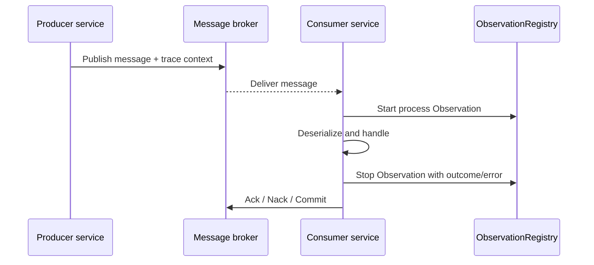
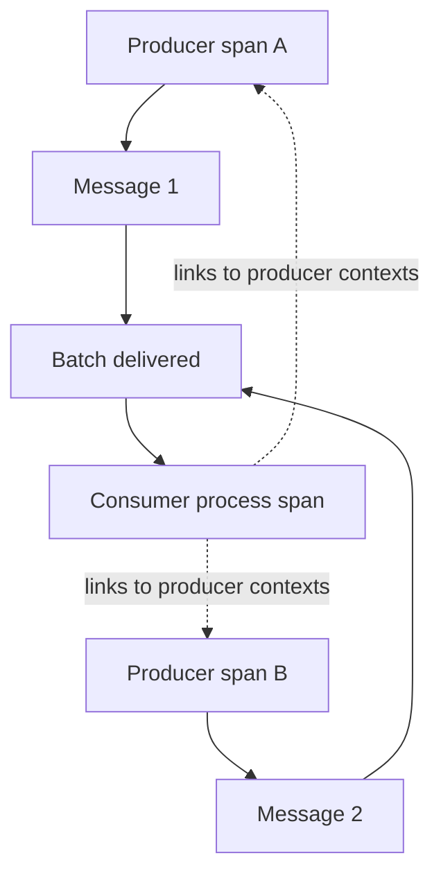
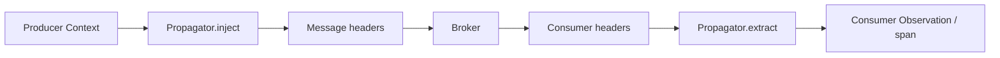
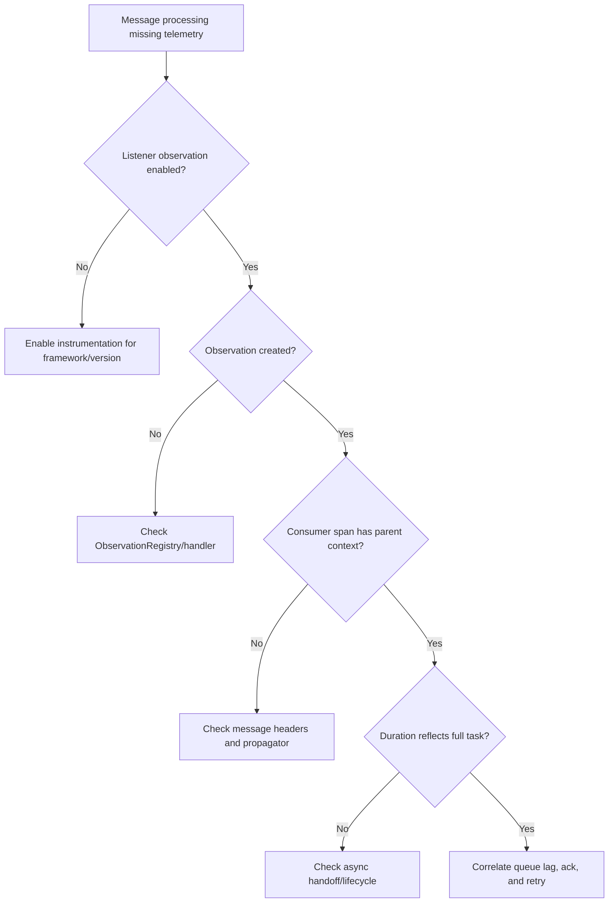

# Message process observation in Spring Boot

In a messaging system, a producer sends a message to a broker and a consumer processes that message at a different time, potentially in a different process, thread, or service. If we only observe HTTP requests, we miss a critical part of the asynchronous flow: when the message was received, how long the handler took to process it, what the ack/nack result was, and whether retries are causing a loop.

**Message process observation** is an Observation wrapping a consumer's processing of a message or a batch. It records processing duration, destination, operation, outcome, and exceptions; a tracing handler can create a consumer span, a metrics handler can record duration/count, and logs can be correlated with the trace context.

The **"Message process observation"** lesson belongs to the **Messaging and task observability** chapter of the **SPRING_BOOT_OBSERVABILITY** module. The module teaches how to set up observability for Spring Boot with Micrometer Observation, metrics, logs, and distributed tracing; covering context propagation, tags/cardinality, exporters, sampling, and signal correlation to investigate errors, latency, and application behavior in production environments.

Clearly separate **message processing time** from **the time a message spends waiting in the broker**. An Observation around a listener typically measures how long the consumer handler executes according to the instrumentation; it does not automatically measure total queue residence time unless producer/enqueue timestamps are recorded and compared.

## 1. Message processing is an asynchronous lifecycle

A message typically passes through the following steps:

1. The producer creates and publishes the message.
2. The broker receives, stores, or routes the message.
3. The message sits in a queue/topic waiting for a consumer.
4. The consumer receives the message and starts a process/consumer Observation.
5. The handler deserializes and executes business logic.
6. The consumer acks/nacks/commits or lets the broker retry according to transport semantics.
7. The message completes, is retried, or is routed to a dead-letter queue.



Observation typically focuses on consumer-side processing. Producer publish Observation is a separate operation. Queue residence time is the interval from enqueue/publish to delivery/start of processing; measuring it requires timestamps or appropriate broker metrics.

## 2. What does Process Observation measure?

A message process Observation can describe the destination or logical queue/topic, operations such as process/consume/handle, consumer group/subscription, processing duration, outcome, exception type, batch size, and trace context.

| Quantity | Question answered |
| --- | --- |
| Process duration | How long did the handler take? |
| Processing count | How many times was a message processed? |
| Error count | How many processing attempts failed? |
| Retry count | How many times did the message have to be retried? |
| Queue residence/lag | How long did the message wait in the broker? |
| Consumer lag | How far behind the producer is the consumer group? |
| Batch size | How many records were processed per poll/handle? |

The exact Observation name depends on Spring Integration, Spring Kafka, Spring AMQP, or the instrumentation in use. Do not assume all frameworks share the same names, conventions, or key sets. Check the documentation for your exact version and inspect the actual `ObservationRegistry`.

Do not infer queue lag from process duration. A consumer might process a message in 5 ms even though the message sat in the queue for 20 minutes.

## 3. Producer Observation and consumer Observation

Producer and consumer are two independent operations that usually happen at different times.

| Producer side | Consumer side |
| --- | --- |
| Create message | Receive message |
| Serialize/publish | Deserialize/process |
| Publish duration | Handler duration |
| Broker send result | Ack/nack/commit result |
| Producer span | Consumer/process span |
| Inject context into message headers | Extract context from message headers |

A trace can link producer and consumer spans. However, a consumer span should not always be a direct child of the producer span; that depends on messaging semantics, batching, and processing timing.

## 4. Parent-child and span links in messaging

If a single message is sent and processed immediately by a consumer, the consumer span can use the producer context as its remote parent. With batch processing, one consumer operation may receive multiple messages from multiple producer traces. A span cannot have multiple parents; in that case, span links are better suited to connect the consumer span to multiple producer contexts.



A single message can use a parent relationship when semantics represent causal continuation. Batches of multiple messages should consider links to each producer context. For long-running delayed work, the producer trace may expire from retention before the consumer runs; a link still describes the relationship without forcing an abnormally long trace tree. Redeliveries can generate multiple attempts and need metadata to distinguish them.

Do not force every consumer span to be a child if a batch has multiple parent contexts.

## 5. Context propagation via message headers

HTTP typically uses `traceparent`/`tracestate` headers. Messaging systems usually have message headers/properties or record headers. Producer instrumentation injects trace context into a carrier; consumer instrumentation extracts it when receiving the message.



Do not serialize the entire runtime `Context` into the message. Only propagate the fields defined by the propagator, such as trace context and permitted baggage. Baggage needs an allowlist, size limits, and must not contain credentials or sensitive personal data.

If the producer and consumer use different formats (W3C/B3), configure compatible propagators or normalize at the boundary. Verify trace ID, sampled decision, and span relationships across each hop.

## 6. Spring Kafka: observation for listener processing

Spring Kafka supports Micrometer Observation for templates and listener containers in supported versions. When observation is enabled on a listener container, the framework can create an Observation around the listener invocation; producer observation can be enabled separately on `KafkaTemplate`.

Example container factory configuration:

```java
import org.springframework.context.annotation.Bean;
import org.springframework.context.annotation.Configuration;
import org.springframework.kafka.config.ConcurrentKafkaListenerContainerFactory;
import org.springframework.kafka.core.ConsumerFactory;

@Configuration(proxyBeanMethods = false)
public class KafkaListenerConfiguration {

    @Bean
    ConcurrentKafkaListenerContainerFactory<String, String> kafkaListenerContainerFactory(
            ConsumerFactory<String, String> consumerFactory) {

        var factory =
                new ConcurrentKafkaListenerContainerFactory<String, String>();
        factory.setConsumerFactory(consumerFactory);
        factory.getContainerProperties().setObservationEnabled(true);
        return factory;
    }
}
```

This is an example for a Spring Kafka version that has the `setObservationEnabled` API. Verify the API against your project's dependency version; do not assume this method exists in every release.

Listener:

```java
import org.springframework.kafka.annotation.KafkaListener;
import org.springframework.stereotype.Component;

@Component
public class OrderEventsListener {

    @KafkaListener(topics = "orders", groupId = "billing-service")
    public void onOrder(String payload) {
        // Validate and process the event
    }
}
```

When observation is enabled, Spring Kafka can provide listener observation and tracing integration as configured. Make sure the `ObservationRegistry`/handlers managed by Spring Boot are used; do not create a separate standalone registry that prevents listener observations from reaching the metrics/tracing backend.

### Producer observation

With `KafkaTemplate`, producer observation can be enabled separately:

```java
KafkaTemplate<String, String> template = new KafkaTemplate<>(producerFactory);
template.setObservationEnabled(true);
```

In Spring Boot, prefer the auto-configured `KafkaTemplate` and configure observation via the builder/customizer/property supported in the current version. Creating an extra template bean can replace the auto-configured bean; use the application's proper customization mechanism.

## 7. Spring AMQP: observation for RabbitMQ listeners

Spring AMQP supports Micrometer Observation for `RabbitTemplate` and listener containers in supported versions. Producer and consumer observations are configured separately; check your Spring AMQP version for the exact property/API.

Example listener container factory:

```java
import org.springframework.amqp.rabbit.config.SimpleRabbitListenerContainerFactory;
import org.springframework.amqp.rabbit.connection.ConnectionFactory;

SimpleRabbitListenerContainerFactory factory =
        new SimpleRabbitListenerContainerFactory();
factory.setConnectionFactory(connectionFactory);
factory.setObservationEnabled(true);
```

Listener:

```java
import org.springframework.amqp.rabbit.annotation.RabbitListener;
import org.springframework.stereotype.Component;

@Component
public class PaymentEventsListener {

    @RabbitListener(queues = "payments")
    public void onPayment(String payload) {
        // Validate and process the event
    }
}
```

This is an API example for versions that support observation-enabled listener containers. In a Boot application, consider customizing the auto-configured factory instead of creating a new factory that might lack converters, advice, retry interceptors, or error handlers.

## 8. Customizing process observation conventions

Good conventions use stable logical destinations and operations. Specific extension points differ across Spring Kafka, AMQP, and Micrometer instrumentation; use the API appropriate for your framework and version.

| Dimension | Suggested values |
| --- | --- |
| messaging.system | kafka, rabbitmq |
| messaging.destination.name | orders, payments |
| messaging.operation.type | process, receive |
| consumer.group | billing-service |
| outcome | success, failure |
| error.type | Controlled exception class/category |

Do not use message keys, payloads, customer IDs, order IDs, or exception messages as metric tags. Destinations managed by deployment configuration generally have low cardinality; dynamic tenant-specific topics may no longer be low-cardinality.

If you add metadata, keep the default attributes needed for dashboards and semantic conventions. Do not replace the entire schema just to add a single tag.

## 9. Error, ack/nack, and retry semantics

Consumer processing may succeed while the ack fails; the handler may throw an exception before ack; the broker may redeliver after a timeout; the framework may retry in-process before returning to the broker.

Distinguish:

- **Processing outcome:** whether the business handler succeeded or failed.
- **Acknowledgement outcome:** whether the broker received the ack/commit.
- **Retry outcome:** whether the message is reprocessed or routed to a recovery flow.
- **Delivery attempt:** which broker delivery attempt this message is on.

An Observation around a listener invocation does not by itself prove the message was successfully committed/acked. Depending on container semantics, the Observation may stop before or after part of the acknowledgement lifecycle. Check the instrumentation boundaries and framework version.

| Type | Behavior | Observability impact |
| --- | --- | --- |
| In-memory retry/interceptor | Handler is invoked again within the same consumer flow | May have attempt metadata or multiple handler invocations |
| Broker redelivery | Message is redelivered by the broker after nack/timeout/requeue | Has delivery count/redelivered flag depending on broker |
| Dead-letter routing | Message moves to DLQ per policy | Needs separate metrics for DLQ/recovery |
| Retry topic/queue | Application publishes message to a retry destination | Generates new producer and consumer observations |

Do not lump all retries into a single error metric. Separate initial failures, retry attempts, final failures, and recovery successes so reliability is not misjudged.

## 10. Batch processing

A listener can receive a single message or a batch. For a batch, duration is the time to process the entire batch; you cannot infer that every message had the same latency.

- Record batch size as an appropriate dimension/measurement.
- Do not use individual message IDs as tags.
- Consider span links to the producer contexts of the records in the batch.
- If one record's error fails the entire batch, clearly document the error policy and partial processing semantics.
- Avoid retrying the entire batch if some records already succeeded without idempotency.

Batch observation is useful for measuring throughput and handler duration; per-record metrics/traces must be designed carefully to avoid excessive telemetry volume.

## 11. Async tasks and context propagation

A consumer can hand off work to an executor or scheduler. When it does, the initial process Observation may end before the task actually completes if the handler simply submits the task and returns.

Example:

```java
@KafkaListener(topics = "orders")
public void onOrder(String payload) {
    executor.execute(() -> process(payload));
}
```

The listener Observation may only measure task submission time. It does not necessarily measure `process(payload)` completing.

If you want to measure the task separately, create an Observation for task execution and propagate context properly across the executor using Micrometer Context Propagation or an executor decorator. Do not hold an Observation scope open across threads using manual `ThreadLocal` handling.

```java
import io.micrometer.observation.Observation;
import io.micrometer.observation.ObservationRegistry;

public class OrderTask {

    private final ObservationRegistry registry;

    public OrderTask(ObservationRegistry registry) {
        this.registry = registry;
    }

    public void process(String payload) {
        Observation.createNotStarted("order.task.process", registry)
                .lowCardinalityKeyValue("task.type", "order")
                .observe(() -> performWork(payload));
    }

    private void performWork(String payload) {
        // Execute task logic
    }
}
```

This example shows creating a separate Observation for a task. If the task needs to continue the trace context from the message, create the Observation after the context has been properly propagated/extracted; do not manually copy the trace ID into a metric tag.

## 12. Queue residence time and consumer lag

Process Observation typically measures how long the handler runs, not how long the message waited in the broker. To know how delayed a message was before processing, you need producer/enqueue timestamps or broker metrics:

- Producer event timestamp or enqueue timestamp.
- Broker queue age / oldest message age.
- Kafka consumer lag per partition/group.
- Delivery timestamp if provided by the broker/client.
- Timestamp when the consumer begins processing.

This can be approximated as:

\[
T_{queue}=T_{consumer\_start}-T_{enqueue}
\]

This formula is only accurate when timestamps are synchronized and share the same semantics. If producer clocks drift, the result can be negative or wrong. Prefer broker-native queue age/lag metrics when available.

End-to-end latency can include publish, broker residence, consumer processing, and downstream calls. Do not add metrics from different boundaries if they overlap or lack matching correlation.

## 13. Cardinality, payload, and privacy

Do not include message contents in metric tags or span attributes by default. Payloads can contain personal data, credentials, payment information, or business secrets.

Avoid raw message bodies, message keys containing customer identifiers, order/customer/payment IDs as metric dimensions, exception messages containing payloads, unvalidated external baggage, and dynamic per-tenant topic/queue names.

You can use destination name, consumer group, and operation type if they are stable. If message identity is needed for investigation, use log/span attributes after redaction and enforce access/retention controls.

## 14. Testing message process Observation

A good test verifies the Observation lifecycle, outcomes, and broker semantics:

1. Create a test broker/container for Kafka or RabbitMQ.
2. Enable listener observation on the corresponding container/template.
3. Publish a message with trace context.
4. Verify the consumer Observation is created and stopped after processing.
5. Check metrics count/duration and destination/group dimensions.
6. Check the consumer span and its trace relationship with the producer span.
7. Throw an exception from the handler; verify error metadata and retry behavior.
8. Test ack/nack/requeue or offset commit per broker semantics.
9. Test redelivery and verify attempt metadata.
10. Send a batch and check batch size/links if supported by instrumentation.
11. Hand off a task to an executor and verify task Observation/context propagation.
12. Verify payloads/IDs do not leak into metric tags or log fields in violation of policy.
13. Temporarily stop the broker to test recovery and telemetry gaps.

Do not merely check that the listener was invoked. Tests must distinguish handler success from broker acknowledgement and retry/recovery.

## 15. Diagnosing missing or incorrect message process Observation

| Symptom | Possible cause | How to check |
| --- | --- | --- |
| Listener processes messages but no Observation exists | Observation not enabled or unsupported version | Check listener container/template configuration |
| Process metrics exist but no span | Tracing handler/bridge not configured or trace unsampled | Check Micrometer Tracing |
| Consumer trace not linked to producer | Message headers not injected/extracted or format mismatch | Check propagator and broker headers |
| Duration too short | Handler submits async task and returns | Create a separate task Observation |
| Duration increases while queue lag is low | Slow consumer handler or downstream dependency | Inspect process span and downstream spans |
| Queue age is high while process duration is low | Consumer lag, concurrency, or broker backlog | Check broker-native lag/queue metrics |
| Retries inflate error count | Every attempt counted as a final failure | Separate attempts from terminal outcome |
| Ack fails but Observation succeeds | Observation stops before ack/commit | Check lifecycle boundary and container logs |
| Batch produces fragmented traces | Multiple producer contexts but only one parent | Use span links where appropriate |
| Metrics cardinality explodes | Message ID/key or dynamic destination becomes a tag | Check convention/tag values |
| Async task loses trace context | Executor does not propagate context | Use Micrometer Context Propagation |
| Duplicate processing | Redelivery or retry policy | Check delivery count/idempotency |

Investigation workflow:

1. Identify the broker/framework and version.
2. Verify observation-enabled listener/template configuration.
3. Confirm `ObservationRegistry` and handlers.
4. Follow one message across producer, broker, and consumer.
5. Check trace headers/context at the broker boundary.
6. Compare process duration with queue age/consumer lag.
7. Check ack/nack/commit and redelivery.
8. If async, verify Observation lifecycle and executor context.
9. Check tags, payload redaction, and cardinality.



## 16. Lab exercise: observing Kafka message processing

Execute in local/test:

1. Create a Spring Boot application with Spring Kafka and Micrometer Observation.
2. Enable observation for the Kafka listener container and producer template per your version.
3. Create a producer that sends events to the `orders` topic.
4. Create a consumer that processes messages and writes logs inside the handler.
5. Inspect producer/consumer observations, metrics, and trace spans.
6. Verify trace context passes through Kafka headers.
7. Make the handler throw an exception to test retry, recovery, and DLQ.
8. Compare process duration with consumer lag/broker queue age.
9. Have the listener hand off work to an executor; observe the difference between listener duration and task duration.
10. Create a batch consumer if used; check span links/parent semantics.
11. Check that tags do not contain payloads or message IDs.
12. Temporarily stop the broker and observe recovery, dropped telemetry, and duplicate processing.

Expected result: determine handler time, queue lag, retry, and acknowledgement behavior; traces link producer/consumer; async tasks have their own Observation when needed.

## 17. Self-check questions

1. Which part of the message lifecycle does Message process Observation measure?
2. How does process duration differ from queue residence time?
3. What are the roles of Producer Observation and Consumer Observation?
4. When should a consumer span use a parent relationship?
5. Why might a batch consumer need span links?
6. How is trace context propagated across a message broker?
7. How does Spring Kafka enable observation for listener containers?
8. Why do producer and consumer observation need separate configuration?
9. Does handler success guarantee the broker has acked/committed?
10. How does in-memory retry differ from broker redelivery?
11. Why do batch retries need idempotency/partial processing policies?
12. When a listener submits a task and returns, what does Observation duration reflect?
13. How does Micrometer Context Propagation help async tasks?
14. How do you measure queue residence time and consumer lag?
15. Which metadata should not become metric tags?
16. How do you distinguish process latency from downstream service latency?
17. Why shouldn't message payloads be used as span/metric attributes by default?
18. Which layers must end-to-end tests verify?

## References

- [Spring Kafka — Micrometer Observation](https://docs.spring.io/spring-kafka/reference/kafka/micrometer.html): producer/listener observations, enabling observation, and conventions.
- [Spring AMQP — Micrometer Observation](https://docs.spring.io/spring-amqp/reference/amqp/receiving-messages/micrometer-observation.html): `RabbitTemplate` and listener container observations.
- [Spring Framework — Micrometer Observation](https://docs.spring.io/spring-framework/reference/integration/observability.html): Observation lifecycle, conventions, and handlers.
- [Micrometer Observation](https://docs.micrometer.io/micrometer/reference/observation.html): `ObservationRegistry`, handlers, conventions, and filters.
- [Micrometer Context Propagation](https://docs.micrometer.io/context-propagation/reference/): context propagation across `ThreadLocal`, Reactor, and executors.
- [OpenTelemetry Messaging Semantic Conventions](https://opentelemetry.io/docs/specs/semconv/messaging/): messaging spans, attributes, and links.
- [OpenTelemetry Context Propagation](https://opentelemetry.io/docs/concepts/context-propagation/): injecting/extracting context via carriers.

## Conclusion

**Message process Observation helps observe the part where the consumer actually processes a message in an asynchronous system.** It provides duration, outcome, errors, and context to generate metrics/traces; producer publish, broker queue residence, consumer processing, and acknowledgement are separate boundaries that must be distinguished.

In Spring Boot, properly enable observation on Kafka/Rabbit listener containers and producer templates, preserve context across message headers, use span links when a batch has multiple producer contexts, and create a separate Observation for async tasks if the listener only submits work. Combine process duration with broker lag, ack/retry/DLQ metrics, and trace-correlated logs to determine whether a message is slow in the queue, the handler, or a downstream dependency.
