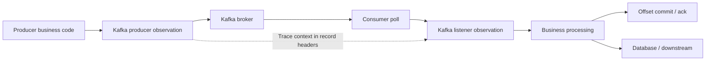
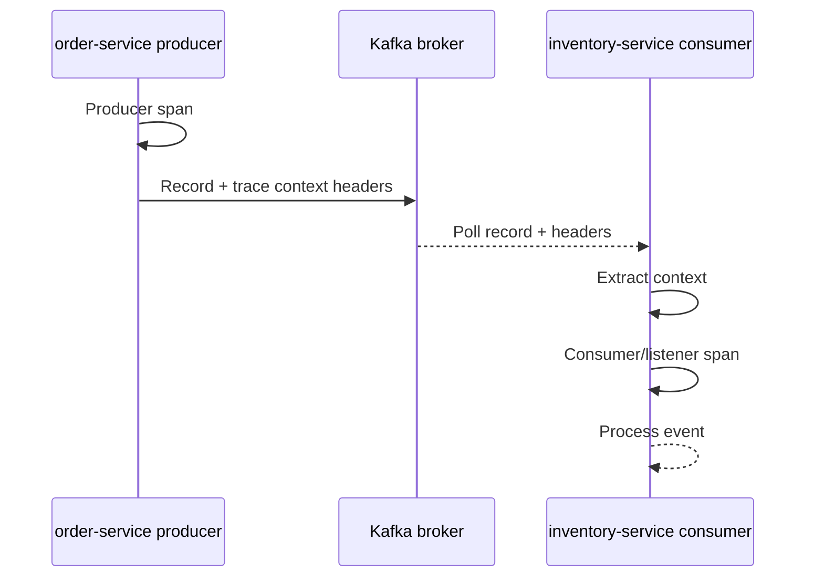
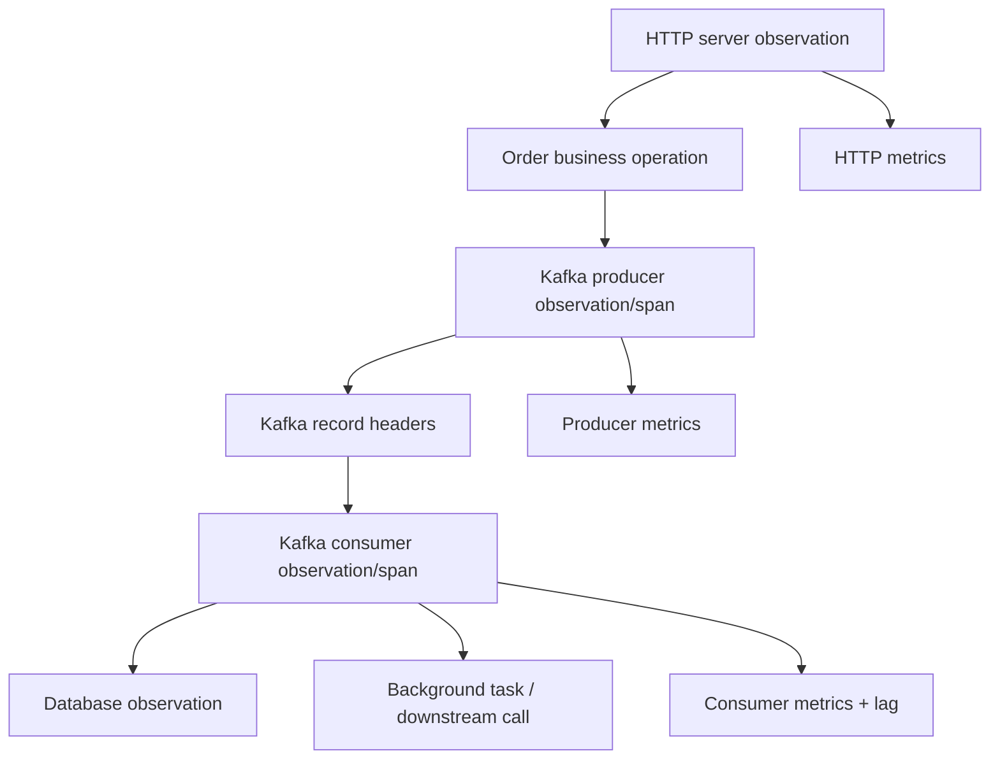

# Kafka instrumentation boundary in Spring Boot

An HTTP request is handled in `order-service`, which then emits a Kafka event so `inventory-service` updates stock. The HTTP request may return success before the consumer processes the message. If you only observe HTTP requests, operations teams cannot tell whether the message was sent to the broker, whether the consumer received it, how long processing took, or whether retries are causing duplicate processing. **Kafka instrumentation boundaries** help place observations accurately at the producer, broker, and consumer boundaries to understand the entire asynchronous flow.

In Spring Boot, Spring for Apache Kafka provides Micrometer Observation integration points for Kafka producers and listeners when enabled/configured appropriately. Observations can create metrics and tracing spans via registered handlers. However, producer send, broker acknowledgement, listener execution, and offset commit are distinct stages; no single span or metric should be treated as proof of the entire message lifecycle.

The **Kafka instrumentation boundary** lesson belongs to the **Messaging and task observability** chapter of the **SPRING_BOOT_OBSERVABILITY** module. The module focuses on setting up observability for Spring Boot using Micrometer Observation, metrics, logs, and distributed tracing; teaching context propagation, tags/cardinality, exporters, sampling, and signal correlation to investigate errors, latency, and application behavior in production.

## 1. Learning objectives

After this lesson, you will be able to:

- Distinguish producer, broker, consumer listener, and offset commit boundaries.
- Enable Micrometer Observation for Kafka in Spring Boot.
- Understand how metrics and tracing are generated on the producer/consumer sides.
- Distinguish send completion, broker acknowledgement, and business processing completion.
- Monitor consumer lag, processing duration, retries, and dead-letter flows.
- Understand how trace context is propagated in Kafka record headers.
- Avoid high-cardinality tags and keep payloads/PII out of telemetry.
- Diagnose message duplication, missing spans, retry storms, and commit failures.

## 2. What instrumentation boundaries exist in Kafka?

A message passing through Kafka goes through multiple stages:

1. **Producer application:** creates the event and invokes `KafkaTemplate`/producer API.
2. **Producer client:** serializes the record, sends the request, and receives broker acknowledgement according to producer configuration.
3. **Broker:** receives, appends, and persists the record according to partition/replication policy.
4. **Consumer client:** polls records from the broker.
5. **Listener:** deserializes and executes the business handler.
6. **Offset management:** commits the offset per ack mode/transaction semantics.
7. **Downstream work:** may emit further events, call databases, or invoke HTTP services.



Producer observation and listener observation measure two different parts. The time the broker holds a message before the consumer processes it is not necessarily included in the producer or listener span duration. Measuring end-to-end event age requires timestamps/lag measurements or explicit correlation mechanisms.

## 3. Enabling Kafka observations in Spring Boot

With Spring Boot and Spring for Apache Kafka versions supporting Micrometer Observation, configure listener observation and template observation using the corresponding properties:

```yaml
spring:
  kafka:
    template:
      observation-enabled: true
    listener:
      observation-enabled: true
```

Property names and auto-configuration vary across Spring Boot/Spring Kafka versions. Check your application's configuration metadata; if you manually configure factories/containers, enable observation on the specific `KafkaTemplate` or listener container factory rather than assuming a global property automatically applies to every instance.

### Dependencies

A Spring Boot Kafka application typically includes the starter:

```kotlin
dependencies {
    implementation("org.springframework.boot:spring-boot-starter-actuator")
    implementation("org.springframework.kafka:spring-kafka")
}
```

The Spring Boot BOM manages compatible versions. If the application uses tracing, add an appropriate tracing bridge (Brave or OpenTelemetry) and matching exporter according to your architecture. Do not add two bridges simultaneously just to create duplicate spans.

### ObservationRegistry and handlers

The Kafka integration uses Micrometer Observation when enabled. `ObservationRegistry` coordinates metrics/tracing handlers:

- The metrics handler records producer/consumer observations to `MeterRegistry`.
- The tracing handler creates spans via the Micrometer Tracing bridge.
- The propagator injects/extracts trace context via record headers if integration is configured.

If you have a custom `ObservationRegistry` or manual configuration, make sure Kafka components use the registry carrying the application's handlers. An empty registry can prevent observations from producing expected metrics/traces.

## 4. Producer boundary: sending a message does not mean the consumer processed it

Example producer sending an event:

```java
import org.springframework.kafka.core.KafkaTemplate;
import org.springframework.stereotype.Service;

@Service
public class OrderEventPublisher {
    private final KafkaTemplate<String, OrderCreated> kafkaTemplate;

    public OrderEventPublisher(
            KafkaTemplate<String, OrderCreated> kafkaTemplate) {
        this.kafkaTemplate = kafkaTemplate;
    }

    public void publish(OrderCreated event) {
        kafkaTemplate.send("orders.created", event.orderId(), event);
    }
}

record OrderCreated(String orderId, String customerTier) {}
```

`KafkaTemplate.send()` returns a future for the send result. Producer observation typically wraps the send and corresponding completion callback. Exact behavior depends on version and producer configuration.

Distinguish:

| Milestone | What it proves |
| --- | --- |
| Business code calls send() | The application requested sending the record |
| Producer future completes successfully | Producer received a successful send result per configured semantics/acks |
| Broker acknowledgement | Broker acknowledged per current `acks` and replication policy |
| Consumer listener completes | Listener processed the record per application semantics |
| Offset commit succeeds | Consumer progress was recorded per commit/transaction strategy |

A successfully completed producer span does not prove the consumer processed the event. If the business workflow needs to know when the consumer finishes, there must be a separate acknowledgement/event response or business state.

### Producer configuration affects semantics

Settings such as `acks`, `retries`, idempotence, delivery timeout, and transaction configuration affect when a send is considered successful and the possibility of duplicates. Metrics/tracing must be interpreted alongside producer configuration; do not interpret span success as an exactly-once guarantee for the entire business workflow.

## 5. Consumer boundary: poll, listener, and commit

Example listener:

```java
import org.springframework.kafka.annotation.KafkaListener;
import org.springframework.stereotype.Component;

@Component
public class OrderCreatedListener {

    @KafkaListener(topics = "orders.created", groupId = "inventory-service")
    public void handle(OrderCreated event) {
        reserveInventory(event.orderId());
    }

    private void reserveInventory(String orderId) {
        // Business operation
    }
}
```

When listener observation is enabled, Spring Kafka can create an observation/span for the listener processing the record. Consumer processing duration typically measures the listener callback/observation scope per integration; it does not necessarily include the entire time the record sat in the broker before polling.

### Offset commit differs from listener completion

Successful listener return and offset commit are related milestones, but they are not identical across all ack modes:

- With auto vs. manual ack, commit timing differs.
- A batch listener can process multiple records in one callback.
- A transactional listener can commit offsets together with a Kafka transaction.
- A retry/error handler can seek, pause, republish, or send records to a DLT.

When investigating duplicates or lost messages, inspect ack mode, transaction boundaries, retry policy, and business handler idempotency.

## 6. Producer and consumer metrics

Micrometer/Spring Kafka can provide metrics for producer, consumer, and listener observations. Exact meter names depend on Spring Kafka, Kafka client, Micrometer, and registry versions.

| Group | Operational questions |
| --- | --- |
| Kafka client metrics | Producer throughput, request latency, retries, buffer exhaustion, consumer fetch/poll behavior |
| Observation-derived metrics | Producer/consumer operation duration, counts, outcomes, and low-cardinality dimensions |

Some observation meters may follow conventions such as `spring.kafka.template` and `spring.kafka.listener`; verify actual meter names via Actuator or the registry rather than hardcoding names from another version.

### Reading metrics via Actuator

Expose the metrics endpoint according to policy:

```yaml
management:
  endpoints:
    web:
      exposure:
        include: health,metrics
```

Inspect the list of meters:

```http
GET /actuator/metrics
```

Then query a specific meter using its actual name:

```http
GET /actuator/metrics/spring.kafka.listener
```

This is an illustrative example name; names may vary by version/configuration. Actuator returns current in-process values, not historical time series for the entire cluster.

### Consumer lag

Consumer lag reflects the difference between the consumer group's committed position and the partition's log end offset. This is a critical indicator of whether consumers are keeping up with producers. Lag can be provided by the Kafka client/exporter/monitoring platform; it should not be inferred from listener duration alone.

Rising lag can be caused by an arrival rate exceeding processing throughput, unsuitable consumer concurrency/partition assignment, slow handlers due to database/HTTP dependencies, frequent consumer rebalances, retries/pauses/error handling reducing throughput, or a consumer failing to commit offsets/getting stuck.

## 7. Tracing via Kafka record headers

Distributed tracing needs to propagate trace context from producer to consumer. With appropriate Spring Kafka observation/tracing integration, the propagator can inject context into Kafka record headers on send and extract it on receive.



Record headers carry context, not the business payload. The Trace ID can stay constant across the producer/consumer boundary; span IDs change per operation. Depending on the integration, consumer spans may link via parent-child or span links, especially during batch consumption or when multiple records have multiple parent contexts.

### Inspecting headers

1. Confirm producer observation/tracing is enabled.
2. Send a record identifiable by a non-sensitive test business key.
3. Inspect injected headers (e.g., W3C `traceparent`) using safe tooling.
4. Confirm the consumer receives the same context and the trace backend shows the expected linkage.

Do not manually serialize the trace ID into the JSON payload or craft tracing headers manually if the framework propagator already handles it. Do not use trace context as an identity or authorization credential.

## 8. Batch consumption and span links

A consumer can receive one record or a batch. Within a batch, records may come from many different traces. A single listener span cannot always have a single parent span that accurately represents all records.

Tracing integrations can use span links to connect the consumer processing span to multiple producer contexts. Exact behavior depends on Spring Kafka/Micrometer Tracing version and batch listener instrumentation.

When reading traces:

- A consumer span with a simple parent can fit single-record processing.
- A batch consumer can use links to multiple producer spans.
- Do not conclude trace propagation is broken just because a batch span lacks a single-record parent-child tree.
- Check the integration documentation and your backend's trace graph semantics.

## 9. Retries, error handlers, and Dead Letter Topics

Message processing can fail due to database timeouts, validation errors, unavailable dependencies, or bugs. Retries can happen inside the listener container or by republishing messages. When observing, distinguish the initial attempt from retry attempts.

| Stage | Question |
| --- | --- |
| Listener attempt | How long did one processing attempt take and what was the outcome? |
| Retry | How many attempts occurred, and how long was the delay? |
| Recovery | Was the record handled by a recoverer or moved to a DLT? |
| DLT consumer | How are failed messages read/re-investigated? |
| Offset commit | At what point is the offset committed? |

Retries can cause an event to be processed multiple times. Business handlers should be idempotent or use an appropriate deduplication strategy. Do not use a `messageId` metric tag as a dimension if each message has its own unique ID.

### Trace continuity during retries

Depending on the retry mechanism, a retry may continue the old context, create a new operation, or republish the record with preserved/modified headers. Inspect the actual headers and spans. When moved to a DLT, the trace may need to link back to the initial processing attempt for investigation.

## 10. Cardinality and message data protection

Do not put high-cardinality or sensitive values into metric tags:

- Message keys that may be order/customer IDs.
- Unique message IDs or correlation IDs.
- Full topic names if topics are dynamically created per tenant.
- Payload fields, emails, phone numbers, addresses, or payment data.
- Trace ID/span ID.
- Exception messages containing SQL/credentials/payloads.

Appropriate dimensions are typically:

| Dimension | Example |
| --- | --- |
| Topic (finite set) | orders.created, inventory.updated |
| Consumer group | inventory-service |
| Operation | send, receive, process |
| Outcome | success, error, retry, recovered |
| Partition | Consider carefully; partition count is finite but can grow per cluster |

Topics/groups/partitions still require control if created dynamically. Payload logging should be turned off or redacted per schema; log only necessary metadata with access control and retention policies.

## 11. Correlating Kafka with HTTP, database, and task observations

A request can emit a Kafka event and finish; the consumer processes it later in another process. For end-to-end investigation, correlate:



The HTTP response may complete before consumer processing. If the business requires confirmation of completion, emit a separate acknowledgement status/event or track workflow state; do not infer it from the producer span.

For scheduled/background tasks not started from Kafka, create observations at the separate task boundary and propagate context if there is a parent workflow. Avoid using a single span lasting hours; use policy-compliant workflow/run identifiers and span links/events if the tracing model requires them.

## 12. Troubleshooting Kafka instrumentation

| Symptom | Possible cause | Investigation approach |
| --- | --- | --- |
| Producer metrics exist but no producer span | Tracing handler/bridge not enabled or rejected by sampling | Check ObservationRegistry, bridge, and sampler |
| Producer span ends but consumer has not processed | Span only measures the send/ack boundary | Check consumer lag and listener observations |
| Consumer span starts a new root trace | Headers not injected/forwarded/extracted | Check record headers and propagator |
| No listener observation | Observation not enabled on container factory | Check properties and custom factories |
| Listener duration increases | Slow business handler/dependency or large batch | Inspect child spans, database/client timings |
| Lag increases while listener duration is low | Arrival rate, partition assignment, poll/commit/rebalance | Check consumer group metrics |
| Duplicate business events | Retries, redelivery, offset commit, or producer retry semantics | Check idempotency and commit strategy |
| DLT grows rapidly | Persistent handler failures or recovery policy | Check exception classes, retry counts, and downstream health |
| Trace context lost on retry/DLT | Headers not preserved or custom republish | Check headers at each hop |
| Batch trace graph is hard to read | Multiple parent contexts, span links | Check batch instrumentation semantics |
| Metrics cardinality increases | Message key/ID or payload field used as a tag | Remove high-cardinality tags |
| SQL/payload exposed in logs | Overly verbose listener debug logging | Redact and limit log scope |

### Investigation checklist

1. Confirm producer and listener observations are enabled on the right beans/factories.
2. Send a test record with a known topic/group.
3. Check the producer send result and broker acknowledgement semantics.
4. Inspect consumer group lag, polls, and listener execution.
5. Verify trace headers are injected and extracted.
6. Correlate listener completion with offset commit/transaction.
7. Check retries, DLT, duplicate handling, and idempotency.
8. Check metric tags, payload redaction, and the exporter pipeline.

## 13. Lab exercise: tracking an order event through Kafka

**Scenario:** `order-service` emits `orders.created`; `inventory-service` consumes it and reserves stock. We need to know how the event is sent, received, processed, and offset-committed.

### Part A — Preparation

1. Configure Spring Kafka and a test broker.
2. Enable template/listener observation using the properties supported by your version.
3. Configure `MeterRegistry` and a tracing bridge/exporter if needed.
4. Create the producer and listener following the examples.
5. Expose Actuator metrics in the test environment.

### Part B — Verification

| Case | Action | What to observe |
| --- | --- | --- |
| A — Producer success | Send a valid event | Producer observation/send result succeeds |
| B — Consumer success | Listener processes the record | Listener observation duration is recorded |
| C — Broker delay | Pause the consumer | Producer still sends; consumer lag rises |
| D — Handler failure | Throw a controlled exception | Error/retry observations and retry count |
| E — DLT | Exceed retry limit | Record is recovered/DLT'd per policy |
| F — Context | Enable tracing and send a record | Trace context in headers, consumer links properly |
| G — Offset | Use selected ack/transaction mode | Commit behavior matches configuration |
| H — Cardinality | Send multiple order IDs | Metric series do not create a tag per ID |

### Part C — Self-assessment questions

1. Why does producer send success not equate to completed consumer business processing?
2. Which producer configurations affect broker acknowledgement?
3. How does listener completion differ from offset commit?
4. What does consumer lag tell you that listener duration does not?
5. How is trace context transmitted through a Kafka record?
6. When batch-consuming multiple records, why might span links be more suitable than a single parent?
7. How can retries and redelivery create duplicate business effects?
8. Why shouldn't message key/message ID be used as a metric tag?
9. How do you preserve trace correlation across retries and DLT?
10. If an HTTP request succeeds but consumer lag rises, which boundary needs investigation?

## 14. Takeaways

**Kafka instrumentation boundaries** separate producer send, broker acknowledgement, consumer listener execution, and offset commit. Spring Kafka can integrate Micrometer Observation into `KafkaTemplate` and listener containers when enabled properly for the version. Metrics handlers record measurements; tracing handlers create spans, and propagators can transmit trace context through record headers.

A successful producer span does not prove the consumer processed the message. Correlate producer results, broker/client metrics, consumer lag, listener duration, retries, DLT, and offset commits. For batch processing, trace links can represent multiple producer contexts; for retries, inspect headers and idempotency. Keep tags low-cardinality, avoid logging sensitive payloads, and do not use message IDs as metric labels. Observing each boundary accurately connects HTTP, Kafka, databases, and background tasks while distinguishing broker latency, consumer processing, and workflow failures.
