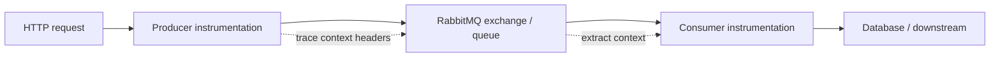
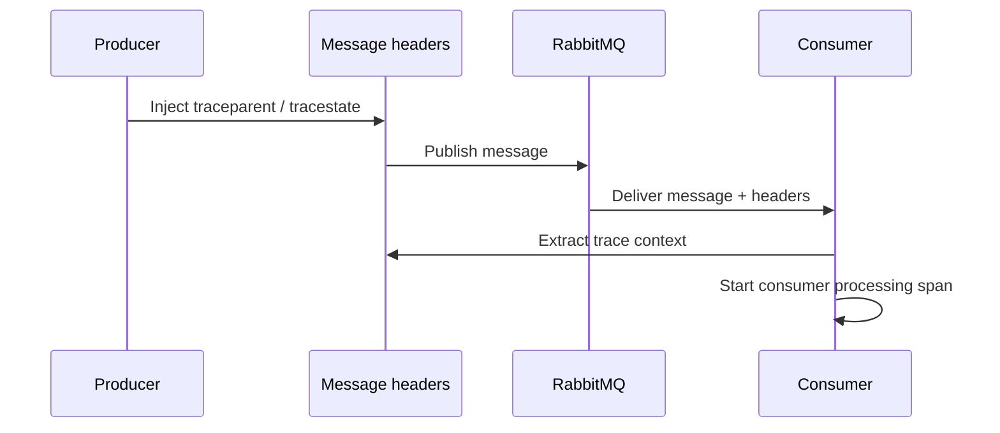

# RabbitMQ instrumentation boundary in Spring Boot

In a Spring Boot application using RabbitMQ, a business operation may start in an HTTP request, get published as a message, and continue processing in a consumer in another process. If you only instrument the HTTP server, you see the initial request but not how the message moves through the broker or how the consumer handles it. **RabbitMQ instrumentation boundaries** define where telemetry is created on the producer side, where context is injected/extracted, and where the consumer starts/ends its processing span to connect asynchronous steps into an investigable flow.

The **RabbitMQ instrumentation boundary** lesson belongs to the **Messaging and task observability** chapter of the **SPRING_BOOT_OBSERVABILITY** module. The module teaches how to set up observability for Spring Boot using Micrometer Observation, metrics, logs, and distributed tracing; covering context propagation, tags/cardinality, exporters, sampling, and signal correlation to investigate errors, latency, and application behavior in production.

After this lesson, you will be able to distinguish producer, broker, and consumer boundaries; understand Spring AMQP observation support; configure context propagation via message headers; analyze ack/retry/DLQ and batch processing; avoid duplicate spans; and test trace continuity alongside messaging metrics.

## 1. Why is RabbitMQ instrumentation needed?

An HTTP request often finishes before the consumer processes the message. If the API only records publish duration, you will not know how long the message waited in the queue, which consumer received it, how long the consumer took to process it, whether retries/rejects/DLQs occurred, whether failures happened in the producer/broker/handler, and whether the message correlates with the trace started by the HTTP request.

Instrumentation needs to observe at least three boundaries:

1. **Producer:** the application creates and sends the message.
2. **Broker transport:** the message is routed, stored in a queue, and delivered to a consumer. Time spent in the broker is usually measured indirectly via timestamps/queue metrics rather than an internal application span.
3. **Consumer:** the application receives the message, runs the business handler, and acks/rejects/nacks.



Producers and consumers typically run at different times, often in different processes or hosts. Trace context must be injected into message headers and extracted on the consumer to establish the proper trace relationship.

## 2. Identifying which boundaries belong to the application

| Boundary | Executed by | Appropriate telemetry |
| --- | --- | --- |
| Business event creation | Producer application | Business Observation/span |
| Message publish | RabbitTemplate / producer client | Producer span, publish outcome, duration |
| Exchange routing | RabbitMQ broker | Broker metrics, topology, and queue metrics |
| Queue waiting | Broker | Queue depth, ready/unacked, enqueue/consume timestamps if available |
| Message delivery | Broker + consumer client | Consumer receive/delivery instrumentation |
| Business processing | Consumer application | Process span/Observation, result/error |
| Ack/reject/nack | Consumer client/protocol | Delivery outcome, retry/DLQ metrics |

A producer span typically measures the publish operation through the client API, not the entire time the message sits in the queue. A consumer span measures the time from when the consumer receives/dispatches the message until processing completes per instrumentation semantics. To know queue delay, you need timestamps/queue metrics; do not infer queue latency by subtracting timestamps if clocks across hosts are not synchronized.

## 3. Spring AMQP Observation support

Spring AMQP supports Micrometer Observation for components like `RabbitTemplate` and listener containers in supported versions. When observation is enabled, producer and consumer operations can create Observations; tracing handlers can convert them into spans, and metrics handlers can create meters.

With Spring Boot, configuration typically lives in Spring AMQP properties and depends on the version. Illustrative example:

```yaml
spring:
  rabbitmq:
    template:
      observation-enabled: true
    listener:
      simple:
        observation-enabled: true
      direct:
        observation-enabled: true
```

Property names, listener container types, and default values vary across Spring Boot/Spring AMQP versions. Check the configuration metadata of the dependency in use. If the framework already enables Observation automatically, do not add custom instrumentation that creates the same producer/consumer spans again.

Observation can generate metrics even when tracing sampling does not record a span. Conversely, the exporter/backend only receives traces if the tracing handler, sampler, processor, and exporter are configured properly.

## 4. Producer boundary: recording publishes

Producer instrumentation should describe the publish operation with a stable name and useful metadata: messaging system RabbitMQ, destination/exchange or queue per appropriate convention, operation publish/send, routing key if needed with controlled cardinality, outcome success/failure, and publish call duration.

Example business code using `RabbitTemplate`:

```java
import org.springframework.amqp.rabbit.core.RabbitTemplate;
import org.springframework.stereotype.Component;

@Component
class OrderPublisher {
    private final RabbitTemplate rabbitTemplate;

    OrderPublisher(RabbitTemplate rabbitTemplate) {
        this.rabbitTemplate = rabbitTemplate;
    }

    void publish(OrderCreated event) {
        rabbitTemplate.convertAndSend(
            "orders.exchange",
            "orders.created",
            event
        );
    }
}
```

If observation support is enabled on `RabbitTemplate`, the publish operation can be instrumented by the framework. Do not wrap the code above with a redundant custom span unless there is a distinct need.

A successful publish call does not necessarily mean the consumer processed the message. Distinguish publisher confirm, routing return, broker acceptance, and consumer business completion. Each concept has its own signal.

## 5. Consumer boundary: receiving and processing messages

The consumer span should wrap message processing at the listener boundary. Example:

```java
import org.springframework.amqp.rabbit.annotation.RabbitListener;
import org.springframework.stereotype.Component;

@Component
class OrderCreatedListener {
    @RabbitListener(queues = "orders.created")
    void onMessage(OrderCreated event) {
        processOrder(event);
    }

    private void processOrder(OrderCreated event) {
        // Validate and apply the business event.
    }
}
```

The listener container can provide an Observation for receiving/processing if the corresponding instrumentation is enabled. Business methods should focus on the event and business logic; do not manually create a consumer span if the listener container already creates a span wrapping the same operation.

If you want to measure a separate business sub-step, name the span/Observation after the actual operation, such as `order.apply-created-event`, to distinguish it from the messaging receive span. Avoid two spans with the same name and the same lifecycle wrapping the entire listener.

## 6. Context propagation via message headers

HTTP tracing typically passes context via headers such as W3C Trace Context. RabbitMQ messages have their own properties/headers; producer instrumentation needs to inject trace context into message headers, and consumer instrumentation extracts context upon receiving the message.



When propagation is properly configured, the consumer trace can link to the producer context according to messaging semantic conventions and the tracing API. For messages processed long after publishing, some instrumentations/conventions may use span links instead of a direct parent-child relationship; the representation depends on the messaging model and OTel semantic conventions.

Do not manually embed trace IDs in the JSON payload to replace propagation headers. The payload is the business contract; trace context is transport metadata. Use a propagator supported by the framework/bridge.

## 7. Headers, baggage, and sensitive data

Message headers can live long in the broker, be persisted durably, or pass through multiple services. Therefore, propagate only necessary context:

- Standard trace context such as `traceparent`/`tracestate`.
- Baggage only with an allowlist and a clear justification.
- Never transmit Authorization, cookies, session tokens, or secrets.
- Never include PII/customer identifiers in baggage by default.
- Limit the size and number of custom headers.

Baggage can be copied across multiple services and appear in downstream telemetry. Do not use it as a container for business payloads. Trace context is also not proof of authentication or message authorization.

## 8. Publish confirms, routing returns, and consumer acks

| Outcome | Meaning |
| --- | --- |
| Publish API returned | Client call completed per API semantics |
| Publisher confirm ack | Broker confirmed the publish per confirm mode |
| Mandatory return | Message could not be routed to a matching queue |
| Consumer ack | Consumer confirmed delivery was processed per ack mode |
| Consumer nack/reject | Consumer did not accept delivery |
| Requeue | Message can be returned to the queue for another processing attempt |
| Dead-letter | Message is routed to a DLQ per policy/topology |

A publish span should not be interpreted as "business transaction completed." Producer confirm does not prove the consumer succeeded; consumer ack does not necessarily prove external side effects completed if the code acks at the wrong time.

Instrument outcomes at the right boundary. If using manual ack, clearly define when the ack occurs and whether the business operation has committed. If you ack before the database transaction commits, messages can be lost if the process fails in between.

## 9. Retries and dead-letter queues

Retries can occur in the listener container, application code, or broker topology. Each delivery/retry should be distinguished by retry count/attempt, exception category, requeue/reject, and DLQ destination.

Do not use arbitrary message IDs as metric tags. If you need to locate a specific message, use log fields or trace attributes per policy with restricted access and retention.

Retries can create multiple consumer spans for the same logical message. That is not duplicate instrumentation if each span represents a distinct delivery/attempt. Use attempt metadata with appropriate cardinality and correlate attempts using safe context/identifiers.

A DLQ is another queue and may have its own consumer. Observe both publishing to the DLQ and processing from the DLQ; never treat a message entering the DLQ as business success.

## 10. Batch consumption and concurrency

A listener can receive one message at a time or a batch of multiple messages, depending on container/configuration. Instrumentation semantics must be clear:

- One span per message or one span for the whole batch?
- Does a batch failure affect all messages or only a subset?
- Is ack performed per message or per batch?
- Does retrying one message replay the entire batch?
- Does consumer concurrency increase pending/unacked counts and DB pool usage?

If one span represents the whole batch, record batch size as a bounded numeric attribute rather than putting all IDs into the span name. If individual messages need tracing, use a span/link strategy aligned with conventions and avoid creating too many spans beyond sampling/budget limits.

High concurrency can raise consumer throughput until downstream services or the database saturate. Combine RabbitMQ queue metrics with Hikari pool metrics, HTTP/DB latency, and consumer processing duration.

## 11. Messaging semantic conventions and naming

OpenTelemetry defines semantic conventions for messaging so backends understand publish/receive/process operations consistently. Exact attributes depend on the convention version and instrumentation library.

| Concept | Example value | Notes |
| --- | --- | --- |
| Messaging system | rabbitmq | Name of the messaging system |
| Destination | orders.created | Queue/topic/exchange per current convention |
| Operation | publish, receive, process | Distinguish the operation |
| Consumer group/name | orders-worker | Stable consumer name |
| Message body size | number of bytes | Do not log body contents |
| Error type | timeout, validation | Use stable categories |

Do not guess attribute keys and treat them as standard. Check OTel semantic conventions and the instrumentation library version. Conventions can change between experimental and stable versions; align schemas during upgrades.

## 12. Metrics for RabbitMQ and consumers

Observation/tracing does not replace broker metrics. A messaging dashboard should include queue ready messages, unacknowledged messages, publish rate and deliver/consume rate, consumer processing duration, consumer error/retry count, DLQ message count/rate, consumer concurrency/utilization, and connection/channel health.

Continuously rising queue depth while consume rate is low can signal insufficient consumer capacity or slow downstream services. Rising unacked counts can result from consumers processing slowly, batch/concurrency settings, or delayed acks.

Metric names depend on the RabbitMQ management plugin, exporter, Spring AMQP/Micrometer binder, and backend. Distinguish broker-side metrics from application-side listener timers; the two sources may measure different phases.

## 13. Testing instrumentation boundaries

| Test | What to prove |
| --- | --- |
| Producer observation test | Publish creates an observation/span with the right operation |
| Header propagation test | Trace context is injected into message headers |
| Consumer extraction test | Consumer restores parent context or links properly |
| Error test | Publish/processing failures are marked accurately |
| Ack/retry test | Delivery outcomes and retry attempts are not confused |
| DLQ test | Message reject/dead-letter is observed |
| Batch test | Batch size/failure semantics are reflected accurately |
| Duplicate instrumentation test | A single publish/consume operation has no redundant spans |

### Testing propagation with a test message

```java
// Pseudocode:
// 1. Create a producer Observation/Span in the test context.
// 2. Send a message via the instrumented RabbitTemplate.
// 3. Capture the message from a test queue.
// 4. Verify headers contain the injected trace context.
// 5. Invoke the listener under consumer instrumentation.
// 6. Assert the consumer span has the expected trace relationship.
```

This is pseudocode, not a concrete test API for every Spring AMQP version. Integration tests should use a RabbitMQ test container or dedicated test broker rather than relying on a production broker.

## 14. Common mistakes

| Symptom | Possible cause | How to check |
| --- | --- | --- |
| Producer span exists but consumer trace is detached | Context not injected/extracted | Check message headers and propagation integration |
| Two producer spans for one publish | Spring Observation and custom span both instrumenting | Pick one instrumentation owner |
| Publish span succeeds but message never reaches queue | Routing/confirm/mandatory return or wrong topology | Check exchange, binding, routing key, and confirms |
| Consumer span ends yet message retries | Ack/retry semantics differ from expectations | Check container ack mode, exception/retry policy |
| Queue depth grows, consumer latency grows | Low consumer capacity or slow downstream | Correlate processing duration, DB pool, and dependency spans |
| DLQ grows while error metric stays low | DLQ path uninstrumented or metrics don't classify outcomes | Check reject/dead-letter counters |
| Baggage/headers too large | Propagating too many custom fields | Allowlist and limit header size |
| Trace has high-cardinality message IDs | IDs placed into metric tags | Move IDs to policy-governed log/trace fields |
| Batch span hides failing message | Batch failure lacks per-message context | Design batch semantics/links and logs |
| Consumer trace has no parent | Message published without context or dropped by sampling | Check producer context, sampling, and links |

## 15. Real-world scenario: HTTP request succeeds but order is not processed

**Hypothetical scenario:** The API returns `202 Accepted` after publishing `OrderCreated`. Some orders do not appear downstream. HTTP metrics look healthy; queue depth is rising and consumer logs show retries.

Investigation workflow:

1. **Check the producer:** verify publish observation, publisher confirms, and routing returns; HTTP `202` only states the API accepted the request per contract.
2. **Check the queue:** inspect ready/unacked depth, publish rate, and consume rate to see if messages are being routed and delivered.
3. **Check context:** open the producer trace and confirm trace context is present in message headers.
4. **Check the consumer:** find consumer processing spans/logs by trace context; inspect duration and exception categories.
5. **Check retries:** correlate attempt count, requeue/reject, and DLQ routing.
6. **Correlate the database:** check transactions/connection pools and whether the consumer commits before acking.
7. **Verify the fix:** publish a test message, watch the queue drain, confirm consumer success, ack, and downstream side effects.

Do not conclude a successful publish means the business workflow finished. Observe across producer, broker routing, consumer processing, and side effects.

## 16. Self-check exercises

**Exercise 1.** Does a producer span measuring publish duration include queue waiting time?

*Hint:* Usually no. Queue delay belongs to the broker lifecycle and requires queue metrics/timestamps to observe.

**Exercise 2.** Why should trace context live in message headers rather than the business payload?

*Hint:* Context is transport metadata, not the business contract; use a standard propagator to inject/extract.

**Exercise 3.** Does a publisher confirm ack prove the consumer processed the message?

*Hint:* No. Confirms relate to broker acceptance; consumer processing/ack is a different boundary.

**Exercise 4.** What does rising queue depth alongside rising Hikari pending threads suggest?

*Hint:* Consumers may be blocked by the database connection pool or slow transactions/queries; check usage/acquire and DB metrics.

**Exercise 5.** Why shouldn't message IDs be put into metric tags?

*Hint:* IDs typically have very high cardinality; use controlled logs or trace attributes to investigate individual messages.

**Exercise 6.** Is a consumer retry creating multiple spans always duplicate instrumentation?

*Hint:* No. Each delivery/attempt can be a distinct operation; represent attempt semantics clearly.

**Exercise 7.** Why does a batch listener require dedicated instrumentation design?

*Hint:* A batch contains multiple messages and may have partial failures/different acks; span boundaries must reflect those semantics accurately.

**Exercise 8.** HTTP returns `202` but the message ends up in the DLQ. Which boundaries need observation?

*Hint:* Producer publish/confirm/routing, broker queue, consumer processing, retry/reject, and DLQ processing.

## 17. Takeaways

- RabbitMQ instrumentation must distinguish **producer publish**, **broker queue/routing**, and **consumer processing**; one span does not represent the entire workflow.
- Spring AMQP Observation support can instrument `RabbitTemplate` and listener containers; verify properties/versions and avoid creating duplicate spans.
- Pass trace context through message headers using standard propagation integration; do not embed trace IDs in business payloads or manually manage `ThreadLocal`.
- Publisher confirms, routing returns, consumer ack/reject, and DLQ are distinct outcomes; do not equate publish success with business completion.
- Queue depth/unacked counts, consume rate, processing duration, retries, and DLQ metrics complement traces and logs.
- Batching and concurrency alter span and ack semantics; design boundaries suited for single messages or batches.
- Keep baggage/headers small and safe; do not transmit credentials, secrets, or unnecessary PII.
- Use integration tests with a test broker to verify propagation, retries, acks, and absence of duplicate instrumentation; combine RabbitMQ metrics with database pool and HTTP telemetry to locate bottlenecks.
