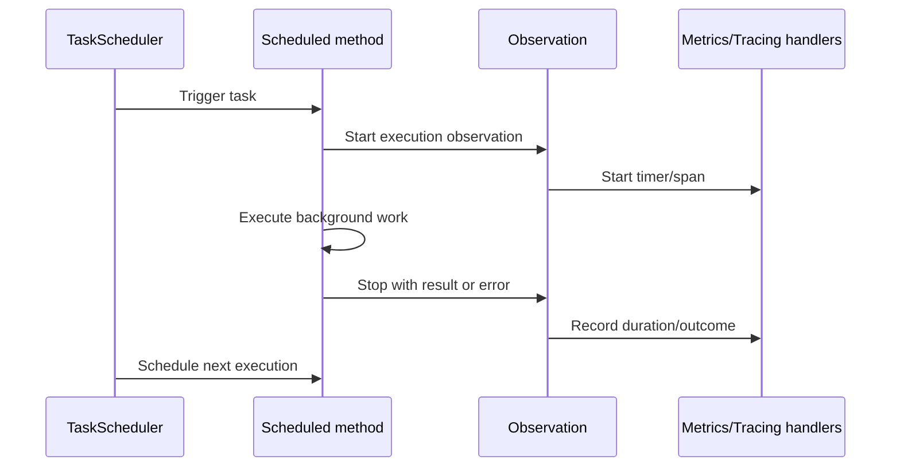
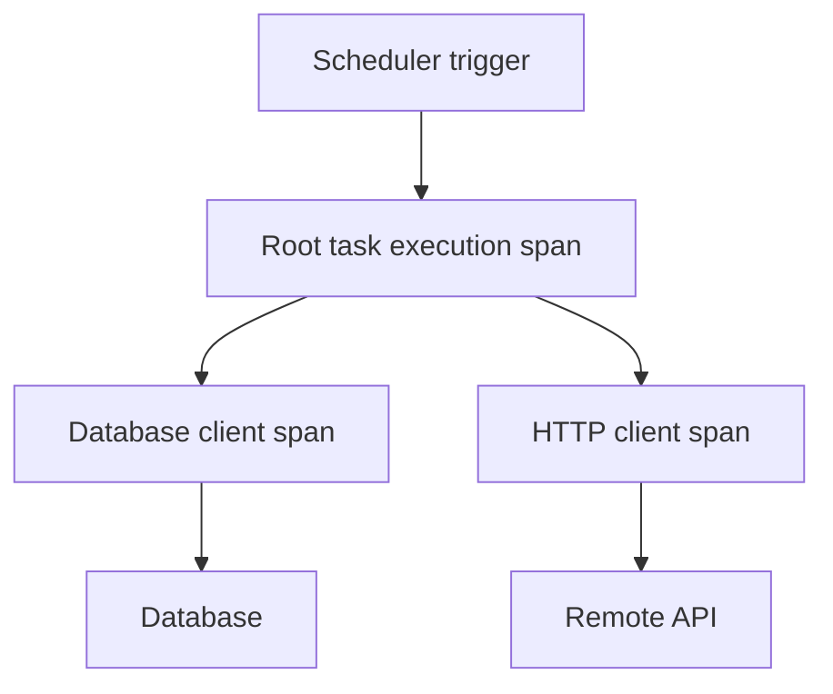

# tasks.scheduled.execution in Spring Boot

Spring Boot applications frequently run periodic work such as data synchronization, expired record cleanup, cache refreshing, report aggregation, or dependency checks. Scheduled tasks sit outside the normal HTTP request lifecycle, yet they consume CPU, threads, database connections, and external system resources. When a run is slow, fails, or overlaps with the next run, operations teams need to know which task ran, how long it took, what the outcome was, and which instance executed it.

**tasks.scheduled.execution** is an observation describing a single scheduled task execution. It records the start/end lifecycle, duration, outcome, and errors. In Spring Boot, scheduling can be enabled with `@EnableScheduling` and declared via `@Scheduled`; the scheduler executes the method on a managed thread. Observations may be created automatically in some integrations/versions or require additional instrumentation depending on the stack. Do not assume `@Scheduled` automatically produces complete metrics and spans in every version.

This lesson belongs to the **Messaging and task observability** chapter of the **SPRING_BOOT_OBSERVABILITY** module. The module teaches how to set up observability for Spring Boot using Micrometer Observation, metrics, logs, and distributed tracing; covering context propagation, tags/cardinality, exporters, sampling, and signal correlation to investigate errors, latency, and application behavior in production. This lesson focuses on scheduled task execution observation, naming, measuring duration/outcomes, and correlating logs/traces for background work.

## Learning objectives

1. Explain scheduled task execution and distinguish it from HTTP requests and message consumption.
2. Describe the lifecycle of a single `@Scheduled` task run.
3. Understand the roles of `TaskScheduler`, scheduler threads, and executors.
4. Design stable observation names, task identities, and low-cardinality dimensions.
5. Measure execution count, duration, success/failure, and task lag.
6. Create Observations/metrics/tracing when the framework does not instrument automatically.
7. Handle exceptions, retries, overlaps, and concurrency.
8. Understand background task trace context and how to create root/linked spans.
9. Test schedule execution, failures, cancellation, and shutdown.
10. Operate scheduled tasks with dashboards, alerts, and runbooks.

## 1. What is a scheduled task execution?

A scheduled task is work triggered according to a schedule or periodic interval. Spring scheduling commonly uses `@Scheduled` on a bean method. Triggers can be based on fixed rate, fixed delay, or a cron expression.

- **fixedRate:** the next run is scheduled at an interval measured from the start time of the previous run; scheduler/thread availability and execution model affect actual start times.
- **fixedDelay:** the delay is measured after the previous run completes.
- **cron:** runs according to a calendar expression and configured timezone.
- **one-time scheduling:** a task scheduled once via the scheduler API.

An Observation should represent **a single execution**, not merely the existence of the method or configured schedule. A task running every minute generates multiple execution observations, each with its own duration and outcome.



### 1.1. Schedule time and execution time

Distinguish when a task was scheduled to run from when it actually started. The scheduler can be delayed due to busy threads, JVM pauses, CPU contention, or another task occupying the worker. Measuring method duration alone does not reveal whether the task started on time.

If schedule timeliness matters, record scheduled time and actual start time in a low-cardinality manner to derive scheduling lag. Do not attach specific timestamps as metric tags.

### 1.2. Execution duration

Execution duration measures how long the task actually ran from start to finish. It can include SQL queries, HTTP calls, lock waits, computation, and sleeps. To find root causes, you need trace spans or dedicated metrics for dependency operations inside the task.

## 2. Spring scheduling runtime

Enable scheduling:

```java
@Configuration
@EnableScheduling
class SchedulingConfiguration {
}
```

Declare a task:

```java
@Component
class CacheRefreshJob {

    @Scheduled(fixedDelayString = "60000")
    void refresh() {
        // Refresh cache data.
    }
}
```

If no `TaskScheduler` is configured explicitly, Spring may choose a default scheduler depending on environment/version. To control thread pools, error handling, and lifecycle, configure a scheduler bean explicitly when the workload requires it.

### 2.1. Thread scheduling and concurrency

A single-threaded scheduler runs tasks sequentially; one slow task can delay another. A multi-threaded scheduler allows multiple concurrent executions, but can also allow runs of the same task to overlap if the schedule/trigger and execution model permit it.

Do not infer concurrency solely from `cron`/`fixedRate`. Verify the actual `TaskScheduler`, thread pool size, trigger semantics, and execution duration.

### 2.2. Fixed rate, fixed delay, and overlap

Fixed delay typically waits for the previous execution to finish before counting the delay until the next run for the same scheduled registration. Fixed rate aims for a fixed cadence; if a task runs longer than the period, the scheduler implementation may delay or overlap runs depending on the scheduling model and configuration. With multiple application replicas, the same `@Scheduled` method can run on every replica.

If work must run only once cluster-wide, use appropriate distributed coordination, leader election, or locking. Observation only makes overlaps visible; it does not prevent them.

## 3. Identifying scheduled tasks

An observation needs a stable name to identify the task. Example:

```text
cache.refresh
orders.expire
report.daily.aggregate
inventory.reconcile
partner.catalog.sync
```

Avoid using instance IDs, execution times, cron timestamps, or dynamic inputs in the observation name.

### 3.1. Task identity and instance identity

Task name describes the kind of work. Service name/version describes the application emitting telemetry. Instance ID can indicate which pod/host ran the task, but should only be a standard deployment resource attribute; do not mix it into the task name or metric tags if it adds unnecessary cardinality.

### 3.2. Schedule metadata

You can record schedule type such as `fixed-delay`, `fixed-rate`, or `cron` since the set of values is small. Do not record dynamic cron expressions as metric tags if configuration varies per tenant or is unbounded. Schedule expressions can live as config metadata in logs/tracing when needed for diagnosis.

## 4. Observation name and key-values

| Component | Example | Purpose |
|---|---|---|
| Observation name | tasks.scheduled.execution | Stable operation type |
| Task name | cache.refresh | Distinguish logical task |
| Scheduler type | thread-pool | Runtime grouping |
| Outcome | success, failure | Execution result |
| Exception | IllegalStateException | Bounded error category |
| Duration | 420 ms | Execution time |
| Instance/resource | service, pod | Telemetry source |

Exact naming conventions depend on the framework/integration. If using `tasks.scheduled.execution`, keep it consistent across metrics and tracing.

### 4.1. Low-cardinality keys

Suitable metric tags are typically an allowlisted task name, outcome, stable scheduler pool name, and bounded exception class. Avoid task inputs, customer IDs, file paths, tenant IDs, exception messages, or execution timestamps.

### 4.2. High-cardinality context

Trace attributes and log fields can hold execution IDs or correlation IDs when needed and permitted by policy. These values must not become meter tags. Locate a specific run by trace ID or log field rather than creating a time series per execution.

## 5. Manually instrumenting scheduled tasks with Micrometer Observation

If your Spring/framework version does not automatically create an observation for scheduled methods, wrap the execution with the Observation API:

```java
@Component
class CatalogSyncJob {
    private final ObservationRegistry observationRegistry;
    private final CatalogService catalogService;

    CatalogSyncJob(
            ObservationRegistry observationRegistry,
            CatalogService catalogService) {
        this.observationRegistry = observationRegistry;
        this.catalogService = catalogService;
    }

    @Scheduled(cron = "0 */5 * * * *")
    void sync() {
        Observation.createNotStarted(
                        "tasks.scheduled.execution",
                        observationRegistry)
                .lowCardinalityKeyValue("task.name", "catalog.sync")
                .observe(catalogService::synchronize);
    }
}
```

The Observation API manages start/stop around the callback; registered handlers can produce metrics and tracing. Depending on version, contextual names, error handling, or convention APIs may differ. Do not create a new empty `ObservationRegistry`; inject the registry configured by Spring Boot.

### 5.1. Recording exceptions

The `Observation.observe` callback can mark an error when an exception escapes the callback and is rethrown to the caller. If you catch the exception inside the callback and return normally, handlers may see the execution as successful. If the task has retries/fallbacks, clearly define the outcome of each attempt and of the logical execution.

### 5.2. Avoiding double instrumentation

If the framework or an agent already creates a scheduled execution observation/span, wrapping it in another observation with the same purpose can create duplicate timers/spans. Check existing meters and traces before adding custom instrumentation.

## 6. Duration, count, and outcome

Metrics for scheduled tasks should answer: how many times did the task run, how is duration distributed, what is the failure rate, which tasks missed their schedule, and which executions are running too long or overlapping?

A timer by task name and outcome can provide count and duration:

```text
tasks.scheduled.execution{
  task_name="catalog.sync",
  outcome="success"
}
```

Exact meter names and tag mappings depend on conventions and the registry. If a timer only records upon task completion, currently running executions are not reflected in count/duration until they finish. You may need a separate gauge or in-progress counter to monitor concurrent executions.

### 6.1. Success is not always business success

A method may finish normally while skipping part of the data or returning a partial result. Define outcomes according to the task's contract. For example, `success`, `partial`, `skipped`, and `failure` are useful if the value set is small, stable, and well-defined.

### 6.2. Duration does not measure scheduling lag

A task might run in 100 ms yet start 10 minutes late. If freshness or deadlines matter, additionally measure scheduling lag or last-success timestamp via a gauge/timestamp metric. Do not use raw timestamps as tags.

## 7. Scheduler pool and thread observability

`TaskScheduler` can use a thread pool. Observe pool size, active scheduler threads, queue size if supported by the implementation, task duration, scheduling lag, rejected executions, and thread saturation/JVM CPU/GC pauses.

If the scheduler has a single thread and task A calls a slow dependency, task B may be delayed even though B has no fault of its own. Thread pool metrics help detect contention at the scheduler layer.

### 7.1. Separating scheduler workloads

Long-running or blocking tasks should not occupy a small thread pool meant for short, time-sensitive tasks. You can configure multiple schedulers/pools by workload class, using stable names so metrics distinguish them. Avoid creating a dedicated pool for every single task if thread/resource overhead outweighs the benefit.

### 7.2. Blocking and reactive work

If a scheduled method constructs a reactive publisher without subscribing, the work may never run. If it subscribes fire-and-forget and the method returns immediately, an observation wrapping the method may end before the reactive work executes. Manage the lifecycle so the observation covers actual execution or place the observation inside the reactive pipeline.

## 8. Error handling, retries, and idempotency

Scheduled tasks generally run again on the next trigger, so a single execution failure does not necessarily stop the schedule. Spring's scheduler has configurable error handling behavior; decide whether exceptions are logged, propagated, or handled inside the method.

- Record errors once at the responsible boundary.
- Distinguish attempt failure from logical task failure.
- Retry with limits, backoff, and jitter where appropriate.
- Do not retry permanent errors such as invalid configuration or schema mismatches.
- Tasks must be idempotent if the same input/window can be reprocessed.
- Store checkpoints/watermarks to avoid gaps or duplicate processing.

### 8.1. Observation for retries

If a run retries 3 times, you can have an outer observation for the logical execution and child observations for each attempt. This shows both total duration and individual dependency calls. Put attempt numbers in trace/log context; do not add them as metric tags if they create extra series.

### 8.2. Do not swallow exceptions

If you catch and merely log an error and return normally, the scheduler and observation may treat the execution as successful. If policy requires failures to be visible, explicitly record the error/outcome or rethrow the exception per scheduler semantics. If a task handles partial failures intentionally, represent that with a distinct outcome.

## 9. Concurrency, overlap, and distributed locks

Within one instance, a multi-threaded pool can run multiple scheduled methods concurrently. Across multiple replicas, each replica normally runs its own scheduler, so the same schedule can trigger the task on every replica.

If a task must run only once across the cluster, use an appropriate coordination mechanism such as a database lock, clustered scheduler, or leader election. When locking is used, measure lock wait time, record `skipped`/`lock-not-acquired` outcomes, measure duration after lock acquisition, and manage leases/TTLs/renewals.

Observation does not replace distributed locking and does not guarantee exactly-once execution. Distributed systems generally require idempotency and checkpoints to handle retries and crashes safely.

## 10. Trace context for background tasks

Scheduled tasks do not start from an inbound HTTP request, so they normally lack a parent request span. An execution can start a new root trace with a span representing the scheduled task. If a task is triggered by a message/event or business workflow that has a trace context, you can continue that context or create a span link depending on the causal relationship.



Do not reuse a fixed trace ID for every run of the same task. Each independent execution normally needs its own trace identity.

### 10.1. Tasks creating child spans

Database/HTTP operations inside the task become child spans of the task execution span if the current context is maintained. The trace tree helps analyze which dependency calls occurred during a run.

### 10.2. Async boundaries

If a scheduled method submits work to an executor and returns, the task observation may stop too early. There are two options: wait for the work to complete within the current scope, or create a separate observation/span inside the worker for actual execution. Propagate context across the executor if causal relationships must be preserved.

### 10.3. Long tasks and trace volume

Tasks can run for hours or create many spans. Consider span lifecycle, event volume, sampling, and trace size. For large batches, create spans per batch/chunk rather than per individual record to avoid oversized traces.

## 11. Correlating logs and metrics

Logs for scheduled executions should have a stable event name, task name, outcome, duration, instance/resource context, and trace/span IDs if present. Do not log entire input batches or credentials.

```json
{
  "event.name": "tasks.scheduled.execution.completed",
  "task.name": "catalog.sync",
  "outcome": "success",
  "duration_ms": 420,
  "trace_id": "0af7651916cd43dd8448eb211c80319c",
  "span_id": "b7ad6b7169203331"
}
```

Metrics track count/duration/failures per task. Logs explain a specific execution. Traces describe the timeline and dependency calls. Do not add execution IDs or trace IDs into metric tags.

## 12. Testing scheduled task observation

Separate task logic from the trigger so tests can invoke the method/service directly instead of waiting minutes for cron schedules.

1. **Success:** observation starts/stops and duration is recorded.
2. **Failure:** exceptions are marked as errors with the appropriate outcome.
3. **Retry:** logical execution and individual attempts are distinguished.
4. **Overlap:** task runs longer than its period; verify concurrency behavior.
5. **Scheduler saturation:** one task blocks; observe lag on other tasks.
6. **Multi-instance:** two instances share the same schedule; verify lock/coordination if required.
7. **Async:** task submits to an executor; observation covers the actual work.
8. **Shutdown:** application stops while a task is running; verify interruption/cancellation policy.

### 12.1. Using a test ObservationRegistry

You can use a test `ObservationHandler` or an in-memory `MeterRegistry` to verify observation names and low-cardinality keys. For tracing, use a test span exporter to assert root/child spans and statuses. Metric tests do not replace trace propagation tests.

### 12.2. Controlling the scheduler

In integration tests, use a test/deterministic scheduler or trigger the task through a controlled method invocation. Do not use long `Thread.sleep` calls waiting for schedules. If testing scheduler lifecycle, use latches/futures with bounded timeouts.

## 13. Diagnosing abnormal scheduled tasks

| Symptom | Possible cause | How to check |
|---|---|---|
| Task runs without metrics | Missing observation instrumentation/handler | `ObservationRegistry` and meter registry |
| Metrics exist without spans | Tracing handler/bridge inactive | Tracer and exporter |
| Low duration yet task runs behind schedule | Scheduler lag/thread starvation | Scheduler pool, queue, JVM pauses |
| Task does not run on one replica | Scheduling not enabled or different bean/profile | Application context and scheduler logs |
| Task runs on all replicas | Each instance has its own scheduler | Replica count and coordination |
| Executions overlap | Multi-threaded pool or multiple replicas | Active executions, locks, schedule semantics |
| Observation ends before async work | Method submits and returns | Worker lifecycle/context |
| Failures not recorded | Exception caught/swallowed | Error handling/outcome mapping |
| Oversized traces | Per-record spans or overly long tasks | Batch/chunk instrumentation and sampling |
| Metrics cardinality increases | Dynamic task name/exception/tenant | Tag values and allowlists |
| Task B delayed behind task A | Scheduler thread blocked | Thread dump, pool size, execution duration |
| Lock timeouts increase | Distributed lock contention | Lock metrics/leases and owner logs |

### Investigation workflow

1. Identify task name, `cron`/`fixedRate`/`fixedDelay`, and timezone.
2. Verify the scheduled bean was initialized and triggered.
3. Inspect the last execution, duration, outcome, and scheduling lag.
4. Check the scheduler thread pool, queue, and rejected tasks.
5. Read exception logs and execution traces.
6. Inspect database/HTTP child spans and dependency latencies.
7. Check for execution overlaps and replica counts.
8. Check distributed lock/lease state if the task is cluster-wide.
9. Verify async/reactive work does not end the observation early.
10. Check sampling/export separately if traces do not appear in the backend.

## 14. Anti-patterns to avoid

| Anti-pattern | Consequence | Proper approach |
|---|---|---|
| Assuming `@Scheduled` auto-creates observations in all versions | Missing metrics/spans | Check integration and instrument as needed |
| Using task input as a metric tag | Cardinality explosion | Allowlisted task names |
| Using execution timestamp as a tag | Every run creates a new series | Timestamp log field or gauge |
| Catching exceptions and returning normally | Failures recorded as success | Explicit error/outcome semantics |
| Submitting async work then stopping observation | Duration measures submission only | Observation inside worker or wait for completion |
| Single-threaded scheduler for long blocking tasks | Other tasks get delayed | Pool/workload isolation |
| Increasing thread pool without checking overlap | Concurrent duplicate executions | Coordination/idempotency |
| Assuming `@Scheduled` runs once cluster-wide | Every replica can run the task | Distributed lock/leader election |
| Creating a span per row in a large batch | Oversized, costly traces | Batch/chunk spans |
| Using trace count as task execution count | Sampling skews counts | Metrics independent of trace sampling |
| Ignoring scheduling lag | Late-running tasks go unnoticed | Measure scheduled vs. actual start |
| Swallowing the final retry failure | Dashboard falsely reports success | Mark failure after retry exhaustion |

## 15. Production checklist for scheduled tasks

1. **Identity:** Does every task have a stable name without dynamic inputs?
2. **Trigger:** Are cron/timezone/`fixedRate`/`fixedDelay` configured clearly?
3. **Runtime:** Are the scheduler thread pool, queue, and lifecycle observed?
4. **Observation:** Does every execution have an observation at the right boundary?
5. **Metrics:** Are count, duration, outcome, and needed in-progress/lag metrics recorded?
6. **Cardinality:** Are task name/outcome/exception dimensions bounded?
7. **Errors:** Are exceptions prevented from being swallowed, with final retry exhaustion reflected as failure?
8. **Concurrency:** Is overlap behavior clearly defined?
9. **Cluster:** Do tasks meant to run once cluster-wide have locking/leader election?
10. **Idempotency:** Are duplicate/crash/retry executions safe from harmful side effects?
11. **Async:** Does the observation/span cover the actual work?
12. **Tracing:** Do background executions have appropriate root/linked traces?
13. **Logs:** Do logs include useful event/task/outcome/trace context without exposing sensitive inputs?
14. **Dependencies:** Are DB/HTTP child operations instrumented?
15. **Shutdown:** Are cancellation/interruption and in-flight tasks handled?
16. **Alerts:** Are task failures, missed runs, late starts, rising durations, and overlaps detected?
17. **Testing:** Are success/failure/retry/overlap/saturation/multi-instance scenarios tested?
18. **Capacity:** Do task runtimes and concurrency fit database/API quotas?

## 16. Self-assessment questions

**Question 1.** What does the `tasks.scheduled.execution` observation represent?

**Hint:** A single execution of a scheduled task, including lifecycle, duration, outcome, and errors.

**Question 2.** What is the difference between `fixedRate` and `fixedDelay`?

**Hint:** Fixed rate targets a cadence measured from the previous start time; fixed delay measures the wait interval after the previous run finishes.

**Question 3.** Why doesn't duration tell you whether a task ran on time?

**Hint:** Duration only measures execution time; you need scheduling lag between scheduled time and actual start time.

**Question 4.** Why can rising active connections in a scheduled job affect the API?

**Hint:** Background jobs can hold database connections and compete for the pool with HTTP requests.

**Question 5.** Why shouldn't execution ID be used as a metric tag?

**Hint:** Every execution has its own ID, creating very high cardinality; keep the ID in logs/traces.

**Question 6.** Does `@Scheduled` across multiple replicas run only once cluster-wide?

**Hint:** No. Each instance has its own scheduler; distributed coordination is required if only one execution is permitted.

**Question 7.** Why can catching an exception and returning cause an inaccurate observation?

**Hint:** The callback completes normally so handlers may record success; explicitly express failure or partial outcomes.

**Question 8.** When submitting a task to an executor and returning, what is the observability issue?

**Hint:** The method's observation stops before the worker finishes; place an observation/span inside the worker or await completion.

**Question 9.** Should you create a span for every record in a batch?

**Hint:** Generally no; traces can grow too large. Use spans per batch/chunk and metrics for record counts when needed.

**Question 10.** Which signals should be combined to investigate a slow scheduled task?

**Hint:** Task duration/lag metrics, scheduler pool/thread state, trace child spans, logs, and database/HTTP dependency metrics.

## Conclusion

**tasks.scheduled.execution describes a single background task run to measure duration, outcome, and errors independently of the HTTP request lifecycle.** In Spring Boot, `@Scheduled` defines the trigger, `TaskScheduler` determines the execution thread, and Micrometer Observation can produce metrics/tracing when integrated or instrumented properly. Use stable task identities, measure both duration and scheduling lag, distinguish logical executions from retry attempts, and handle overlaps/multi-replica runs with idempotency and coordination where required. For async/reactive work, observations must wrap the true execution lifecycle. Combine metrics, logs, and trace child spans to identify whether a task is delayed in the scheduler, waiting on the database, calling an HTTP dependency, or executing business logic, while keeping cardinality and telemetry volume bounded.
